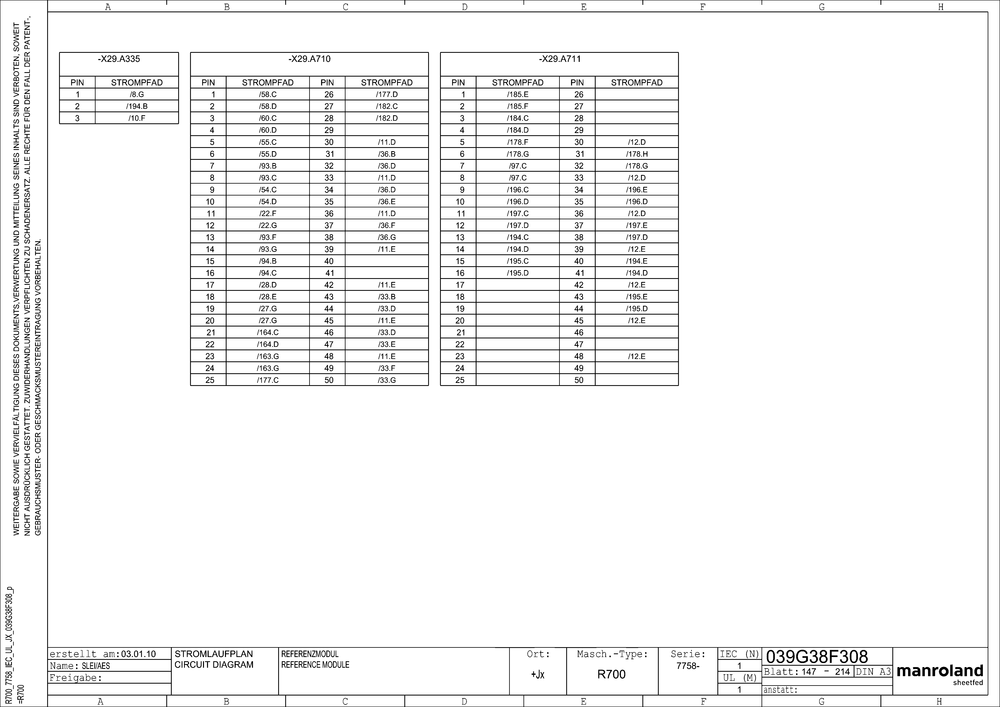

# +Jx — Sheet 147 of 214 — REFERENZMODUL

**REFERENCE MODULE**

> Part of the manroland **R700** printing press IEC/UL circuit diagrams.
> Drawing class: **Stromlaufplan / Circuit diagram** (DIN A3).
> Document `+Jx` covers the **1st printing module + feed register** machine section.

## At a glance

| Field | Value |
|---|---|
| Document | `+Jx`  (039G38F308) |
| Sheet | **147** of 214 |
| Section (DE) | REFERENZMODUL |
| Section (EN) | REFERENCE MODULE |
| Section type | REFERENCE_MODULE — Reference module |
| Machine type | `R700` |
| Series | `7758` |
| Created | 03.01.10 |
| Replaces | — |
| Columns used | A, B, C, D, E |
| Path numbers | — |
| Labels on sheet | 199 |
| Cross-refs out | 83 |
| Cross-refs in | 0 |

**Previous:** [+Jx sheet 146](SHEET_0146.md) · **Next:** [+Jx sheet 148](SHEET_0148.md) · **Document TOC:** [_TOC.md](_TOC.md)  (+Jx) · **Master TOC:** [all sheets](../_MASTER_TOC.md)

## Sheet image (300 DPI, exact vector render)



_Rendered directly from the PDF vector layer at 300 DPI (1-bit), no OCR and no resampling. Use it to confirm anything ambiguous in the text below._

## Cross-references on this sheet

Each entry is a wire leaving this sheet. The printed token is `/sheet.column`; the link resolves to that sheet inside the same document.

| Ref | Target sheet | Col | Path | Destination on target | Target section | From col |
|---|---|---|---|---|---|---|
| `/8.G` | [+Jx sheet 8](SHEET_0008.md) | G | — | — | SPANNUNGSVERSORGUNG, SCHALTSCHRANKBELÜFTUNG | A |
| `/185.E` | [+Jx sheet 185](SHEET_0185.md) | E | — | — | OPTION: TRANSFERMODUL 1 + 2 | D |
| `/58.C` | [+Jx sheet 58](SHEET_0058.md) | C | — | — | SCHUTZEINRICHTUNGEN | B |
| `/177.D` | [+Jx sheet 177](SHEET_0177.md) | D | — | — | SCHUTZEINRICHTUNGEN | C |
| `/194.B` | [+Jx sheet 194](SHEET_0194.md) | B | — | — | OPTION: ZWISCHENTROCKNER, VORBEREITUNG | A |
| `/185.F` | [+Jx sheet 185](SHEET_0185.md) | F | — | — | OPTION: TRANSFERMODUL 1 + 2 | D |
| `/58.D` | [+Jx sheet 58](SHEET_0058.md) | D | — | — | SCHUTZEINRICHTUNGEN | B |
| `/182.C` | [+Jx sheet 182](SHEET_0182.md) | C | — | — | OPTION: TRANSFERMODUL 2 | C |
| `/10.F` | [+Jx sheet 10](SHEET_0010.md) | F | — | — | SPANNUNGSVERSORGUNG, SCHALTSCHRANKBELÜFTUNG | A |
| `/60.C` | [+Jx sheet 60](SHEET_0060.md) | C | — | — | SCHUTZEINRICHTUNGEN | B |
| `/182.D` | [+Jx sheet 182](SHEET_0182.md) | D | — | — | OPTION: TRANSFERMODUL 2 | C |
| `/184.C` | [+Jx sheet 184](SHEET_0184.md) | C | — | — | OPTION: TRANSFERMODUL 1 + 2 | D |
| `/60.D` | [+Jx sheet 60](SHEET_0060.md) | D | — | — | SCHUTZEINRICHTUNGEN | B |
| `/184.D` | [+Jx sheet 184](SHEET_0184.md) | D | — | — | OPTION: TRANSFERMODUL 1 + 2 | D |
| `/178.F` | [+Jx sheet 178](SHEET_0178.md) | F | — | — | OPTION: TRANSFERMODUL 1 NACH | D |
| `/55.C` | [+Jx sheet 55](SHEET_0055.md) | C | — | — | SCHUTZEINRICHTUNGEN | B |
| `/11.D` | [+Jx sheet 11](SHEET_0011.md) | D | — | — | SPANNUNGSVERSORGUNG, SCHALTSCHRANKBELÜFTUNG | C |
| `/12.D` | [+Jx sheet 12](SHEET_0012.md) | D | — | — | SPANNUNGSVERSORGUNG, SCHALTSCHRANKBELÜFTUNG | E |
| `/36.B` | [+Jx sheet 36](SHEET_0036.md) | B | — | — | STOP SICHERN | C |
| `/178.G` | [+Jx sheet 178](SHEET_0178.md) | G | — | — | OPTION: TRANSFERMODUL 1 NACH | D |
| `/55.D` | [+Jx sheet 55](SHEET_0055.md) | D | — | — | SCHUTZEINRICHTUNGEN | B |
| `/178.H` | [+Jx sheet 178](SHEET_0178.md) | H | — | — | OPTION: TRANSFERMODUL 1 NACH | E |
| `/93.B` | [+Jx sheet 93](SHEET_0093.md) | B | — | — | RESERVE | B |
| `/36.D` | [+Jx sheet 36](SHEET_0036.md) | D | — | — | STOP SICHERN | C |
| `/97.C` | [+Jx sheet 97](SHEET_0097.md) | C | — | — | RESERVE | D |
| `/178.G` | [+Jx sheet 178](SHEET_0178.md) | G | — | — | OPTION: TRANSFERMODUL 1 NACH | E |
| `/93.C` | [+Jx sheet 93](SHEET_0093.md) | C | — | — | RESERVE | B |
| `/11.D` | [+Jx sheet 11](SHEET_0011.md) | D | — | — | SPANNUNGSVERSORGUNG, SCHALTSCHRANKBELÜFTUNG | C |
| `/97.C` | [+Jx sheet 97](SHEET_0097.md) | C | — | — | RESERVE | D |
| `/12.D` | [+Jx sheet 12](SHEET_0012.md) | D | — | — | SPANNUNGSVERSORGUNG, SCHALTSCHRANKBELÜFTUNG | E |
| `/196.E` | [+Jx sheet 196](SHEET_0196.md) | E | — | — | OPTION: ZWISCHENTROCKNER, VORBEREITUNG | E |
| `/54.C` | [+Jx sheet 54](SHEET_0054.md) | C | — | — | SCHUTZEINRICHTUNGEN | B |
| `/36.D` | [+Jx sheet 36](SHEET_0036.md) | D | — | — | STOP SICHERN | C |
| `/196.C` | [+Jx sheet 196](SHEET_0196.md) | C | — | — | OPTION: ZWISCHENTROCKNER, VORBEREITUNG | D |
| `/36.E` | [+Jx sheet 36](SHEET_0036.md) | E | — | — | STOP SICHERN | C |
| `/54.D` | [+Jx sheet 54](SHEET_0054.md) | D | — | — | SCHUTZEINRICHTUNGEN | B |
| `/196.D` | [+Jx sheet 196](SHEET_0196.md) | D | — | — | OPTION: ZWISCHENTROCKNER, VORBEREITUNG | D |
| `/196.D` | [+Jx sheet 196](SHEET_0196.md) | D | — | — | OPTION: ZWISCHENTROCKNER, VORBEREITUNG | E |
| `/22.F` | [+Jx sheet 22](SHEET_0022.md) | F | — | — | LACKPUMPE | B |
| `/11.D` | [+Jx sheet 11](SHEET_0011.md) | D | — | — | SPANNUNGSVERSORGUNG, SCHALTSCHRANKBELÜFTUNG | C |
| `/12.D` | [+Jx sheet 12](SHEET_0012.md) | D | — | — | SPANNUNGSVERSORGUNG, SCHALTSCHRANKBELÜFTUNG | E |
| `/197.C` | [+Jx sheet 197](SHEET_0197.md) | C | — | — | OPTION: ZWISCHENTROCKNER, VORBEREITUNG | D |
| `/36.F` | [+Jx sheet 36](SHEET_0036.md) | F | — | — | STOP SICHERN | C |
| `/22.G` | [+Jx sheet 22](SHEET_0022.md) | G | — | — | LACKPUMPE | B |
| `/197.E` | [+Jx sheet 197](SHEET_0197.md) | E | — | — | OPTION: ZWISCHENTROCKNER, VORBEREITUNG | E |
| `/197.D` | [+Jx sheet 197](SHEET_0197.md) | D | — | — | OPTION: ZWISCHENTROCKNER, VORBEREITUNG | D |
| `/93.F` | [+Jx sheet 93](SHEET_0093.md) | F | — | — | RESERVE | B |
| `/36.G` | [+Jx sheet 36](SHEET_0036.md) | G | — | — | STOP SICHERN | C |
| `/194.C` | [+Jx sheet 194](SHEET_0194.md) | C | — | — | OPTION: ZWISCHENTROCKNER, VORBEREITUNG | D |
| `/197.D` | [+Jx sheet 197](SHEET_0197.md) | D | — | — | OPTION: ZWISCHENTROCKNER, VORBEREITUNG | E |
| `/11.E` | [+Jx sheet 11](SHEET_0011.md) | E | — | — | SPANNUNGSVERSORGUNG, SCHALTSCHRANKBELÜFTUNG | C |
| `/12.E` | [+Jx sheet 12](SHEET_0012.md) | E | — | — | SPANNUNGSVERSORGUNG, SCHALTSCHRANKBELÜFTUNG | E |
| `/93.G` | [+Jx sheet 93](SHEET_0093.md) | G | — | — | RESERVE | B |
| `/194.D` | [+Jx sheet 194](SHEET_0194.md) | D | — | — | OPTION: ZWISCHENTROCKNER, VORBEREITUNG | D |
| `/94.B` | [+Jx sheet 94](SHEET_0094.md) | B | — | — | RESERVE | B |
| `/194.E` | [+Jx sheet 194](SHEET_0194.md) | E | — | — | OPTION: ZWISCHENTROCKNER, VORBEREITUNG | E |
| `/195.C` | [+Jx sheet 195](SHEET_0195.md) | C | — | — | OPTION: ZWISCHENTROCKNER, VORBEREITUNG | D |
| `/94.C` | [+Jx sheet 94](SHEET_0094.md) | C | — | — | RESERVE | B |
| `/195.D` | [+Jx sheet 195](SHEET_0195.md) | D | — | — | OPTION: ZWISCHENTROCKNER, VORBEREITUNG | D |
| `/194.D` | [+Jx sheet 194](SHEET_0194.md) | D | — | — | OPTION: ZWISCHENTROCKNER, VORBEREITUNG | E |
| `/11.E` | [+Jx sheet 11](SHEET_0011.md) | E | — | — | SPANNUNGSVERSORGUNG, SCHALTSCHRANKBELÜFTUNG | C |
| `/12.E` | [+Jx sheet 12](SHEET_0012.md) | E | — | — | SPANNUNGSVERSORGUNG, SCHALTSCHRANKBELÜFTUNG | E |
| `/28.D` | [+Jx sheet 28](SHEET_0028.md) | D | — | — | KAMMERRAKEL | B |
| `/28.E` | [+Jx sheet 28](SHEET_0028.md) | E | — | — | KAMMERRAKEL | B |
| `/33.B` | [+Jx sheet 33](SHEET_0033.md) | B | — | — | NOT AUS | C |
| `/195.E` | [+Jx sheet 195](SHEET_0195.md) | E | — | — | OPTION: ZWISCHENTROCKNER, VORBEREITUNG | E |
| `/27.G` | [+Jx sheet 27](SHEET_0027.md) | G | — | — | KAMMERRAKEL | B |
| `/33.D` | [+Jx sheet 33](SHEET_0033.md) | D | — | — | NOT AUS | C |
| `/195.D` | [+Jx sheet 195](SHEET_0195.md) | D | — | — | OPTION: ZWISCHENTROCKNER, VORBEREITUNG | E |
| `/11.E` | [+Jx sheet 11](SHEET_0011.md) | E | — | — | SPANNUNGSVERSORGUNG, SCHALTSCHRANKBELÜFTUNG | C |
| `/12.E` | [+Jx sheet 12](SHEET_0012.md) | E | — | — | SPANNUNGSVERSORGUNG, SCHALTSCHRANKBELÜFTUNG | E |
| `/27.G` | [+Jx sheet 27](SHEET_0027.md) | G | — | — | KAMMERRAKEL | B |
| `/164.C` | [+Jx sheet 164](SHEET_0164.md) | C | — | — | OPTION: | B |
| `/33.D` | [+Jx sheet 33](SHEET_0033.md) | D | — | — | NOT AUS | C |
| `/33.E` | [+Jx sheet 33](SHEET_0033.md) | E | — | — | NOT AUS | C |
| `/164.D` | [+Jx sheet 164](SHEET_0164.md) | D | — | — | OPTION: | B |
| `/11.E` | [+Jx sheet 11](SHEET_0011.md) | E | — | — | SPANNUNGSVERSORGUNG, SCHALTSCHRANKBELÜFTUNG | C |
| `/12.E` | [+Jx sheet 12](SHEET_0012.md) | E | — | — | SPANNUNGSVERSORGUNG, SCHALTSCHRANKBELÜFTUNG | E |
| `/163.G` | [+Jx sheet 163](SHEET_0163.md) | G | — | — | OPTION: | B |
| `/33.F` | [+Jx sheet 33](SHEET_0033.md) | F | — | — | NOT AUS | C |
| `/163.G` | [+Jx sheet 163](SHEET_0163.md) | G | — | — | OPTION: | B |
| `/33.G` | [+Jx sheet 33](SHEET_0033.md) | G | — | — | NOT AUS | C |
| `/177.C` | [+Jx sheet 177](SHEET_0177.md) | C | — | — | SCHUTZEINRICHTUNGEN | B |

## Devices on this sheet

| Tag | Class | Class meaning (IEC) | Col | Sub | Terminal | Sign |
|---|---|---|---|---|---|---|
| `X29.A335` | — | cross-device reference | A | — | — | — |
| `X29.A711` | — | cross-device reference | E | — | — | — |
| `X29.A710` | — | cross-device reference | C | — | — | — |

## Potentials / nets

_No named potentials on this sheet._

## Wire-end annotations (grouped as printed)

A wire that continues elsewhere is annotated with a small cluster: the destination description, the path/line number `#NN`, and the `/sheet.column` cross reference. Each row below is one such cluster exactly as it is grouped on the drawing.

| Col | Y | Path | Cross-ref | Text on the wire |
|---|---|---|---|---|
| A | 65.4 | — | — | `X29.A335` |
| C | 65.4 | — | — | `X29.A710` |
| E | 65.4 | — | — | `X29.A711` |
| A | 94.1 | — | — | `PIN 2 3 1 STROMPFAD` |
| B | 94.1 | — | — | `PIN STROMPFAD` |
| C | 94.1 | — | — | `PIN STROMPFAD` |
| D | 94.1 | — | — | `PIN STROMPFAD` |
| E | 94.1 | — | — | `PIN STROMPFAD` |
| B | 108.3 | — | — | `2 3 4 5 6 7 8 9 1` |
| C | 108.3 | — | — | `26 27 28 29 30 32 33 34 35 36 37 38 39 40 42 43 44 45 46 47 48 49 50 31 41` |
| D | 108.3 | — | — | `2 3 4 5 6 7 8 9 1` |
| E | 108.3 | — | — | `26 27 28 29 30 32 33 34 35 36 37 38 39 40 42 43 44 45 46 47 48 49 50 31 41` |
| A | 108.6 | — | `/8.G` | — |
| D | 108.6 | — | `/185.E` | — |
| B | 108.7 | — | `/58.C` | — |
| C | 108.7 | — | `/177.D` | — |
| A | 122.8 | — | `/194.B` | — |
| B | 122.8 | — | `/58.D` | — |
| C | 122.8 | — | `/182.C` | — |
| D | 122.8 | — | `/185.F` | — |
| A | 137.0 | — | `/10.F` | — |
| B | 137.0 | — | `/60.C` | — |
| C | 137.0 | — | `/182.D` | — |
| D | 137.0 | — | `/184.C` | — |
| B | 151.2 | — | `/60.D` | — |
| D | 151.2 | — | `/184.D` | — |
| B | 165.3 | — | `/55.C` | — |
| C | 165.3 | — | `/11.D` | — |
| D | 165.3 | — | `/178.F` | — |
| E | 165.3 | — | `/12.D` | — |
| B | 179.5 | — | `/55.D` | — |
| C | 179.5 | — | `/36.B` | — |
| D | 179.5 | — | `/178.G` | — |
| E | 179.5 | — | `/178.H` | — |
| B | 193.7 | — | `/93.B` | — |
| C | 193.7 | — | `/36.D` | — |
| D | 193.7 | — | `/97.C` | — |
| E | 193.7 | — | `/178.G` | — |
| B | 207.9 | — | `/93.C` | — |
| C | 207.9 | — | `/11.D` | — |
| D | 207.9 | — | `/97.C` | — |
| E | 207.9 | — | `/12.D` | — |
| B | 222.0 | — | `/54.C` | — |
| C | 222.0 | — | `/36.D` | — |
| D | 222.0 | — | `/196.C` | — |
| E | 222.0 | — | `/196.E` | — |
| B | 235.9 | — | — | `10 12 13 14 15 16 17 18 19 20 11` |
| D | 235.9 | — | — | `10 12 13 14 15 16 17 18 19 20 11` |
| B | 236.2 | — | `/54.D` | — |
| C | 236.2 | — | `/36.E` | — |
| D | 236.2 | — | `/196.D` | — |
| E | 236.2 | — | `/196.D` | — |
| B | 250.4 | — | `/22.F` | — |
| C | 250.4 | — | `/11.D` | — |
| D | 250.4 | — | `/197.C` | — |
| E | 250.4 | — | `/12.D` | — |
| B | 264.5 | — | `/22.G` | — |
| C | 264.5 | — | `/36.F` | — |
| E | 264.5 | — | `/197.E` | — |
| D | 264.6 | — | `/197.D` | — |
| B | 278.7 | — | `/93.F` | — |
| C | 278.7 | — | `/36.G` | — |
| D | 278.7 | — | `/194.C` | — |
| E | 278.7 | — | `/197.D` | — |
| B | 292.9 | — | `/93.G` | — |
| C | 292.9 | — | `/11.E` | — |
| D | 292.9 | — | `/194.D` | — |
| E | 292.9 | — | `/12.E` | — |
| B | 307.0 | — | `/94.B` | — |
| D | 307.1 | — | `/195.C` | — |
| E | 307.1 | — | `/194.E` | — |
| B | 321.2 | — | `/94.C` | — |
| D | 321.3 | — | `/195.D` | — |
| E | 321.3 | — | `/194.D` | — |
| B | 335.4 | — | `/28.D` | — |
| C | 335.4 | — | `/11.E` | — |
| E | 335.4 | — | `/12.E` | — |
| B | 349.6 | — | `/28.E` | — |
| C | 349.6 | — | `/33.B` | — |
| E | 349.6 | — | `/195.E` | — |
| B | 363.8 | — | `/27.G` | — |
| C | 363.8 | — | `/33.D` | — |
| E | 363.8 | — | `/195.D` | — |
| B | 377.9 | — | `/27.G` | — |
| C | 377.9 | — | `/11.E` | — |
| E | 377.9 | — | `/12.E` | — |
| B | 391.8 | — | — | `22 23 24 25 21` |
| D | 391.8 | — | — | `22 23 24 25 21` |
| B | 392.1 | — | `/164.C` | — |
| C | 392.1 | — | `/33.D` | — |
| C | 406.2 | — | `/33.E` | — |
| B | 406.3 | — | `/164.D` | — |
| C | 420.4 | — | `/11.E` | — |
| E | 420.4 | — | `/12.E` | — |
| B | 420.5 | — | `/163.G` | — |
| B | 434.6 | — | `/163.G` | — |
| C | 434.6 | — | `/33.F` | — |
| B | 448.8 | — | `/177.C` | — |
| C | 448.8 | — | `/33.G` | — |


## Reconstructed tables

This sheet carries tabular content (pin map / terminal assignment / index). The grid below was rebuilt from the drawing's own rule lines, so each row is exactly one physical row of the table.

### Table 1 — 3 data rows × 2 columns (at x=70.9, y=62.4) — **X29.A335**

| PIN | STROMPFAD |
|---|---|
| `1` | `/8.G` |
| `2` | `/194.B` |
| `3` | `/10.F` |


### Table 2 — 25 data rows × 4 columns (at x=226.8, y=62.4) — **X29.A710**

| PIN | STROMPFAD | PIN | STROMPFAD |
|---|---|---|---|
| `1` | `/58.C` | `26` | `/177.D` |
| `2` | `/58.D` | `27` | `/182.C` |
| `3` | `/60.C` | `28` | `/182.D` |
| `4` | `/60.D` | `29` |  |
| `5` | `/55.C` | `30` | `/11.D` |
| `6` | `/55.D` | `31` | `/36.B` |
| `7` | `/93.B` | `32` | `/36.D` |
| `8` | `/93.C` | `33` | `/11.D` |
| `9` | `/54.C` | `34` | `/36.D` |
| `10` | `/54.D` | `35` | `/36.E` |
| `11` | `/22.F` | `36` | `/11.D` |
| `12` | `/22.G` | `37` | `/36.F` |
| `13` | `/93.F` | `38` | `/36.G` |
| `14` | `/93.G` | `39` | `/11.E` |
| `15` | `/94.B` | `40` |  |
| `16` | `/94.C` | `41` |  |
| `17` | `/28.D` | `42` | `/11.E` |
| `18` | `/28.E` | `43` | `/33.B` |
| `19` | `/27.G` | `44` | `/33.D` |
| `20` | `/27.G` | `45` | `/11.E` |
| `21` | `/164.C` | `46` | `/33.D` |
| `22` | `/164.D` | `47` | `/33.E` |
| `23` | `/163.G` | `48` | `/11.E` |
| `24` | `/163.G` | `49` | `/33.F` |
| `25` | `/177.C` | `50` | `/33.G` |


### Table 3 — 25 data rows × 4 columns (at x=524.4, y=62.4) — **X29.A711**

| PIN | STROMPFAD | PIN | STROMPFAD |
|---|---|---|---|
| `1` | `/185.E` | `26` |  |
| `2` | `/185.F` | `27` |  |
| `3` | `/184.C` | `28` |  |
| `4` | `/184.D` | `29` |  |
| `5` | `/178.F` | `30` | `/12.D` |
| `6` | `/178.G` | `31` | `/178.H` |
| `7` | `/97.C` | `32` | `/178.G` |
| `8` | `/97.C` | `33` | `/12.D` |
| `9` | `/196.C` | `34` | `/196.E` |
| `10` | `/196.D` | `35` | `/196.D` |
| `11` | `/197.C` | `36` | `/12.D` |
| `12` | `/197.D` | `37` | `/197.E` |
| `13` | `/194.C` | `38` | `/197.D` |
| `14` | `/194.D` | `39` | `/12.E` |
| `15` | `/195.C` | `40` | `/194.E` |
| `16` | `/195.D` | `41` | `/194.D` |
| `17` |  | `42` | `/12.E` |
| `18` |  | `43` | `/195.E` |
| `19` |  | `44` | `/195.D` |
| `20` |  | `45` | `/12.E` |
| `21` |  | `46` |  |
| `22` |  | `47` |  |
| `23` |  | `48` | `/12.E` |
| `24` |  | `49` |  |
| `25` |  | `50` |  |


## Notes and free text on this sheet

| Text | Col | Y (pt) |
|---|---|---|
| `PIN` | A | 94.13 |
| `STROMPFAD` | A | 94.09 |
| `PIN` | D | 94.13 |
| `STROMPFAD` | D | 94.09 |
| `PIN` | E | 94.13 |
| `STROMPFAD` | E | 94.09 |
| `PIN` | B | 94.13 |
| `STROMPFAD` | B | 94.09 |
| `PIN` | C | 94.13 |
| `STROMPFAD` | C | 94.09 |

## Complete label inventory (exact text from the drawing)

Every text object inside the drawing area of this sheet, in DIN reading order (column A→H, then top→bottom). This is the authoritative list: if a string is not here it is not printed on this sheet.

| Col | Y | X | Dir | Type | Text |
|---|---|---|---|---|---|
| A | 65.4 | 116.6 | → | device ref | `X29.A335` |
| A | 94.1 | 84.0 | → | text | `PIN` |
| A | 94.1 | 132.4 | → | text | `STROMPFAD` |
| A | 108.3 | 89.9 | → | number | `1` |
| A | 108.6 | 154.8 | → | cross-reference | `/8.G` |
| A | 122.5 | 89.4 | → | number | `2` |
| A | 122.8 | 150.4 | → | cross-reference | `/194.B` |
| A | 136.7 | 89.4 | → | number | `3` |
| A | 137.0 | 153.1 | → | cross-reference | `/10.F` |
| B | 94.1 | 240.0 | → | text | `PIN` |
| B | 94.1 | 288.3 | → | text | `STROMPFAD` |
| B | 108.3 | 251.4 | → | number | `1` |
| B | 108.7 | 308.6 | → | cross-reference | `/58.C` |
| B | 122.5 | 250.0 | → | number | `2` |
| B | 122.8 | 308.6 | → | cross-reference | `/58.D` |
| B | 136.7 | 250.0 | → | number | `3` |
| B | 137.0 | 308.6 | → | cross-reference | `/60.C` |
| B | 150.8 | 250.0 | → | number | `4` |
| B | 151.2 | 308.6 | → | cross-reference | `/60.D` |
| B | 165.0 | 250.0 | → | number | `5` |
| B | 165.3 | 308.6 | → | cross-reference | `/55.C` |
| B | 179.2 | 250.0 | → | number | `6` |
| B | 179.5 | 308.6 | → | cross-reference | `/55.D` |
| B | 193.3 | 250.0 | → | number | `7` |
| B | 193.7 | 308.7 | → | cross-reference | `/93.B` |
| B | 207.5 | 250.0 | → | number | `8` |
| B | 207.9 | 308.6 | → | cross-reference | `/93.C` |
| B | 221.7 | 250.0 | → | number | `9` |
| B | 222.0 | 308.6 | → | cross-reference | `/54.C` |
| B | 235.9 | 244.6 | → | number | `10` |
| B | 236.2 | 308.6 | → | cross-reference | `/54.D` |
| B | 250.0 | 246.0 | → | number | `11` |
| B | 250.4 | 309.0 | → | cross-reference | `/22.F` |
| B | 264.2 | 244.6 | → | number | `12` |
| B | 264.5 | 308.3 | → | cross-reference | `/22.G` |
| B | 278.4 | 244.6 | → | number | `13` |
| B | 278.7 | 309.0 | → | cross-reference | `/93.F` |
| B | 292.6 | 244.6 | → | number | `14` |
| B | 292.9 | 308.3 | → | cross-reference | `/93.G` |
| B | 306.7 | 244.6 | → | number | `15` |
| B | 307.0 | 308.7 | → | cross-reference | `/94.B` |
| B | 320.9 | 244.6 | → | number | `16` |
| B | 321.2 | 308.6 | → | cross-reference | `/94.C` |
| B | 335.1 | 244.6 | → | number | `17` |
| B | 335.4 | 308.6 | → | cross-reference | `/28.D` |
| B | 349.3 | 244.6 | → | number | `18` |
| B | 349.6 | 308.7 | → | cross-reference | `/28.E` |
| B | 363.4 | 244.6 | → | number | `19` |
| B | 363.8 | 308.3 | → | cross-reference | `/27.G` |
| B | 377.6 | 244.6 | → | number | `20` |
| B | 377.9 | 308.3 | → | cross-reference | `/27.G` |
| B | 391.8 | 246.0 | → | number | `21` |
| B | 392.1 | 306.1 | → | cross-reference | `/164.C` |
| B | 405.9 | 244.6 | → | number | `22` |
| B | 406.3 | 306.1 | → | cross-reference | `/164.D` |
| B | 420.1 | 244.6 | → | number | `23` |
| B | 420.5 | 305.9 | → | cross-reference | `/163.G` |
| B | 434.3 | 244.6 | → | number | `24` |
| B | 434.6 | 305.9 | → | cross-reference | `/163.G` |
| B | 448.5 | 244.6 | → | number | `25` |
| B | 448.8 | 306.1 | → | cross-reference | `/177.C` |
| C | 65.4 | 343.6 | → | device ref | `X29.A710` |
| C | 94.1 | 381.7 | → | text | `PIN` |
| C | 94.1 | 430.0 | → | text | `STROMPFAD` |
| C | 108.3 | 386.4 | → | number | `26` |
| C | 108.7 | 447.9 | → | cross-reference | `/177.D` |
| C | 122.5 | 386.4 | → | number | `27` |
| C | 122.8 | 447.9 | → | cross-reference | `/182.C` |
| C | 136.7 | 386.4 | → | number | `28` |
| C | 137.0 | 447.9 | → | cross-reference | `/182.D` |
| C | 150.8 | 386.4 | → | number | `29` |
| C | 165.0 | 386.4 | → | number | `30` |
| C | 165.3 | 450.3 | → | cross-reference | `/11.D` |
| C | 179.2 | 387.8 | → | number | `31` |
| C | 179.5 | 450.4 | → | cross-reference | `/36.B` |
| C | 193.3 | 386.4 | → | number | `32` |
| C | 193.7 | 450.3 | → | cross-reference | `/36.D` |
| C | 207.5 | 386.4 | → | number | `33` |
| C | 207.9 | 450.3 | → | cross-reference | `/11.D` |
| C | 221.7 | 386.4 | → | number | `34` |
| C | 222.0 | 450.3 | → | cross-reference | `/36.D` |
| C | 235.9 | 386.4 | → | number | `35` |
| C | 236.2 | 450.4 | → | cross-reference | `/36.E` |
| C | 250.0 | 386.4 | → | number | `36` |
| C | 250.4 | 450.3 | → | cross-reference | `/11.D` |
| C | 264.2 | 386.4 | → | number | `37` |
| C | 264.5 | 450.7 | → | cross-reference | `/36.F` |
| C | 278.4 | 386.4 | → | number | `38` |
| C | 278.7 | 450.0 | → | cross-reference | `/36.G` |
| C | 292.6 | 386.4 | → | number | `39` |
| C | 292.9 | 450.4 | → | cross-reference | `/11.E` |
| C | 306.7 | 386.4 | → | number | `40` |
| C | 320.9 | 387.8 | → | number | `41` |
| C | 335.1 | 386.4 | → | number | `42` |
| C | 335.4 | 450.4 | → | cross-reference | `/11.E` |
| C | 349.3 | 386.4 | → | number | `43` |
| C | 349.6 | 450.4 | → | cross-reference | `/33.B` |
| C | 363.4 | 386.4 | → | number | `44` |
| C | 363.8 | 450.3 | → | cross-reference | `/33.D` |
| C | 377.6 | 386.4 | → | number | `45` |
| C | 377.9 | 450.4 | → | cross-reference | `/11.E` |
| C | 391.8 | 386.4 | → | number | `46` |
| C | 392.1 | 450.3 | → | cross-reference | `/33.D` |
| C | 405.9 | 386.4 | → | number | `47` |
| C | 406.3 | 450.4 | → | cross-reference | `/33.E` |
| C | 420.1 | 386.4 | → | number | `48` |
| C | 420.4 | 450.4 | → | cross-reference | `/11.E` |
| C | 434.3 | 386.4 | → | number | `49` |
| C | 434.6 | 450.7 | → | cross-reference | `/33.F` |
| C | 448.5 | 386.4 | → | number | `50` |
| C | 448.8 | 450.0 | → | cross-reference | `/33.G` |
| D | 94.1 | 537.6 | → | text | `PIN` |
| D | 94.1 | 585.9 | → | text | `STROMPFAD` |
| D | 108.3 | 549.1 | → | number | `1` |
| D | 108.6 | 603.9 | → | cross-reference | `/185.E` |
| D | 122.5 | 547.7 | → | number | `2` |
| D | 122.8 | 604.2 | → | cross-reference | `/185.F` |
| D | 136.7 | 547.7 | → | number | `3` |
| D | 137.0 | 603.8 | → | cross-reference | `/184.C` |
| D | 150.8 | 547.7 | → | number | `4` |
| D | 151.2 | 603.8 | → | cross-reference | `/184.D` |
| D | 165.0 | 547.7 | → | number | `5` |
| D | 165.3 | 604.2 | → | cross-reference | `/178.F` |
| D | 179.2 | 547.7 | → | number | `6` |
| D | 179.5 | 603.5 | → | cross-reference | `/178.G` |
| D | 193.3 | 547.7 | → | number | `7` |
| D | 193.7 | 606.2 | → | cross-reference | `/97.C` |
| D | 207.5 | 547.7 | → | number | `8` |
| D | 207.9 | 606.2 | → | cross-reference | `/97.C` |
| D | 221.7 | 547.7 | → | number | `9` |
| D | 222.0 | 603.8 | → | cross-reference | `/196.C` |
| D | 235.9 | 542.3 | → | number | `10` |
| D | 236.2 | 603.8 | → | cross-reference | `/196.D` |
| D | 250.0 | 543.7 | → | number | `11` |
| D | 250.4 | 603.8 | → | cross-reference | `/197.C` |
| D | 264.2 | 542.3 | → | number | `12` |
| D | 264.6 | 603.8 | → | cross-reference | `/197.D` |
| D | 278.4 | 542.3 | → | number | `13` |
| D | 278.7 | 603.8 | → | cross-reference | `/194.C` |
| D | 292.6 | 542.3 | → | number | `14` |
| D | 292.9 | 603.8 | → | cross-reference | `/194.D` |
| D | 306.7 | 542.3 | → | number | `15` |
| D | 307.1 | 603.8 | → | cross-reference | `/195.C` |
| D | 320.9 | 542.3 | → | number | `16` |
| D | 321.3 | 603.8 | → | cross-reference | `/195.D` |
| D | 335.1 | 542.3 | → | number | `17` |
| D | 349.3 | 542.3 | → | number | `18` |
| D | 363.4 | 542.3 | → | number | `19` |
| D | 377.6 | 542.3 | → | number | `20` |
| D | 391.8 | 543.7 | → | number | `21` |
| D | 405.9 | 542.3 | → | number | `22` |
| D | 420.1 | 542.3 | → | number | `23` |
| D | 434.3 | 542.3 | → | number | `24` |
| D | 448.5 | 542.3 | → | number | `25` |
| E | 65.4 | 641.9 | → | device ref | `X29.A711` |
| E | 94.1 | 679.3 | → | text | `PIN` |
| E | 94.1 | 727.7 | → | text | `STROMPFAD` |
| E | 108.3 | 684.0 | → | number | `26` |
| E | 122.5 | 684.0 | → | number | `27` |
| E | 136.7 | 684.0 | → | number | `28` |
| E | 150.8 | 684.0 | → | number | `29` |
| E | 165.0 | 684.0 | → | number | `30` |
| E | 165.3 | 747.9 | → | cross-reference | `/12.D` |
| E | 179.2 | 685.4 | → | number | `31` |
| E | 179.5 | 745.7 | → | cross-reference | `/178.H` |
| E | 193.3 | 684.0 | → | number | `32` |
| E | 193.7 | 745.2 | → | cross-reference | `/178.G` |
| E | 207.5 | 684.0 | → | number | `33` |
| E | 207.9 | 747.9 | → | cross-reference | `/12.D` |
| E | 221.7 | 684.0 | → | number | `34` |
| E | 222.0 | 745.7 | → | cross-reference | `/196.E` |
| E | 235.9 | 684.0 | → | number | `35` |
| E | 236.2 | 745.5 | → | cross-reference | `/196.D` |
| E | 250.0 | 684.0 | → | number | `36` |
| E | 250.4 | 747.9 | → | cross-reference | `/12.D` |
| E | 264.2 | 684.0 | → | number | `37` |
| E | 264.5 | 745.7 | → | cross-reference | `/197.E` |
| E | 278.4 | 684.0 | → | number | `38` |
| E | 278.7 | 745.5 | → | cross-reference | `/197.D` |
| E | 292.6 | 684.0 | → | number | `39` |
| E | 292.9 | 748.1 | → | cross-reference | `/12.E` |
| E | 306.7 | 684.0 | → | number | `40` |
| E | 307.1 | 745.7 | → | cross-reference | `/194.E` |
| E | 320.9 | 685.4 | → | number | `41` |
| E | 321.3 | 745.5 | → | cross-reference | `/194.D` |
| E | 335.1 | 684.0 | → | number | `42` |
| E | 335.4 | 748.1 | → | cross-reference | `/12.E` |
| E | 349.3 | 684.0 | → | number | `43` |
| E | 349.6 | 745.7 | → | cross-reference | `/195.E` |
| E | 363.4 | 684.0 | → | number | `44` |
| E | 363.8 | 745.5 | → | cross-reference | `/195.D` |
| E | 377.6 | 684.0 | → | number | `45` |
| E | 377.9 | 748.1 | → | cross-reference | `/12.E` |
| E | 391.8 | 684.0 | → | number | `46` |
| E | 405.9 | 684.0 | → | number | `47` |
| E | 420.1 | 684.0 | → | number | `48` |
| E | 420.4 | 748.1 | → | cross-reference | `/12.E` |
| E | 434.3 | 684.0 | → | number | `49` |
| E | 448.5 | 684.0 | → | number | `50` |

## Reading-order text block

The same content as a plain block, grouped by DIN column — convenient to paste or to match against a visual description.

```text
=== Column A ===
  65.4  116.6  devref       X29.A335
  94.1   84.0  text         PIN
  94.1  132.4  text         STROMPFAD
 108.3   89.9  numeric      1
 108.6  154.8  xref         /8.G
 122.5   89.4  numeric      2
 122.8  150.4  xref         /194.B
 136.7   89.4  numeric      3
 137.0  153.1  xref         /10.F
=== Column B ===
  94.1  240.0  text         PIN
  94.1  288.3  text         STROMPFAD
 108.3  251.4  numeric      1
 108.7  308.6  xref         /58.C
 122.5  250.0  numeric      2
 122.8  308.6  xref         /58.D
 136.7  250.0  numeric      3
 137.0  308.6  xref         /60.C
 150.8  250.0  numeric      4
 151.2  308.6  xref         /60.D
 165.0  250.0  numeric      5
 165.3  308.6  xref         /55.C
 179.2  250.0  numeric      6
 179.5  308.6  xref         /55.D
 193.3  250.0  numeric      7
 193.7  308.7  xref         /93.B
 207.5  250.0  numeric      8
 207.9  308.6  xref         /93.C
 221.7  250.0  numeric      9
 222.0  308.6  xref         /54.C
 235.9  244.6  numeric      10
 236.2  308.6  xref         /54.D
 250.0  246.0  numeric      11
 250.4  309.0  xref         /22.F
 264.2  244.6  numeric      12
 264.5  308.3  xref         /22.G
 278.4  244.6  numeric      13
 278.7  309.0  xref         /93.F
 292.6  244.6  numeric      14
 292.9  308.3  xref         /93.G
 306.7  244.6  numeric      15
 307.0  308.7  xref         /94.B
 320.9  244.6  numeric      16
 321.2  308.6  xref         /94.C
 335.1  244.6  numeric      17
 335.4  308.6  xref         /28.D
 349.3  244.6  numeric      18
 349.6  308.7  xref         /28.E
 363.4  244.6  numeric      19
 363.8  308.3  xref         /27.G
 377.6  244.6  numeric      20
 377.9  308.3  xref         /27.G
 391.8  246.0  numeric      21
 392.1  306.1  xref         /164.C
 405.9  244.6  numeric      22
 406.3  306.1  xref         /164.D
 420.1  244.6  numeric      23
 420.5  305.9  xref         /163.G
 434.3  244.6  numeric      24
 434.6  305.9  xref         /163.G
 448.5  244.6  numeric      25
 448.8  306.1  xref         /177.C
=== Column C ===
  65.4  343.6  devref       X29.A710
  94.1  381.7  text         PIN
  94.1  430.0  text         STROMPFAD
 108.3  386.4  numeric      26
 108.7  447.9  xref         /177.D
 122.5  386.4  numeric      27
 122.8  447.9  xref         /182.C
 136.7  386.4  numeric      28
 137.0  447.9  xref         /182.D
 150.8  386.4  numeric      29
 165.0  386.4  numeric      30
 165.3  450.3  xref         /11.D
 179.2  387.8  numeric      31
 179.5  450.4  xref         /36.B
 193.3  386.4  numeric      32
 193.7  450.3  xref         /36.D
 207.5  386.4  numeric      33
 207.9  450.3  xref         /11.D
 221.7  386.4  numeric      34
 222.0  450.3  xref         /36.D
 235.9  386.4  numeric      35
 236.2  450.4  xref         /36.E
 250.0  386.4  numeric      36
 250.4  450.3  xref         /11.D
 264.2  386.4  numeric      37
 264.5  450.7  xref         /36.F
 278.4  386.4  numeric      38
 278.7  450.0  xref         /36.G
 292.6  386.4  numeric      39
 292.9  450.4  xref         /11.E
 306.7  386.4  numeric      40
 320.9  387.8  numeric      41
 335.1  386.4  numeric      42
 335.4  450.4  xref         /11.E
 349.3  386.4  numeric      43
 349.6  450.4  xref         /33.B
 363.4  386.4  numeric      44
 363.8  450.3  xref         /33.D
 377.6  386.4  numeric      45
 377.9  450.4  xref         /11.E
 391.8  386.4  numeric      46
 392.1  450.3  xref         /33.D
 405.9  386.4  numeric      47
 406.3  450.4  xref         /33.E
 420.1  386.4  numeric      48
 420.4  450.4  xref         /11.E
 434.3  386.4  numeric      49
 434.6  450.7  xref         /33.F
 448.5  386.4  numeric      50
 448.8  450.0  xref         /33.G
=== Column D ===
  94.1  537.6  text         PIN
  94.1  585.9  text         STROMPFAD
 108.3  549.1  numeric      1
 108.6  603.9  xref         /185.E
 122.5  547.7  numeric      2
 122.8  604.2  xref         /185.F
 136.7  547.7  numeric      3
 137.0  603.8  xref         /184.C
 150.8  547.7  numeric      4
 151.2  603.8  xref         /184.D
 165.0  547.7  numeric      5
 165.3  604.2  xref         /178.F
 179.2  547.7  numeric      6
 179.5  603.5  xref         /178.G
 193.3  547.7  numeric      7
 193.7  606.2  xref         /97.C
 207.5  547.7  numeric      8
 207.9  606.2  xref         /97.C
 221.7  547.7  numeric      9
 222.0  603.8  xref         /196.C
 235.9  542.3  numeric      10
 236.2  603.8  xref         /196.D
 250.0  543.7  numeric      11
 250.4  603.8  xref         /197.C
 264.2  542.3  numeric      12
 264.6  603.8  xref         /197.D
 278.4  542.3  numeric      13
 278.7  603.8  xref         /194.C
 292.6  542.3  numeric      14
 292.9  603.8  xref         /194.D
 306.7  542.3  numeric      15
 307.1  603.8  xref         /195.C
 320.9  542.3  numeric      16
 321.3  603.8  xref         /195.D
 335.1  542.3  numeric      17
 349.3  542.3  numeric      18
 363.4  542.3  numeric      19
 377.6  542.3  numeric      20
 391.8  543.7  numeric      21
 405.9  542.3  numeric      22
 420.1  542.3  numeric      23
 434.3  542.3  numeric      24
 448.5  542.3  numeric      25
=== Column E ===
  65.4  641.9  devref       X29.A711
  94.1  679.3  text         PIN
  94.1  727.7  text         STROMPFAD
 108.3  684.0  numeric      26
 122.5  684.0  numeric      27
 136.7  684.0  numeric      28
 150.8  684.0  numeric      29
 165.0  684.0  numeric      30
 165.3  747.9  xref         /12.D
 179.2  685.4  numeric      31
 179.5  745.7  xref         /178.H
 193.3  684.0  numeric      32
 193.7  745.2  xref         /178.G
 207.5  684.0  numeric      33
 207.9  747.9  xref         /12.D
 221.7  684.0  numeric      34
 222.0  745.7  xref         /196.E
 235.9  684.0  numeric      35
 236.2  745.5  xref         /196.D
 250.0  684.0  numeric      36
 250.4  747.9  xref         /12.D
 264.2  684.0  numeric      37
 264.5  745.7  xref         /197.E
 278.4  684.0  numeric      38
 278.7  745.5  xref         /197.D
 292.6  684.0  numeric      39
 292.9  748.1  xref         /12.E
 306.7  684.0  numeric      40
 307.1  745.7  xref         /194.E
 320.9  685.4  numeric      41
 321.3  745.5  xref         /194.D
 335.1  684.0  numeric      42
 335.4  748.1  xref         /12.E
 349.3  684.0  numeric      43
 349.6  745.7  xref         /195.E
 363.4  684.0  numeric      44
 363.8  745.5  xref         /195.D
 377.6  684.0  numeric      45
 377.9  748.1  xref         /12.E
 391.8  684.0  numeric      46
 405.9  684.0  numeric      47
 420.1  684.0  numeric      48
 420.4  748.1  xref         /12.E
 434.3  684.0  numeric      49
 448.5  684.0  numeric      50
```

---
_Generated from the PDF vector text layer; no OCR. Source: `R700_7758_IEC_UL_JX_039G38F308_p`, sheet 147._
