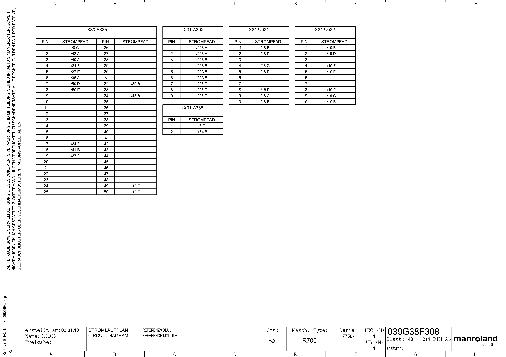

# +Jx — Sheet 148 of 214 — REFERENZMODUL

**REFERENCE MODULE**

> Part of the manroland **R700** printing press IEC/UL circuit diagrams.
> Drawing class: **Stromlaufplan / Circuit diagram** (DIN A3).
> Document `+Jx` covers the **1st printing module + feed register** machine section.

## At a glance

| Field | Value |
|---|---|
| Document | `+Jx`  (039G38F308) |
| Sheet | **148** of 214 |
| Section (DE) | REFERENZMODUL |
| Section (EN) | REFERENCE MODULE |
| Section type | REFERENCE_MODULE — Reference module |
| Machine type | `R700` |
| Series | `7758` |
| Created | 03.01.10 |
| Replaces | — |
| Columns used | A, B, C, D, E, F |
| Path numbers | — |
| Labels on sheet | 138 |
| Cross-refs out | 40 |
| Cross-refs in | 0 |

**Previous:** [+Jx sheet 147](SHEET_0147.md) · **Next:** [+Jx sheet 149](SHEET_0149.md) · **Document TOC:** [_TOC.md](_TOC.md)  (+Jx) · **Master TOC:** [all sheets](../_MASTER_TOC.md)

## Sheet image (300 DPI, exact vector render)



_Rendered directly from the PDF vector layer at 300 DPI (1-bit), no OCR and no resampling. Use it to confirm anything ambiguous in the text below._

## Cross-references on this sheet

Each entry is a wire leaving this sheet. The printed token is `/sheet.column`; the link resolves to that sheet inside the same document.

| Ref | Target sheet | Col | Path | Destination on target | Target section | From col |
|---|---|---|---|---|---|---|
| `/18.B` | [+Jx sheet 18](SHEET_0018.md) | B | — | — | LACKPUMPE | E |
| `/19.B` | [+Jx sheet 19](SHEET_0019.md) | B | — | — | LACKPUMPE | F |
| `/203.A` | [+Jx sheet 203](SHEET_0203.md) | A | — | — | OPTION: TELEPRESENCE | C |
| `/8.C` | [+Jx sheet 8](SHEET_0008.md) | C | — | — | SPANNUNGSVERSORGUNG, SCHALTSCHRANKBELÜFTUNG | A |
| `/42.A` | [+Jx sheet 42](SHEET_0042.md) | A | — | — | LAUFKOMMANDOS | A |
| `/203.A` | [+Jx sheet 203](SHEET_0203.md) | A | — | — | OPTION: TELEPRESENCE | C |
| `/18.D` | [+Jx sheet 18](SHEET_0018.md) | D | — | — | LACKPUMPE | E |
| `/19.D` | [+Jx sheet 19](SHEET_0019.md) | D | — | — | LACKPUMPE | F |
| `/40.A` | [+Jx sheet 40](SHEET_0040.md) | A | — | — | LAUFKOMMANDOS | A |
| `/203.B` | [+Jx sheet 203](SHEET_0203.md) | B | — | — | OPTION: TELEPRESENCE | C |
| `/34.F` | [+Jx sheet 34](SHEET_0034.md) | F | — | — | NOT AUS | A |
| `/203.B` | [+Jx sheet 203](SHEET_0203.md) | B | — | — | OPTION: TELEPRESENCE | C |
| `/19.F` | [+Jx sheet 19](SHEET_0019.md) | F | — | — | LACKPUMPE | F |
| `/18.G` | [+Jx sheet 18](SHEET_0018.md) | G | — | — | LACKPUMPE | E |
| `/37.E` | [+Jx sheet 37](SHEET_0037.md) | E | — | — | STOP SICHERN | A |
| `/19.E` | [+Jx sheet 19](SHEET_0019.md) | E | — | — | LACKPUMPE | F |
| `/203.B` | [+Jx sheet 203](SHEET_0203.md) | B | — | — | OPTION: TELEPRESENCE | C |
| `/18.D` | [+Jx sheet 18](SHEET_0018.md) | D | — | — | LACKPUMPE | E |
| `/38.A` | [+Jx sheet 38](SHEET_0038.md) | A | — | — | LAUFKOMMANDOS | A |
| `/203.B` | [+Jx sheet 203](SHEET_0203.md) | B | — | — | OPTION: TELEPRESENCE | C |
| `/39.B` | [+Jx sheet 39](SHEET_0039.md) | B | — | — | LAUFKOMMANDOS | B |
| `/50.D` | [+Jx sheet 50](SHEET_0050.md) | D | — | — | SIGNALGEBER: AKUSTISCHE WARNSIGNALE | A |
| `/203.C` | [+Jx sheet 203](SHEET_0203.md) | C | — | — | OPTION: TELEPRESENCE | C |
| `/50.E` | [+Jx sheet 50](SHEET_0050.md) | E | — | — | SIGNALGEBER: AKUSTISCHE WARNSIGNALE | A |
| `/18.F` | [+Jx sheet 18](SHEET_0018.md) | F | — | — | LACKPUMPE | E |
| `/19.F` | [+Jx sheet 19](SHEET_0019.md) | F | — | — | LACKPUMPE | F |
| `/203.C` | [+Jx sheet 203](SHEET_0203.md) | C | — | — | OPTION: TELEPRESENCE | C |
| `/43.B` | [+Jx sheet 43](SHEET_0043.md) | B | — | — | LAUFKOMMANDOS | B |
| `/203.C` | [+Jx sheet 203](SHEET_0203.md) | C | — | — | OPTION: TELEPRESENCE | C |
| `/18.C` | [+Jx sheet 18](SHEET_0018.md) | C | — | — | LACKPUMPE | E |
| `/19.C` | [+Jx sheet 19](SHEET_0019.md) | C | — | — | LACKPUMPE | F |
| `/18.B` | [+Jx sheet 18](SHEET_0018.md) | B | — | — | LACKPUMPE | E |
| `/19.B` | [+Jx sheet 19](SHEET_0019.md) | B | — | — | LACKPUMPE | F |
| `/8.C` | [+Jx sheet 8](SHEET_0008.md) | C | — | — | SPANNUNGSVERSORGUNG, SCHALTSCHRANKBELÜFTUNG | C |
| `/164.B` | [+Jx sheet 164](SHEET_0164.md) | B | — | — | OPTION: | C |
| `/34.F` | [+Jx sheet 34](SHEET_0034.md) | F | — | — | NOT AUS | A |
| `/41.B` | [+Jx sheet 41](SHEET_0041.md) | B | — | — | LAUFKOMMANDOS | A |
| `/37.F` | [+Jx sheet 37](SHEET_0037.md) | F | — | — | STOP SICHERN | A |
| `/10.F` | [+Jx sheet 10](SHEET_0010.md) | F | — | — | SPANNUNGSVERSORGUNG, SCHALTSCHRANKBELÜFTUNG | B |
| `/10.F` | [+Jx sheet 10](SHEET_0010.md) | F | — | — | SPANNUNGSVERSORGUNG, SCHALTSCHRANKBELÜFTUNG | B |

## Devices on this sheet

| Tag | Class | Class meaning (IEC) | Col | Sub | Terminal | Sign |
|---|---|---|---|---|---|---|
| `X30.A335` | — | cross-device reference | B | — | — | — |
| `X31.A302` | — | cross-device reference | C | — | — | — |
| `X31.A335` | — | cross-device reference | C | — | — | — |
| `X31.U021` | — | cross-device reference | D | — | — | — |
| `X31.U022` | — | cross-device reference | E | — | — | — |

## Potentials / nets

_No named potentials on this sheet._

## Wire-end annotations (grouped as printed)

A wire that continues elsewhere is annotated with a small cluster: the destination description, the path/line number `#NN`, and the `/sheet.column` cross reference. Each row below is one such cluster exactly as it is grouped on the drawing.

| Col | Y | Path | Cross-ref | Text on the wire |
|---|---|---|---|---|
| B | 65.4 | — | — | `X30.A335` |
| C | 65.4 | — | — | `X31.A302` |
| D | 65.4 | — | — | `X31.U021` |
| E | 65.4 | — | — | `X31.U022` |
| A | 94.1 | — | — | `PIN STROMPFAD` |
| B | 94.1 | — | — | `PIN STROMPFAD` |
| C | 94.1 | — | — | `PIN 2 3 5 6 7 8 9 4 1 STROMPFAD` |
| D | 94.1 | — | — | `PIN 10 2 3 4 5 6 7 8 9 1 STROMPFAD` |
| E | 94.1 | — | — | `PIN 10 2 3 4 5 6 7 8 9 1 STROMPFAD` |
| A | 108.3 | — | — | `2 3 4 5 6 7 8 9 1` |
| B | 108.3 | — | — | `26 27 28 29 30 32 33 34 35 36 37 38 39 40 42 43 44 45 46 47 48 49 50 31 41` |
| A | 108.6 | — | `/8.C` | — |
| C | 108.6 | — | `/203.A` | — |
| E | 108.6 | — | `/18.B` | — |
| F | 108.6 | — | `/19.B` | — |
| A | 122.8 | — | `/42.A` | — |
| C | 122.8 | — | `/203.A` | — |
| E | 122.8 | — | `/18.D` | — |
| F | 122.8 | — | `/19.D` | — |
| A | 137.0 | — | `/40.A` | — |
| C | 137.0 | — | `/203.B` | — |
| A | 151.2 | — | `/34.F` | — |
| C | 151.2 | — | `/203.B` | — |
| E | 151.2 | — | `/18.G` | — |
| F | 151.2 | — | `/19.F` | — |
| A | 165.3 | — | `/37.E` | — |
| C | 165.3 | — | `/203.B` | — |
| E | 165.3 | — | `/18.D` | — |
| F | 165.3 | — | `/19.E` | — |
| A | 179.5 | — | `/38.A` | — |
| C | 179.5 | — | `/203.B` | — |
| A | 193.7 | — | `/50.D` | — |
| B | 193.7 | — | `/39.B` | — |
| C | 193.7 | — | `/203.C` | — |
| A | 207.8 | — | `/50.E` | — |
| E | 207.8 | — | `/18.F` | — |
| F | 207.8 | — | `/19.F` | — |
| C | 207.9 | — | `/203.C` | — |
| B | 222.0 | — | `/43.B` | — |
| C | 222.0 | — | `/203.C` | — |
| E | 222.0 | — | `/18.C` | — |
| F | 222.0 | — | `/19.C` | — |
| A | 235.9 | — | — | `10 12 13 14 15 16 17 18 19 20 11` |
| E | 236.2 | — | `/18.B` | — |
| F | 236.2 | — | `/19.B` | — |
| C | 249.7 | — | — | `X31.A335` |
| C | 278.3 | — | — | `PIN 2 1 STROMPFAD` |
| C | 292.9 | — | `/8.C` | — |
| C | 307.1 | — | `/164.B` | — |
| A | 335.4 | — | `/34.F` | — |
| A | 349.6 | — | `/41.B` | — |
| A | 363.8 | — | `/37.F` | — |
| A | 391.8 | — | — | `22 23 24 25 21` |
| B | 434.6 | — | `/10.F` | — |
| B | 448.8 | — | `/10.F` | — |


## Reconstructed tables

This sheet carries tabular content (pin map / terminal assignment / index). The grid below was rebuilt from the drawing's own rule lines, so each row is exactly one physical row of the table.

### Table 1 — 25 data rows × 4 columns (at x=85.0, y=62.4) — **X30.A335**

| PIN | STROMPFAD | PIN | STROMPFAD |
|---|---|---|---|
| `1` | `/8.C` | `26` |  |
| `2` | `/42.A` | `27` |  |
| `3` | `/40.A` | `28` |  |
| `4` | `/34.F` | `29` |  |
| `5` | `/37.E` | `30` |  |
| `6` | `/38.A` | `31` |  |
| `7` | `/50.D` | `32` | `/39.B` |
| `8` | `/50.E` | `33` |  |
| `9` |  | `34` | `/43.B` |
| `10` |  | `35` |  |
| `11` |  | `36` |  |
| `12` |  | `37` |  |
| `13` |  | `38` |  |
| `14` |  | `39` |  |
| `15` |  | `40` |  |
| `16` |  | `41` |  |
| `17` | `/34.F` | `42` |  |
| `18` | `/41.B` | `43` |  |
| `19` | `/37.F` | `44` |  |
| `20` |  | `45` |  |
| `21` |  | `46` |  |
| `22` |  | `47` |  |
| `23` |  | `48` |  |
| `24` |  | `49` | `/10.F` |
| `25` |  | `50` | `/10.F` |


### Table 2 — 13 data rows × 2 columns (at x=382.7, y=62.4) — **X31.A302**

| PIN | STROMPFAD |
|---|---|
| `1` | `/203.A` |
| `2` | `/203.A` |
| `3` | `/203.B` |
| `4` | `/203.B` |
| `5` | `/203.B` |
| `6` | `/203.B` |
| `7` | `/203.C` |
| `8` | `/203.C` |
| `9` | `/203.C` |
|  | `X31.A335` |
| `PIN` | `STROMPFAD` |
| `1` | `/8.C` |
| `2` | `/164.B` |


### Table 3 — 10 data rows × 2 columns (at x=538.6, y=62.4) — **X31.U021**

| PIN | STROMPFAD |
|---|---|
| `1` | `/18.B` |
| `2` | `/18.D` |
| `3` |  |
| `4` | `/18.G` |
| `5` | `/18.D` |
| `6` |  |
| `7` |  |
| `8` | `/18.F` |
| `9` | `/18.C` |
| `10` | `/18.B` |


### Table 4 — 10 data rows × 2 columns (at x=694.5, y=62.4) — **X31.U022**

| PIN | STROMPFAD |
|---|---|
| `1` | `/19.B` |
| `2` | `/19.D` |
| `3` |  |
| `4` | `/19.F` |
| `5` | `/19.E` |
| `6` |  |
| `7` |  |
| `8` | `/19.F` |
| `9` | `/19.C` |
| `10` | `/19.B` |


## Notes and free text on this sheet

| Text | Col | Y (pt) |
|---|---|---|
| `PIN` | A | 94.13 |
| `STROMPFAD` | A | 94.09 |
| `PIN` | B | 94.13 |
| `STROMPFAD` | B | 94.09 |
| `PIN` | C | 94.13 |
| `STROMPFAD` | C | 94.09 |
| `PIN` | D | 94.13 |
| `STROMPFAD` | E | 94.09 |
| `PIN` | E | 94.13 |
| `STROMPFAD` | F | 94.09 |

## Complete label inventory (exact text from the drawing)

Every text object inside the drawing area of this sheet, in DIN reading order (column A→H, then top→bottom). This is the authoritative list: if a string is not here it is not printed on this sheet.

| Col | Y | X | Dir | Type | Text |
|---|---|---|---|---|---|
| A | 94.1 | 98.2 | → | text | `PIN` |
| A | 94.1 | 146.6 | → | text | `STROMPFAD` |
| A | 108.3 | 109.7 | → | number | `1` |
| A | 108.6 | 169.2 | → | cross-reference | `/8.C` |
| A | 122.5 | 108.3 | → | number | `2` |
| A | 122.8 | 166.8 | → | cross-reference | `/42.A` |
| A | 136.7 | 108.3 | → | number | `3` |
| A | 137.0 | 166.8 | → | cross-reference | `/40.A` |
| A | 150.8 | 108.3 | → | number | `4` |
| A | 151.1 | 167.2 | → | cross-reference | `/34.F` |
| A | 165.0 | 108.3 | → | number | `5` |
| A | 165.3 | 167.0 | → | cross-reference | `/37.E` |
| A | 179.2 | 108.3 | → | number | `6` |
| A | 179.5 | 166.8 | → | cross-reference | `/38.A` |
| A | 193.3 | 108.3 | → | number | `7` |
| A | 193.7 | 166.8 | → | cross-reference | `/50.D` |
| A | 207.5 | 108.3 | → | number | `8` |
| A | 207.8 | 167.0 | → | cross-reference | `/50.E` |
| A | 221.7 | 108.3 | → | number | `9` |
| A | 235.9 | 102.9 | → | number | `10` |
| A | 250.0 | 104.3 | → | number | `11` |
| A | 264.2 | 102.9 | → | number | `12` |
| A | 278.4 | 102.9 | → | number | `13` |
| A | 292.6 | 102.9 | → | number | `14` |
| A | 306.7 | 102.9 | → | number | `15` |
| A | 320.9 | 102.9 | → | number | `16` |
| A | 335.1 | 102.9 | → | number | `17` |
| A | 335.4 | 167.2 | → | cross-reference | `/34.F` |
| A | 349.3 | 102.9 | → | number | `18` |
| A | 349.6 | 167.0 | → | cross-reference | `/41.B` |
| A | 363.4 | 102.9 | → | number | `19` |
| A | 363.7 | 167.2 | → | cross-reference | `/37.F` |
| A | 377.6 | 102.9 | → | number | `20` |
| A | 391.8 | 104.3 | → | number | `21` |
| A | 405.9 | 102.9 | → | number | `22` |
| A | 420.1 | 102.9 | → | number | `23` |
| A | 434.3 | 102.9 | → | number | `24` |
| A | 448.5 | 102.9 | → | number | `25` |
| B | 65.4 | 201.7 | → | device ref | `X30.A335` |
| B | 94.1 | 240.0 | → | text | `PIN` |
| B | 94.1 | 288.3 | → | text | `STROMPFAD` |
| B | 108.3 | 244.6 | → | number | `26` |
| B | 122.5 | 244.6 | → | number | `27` |
| B | 136.7 | 244.6 | → | number | `28` |
| B | 150.8 | 244.6 | → | number | `29` |
| B | 165.0 | 244.6 | → | number | `30` |
| B | 179.2 | 246.0 | → | number | `31` |
| B | 193.3 | 244.6 | → | number | `32` |
| B | 193.7 | 308.7 | → | cross-reference | `/39.B` |
| B | 207.5 | 244.6 | → | number | `33` |
| B | 221.7 | 244.6 | → | number | `34` |
| B | 222.0 | 308.7 | → | cross-reference | `/43.B` |
| B | 235.9 | 244.6 | → | number | `35` |
| B | 250.0 | 244.6 | → | number | `36` |
| B | 264.2 | 244.6 | → | number | `37` |
| B | 278.4 | 244.6 | → | number | `38` |
| B | 292.6 | 244.6 | → | number | `39` |
| B | 306.7 | 244.6 | → | number | `40` |
| B | 320.9 | 246.0 | → | number | `41` |
| B | 335.1 | 244.6 | → | number | `42` |
| B | 349.3 | 244.6 | → | number | `43` |
| B | 363.4 | 244.6 | → | number | `44` |
| B | 377.6 | 244.6 | → | number | `45` |
| B | 391.8 | 244.6 | → | number | `46` |
| B | 405.9 | 244.6 | → | number | `47` |
| B | 420.1 | 244.6 | → | number | `48` |
| B | 434.3 | 244.6 | → | number | `49` |
| B | 434.6 | 309.0 | → | cross-reference | `/10.F` |
| B | 448.5 | 244.6 | → | number | `50` |
| B | 448.8 | 309.0 | → | cross-reference | `/10.F` |
| C | 65.4 | 428.6 | → | device ref | `X31.A302` |
| C | 94.1 | 395.9 | → | text | `PIN` |
| C | 94.1 | 444.2 | → | text | `STROMPFAD` |
| C | 108.3 | 401.7 | → | number | `1` |
| C | 108.6 | 462.0 | → | cross-reference | `/203.A` |
| C | 122.5 | 401.2 | → | number | `2` |
| C | 122.8 | 462.0 | → | cross-reference | `/203.A` |
| C | 136.7 | 401.2 | → | number | `3` |
| C | 137.0 | 462.2 | → | cross-reference | `/203.B` |
| C | 150.8 | 401.4 | → | number | `4` |
| C | 151.2 | 462.2 | → | cross-reference | `/203.B` |
| C | 165.0 | 401.2 | → | number | `5` |
| C | 165.3 | 462.2 | → | cross-reference | `/203.B` |
| C | 179.2 | 401.2 | → | number | `6` |
| C | 179.5 | 462.2 | → | cross-reference | `/203.B` |
| C | 193.3 | 401.2 | → | number | `7` |
| C | 193.7 | 462.0 | → | cross-reference | `/203.C` |
| C | 207.5 | 401.2 | → | number | `8` |
| C | 207.9 | 462.0 | → | cross-reference | `/203.C` |
| C | 221.7 | 401.2 | → | number | `9` |
| C | 222.0 | 462.0 | → | cross-reference | `/203.C` |
| C | 249.7 | 428.5 | → | device ref | `X31.A335` |
| C | 278.3 | 444.2 | → | text | `STROMPFAD` |
| C | 278.4 | 395.9 | → | text | `PIN` |
| C | 292.6 | 401.7 | → | number | `1` |
| C | 292.9 | 466.9 | → | cross-reference | `/8.C` |
| C | 306.7 | 401.2 | → | number | `2` |
| C | 307.1 | 462.2 | → | cross-reference | `/164.B` |
| D | 65.4 | 582.1 | → | device ref | `X31.U021` |
| D | 94.1 | 551.8 | → | text | `PIN` |
| D | 108.3 | 563.2 | → | number | `1` |
| D | 122.5 | 561.8 | → | number | `2` |
| D | 136.7 | 561.8 | → | number | `3` |
| D | 150.8 | 561.8 | → | number | `4` |
| D | 165.0 | 561.8 | → | number | `5` |
| D | 179.2 | 561.8 | → | number | `6` |
| D | 193.3 | 561.8 | → | number | `7` |
| D | 207.5 | 561.8 | → | number | `8` |
| D | 221.7 | 561.8 | → | number | `9` |
| D | 235.9 | 556.4 | → | number | `10` |
| E | 65.4 | 737.3 | → | device ref | `X31.U022` |
| E | 94.1 | 600.1 | → | text | `STROMPFAD` |
| E | 94.1 | 707.7 | → | text | `PIN` |
| E | 108.3 | 719.1 | → | number | `1` |
| E | 108.6 | 613.4 | → | cross-reference | `/18.B` |
| E | 122.5 | 717.7 | → | number | `2` |
| E | 122.8 | 613.3 | → | cross-reference | `/18.D` |
| E | 136.7 | 717.7 | → | number | `3` |
| E | 150.8 | 717.7 | → | number | `4` |
| E | 151.2 | 613.0 | → | cross-reference | `/18.G` |
| E | 165.0 | 717.7 | → | number | `5` |
| E | 165.3 | 613.3 | → | cross-reference | `/18.D` |
| E | 179.2 | 717.7 | → | number | `6` |
| E | 193.3 | 717.7 | → | number | `7` |
| E | 207.5 | 717.7 | → | number | `8` |
| E | 207.8 | 613.7 | → | cross-reference | `/18.F` |
| E | 221.7 | 717.7 | → | number | `9` |
| E | 222.0 | 613.3 | → | cross-reference | `/18.C` |
| E | 235.9 | 712.3 | → | number | `10` |
| E | 236.2 | 613.4 | → | cross-reference | `/18.B` |
| F | 94.1 | 756.0 | → | text | `STROMPFAD` |
| F | 108.6 | 769.3 | → | cross-reference | `/19.B` |
| F | 122.8 | 769.2 | → | cross-reference | `/19.D` |
| F | 151.1 | 769.6 | → | cross-reference | `/19.F` |
| F | 165.3 | 769.3 | → | cross-reference | `/19.E` |
| F | 207.8 | 769.6 | → | cross-reference | `/19.F` |
| F | 222.0 | 769.2 | → | cross-reference | `/19.C` |
| F | 236.2 | 769.3 | → | cross-reference | `/19.B` |

## Reading-order text block

The same content as a plain block, grouped by DIN column — convenient to paste or to match against a visual description.

```text
=== Column A ===
  94.1   98.2  text         PIN
  94.1  146.6  text         STROMPFAD
 108.3  109.7  numeric      1
 108.6  169.2  xref         /8.C
 122.5  108.3  numeric      2
 122.8  166.8  xref         /42.A
 136.7  108.3  numeric      3
 137.0  166.8  xref         /40.A
 150.8  108.3  numeric      4
 151.1  167.2  xref         /34.F
 165.0  108.3  numeric      5
 165.3  167.0  xref         /37.E
 179.2  108.3  numeric      6
 179.5  166.8  xref         /38.A
 193.3  108.3  numeric      7
 193.7  166.8  xref         /50.D
 207.5  108.3  numeric      8
 207.8  167.0  xref         /50.E
 221.7  108.3  numeric      9
 235.9  102.9  numeric      10
 250.0  104.3  numeric      11
 264.2  102.9  numeric      12
 278.4  102.9  numeric      13
 292.6  102.9  numeric      14
 306.7  102.9  numeric      15
 320.9  102.9  numeric      16
 335.1  102.9  numeric      17
 335.4  167.2  xref         /34.F
 349.3  102.9  numeric      18
 349.6  167.0  xref         /41.B
 363.4  102.9  numeric      19
 363.7  167.2  xref         /37.F
 377.6  102.9  numeric      20
 391.8  104.3  numeric      21
 405.9  102.9  numeric      22
 420.1  102.9  numeric      23
 434.3  102.9  numeric      24
 448.5  102.9  numeric      25
=== Column B ===
  65.4  201.7  devref       X30.A335
  94.1  240.0  text         PIN
  94.1  288.3  text         STROMPFAD
 108.3  244.6  numeric      26
 122.5  244.6  numeric      27
 136.7  244.6  numeric      28
 150.8  244.6  numeric      29
 165.0  244.6  numeric      30
 179.2  246.0  numeric      31
 193.3  244.6  numeric      32
 193.7  308.7  xref         /39.B
 207.5  244.6  numeric      33
 221.7  244.6  numeric      34
 222.0  308.7  xref         /43.B
 235.9  244.6  numeric      35
 250.0  244.6  numeric      36
 264.2  244.6  numeric      37
 278.4  244.6  numeric      38
 292.6  244.6  numeric      39
 306.7  244.6  numeric      40
 320.9  246.0  numeric      41
 335.1  244.6  numeric      42
 349.3  244.6  numeric      43
 363.4  244.6  numeric      44
 377.6  244.6  numeric      45
 391.8  244.6  numeric      46
 405.9  244.6  numeric      47
 420.1  244.6  numeric      48
 434.3  244.6  numeric      49
 434.6  309.0  xref         /10.F
 448.5  244.6  numeric      50
 448.8  309.0  xref         /10.F
=== Column C ===
  65.4  428.6  devref       X31.A302
  94.1  395.9  text         PIN
  94.1  444.2  text         STROMPFAD
 108.3  401.7  numeric      1
 108.6  462.0  xref         /203.A
 122.5  401.2  numeric      2
 122.8  462.0  xref         /203.A
 136.7  401.2  numeric      3
 137.0  462.2  xref         /203.B
 150.8  401.4  numeric      4
 151.2  462.2  xref         /203.B
 165.0  401.2  numeric      5
 165.3  462.2  xref         /203.B
 179.2  401.2  numeric      6
 179.5  462.2  xref         /203.B
 193.3  401.2  numeric      7
 193.7  462.0  xref         /203.C
 207.5  401.2  numeric      8
 207.9  462.0  xref         /203.C
 221.7  401.2  numeric      9
 222.0  462.0  xref         /203.C
 249.7  428.5  devref       X31.A335
 278.3  444.2  text         STROMPFAD
 278.4  395.9  text         PIN
 292.6  401.7  numeric      1
 292.9  466.9  xref         /8.C
 306.7  401.2  numeric      2
 307.1  462.2  xref         /164.B
=== Column D ===
  65.4  582.1  devref       X31.U021
  94.1  551.8  text         PIN
 108.3  563.2  numeric      1
 122.5  561.8  numeric      2
 136.7  561.8  numeric      3
 150.8  561.8  numeric      4
 165.0  561.8  numeric      5
 179.2  561.8  numeric      6
 193.3  561.8  numeric      7
 207.5  561.8  numeric      8
 221.7  561.8  numeric      9
 235.9  556.4  numeric      10
=== Column E ===
  65.4  737.3  devref       X31.U022
  94.1  600.1  text         STROMPFAD
  94.1  707.7  text         PIN
 108.3  719.1  numeric      1
 108.6  613.4  xref         /18.B
 122.5  717.7  numeric      2
 122.8  613.3  xref         /18.D
 136.7  717.7  numeric      3
 150.8  717.7  numeric      4
 151.2  613.0  xref         /18.G
 165.0  717.7  numeric      5
 165.3  613.3  xref         /18.D
 179.2  717.7  numeric      6
 193.3  717.7  numeric      7
 207.5  717.7  numeric      8
 207.8  613.7  xref         /18.F
 221.7  717.7  numeric      9
 222.0  613.3  xref         /18.C
 235.9  712.3  numeric      10
 236.2  613.4  xref         /18.B
=== Column F ===
  94.1  756.0  text         STROMPFAD
 108.6  769.3  xref         /19.B
 122.8  769.2  xref         /19.D
 151.1  769.6  xref         /19.F
 165.3  769.3  xref         /19.E
 207.8  769.6  xref         /19.F
 222.0  769.2  xref         /19.C
 236.2  769.3  xref         /19.B
```

---
_Generated from the PDF vector text layer; no OCR. Source: `R700_7758_IEC_UL_JX_039G38F308_p`, sheet 148._
