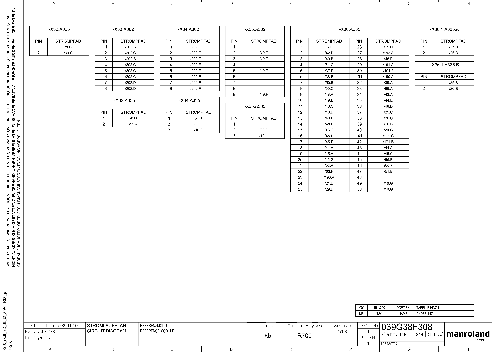

# +Jx — Sheet 149 of 214 — REFERENZMODUL

**REFERENCE MODULE**

> Part of the manroland **R700** printing press IEC/UL circuit diagrams.
> Drawing class: **Stromlaufplan / Circuit diagram** (DIN A3).
> Document `+Jx` covers the **1st printing module + feed register** machine section.

## At a glance

| Field | Value |
|---|---|
| Document | `+Jx`  (039G38F308) |
| Sheet | **149** of 214 |
| Section (DE) | REFERENZMODUL |
| Section (EN) | REFERENCE MODULE |
| Section type | REFERENCE_MODULE — Reference module |
| Machine type | `R700` |
| Series | `7758` |
| Created | 03.01.10 |
| Replaces | — |
| Columns used | A, B, C, D, E, F, G, H |
| Path numbers | — |
| Labels on sheet | 212 |
| Cross-refs out | 83 |
| Cross-refs in | 0 |

**Previous:** [+Jx sheet 148](SHEET_0148.md) · **Next:** [+Jx sheet 150](SHEET_0150.md) · **Document TOC:** [_TOC.md](_TOC.md)  (+Jx) · **Master TOC:** [all sheets](../_MASTER_TOC.md)

## Sheet image (300 DPI, exact vector render)



_Rendered directly from the PDF vector layer at 300 DPI (1-bit), no OCR and no resampling. Use it to confirm anything ambiguous in the text below._

## Cross-references on this sheet

Each entry is a wire leaving this sheet. The printed token is `/sheet.column`; the link resolves to that sheet inside the same document.

| Ref | Target sheet | Col | Path | Destination on target | Target section | From col |
|---|---|---|---|---|---|---|
| `/25.B` | [+Jx sheet 25](SHEET_0025.md) | B | — | — | HILFSANTRIEB, LACKDOSIER /AUFTRAGSWALZEN | H |
| `/202.B` | [+Jx sheet 202](SHEET_0202.md) | B | — | — | OPTION: TELEPRESENCE | B |
| `/202.E` | [+Jx sheet 202](SHEET_0202.md) | E | — | — | OPTION: TELEPRESENCE | C |
| `/8.C` | [+Jx sheet 8](SHEET_0008.md) | C | — | — | SPANNUNGSVERSORGUNG, SCHALTSCHRANKBELÜFTUNG | A |
| `/8.D` | [+Jx sheet 8](SHEET_0008.md) | D | — | — | SPANNUNGSVERSORGUNG, SCHALTSCHRANKBELÜFTUNG | F |
| `/29.H` | [+Jx sheet 29](SHEET_0029.md) | H | — | — | KAMMERRAKEL | G |
| `/49.E` | [+Jx sheet 49](SHEET_0049.md) | E | — | — | HANDTERMINAL | E |
| `/42.B` | [+Jx sheet 42](SHEET_0042.md) | B | — | — | LAUFKOMMANDOS | F |
| `/26.B` | [+Jx sheet 26](SHEET_0026.md) | B | — | — | HILFSANTRIEB, LACKDOSIER /AUFTRAGSWALZEN | H |
| `/202.E` | [+Jx sheet 202](SHEET_0202.md) | E | — | — | OPTION: TELEPRESENCE | C |
| `/192.A` | [+Jx sheet 192](SHEET_0192.md) | A | — | — | OPTION: ZWISCHENTROCKNER, VORBEREITUNG | G |
| `/30.C` | [+Jx sheet 30](SHEET_0030.md) | C | — | — | LACKNIVEAUÜBERWACHUNG | A |
| `/202.C` | [+Jx sheet 202](SHEET_0202.md) | C | — | — | OPTION: TELEPRESENCE | B |
| `/49.E` | [+Jx sheet 49](SHEET_0049.md) | E | — | — | HANDTERMINAL | E |
| `/40.B` | [+Jx sheet 40](SHEET_0040.md) | B | — | — | LAUFKOMMANDOS | F |
| `/46.E` | [+Jx sheet 46](SHEET_0046.md) | E | — | — | MASCHINENBEDIENUNG | G |
| `/202.B` | [+Jx sheet 202](SHEET_0202.md) | B | — | — | OPTION: TELEPRESENCE | B |
| `/202.E` | [+Jx sheet 202](SHEET_0202.md) | E | — | — | OPTION: TELEPRESENCE | C |
| `/202.E` | [+Jx sheet 202](SHEET_0202.md) | E | — | — | OPTION: TELEPRESENCE | C |
| `/191.A` | [+Jx sheet 191](SHEET_0191.md) | A | — | — | OPTION: ZWISCHENTROCKNER, VORBEREITUNG | G |
| `/34.G` | [+Jx sheet 34](SHEET_0034.md) | G | — | — | NOT AUS | F |
| `/202.C` | [+Jx sheet 202](SHEET_0202.md) | C | — | — | OPTION: TELEPRESENCE | B |
| `/49.E` | [+Jx sheet 49](SHEET_0049.md) | E | — | — | HANDTERMINAL | E |
| `/37.F` | [+Jx sheet 37](SHEET_0037.md) | F | — | — | STOP SICHERN | F |
| `/202.F` | [+Jx sheet 202](SHEET_0202.md) | F | — | — | OPTION: TELEPRESENCE | C |
| `/101.F` | [+Jx sheet 101](SHEET_0101.md) | F | — | — | RESERVE | G |
| `/202.C` | [+Jx sheet 202](SHEET_0202.md) | C | — | — | OPTION: TELEPRESENCE | B |
| `/38.B` | [+Jx sheet 38](SHEET_0038.md) | B | — | — | LAUFKOMMANDOS | F |
| `/190.A` | [+Jx sheet 190](SHEET_0190.md) | A | — | — | OPTION: ZWISCHENTROCKNER, VORBEREITUNG | G |
| `/202.F` | [+Jx sheet 202](SHEET_0202.md) | F | — | — | OPTION: TELEPRESENCE | C |
| `/202.C` | [+Jx sheet 202](SHEET_0202.md) | C | — | — | OPTION: TELEPRESENCE | B |
| `/50.B` | [+Jx sheet 50](SHEET_0050.md) | B | — | — | SIGNALGEBER: AKUSTISCHE WARNSIGNALE | F |
| `/39.A` | [+Jx sheet 39](SHEET_0039.md) | A | — | — | LAUFKOMMANDOS | G |
| `/25.B` | [+Jx sheet 25](SHEET_0025.md) | B | — | — | HILFSANTRIEB, LACKDOSIER /AUFTRAGSWALZEN | H |
| `/202.F` | [+Jx sheet 202](SHEET_0202.md) | F | — | — | OPTION: TELEPRESENCE | C |
| `/202.D` | [+Jx sheet 202](SHEET_0202.md) | D | — | — | OPTION: TELEPRESENCE | B |
| `/96.A` | [+Jx sheet 96](SHEET_0096.md) | A | — | — | RESERVE | G |
| `/26.B` | [+Jx sheet 26](SHEET_0026.md) | B | — | — | HILFSANTRIEB, LACKDOSIER /AUFTRAGSWALZEN | H |
| `/202.F` | [+Jx sheet 202](SHEET_0202.md) | F | — | — | OPTION: TELEPRESENCE | C |
| `/50.C` | [+Jx sheet 50](SHEET_0050.md) | C | — | — | SIGNALGEBER: AKUSTISCHE WARNSIGNALE | F |
| `/202.D` | [+Jx sheet 202](SHEET_0202.md) | D | — | — | OPTION: TELEPRESENCE | B |
| `/48.A` | [+Jx sheet 48](SHEET_0048.md) | A | — | — | 7 SEGMENTANZEIGE | F |
| `/43.A` | [+Jx sheet 43](SHEET_0043.md) | A | — | — | LAUFKOMMANDOS | G |
| `/49.F` | [+Jx sheet 49](SHEET_0049.md) | F | — | — | HANDTERMINAL | E |
| `/48.B` | [+Jx sheet 48](SHEET_0048.md) | B | — | — | 7 SEGMENTANZEIGE | F |
| `/44.E` | [+Jx sheet 44](SHEET_0044.md) | E | — | — | MASCHINENBEDIENUNG | G |
| `/48.C` | [+Jx sheet 48](SHEET_0048.md) | C | — | — | 7 SEGMENTANZEIGE | F |
| `/46.D` | [+Jx sheet 46](SHEET_0046.md) | D | — | — | MASCHINENBEDIENUNG | G |
| `/48.D` | [+Jx sheet 48](SHEET_0048.md) | D | — | — | 7 SEGMENTANZEIGE | F |
| `/25.C` | [+Jx sheet 25](SHEET_0025.md) | C | — | — | HILFSANTRIEB, LACKDOSIER /AUFTRAGSWALZEN | G |
| `/48.E` | [+Jx sheet 48](SHEET_0048.md) | E | — | — | 7 SEGMENTANZEIGE | F |
| `/8.D` | [+Jx sheet 8](SHEET_0008.md) | D | — | — | SPANNUNGSVERSORGUNG, SCHALTSCHRANKBELÜFTUNG | B |
| `/8.D` | [+Jx sheet 8](SHEET_0008.md) | D | — | — | SPANNUNGSVERSORGUNG, SCHALTSCHRANKBELÜFTUNG | C |
| `/26.C` | [+Jx sheet 26](SHEET_0026.md) | C | — | — | HILFSANTRIEB, LACKDOSIER /AUFTRAGSWALZEN | G |
| `/55.A` | [+Jx sheet 55](SHEET_0055.md) | A | — | — | SCHUTZEINRICHTUNGEN | B |
| `/30.E` | [+Jx sheet 30](SHEET_0030.md) | E | — | — | LACKNIVEAUÜBERWACHUNG | C |
| `/20.B` | [+Jx sheet 20](SHEET_0020.md) | B | — | — | LACKPUMPE | G |
| `/48.F` | [+Jx sheet 48](SHEET_0048.md) | F | — | — | 7 SEGMENTANZEIGE | F |
| `/30.D` | [+Jx sheet 30](SHEET_0030.md) | D | — | — | LACKNIVEAUÜBERWACHUNG | E |
| `/10.G` | [+Jx sheet 10](SHEET_0010.md) | G | — | — | SPANNUNGSVERSORGUNG, SCHALTSCHRANKBELÜFTUNG | C |
| `/48.G` | [+Jx sheet 48](SHEET_0048.md) | G | — | — | 7 SEGMENTANZEIGE | F |
| `/20.G` | [+Jx sheet 20](SHEET_0020.md) | G | — | — | LACKPUMPE | G |
| `/30.D` | [+Jx sheet 30](SHEET_0030.md) | D | — | — | LACKNIVEAUÜBERWACHUNG | E |
| `/10.G` | [+Jx sheet 10](SHEET_0010.md) | G | — | — | SPANNUNGSVERSORGUNG, SCHALTSCHRANKBELÜFTUNG | E |
| `/48.H` | [+Jx sheet 48](SHEET_0048.md) | H | — | — | 7 SEGMENTANZEIGE | F |
| `/171.C` | [+Jx sheet 171](SHEET_0171.md) | C | — | — | OPTION: AUTOMATISCHEM SPÜLEN | G |
| `/45.E` | [+Jx sheet 45](SHEET_0045.md) | E | — | — | MASCHINENBEDIENUNG | F |
| `/171.B` | [+Jx sheet 171](SHEET_0171.md) | B | — | — | OPTION: AUTOMATISCHEM SPÜLEN | G |
| `/41.A` | [+Jx sheet 41](SHEET_0041.md) | A | — | — | LAUFKOMMANDOS | F |
| `/44.A` | [+Jx sheet 44](SHEET_0044.md) | A | — | — | MASCHINENBEDIENUNG | G |
| `/45.A` | [+Jx sheet 45](SHEET_0045.md) | A | — | — | MASCHINENBEDIENUNG | F |
| `/46.C` | [+Jx sheet 46](SHEET_0046.md) | C | — | — | MASCHINENBEDIENUNG | G |
| `/65.B` | [+Jx sheet 65](SHEET_0065.md) | B | — | — | TROPFEINRICHTUNG | G |
| `/46.G` | [+Jx sheet 46](SHEET_0046.md) | G | — | — | MASCHINENBEDIENUNG | F |
| `/63.A` | [+Jx sheet 63](SHEET_0063.md) | A | — | — | LACKAUFTRAGSWALZE | F |
| `/65.F` | [+Jx sheet 65](SHEET_0065.md) | F | — | — | TROPFEINRICHTUNG | G |
| `/51.B` | [+Jx sheet 51](SHEET_0051.md) | B | — | — | SIGNALGEBER: AKUSTISCHE WARNSIGNALE | G |
| `/63.F` | [+Jx sheet 63](SHEET_0063.md) | F | — | — | LACKAUFTRAGSWALZE | F |
| `/193.A` | [+Jx sheet 193](SHEET_0193.md) | A | — | — | OPTION: ZWISCHENTROCKNER, VORBEREITUNG | F |
| `/10.G` | [+Jx sheet 10](SHEET_0010.md) | G | — | — | SPANNUNGSVERSORGUNG, SCHALTSCHRANKBELÜFTUNG | G |
| `/21.D` | [+Jx sheet 21](SHEET_0021.md) | D | — | — | LACKPUMPE | F |
| `/10.G` | [+Jx sheet 10](SHEET_0010.md) | G | — | — | SPANNUNGSVERSORGUNG, SCHALTSCHRANKBELÜFTUNG | G |
| `/29.D` | [+Jx sheet 29](SHEET_0029.md) | D | — | — | KAMMERRAKEL | F |

## Devices on this sheet

| Tag | Class | Class meaning (IEC) | Col | Sub | Terminal | Sign |
|---|---|---|---|---|---|---|
| `X32.A335` | — | cross-device reference | A | — | — | — |
| `X33.A302` | — | cross-device reference | B | — | — | — |
| `X33.A335` | — | cross-device reference | B | — | — | — |
| `X35.A302` | — | cross-device reference | D | — | — | — |
| `X35.A335` | — | cross-device reference | D | — | — | — |
| `X34.A302` | — | cross-device reference | C | — | — | — |
| `X36.A335` | — | cross-device reference | F | — | — | — |
| `X34.A335` | — | cross-device reference | C | — | — | — |
| `X36.1.A335.A` | — | cross-device reference | H | — | — | — |
| `X36.1.A335.B` | — | cross-device reference | H | — | — | — |
| `NR.` | — | cross-device reference | F | — | — | — |
| `19.08.10` | — | cross-device reference | F | — | — | — |

## Potentials / nets

_No named potentials on this sheet._

## Wire-end annotations (grouped as printed)

A wire that continues elsewhere is annotated with a small cluster: the destination description, the path/line number `#NN`, and the `/sheet.column` cross reference. Each row below is one such cluster exactly as it is grouped on the drawing.

| Col | Y | Path | Cross-ref | Text on the wire |
|---|---|---|---|---|
| A | 65.4 | — | — | `X32.A335` |
| B | 65.4 | — | — | `X33.A302` |
| C | 65.4 | — | — | `X34.A302` |
| D | 65.4 | — | — | `X35.A302` |
| F | 65.4 | — | — | `X36.A335` |
| H | 65.4 | — | — | `X36.1.A335.A` |
| A | 94.1 | — | — | `PIN 2 1 STROMPFAD` |
| B | 94.1 | — | — | `PIN 2 3 4 5 6 7 8 1 STROMPFAD` |
| C | 94.1 | — | — | `PIN 2 3 4 5 6 7 8 1 STROMPFAD` |
| D | 94.1 | — | — | `PIN 2 3 5 6 7 8 9 4 1 STROMPFAD` |
| E | 94.1 | — | — | `PIN STROMPFAD` |
| F | 94.1 | — | — | `PIN STROMPFAD` |
| H | 94.1 | — | — | `PIN 2 1 STROMPFAD` |
| E | 108.3 | — | — | `2 3 4 5 6 7 8 9 1` |
| F | 108.3 | — | — | `26 27 28 29 30 32 33 34 35 36 37 38 39 40 42 43 44 45 46 47 48 49 50 31 41` |
| A | 108.6 | — | `/8.C` | — |
| B | 108.6 | — | `/202.B` | — |
| C | 108.6 | — | `/202.E` | — |
| F | 108.6 | — | `/8.D` | — |
| H | 108.6 | — | `/25.B` | — |
| G | 108.7 | — | `/29.H` | — |
| A | 122.8 | — | `/30.C` | — |
| B | 122.8 | — | `/202.C` | — |
| C | 122.8 | — | `/202.E` | — |
| E | 122.8 | — | `/49.E` | — |
| F | 122.8 | — | `/42.B` | — |
| G | 122.8 | — | `/192.A` | — |
| H | 122.8 | — | `/26.B` | — |
| B | 137.0 | — | `/202.B` | — |
| C | 137.0 | — | `/202.E` | — |
| E | 137.0 | — | `/49.E` | — |
| F | 137.0 | — | `/40.B` | — |
| G | 137.0 | — | `/46.E` | — |
| H | 150.5 | — | — | `X36.1.A335.B` |
| B | 151.2 | — | `/202.C` | — |
| C | 151.2 | — | `/202.E` | — |
| F | 151.2 | — | `/34.G` | — |
| G | 151.2 | — | `/191.A` | — |
| B | 165.3 | — | `/202.C` | — |
| C | 165.3 | — | `/202.F` | — |
| E | 165.3 | — | `/49.E` | — |
| F | 165.3 | — | `/37.F` | — |
| G | 165.3 | — | `/101.F` | — |
| H | 179.1 | — | — | `PIN 2 1 STROMPFAD` |
| B | 179.5 | — | `/202.C` | — |
| C | 179.5 | — | `/202.F` | — |
| F | 179.5 | — | `/38.B` | — |
| G | 179.5 | — | `/190.A` | — |
| B | 193.7 | — | `/202.D` | — |
| C | 193.7 | — | `/202.F` | — |
| F | 193.7 | — | `/50.B` | — |
| G | 193.7 | — | `/39.A` | — |
| H | 193.7 | — | `/25.B` | — |
| C | 207.8 | — | `/202.F` | — |
| G | 207.8 | — | `/96.A` | — |
| H | 207.8 | — | `/26.B` | — |
| B | 207.9 | — | `/202.D` | — |
| F | 207.9 | — | `/50.C` | — |
| E | 222.0 | — | `/49.F` | — |
| F | 222.0 | — | `/48.A` | — |
| G | 222.0 | — | `/43.A` | — |
| B | 235.5 | — | — | `X33.A335` |
| C | 235.5 | — | — | `X34.A335` |
| E | 235.9 | — | — | `10 12 13 14 15 16 17 18 19 20 11` |
| F | 236.2 | — | `/48.B` | — |
| G | 236.2 | — | `/44.E` | — |
| D | 249.7 | — | — | `X35.A335` |
| F | 250.4 | — | `/48.C` | — |
| G | 250.4 | — | `/46.D` | — |
| B | 264.2 | — | — | `PIN 2 1 STROMPFAD` |
| C | 264.2 | — | — | `PIN 2 3 1 STROMPFAD` |
| F | 264.6 | — | `/48.D` | — |
| G | 264.6 | — | `/25.C` | — |
| D | 278.3 | — | — | `PIN 2 3 1 STROMPFAD` |
| B | 278.7 | — | `/8.D` | — |
| C | 278.7 | — | `/8.D` | — |
| F | 278.7 | — | `/48.E` | — |
| G | 278.7 | — | `/26.C` | — |
| B | 292.9 | — | `/55.A` | — |
| C | 292.9 | — | `/30.E` | — |
| E | 292.9 | — | `/30.D` | — |
| F | 292.9 | — | `/48.F` | — |
| G | 292.9 | — | `/20.B` | — |
| C | 307.1 | — | `/10.G` | — |
| E | 307.1 | — | `/30.D` | — |
| F | 307.1 | — | `/48.G` | — |
| G | 307.1 | — | `/20.G` | — |
| E | 321.2 | — | `/10.G` | — |
| F | 321.2 | — | `/48.H` | — |
| G | 321.3 | — | `/171.C` | — |
| F | 335.4 | — | `/45.E` | — |
| G | 335.4 | — | `/171.B` | — |
| F | 349.6 | — | `/41.A` | — |
| G | 349.6 | — | `/44.A` | — |
| F | 363.7 | — | `/45.A` | — |
| G | 363.8 | — | `/46.C` | — |
| F | 377.9 | — | `/46.G` | — |
| G | 377.9 | — | `/65.B` | — |
| E | 391.8 | — | — | `22 23 24 25 21` |
| F | 392.1 | — | `/63.A` | — |
| G | 392.1 | — | `/65.F` | — |
| G | 406.2 | — | `/51.B` | — |
| F | 406.3 | — | `/63.F` | — |
| F | 420.4 | — | `/193.A` | — |
| F | 434.6 | — | `/21.D` | — |
| G | 434.6 | — | `/10.G` | — |
| F | 448.8 | — | `/29.D` | — |
| G | 448.8 | — | `/10.G` | — |
| G | 733.0 | — | — | `001 19.08.10 DGE/AES TABELLE HINZU` |
| G | 747.1 | — | — | `NR. TAG NAME ÄNDERUNG` |


## Reconstructed tables

This sheet carries tabular content (pin map / terminal assignment / index). The grid below was rebuilt from the drawing's own rule lines, so each row is exactly one physical row of the table.

### Table 1 — 2 data rows × 2 columns (at x=70.9, y=62.4) — **X32.A335**

| PIN | STROMPFAD |
|---|---|
| `1` | `/8.C` |
| `2` | `/30.C` |


### Table 2 — 12 data rows × 2 columns (at x=226.8, y=62.4) — **X33.A302**

| PIN | STROMPFAD |
|---|---|
| `1` | `/202.B` |
| `2` | `/202.C` |
| `3` | `/202.B` |
| `4` | `/202.C` |
| `5` | `/202.C` |
| `6` | `/202.C` |
| `7` | `/202.D` |
| `8` | `/202.D` |
|  | `X33.A335` |
| `PIN` | `STROMPFAD` |
| `1` | `/8.D` |
| `2` | `/55.A` |


### Table 3 — 13 data rows × 2 columns (at x=382.7, y=62.4) — **X34.A302**

| PIN | STROMPFAD |
|---|---|
| `1` | `/202.E` |
| `2` | `/202.E` |
| `3` | `/202.E` |
| `4` | `/202.E` |
| `5` | `/202.F` |
| `6` | `/202.F` |
| `7` | `/202.F` |
| `8` | `/202.F` |
|  | `X34.A335` |
| `PIN` | `STROMPFAD` |
| `1` | `/8.D` |
| `2` | `/30.E` |
| `3` | `/10.G` |


### Table 4 — 14 data rows × 2 columns (at x=538.6, y=62.4) — **X35.A302**

| PIN | STROMPFAD |
|---|---|
| `1` |  |
| `2` | `/49.E` |
| `3` | `/49.E` |
| `4` |  |
| `5` | `/49.E` |
| `6` |  |
| `7` |  |
| `8` |  |
| `9` | `/49.F` |
|  | `X35.A335` |
| `PIN` | `STROMPFAD` |
| `1` | `/30.D` |
| `2` | `/30.D` |
| `3` | `/10.G` |


### Table 5 — 25 data rows × 4 columns (at x=694.5, y=62.4) — **X36.A335**

| PIN | STROMPFAD | PIN | STROMPFAD |
|---|---|---|---|
| `1` | `/8.D` | `26` | `/29.H` |
| `2` | `/42.B` | `27` | `/192.A` |
| `3` | `/40.B` | `28` | `/46.E` |
| `4` | `/34.G` | `29` | `/191.A` |
| `5` | `/37.F` | `30` | `/101.F` |
| `6` | `/38.B` | `31` | `/190.A` |
| `7` | `/50.B` | `32` | `/39.A` |
| `8` | `/50.C` | `33` | `/96.A` |
| `9` | `/48.A` | `34` | `/43.A` |
| `10` | `/48.B` | `35` | `/44.E` |
| `11` | `/48.C` | `36` | `/46.D` |
| `12` | `/48.D` | `37` | `/25.C` |
| `13` | `/48.E` | `38` | `/26.C` |
| `14` | `/48.F` | `39` | `/20.B` |
| `15` | `/48.G` | `40` | `/20.G` |
| `16` | `/48.H` | `41` | `/171.C` |
| `17` | `/45.E` | `42` | `/171.B` |
| `18` | `/41.A` | `43` | `/44.A` |
| `19` | `/45.A` | `44` | `/46.C` |
| `20` | `/46.G` | `45` | `/65.B` |
| `21` | `/63.A` | `46` | `/65.F` |
| `22` | `/63.F` | `47` | `/51.B` |
| `23` | `/193.A` | `48` |  |
| `24` | `/21.D` | `49` | `/10.G` |
| `25` | `/29.D` | `50` | `/10.G` |


### Table 6 — 6 data rows × 2 columns (at x=992.1, y=62.4) — **X36.1.A335.A**

| PIN | STROMPFAD |
|---|---|
| `1` | `/25.B` |
| `2` | `/26.B` |
|  | `X36.1.A335.B` |
| `PIN` | `STROMPFAD` |
| `1` | `/25.B` |
| `2` | `/26.B` |


## Notes and free text on this sheet

| Text | Col | Y (pt) |
|---|---|---|
| `PIN` | A | 94.13 |
| `STROMPFAD` | A | 94.09 |
| `PIN` | B | 94.13 |
| `STROMPFAD` | B | 94.09 |
| `PIN` | D | 94.13 |
| `STROMPFAD` | E | 94.09 |
| `PIN` | C | 94.13 |
| `STROMPFAD` | C | 94.09 |
| `PIN` | E | 94.13 |
| `STROMPFAD` | F | 94.09 |
| `PIN` | F | 94.13 |
| `STROMPFAD` | G | 94.09 |
| `PIN` | G | 94.13 |
| `STROMPFAD` | H | 94.09 |
| `TAG` | G | 747.23 |
| `NAME` | G | 747.22 |
| `ÄNDERUNG` | G | 747.25 |
| `DGE/AES` | G | 733.06 |
| `TABELLE HINZU` | G | 733.1 |

## Complete label inventory (exact text from the drawing)

Every text object inside the drawing area of this sheet, in DIN reading order (column A→H, then top→bottom). This is the authoritative list: if a string is not here it is not printed on this sheet.

| Col | Y | X | Dir | Type | Text |
|---|---|---|---|---|---|
| A | 65.4 | 116.6 | → | device ref | `X32.A335` |
| A | 94.1 | 84.0 | → | text | `PIN` |
| A | 94.1 | 132.4 | → | text | `STROMPFAD` |
| A | 108.3 | 89.9 | → | number | `1` |
| A | 108.6 | 155.1 | → | cross-reference | `/8.C` |
| A | 122.5 | 89.4 | → | number | `2` |
| A | 122.8 | 152.6 | → | cross-reference | `/30.C` |
| B | 65.4 | 269.9 | → | device ref | `X33.A302` |
| B | 94.1 | 240.0 | → | text | `PIN` |
| B | 94.1 | 288.3 | → | text | `STROMPFAD` |
| B | 108.3 | 251.4 | → | number | `1` |
| B | 108.6 | 299.2 | → | cross-reference | `/202.B` |
| B | 122.5 | 250.0 | → | number | `2` |
| B | 122.8 | 299.1 | → | cross-reference | `/202.C` |
| B | 136.7 | 250.0 | → | number | `3` |
| B | 137.0 | 299.2 | → | cross-reference | `/202.B` |
| B | 150.8 | 250.0 | → | number | `4` |
| B | 151.2 | 299.1 | → | cross-reference | `/202.C` |
| B | 165.0 | 250.0 | → | number | `5` |
| B | 165.4 | 299.1 | → | cross-reference | `/202.C` |
| B | 179.2 | 250.0 | → | number | `6` |
| B | 179.5 | 299.1 | → | cross-reference | `/202.C` |
| B | 193.3 | 250.0 | → | number | `7` |
| B | 193.7 | 299.1 | → | cross-reference | `/202.D` |
| B | 207.5 | 250.0 | → | number | `8` |
| B | 207.9 | 299.1 | → | cross-reference | `/202.D` |
| B | 235.5 | 272.6 | → | device ref | `X33.A335` |
| B | 264.2 | 240.0 | → | text | `PIN` |
| B | 264.2 | 288.3 | → | text | `STROMPFAD` |
| B | 278.4 | 245.8 | → | number | `1` |
| B | 278.7 | 311.0 | → | cross-reference | `/8.D` |
| B | 292.6 | 245.3 | → | number | `2` |
| B | 292.9 | 308.6 | → | cross-reference | `/55.A` |
| C | 65.4 | 425.8 | → | device ref | `X34.A302` |
| C | 94.1 | 395.9 | → | text | `PIN` |
| C | 94.1 | 444.2 | → | text | `STROMPFAD` |
| C | 108.3 | 407.3 | → | number | `1` |
| C | 108.6 | 455.1 | → | cross-reference | `/202.E` |
| C | 122.5 | 405.9 | → | number | `2` |
| C | 122.8 | 455.1 | → | cross-reference | `/202.E` |
| C | 136.7 | 405.9 | → | number | `3` |
| C | 137.0 | 455.1 | → | cross-reference | `/202.E` |
| C | 150.8 | 405.9 | → | number | `4` |
| C | 151.2 | 455.1 | → | cross-reference | `/202.E` |
| C | 165.0 | 405.9 | → | number | `5` |
| C | 165.3 | 455.4 | → | cross-reference | `/202.F` |
| C | 179.2 | 405.9 | → | number | `6` |
| C | 179.5 | 455.4 | → | cross-reference | `/202.F` |
| C | 193.3 | 405.9 | → | number | `7` |
| C | 193.7 | 455.4 | → | cross-reference | `/202.F` |
| C | 207.5 | 405.9 | → | number | `8` |
| C | 207.9 | 455.4 | → | cross-reference | `/202.F` |
| C | 235.5 | 428.5 | → | device ref | `X34.A335` |
| C | 264.2 | 395.9 | → | text | `PIN` |
| C | 264.2 | 444.2 | → | text | `STROMPFAD` |
| C | 278.4 | 401.7 | → | number | `1` |
| C | 278.7 | 466.9 | → | cross-reference | `/8.D` |
| C | 292.6 | 401.2 | → | number | `2` |
| C | 292.9 | 464.6 | → | cross-reference | `/30.E` |
| C | 306.7 | 401.2 | → | number | `3` |
| C | 307.1 | 464.2 | → | cross-reference | `/10.G` |
| D | 65.4 | 584.5 | → | device ref | `X35.A302` |
| D | 94.1 | 551.8 | → | text | `PIN` |
| D | 108.3 | 557.6 | → | number | `1` |
| D | 122.5 | 557.1 | → | number | `2` |
| D | 136.7 | 557.1 | → | number | `3` |
| D | 150.8 | 557.3 | → | number | `4` |
| D | 165.0 | 557.1 | → | number | `5` |
| D | 179.2 | 557.1 | → | number | `6` |
| D | 193.3 | 557.1 | → | number | `7` |
| D | 207.5 | 557.1 | → | number | `8` |
| D | 221.7 | 557.1 | → | number | `9` |
| D | 249.7 | 584.4 | → | device ref | `X35.A335` |
| D | 278.4 | 551.8 | → | text | `PIN` |
| D | 292.6 | 557.6 | → | number | `1` |
| D | 306.7 | 557.1 | → | number | `2` |
| D | 320.9 | 557.1 | → | number | `3` |
| E | 94.1 | 600.1 | → | text | `STROMPFAD` |
| E | 94.1 | 707.7 | → | text | `PIN` |
| E | 108.3 | 719.1 | → | number | `1` |
| E | 122.5 | 717.7 | → | number | `2` |
| E | 122.8 | 620.5 | → | cross-reference | `/49.E` |
| E | 136.7 | 717.7 | → | number | `3` |
| E | 137.0 | 620.5 | → | cross-reference | `/49.E` |
| E | 150.8 | 717.7 | → | number | `4` |
| E | 165.0 | 717.7 | → | number | `5` |
| E | 165.3 | 620.5 | → | cross-reference | `/49.E` |
| E | 179.2 | 717.7 | → | number | `6` |
| E | 193.3 | 717.7 | → | number | `7` |
| E | 207.5 | 717.7 | → | number | `8` |
| E | 221.7 | 717.7 | → | number | `9` |
| E | 222.0 | 620.8 | → | cross-reference | `/49.F` |
| E | 235.9 | 712.3 | → | number | `10` |
| E | 250.0 | 713.8 | → | number | `11` |
| E | 264.2 | 712.3 | → | number | `12` |
| E | 278.3 | 600.1 | → | text | `STROMPFAD` |
| E | 278.4 | 712.3 | → | number | `13` |
| E | 292.6 | 712.3 | → | number | `14` |
| E | 292.9 | 620.4 | → | cross-reference | `/30.D` |
| E | 306.7 | 712.3 | → | number | `15` |
| E | 307.1 | 620.4 | → | cross-reference | `/30.D` |
| E | 320.9 | 712.3 | → | number | `16` |
| E | 321.2 | 620.1 | → | cross-reference | `/10.G` |
| E | 335.1 | 712.3 | → | number | `17` |
| E | 349.3 | 712.3 | → | number | `18` |
| E | 363.4 | 712.3 | → | number | `19` |
| E | 377.6 | 712.3 | → | number | `20` |
| E | 391.8 | 713.8 | → | number | `21` |
| E | 405.9 | 712.3 | → | number | `22` |
| E | 420.1 | 712.3 | → | number | `23` |
| E | 434.3 | 712.3 | → | number | `24` |
| E | 448.5 | 712.3 | → | number | `25` |
| F | 65.4 | 811.1 | → | device ref | `X36.A335` |
| F | 94.1 | 756.0 | → | text | `STROMPFAD` |
| F | 94.1 | 849.4 | → | text | `PIN` |
| F | 108.3 | 854.1 | → | number | `26` |
| F | 108.6 | 778.7 | → | cross-reference | `/8.D` |
| F | 122.5 | 854.1 | → | number | `27` |
| F | 122.8 | 776.4 | → | cross-reference | `/42.B` |
| F | 136.7 | 854.1 | → | number | `28` |
| F | 137.0 | 776.4 | → | cross-reference | `/40.B` |
| F | 150.8 | 854.1 | → | number | `29` |
| F | 151.2 | 776.0 | → | cross-reference | `/34.G` |
| F | 165.0 | 854.1 | → | number | `30` |
| F | 165.3 | 776.7 | → | cross-reference | `/37.F` |
| F | 179.2 | 855.5 | → | number | `31` |
| F | 179.5 | 776.4 | → | cross-reference | `/38.B` |
| F | 193.3 | 854.1 | → | number | `32` |
| F | 193.7 | 776.4 | → | cross-reference | `/50.B` |
| F | 207.5 | 854.1 | → | number | `33` |
| F | 207.9 | 776.3 | → | cross-reference | `/50.C` |
| F | 221.7 | 854.1 | → | number | `34` |
| F | 222.0 | 776.3 | → | cross-reference | `/48.A` |
| F | 235.9 | 854.1 | → | number | `35` |
| F | 236.2 | 776.4 | → | cross-reference | `/48.B` |
| F | 250.0 | 854.1 | → | number | `36` |
| F | 250.4 | 776.3 | → | cross-reference | `/48.C` |
| F | 264.2 | 854.1 | → | number | `37` |
| F | 264.6 | 776.3 | → | cross-reference | `/48.D` |
| F | 278.4 | 854.1 | → | number | `38` |
| F | 278.7 | 776.4 | → | cross-reference | `/48.E` |
| F | 292.6 | 854.1 | → | number | `39` |
| F | 292.9 | 776.7 | → | cross-reference | `/48.F` |
| F | 306.7 | 854.1 | → | number | `40` |
| F | 307.1 | 776.0 | → | cross-reference | `/48.G` |
| F | 320.9 | 855.5 | → | number | `41` |
| F | 321.2 | 776.4 | → | cross-reference | `/48.H` |
| F | 335.1 | 854.1 | → | number | `42` |
| F | 335.4 | 776.4 | → | cross-reference | `/45.E` |
| F | 349.3 | 854.1 | → | number | `43` |
| F | 349.6 | 776.3 | → | cross-reference | `/41.A` |
| F | 363.4 | 854.1 | → | number | `44` |
| F | 363.7 | 776.3 | → | cross-reference | `/45.A` |
| F | 377.6 | 854.1 | → | number | `45` |
| F | 377.9 | 776.0 | → | cross-reference | `/46.G` |
| F | 391.8 | 854.1 | → | number | `46` |
| F | 392.1 | 776.3 | → | cross-reference | `/63.A` |
| F | 405.9 | 854.1 | → | number | `47` |
| F | 406.3 | 776.7 | → | cross-reference | `/63.F` |
| F | 420.1 | 854.1 | → | number | `48` |
| F | 420.4 | 773.9 | → | cross-reference | `/193.A` |
| F | 434.3 | 854.1 | → | number | `49` |
| F | 434.6 | 776.3 | → | cross-reference | `/21.D` |
| F | 448.5 | 854.1 | → | number | `50` |
| F | 448.8 | 776.3 | → | cross-reference | `/29.D` |
| F | 733.0 | 859.3 | → | number | `001` |
| F | 733.1 | 893.2 | → | device ref | `19.08.10` |
| F | 747.1 | 858.5 | → | device ref | `NR.` |
| G | 94.1 | 897.7 | → | text | `STROMPFAD` |
| G | 94.1 | 1005.3 | → | text | `PIN` |
| G | 108.3 | 1011.1 | → | number | `1` |
| G | 108.7 | 918.1 | → | cross-reference | `/29.H` |
| G | 122.5 | 1010.7 | → | number | `2` |
| G | 122.8 | 915.6 | → | cross-reference | `/192.A` |
| G | 137.0 | 918.1 | → | cross-reference | `/46.E` |
| G | 151.2 | 915.6 | → | cross-reference | `/191.A` |
| G | 165.3 | 916.0 | → | cross-reference | `/101.F` |
| G | 179.2 | 1005.3 | → | text | `PIN` |
| G | 179.5 | 915.6 | → | cross-reference | `/190.A` |
| G | 193.3 | 1011.1 | → | number | `1` |
| G | 193.7 | 918.0 | → | cross-reference | `/39.A` |
| G | 207.5 | 1010.7 | → | number | `2` |
| G | 207.8 | 918.0 | → | cross-reference | `/96.A` |
| G | 222.0 | 918.0 | → | cross-reference | `/43.A` |
| G | 236.2 | 918.1 | → | cross-reference | `/44.E` |
| G | 250.4 | 918.0 | → | cross-reference | `/46.D` |
| G | 264.6 | 918.0 | → | cross-reference | `/25.C` |
| G | 278.7 | 918.0 | → | cross-reference | `/26.C` |
| G | 292.9 | 918.1 | → | cross-reference | `/20.B` |
| G | 307.1 | 917.7 | → | cross-reference | `/20.G` |
| G | 321.3 | 915.6 | → | cross-reference | `/171.C` |
| G | 335.4 | 915.7 | → | cross-reference | `/171.B` |
| G | 349.6 | 918.0 | → | cross-reference | `/44.A` |
| G | 363.8 | 918.0 | → | cross-reference | `/46.C` |
| G | 377.9 | 918.1 | → | cross-reference | `/65.B` |
| G | 392.1 | 918.4 | → | cross-reference | `/65.F` |
| G | 406.3 | 918.1 | → | cross-reference | `/51.B` |
| G | 434.6 | 917.7 | → | cross-reference | `/10.G` |
| G | 448.8 | 917.7 | → | cross-reference | `/10.G` |
| G | 733.1 | 948.0 | → | text | `DGE/AES` |
| G | 733.1 | 995.7 | → | text | `TABELLE HINZU` |
| G | 747.2 | 900.1 | → | text | `TAG` |
| G | 747.2 | 953.5 | → | text | `NAME` |
| G | 747.3 | 995.7 | → | text | `ÄNDERUNG` |
| H | 65.4 | 1028.4 | → | device ref | `X36.1.A335.A` |
| H | 94.1 | 1053.6 | → | text | `STROMPFAD` |
| H | 108.6 | 1074.0 | → | cross-reference | `/25.B` |
| H | 122.8 | 1074.0 | → | cross-reference | `/26.B` |
| H | 150.5 | 1028.7 | → | device ref | `X36.1.A335.B` |
| H | 179.1 | 1053.6 | → | text | `STROMPFAD` |
| H | 193.7 | 1074.0 | → | cross-reference | `/25.B` |
| H | 207.8 | 1074.0 | → | cross-reference | `/26.B` |

## Reading-order text block

The same content as a plain block, grouped by DIN column — convenient to paste or to match against a visual description.

```text
=== Column A ===
  65.4  116.6  devref       X32.A335
  94.1   84.0  text         PIN
  94.1  132.4  text         STROMPFAD
 108.3   89.9  numeric      1
 108.6  155.1  xref         /8.C
 122.5   89.4  numeric      2
 122.8  152.6  xref         /30.C
=== Column B ===
  65.4  269.9  devref       X33.A302
  94.1  240.0  text         PIN
  94.1  288.3  text         STROMPFAD
 108.3  251.4  numeric      1
 108.6  299.2  xref         /202.B
 122.5  250.0  numeric      2
 122.8  299.1  xref         /202.C
 136.7  250.0  numeric      3
 137.0  299.2  xref         /202.B
 150.8  250.0  numeric      4
 151.2  299.1  xref         /202.C
 165.0  250.0  numeric      5
 165.4  299.1  xref         /202.C
 179.2  250.0  numeric      6
 179.5  299.1  xref         /202.C
 193.3  250.0  numeric      7
 193.7  299.1  xref         /202.D
 207.5  250.0  numeric      8
 207.9  299.1  xref         /202.D
 235.5  272.6  devref       X33.A335
 264.2  240.0  text         PIN
 264.2  288.3  text         STROMPFAD
 278.4  245.8  numeric      1
 278.7  311.0  xref         /8.D
 292.6  245.3  numeric      2
 292.9  308.6  xref         /55.A
=== Column C ===
  65.4  425.8  devref       X34.A302
  94.1  395.9  text         PIN
  94.1  444.2  text         STROMPFAD
 108.3  407.3  numeric      1
 108.6  455.1  xref         /202.E
 122.5  405.9  numeric      2
 122.8  455.1  xref         /202.E
 136.7  405.9  numeric      3
 137.0  455.1  xref         /202.E
 150.8  405.9  numeric      4
 151.2  455.1  xref         /202.E
 165.0  405.9  numeric      5
 165.3  455.4  xref         /202.F
 179.2  405.9  numeric      6
 179.5  455.4  xref         /202.F
 193.3  405.9  numeric      7
 193.7  455.4  xref         /202.F
 207.5  405.9  numeric      8
 207.9  455.4  xref         /202.F
 235.5  428.5  devref       X34.A335
 264.2  395.9  text         PIN
 264.2  444.2  text         STROMPFAD
 278.4  401.7  numeric      1
 278.7  466.9  xref         /8.D
 292.6  401.2  numeric      2
 292.9  464.6  xref         /30.E
 306.7  401.2  numeric      3
 307.1  464.2  xref         /10.G
=== Column D ===
  65.4  584.5  devref       X35.A302
  94.1  551.8  text         PIN
 108.3  557.6  numeric      1
 122.5  557.1  numeric      2
 136.7  557.1  numeric      3
 150.8  557.3  numeric      4
 165.0  557.1  numeric      5
 179.2  557.1  numeric      6
 193.3  557.1  numeric      7
 207.5  557.1  numeric      8
 221.7  557.1  numeric      9
 249.7  584.4  devref       X35.A335
 278.4  551.8  text         PIN
 292.6  557.6  numeric      1
 306.7  557.1  numeric      2
 320.9  557.1  numeric      3
=== Column E ===
  94.1  600.1  text         STROMPFAD
  94.1  707.7  text         PIN
 108.3  719.1  numeric      1
 122.5  717.7  numeric      2
 122.8  620.5  xref         /49.E
 136.7  717.7  numeric      3
 137.0  620.5  xref         /49.E
 150.8  717.7  numeric      4
 165.0  717.7  numeric      5
 165.3  620.5  xref         /49.E
 179.2  717.7  numeric      6
 193.3  717.7  numeric      7
 207.5  717.7  numeric      8
 221.7  717.7  numeric      9
 222.0  620.8  xref         /49.F
 235.9  712.3  numeric      10
 250.0  713.8  numeric      11
 264.2  712.3  numeric      12
 278.3  600.1  text         STROMPFAD
 278.4  712.3  numeric      13
 292.6  712.3  numeric      14
 292.9  620.4  xref         /30.D
 306.7  712.3  numeric      15
 307.1  620.4  xref         /30.D
 320.9  712.3  numeric      16
 321.2  620.1  xref         /10.G
 335.1  712.3  numeric      17
 349.3  712.3  numeric      18
 363.4  712.3  numeric      19
 377.6  712.3  numeric      20
 391.8  713.8  numeric      21
 405.9  712.3  numeric      22
 420.1  712.3  numeric      23
 434.3  712.3  numeric      24
 448.5  712.3  numeric      25
=== Column F ===
  65.4  811.1  devref       X36.A335
  94.1  756.0  text         STROMPFAD
  94.1  849.4  text         PIN
 108.3  854.1  numeric      26
 108.6  778.7  xref         /8.D
 122.5  854.1  numeric      27
 122.8  776.4  xref         /42.B
 136.7  854.1  numeric      28
 137.0  776.4  xref         /40.B
 150.8  854.1  numeric      29
 151.2  776.0  xref         /34.G
 165.0  854.1  numeric      30
 165.3  776.7  xref         /37.F
 179.2  855.5  numeric      31
 179.5  776.4  xref         /38.B
 193.3  854.1  numeric      32
 193.7  776.4  xref         /50.B
 207.5  854.1  numeric      33
 207.9  776.3  xref         /50.C
 221.7  854.1  numeric      34
 222.0  776.3  xref         /48.A
 235.9  854.1  numeric      35
 236.2  776.4  xref         /48.B
 250.0  854.1  numeric      36
 250.4  776.3  xref         /48.C
 264.2  854.1  numeric      37
 264.6  776.3  xref         /48.D
 278.4  854.1  numeric      38
 278.7  776.4  xref         /48.E
 292.6  854.1  numeric      39
 292.9  776.7  xref         /48.F
 306.7  854.1  numeric      40
 307.1  776.0  xref         /48.G
 320.9  855.5  numeric      41
 321.2  776.4  xref         /48.H
 335.1  854.1  numeric      42
 335.4  776.4  xref         /45.E
 349.3  854.1  numeric      43
 349.6  776.3  xref         /41.A
 363.4  854.1  numeric      44
 363.7  776.3  xref         /45.A
 377.6  854.1  numeric      45
 377.9  776.0  xref         /46.G
 391.8  854.1  numeric      46
 392.1  776.3  xref         /63.A
 405.9  854.1  numeric      47
 406.3  776.7  xref         /63.F
 420.1  854.1  numeric      48
 420.4  773.9  xref         /193.A
 434.3  854.1  numeric      49
 434.6  776.3  xref         /21.D
 448.5  854.1  numeric      50
 448.8  776.3  xref         /29.D
 733.0  859.3  numeric      001
 733.1  893.2  devref       19.08.10
 747.1  858.5  devref       NR.
=== Column G ===
  94.1  897.7  text         STROMPFAD
  94.1 1005.3  text         PIN
 108.3 1011.1  numeric      1
 108.7  918.1  xref         /29.H
 122.5 1010.7  numeric      2
 122.8  915.6  xref         /192.A
 137.0  918.1  xref         /46.E
 151.2  915.6  xref         /191.A
 165.3  916.0  xref         /101.F
 179.2 1005.3  text         PIN
 179.5  915.6  xref         /190.A
 193.3 1011.1  numeric      1
 193.7  918.0  xref         /39.A
 207.5 1010.7  numeric      2
 207.8  918.0  xref         /96.A
 222.0  918.0  xref         /43.A
 236.2  918.1  xref         /44.E
 250.4  918.0  xref         /46.D
 264.6  918.0  xref         /25.C
 278.7  918.0  xref         /26.C
 292.9  918.1  xref         /20.B
 307.1  917.7  xref         /20.G
 321.3  915.6  xref         /171.C
 335.4  915.7  xref         /171.B
 349.6  918.0  xref         /44.A
 363.8  918.0  xref         /46.C
 377.9  918.1  xref         /65.B
 392.1  918.4  xref         /65.F
 406.3  918.1  xref         /51.B
 434.6  917.7  xref         /10.G
 448.8  917.7  xref         /10.G
 733.1  948.0  text         DGE/AES
 733.1  995.7  text         TABELLE HINZU
 747.2  900.1  text         TAG
 747.2  953.5  text         NAME
 747.3  995.7  text         ÄNDERUNG
=== Column H ===
  65.4 1028.4  devref       X36.1.A335.A
  94.1 1053.6  text         STROMPFAD
 108.6 1074.0  xref         /25.B
 122.8 1074.0  xref         /26.B
 150.5 1028.7  devref       X36.1.A335.B
 179.1 1053.6  text         STROMPFAD
 193.7 1074.0  xref         /25.B
 207.8 1074.0  xref         /26.B
```

---
_Generated from the PDF vector text layer; no OCR. Source: `R700_7758_IEC_UL_JX_039G38F308_p`, sheet 149._
