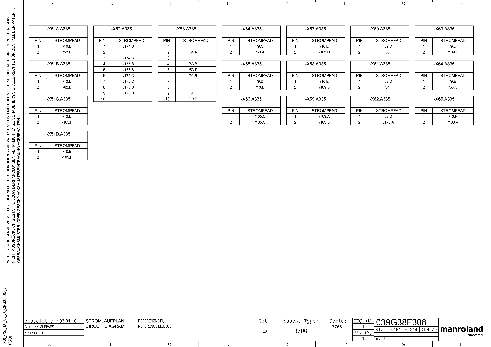

# +Jx — Sheet 151 of 214 — REFERENZMODUL

**REFERENCE MODULE**

> Part of the manroland **R700** printing press IEC/UL circuit diagrams.
> Drawing class: **Stromlaufplan / Circuit diagram** (DIN A3).
> Document `+Jx` covers the **1st printing module + feed register** machine section.

## At a glance

| Field | Value |
|---|---|
| Document | `+Jx`  (039G38F308) |
| Sheet | **151** of 214 |
| Section (DE) | REFERENZMODUL |
| Section (EN) | REFERENCE MODULE |
| Section type | REFERENCE_MODULE — Reference module |
| Machine type | `R700` |
| Series | `7758` |
| Created | 03.01.10 |
| Replaces | — |
| Columns used | A, B, C, D, E, F, G, H |
| Path numbers | — |
| Labels on sheet | 152 |
| Cross-refs out | 46 |
| Cross-refs in | 0 |

**Previous:** [+Jx sheet 150](SHEET_0150.md) · **Next:** [+Jx sheet 152](SHEET_0152.md) · **Document TOC:** [_TOC.md](_TOC.md)  (+Jx) · **Master TOC:** [all sheets](../_MASTER_TOC.md)

## Sheet image (300 DPI, exact vector render)



_Rendered directly from the PDF vector layer at 300 DPI (1-bit), no OCR and no resampling. Use it to confirm anything ambiguous in the text below._

## Cross-references on this sheet

Each entry is a wire leaving this sheet. The printed token is `/sheet.column`; the link resolves to that sheet inside the same document.

| Ref | Target sheet | Col | Path | Destination on target | Target section | From col |
|---|---|---|---|---|---|---|
| `/10.E` | [+Jx sheet 10](SHEET_0010.md) | E | — | — | SPANNUNGSVERSORGUNG, SCHALTSCHRANKBELÜFTUNG | F |
| `/174.B` | [+Jx sheet 174](SHEET_0174.md) | B | — | — | OPTION: | B |
| `/9.C` | [+Jx sheet 9](SHEET_0009.md) | C | — | — | SPANNUNGSVERSORGUNG, SCHALTSCHRANKBELÜFTUNG | E |
| `/9.D` | [+Jx sheet 9](SHEET_0009.md) | D | — | — | SPANNUNGSVERSORGUNG, SCHALTSCHRANKBELÜFTUNG | G |
| `/9.D` | [+Jx sheet 9](SHEET_0009.md) | D | — | — | SPANNUNGSVERSORGUNG, SCHALTSCHRANKBELÜFTUNG | H |
| `/10.D` | [+Jx sheet 10](SHEET_0010.md) | D | — | — | SPANNUNGSVERSORGUNG, SCHALTSCHRANKBELÜFTUNG | A |
| `/54.A` | [+Jx sheet 54](SHEET_0054.md) | A | — | — | SCHUTZEINRICHTUNGEN | C |
| `/60.A` | [+Jx sheet 60](SHEET_0060.md) | A | — | — | SCHUTZEINRICHTUNGEN | E |
| `/53.F` | [+Jx sheet 53](SHEET_0053.md) | F | — | — | SCHUTZEINRICHTUNGEN | G |
| `/189.B` | [+Jx sheet 189](SHEET_0189.md) | B | — | — | OPTION: ZWISCHENTROCKNER, VORBEREITUNG | H |
| `/62.C` | [+Jx sheet 62](SHEET_0062.md) | C | — | — | GTW | A |
| `/103.H` | [+Jx sheet 103](SHEET_0103.md) | H | — | — | RESERVE | F |
| `/174.C` | [+Jx sheet 174](SHEET_0174.md) | C | — | — | OPTION: | B |
| `/53.B` | [+Jx sheet 53](SHEET_0053.md) | B | — | — | SCHUTZEINRICHTUNGEN | C |
| `/175.B` | [+Jx sheet 175](SHEET_0175.md) | B | — | — | OPTION: | B |
| `/175.B` | [+Jx sheet 175](SHEET_0175.md) | B | — | — | OPTION: | B |
| `/53.F` | [+Jx sheet 53](SHEET_0053.md) | F | — | — | SCHUTZEINRICHTUNGEN | C |
| `/52.B` | [+Jx sheet 52](SHEET_0052.md) | B | — | — | SCHUTZEINRICHTUNGEN | C |
| `/175.C` | [+Jx sheet 175](SHEET_0175.md) | C | — | — | OPTION: | B |
| `/9.E` | [+Jx sheet 9](SHEET_0009.md) | E | — | — | SPANNUNGSVERSORGUNG, SCHALTSCHRANKBELÜFTUNG | H |
| `/10.E` | [+Jx sheet 10](SHEET_0010.md) | E | — | — | SPANNUNGSVERSORGUNG, SCHALTSCHRANKBELÜFTUNG | F |
| `/9.D` | [+Jx sheet 9](SHEET_0009.md) | D | — | — | SPANNUNGSVERSORGUNG, SCHALTSCHRANKBELÜFTUNG | E |
| `/9.D` | [+Jx sheet 9](SHEET_0009.md) | D | — | — | SPANNUNGSVERSORGUNG, SCHALTSCHRANKBELÜFTUNG | G |
| `/10.D` | [+Jx sheet 10](SHEET_0010.md) | D | — | — | SPANNUNGSVERSORGUNG, SCHALTSCHRANKBELÜFTUNG | A |
| `/175.C` | [+Jx sheet 175](SHEET_0175.md) | C | — | — | OPTION: | B |
| `/62.E` | [+Jx sheet 62](SHEET_0062.md) | E | — | — | GTW | A |
| `/10.E` | [+Jx sheet 10](SHEET_0010.md) | E | — | — | SPANNUNGSVERSORGUNG, SCHALTSCHRANKBELÜFTUNG | E |
| `/169.B` | [+Jx sheet 169](SHEET_0169.md) | B | — | — | OPTION: BOGENFÜHRUNG ÜBER DRUCKZYLINDER / | F |
| `/54.F` | [+Jx sheet 54](SHEET_0054.md) | F | — | — | SCHUTZEINRICHTUNGEN | G |
| `/53.C` | [+Jx sheet 53](SHEET_0053.md) | C | — | — | SCHUTZEINRICHTUNGEN | H |
| `/175.D` | [+Jx sheet 175](SHEET_0175.md) | D | — | — | OPTION: | B |
| `/175.B` | [+Jx sheet 175](SHEET_0175.md) | B | — | — | OPTION: | B |
| `/9.C` | [+Jx sheet 9](SHEET_0009.md) | C | — | — | SPANNUNGSVERSORGUNG, SCHALTSCHRANKBELÜFTUNG | C |
| `/10.E` | [+Jx sheet 10](SHEET_0010.md) | E | — | — | SPANNUNGSVERSORGUNG, SCHALTSCHRANKBELÜFTUNG | C |
| `/163.A` | [+Jx sheet 163](SHEET_0163.md) | A | — | — | OPTION: | F |
| `/10.F` | [+Jx sheet 10](SHEET_0010.md) | F | — | — | SPANNUNGSVERSORGUNG, SCHALTSCHRANKBELÜFTUNG | H |
| `/9.D` | [+Jx sheet 9](SHEET_0009.md) | D | — | — | SPANNUNGSVERSORGUNG, SCHALTSCHRANKBELÜFTUNG | G |
| `/10.D` | [+Jx sheet 10](SHEET_0010.md) | D | — | — | SPANNUNGSVERSORGUNG, SCHALTSCHRANKBELÜFTUNG | A |
| `/105.C` | [+Jx sheet 105](SHEET_0105.md) | C | — | — | RESERVE | E |
| `/163.B` | [+Jx sheet 163](SHEET_0163.md) | B | — | — | OPTION: | F |
| `/178.A` | [+Jx sheet 178](SHEET_0178.md) | A | — | — | OPTION: TRANSFERMODUL 1 NACH | G |
| `/166.A` | [+Jx sheet 166](SHEET_0166.md) | A | — | — | OPTION: | H |
| `/165.F` | [+Jx sheet 165](SHEET_0165.md) | F | — | — | OPTION: | A |
| `/105.C` | [+Jx sheet 105](SHEET_0105.md) | C | — | — | RESERVE | E |
| `/10.E` | [+Jx sheet 10](SHEET_0010.md) | E | — | — | SPANNUNGSVERSORGUNG, SCHALTSCHRANKBELÜFTUNG | A |
| `/165.H` | [+Jx sheet 165](SHEET_0165.md) | H | — | — | OPTION: | A |

## Devices on this sheet

| Tag | Class | Class meaning (IEC) | Col | Sub | Terminal | Sign |
|---|---|---|---|---|---|---|
| `X51A.A335` | — | cross-device reference | A | — | — | — |
| `X51B.A335` | — | cross-device reference | A | — | — | — |
| `X51C.A335` | — | cross-device reference | A | — | — | — |
| `X51D.A335` | — | cross-device reference | A | — | — | — |
| `X52.A335` | — | cross-device reference | B | — | — | — |
| `X54.A335` | — | cross-device reference | D | — | — | — |
| `X55.A335` | — | cross-device reference | D | — | — | — |
| `X56.A335` | — | cross-device reference | D | — | — | — |
| `X57.A335` | — | cross-device reference | F | — | — | — |
| `X58.A335` | — | cross-device reference | F | — | — | — |
| `X59.A335` | — | cross-device reference | F | — | — | — |
| `X60.A335` | — | cross-device reference | G | — | — | — |
| `X61.A335` | — | cross-device reference | G | — | — | — |
| `X62.A335` | — | cross-device reference | G | — | — | — |
| `X63.A335` | — | cross-device reference | H | — | — | — |
| `X64.A335` | — | cross-device reference | H | — | — | — |
| `X65.A335` | — | cross-device reference | H | — | — | — |
| `X53.A335` | — | cross-device reference | C | — | — | — |

## Potentials / nets

_No named potentials on this sheet._

## Wire-end annotations (grouped as printed)

A wire that continues elsewhere is annotated with a small cluster: the destination description, the path/line number `#NN`, and the `/sheet.column` cross reference. Each row below is one such cluster exactly as it is grouped on the drawing.

| Col | Y | Path | Cross-ref | Text on the wire |
|---|---|---|---|---|
| A | 65.4 | — | — | `X51A.A335` |
| B | 65.4 | — | — | `X52.A335` |
| C | 65.4 | — | — | `X53.A335` |
| D | 65.4 | — | — | `X54.A335` |
| F | 65.4 | — | — | `X57.A335` |
| G | 65.4 | — | — | `X60.A335` |
| H | 65.4 | — | — | `X63.A335` |
| A | 94.1 | — | — | `PIN 2 1 STROMPFAD` |
| B | 94.1 | — | — | `PIN 10 2 3 4 5 6 7 8 9 1 STROMPFAD` |
| C | 94.1 | — | — | `PIN 10 2 3 4 5 6 7 8 9 1 STROMPFAD` |
| D | 94.1 | — | — | `PIN 2 1 STROMPFAD` |
| E | 94.1 | — | — | `PIN 2 1 STROMPFAD` |
| G | 94.1 | — | — | `PIN 2 1 STROMPFAD` |
| H | 94.1 | — | — | `PIN 2 1 STROMPFAD` |
| B | 108.6 | — | `/174.B` | — |
| E | 108.6 | — | `/9.C` | — |
| F | 108.6 | — | `/10.E` | — |
| G | 108.6 | — | `/9.D` | — |
| H | 108.6 | — | `/9.D` | — |
| A | 108.7 | — | `/10.D` | — |
| A | 122.8 | — | `/62.C` | — |
| C | 122.8 | — | `/54.A` | — |
| E | 122.8 | — | `/60.A` | — |
| F | 122.8 | — | `/103.H` | — |
| G | 122.8 | — | `/53.F` | — |
| H | 122.8 | — | `/189.B` | — |
| B | 137.0 | — | `/174.C` | — |
| A | 150.5 | — | — | `X51B.A335` |
| D | 150.5 | — | — | `X55.A335` |
| F | 150.5 | — | — | `X58.A335` |
| G | 150.5 | — | — | `X61.A335` |
| H | 150.5 | — | — | `X64.A335` |
| C | 151.1 | — | `/53.B` | — |
| B | 151.2 | — | `/175.B` | — |
| B | 165.3 | — | `/175.B` | — |
| C | 165.3 | — | `/53.F` | — |
| A | 179.1 | — | — | `PIN 2 1 STROMPFAD` |
| D | 179.1 | — | — | `PIN 2 1 STROMPFAD` |
| E | 179.1 | — | — | `PIN 2 1 STROMPFAD` |
| G | 179.1 | — | — | `PIN 2 1 STROMPFAD` |
| H | 179.1 | — | — | `PIN 2 1 STROMPFAD` |
| B | 179.5 | — | `/175.C` | — |
| C | 179.5 | — | `/52.B` | — |
| H | 193.6 | — | `/9.E` | — |
| A | 193.7 | — | `/10.D` | — |
| B | 193.7 | — | `/175.C` | — |
| E | 193.7 | — | `/9.D` | — |
| F | 193.7 | — | `/10.E` | — |
| G | 193.7 | — | `/9.D` | — |
| A | 207.8 | — | `/62.E` | — |
| E | 207.8 | — | `/10.E` | — |
| F | 207.8 | — | `/169.B` | — |
| G | 207.8 | — | `/54.F` | — |
| B | 207.9 | — | `/175.D` | — |
| H | 207.9 | — | `/53.C` | — |
| B | 222.0 | — | `/175.B` | — |
| C | 222.0 | — | `/9.C` | — |
| A | 235.5 | — | — | `X51C.A335` |
| D | 235.5 | — | — | `X56.A335` |
| F | 235.5 | — | — | `X59.A335` |
| G | 235.5 | — | — | `X62.A335` |
| H | 235.5 | — | — | `X65.A335` |
| C | 236.2 | — | `/10.E` | — |
| A | 264.2 | — | — | `PIN 2 1 STROMPFAD` |
| D | 264.2 | — | — | `PIN 2 1 STROMPFAD` |
| E | 264.2 | — | — | `PIN 2 1 STROMPFAD` |
| G | 264.2 | — | — | `PIN 2 1 STROMPFAD` |
| H | 264.2 | — | — | `PIN 2 1 STROMPFAD` |
| A | 278.7 | — | `/10.D` | — |
| E | 278.7 | — | `/105.C` | — |
| F | 278.7 | — | `/163.A` | — |
| G | 278.7 | — | `/9.D` | — |
| H | 278.7 | — | `/10.F` | — |
| A | 292.9 | — | `/165.F` | — |
| E | 292.9 | — | `/105.C` | — |
| F | 292.9 | — | `/163.B` | — |
| G | 292.9 | — | `/178.A` | — |
| H | 292.9 | — | `/166.A` | — |
| A | 320.6 | — | — | `X51D.A335` |
| A | 349.2 | — | — | `PIN 2 1 STROMPFAD` |
| A | 363.7 | — | `/10.E` | — |
| A | 377.9 | — | `/165.H` | — |


## Reconstructed tables

This sheet carries tabular content (pin map / terminal assignment / index). The grid below was rebuilt from the drawing's own rule lines, so each row is exactly one physical row of the table.

### Table 1 — 14 data rows × 2 columns (at x=70.9, y=62.4) — **X51A.A335**

| PIN | STROMPFAD |
|---|---|
| `1` | `/10.D` |
| `2` | `/62.C` |
|  | `X51B.A335` |
| `PIN` | `STROMPFAD` |
| `1` | `/10.D` |
| `2` | `/62.E` |
|  | `X51C.A335` |
| `PIN` | `STROMPFAD` |
| `1` | `/10.D` |
| `2` | `/165.F` |
|  | `X51D.A335` |
| `PIN` | `STROMPFAD` |
| `1` | `/10.E` |
| `2` | `/165.H` |


### Table 2 — 10 data rows × 2 columns (at x=226.8, y=62.4) — **X52.A335**

| PIN | STROMPFAD |
|---|---|
| `1` | `/174.B` |
| `2` |  |
| `3` | `/174.C` |
| `4` | `/175.B` |
| `5` | `/175.B` |
| `6` | `/175.C` |
| `7` | `/175.C` |
| `8` | `/175.D` |
| `9` | `/175.B` |
| `10` |  |


### Table 3 — 10 data rows × 2 columns (at x=382.7, y=62.4) — **X53.A335**

| PIN | STROMPFAD |
|---|---|
| `1` |  |
| `2` | `/54.A` |
| `3` |  |
| `4` | `/53.B` |
| `5` | `/53.F` |
| `6` | `/52.B` |
| `7` |  |
| `8` |  |
| `9` | `/9.C` |
| `10` | `/10.E` |


### Table 4 — 10 data rows × 2 columns (at x=538.6, y=62.4) — **X54.A335**

| PIN | STROMPFAD |
|---|---|
| `1` | `/9.C` |
| `2` | `/60.A` |
|  | `X55.A335` |
| `PIN` | `STROMPFAD` |
| `1` | `/9.D` |
| `2` | `/10.E` |
|  | `X56.A335` |
| `PIN` | `STROMPFAD` |
| `1` | `/105.C` |
| `2` | `/105.C` |


### Table 5 — 10 data rows × 2 columns (at x=694.5, y=62.4) — **X57.A335**

| PIN | STROMPFAD |
|---|---|
| `1` | `/10.E` |
| `2` | `/103.H` |
|  | `X58.A335` |
| `PIN` | `STROMPFAD` |
| `1` | `/10.E` |
| `2` | `/169.B` |
|  | `X59.A335` |
| `PIN` | `STROMPFAD` |
| `1` | `/163.A` |
| `2` | `/163.B` |


### Table 6 — 10 data rows × 2 columns (at x=850.4, y=62.4) — **X60.A335**

| PIN | STROMPFAD |
|---|---|
| `1` | `/9.D` |
| `2` | `/53.F` |
|  | `X61.A335` |
| `PIN` | `STROMPFAD` |
| `1` | `/9.D` |
| `2` | `/54.F` |
|  | `X62.A335` |
| `PIN` | `STROMPFAD` |
| `1` | `/9.D` |
| `2` | `/178.A` |


### Table 7 — 10 data rows × 2 columns (at x=1006.3, y=62.4) — **X63.A335**

| PIN | STROMPFAD |
|---|---|
| `1` | `/9.D` |
| `2` | `/189.B` |
|  | `X64.A335` |
| `PIN` | `STROMPFAD` |
| `1` | `/9.E` |
| `2` | `/53.C` |
|  | `X65.A335` |
| `PIN` | `STROMPFAD` |
| `1` | `/10.F` |
| `2` | `/166.A` |


## Notes and free text on this sheet

| Text | Col | Y (pt) |
|---|---|---|
| `PIN` | A | 94.13 |
| `STROMPFAD` | A | 94.09 |
| `PIN` | B | 94.13 |
| `STROMPFAD` | B | 94.09 |
| `PIN` | D | 94.13 |
| `STROMPFAD` | E | 94.09 |
| `PIN` | E | 94.13 |
| `STROMPFAD` | F | 94.09 |
| `PIN` | F | 94.13 |
| `STROMPFAD` | G | 94.09 |
| `PIN` | G | 94.13 |
| `STROMPFAD` | H | 94.09 |
| `PIN` | C | 94.13 |
| `STROMPFAD` | C | 94.09 |

## Complete label inventory (exact text from the drawing)

Every text object inside the drawing area of this sheet, in DIN reading order (column A→H, then top→bottom). This is the authoritative list: if a string is not here it is not printed on this sheet.

| Col | Y | X | Dir | Type | Text |
|---|---|---|---|---|---|
| A | 65.4 | 113.1 | → | device ref | `X51A.A335` |
| A | 94.1 | 84.0 | → | text | `PIN` |
| A | 94.1 | 132.4 | → | text | `STROMPFAD` |
| A | 108.3 | 89.9 | → | number | `1` |
| A | 108.7 | 152.6 | → | cross-reference | `/10.D` |
| A | 122.5 | 89.4 | → | number | `2` |
| A | 122.8 | 152.6 | → | cross-reference | `/62.C` |
| A | 150.5 | 113.1 | → | device ref | `X51B.A335` |
| A | 179.1 | 132.4 | → | text | `STROMPFAD` |
| A | 179.2 | 84.0 | → | text | `PIN` |
| A | 193.3 | 89.9 | → | number | `1` |
| A | 193.7 | 152.6 | → | cross-reference | `/10.D` |
| A | 207.5 | 89.4 | → | number | `2` |
| A | 207.8 | 152.8 | → | cross-reference | `/62.E` |
| A | 235.5 | 112.8 | → | device ref | `X51C.A335` |
| A | 264.2 | 84.0 | → | text | `PIN` |
| A | 264.2 | 132.4 | → | text | `STROMPFAD` |
| A | 278.4 | 89.9 | → | number | `1` |
| A | 278.7 | 152.6 | → | cross-reference | `/10.D` |
| A | 292.6 | 89.4 | → | number | `2` |
| A | 292.9 | 150.7 | → | cross-reference | `/165.F` |
| A | 320.6 | 112.8 | → | device ref | `X51D.A335` |
| A | 349.2 | 132.4 | → | text | `STROMPFAD` |
| A | 349.3 | 84.0 | → | text | `PIN` |
| A | 363.4 | 89.9 | → | number | `1` |
| A | 363.7 | 152.8 | → | cross-reference | `/10.E` |
| A | 377.6 | 89.4 | → | number | `2` |
| A | 377.9 | 150.4 | → | cross-reference | `/165.H` |
| B | 65.4 | 269.7 | → | device ref | `X52.A335` |
| B | 94.1 | 240.0 | → | text | `PIN` |
| B | 94.1 | 288.3 | → | text | `STROMPFAD` |
| B | 108.3 | 251.4 | → | number | `1` |
| B | 108.6 | 299.2 | → | cross-reference | `/174.B` |
| B | 122.5 | 250.0 | → | number | `2` |
| B | 136.7 | 250.0 | → | number | `3` |
| B | 137.0 | 299.1 | → | cross-reference | `/174.C` |
| B | 150.8 | 250.0 | → | number | `4` |
| B | 151.2 | 299.2 | → | cross-reference | `/175.B` |
| B | 165.0 | 250.0 | → | number | `5` |
| B | 165.3 | 299.2 | → | cross-reference | `/175.B` |
| B | 179.2 | 250.0 | → | number | `6` |
| B | 179.5 | 299.1 | → | cross-reference | `/175.C` |
| B | 193.3 | 250.0 | → | number | `7` |
| B | 193.7 | 299.1 | → | cross-reference | `/175.C` |
| B | 207.5 | 250.0 | → | number | `8` |
| B | 207.9 | 299.1 | → | cross-reference | `/175.D` |
| B | 221.7 | 250.0 | → | number | `9` |
| B | 222.0 | 299.2 | → | cross-reference | `/175.B` |
| B | 235.9 | 244.6 | → | number | `10` |
| C | 65.4 | 425.6 | → | device ref | `X53.A335` |
| C | 94.1 | 395.9 | → | text | `PIN` |
| C | 94.1 | 444.2 | → | text | `STROMPFAD` |
| C | 108.3 | 407.3 | → | number | `1` |
| C | 122.5 | 405.9 | → | number | `2` |
| C | 122.8 | 457.4 | → | cross-reference | `/54.A` |
| C | 136.7 | 405.9 | → | number | `3` |
| C | 150.8 | 405.9 | → | number | `4` |
| C | 151.1 | 457.5 | → | cross-reference | `/53.B` |
| C | 165.0 | 405.9 | → | number | `5` |
| C | 165.3 | 457.8 | → | cross-reference | `/53.F` |
| C | 179.2 | 405.9 | → | number | `6` |
| C | 179.5 | 457.5 | → | cross-reference | `/52.B` |
| C | 193.3 | 405.9 | → | number | `7` |
| C | 207.5 | 405.9 | → | number | `8` |
| C | 221.7 | 405.9 | → | number | `9` |
| C | 222.0 | 459.8 | → | cross-reference | `/9.C` |
| C | 235.9 | 400.5 | → | number | `10` |
| C | 236.2 | 457.5 | → | cross-reference | `/10.E` |
| D | 65.4 | 584.4 | → | device ref | `X54.A335` |
| D | 94.1 | 551.8 | → | text | `PIN` |
| D | 108.3 | 557.6 | → | number | `1` |
| D | 122.5 | 557.1 | → | number | `2` |
| D | 150.5 | 584.4 | → | device ref | `X55.A335` |
| D | 179.2 | 551.8 | → | text | `PIN` |
| D | 193.3 | 557.6 | → | number | `1` |
| D | 207.5 | 557.1 | → | number | `2` |
| D | 235.5 | 584.4 | → | device ref | `X56.A335` |
| D | 264.2 | 551.8 | → | text | `PIN` |
| D | 278.4 | 557.6 | → | number | `1` |
| D | 292.6 | 557.1 | → | number | `2` |
| E | 94.1 | 600.1 | → | text | `STROMPFAD` |
| E | 94.1 | 707.7 | → | text | `PIN` |
| E | 108.3 | 713.5 | → | number | `1` |
| E | 108.6 | 622.8 | → | cross-reference | `/9.C` |
| E | 122.5 | 713.1 | → | number | `2` |
| E | 122.8 | 620.4 | → | cross-reference | `/60.A` |
| E | 179.1 | 600.1 | → | text | `STROMPFAD` |
| E | 179.2 | 707.7 | → | text | `PIN` |
| E | 193.3 | 713.5 | → | number | `1` |
| E | 193.7 | 622.8 | → | cross-reference | `/9.D` |
| E | 207.5 | 713.1 | → | number | `2` |
| E | 207.8 | 620.5 | → | cross-reference | `/10.E` |
| E | 264.2 | 600.1 | → | text | `STROMPFAD` |
| E | 264.2 | 707.7 | → | text | `PIN` |
| E | 278.4 | 713.5 | → | number | `1` |
| E | 278.7 | 618.0 | → | cross-reference | `/105.C` |
| E | 292.6 | 713.1 | → | number | `2` |
| E | 292.9 | 618.0 | → | cross-reference | `/105.C` |
| F | 65.4 | 740.3 | → | device ref | `X57.A335` |
| F | 94.1 | 756.0 | → | text | `STROMPFAD` |
| F | 94.1 | 863.6 | → | text | `PIN` |
| F | 108.3 | 869.4 | → | number | `1` |
| F | 108.6 | 776.4 | → | cross-reference | `/10.E` |
| F | 122.5 | 869.0 | → | number | `2` |
| F | 122.8 | 774.0 | → | cross-reference | `/103.H` |
| F | 150.5 | 740.3 | → | device ref | `X58.A335` |
| F | 179.1 | 756.0 | → | text | `STROMPFAD` |
| F | 179.2 | 863.6 | → | text | `PIN` |
| F | 193.3 | 869.4 | → | number | `1` |
| F | 193.7 | 776.4 | → | cross-reference | `/10.E` |
| F | 207.5 | 869.0 | → | number | `2` |
| F | 207.8 | 774.0 | → | cross-reference | `/169.B` |
| F | 235.5 | 740.3 | → | device ref | `X59.A335` |
| F | 264.2 | 756.0 | → | text | `STROMPFAD` |
| F | 264.2 | 863.6 | → | text | `PIN` |
| F | 278.4 | 869.4 | → | number | `1` |
| F | 278.7 | 773.9 | → | cross-reference | `/163.A` |
| F | 292.6 | 869.0 | → | number | `2` |
| F | 292.9 | 774.0 | → | cross-reference | `/163.B` |
| G | 65.4 | 896.2 | → | device ref | `X60.A335` |
| G | 94.1 | 911.9 | → | text | `STROMPFAD` |
| G | 94.1 | 1019.5 | → | text | `PIN` |
| G | 108.3 | 1025.3 | → | number | `1` |
| G | 108.6 | 934.6 | → | cross-reference | `/9.D` |
| G | 122.5 | 1024.9 | → | number | `2` |
| G | 122.8 | 932.6 | → | cross-reference | `/53.F` |
| G | 150.5 | 896.2 | → | device ref | `X61.A335` |
| G | 179.1 | 911.9 | → | text | `STROMPFAD` |
| G | 179.2 | 1019.5 | → | text | `PIN` |
| G | 193.3 | 1025.3 | → | number | `1` |
| G | 193.7 | 934.6 | → | cross-reference | `/9.D` |
| G | 207.5 | 1024.9 | → | number | `2` |
| G | 207.8 | 932.6 | → | cross-reference | `/54.F` |
| G | 235.5 | 896.2 | → | device ref | `X62.A335` |
| G | 264.2 | 911.9 | → | text | `STROMPFAD` |
| G | 264.2 | 1019.5 | → | text | `PIN` |
| G | 278.4 | 1025.3 | → | number | `1` |
| G | 278.7 | 934.6 | → | cross-reference | `/9.D` |
| G | 292.6 | 1024.9 | → | number | `2` |
| G | 292.9 | 929.8 | → | cross-reference | `/178.A` |
| H | 65.4 | 1052.1 | → | device ref | `X63.A335` |
| H | 94.1 | 1067.8 | → | text | `STROMPFAD` |
| H | 108.6 | 1090.5 | → | cross-reference | `/9.D` |
| H | 122.8 | 1085.8 | → | cross-reference | `/189.B` |
| H | 150.5 | 1052.1 | → | device ref | `X64.A335` |
| H | 179.1 | 1067.8 | → | text | `STROMPFAD` |
| H | 193.6 | 1090.6 | → | cross-reference | `/9.E` |
| H | 207.9 | 1088.1 | → | cross-reference | `/53.C` |
| H | 235.5 | 1052.1 | → | device ref | `X65.A335` |
| H | 264.2 | 1067.8 | → | text | `STROMPFAD` |
| H | 278.7 | 1088.5 | → | cross-reference | `/10.F` |
| H | 292.9 | 1085.7 | → | cross-reference | `/166.A` |

## Reading-order text block

The same content as a plain block, grouped by DIN column — convenient to paste or to match against a visual description.

```text
=== Column A ===
  65.4  113.1  devref       X51A.A335
  94.1   84.0  text         PIN
  94.1  132.4  text         STROMPFAD
 108.3   89.9  numeric      1
 108.7  152.6  xref         /10.D
 122.5   89.4  numeric      2
 122.8  152.6  xref         /62.C
 150.5  113.1  devref       X51B.A335
 179.1  132.4  text         STROMPFAD
 179.2   84.0  text         PIN
 193.3   89.9  numeric      1
 193.7  152.6  xref         /10.D
 207.5   89.4  numeric      2
 207.8  152.8  xref         /62.E
 235.5  112.8  devref       X51C.A335
 264.2   84.0  text         PIN
 264.2  132.4  text         STROMPFAD
 278.4   89.9  numeric      1
 278.7  152.6  xref         /10.D
 292.6   89.4  numeric      2
 292.9  150.7  xref         /165.F
 320.6  112.8  devref       X51D.A335
 349.2  132.4  text         STROMPFAD
 349.3   84.0  text         PIN
 363.4   89.9  numeric      1
 363.7  152.8  xref         /10.E
 377.6   89.4  numeric      2
 377.9  150.4  xref         /165.H
=== Column B ===
  65.4  269.7  devref       X52.A335
  94.1  240.0  text         PIN
  94.1  288.3  text         STROMPFAD
 108.3  251.4  numeric      1
 108.6  299.2  xref         /174.B
 122.5  250.0  numeric      2
 136.7  250.0  numeric      3
 137.0  299.1  xref         /174.C
 150.8  250.0  numeric      4
 151.2  299.2  xref         /175.B
 165.0  250.0  numeric      5
 165.3  299.2  xref         /175.B
 179.2  250.0  numeric      6
 179.5  299.1  xref         /175.C
 193.3  250.0  numeric      7
 193.7  299.1  xref         /175.C
 207.5  250.0  numeric      8
 207.9  299.1  xref         /175.D
 221.7  250.0  numeric      9
 222.0  299.2  xref         /175.B
 235.9  244.6  numeric      10
=== Column C ===
  65.4  425.6  devref       X53.A335
  94.1  395.9  text         PIN
  94.1  444.2  text         STROMPFAD
 108.3  407.3  numeric      1
 122.5  405.9  numeric      2
 122.8  457.4  xref         /54.A
 136.7  405.9  numeric      3
 150.8  405.9  numeric      4
 151.1  457.5  xref         /53.B
 165.0  405.9  numeric      5
 165.3  457.8  xref         /53.F
 179.2  405.9  numeric      6
 179.5  457.5  xref         /52.B
 193.3  405.9  numeric      7
 207.5  405.9  numeric      8
 221.7  405.9  numeric      9
 222.0  459.8  xref         /9.C
 235.9  400.5  numeric      10
 236.2  457.5  xref         /10.E
=== Column D ===
  65.4  584.4  devref       X54.A335
  94.1  551.8  text         PIN
 108.3  557.6  numeric      1
 122.5  557.1  numeric      2
 150.5  584.4  devref       X55.A335
 179.2  551.8  text         PIN
 193.3  557.6  numeric      1
 207.5  557.1  numeric      2
 235.5  584.4  devref       X56.A335
 264.2  551.8  text         PIN
 278.4  557.6  numeric      1
 292.6  557.1  numeric      2
=== Column E ===
  94.1  600.1  text         STROMPFAD
  94.1  707.7  text         PIN
 108.3  713.5  numeric      1
 108.6  622.8  xref         /9.C
 122.5  713.1  numeric      2
 122.8  620.4  xref         /60.A
 179.1  600.1  text         STROMPFAD
 179.2  707.7  text         PIN
 193.3  713.5  numeric      1
 193.7  622.8  xref         /9.D
 207.5  713.1  numeric      2
 207.8  620.5  xref         /10.E
 264.2  600.1  text         STROMPFAD
 264.2  707.7  text         PIN
 278.4  713.5  numeric      1
 278.7  618.0  xref         /105.C
 292.6  713.1  numeric      2
 292.9  618.0  xref         /105.C
=== Column F ===
  65.4  740.3  devref       X57.A335
  94.1  756.0  text         STROMPFAD
  94.1  863.6  text         PIN
 108.3  869.4  numeric      1
 108.6  776.4  xref         /10.E
 122.5  869.0  numeric      2
 122.8  774.0  xref         /103.H
 150.5  740.3  devref       X58.A335
 179.1  756.0  text         STROMPFAD
 179.2  863.6  text         PIN
 193.3  869.4  numeric      1
 193.7  776.4  xref         /10.E
 207.5  869.0  numeric      2
 207.8  774.0  xref         /169.B
 235.5  740.3  devref       X59.A335
 264.2  756.0  text         STROMPFAD
 264.2  863.6  text         PIN
 278.4  869.4  numeric      1
 278.7  773.9  xref         /163.A
 292.6  869.0  numeric      2
 292.9  774.0  xref         /163.B
=== Column G ===
  65.4  896.2  devref       X60.A335
  94.1  911.9  text         STROMPFAD
  94.1 1019.5  text         PIN
 108.3 1025.3  numeric      1
 108.6  934.6  xref         /9.D
 122.5 1024.9  numeric      2
 122.8  932.6  xref         /53.F
 150.5  896.2  devref       X61.A335
 179.1  911.9  text         STROMPFAD
 179.2 1019.5  text         PIN
 193.3 1025.3  numeric      1
 193.7  934.6  xref         /9.D
 207.5 1024.9  numeric      2
 207.8  932.6  xref         /54.F
 235.5  896.2  devref       X62.A335
 264.2  911.9  text         STROMPFAD
 264.2 1019.5  text         PIN
 278.4 1025.3  numeric      1
 278.7  934.6  xref         /9.D
 292.6 1024.9  numeric      2
 292.9  929.8  xref         /178.A
=== Column H ===
  65.4 1052.1  devref       X63.A335
  94.1 1067.8  text         STROMPFAD
 108.6 1090.5  xref         /9.D
 122.8 1085.8  xref         /189.B
 150.5 1052.1  devref       X64.A335
 179.1 1067.8  text         STROMPFAD
 193.6 1090.6  xref         /9.E
 207.9 1088.1  xref         /53.C
 235.5 1052.1  devref       X65.A335
 264.2 1067.8  text         STROMPFAD
 278.7 1088.5  xref         /10.F
 292.9 1085.7  xref         /166.A
```

---
_Generated from the PDF vector text layer; no OCR. Source: `R700_7758_IEC_UL_JX_039G38F308_p`, sheet 151._
