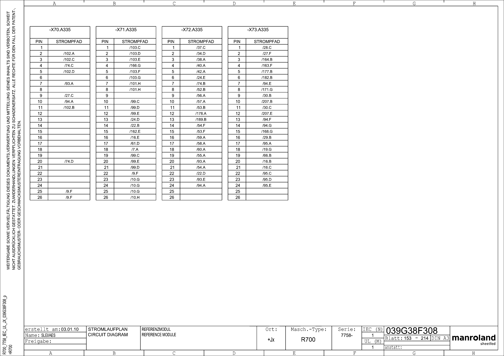

# +Jx — Sheet 153 of 214 — REFERENZMODUL

**REFERENCE MODULE**

> Part of the manroland **R700** printing press IEC/UL circuit diagrams.
> Drawing class: **Stromlaufplan / Circuit diagram** (DIN A3).
> Document `+Jx` covers the **1st printing module + feed register** machine section.

## At a glance

| Field | Value |
|---|---|
| Document | `+Jx`  (039G38F308) |
| Sheet | **153** of 214 |
| Section (DE) | REFERENZMODUL |
| Section (EN) | REFERENCE MODULE |
| Section type | REFERENCE_MODULE — Reference module |
| Machine type | `R700` |
| Series | `7758` |
| Created | 03.01.10 |
| Replaces | — |
| Columns used | A, B, C, D, E |
| Path numbers | — |
| Labels on sheet | 200 |
| Cross-refs out | 84 |
| Cross-refs in | 0 |

**Previous:** [+Jx sheet 152](SHEET_0152.md) · **Next:** [+Jx sheet 154](SHEET_0154.md) · **Document TOC:** [_TOC.md](_TOC.md)  (+Jx) · **Master TOC:** [all sheets](../_MASTER_TOC.md)

## Sheet image (300 DPI, exact vector render)



_Rendered directly from the PDF vector layer at 300 DPI (1-bit), no OCR and no resampling. Use it to confirm anything ambiguous in the text below._

## Cross-references on this sheet

Each entry is a wire leaving this sheet. The printed token is `/sheet.column`; the link resolves to that sheet inside the same document.

| Ref | Target sheet | Col | Path | Destination on target | Target section | From col |
|---|---|---|---|---|---|---|
| `/37.C` | [+Jx sheet 37](SHEET_0037.md) | C | — | — | STOP SICHERN | C |
| `/28.C` | [+Jx sheet 28](SHEET_0028.md) | C | — | — | KAMMERRAKEL | E |
| `/103.C` | [+Jx sheet 103](SHEET_0103.md) | C | — | — | RESERVE | B |
| `/27.F` | [+Jx sheet 27](SHEET_0027.md) | F | — | — | KAMMERRAKEL | E |
| `/102.A` | [+Jx sheet 102](SHEET_0102.md) | A | — | — | RESERVE | A |
| `/34.D` | [+Jx sheet 34](SHEET_0034.md) | D | — | — | NOT AUS | C |
| `/103.D` | [+Jx sheet 103](SHEET_0103.md) | D | — | — | RESERVE | B |
| `/38.A` | [+Jx sheet 38](SHEET_0038.md) | A | — | — | LAUFKOMMANDOS | C |
| `/103.E` | [+Jx sheet 103](SHEET_0103.md) | E | — | — | RESERVE | B |
| `/164.B` | [+Jx sheet 164](SHEET_0164.md) | B | — | — | OPTION: | E |
| `/102.C` | [+Jx sheet 102](SHEET_0102.md) | C | — | — | RESERVE | A |
| `/40.A` | [+Jx sheet 40](SHEET_0040.md) | A | — | — | LAUFKOMMANDOS | C |
| `/163.F` | [+Jx sheet 163](SHEET_0163.md) | F | — | — | OPTION: | E |
| `/74.C` | [+Jx sheet 74](SHEET_0074.md) | C | — | — | REDUNDANZ: ANTRIEBE | A |
| `/166.G` | [+Jx sheet 166](SHEET_0166.md) | G | — | — | OPTION: | B |
| `/42.A` | [+Jx sheet 42](SHEET_0042.md) | A | — | — | LAUFKOMMANDOS | C |
| `/177.B` | [+Jx sheet 177](SHEET_0177.md) | B | — | — | SCHUTZEINRICHTUNGEN | E |
| `/103.F` | [+Jx sheet 103](SHEET_0103.md) | F | — | — | RESERVE | B |
| `/102.D` | [+Jx sheet 102](SHEET_0102.md) | D | — | — | RESERVE | A |
| `/24.E` | [+Jx sheet 24](SHEET_0024.md) | E | — | — | HILFSANTRIEB, LACKDOSIER /AUFTRAGSWALZEN | C |
| `/182.B` | [+Jx sheet 182](SHEET_0182.md) | B | — | — | OPTION: TRANSFERMODUL 2 | E |
| `/103.G` | [+Jx sheet 103](SHEET_0103.md) | G | — | — | RESERVE | B |
| `/93.A` | [+Jx sheet 93](SHEET_0093.md) | A | — | — | RESERVE | A |
| `/74.B` | [+Jx sheet 74](SHEET_0074.md) | B | — | — | REDUNDANZ: ANTRIEBE | C |
| `/94.E` | [+Jx sheet 94](SHEET_0094.md) | E | — | — | RESERVE | E |
| `/101.H` | [+Jx sheet 101](SHEET_0101.md) | H | — | — | RESERVE | B |
| `/52.B` | [+Jx sheet 52](SHEET_0052.md) | B | — | — | SCHUTZEINRICHTUNGEN | C |
| `/171.G` | [+Jx sheet 171](SHEET_0171.md) | G | — | — | OPTION: AUTOMATISCHEM SPÜLEN | E |
| `/101.H` | [+Jx sheet 101](SHEET_0101.md) | H | — | — | RESERVE | B |
| `/56.A` | [+Jx sheet 56](SHEET_0056.md) | A | — | — | SCHUTZEINRICHTUNGEN | C |
| `/30.B` | [+Jx sheet 30](SHEET_0030.md) | B | — | — | LACKNIVEAUÜBERWACHUNG | E |
| `/27.C` | [+Jx sheet 27](SHEET_0027.md) | C | — | — | KAMMERRAKEL | A |
| `/94.A` | [+Jx sheet 94](SHEET_0094.md) | A | — | — | RESERVE | A |
| `/57.A` | [+Jx sheet 57](SHEET_0057.md) | A | — | — | SCHUTZEINRICHTUNGEN | C |
| `/207.B` | [+Jx sheet 207](SHEET_0207.md) | B | — | — | OPTION: ZWISCHENTROCKNER, VORBEREITUNG | E |
| `/99.C` | [+Jx sheet 99](SHEET_0099.md) | C | — | — | RESERVE | B |
| `/53.B` | [+Jx sheet 53](SHEET_0053.md) | B | — | — | SCHUTZEINRICHTUNGEN | C |
| `/102.B` | [+Jx sheet 102](SHEET_0102.md) | B | — | — | RESERVE | A |
| `/99.D` | [+Jx sheet 99](SHEET_0099.md) | D | — | — | RESERVE | B |
| `/30.C` | [+Jx sheet 30](SHEET_0030.md) | C | — | — | LACKNIVEAUÜBERWACHUNG | E |
| `/99.E` | [+Jx sheet 99](SHEET_0099.md) | E | — | — | RESERVE | B |
| `/178.A` | [+Jx sheet 178](SHEET_0178.md) | A | — | — | OPTION: TRANSFERMODUL 1 NACH | C |
| `/207.E` | [+Jx sheet 207](SHEET_0207.md) | E | — | — | OPTION: ZWISCHENTROCKNER, VORBEREITUNG | E |
| `/189.B` | [+Jx sheet 189](SHEET_0189.md) | B | — | — | OPTION: ZWISCHENTROCKNER, VORBEREITUNG | C |
| `/94.F` | [+Jx sheet 94](SHEET_0094.md) | F | — | — | RESERVE | E |
| `/24.D` | [+Jx sheet 24](SHEET_0024.md) | D | — | — | HILFSANTRIEB, LACKDOSIER /AUFTRAGSWALZEN | B |
| `/22.B` | [+Jx sheet 22](SHEET_0022.md) | B | — | — | LACKPUMPE | B |
| `/54.F` | [+Jx sheet 54](SHEET_0054.md) | F | — | — | SCHUTZEINRICHTUNGEN | C |
| `/94.G` | [+Jx sheet 94](SHEET_0094.md) | G | — | — | RESERVE | E |
| `/53.F` | [+Jx sheet 53](SHEET_0053.md) | F | — | — | SCHUTZEINRICHTUNGEN | C |
| `/162.E` | [+Jx sheet 162](SHEET_0162.md) | E | — | — | OPTION: | B |
| `/168.G` | [+Jx sheet 168](SHEET_0168.md) | G | — | — | OPTION: | E |
| `/16.E` | [+Jx sheet 16](SHEET_0016.md) | E | — | — | ÖLUMLAUFSCHMIERUNG | B |
| `/59.A` | [+Jx sheet 59](SHEET_0059.md) | A | — | — | SCHUTZEINRICHTUNGEN | C |
| `/29.B` | [+Jx sheet 29](SHEET_0029.md) | B | — | — | KAMMERRAKEL | E |
| `/58.A` | [+Jx sheet 58](SHEET_0058.md) | A | — | — | SCHUTZEINRICHTUNGEN | C |
| `/95.A` | [+Jx sheet 95](SHEET_0095.md) | A | — | — | RESERVE | E |
| `/61.D` | [+Jx sheet 61](SHEET_0061.md) | D | — | — | GTW | B |
| `/7.A` | [+Jx sheet 7](SHEET_0007.md) | A | — | — | SPANNUNGSVERSORGUNG, SCHALTSCHRANKBELÜFTUNG | B |
| `/60.A` | [+Jx sheet 60](SHEET_0060.md) | A | — | — | SCHUTZEINRICHTUNGEN | C |
| `/19.G` | [+Jx sheet 19](SHEET_0019.md) | G | — | — | LACKPUMPE | E |
| `/55.A` | [+Jx sheet 55](SHEET_0055.md) | A | — | — | SCHUTZEINRICHTUNGEN | C |
| `/66.B` | [+Jx sheet 66](SHEET_0066.md) | B | — | — | DRUCKANSTELLUNG | E |
| `/99.C` | [+Jx sheet 99](SHEET_0099.md) | C | — | — | RESERVE | B |
| `/99.E` | [+Jx sheet 99](SHEET_0099.md) | E | — | — | RESERVE | B |
| `/93.A` | [+Jx sheet 93](SHEET_0093.md) | A | — | — | RESERVE | C |
| `/16.B` | [+Jx sheet 16](SHEET_0016.md) | B | — | — | ÖLUMLAUFSCHMIERUNG | E |
| `/74.D` | [+Jx sheet 74](SHEET_0074.md) | D | — | — | REDUNDANZ: ANTRIEBE | A |
| `/54.A` | [+Jx sheet 54](SHEET_0054.md) | A | — | — | SCHUTZEINRICHTUNGEN | C |
| `/99.D` | [+Jx sheet 99](SHEET_0099.md) | D | — | — | RESERVE | B |
| `/16.C` | [+Jx sheet 16](SHEET_0016.md) | C | — | — | ÖLUMLAUFSCHMIERUNG | E |
| `/9.F` | [+Jx sheet 9](SHEET_0009.md) | F | — | — | SPANNUNGSVERSORGUNG, SCHALTSCHRANKBELÜFTUNG | B |
| `/22.D` | [+Jx sheet 22](SHEET_0022.md) | D | — | — | LACKPUMPE | C |
| `/95.C` | [+Jx sheet 95](SHEET_0095.md) | C | — | — | RESERVE | E |
| `/93.E` | [+Jx sheet 93](SHEET_0093.md) | E | — | — | RESERVE | C |
| `/10.G` | [+Jx sheet 10](SHEET_0010.md) | G | — | — | SPANNUNGSVERSORGUNG, SCHALTSCHRANKBELÜFTUNG | B |
| `/95.D` | [+Jx sheet 95](SHEET_0095.md) | D | — | — | RESERVE | E |
| `/94.A` | [+Jx sheet 94](SHEET_0094.md) | A | — | — | RESERVE | C |
| `/95.E` | [+Jx sheet 95](SHEET_0095.md) | E | — | — | RESERVE | E |
| `/10.G` | [+Jx sheet 10](SHEET_0010.md) | G | — | — | SPANNUNGSVERSORGUNG, SCHALTSCHRANKBELÜFTUNG | B |
| `/9.F` | [+Jx sheet 9](SHEET_0009.md) | F | — | — | SPANNUNGSVERSORGUNG, SCHALTSCHRANKBELÜFTUNG | A |
| `/10.G` | [+Jx sheet 10](SHEET_0010.md) | G | — | — | SPANNUNGSVERSORGUNG, SCHALTSCHRANKBELÜFTUNG | B |
| `/9.F` | [+Jx sheet 9](SHEET_0009.md) | F | — | — | SPANNUNGSVERSORGUNG, SCHALTSCHRANKBELÜFTUNG | A |
| `/10.H` | [+Jx sheet 10](SHEET_0010.md) | H | — | — | SPANNUNGSVERSORGUNG, SCHALTSCHRANKBELÜFTUNG | B |

## Devices on this sheet

| Tag | Class | Class meaning (IEC) | Col | Sub | Terminal | Sign |
|---|---|---|---|---|---|---|
| `X70.A335` | — | cross-device reference | A | — | — | — |
| `X71.A335` | — | cross-device reference | B | — | — | — |
| `X72.A335` | — | cross-device reference | C | — | — | — |
| `X73.A335` | — | cross-device reference | D | — | — | — |

## Potentials / nets

_No named potentials on this sheet._

## Wire-end annotations (grouped as printed)

A wire that continues elsewhere is annotated with a small cluster: the destination description, the path/line number `#NN`, and the `/sheet.column` cross reference. Each row below is one such cluster exactly as it is grouped on the drawing.

| Col | Y | Path | Cross-ref | Text on the wire |
|---|---|---|---|---|
| A | 65.4 | — | — | `X70.A335` |
| B | 65.4 | — | — | `X71.A335` |
| C | 65.4 | — | — | `X72.A335` |
| D | 65.4 | — | — | `X73.A335` |
| A | 94.1 | — | — | `PIN STROMPFAD` |
| B | 94.1 | — | — | `PIN STROMPFAD` |
| C | 94.1 | — | — | `PIN STROMPFAD` |
| D | 94.1 | — | — | `PIN STROMPFAD` |
| A | 108.3 | — | — | `2 3 4 5 6 7 8 9 1` |
| B | 108.3 | — | — | `2 3 4 5 6 7 8 9 1` |
| C | 108.3 | — | — | `2 3 4 5 6 7 8 9 1` |
| D | 108.3 | — | — | `2 3 4 5 6 7 8 9 1` |
| B | 108.7 | — | `/103.C` | — |
| C | 108.7 | — | `/37.C` | — |
| E | 108.7 | — | `/28.C` | — |
| A | 122.8 | — | `/102.A` | — |
| B | 122.8 | — | `/103.D` | — |
| C | 122.8 | — | `/34.D` | — |
| E | 122.8 | — | `/27.F` | — |
| A | 137.0 | — | `/102.C` | — |
| B | 137.0 | — | `/103.E` | — |
| C | 137.0 | — | `/38.A` | — |
| E | 137.0 | — | `/164.B` | — |
| C | 151.1 | — | `/40.A` | — |
| A | 151.2 | — | `/74.C` | — |
| B | 151.2 | — | `/166.G` | — |
| E | 151.2 | — | `/163.F` | — |
| A | 165.3 | — | `/102.D` | — |
| B | 165.3 | — | `/103.F` | — |
| C | 165.3 | — | `/42.A` | — |
| E | 165.3 | — | `/177.B` | — |
| B | 179.5 | — | `/103.G` | — |
| C | 179.5 | — | `/24.E` | — |
| E | 179.5 | — | `/182.B` | — |
| A | 193.7 | — | `/93.A` | — |
| B | 193.7 | — | `/101.H` | — |
| C | 193.7 | — | `/74.B` | — |
| E | 193.7 | — | `/94.E` | — |
| C | 207.8 | — | `/52.B` | — |
| B | 207.9 | — | `/101.H` | — |
| E | 207.9 | — | `/171.G` | — |
| A | 222.0 | — | `/27.C` | — |
| C | 222.0 | — | `/56.A` | — |
| E | 222.0 | — | `/30.B` | — |
| A | 235.9 | — | — | `10 12 13 14 15 16 17 18 19 20 11` |
| B | 235.9 | — | — | `10 12 13 14 15 16 17 18 19 20 11` |
| C | 235.9 | — | — | `10 12 13 14 15 16 17 18 19 20 11` |
| D | 235.9 | — | — | `10 12 13 14 15 16 17 18 19 20 11` |
| A | 236.2 | — | `/94.A` | — |
| B | 236.2 | — | `/99.C` | — |
| C | 236.2 | — | `/57.A` | — |
| E | 236.2 | — | `/207.B` | — |
| C | 250.3 | — | `/53.B` | — |
| A | 250.4 | — | `/102.B` | — |
| B | 250.4 | — | `/99.D` | — |
| E | 250.4 | — | `/30.C` | — |
| B | 264.5 | — | `/99.E` | — |
| C | 264.5 | — | `/178.A` | — |
| E | 264.5 | — | `/207.E` | — |
| B | 278.7 | — | `/24.D` | — |
| C | 278.7 | — | `/189.B` | — |
| E | 278.7 | — | `/94.F` | — |
| B | 292.9 | — | `/22.B` | — |
| C | 292.9 | — | `/54.F` | — |
| E | 292.9 | — | `/94.G` | — |
| B | 307.1 | — | `/162.E` | — |
| C | 307.1 | — | `/53.F` | — |
| E | 307.1 | — | `/168.G` | — |
| B | 321.2 | — | `/16.E` | — |
| C | 321.2 | — | `/59.A` | — |
| E | 321.2 | — | `/29.B` | — |
| B | 335.4 | — | `/61.D` | — |
| C | 335.4 | — | `/58.A` | — |
| E | 335.4 | — | `/95.A` | — |
| B | 349.5 | — | `/7.A` | — |
| C | 349.6 | — | `/60.A` | — |
| E | 349.6 | — | `/19.G` | — |
| C | 363.7 | — | `/55.A` | — |
| E | 363.7 | — | `/66.B` | — |
| B | 363.8 | — | `/99.C` | — |
| A | 377.9 | — | `/74.D` | — |
| B | 377.9 | — | `/99.E` | — |
| C | 377.9 | — | `/93.A` | — |
| E | 377.9 | — | `/16.B` | — |
| A | 391.8 | — | — | `22 23 24 25 26 21` |
| B | 391.8 | — | — | `22 23 24 25 26 21` |
| C | 391.8 | — | — | `22 23 24 25 26 21` |
| D | 391.8 | — | — | `22 23 24 25 26 21` |
| B | 392.1 | — | `/99.D` | — |
| C | 392.1 | — | `/54.A` | — |
| E | 392.1 | — | `/16.C` | — |
| B | 406.2 | — | `/9.F` | — |
| C | 406.3 | — | `/22.D` | — |
| E | 406.3 | — | `/95.C` | — |
| B | 420.4 | — | `/10.G` | — |
| C | 420.4 | — | `/93.E` | — |
| E | 420.5 | — | `/95.D` | — |
| B | 434.6 | — | `/10.G` | — |
| C | 434.6 | — | `/94.A` | — |
| E | 434.6 | — | `/95.E` | — |
| A | 448.8 | — | `/9.F` | — |
| B | 448.8 | — | `/10.G` | — |
| A | 462.9 | — | `/9.F` | — |
| B | 463.0 | — | `/10.H` | — |


## Reconstructed tables

This sheet carries tabular content (pin map / terminal assignment / index). The grid below was rebuilt from the drawing's own rule lines, so each row is exactly one physical row of the table.

### Table 1 — 26 data rows × 2 columns (at x=70.9, y=62.4) — **X70.A335**

| PIN | STROMPFAD |
|---|---|
| `1` |  |
| `2` | `/102.A` |
| `3` | `/102.C` |
| `4` | `/74.C` |
| `5` | `/102.D` |
| `6` |  |
| `7` | `/93.A` |
| `8` |  |
| `9` | `/27.C` |
| `10` | `/94.A` |
| `11` | `/102.B` |
| `12` |  |
| `13` |  |
| `14` |  |
| `15` |  |
| `16` |  |
| `17` |  |
| `18` |  |
| `19` |  |
| `20` | `/74.D` |
| `21` |  |
| `22` |  |
| `23` |  |
| `24` |  |
| `25` | `/9.F` |
| `26` | `/9.F` |


### Table 2 — 26 data rows × 2 columns (at x=226.8, y=62.4) — **X71.A335**

| PIN | STROMPFAD |
|---|---|
| `1` | `/103.C` |
| `2` | `/103.D` |
| `3` | `/103.E` |
| `4` | `/166.G` |
| `5` | `/103.F` |
| `6` | `/103.G` |
| `7` | `/101.H` |
| `8` | `/101.H` |
| `9` |  |
| `10` | `/99.C` |
| `11` | `/99.D` |
| `12` | `/99.E` |
| `13` | `/24.D` |
| `14` | `/22.B` |
| `15` | `/162.E` |
| `16` | `/16.E` |
| `17` | `/61.D` |
| `18` | `/7.A` |
| `19` | `/99.C` |
| `20` | `/99.E` |
| `21` | `/99.D` |
| `22` | `/9.F` |
| `23` | `/10.G` |
| `24` | `/10.G` |
| `25` | `/10.G` |
| `26` | `/10.H` |


### Table 3 — 26 data rows × 2 columns (at x=382.7, y=62.4) — **X72.A335**

| PIN | STROMPFAD |
|---|---|
| `1` | `/37.C` |
| `2` | `/34.D` |
| `3` | `/38.A` |
| `4` | `/40.A` |
| `5` | `/42.A` |
| `6` | `/24.E` |
| `7` | `/74.B` |
| `8` | `/52.B` |
| `9` | `/56.A` |
| `10` | `/57.A` |
| `11` | `/53.B` |
| `12` | `/178.A` |
| `13` | `/189.B` |
| `14` | `/54.F` |
| `15` | `/53.F` |
| `16` | `/59.A` |
| `17` | `/58.A` |
| `18` | `/60.A` |
| `19` | `/55.A` |
| `20` | `/93.A` |
| `21` | `/54.A` |
| `22` | `/22.D` |
| `23` | `/93.E` |
| `24` | `/94.A` |
| `25` |  |
| `26` |  |


### Table 4 — 26 data rows × 2 columns (at x=538.6, y=62.4) — **X73.A335**

| PIN | STROMPFAD |
|---|---|
| `1` | `/28.C` |
| `2` | `/27.F` |
| `3` | `/164.B` |
| `4` | `/163.F` |
| `5` | `/177.B` |
| `6` | `/182.B` |
| `7` | `/94.E` |
| `8` | `/171.G` |
| `9` | `/30.B` |
| `10` | `/207.B` |
| `11` | `/30.C` |
| `12` | `/207.E` |
| `13` | `/94.F` |
| `14` | `/94.G` |
| `15` | `/168.G` |
| `16` | `/29.B` |
| `17` | `/95.A` |
| `18` | `/19.G` |
| `19` | `/66.B` |
| `20` | `/16.B` |
| `21` | `/16.C` |
| `22` | `/95.C` |
| `23` | `/95.D` |
| `24` | `/95.E` |
| `25` |  |
| `26` |  |


## Notes and free text on this sheet

| Text | Col | Y (pt) |
|---|---|---|
| `PIN` | A | 94.13 |
| `STROMPFAD` | A | 94.09 |
| `PIN` | B | 94.13 |
| `STROMPFAD` | B | 94.09 |
| `PIN` | C | 94.13 |
| `STROMPFAD` | C | 94.09 |
| `PIN` | D | 94.13 |
| `STROMPFAD` | E | 94.09 |

## Complete label inventory (exact text from the drawing)

Every text object inside the drawing area of this sheet, in DIN reading order (column A→H, then top→bottom). This is the authoritative list: if a string is not here it is not printed on this sheet.

| Col | Y | X | Dir | Type | Text |
|---|---|---|---|---|---|
| A | 65.4 | 116.6 | → | device ref | `X70.A335` |
| A | 94.1 | 84.0 | → | text | `PIN` |
| A | 94.1 | 132.4 | → | text | `STROMPFAD` |
| A | 108.3 | 95.5 | → | number | `1` |
| A | 122.5 | 94.1 | → | number | `2` |
| A | 122.8 | 150.2 | → | cross-reference | `/102.A` |
| A | 136.7 | 94.1 | → | number | `3` |
| A | 137.0 | 150.2 | → | cross-reference | `/102.C` |
| A | 150.8 | 94.1 | → | number | `4` |
| A | 151.2 | 152.6 | → | cross-reference | `/74.C` |
| A | 165.0 | 94.1 | → | number | `5` |
| A | 165.4 | 150.2 | → | cross-reference | `/102.D` |
| A | 179.2 | 94.1 | → | number | `6` |
| A | 193.3 | 94.1 | → | number | `7` |
| A | 193.7 | 152.6 | → | cross-reference | `/93.A` |
| A | 207.5 | 94.1 | → | number | `8` |
| A | 221.7 | 94.1 | → | number | `9` |
| A | 222.0 | 152.6 | → | cross-reference | `/27.C` |
| A | 235.9 | 88.7 | → | number | `10` |
| A | 236.2 | 152.6 | → | cross-reference | `/94.A` |
| A | 250.0 | 90.1 | → | number | `11` |
| A | 250.4 | 150.4 | → | cross-reference | `/102.B` |
| A | 264.2 | 88.7 | → | number | `12` |
| A | 278.4 | 88.7 | → | number | `13` |
| A | 292.6 | 88.7 | → | number | `14` |
| A | 306.7 | 88.7 | → | number | `15` |
| A | 320.9 | 88.7 | → | number | `16` |
| A | 335.1 | 88.7 | → | number | `17` |
| A | 349.3 | 88.7 | → | number | `18` |
| A | 363.4 | 88.7 | → | number | `19` |
| A | 377.6 | 88.7 | → | number | `20` |
| A | 377.9 | 152.6 | → | cross-reference | `/74.D` |
| A | 391.8 | 90.1 | → | number | `21` |
| A | 405.9 | 88.7 | → | number | `22` |
| A | 420.1 | 88.7 | → | number | `23` |
| A | 434.3 | 88.7 | → | number | `24` |
| A | 448.5 | 88.7 | → | number | `25` |
| A | 448.8 | 155.5 | → | cross-reference | `/9.F` |
| A | 462.6 | 88.7 | → | number | `26` |
| A | 462.9 | 155.5 | → | cross-reference | `/9.F` |
| B | 65.4 | 272.6 | → | device ref | `X71.A335` |
| B | 94.1 | 240.0 | → | text | `PIN` |
| B | 94.1 | 288.3 | → | text | `STROMPFAD` |
| B | 108.3 | 251.4 | → | number | `1` |
| B | 108.7 | 306.1 | → | cross-reference | `/103.C` |
| B | 122.5 | 250.0 | → | number | `2` |
| B | 122.8 | 306.1 | → | cross-reference | `/103.D` |
| B | 136.7 | 250.0 | → | number | `3` |
| B | 137.0 | 306.3 | → | cross-reference | `/103.E` |
| B | 150.8 | 250.0 | → | number | `4` |
| B | 151.2 | 305.9 | → | cross-reference | `/166.G` |
| B | 165.0 | 250.0 | → | number | `5` |
| B | 165.3 | 306.6 | → | cross-reference | `/103.F` |
| B | 179.2 | 250.0 | → | number | `6` |
| B | 179.5 | 305.9 | → | cross-reference | `/103.G` |
| B | 193.3 | 250.0 | → | number | `7` |
| B | 193.7 | 306.3 | → | cross-reference | `/101.H` |
| B | 207.5 | 250.0 | → | number | `8` |
| B | 207.9 | 306.3 | → | cross-reference | `/101.H` |
| B | 221.7 | 250.0 | → | number | `9` |
| B | 235.9 | 244.6 | → | number | `10` |
| B | 236.2 | 308.6 | → | cross-reference | `/99.C` |
| B | 250.0 | 246.0 | → | number | `11` |
| B | 250.4 | 308.6 | → | cross-reference | `/99.D` |
| B | 264.2 | 244.6 | → | number | `12` |
| B | 264.5 | 308.7 | → | cross-reference | `/99.E` |
| B | 278.4 | 244.6 | → | number | `13` |
| B | 278.7 | 308.6 | → | cross-reference | `/24.D` |
| B | 292.6 | 244.6 | → | number | `14` |
| B | 292.9 | 308.7 | → | cross-reference | `/22.B` |
| B | 306.7 | 244.6 | → | number | `15` |
| B | 307.1 | 306.3 | → | cross-reference | `/162.E` |
| B | 320.9 | 244.6 | → | number | `16` |
| B | 321.2 | 308.7 | → | cross-reference | `/16.E` |
| B | 335.1 | 244.6 | → | number | `17` |
| B | 335.4 | 308.6 | → | cross-reference | `/61.D` |
| B | 349.3 | 244.6 | → | number | `18` |
| B | 349.5 | 311.0 | → | cross-reference | `/7.A` |
| B | 363.4 | 244.6 | → | number | `19` |
| B | 363.8 | 308.6 | → | cross-reference | `/99.C` |
| B | 377.6 | 244.6 | → | number | `20` |
| B | 377.9 | 308.7 | → | cross-reference | `/99.E` |
| B | 391.8 | 246.0 | → | number | `21` |
| B | 392.1 | 308.6 | → | cross-reference | `/99.D` |
| B | 405.9 | 244.6 | → | number | `22` |
| B | 406.2 | 311.4 | → | cross-reference | `/9.F` |
| B | 420.1 | 244.6 | → | number | `23` |
| B | 420.4 | 308.3 | → | cross-reference | `/10.G` |
| B | 434.3 | 244.6 | → | number | `24` |
| B | 434.6 | 308.3 | → | cross-reference | `/10.G` |
| B | 448.5 | 244.6 | → | number | `25` |
| B | 448.8 | 308.3 | → | cross-reference | `/10.G` |
| B | 462.6 | 244.6 | → | number | `26` |
| B | 463.0 | 308.7 | → | cross-reference | `/10.H` |
| C | 65.4 | 428.5 | → | device ref | `X72.A335` |
| C | 94.1 | 395.9 | → | text | `PIN` |
| C | 94.1 | 444.2 | → | text | `STROMPFAD` |
| C | 108.3 | 407.3 | → | number | `1` |
| C | 108.7 | 464.5 | → | cross-reference | `/37.C` |
| C | 122.5 | 405.9 | → | number | `2` |
| C | 122.8 | 464.5 | → | cross-reference | `/34.D` |
| C | 136.7 | 405.9 | → | number | `3` |
| C | 137.0 | 464.5 | → | cross-reference | `/38.A` |
| C | 150.8 | 405.9 | → | number | `4` |
| C | 151.1 | 464.5 | → | cross-reference | `/40.A` |
| C | 165.0 | 405.9 | → | number | `5` |
| C | 165.3 | 464.5 | → | cross-reference | `/42.A` |
| C | 179.2 | 405.9 | → | number | `6` |
| C | 179.5 | 464.6 | → | cross-reference | `/24.E` |
| C | 193.3 | 405.9 | → | number | `7` |
| C | 193.7 | 464.6 | → | cross-reference | `/74.B` |
| C | 207.5 | 405.9 | → | number | `8` |
| C | 207.8 | 464.6 | → | cross-reference | `/52.B` |
| C | 221.7 | 405.9 | → | number | `9` |
| C | 222.0 | 464.5 | → | cross-reference | `/56.A` |
| C | 235.9 | 400.5 | → | number | `10` |
| C | 236.2 | 464.5 | → | cross-reference | `/57.A` |
| C | 250.0 | 402.0 | → | number | `11` |
| C | 250.3 | 464.6 | → | cross-reference | `/53.B` |
| C | 264.2 | 400.5 | → | number | `12` |
| C | 264.5 | 462.0 | → | cross-reference | `/178.A` |
| C | 278.4 | 400.5 | → | number | `13` |
| C | 278.7 | 462.2 | → | cross-reference | `/189.B` |
| C | 292.6 | 400.5 | → | number | `14` |
| C | 292.9 | 464.9 | → | cross-reference | `/54.F` |
| C | 306.7 | 400.5 | → | number | `15` |
| C | 307.1 | 464.9 | → | cross-reference | `/53.F` |
| C | 320.9 | 400.5 | → | number | `16` |
| C | 321.2 | 464.5 | → | cross-reference | `/59.A` |
| C | 335.1 | 400.5 | → | number | `17` |
| C | 335.4 | 464.5 | → | cross-reference | `/58.A` |
| C | 349.3 | 400.5 | → | number | `18` |
| C | 349.6 | 464.5 | → | cross-reference | `/60.A` |
| C | 363.4 | 400.5 | → | number | `19` |
| C | 363.7 | 464.5 | → | cross-reference | `/55.A` |
| C | 377.6 | 400.5 | → | number | `20` |
| C | 377.9 | 464.5 | → | cross-reference | `/93.A` |
| C | 391.8 | 402.0 | → | number | `21` |
| C | 392.1 | 464.5 | → | cross-reference | `/54.A` |
| C | 405.9 | 400.5 | → | number | `22` |
| C | 406.3 | 464.5 | → | cross-reference | `/22.D` |
| C | 420.1 | 400.5 | → | number | `23` |
| C | 420.4 | 464.6 | → | cross-reference | `/93.E` |
| C | 434.3 | 400.5 | → | number | `24` |
| C | 434.6 | 464.5 | → | cross-reference | `/94.A` |
| C | 448.5 | 400.5 | → | number | `25` |
| C | 462.6 | 400.5 | → | number | `26` |
| D | 65.4 | 584.4 | → | device ref | `X73.A335` |
| D | 94.1 | 551.8 | → | text | `PIN` |
| D | 108.3 | 563.2 | → | number | `1` |
| D | 122.5 | 561.8 | → | number | `2` |
| D | 136.7 | 561.8 | → | number | `3` |
| D | 150.8 | 561.8 | → | number | `4` |
| D | 165.0 | 561.8 | → | number | `5` |
| D | 179.2 | 561.8 | → | number | `6` |
| D | 193.3 | 561.8 | → | number | `7` |
| D | 207.5 | 561.8 | → | number | `8` |
| D | 221.7 | 561.8 | → | number | `9` |
| D | 235.9 | 556.4 | → | number | `10` |
| D | 250.0 | 557.9 | → | number | `11` |
| D | 264.2 | 556.4 | → | number | `12` |
| D | 278.4 | 556.4 | → | number | `13` |
| D | 292.6 | 556.4 | → | number | `14` |
| D | 306.7 | 556.4 | → | number | `15` |
| D | 320.9 | 556.4 | → | number | `16` |
| D | 335.1 | 556.4 | → | number | `17` |
| D | 349.3 | 556.4 | → | number | `18` |
| D | 363.4 | 556.4 | → | number | `19` |
| D | 377.6 | 556.4 | → | number | `20` |
| D | 391.8 | 557.9 | → | number | `21` |
| D | 405.9 | 556.4 | → | number | `22` |
| D | 420.1 | 556.4 | → | number | `23` |
| D | 434.3 | 556.4 | → | number | `24` |
| D | 448.5 | 556.4 | → | number | `25` |
| D | 462.6 | 556.4 | → | number | `26` |
| E | 94.1 | 600.1 | → | text | `STROMPFAD` |
| E | 108.7 | 620.4 | → | cross-reference | `/28.C` |
| E | 122.8 | 620.8 | → | cross-reference | `/27.F` |
| E | 137.0 | 618.1 | → | cross-reference | `/164.B` |
| E | 151.2 | 618.4 | → | cross-reference | `/163.F` |
| E | 165.3 | 618.1 | → | cross-reference | `/177.B` |
| E | 179.5 | 618.1 | → | cross-reference | `/182.B` |
| E | 193.7 | 620.5 | → | cross-reference | `/94.E` |
| E | 207.9 | 617.7 | → | cross-reference | `/171.G` |
| E | 222.0 | 620.5 | → | cross-reference | `/30.B` |
| E | 236.2 | 618.1 | → | cross-reference | `/207.B` |
| E | 250.4 | 620.4 | → | cross-reference | `/30.C` |
| E | 264.5 | 618.1 | → | cross-reference | `/207.E` |
| E | 278.7 | 620.8 | → | cross-reference | `/94.F` |
| E | 292.9 | 620.1 | → | cross-reference | `/94.G` |
| E | 307.1 | 617.7 | → | cross-reference | `/168.G` |
| E | 321.2 | 620.5 | → | cross-reference | `/29.B` |
| E | 335.4 | 620.4 | → | cross-reference | `/95.A` |
| E | 349.6 | 620.1 | → | cross-reference | `/19.G` |
| E | 363.7 | 620.5 | → | cross-reference | `/66.B` |
| E | 377.9 | 620.5 | → | cross-reference | `/16.B` |
| E | 392.1 | 620.4 | → | cross-reference | `/16.C` |
| E | 406.3 | 620.4 | → | cross-reference | `/95.C` |
| E | 420.5 | 620.4 | → | cross-reference | `/95.D` |
| E | 434.6 | 620.5 | → | cross-reference | `/95.E` |

## Reading-order text block

The same content as a plain block, grouped by DIN column — convenient to paste or to match against a visual description.

```text
=== Column A ===
  65.4  116.6  devref       X70.A335
  94.1   84.0  text         PIN
  94.1  132.4  text         STROMPFAD
 108.3   95.5  numeric      1
 122.5   94.1  numeric      2
 122.8  150.2  xref         /102.A
 136.7   94.1  numeric      3
 137.0  150.2  xref         /102.C
 150.8   94.1  numeric      4
 151.2  152.6  xref         /74.C
 165.0   94.1  numeric      5
 165.4  150.2  xref         /102.D
 179.2   94.1  numeric      6
 193.3   94.1  numeric      7
 193.7  152.6  xref         /93.A
 207.5   94.1  numeric      8
 221.7   94.1  numeric      9
 222.0  152.6  xref         /27.C
 235.9   88.7  numeric      10
 236.2  152.6  xref         /94.A
 250.0   90.1  numeric      11
 250.4  150.4  xref         /102.B
 264.2   88.7  numeric      12
 278.4   88.7  numeric      13
 292.6   88.7  numeric      14
 306.7   88.7  numeric      15
 320.9   88.7  numeric      16
 335.1   88.7  numeric      17
 349.3   88.7  numeric      18
 363.4   88.7  numeric      19
 377.6   88.7  numeric      20
 377.9  152.6  xref         /74.D
 391.8   90.1  numeric      21
 405.9   88.7  numeric      22
 420.1   88.7  numeric      23
 434.3   88.7  numeric      24
 448.5   88.7  numeric      25
 448.8  155.5  xref         /9.F
 462.6   88.7  numeric      26
 462.9  155.5  xref         /9.F
=== Column B ===
  65.4  272.6  devref       X71.A335
  94.1  240.0  text         PIN
  94.1  288.3  text         STROMPFAD
 108.3  251.4  numeric      1
 108.7  306.1  xref         /103.C
 122.5  250.0  numeric      2
 122.8  306.1  xref         /103.D
 136.7  250.0  numeric      3
 137.0  306.3  xref         /103.E
 150.8  250.0  numeric      4
 151.2  305.9  xref         /166.G
 165.0  250.0  numeric      5
 165.3  306.6  xref         /103.F
 179.2  250.0  numeric      6
 179.5  305.9  xref         /103.G
 193.3  250.0  numeric      7
 193.7  306.3  xref         /101.H
 207.5  250.0  numeric      8
 207.9  306.3  xref         /101.H
 221.7  250.0  numeric      9
 235.9  244.6  numeric      10
 236.2  308.6  xref         /99.C
 250.0  246.0  numeric      11
 250.4  308.6  xref         /99.D
 264.2  244.6  numeric      12
 264.5  308.7  xref         /99.E
 278.4  244.6  numeric      13
 278.7  308.6  xref         /24.D
 292.6  244.6  numeric      14
 292.9  308.7  xref         /22.B
 306.7  244.6  numeric      15
 307.1  306.3  xref         /162.E
 320.9  244.6  numeric      16
 321.2  308.7  xref         /16.E
 335.1  244.6  numeric      17
 335.4  308.6  xref         /61.D
 349.3  244.6  numeric      18
 349.5  311.0  xref         /7.A
 363.4  244.6  numeric      19
 363.8  308.6  xref         /99.C
 377.6  244.6  numeric      20
 377.9  308.7  xref         /99.E
 391.8  246.0  numeric      21
 392.1  308.6  xref         /99.D
 405.9  244.6  numeric      22
 406.2  311.4  xref         /9.F
 420.1  244.6  numeric      23
 420.4  308.3  xref         /10.G
 434.3  244.6  numeric      24
 434.6  308.3  xref         /10.G
 448.5  244.6  numeric      25
 448.8  308.3  xref         /10.G
 462.6  244.6  numeric      26
 463.0  308.7  xref         /10.H
=== Column C ===
  65.4  428.5  devref       X72.A335
  94.1  395.9  text         PIN
  94.1  444.2  text         STROMPFAD
 108.3  407.3  numeric      1
 108.7  464.5  xref         /37.C
 122.5  405.9  numeric      2
 122.8  464.5  xref         /34.D
 136.7  405.9  numeric      3
 137.0  464.5  xref         /38.A
 150.8  405.9  numeric      4
 151.1  464.5  xref         /40.A
 165.0  405.9  numeric      5
 165.3  464.5  xref         /42.A
 179.2  405.9  numeric      6
 179.5  464.6  xref         /24.E
 193.3  405.9  numeric      7
 193.7  464.6  xref         /74.B
 207.5  405.9  numeric      8
 207.8  464.6  xref         /52.B
 221.7  405.9  numeric      9
 222.0  464.5  xref         /56.A
 235.9  400.5  numeric      10
 236.2  464.5  xref         /57.A
 250.0  402.0  numeric      11
 250.3  464.6  xref         /53.B
 264.2  400.5  numeric      12
 264.5  462.0  xref         /178.A
 278.4  400.5  numeric      13
 278.7  462.2  xref         /189.B
 292.6  400.5  numeric      14
 292.9  464.9  xref         /54.F
 306.7  400.5  numeric      15
 307.1  464.9  xref         /53.F
 320.9  400.5  numeric      16
 321.2  464.5  xref         /59.A
 335.1  400.5  numeric      17
 335.4  464.5  xref         /58.A
 349.3  400.5  numeric      18
 349.6  464.5  xref         /60.A
 363.4  400.5  numeric      19
 363.7  464.5  xref         /55.A
 377.6  400.5  numeric      20
 377.9  464.5  xref         /93.A
 391.8  402.0  numeric      21
 392.1  464.5  xref         /54.A
 405.9  400.5  numeric      22
 406.3  464.5  xref         /22.D
 420.1  400.5  numeric      23
 420.4  464.6  xref         /93.E
 434.3  400.5  numeric      24
 434.6  464.5  xref         /94.A
 448.5  400.5  numeric      25
 462.6  400.5  numeric      26
=== Column D ===
  65.4  584.4  devref       X73.A335
  94.1  551.8  text         PIN
 108.3  563.2  numeric      1
 122.5  561.8  numeric      2
 136.7  561.8  numeric      3
 150.8  561.8  numeric      4
 165.0  561.8  numeric      5
 179.2  561.8  numeric      6
 193.3  561.8  numeric      7
 207.5  561.8  numeric      8
 221.7  561.8  numeric      9
 235.9  556.4  numeric      10
 250.0  557.9  numeric      11
 264.2  556.4  numeric      12
 278.4  556.4  numeric      13
 292.6  556.4  numeric      14
 306.7  556.4  numeric      15
 320.9  556.4  numeric      16
 335.1  556.4  numeric      17
 349.3  556.4  numeric      18
 363.4  556.4  numeric      19
 377.6  556.4  numeric      20
 391.8  557.9  numeric      21
 405.9  556.4  numeric      22
 420.1  556.4  numeric      23
 434.3  556.4  numeric      24
 448.5  556.4  numeric      25
 462.6  556.4  numeric      26
=== Column E ===
  94.1  600.1  text         STROMPFAD
 108.7  620.4  xref         /28.C
 122.8  620.8  xref         /27.F
 137.0  618.1  xref         /164.B
 151.2  618.4  xref         /163.F
 165.3  618.1  xref         /177.B
 179.5  618.1  xref         /182.B
 193.7  620.5  xref         /94.E
 207.9  617.7  xref         /171.G
 222.0  620.5  xref         /30.B
 236.2  618.1  xref         /207.B
 250.4  620.4  xref         /30.C
 264.5  618.1  xref         /207.E
 278.7  620.8  xref         /94.F
 292.9  620.1  xref         /94.G
 307.1  617.7  xref         /168.G
 321.2  620.5  xref         /29.B
 335.4  620.4  xref         /95.A
 349.6  620.1  xref         /19.G
 363.7  620.5  xref         /66.B
 377.9  620.5  xref         /16.B
 392.1  620.4  xref         /16.C
 406.3  620.4  xref         /95.C
 420.5  620.4  xref         /95.D
 434.6  620.5  xref         /95.E
```

---
_Generated from the PDF vector text layer; no OCR. Source: `R700_7758_IEC_UL_JX_039G38F308_p`, sheet 153._
