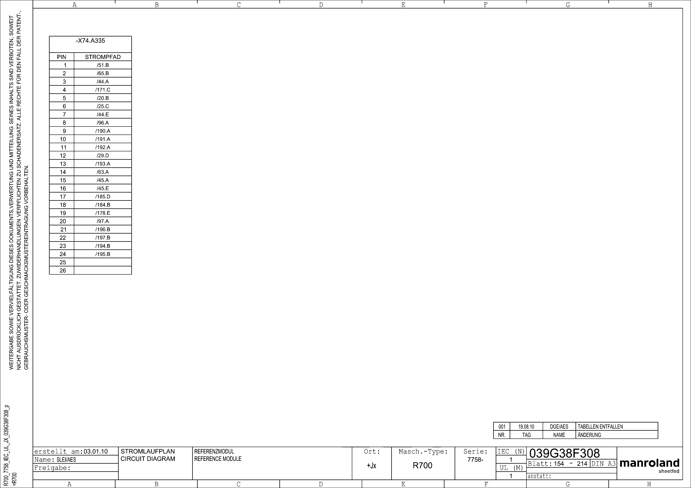

# +Jx — Sheet 154 of 214 — REFERENZMODUL

**REFERENCE MODULE**

> Part of the manroland **R700** printing press IEC/UL circuit diagrams.
> Drawing class: **Stromlaufplan / Circuit diagram** (DIN A3).
> Document `+Jx` covers the **1st printing module + feed register** machine section.

## At a glance

| Field | Value |
|---|---|
| Document | `+Jx`  (039G38F308) |
| Sheet | **154** of 214 |
| Section (DE) | REFERENZMODUL |
| Section (EN) | REFERENCE MODULE |
| Section type | REFERENCE_MODULE — Reference module |
| Machine type | `R700` |
| Series | `7758` |
| Created | 03.01.10 |
| Replaces | — |
| Columns used | A, F, G |
| Path numbers | — |
| Labels on sheet | 61 |
| Cross-refs out | 24 |
| Cross-refs in | 0 |

**Previous:** [+Jx sheet 153](SHEET_0153.md) · **Next:** [+Jx sheet 155](SHEET_0155.md) · **Document TOC:** [_TOC.md](_TOC.md)  (+Jx) · **Master TOC:** [all sheets](../_MASTER_TOC.md)

## Sheet image (300 DPI, exact vector render)



_Rendered directly from the PDF vector layer at 300 DPI (1-bit), no OCR and no resampling. Use it to confirm anything ambiguous in the text below._

## Cross-references on this sheet

Each entry is a wire leaving this sheet. The printed token is `/sheet.column`; the link resolves to that sheet inside the same document.

| Ref | Target sheet | Col | Path | Destination on target | Target section | From col |
|---|---|---|---|---|---|---|
| `/51.B` | [+Jx sheet 51](SHEET_0051.md) | B | — | — | SIGNALGEBER: AKUSTISCHE WARNSIGNALE | A |
| `/65.B` | [+Jx sheet 65](SHEET_0065.md) | B | — | — | TROPFEINRICHTUNG | A |
| `/44.A` | [+Jx sheet 44](SHEET_0044.md) | A | — | — | MASCHINENBEDIENUNG | A |
| `/171.C` | [+Jx sheet 171](SHEET_0171.md) | C | — | — | OPTION: AUTOMATISCHEM SPÜLEN | A |
| `/20.B` | [+Jx sheet 20](SHEET_0020.md) | B | — | — | LACKPUMPE | A |
| `/25.C` | [+Jx sheet 25](SHEET_0025.md) | C | — | — | HILFSANTRIEB, LACKDOSIER /AUFTRAGSWALZEN | A |
| `/44.E` | [+Jx sheet 44](SHEET_0044.md) | E | — | — | MASCHINENBEDIENUNG | A |
| `/96.A` | [+Jx sheet 96](SHEET_0096.md) | A | — | — | RESERVE | A |
| `/190.A` | [+Jx sheet 190](SHEET_0190.md) | A | — | — | OPTION: ZWISCHENTROCKNER, VORBEREITUNG | A |
| `/191.A` | [+Jx sheet 191](SHEET_0191.md) | A | — | — | OPTION: ZWISCHENTROCKNER, VORBEREITUNG | A |
| `/192.A` | [+Jx sheet 192](SHEET_0192.md) | A | — | — | OPTION: ZWISCHENTROCKNER, VORBEREITUNG | A |
| `/29.D` | [+Jx sheet 29](SHEET_0029.md) | D | — | — | KAMMERRAKEL | A |
| `/193.A` | [+Jx sheet 193](SHEET_0193.md) | A | — | — | OPTION: ZWISCHENTROCKNER, VORBEREITUNG | A |
| `/63.A` | [+Jx sheet 63](SHEET_0063.md) | A | — | — | LACKAUFTRAGSWALZE | A |
| `/45.A` | [+Jx sheet 45](SHEET_0045.md) | A | — | — | MASCHINENBEDIENUNG | A |
| `/45.E` | [+Jx sheet 45](SHEET_0045.md) | E | — | — | MASCHINENBEDIENUNG | A |
| `/185.D` | [+Jx sheet 185](SHEET_0185.md) | D | — | — | OPTION: TRANSFERMODUL 1 + 2 | A |
| `/184.B` | [+Jx sheet 184](SHEET_0184.md) | B | — | — | OPTION: TRANSFERMODUL 1 + 2 | A |
| `/178.E` | [+Jx sheet 178](SHEET_0178.md) | E | — | — | OPTION: TRANSFERMODUL 1 NACH | A |
| `/97.A` | [+Jx sheet 97](SHEET_0097.md) | A | — | — | RESERVE | A |
| `/196.B` | [+Jx sheet 196](SHEET_0196.md) | B | — | — | OPTION: ZWISCHENTROCKNER, VORBEREITUNG | A |
| `/197.B` | [+Jx sheet 197](SHEET_0197.md) | B | — | — | OPTION: ZWISCHENTROCKNER, VORBEREITUNG | A |
| `/194.B` | [+Jx sheet 194](SHEET_0194.md) | B | — | — | OPTION: ZWISCHENTROCKNER, VORBEREITUNG | A |
| `/195.B` | [+Jx sheet 195](SHEET_0195.md) | B | — | — | OPTION: ZWISCHENTROCKNER, VORBEREITUNG | A |

## Devices on this sheet

| Tag | Class | Class meaning (IEC) | Col | Sub | Terminal | Sign |
|---|---|---|---|---|---|---|
| `NR.` | — | cross-device reference | F | — | — | — |
| `19.08.10` | — | cross-device reference | F | — | — | — |
| `X74.A335` | — | cross-device reference | A | — | — | — |

## Potentials / nets

_No named potentials on this sheet._

## Wire-end annotations (grouped as printed)

A wire that continues elsewhere is annotated with a small cluster: the destination description, the path/line number `#NN`, and the `/sheet.column` cross reference. Each row below is one such cluster exactly as it is grouped on the drawing.

| Col | Y | Path | Cross-ref | Text on the wire |
|---|---|---|---|---|
| A | 65.4 | — | — | `X74.A335` |
| A | 94.1 | — | — | `PIN STROMPFAD` |
| A | 108.3 | — | — | `2 3 4 5 6 7 8 9 1` |
| A | 108.6 | — | `/51.B` | — |
| A | 122.8 | — | `/65.B` | — |
| A | 137.0 | — | `/44.A` | — |
| A | 151.2 | — | `/171.C` | — |
| A | 165.3 | — | `/20.B` | — |
| A | 179.5 | — | `/25.C` | — |
| A | 193.7 | — | `/44.E` | — |
| A | 207.8 | — | `/96.A` | — |
| A | 222.0 | — | `/190.A` | — |
| A | 235.9 | — | — | `10 12 13 14 15 16 17 18 19 20 11` |
| A | 236.2 | — | `/191.A` | — |
| A | 250.4 | — | `/192.A` | — |
| A | 264.6 | — | `/29.D` | — |
| A | 278.7 | — | `/193.A` | — |
| A | 292.9 | — | `/63.A` | — |
| A | 307.0 | — | `/45.A` | — |
| A | 321.2 | — | `/45.E` | — |
| A | 335.4 | — | `/185.D` | — |
| A | 349.6 | — | `/184.B` | — |
| A | 363.8 | — | `/178.E` | — |
| A | 377.9 | — | `/97.A` | — |
| A | 391.8 | — | — | `22 23 24 25 26 21` |
| A | 392.1 | — | `/196.B` | — |
| A | 406.3 | — | `/197.B` | — |
| A | 420.4 | — | `/194.B` | — |
| A | 434.6 | — | `/195.B` | — |
| G | 733.0 | — | — | `001 19.08.10 DGE/AES TABELLEN ENTFALLEN` |
| G | 747.1 | — | — | `NR. TAG NAME ÄNDERUNG` |


## Reconstructed tables

This sheet carries tabular content (pin map / terminal assignment / index). The grid below was rebuilt from the drawing's own rule lines, so each row is exactly one physical row of the table.

### Table 1 — 26 data rows × 2 columns (at x=85.0, y=62.4) — **X74.A335**

| PIN | STROMPFAD |
|---|---|
| `1` | `/51.B` |
| `2` | `/65.B` |
| `3` | `/44.A` |
| `4` | `/171.C` |
| `5` | `/20.B` |
| `6` | `/25.C` |
| `7` | `/44.E` |
| `8` | `/96.A` |
| `9` | `/190.A` |
| `10` | `/191.A` |
| `11` | `/192.A` |
| `12` | `/29.D` |
| `13` | `/193.A` |
| `14` | `/63.A` |
| `15` | `/45.A` |
| `16` | `/45.E` |
| `17` | `/185.D` |
| `18` | `/184.B` |
| `19` | `/178.E` |
| `20` | `/97.A` |
| `21` | `/196.B` |
| `22` | `/197.B` |
| `23` | `/194.B` |
| `24` | `/195.B` |
| `25` |  |
| `26` |  |


## Notes and free text on this sheet

| Text | Col | Y (pt) |
|---|---|---|
| `TAG` | G | 747.23 |
| `NAME` | G | 747.22 |
| `ÄNDERUNG` | G | 747.25 |
| `DGE/AES` | G | 733.06 |
| `TABELLEN ENTFALLEN` | G | 733.1 |
| `PIN` | A | 94.13 |
| `STROMPFAD` | A | 94.09 |

## Complete label inventory (exact text from the drawing)

Every text object inside the drawing area of this sheet, in DIN reading order (column A→H, then top→bottom). This is the authoritative list: if a string is not here it is not printed on this sheet.

| Col | Y | X | Dir | Type | Text |
|---|---|---|---|---|---|
| A | 65.4 | 130.8 | → | device ref | `X74.A335` |
| A | 94.1 | 98.2 | → | text | `PIN` |
| A | 94.1 | 146.6 | → | text | `STROMPFAD` |
| A | 108.3 | 109.7 | → | number | `1` |
| A | 108.6 | 167.0 | → | cross-reference | `/51.B` |
| A | 122.5 | 108.3 | → | number | `2` |
| A | 122.8 | 167.0 | → | cross-reference | `/65.B` |
| A | 136.7 | 108.3 | → | number | `3` |
| A | 137.0 | 166.8 | → | cross-reference | `/44.A` |
| A | 150.8 | 108.3 | → | number | `4` |
| A | 151.2 | 164.4 | → | cross-reference | `/171.C` |
| A | 165.0 | 108.3 | → | number | `5` |
| A | 165.3 | 167.0 | → | cross-reference | `/20.B` |
| A | 179.2 | 108.3 | → | number | `6` |
| A | 179.5 | 166.8 | → | cross-reference | `/25.C` |
| A | 193.3 | 108.3 | → | number | `7` |
| A | 193.7 | 167.0 | → | cross-reference | `/44.E` |
| A | 207.5 | 108.3 | → | number | `8` |
| A | 207.8 | 166.8 | → | cross-reference | `/96.A` |
| A | 221.7 | 108.3 | → | number | `9` |
| A | 222.0 | 164.4 | → | cross-reference | `/190.A` |
| A | 235.9 | 102.9 | → | number | `10` |
| A | 236.2 | 164.4 | → | cross-reference | `/191.A` |
| A | 250.0 | 104.3 | → | number | `11` |
| A | 250.4 | 164.4 | → | cross-reference | `/192.A` |
| A | 264.2 | 102.9 | → | number | `12` |
| A | 264.6 | 166.8 | → | cross-reference | `/29.D` |
| A | 278.4 | 102.9 | → | number | `13` |
| A | 278.7 | 164.4 | → | cross-reference | `/193.A` |
| A | 292.6 | 102.9 | → | number | `14` |
| A | 292.9 | 166.8 | → | cross-reference | `/63.A` |
| A | 306.7 | 102.9 | → | number | `15` |
| A | 307.0 | 166.8 | → | cross-reference | `/45.A` |
| A | 320.9 | 102.9 | → | number | `16` |
| A | 321.2 | 167.0 | → | cross-reference | `/45.E` |
| A | 335.1 | 102.9 | → | number | `17` |
| A | 335.4 | 164.4 | → | cross-reference | `/185.D` |
| A | 349.3 | 102.9 | → | number | `18` |
| A | 349.6 | 164.6 | → | cross-reference | `/184.B` |
| A | 363.4 | 102.9 | → | number | `19` |
| A | 363.7 | 164.6 | → | cross-reference | `/178.E` |
| A | 377.6 | 102.9 | → | number | `20` |
| A | 377.9 | 166.8 | → | cross-reference | `/97.A` |
| A | 391.8 | 104.3 | → | number | `21` |
| A | 392.1 | 164.6 | → | cross-reference | `/196.B` |
| A | 405.9 | 102.9 | → | number | `22` |
| A | 406.3 | 164.6 | → | cross-reference | `/197.B` |
| A | 420.1 | 102.9 | → | number | `23` |
| A | 420.4 | 164.6 | → | cross-reference | `/194.B` |
| A | 434.3 | 102.9 | → | number | `24` |
| A | 434.6 | 164.6 | → | cross-reference | `/195.B` |
| A | 448.5 | 102.9 | → | number | `25` |
| A | 462.6 | 102.9 | → | number | `26` |
| F | 733.0 | 859.3 | → | number | `001` |
| F | 733.1 | 893.2 | → | device ref | `19.08.10` |
| F | 747.1 | 858.5 | → | device ref | `NR.` |
| G | 733.1 | 948.0 | → | text | `DGE/AES` |
| G | 733.1 | 995.7 | → | text | `TABELLEN ENTFALLEN` |
| G | 747.2 | 900.1 | → | text | `TAG` |
| G | 747.2 | 953.5 | → | text | `NAME` |
| G | 747.3 | 995.7 | → | text | `ÄNDERUNG` |

## Reading-order text block

The same content as a plain block, grouped by DIN column — convenient to paste or to match against a visual description.

```text
=== Column A ===
  65.4  130.8  devref       X74.A335
  94.1   98.2  text         PIN
  94.1  146.6  text         STROMPFAD
 108.3  109.7  numeric      1
 108.6  167.0  xref         /51.B
 122.5  108.3  numeric      2
 122.8  167.0  xref         /65.B
 136.7  108.3  numeric      3
 137.0  166.8  xref         /44.A
 150.8  108.3  numeric      4
 151.2  164.4  xref         /171.C
 165.0  108.3  numeric      5
 165.3  167.0  xref         /20.B
 179.2  108.3  numeric      6
 179.5  166.8  xref         /25.C
 193.3  108.3  numeric      7
 193.7  167.0  xref         /44.E
 207.5  108.3  numeric      8
 207.8  166.8  xref         /96.A
 221.7  108.3  numeric      9
 222.0  164.4  xref         /190.A
 235.9  102.9  numeric      10
 236.2  164.4  xref         /191.A
 250.0  104.3  numeric      11
 250.4  164.4  xref         /192.A
 264.2  102.9  numeric      12
 264.6  166.8  xref         /29.D
 278.4  102.9  numeric      13
 278.7  164.4  xref         /193.A
 292.6  102.9  numeric      14
 292.9  166.8  xref         /63.A
 306.7  102.9  numeric      15
 307.0  166.8  xref         /45.A
 320.9  102.9  numeric      16
 321.2  167.0  xref         /45.E
 335.1  102.9  numeric      17
 335.4  164.4  xref         /185.D
 349.3  102.9  numeric      18
 349.6  164.6  xref         /184.B
 363.4  102.9  numeric      19
 363.7  164.6  xref         /178.E
 377.6  102.9  numeric      20
 377.9  166.8  xref         /97.A
 391.8  104.3  numeric      21
 392.1  164.6  xref         /196.B
 405.9  102.9  numeric      22
 406.3  164.6  xref         /197.B
 420.1  102.9  numeric      23
 420.4  164.6  xref         /194.B
 434.3  102.9  numeric      24
 434.6  164.6  xref         /195.B
 448.5  102.9  numeric      25
 462.6  102.9  numeric      26
=== Column F ===
 733.0  859.3  numeric      001
 733.1  893.2  devref       19.08.10
 747.1  858.5  devref       NR.
=== Column G ===
 733.1  948.0  text         DGE/AES
 733.1  995.7  text         TABELLEN ENTFALLEN
 747.2  900.1  text         TAG
 747.2  953.5  text         NAME
 747.3  995.7  text         ÄNDERUNG
```

---
_Generated from the PDF vector text layer; no OCR. Source: `R700_7758_IEC_UL_JX_039G38F308_p`, sheet 154._
