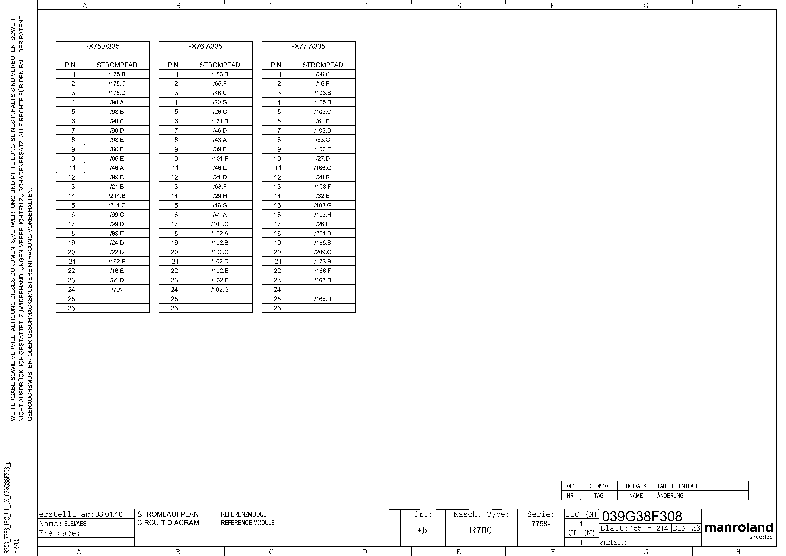

# +Jx — Sheet 155 of 214 — REFERENZMODUL

**REFERENCE MODULE**

> Part of the manroland **R700** printing press IEC/UL circuit diagrams.
> Drawing class: **Stromlaufplan / Circuit diagram** (DIN A3).
> Document `+Jx` covers the **1st printing module + feed register** machine section.

## At a glance

| Field | Value |
|---|---|
| Document | `+Jx`  (039G38F308) |
| Sheet | **155** of 214 |
| Section (DE) | REFERENZMODUL |
| Section (EN) | REFERENCE MODULE |
| Section type | REFERENCE_MODULE — Reference module |
| Machine type | `R700` |
| Series | `7758` |
| Created | 03.01.10 |
| Replaces | — |
| Columns used | A, B, C, D, F, G |
| Path numbers | — |
| Labels on sheet | 167 |
| Cross-refs out | 72 |
| Cross-refs in | 0 |

**Previous:** [+Jx sheet 154](SHEET_0154.md) · **Next:** [+Jx sheet 156](SHEET_0156.md) · **Document TOC:** [_TOC.md](_TOC.md)  (+Jx) · **Master TOC:** [all sheets](../_MASTER_TOC.md)

## Sheet image (300 DPI, exact vector render)



_Rendered directly from the PDF vector layer at 300 DPI (1-bit), no OCR and no resampling. Use it to confirm anything ambiguous in the text below._

## Cross-references on this sheet

Each entry is a wire leaving this sheet. The printed token is `/sheet.column`; the link resolves to that sheet inside the same document.

| Ref | Target sheet | Col | Path | Destination on target | Target section | From col |
|---|---|---|---|---|---|---|
| `/175.B` | [+Jx sheet 175](SHEET_0175.md) | B | — | — | OPTION: | A |
| `/183.B` | [+Jx sheet 183](SHEET_0183.md) | B | — | — | OPTION: TRANSFERMODUL 1 + 2 | B |
| `/66.C` | [+Jx sheet 66](SHEET_0066.md) | C | — | — | DRUCKANSTELLUNG | D |
| `/65.F` | [+Jx sheet 65](SHEET_0065.md) | F | — | — | TROPFEINRICHTUNG | B |
| `/16.F` | [+Jx sheet 16](SHEET_0016.md) | F | — | — | ÖLUMLAUFSCHMIERUNG | D |
| `/175.C` | [+Jx sheet 175](SHEET_0175.md) | C | — | — | OPTION: | A |
| `/103.B` | [+Jx sheet 103](SHEET_0103.md) | B | — | — | RESERVE | D |
| `/46.C` | [+Jx sheet 46](SHEET_0046.md) | C | — | — | MASCHINENBEDIENUNG | B |
| `/175.D` | [+Jx sheet 175](SHEET_0175.md) | D | — | — | OPTION: | A |
| `/98.A` | [+Jx sheet 98](SHEET_0098.md) | A | — | — | RESERVE | A |
| `/165.B` | [+Jx sheet 165](SHEET_0165.md) | B | — | — | OPTION: | D |
| `/20.G` | [+Jx sheet 20](SHEET_0020.md) | G | — | — | LACKPUMPE | B |
| `/98.B` | [+Jx sheet 98](SHEET_0098.md) | B | — | — | RESERVE | A |
| `/26.C` | [+Jx sheet 26](SHEET_0026.md) | C | — | — | HILFSANTRIEB, LACKDOSIER /AUFTRAGSWALZEN | B |
| `/103.C` | [+Jx sheet 103](SHEET_0103.md) | C | — | — | RESERVE | D |
| `/171.B` | [+Jx sheet 171](SHEET_0171.md) | B | — | — | OPTION: AUTOMATISCHEM SPÜLEN | B |
| `/61.F` | [+Jx sheet 61](SHEET_0061.md) | F | — | — | GTW | D |
| `/98.C` | [+Jx sheet 98](SHEET_0098.md) | C | — | — | RESERVE | A |
| `/98.D` | [+Jx sheet 98](SHEET_0098.md) | D | — | — | RESERVE | A |
| `/46.D` | [+Jx sheet 46](SHEET_0046.md) | D | — | — | MASCHINENBEDIENUNG | B |
| `/103.D` | [+Jx sheet 103](SHEET_0103.md) | D | — | — | RESERVE | D |
| `/98.E` | [+Jx sheet 98](SHEET_0098.md) | E | — | — | RESERVE | A |
| `/43.A` | [+Jx sheet 43](SHEET_0043.md) | A | — | — | LAUFKOMMANDOS | B |
| `/63.G` | [+Jx sheet 63](SHEET_0063.md) | G | — | — | LACKAUFTRAGSWALZE | D |
| `/66.E` | [+Jx sheet 66](SHEET_0066.md) | E | — | — | DRUCKANSTELLUNG | A |
| `/39.B` | [+Jx sheet 39](SHEET_0039.md) | B | — | — | LAUFKOMMANDOS | B |
| `/103.E` | [+Jx sheet 103](SHEET_0103.md) | E | — | — | RESERVE | D |
| `/96.E` | [+Jx sheet 96](SHEET_0096.md) | E | — | — | RESERVE | A |
| `/101.F` | [+Jx sheet 101](SHEET_0101.md) | F | — | — | RESERVE | B |
| `/27.D` | [+Jx sheet 27](SHEET_0027.md) | D | — | — | KAMMERRAKEL | D |
| `/46.A` | [+Jx sheet 46](SHEET_0046.md) | A | — | — | MASCHINENBEDIENUNG | A |
| `/46.E` | [+Jx sheet 46](SHEET_0046.md) | E | — | — | MASCHINENBEDIENUNG | B |
| `/166.G` | [+Jx sheet 166](SHEET_0166.md) | G | — | — | OPTION: | D |
| `/99.B` | [+Jx sheet 99](SHEET_0099.md) | B | — | — | RESERVE | A |
| `/28.B` | [+Jx sheet 28](SHEET_0028.md) | B | — | — | KAMMERRAKEL | D |
| `/21.D` | [+Jx sheet 21](SHEET_0021.md) | D | — | — | LACKPUMPE | B |
| `/21.B` | [+Jx sheet 21](SHEET_0021.md) | B | — | — | LACKPUMPE | A |
| `/63.F` | [+Jx sheet 63](SHEET_0063.md) | F | — | — | LACKAUFTRAGSWALZE | B |
| `/103.F` | [+Jx sheet 103](SHEET_0103.md) | F | — | — | RESERVE | D |
| `/62.B` | [+Jx sheet 62](SHEET_0062.md) | B | — | — | GTW | D |
| `/214.B` | [+Jx sheet 214](SHEET_0214.md) | B | — | — | OPTION: FZW | A |
| `/29.H` | [+Jx sheet 29](SHEET_0029.md) | H | — | — | KAMMERRAKEL | B |
| `/46.G` | [+Jx sheet 46](SHEET_0046.md) | G | — | — | MASCHINENBEDIENUNG | B |
| `/103.G` | [+Jx sheet 103](SHEET_0103.md) | G | — | — | RESERVE | D |
| `/214.C` | [+Jx sheet 214](SHEET_0214.md) | C | — | — | OPTION: FZW | A |
| `/41.A` | [+Jx sheet 41](SHEET_0041.md) | A | — | — | LAUFKOMMANDOS | B |
| `/99.C` | [+Jx sheet 99](SHEET_0099.md) | C | — | — | RESERVE | A |
| `/103.H` | [+Jx sheet 103](SHEET_0103.md) | H | — | — | RESERVE | D |
| `/26.E` | [+Jx sheet 26](SHEET_0026.md) | E | — | — | HILFSANTRIEB, LACKDOSIER /AUFTRAGSWALZEN | D |
| `/99.D` | [+Jx sheet 99](SHEET_0099.md) | D | — | — | RESERVE | A |
| `/101.G` | [+Jx sheet 101](SHEET_0101.md) | G | — | — | RESERVE | B |
| `/99.E` | [+Jx sheet 99](SHEET_0099.md) | E | — | — | RESERVE | A |
| `/102.A` | [+Jx sheet 102](SHEET_0102.md) | A | — | — | RESERVE | B |
| `/201.B` | [+Jx sheet 201](SHEET_0201.md) | B | — | — | OPTION: LPPL ANDRÜCKROLLE | D |
| `/102.B` | [+Jx sheet 102](SHEET_0102.md) | B | — | — | RESERVE | B |
| `/166.B` | [+Jx sheet 166](SHEET_0166.md) | B | — | — | OPTION: | D |
| `/24.D` | [+Jx sheet 24](SHEET_0024.md) | D | — | — | HILFSANTRIEB, LACKDOSIER /AUFTRAGSWALZEN | A |
| `/22.B` | [+Jx sheet 22](SHEET_0022.md) | B | — | — | LACKPUMPE | A |
| `/209.G` | [+Jx sheet 209](SHEET_0209.md) | G | — | — | OPTION: WASCHMITTELWECHSELBETRIEB | D |
| `/102.C` | [+Jx sheet 102](SHEET_0102.md) | C | — | — | RESERVE | B |
| `/162.E` | [+Jx sheet 162](SHEET_0162.md) | E | — | — | OPTION: | A |
| `/173.B` | [+Jx sheet 173](SHEET_0173.md) | B | — | — | OPTION: | D |
| `/102.D` | [+Jx sheet 102](SHEET_0102.md) | D | — | — | RESERVE | B |
| `/16.E` | [+Jx sheet 16](SHEET_0016.md) | E | — | — | ÖLUMLAUFSCHMIERUNG | A |
| `/102.E` | [+Jx sheet 102](SHEET_0102.md) | E | — | — | RESERVE | B |
| `/166.F` | [+Jx sheet 166](SHEET_0166.md) | F | — | — | OPTION: | D |
| `/102.F` | [+Jx sheet 102](SHEET_0102.md) | F | — | — | RESERVE | B |
| `/61.D` | [+Jx sheet 61](SHEET_0061.md) | D | — | — | GTW | A |
| `/163.D` | [+Jx sheet 163](SHEET_0163.md) | D | — | — | OPTION: | D |
| `/7.A` | [+Jx sheet 7](SHEET_0007.md) | A | — | — | SPANNUNGSVERSORGUNG, SCHALTSCHRANKBELÜFTUNG | A |
| `/102.G` | [+Jx sheet 102](SHEET_0102.md) | G | — | — | RESERVE | B |
| `/166.D` | [+Jx sheet 166](SHEET_0166.md) | D | — | — | OPTION: | D |

## Devices on this sheet

| Tag | Class | Class meaning (IEC) | Col | Sub | Terminal | Sign |
|---|---|---|---|---|---|---|
| `X77.A335` | — | cross-device reference | C | — | — | — |
| `X75.A335` | — | cross-device reference | A | — | — | — |
| `X76.A335` | — | cross-device reference | B | — | — | — |
| `NR.` | — | cross-device reference | F | — | — | — |
| `24.08.10` | — | cross-device reference | F | — | — | — |

## Potentials / nets

_No named potentials on this sheet._

## Wire-end annotations (grouped as printed)

A wire that continues elsewhere is annotated with a small cluster: the destination description, the path/line number `#NN`, and the `/sheet.column` cross reference. Each row below is one such cluster exactly as it is grouped on the drawing.

| Col | Y | Path | Cross-ref | Text on the wire |
|---|---|---|---|---|
| A | 65.4 | — | — | `X75.A335` |
| B | 65.4 | — | — | `X76.A335` |
| C | 65.4 | — | — | `X77.A335` |
| A | 94.1 | — | — | `PIN STROMPFAD` |
| B | 94.1 | — | — | `PIN STROMPFAD` |
| C | 94.1 | — | — | `PIN STROMPFAD` |
| A | 108.3 | — | — | `2 3 4 5 6 7 8 9 1` |
| B | 108.3 | — | — | `2 3 4 5 6 7 8 9 1` |
| C | 108.3 | — | — | `2 3 4 5 6 7 8 9 1` |
| A | 108.6 | — | `/175.B` | — |
| B | 108.6 | — | `/183.B` | — |
| D | 108.7 | — | `/66.C` | — |
| A | 122.8 | — | `/175.C` | — |
| B | 122.8 | — | `/65.F` | — |
| D | 122.8 | — | `/16.F` | — |
| A | 137.0 | — | `/175.D` | — |
| B | 137.0 | — | `/46.C` | — |
| D | 137.0 | — | `/103.B` | — |
| A | 151.1 | — | `/98.A` | — |
| B | 151.2 | — | `/20.G` | — |
| D | 151.2 | — | `/165.B` | — |
| A | 165.3 | — | `/98.B` | — |
| B | 165.3 | — | `/26.C` | — |
| D | 165.3 | — | `/103.C` | — |
| A | 179.5 | — | `/98.C` | — |
| B | 179.5 | — | `/171.B` | — |
| D | 179.5 | — | `/61.F` | — |
| A | 193.7 | — | `/98.D` | — |
| B | 193.7 | — | `/46.D` | — |
| D | 193.7 | — | `/103.D` | — |
| A | 207.8 | — | `/98.E` | — |
| B | 207.8 | — | `/43.A` | — |
| D | 207.8 | — | `/63.G` | — |
| A | 222.0 | — | `/66.E` | — |
| B | 222.0 | — | `/39.B` | — |
| D | 222.0 | — | `/103.E` | — |
| A | 235.9 | — | — | `10 12 13 14 15 16 17 18 19 20 11` |
| B | 235.9 | — | — | `10 12 13 14 15 16 17 18 19 20 11` |
| C | 235.9 | — | — | `10 12 13 14 15 16 17 18 19 20 11` |
| A | 236.2 | — | `/96.E` | — |
| B | 236.2 | — | `/101.F` | — |
| D | 236.2 | — | `/27.D` | — |
| A | 250.3 | — | `/46.A` | — |
| B | 250.3 | — | `/46.E` | — |
| D | 250.4 | — | `/166.G` | — |
| A | 264.5 | — | `/99.B` | — |
| D | 264.5 | — | `/28.B` | — |
| B | 264.6 | — | `/21.D` | — |
| A | 278.7 | — | `/21.B` | — |
| B | 278.7 | — | `/63.F` | — |
| D | 278.7 | — | `/103.F` | — |
| A | 292.9 | — | `/214.B` | — |
| B | 292.9 | — | `/29.H` | — |
| D | 292.9 | — | `/62.B` | — |
| A | 307.1 | — | `/214.C` | — |
| B | 307.1 | — | `/46.G` | — |
| D | 307.1 | — | `/103.G` | — |
| A | 321.2 | — | `/99.C` | — |
| B | 321.2 | — | `/41.A` | — |
| D | 321.3 | — | `/103.H` | — |
| A | 335.4 | — | `/99.D` | — |
| B | 335.4 | — | `/101.G` | — |
| D | 335.4 | — | `/26.E` | — |
| A | 349.6 | — | `/99.E` | — |
| B | 349.6 | — | `/102.A` | — |
| D | 349.6 | — | `/201.B` | — |
| A | 363.8 | — | `/24.D` | — |
| B | 363.8 | — | `/102.B` | — |
| D | 363.8 | — | `/166.B` | — |
| A | 377.9 | — | `/22.B` | — |
| B | 377.9 | — | `/102.C` | — |
| D | 377.9 | — | `/209.G` | — |
| A | 391.8 | — | — | `22 23 24 25 26 21` |
| B | 391.8 | — | — | `22 23 24 25 26 21` |
| C | 391.8 | — | — | `22 23 24 25 26 21` |
| A | 392.1 | — | `/162.E` | — |
| B | 392.1 | — | `/102.D` | — |
| D | 392.1 | — | `/173.B` | — |
| A | 406.2 | — | `/16.E` | — |
| B | 406.3 | — | `/102.E` | — |
| D | 406.3 | — | `/166.F` | — |
| B | 420.4 | — | `/102.F` | — |
| A | 420.5 | — | `/61.D` | — |
| D | 420.5 | — | `/163.D` | — |
| A | 434.6 | — | `/7.A` | — |
| B | 434.6 | — | `/102.G` | — |
| D | 448.8 | — | `/166.D` | — |
| G | 733.0 | — | — | `001 24.08.10 DGE/AES TABELLE ENTFÄLLT` |
| G | 747.1 | — | — | `NR. TAG NAME ÄNDERUNG` |


## Reconstructed tables

This sheet carries tabular content (pin map / terminal assignment / index). The grid below was rebuilt from the drawing's own rule lines, so each row is exactly one physical row of the table.

### Table 1 — 26 data rows × 2 columns (at x=85.0, y=62.4) — **X75.A335**

| PIN | STROMPFAD |
|---|---|
| `1` | `/175.B` |
| `2` | `/175.C` |
| `3` | `/175.D` |
| `4` | `/98.A` |
| `5` | `/98.B` |
| `6` | `/98.C` |
| `7` | `/98.D` |
| `8` | `/98.E` |
| `9` | `/66.E` |
| `10` | `/96.E` |
| `11` | `/46.A` |
| `12` | `/99.B` |
| `13` | `/21.B` |
| `14` | `/214.B` |
| `15` | `/214.C` |
| `16` | `/99.C` |
| `17` | `/99.D` |
| `18` | `/99.E` |
| `19` | `/24.D` |
| `20` | `/22.B` |
| `21` | `/162.E` |
| `22` | `/16.E` |
| `23` | `/61.D` |
| `24` | `/7.A` |
| `25` |  |
| `26` |  |


### Table 2 — 26 data rows × 2 columns (at x=240.9, y=62.4) — **X76.A335**

| PIN | STROMPFAD |
|---|---|
| `1` | `/183.B` |
| `2` | `/65.F` |
| `3` | `/46.C` |
| `4` | `/20.G` |
| `5` | `/26.C` |
| `6` | `/171.B` |
| `7` | `/46.D` |
| `8` | `/43.A` |
| `9` | `/39.B` |
| `10` | `/101.F` |
| `11` | `/46.E` |
| `12` | `/21.D` |
| `13` | `/63.F` |
| `14` | `/29.H` |
| `15` | `/46.G` |
| `16` | `/41.A` |
| `17` | `/101.G` |
| `18` | `/102.A` |
| `19` | `/102.B` |
| `20` | `/102.C` |
| `21` | `/102.D` |
| `22` | `/102.E` |
| `23` | `/102.F` |
| `24` | `/102.G` |
| `25` |  |
| `26` |  |


### Table 3 — 26 data rows × 2 columns (at x=396.9, y=62.4) — **X77.A335**

| PIN | STROMPFAD |
|---|---|
| `1` | `/66.C` |
| `2` | `/16.F` |
| `3` | `/103.B` |
| `4` | `/165.B` |
| `5` | `/103.C` |
| `6` | `/61.F` |
| `7` | `/103.D` |
| `8` | `/63.G` |
| `9` | `/103.E` |
| `10` | `/27.D` |
| `11` | `/166.G` |
| `12` | `/28.B` |
| `13` | `/103.F` |
| `14` | `/62.B` |
| `15` | `/103.G` |
| `16` | `/103.H` |
| `17` | `/26.E` |
| `18` | `/201.B` |
| `19` | `/166.B` |
| `20` | `/209.G` |
| `21` | `/173.B` |
| `22` | `/166.F` |
| `23` | `/163.D` |
| `24` |  |
| `25` | `/166.D` |
| `26` |  |


## Notes and free text on this sheet

| Text | Col | Y (pt) |
|---|---|---|
| `PIN` | C | 94.13 |
| `STROMPFAD` | D | 94.09 |
| `PIN` | A | 94.13 |
| `STROMPFAD` | A | 94.09 |
| `PIN` | B | 94.13 |
| `STROMPFAD` | B | 94.09 |
| `TAG` | G | 747.23 |
| `NAME` | G | 747.22 |
| `ÄNDERUNG` | G | 747.25 |
| `DGE/AES` | G | 733.06 |
| `TABELLE ENTFÄLLT` | G | 733.11 |

## Complete label inventory (exact text from the drawing)

Every text object inside the drawing area of this sheet, in DIN reading order (column A→H, then top→bottom). This is the authoritative list: if a string is not here it is not printed on this sheet.

| Col | Y | X | Dir | Type | Text |
|---|---|---|---|---|---|
| A | 65.4 | 130.8 | → | device ref | `X75.A335` |
| A | 94.1 | 98.2 | → | text | `PIN` |
| A | 94.1 | 146.6 | → | text | `STROMPFAD` |
| A | 108.3 | 109.7 | → | number | `1` |
| A | 108.6 | 164.6 | → | cross-reference | `/175.B` |
| A | 122.5 | 108.3 | → | number | `2` |
| A | 122.8 | 164.4 | → | cross-reference | `/175.C` |
| A | 136.7 | 108.3 | → | number | `3` |
| A | 137.0 | 164.4 | → | cross-reference | `/175.D` |
| A | 150.8 | 108.3 | → | number | `4` |
| A | 151.1 | 166.8 | → | cross-reference | `/98.A` |
| A | 165.0 | 108.3 | → | number | `5` |
| A | 165.3 | 167.0 | → | cross-reference | `/98.B` |
| A | 179.2 | 108.3 | → | number | `6` |
| A | 179.5 | 166.8 | → | cross-reference | `/98.C` |
| A | 193.3 | 108.3 | → | number | `7` |
| A | 193.7 | 166.8 | → | cross-reference | `/98.D` |
| A | 207.5 | 108.3 | → | number | `8` |
| A | 207.8 | 167.0 | → | cross-reference | `/98.E` |
| A | 221.7 | 108.3 | → | number | `9` |
| A | 222.0 | 167.0 | → | cross-reference | `/66.E` |
| A | 235.9 | 102.9 | → | number | `10` |
| A | 236.2 | 167.0 | → | cross-reference | `/96.E` |
| A | 250.0 | 104.3 | → | number | `11` |
| A | 250.3 | 166.8 | → | cross-reference | `/46.A` |
| A | 264.2 | 102.9 | → | number | `12` |
| A | 264.5 | 167.0 | → | cross-reference | `/99.B` |
| A | 278.4 | 102.9 | → | number | `13` |
| A | 278.7 | 167.0 | → | cross-reference | `/21.B` |
| A | 292.6 | 102.9 | → | number | `14` |
| A | 292.9 | 164.6 | → | cross-reference | `/214.B` |
| A | 306.7 | 102.9 | → | number | `15` |
| A | 307.1 | 164.4 | → | cross-reference | `/214.C` |
| A | 320.9 | 102.9 | → | number | `16` |
| A | 321.2 | 166.8 | → | cross-reference | `/99.C` |
| A | 335.1 | 102.9 | → | number | `17` |
| A | 335.4 | 166.8 | → | cross-reference | `/99.D` |
| A | 349.3 | 102.9 | → | number | `18` |
| A | 349.6 | 167.0 | → | cross-reference | `/99.E` |
| A | 363.4 | 102.9 | → | number | `19` |
| A | 363.8 | 166.8 | → | cross-reference | `/24.D` |
| A | 377.6 | 102.9 | → | number | `20` |
| A | 377.9 | 167.0 | → | cross-reference | `/22.B` |
| A | 391.8 | 104.3 | → | number | `21` |
| A | 392.1 | 164.6 | → | cross-reference | `/162.E` |
| A | 405.9 | 102.9 | → | number | `22` |
| A | 406.3 | 167.0 | → | cross-reference | `/16.E` |
| A | 420.1 | 102.9 | → | number | `23` |
| A | 420.5 | 166.8 | → | cross-reference | `/61.D` |
| A | 434.3 | 102.9 | → | number | `24` |
| A | 434.6 | 169.2 | → | cross-reference | `/7.A` |
| A | 448.5 | 102.9 | → | number | `25` |
| A | 462.6 | 102.9 | → | number | `26` |
| B | 65.4 | 286.7 | → | device ref | `X76.A335` |
| B | 94.1 | 254.1 | → | text | `PIN` |
| B | 94.1 | 302.5 | → | text | `STROMPFAD` |
| B | 108.3 | 265.6 | → | number | `1` |
| B | 108.6 | 320.5 | → | cross-reference | `/183.B` |
| B | 122.5 | 264.2 | → | number | `2` |
| B | 122.8 | 323.1 | → | cross-reference | `/65.F` |
| B | 136.7 | 264.2 | → | number | `3` |
| B | 137.0 | 322.7 | → | cross-reference | `/46.C` |
| B | 150.8 | 264.2 | → | number | `4` |
| B | 151.2 | 322.4 | → | cross-reference | `/20.G` |
| B | 165.0 | 264.2 | → | number | `5` |
| B | 165.3 | 322.7 | → | cross-reference | `/26.C` |
| B | 179.2 | 264.2 | → | number | `6` |
| B | 179.5 | 320.5 | → | cross-reference | `/171.B` |
| B | 193.3 | 264.2 | → | number | `7` |
| B | 193.7 | 322.7 | → | cross-reference | `/46.D` |
| B | 207.5 | 264.2 | → | number | `8` |
| B | 207.8 | 322.7 | → | cross-reference | `/43.A` |
| B | 221.7 | 264.2 | → | number | `9` |
| B | 222.0 | 322.9 | → | cross-reference | `/39.B` |
| B | 235.9 | 258.8 | → | number | `10` |
| B | 236.2 | 320.7 | → | cross-reference | `/101.F` |
| B | 250.0 | 260.2 | → | number | `11` |
| B | 250.3 | 322.9 | → | cross-reference | `/46.E` |
| B | 264.2 | 258.8 | → | number | `12` |
| B | 264.6 | 322.7 | → | cross-reference | `/21.D` |
| B | 278.4 | 258.8 | → | number | `13` |
| B | 278.7 | 323.1 | → | cross-reference | `/63.F` |
| B | 292.6 | 258.8 | → | number | `14` |
| B | 292.9 | 322.9 | → | cross-reference | `/29.H` |
| B | 306.7 | 258.8 | → | number | `15` |
| B | 307.1 | 322.4 | → | cross-reference | `/46.G` |
| B | 320.9 | 258.8 | → | number | `16` |
| B | 321.2 | 322.7 | → | cross-reference | `/41.A` |
| B | 335.1 | 258.8 | → | number | `17` |
| B | 335.4 | 320.0 | → | cross-reference | `/101.G` |
| B | 349.3 | 258.8 | → | number | `18` |
| B | 349.6 | 320.3 | → | cross-reference | `/102.A` |
| B | 363.4 | 258.8 | → | number | `19` |
| B | 363.7 | 320.5 | → | cross-reference | `/102.B` |
| B | 377.6 | 258.8 | → | number | `20` |
| B | 377.9 | 320.3 | → | cross-reference | `/102.C` |
| B | 391.8 | 260.2 | → | number | `21` |
| B | 392.1 | 320.3 | → | cross-reference | `/102.D` |
| B | 405.9 | 258.8 | → | number | `22` |
| B | 406.3 | 320.5 | → | cross-reference | `/102.E` |
| B | 420.1 | 258.8 | → | number | `23` |
| B | 420.5 | 320.7 | → | cross-reference | `/102.F` |
| B | 434.3 | 258.8 | → | number | `24` |
| B | 434.6 | 320.0 | → | cross-reference | `/102.G` |
| B | 448.5 | 258.8 | → | number | `25` |
| B | 462.6 | 258.8 | → | number | `26` |
| C | 65.4 | 442.6 | → | device ref | `X77.A335` |
| C | 94.1 | 410.0 | → | text | `PIN` |
| C | 108.3 | 421.5 | → | number | `1` |
| C | 122.5 | 420.1 | → | number | `2` |
| C | 136.7 | 420.1 | → | number | `3` |
| C | 150.8 | 420.1 | → | number | `4` |
| C | 165.0 | 420.1 | → | number | `5` |
| C | 179.2 | 420.1 | → | number | `6` |
| C | 193.3 | 420.1 | → | number | `7` |
| C | 207.5 | 420.1 | → | number | `8` |
| C | 221.7 | 420.1 | → | number | `9` |
| C | 235.9 | 414.7 | → | number | `10` |
| C | 250.0 | 416.1 | → | number | `11` |
| C | 264.2 | 414.7 | → | number | `12` |
| C | 278.4 | 414.7 | → | number | `13` |
| C | 292.6 | 414.7 | → | number | `14` |
| C | 306.7 | 414.7 | → | number | `15` |
| C | 320.9 | 414.7 | → | number | `16` |
| C | 335.1 | 414.7 | → | number | `17` |
| C | 349.3 | 414.7 | → | number | `18` |
| C | 363.4 | 414.7 | → | number | `19` |
| C | 377.6 | 414.7 | → | number | `20` |
| C | 391.8 | 416.1 | → | number | `21` |
| C | 405.9 | 414.7 | → | number | `22` |
| C | 420.1 | 414.7 | → | number | `23` |
| C | 434.3 | 414.7 | → | number | `24` |
| C | 448.5 | 414.7 | → | number | `25` |
| C | 462.6 | 414.7 | → | number | `26` |
| D | 94.1 | 458.4 | → | text | `STROMPFAD` |
| D | 108.7 | 478.6 | → | cross-reference | `/66.C` |
| D | 122.8 | 479.1 | → | cross-reference | `/16.F` |
| D | 137.0 | 476.4 | → | cross-reference | `/103.B` |
| D | 151.2 | 476.4 | → | cross-reference | `/165.B` |
| D | 165.4 | 476.2 | → | cross-reference | `/103.C` |
| D | 179.5 | 479.1 | → | cross-reference | `/61.F` |
| D | 193.7 | 476.2 | → | cross-reference | `/103.D` |
| D | 207.9 | 478.3 | → | cross-reference | `/63.G` |
| D | 222.0 | 476.4 | → | cross-reference | `/103.E` |
| D | 236.2 | 478.6 | → | cross-reference | `/27.D` |
| D | 250.4 | 475.9 | → | cross-reference | `/166.G` |
| D | 264.5 | 478.8 | → | cross-reference | `/28.B` |
| D | 278.7 | 476.6 | → | cross-reference | `/103.F` |
| D | 292.9 | 478.8 | → | cross-reference | `/62.B` |
| D | 307.1 | 475.9 | → | cross-reference | `/103.G` |
| D | 321.3 | 476.4 | → | cross-reference | `/103.H` |
| D | 335.4 | 478.8 | → | cross-reference | `/26.E` |
| D | 349.6 | 476.4 | → | cross-reference | `/201.B` |
| D | 363.7 | 476.4 | → | cross-reference | `/166.B` |
| D | 377.9 | 475.9 | → | cross-reference | `/209.G` |
| D | 392.1 | 476.4 | → | cross-reference | `/173.B` |
| D | 406.3 | 476.6 | → | cross-reference | `/166.F` |
| D | 420.5 | 476.2 | → | cross-reference | `/163.D` |
| D | 448.8 | 476.2 | → | cross-reference | `/166.D` |
| F | 733.0 | 859.3 | → | number | `001` |
| F | 733.1 | 893.5 | → | device ref | `24.08.10` |
| F | 747.1 | 858.5 | → | device ref | `NR.` |
| G | 733.1 | 948.0 | → | text | `DGE/AES` |
| G | 733.1 | 995.7 | → | text | `TABELLE ENTFÄLLT` |
| G | 747.2 | 900.1 | → | text | `TAG` |
| G | 747.2 | 953.5 | → | text | `NAME` |
| G | 747.3 | 995.7 | → | text | `ÄNDERUNG` |

## Reading-order text block

The same content as a plain block, grouped by DIN column — convenient to paste or to match against a visual description.

```text
=== Column A ===
  65.4  130.8  devref       X75.A335
  94.1   98.2  text         PIN
  94.1  146.6  text         STROMPFAD
 108.3  109.7  numeric      1
 108.6  164.6  xref         /175.B
 122.5  108.3  numeric      2
 122.8  164.4  xref         /175.C
 136.7  108.3  numeric      3
 137.0  164.4  xref         /175.D
 150.8  108.3  numeric      4
 151.1  166.8  xref         /98.A
 165.0  108.3  numeric      5
 165.3  167.0  xref         /98.B
 179.2  108.3  numeric      6
 179.5  166.8  xref         /98.C
 193.3  108.3  numeric      7
 193.7  166.8  xref         /98.D
 207.5  108.3  numeric      8
 207.8  167.0  xref         /98.E
 221.7  108.3  numeric      9
 222.0  167.0  xref         /66.E
 235.9  102.9  numeric      10
 236.2  167.0  xref         /96.E
 250.0  104.3  numeric      11
 250.3  166.8  xref         /46.A
 264.2  102.9  numeric      12
 264.5  167.0  xref         /99.B
 278.4  102.9  numeric      13
 278.7  167.0  xref         /21.B
 292.6  102.9  numeric      14
 292.9  164.6  xref         /214.B
 306.7  102.9  numeric      15
 307.1  164.4  xref         /214.C
 320.9  102.9  numeric      16
 321.2  166.8  xref         /99.C
 335.1  102.9  numeric      17
 335.4  166.8  xref         /99.D
 349.3  102.9  numeric      18
 349.6  167.0  xref         /99.E
 363.4  102.9  numeric      19
 363.8  166.8  xref         /24.D
 377.6  102.9  numeric      20
 377.9  167.0  xref         /22.B
 391.8  104.3  numeric      21
 392.1  164.6  xref         /162.E
 405.9  102.9  numeric      22
 406.3  167.0  xref         /16.E
 420.1  102.9  numeric      23
 420.5  166.8  xref         /61.D
 434.3  102.9  numeric      24
 434.6  169.2  xref         /7.A
 448.5  102.9  numeric      25
 462.6  102.9  numeric      26
=== Column B ===
  65.4  286.7  devref       X76.A335
  94.1  254.1  text         PIN
  94.1  302.5  text         STROMPFAD
 108.3  265.6  numeric      1
 108.6  320.5  xref         /183.B
 122.5  264.2  numeric      2
 122.8  323.1  xref         /65.F
 136.7  264.2  numeric      3
 137.0  322.7  xref         /46.C
 150.8  264.2  numeric      4
 151.2  322.4  xref         /20.G
 165.0  264.2  numeric      5
 165.3  322.7  xref         /26.C
 179.2  264.2  numeric      6
 179.5  320.5  xref         /171.B
 193.3  264.2  numeric      7
 193.7  322.7  xref         /46.D
 207.5  264.2  numeric      8
 207.8  322.7  xref         /43.A
 221.7  264.2  numeric      9
 222.0  322.9  xref         /39.B
 235.9  258.8  numeric      10
 236.2  320.7  xref         /101.F
 250.0  260.2  numeric      11
 250.3  322.9  xref         /46.E
 264.2  258.8  numeric      12
 264.6  322.7  xref         /21.D
 278.4  258.8  numeric      13
 278.7  323.1  xref         /63.F
 292.6  258.8  numeric      14
 292.9  322.9  xref         /29.H
 306.7  258.8  numeric      15
 307.1  322.4  xref         /46.G
 320.9  258.8  numeric      16
 321.2  322.7  xref         /41.A
 335.1  258.8  numeric      17
 335.4  320.0  xref         /101.G
 349.3  258.8  numeric      18
 349.6  320.3  xref         /102.A
 363.4  258.8  numeric      19
 363.7  320.5  xref         /102.B
 377.6  258.8  numeric      20
 377.9  320.3  xref         /102.C
 391.8  260.2  numeric      21
 392.1  320.3  xref         /102.D
 405.9  258.8  numeric      22
 406.3  320.5  xref         /102.E
 420.1  258.8  numeric      23
 420.5  320.7  xref         /102.F
 434.3  258.8  numeric      24
 434.6  320.0  xref         /102.G
 448.5  258.8  numeric      25
 462.6  258.8  numeric      26
=== Column C ===
  65.4  442.6  devref       X77.A335
  94.1  410.0  text         PIN
 108.3  421.5  numeric      1
 122.5  420.1  numeric      2
 136.7  420.1  numeric      3
 150.8  420.1  numeric      4
 165.0  420.1  numeric      5
 179.2  420.1  numeric      6
 193.3  420.1  numeric      7
 207.5  420.1  numeric      8
 221.7  420.1  numeric      9
 235.9  414.7  numeric      10
 250.0  416.1  numeric      11
 264.2  414.7  numeric      12
 278.4  414.7  numeric      13
 292.6  414.7  numeric      14
 306.7  414.7  numeric      15
 320.9  414.7  numeric      16
 335.1  414.7  numeric      17
 349.3  414.7  numeric      18
 363.4  414.7  numeric      19
 377.6  414.7  numeric      20
 391.8  416.1  numeric      21
 405.9  414.7  numeric      22
 420.1  414.7  numeric      23
 434.3  414.7  numeric      24
 448.5  414.7  numeric      25
 462.6  414.7  numeric      26
=== Column D ===
  94.1  458.4  text         STROMPFAD
 108.7  478.6  xref         /66.C
 122.8  479.1  xref         /16.F
 137.0  476.4  xref         /103.B
 151.2  476.4  xref         /165.B
 165.4  476.2  xref         /103.C
 179.5  479.1  xref         /61.F
 193.7  476.2  xref         /103.D
 207.9  478.3  xref         /63.G
 222.0  476.4  xref         /103.E
 236.2  478.6  xref         /27.D
 250.4  475.9  xref         /166.G
 264.5  478.8  xref         /28.B
 278.7  476.6  xref         /103.F
 292.9  478.8  xref         /62.B
 307.1  475.9  xref         /103.G
 321.3  476.4  xref         /103.H
 335.4  478.8  xref         /26.E
 349.6  476.4  xref         /201.B
 363.7  476.4  xref         /166.B
 377.9  475.9  xref         /209.G
 392.1  476.4  xref         /173.B
 406.3  476.6  xref         /166.F
 420.5  476.2  xref         /163.D
 448.8  476.2  xref         /166.D
=== Column F ===
 733.0  859.3  numeric      001
 733.1  893.5  devref       24.08.10
 747.1  858.5  devref       NR.
=== Column G ===
 733.1  948.0  text         DGE/AES
 733.1  995.7  text         TABELLE ENTFÄLLT
 747.2  900.1  text         TAG
 747.2  953.5  text         NAME
 747.3  995.7  text         ÄNDERUNG
```

---
_Generated from the PDF vector text layer; no OCR. Source: `R700_7758_IEC_UL_JX_039G38F308_p`, sheet 155._
