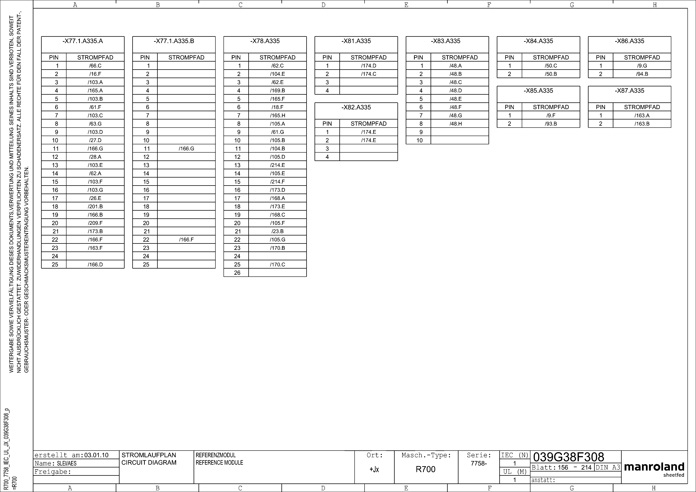

# +Jx — Sheet 156 of 214 — REFERENZMODUL

**REFERENCE MODULE**

> Part of the manroland **R700** printing press IEC/UL circuit diagrams.
> Drawing class: **Stromlaufplan / Circuit diagram** (DIN A3).
> Document `+Jx` covers the **1st printing module + feed register** machine section.

## At a glance

| Field | Value |
|---|---|
| Document | `+Jx`  (039G38F308) |
| Sheet | **156** of 214 |
| Section (DE) | REFERENZMODUL |
| Section (EN) | REFERENCE MODULE |
| Section type | REFERENCE_MODULE — Reference module |
| Machine type | `R700` |
| Series | `7758` |
| Created | 03.01.10 |
| Replaces | — |
| Columns used | A, B, C, D, E, F, G, H |
| Path numbers | — |
| Labels on sheet | 202 |
| Cross-refs out | 70 |
| Cross-refs in | 0 |

**Previous:** [+Jx sheet 155](SHEET_0155.md) · **Next:** [+Jx sheet 157](SHEET_0157.md) · **Document TOC:** [_TOC.md](_TOC.md)  (+Jx) · **Master TOC:** [all sheets](../_MASTER_TOC.md)

## Sheet image (300 DPI, exact vector render)



_Rendered directly from the PDF vector layer at 300 DPI (1-bit), no OCR and no resampling. Use it to confirm anything ambiguous in the text below._

## Cross-references on this sheet

Each entry is a wire leaving this sheet. The printed token is `/sheet.column`; the link resolves to that sheet inside the same document.

| Ref | Target sheet | Col | Path | Destination on target | Target section | From col |
|---|---|---|---|---|---|---|
| `/48.A` | [+Jx sheet 48](SHEET_0048.md) | A | — | — | 7 SEGMENTANZEIGE | F |
| `/9.G` | [+Jx sheet 9](SHEET_0009.md) | G | — | — | SPANNUNGSVERSORGUNG, SCHALTSCHRANKBELÜFTUNG | H |
| `/66.C` | [+Jx sheet 66](SHEET_0066.md) | C | — | — | DRUCKANSTELLUNG | A |
| `/62.C` | [+Jx sheet 62](SHEET_0062.md) | C | — | — | GTW | C |
| `/50.C` | [+Jx sheet 50](SHEET_0050.md) | C | — | — | SIGNALGEBER: AKUSTISCHE WARNSIGNALE | G |
| `/174.D` | [+Jx sheet 174](SHEET_0174.md) | D | — | — | OPTION: | E |
| `/48.B` | [+Jx sheet 48](SHEET_0048.md) | B | — | — | 7 SEGMENTANZEIGE | F |
| `/50.B` | [+Jx sheet 50](SHEET_0050.md) | B | — | — | SIGNALGEBER: AKUSTISCHE WARNSIGNALE | G |
| `/94.B` | [+Jx sheet 94](SHEET_0094.md) | B | — | — | RESERVE | H |
| `/16.F` | [+Jx sheet 16](SHEET_0016.md) | F | — | — | ÖLUMLAUFSCHMIERUNG | A |
| `/104.E` | [+Jx sheet 104](SHEET_0104.md) | E | — | — | RESERVE | C |
| `/174.C` | [+Jx sheet 174](SHEET_0174.md) | C | — | — | OPTION: | E |
| `/62.E` | [+Jx sheet 62](SHEET_0062.md) | E | — | — | GTW | C |
| `/103.A` | [+Jx sheet 103](SHEET_0103.md) | A | — | — | RESERVE | A |
| `/48.C` | [+Jx sheet 48](SHEET_0048.md) | C | — | — | 7 SEGMENTANZEIGE | F |
| `/165.A` | [+Jx sheet 165](SHEET_0165.md) | A | — | — | OPTION: | A |
| `/169.B` | [+Jx sheet 169](SHEET_0169.md) | B | — | — | OPTION: BOGENFÜHRUNG ÜBER DRUCKZYLINDER / | C |
| `/48.D` | [+Jx sheet 48](SHEET_0048.md) | D | — | — | 7 SEGMENTANZEIGE | F |
| `/48.E` | [+Jx sheet 48](SHEET_0048.md) | E | — | — | 7 SEGMENTANZEIGE | F |
| `/103.B` | [+Jx sheet 103](SHEET_0103.md) | B | — | — | RESERVE | A |
| `/165.F` | [+Jx sheet 165](SHEET_0165.md) | F | — | — | OPTION: | C |
| `/61.F` | [+Jx sheet 61](SHEET_0061.md) | F | — | — | GTW | A |
| `/18.F` | [+Jx sheet 18](SHEET_0018.md) | F | — | — | LACKPUMPE | C |
| `/48.F` | [+Jx sheet 48](SHEET_0048.md) | F | — | — | 7 SEGMENTANZEIGE | F |
| `/9.F` | [+Jx sheet 9](SHEET_0009.md) | F | — | — | SPANNUNGSVERSORGUNG, SCHALTSCHRANKBELÜFTUNG | G |
| `/163.A` | [+Jx sheet 163](SHEET_0163.md) | A | — | — | OPTION: | H |
| `/48.G` | [+Jx sheet 48](SHEET_0048.md) | G | — | — | 7 SEGMENTANZEIGE | F |
| `/103.C` | [+Jx sheet 103](SHEET_0103.md) | C | — | — | RESERVE | A |
| `/165.H` | [+Jx sheet 165](SHEET_0165.md) | H | — | — | OPTION: | C |
| `/93.B` | [+Jx sheet 93](SHEET_0093.md) | B | — | — | RESERVE | G |
| `/105.A` | [+Jx sheet 105](SHEET_0105.md) | A | — | — | RESERVE | C |
| `/163.B` | [+Jx sheet 163](SHEET_0163.md) | B | — | — | OPTION: | H |
| `/63.G` | [+Jx sheet 63](SHEET_0063.md) | G | — | — | LACKAUFTRAGSWALZE | A |
| `/48.H` | [+Jx sheet 48](SHEET_0048.md) | H | — | — | 7 SEGMENTANZEIGE | F |
| `/61.G` | [+Jx sheet 61](SHEET_0061.md) | G | — | — | GTW | C |
| `/174.E` | [+Jx sheet 174](SHEET_0174.md) | E | — | — | OPTION: | E |
| `/103.D` | [+Jx sheet 103](SHEET_0103.md) | D | — | — | RESERVE | A |
| `/105.B` | [+Jx sheet 105](SHEET_0105.md) | B | — | — | RESERVE | C |
| `/174.E` | [+Jx sheet 174](SHEET_0174.md) | E | — | — | OPTION: | E |
| `/27.D` | [+Jx sheet 27](SHEET_0027.md) | D | — | — | KAMMERRAKEL | A |
| `/104.B` | [+Jx sheet 104](SHEET_0104.md) | B | — | — | RESERVE | C |
| `/166.G` | [+Jx sheet 166](SHEET_0166.md) | G | — | — | OPTION: | A |
| `/166.G` | [+Jx sheet 166](SHEET_0166.md) | G | — | — | OPTION: | B |
| `/28.A` | [+Jx sheet 28](SHEET_0028.md) | A | — | — | KAMMERRAKEL | A |
| `/105.D` | [+Jx sheet 105](SHEET_0105.md) | D | — | — | RESERVE | C |
| `/103.E` | [+Jx sheet 103](SHEET_0103.md) | E | — | — | RESERVE | A |
| `/214.E` | [+Jx sheet 214](SHEET_0214.md) | E | — | — | OPTION: FZW | C |
| `/62.A` | [+Jx sheet 62](SHEET_0062.md) | A | — | — | GTW | A |
| `/105.E` | [+Jx sheet 105](SHEET_0105.md) | E | — | — | RESERVE | C |
| `/103.F` | [+Jx sheet 103](SHEET_0103.md) | F | — | — | RESERVE | A |
| `/214.F` | [+Jx sheet 214](SHEET_0214.md) | F | — | — | OPTION: FZW | C |
| `/103.G` | [+Jx sheet 103](SHEET_0103.md) | G | — | — | RESERVE | A |
| `/173.D` | [+Jx sheet 173](SHEET_0173.md) | D | — | — | OPTION: | C |
| `/26.E` | [+Jx sheet 26](SHEET_0026.md) | E | — | — | HILFSANTRIEB, LACKDOSIER /AUFTRAGSWALZEN | A |
| `/168.A` | [+Jx sheet 168](SHEET_0168.md) | A | — | — | OPTION: | C |
| `/201.B` | [+Jx sheet 201](SHEET_0201.md) | B | — | — | OPTION: LPPL ANDRÜCKROLLE | A |
| `/173.E` | [+Jx sheet 173](SHEET_0173.md) | E | — | — | OPTION: | C |
| `/166.B` | [+Jx sheet 166](SHEET_0166.md) | B | — | — | OPTION: | A |
| `/168.C` | [+Jx sheet 168](SHEET_0168.md) | C | — | — | OPTION: | C |
| `/209.F` | [+Jx sheet 209](SHEET_0209.md) | F | — | — | OPTION: WASCHMITTELWECHSELBETRIEB | A |
| `/105.F` | [+Jx sheet 105](SHEET_0105.md) | F | — | — | RESERVE | C |
| `/23.B` | [+Jx sheet 23](SHEET_0023.md) | B | — | — | LACKPUMPE | C |
| `/173.B` | [+Jx sheet 173](SHEET_0173.md) | B | — | — | OPTION: | A |
| `/166.F` | [+Jx sheet 166](SHEET_0166.md) | F | — | — | OPTION: | A |
| `/166.F` | [+Jx sheet 166](SHEET_0166.md) | F | — | — | OPTION: | B |
| `/105.G` | [+Jx sheet 105](SHEET_0105.md) | G | — | — | RESERVE | C |
| `/170.B` | [+Jx sheet 170](SHEET_0170.md) | B | — | — | OPTION: AUTOMATISCHEM SPÜLEN | C |
| `/163.F` | [+Jx sheet 163](SHEET_0163.md) | F | — | — | OPTION: | A |
| `/166.D` | [+Jx sheet 166](SHEET_0166.md) | D | — | — | OPTION: | A |
| `/170.C` | [+Jx sheet 170](SHEET_0170.md) | C | — | — | OPTION: AUTOMATISCHEM SPÜLEN | C |

## Devices on this sheet

| Tag | Class | Class meaning (IEC) | Col | Sub | Terminal | Sign |
|---|---|---|---|---|---|---|
| `X78.A335` | — | cross-device reference | C | — | — | — |
| `X77.1.A335.A` | — | cross-device reference | A | — | — | — |
| `X77.1.A335.B` | — | cross-device reference | B | — | — | — |
| `X81.A335` | — | cross-device reference | D | — | — | — |
| `X82.A335` | — | cross-device reference | D | — | — | — |
| `X83.A335` | — | cross-device reference | E | — | — | — |
| `X84.A335` | — | cross-device reference | G | — | — | — |
| `X85.A335` | — | cross-device reference | G | — | — | — |
| `X86.A335` | — | cross-device reference | H | — | — | — |
| `X87.A335` | — | cross-device reference | H | — | — | — |

## Potentials / nets

_No named potentials on this sheet._

## Wire-end annotations (grouped as printed)

A wire that continues elsewhere is annotated with a small cluster: the destination description, the path/line number `#NN`, and the `/sheet.column` cross reference. Each row below is one such cluster exactly as it is grouped on the drawing.

| Col | Y | Path | Cross-ref | Text on the wire |
|---|---|---|---|---|
| A | 65.4 | — | — | `X77.1.A335.A` |
| B | 65.4 | — | — | `X77.1.A335.B` |
| C | 65.4 | — | — | `X78.A335` |
| D | 65.4 | — | — | `X81.A335` |
| E | 65.4 | — | — | `X83.A335` |
| G | 65.4 | — | — | `X84.A335` |
| H | 65.4 | — | — | `X86.A335` |
| A | 94.1 | — | — | `PIN STROMPFAD` |
| B | 94.1 | — | — | `PIN STROMPFAD` |
| C | 94.1 | — | — | `PIN STROMPFAD` |
| D | 94.1 | — | — | `PIN 2 3 4 1 STROMPFAD` |
| E | 94.1 | — | — | `PIN 10 2 3 4 5 6 7 8 9 1 STROMPFAD` |
| G | 94.1 | — | — | `PIN 2 1 STROMPFAD` |
| H | 94.1 | — | — | `PIN 2 1 STROMPFAD` |
| A | 108.3 | — | — | `2 3 4 5 6 7 8 9 1` |
| B | 108.3 | — | — | `2 3 4 5 6 7 8 9 1` |
| C | 108.3 | — | — | `2 3 4 5 6 7 8 9 1` |
| F | 108.6 | — | `/48.A` | — |
| H | 108.6 | — | `/9.G` | — |
| A | 108.7 | — | `/66.C` | — |
| C | 108.7 | — | `/62.C` | — |
| E | 108.7 | — | `/174.D` | — |
| G | 108.7 | — | `/50.C` | — |
| A | 122.8 | — | `/16.F` | — |
| C | 122.8 | — | `/104.E` | — |
| E | 122.8 | — | `/174.C` | — |
| F | 122.8 | — | `/48.B` | — |
| G | 122.8 | — | `/50.B` | — |
| H | 122.8 | — | `/94.B` | — |
| A | 137.0 | — | `/103.A` | — |
| C | 137.0 | — | `/62.E` | — |
| F | 137.0 | — | `/48.C` | — |
| G | 150.5 | — | — | `X85.A335` |
| H | 150.5 | — | — | `X87.A335` |
| A | 151.2 | — | `/165.A` | — |
| C | 151.2 | — | `/169.B` | — |
| F | 151.2 | — | `/48.D` | — |
| A | 165.3 | — | `/103.B` | — |
| C | 165.3 | — | `/165.F` | — |
| F | 165.3 | — | `/48.E` | — |
| D | 178.8 | — | — | `X82.A335` |
| G | 179.1 | — | — | `PIN 2 1 STROMPFAD` |
| H | 179.1 | — | — | `PIN 2 1 STROMPFAD` |
| A | 179.5 | — | `/61.F` | — |
| C | 179.5 | — | `/18.F` | — |
| F | 179.5 | — | `/48.F` | — |
| A | 193.7 | — | `/103.C` | — |
| C | 193.7 | — | `/165.H` | — |
| F | 193.7 | — | `/48.G` | — |
| G | 193.7 | — | `/9.F` | — |
| H | 193.7 | — | `/163.A` | — |
| D | 207.5 | — | — | `PIN 2 3 4 1 STROMPFAD` |
| A | 207.8 | — | `/63.G` | — |
| C | 207.8 | — | `/105.A` | — |
| G | 207.8 | — | `/93.B` | — |
| H | 207.8 | — | `/163.B` | — |
| F | 207.9 | — | `/48.H` | — |
| A | 222.0 | — | `/103.D` | — |
| C | 222.0 | — | `/61.G` | — |
| E | 222.0 | — | `/174.E` | — |
| A | 235.9 | — | — | `10 12 13 14 15 16 17 18 19 20 11` |
| B | 235.9 | — | — | `10 12 13 14 15 16 17 18 19 20 11` |
| C | 235.9 | — | — | `10 12 13 14 15 16 17 18 19 20 11` |
| A | 236.2 | — | `/27.D` | — |
| C | 236.2 | — | `/105.B` | — |
| E | 236.2 | — | `/174.E` | — |
| A | 250.4 | — | `/166.G` | — |
| B | 250.4 | — | `/166.G` | — |
| C | 250.4 | — | `/104.B` | — |
| A | 264.5 | — | `/28.A` | — |
| C | 264.6 | — | `/105.D` | — |
| A | 278.7 | — | `/103.E` | — |
| C | 278.7 | — | `/214.E` | — |
| A | 292.9 | — | `/62.A` | — |
| C | 292.9 | — | `/105.E` | — |
| A | 307.1 | — | `/103.F` | — |
| C | 307.1 | — | `/214.F` | — |
| A | 321.2 | — | `/103.G` | — |
| C | 321.3 | — | `/173.D` | — |
| A | 335.4 | — | `/26.E` | — |
| C | 335.4 | — | `/168.A` | — |
| A | 349.6 | — | `/201.B` | — |
| C | 349.6 | — | `/173.E` | — |
| A | 363.8 | — | `/166.B` | — |
| C | 363.8 | — | `/168.C` | — |
| A | 377.9 | — | `/209.F` | — |
| C | 377.9 | — | `/105.F` | — |
| A | 391.8 | — | — | `22 23 24 25 21` |
| B | 391.8 | — | — | `22 23 24 25 21` |
| C | 391.8 | — | — | `22 23 24 25 26 21` |
| A | 392.1 | — | `/173.B` | — |
| C | 392.1 | — | `/23.B` | — |
| A | 406.3 | — | `/166.F` | — |
| B | 406.3 | — | `/166.F` | — |
| C | 406.3 | — | `/105.G` | — |
| A | 420.4 | — | `/163.F` | — |
| C | 420.4 | — | `/170.B` | — |
| A | 448.8 | — | `/166.D` | — |
| C | 448.8 | — | `/170.C` | — |


## Reconstructed tables

This sheet carries tabular content (pin map / terminal assignment / index). The grid below was rebuilt from the drawing's own rule lines, so each row is exactly one physical row of the table.

### Table 1 — 25 data rows × 2 columns (at x=70.9, y=62.4) — **X77.1.A335.A**

| PIN | STROMPFAD |
|---|---|
| `1` | `/66.C` |
| `2` | `/16.F` |
| `3` | `/103.A` |
| `4` | `/165.A` |
| `5` | `/103.B` |
| `6` | `/61.F` |
| `7` | `/103.C` |
| `8` | `/63.G` |
| `9` | `/103.D` |
| `10` | `/27.D` |
| `11` | `/166.G` |
| `12` | `/28.A` |
| `13` | `/103.E` |
| `14` | `/62.A` |
| `15` | `/103.F` |
| `16` | `/103.G` |
| `17` | `/26.E` |
| `18` | `/201.B` |
| `19` | `/166.B` |
| `20` | `/209.F` |
| `21` | `/173.B` |
| `22` | `/166.F` |
| `23` | `/163.F` |
| `24` |  |
| `25` | `/166.D` |


### Table 2 — 25 data rows × 2 columns (at x=226.8, y=62.4) — **X77.1.A335.B**

| PIN | STROMPFAD |
|---|---|
| `1` |  |
| `2` |  |
| `3` |  |
| `4` |  |
| `5` |  |
| `6` |  |
| `7` |  |
| `8` |  |
| `9` |  |
| `10` |  |
| `11` | `/166.G` |
| `12` |  |
| `13` |  |
| `14` |  |
| `15` |  |
| `16` |  |
| `17` |  |
| `18` |  |
| `19` |  |
| `20` |  |
| `21` |  |
| `22` | `/166.F` |
| `23` |  |
| `24` |  |
| `25` |  |


### Table 3 — 26 data rows × 2 columns (at x=382.7, y=62.4) — **X78.A335**

| PIN | STROMPFAD |
|---|---|
| `1` | `/62.C` |
| `2` | `/104.E` |
| `3` | `/62.E` |
| `4` | `/169.B` |
| `5` | `/165.F` |
| `6` | `/18.F` |
| `7` | `/165.H` |
| `8` | `/105.A` |
| `9` | `/61.G` |
| `10` | `/105.B` |
| `11` | `/104.B` |
| `12` | `/105.D` |
| `13` | `/214.E` |
| `14` | `/105.E` |
| `15` | `/214.F` |
| `16` | `/173.D` |
| `17` | `/168.A` |
| `18` | `/173.E` |
| `19` | `/168.C` |
| `20` | `/105.F` |
| `21` | `/23.B` |
| `22` | `/105.G` |
| `23` | `/170.B` |
| `24` |  |
| `25` | `/170.C` |
| `26` |  |


### Table 4 — 10 data rows × 2 columns (at x=538.6, y=62.4) — **X81.A335**

| PIN | STROMPFAD |
|---|---|
| `1` | `/174.D` |
| `2` | `/174.C` |
| `3` |  |
| `4` |  |
|  | `X82.A335` |
| `PIN` | `STROMPFAD` |
| `1` | `/174.E` |
| `2` | `/174.E` |
| `3` |  |
| `4` |  |


### Table 5 — 10 data rows × 2 columns (at x=694.5, y=62.4) — **X83.A335**

| PIN | STROMPFAD |
|---|---|
| `1` | `/48.A` |
| `2` | `/48.B` |
| `3` | `/48.C` |
| `4` | `/48.D` |
| `5` | `/48.E` |
| `6` | `/48.F` |
| `7` | `/48.G` |
| `8` | `/48.H` |
| `9` |  |
| `10` |  |


### Table 6 — 6 data rows × 2 columns (at x=850.4, y=62.4) — **X84.A335**

| PIN | STROMPFAD |
|---|---|
| `1` | `/50.C` |
| `2` | `/50.B` |
|  | `X85.A335` |
| `PIN` | `STROMPFAD` |
| `1` | `/9.F` |
| `2` | `/93.B` |


### Table 7 — 6 data rows × 2 columns (at x=1006.3, y=62.4) — **X86.A335**

| PIN | STROMPFAD |
|---|---|
| `1` | `/9.G` |
| `2` | `/94.B` |
|  | `X87.A335` |
| `PIN` | `STROMPFAD` |
| `1` | `/163.A` |
| `2` | `/163.B` |


## Notes and free text on this sheet

| Text | Col | Y (pt) |
|---|---|---|
| `PIN` | C | 94.13 |
| `STROMPFAD` | C | 94.09 |
| `PIN` | A | 94.13 |
| `STROMPFAD` | A | 94.09 |
| `PIN` | B | 94.13 |
| `STROMPFAD` | B | 94.09 |
| `PIN` | D | 94.13 |
| `STROMPFAD` | E | 94.09 |
| `PIN` | E | 94.13 |
| `STROMPFAD` | F | 94.09 |
| `PIN` | F | 94.13 |
| `STROMPFAD` | G | 94.09 |
| `PIN` | G | 94.13 |
| `STROMPFAD` | H | 94.09 |

## Complete label inventory (exact text from the drawing)

Every text object inside the drawing area of this sheet, in DIN reading order (column A→H, then top→bottom). This is the authoritative list: if a string is not here it is not printed on this sheet.

| Col | Y | X | Dir | Type | Text |
|---|---|---|---|---|---|
| A | 65.4 | 107.1 | → | device ref | `X77.1.A335.A` |
| A | 94.1 | 84.0 | → | text | `PIN` |
| A | 94.1 | 132.4 | → | text | `STROMPFAD` |
| A | 108.3 | 95.5 | → | number | `1` |
| A | 108.7 | 152.6 | → | cross-reference | `/66.C` |
| A | 122.5 | 94.1 | → | number | `2` |
| A | 122.8 | 153.1 | → | cross-reference | `/16.F` |
| A | 136.7 | 94.1 | → | number | `3` |
| A | 137.0 | 150.2 | → | cross-reference | `/103.A` |
| A | 150.8 | 94.1 | → | number | `4` |
| A | 151.2 | 150.2 | → | cross-reference | `/165.A` |
| A | 165.0 | 94.1 | → | number | `5` |
| A | 165.3 | 150.4 | → | cross-reference | `/103.B` |
| A | 179.2 | 94.1 | → | number | `6` |
| A | 179.5 | 153.1 | → | cross-reference | `/61.F` |
| A | 193.3 | 94.1 | → | number | `7` |
| A | 193.7 | 150.2 | → | cross-reference | `/103.C` |
| A | 207.5 | 94.1 | → | number | `8` |
| A | 207.9 | 152.4 | → | cross-reference | `/63.G` |
| A | 221.7 | 94.1 | → | number | `9` |
| A | 222.0 | 150.2 | → | cross-reference | `/103.D` |
| A | 235.9 | 88.7 | → | number | `10` |
| A | 236.2 | 152.6 | → | cross-reference | `/27.D` |
| A | 250.0 | 90.1 | → | number | `11` |
| A | 250.4 | 150.0 | → | cross-reference | `/166.G` |
| A | 264.2 | 88.7 | → | number | `12` |
| A | 264.5 | 152.6 | → | cross-reference | `/28.A` |
| A | 278.4 | 88.7 | → | number | `13` |
| A | 278.7 | 150.4 | → | cross-reference | `/103.E` |
| A | 292.6 | 88.7 | → | number | `14` |
| A | 292.9 | 152.6 | → | cross-reference | `/62.A` |
| A | 306.7 | 88.7 | → | number | `15` |
| A | 307.1 | 150.7 | → | cross-reference | `/103.F` |
| A | 320.9 | 88.7 | → | number | `16` |
| A | 321.2 | 150.0 | → | cross-reference | `/103.G` |
| A | 335.1 | 88.7 | → | number | `17` |
| A | 335.4 | 152.8 | → | cross-reference | `/26.E` |
| A | 349.3 | 88.7 | → | number | `18` |
| A | 349.6 | 150.4 | → | cross-reference | `/201.B` |
| A | 363.4 | 88.7 | → | number | `19` |
| A | 363.7 | 150.4 | → | cross-reference | `/166.B` |
| A | 377.6 | 88.7 | → | number | `20` |
| A | 377.9 | 150.7 | → | cross-reference | `/209.F` |
| A | 391.8 | 90.1 | → | number | `21` |
| A | 392.1 | 150.4 | → | cross-reference | `/173.B` |
| A | 405.9 | 88.7 | → | number | `22` |
| A | 406.3 | 150.7 | → | cross-reference | `/166.F` |
| A | 420.1 | 88.7 | → | number | `23` |
| A | 420.5 | 150.7 | → | cross-reference | `/163.F` |
| A | 434.3 | 88.7 | → | number | `24` |
| A | 448.5 | 88.7 | → | number | `25` |
| A | 448.8 | 150.2 | → | cross-reference | `/166.D` |
| B | 65.4 | 263.3 | → | device ref | `X77.1.A335.B` |
| B | 94.1 | 240.0 | → | text | `PIN` |
| B | 94.1 | 288.3 | → | text | `STROMPFAD` |
| B | 108.3 | 251.4 | → | number | `1` |
| B | 122.5 | 250.0 | → | number | `2` |
| B | 136.7 | 250.0 | → | number | `3` |
| B | 150.8 | 250.0 | → | number | `4` |
| B | 165.0 | 250.0 | → | number | `5` |
| B | 179.2 | 250.0 | → | number | `6` |
| B | 193.3 | 250.0 | → | number | `7` |
| B | 207.5 | 250.0 | → | number | `8` |
| B | 221.7 | 250.0 | → | number | `9` |
| B | 235.9 | 244.6 | → | number | `10` |
| B | 250.0 | 246.0 | → | number | `11` |
| B | 250.4 | 305.9 | → | cross-reference | `/166.G` |
| B | 264.2 | 244.6 | → | number | `12` |
| B | 278.4 | 244.6 | → | number | `13` |
| B | 292.6 | 244.6 | → | number | `14` |
| B | 306.7 | 244.6 | → | number | `15` |
| B | 320.9 | 244.6 | → | number | `16` |
| B | 335.1 | 244.6 | → | number | `17` |
| B | 349.3 | 244.6 | → | number | `18` |
| B | 363.4 | 244.6 | → | number | `19` |
| B | 377.6 | 244.6 | → | number | `20` |
| B | 391.8 | 246.0 | → | number | `21` |
| B | 405.9 | 244.6 | → | number | `22` |
| B | 406.3 | 306.6 | → | cross-reference | `/166.F` |
| B | 420.1 | 244.6 | → | number | `23` |
| B | 434.3 | 244.6 | → | number | `24` |
| B | 448.5 | 244.6 | → | number | `25` |
| C | 65.4 | 428.5 | → | device ref | `X78.A335` |
| C | 94.1 | 395.9 | → | text | `PIN` |
| C | 94.1 | 444.2 | → | text | `STROMPFAD` |
| C | 108.3 | 407.3 | → | number | `1` |
| C | 108.7 | 464.5 | → | cross-reference | `/62.C` |
| C | 122.5 | 405.9 | → | number | `2` |
| C | 122.8 | 462.2 | → | cross-reference | `/104.E` |
| C | 136.7 | 405.9 | → | number | `3` |
| C | 137.0 | 464.6 | → | cross-reference | `/62.E` |
| C | 150.8 | 405.9 | → | number | `4` |
| C | 151.2 | 462.2 | → | cross-reference | `/169.B` |
| C | 165.0 | 405.9 | → | number | `5` |
| C | 165.3 | 462.5 | → | cross-reference | `/165.F` |
| C | 179.2 | 405.9 | → | number | `6` |
| C | 179.5 | 464.9 | → | cross-reference | `/18.F` |
| C | 193.3 | 405.9 | → | number | `7` |
| C | 193.7 | 462.2 | → | cross-reference | `/165.H` |
| C | 207.5 | 405.9 | → | number | `8` |
| C | 207.8 | 462.0 | → | cross-reference | `/105.A` |
| C | 221.7 | 405.9 | → | number | `9` |
| C | 222.0 | 464.2 | → | cross-reference | `/61.G` |
| C | 235.9 | 400.5 | → | number | `10` |
| C | 236.2 | 462.2 | → | cross-reference | `/105.B` |
| C | 250.0 | 402.0 | → | number | `11` |
| C | 250.4 | 462.2 | → | cross-reference | `/104.B` |
| C | 264.2 | 400.5 | → | number | `12` |
| C | 264.6 | 462.0 | → | cross-reference | `/105.D` |
| C | 278.4 | 400.5 | → | number | `13` |
| C | 278.7 | 462.2 | → | cross-reference | `/214.E` |
| C | 292.6 | 400.5 | → | number | `14` |
| C | 292.9 | 462.2 | → | cross-reference | `/105.E` |
| C | 306.7 | 400.5 | → | number | `15` |
| C | 307.1 | 462.5 | → | cross-reference | `/214.F` |
| C | 320.9 | 400.5 | → | number | `16` |
| C | 321.3 | 462.0 | → | cross-reference | `/173.D` |
| C | 335.1 | 400.5 | → | number | `17` |
| C | 335.4 | 462.0 | → | cross-reference | `/168.A` |
| C | 349.3 | 400.5 | → | number | `18` |
| C | 349.6 | 462.2 | → | cross-reference | `/173.E` |
| C | 363.4 | 400.5 | → | number | `19` |
| C | 363.8 | 462.0 | → | cross-reference | `/168.C` |
| C | 377.6 | 400.5 | → | number | `20` |
| C | 377.9 | 462.5 | → | cross-reference | `/105.F` |
| C | 391.8 | 402.0 | → | number | `21` |
| C | 392.1 | 464.6 | → | cross-reference | `/23.B` |
| C | 405.9 | 400.5 | → | number | `22` |
| C | 406.3 | 461.8 | → | cross-reference | `/105.G` |
| C | 420.1 | 400.5 | → | number | `23` |
| C | 420.4 | 462.2 | → | cross-reference | `/170.B` |
| C | 434.3 | 400.5 | → | number | `24` |
| C | 448.5 | 400.5 | → | number | `25` |
| C | 448.8 | 462.0 | → | cross-reference | `/170.C` |
| C | 462.6 | 400.5 | → | number | `26` |
| D | 65.4 | 584.4 | → | device ref | `X81.A335` |
| D | 94.1 | 551.8 | → | text | `PIN` |
| D | 108.3 | 557.6 | → | number | `1` |
| D | 122.5 | 557.1 | → | number | `2` |
| D | 136.7 | 557.1 | → | number | `3` |
| D | 150.8 | 557.3 | → | number | `4` |
| D | 178.8 | 584.4 | → | device ref | `X82.A335` |
| D | 207.5 | 551.8 | → | text | `PIN` |
| D | 221.7 | 557.6 | → | number | `1` |
| D | 235.9 | 557.1 | → | number | `2` |
| D | 250.0 | 557.1 | → | number | `3` |
| D | 264.2 | 557.3 | → | number | `4` |
| E | 65.4 | 737.4 | → | device ref | `X83.A335` |
| E | 94.1 | 600.1 | → | text | `STROMPFAD` |
| E | 94.1 | 707.7 | → | text | `PIN` |
| E | 108.3 | 719.1 | → | number | `1` |
| E | 108.7 | 618.0 | → | cross-reference | `/174.D` |
| E | 122.5 | 717.7 | → | number | `2` |
| E | 122.8 | 618.0 | → | cross-reference | `/174.C` |
| E | 136.7 | 717.7 | → | number | `3` |
| E | 150.8 | 717.7 | → | number | `4` |
| E | 165.0 | 717.7 | → | number | `5` |
| E | 179.2 | 717.7 | → | number | `6` |
| E | 193.3 | 717.7 | → | number | `7` |
| E | 207.5 | 600.1 | → | text | `STROMPFAD` |
| E | 207.5 | 717.7 | → | number | `8` |
| E | 221.7 | 717.7 | → | number | `9` |
| E | 222.0 | 618.1 | → | cross-reference | `/174.E` |
| E | 235.9 | 712.3 | → | number | `10` |
| E | 236.2 | 618.1 | → | cross-reference | `/174.E` |
| F | 94.1 | 756.0 | → | text | `STROMPFAD` |
| F | 94.1 | 863.6 | → | text | `PIN` |
| F | 108.3 | 869.4 | → | number | `1` |
| F | 108.6 | 769.2 | → | cross-reference | `/48.A` |
| F | 122.5 | 869.0 | → | number | `2` |
| F | 122.8 | 769.3 | → | cross-reference | `/48.B` |
| F | 137.0 | 769.2 | → | cross-reference | `/48.C` |
| F | 151.2 | 769.2 | → | cross-reference | `/48.D` |
| F | 165.3 | 769.3 | → | cross-reference | `/48.E` |
| F | 179.2 | 863.6 | → | text | `PIN` |
| F | 179.5 | 769.6 | → | cross-reference | `/48.F` |
| F | 193.3 | 869.4 | → | number | `1` |
| F | 193.7 | 768.9 | → | cross-reference | `/48.G` |
| F | 207.5 | 869.0 | → | number | `2` |
| F | 207.9 | 769.3 | → | cross-reference | `/48.H` |
| G | 65.4 | 896.2 | → | device ref | `X84.A335` |
| G | 94.1 | 911.9 | → | text | `STROMPFAD` |
| G | 94.1 | 1019.5 | → | text | `PIN` |
| G | 108.3 | 1025.3 | → | number | `1` |
| G | 108.7 | 932.2 | → | cross-reference | `/50.C` |
| G | 122.5 | 1024.9 | → | number | `2` |
| G | 122.8 | 932.3 | → | cross-reference | `/50.B` |
| G | 150.5 | 896.2 | → | device ref | `X85.A335` |
| G | 179.1 | 911.9 | → | text | `STROMPFAD` |
| G | 179.2 | 1019.5 | → | text | `PIN` |
| G | 193.3 | 1025.3 | → | number | `1` |
| G | 193.6 | 935.0 | → | cross-reference | `/9.F` |
| G | 207.5 | 1024.9 | → | number | `2` |
| G | 207.8 | 932.3 | → | cross-reference | `/93.B` |
| H | 65.4 | 1052.1 | → | device ref | `X86.A335` |
| H | 94.1 | 1067.8 | → | text | `STROMPFAD` |
| H | 108.6 | 1090.2 | → | cross-reference | `/9.G` |
| H | 122.8 | 1088.2 | → | cross-reference | `/94.B` |
| H | 150.5 | 1052.1 | → | device ref | `X87.A335` |
| H | 179.1 | 1067.8 | → | text | `STROMPFAD` |
| H | 193.7 | 1085.7 | → | cross-reference | `/163.A` |
| H | 207.8 | 1085.8 | → | cross-reference | `/163.B` |

## Reading-order text block

The same content as a plain block, grouped by DIN column — convenient to paste or to match against a visual description.

```text
=== Column A ===
  65.4  107.1  devref       X77.1.A335.A
  94.1   84.0  text         PIN
  94.1  132.4  text         STROMPFAD
 108.3   95.5  numeric      1
 108.7  152.6  xref         /66.C
 122.5   94.1  numeric      2
 122.8  153.1  xref         /16.F
 136.7   94.1  numeric      3
 137.0  150.2  xref         /103.A
 150.8   94.1  numeric      4
 151.2  150.2  xref         /165.A
 165.0   94.1  numeric      5
 165.3  150.4  xref         /103.B
 179.2   94.1  numeric      6
 179.5  153.1  xref         /61.F
 193.3   94.1  numeric      7
 193.7  150.2  xref         /103.C
 207.5   94.1  numeric      8
 207.9  152.4  xref         /63.G
 221.7   94.1  numeric      9
 222.0  150.2  xref         /103.D
 235.9   88.7  numeric      10
 236.2  152.6  xref         /27.D
 250.0   90.1  numeric      11
 250.4  150.0  xref         /166.G
 264.2   88.7  numeric      12
 264.5  152.6  xref         /28.A
 278.4   88.7  numeric      13
 278.7  150.4  xref         /103.E
 292.6   88.7  numeric      14
 292.9  152.6  xref         /62.A
 306.7   88.7  numeric      15
 307.1  150.7  xref         /103.F
 320.9   88.7  numeric      16
 321.2  150.0  xref         /103.G
 335.1   88.7  numeric      17
 335.4  152.8  xref         /26.E
 349.3   88.7  numeric      18
 349.6  150.4  xref         /201.B
 363.4   88.7  numeric      19
 363.7  150.4  xref         /166.B
 377.6   88.7  numeric      20
 377.9  150.7  xref         /209.F
 391.8   90.1  numeric      21
 392.1  150.4  xref         /173.B
 405.9   88.7  numeric      22
 406.3  150.7  xref         /166.F
 420.1   88.7  numeric      23
 420.5  150.7  xref         /163.F
 434.3   88.7  numeric      24
 448.5   88.7  numeric      25
 448.8  150.2  xref         /166.D
=== Column B ===
  65.4  263.3  devref       X77.1.A335.B
  94.1  240.0  text         PIN
  94.1  288.3  text         STROMPFAD
 108.3  251.4  numeric      1
 122.5  250.0  numeric      2
 136.7  250.0  numeric      3
 150.8  250.0  numeric      4
 165.0  250.0  numeric      5
 179.2  250.0  numeric      6
 193.3  250.0  numeric      7
 207.5  250.0  numeric      8
 221.7  250.0  numeric      9
 235.9  244.6  numeric      10
 250.0  246.0  numeric      11
 250.4  305.9  xref         /166.G
 264.2  244.6  numeric      12
 278.4  244.6  numeric      13
 292.6  244.6  numeric      14
 306.7  244.6  numeric      15
 320.9  244.6  numeric      16
 335.1  244.6  numeric      17
 349.3  244.6  numeric      18
 363.4  244.6  numeric      19
 377.6  244.6  numeric      20
 391.8  246.0  numeric      21
 405.9  244.6  numeric      22
 406.3  306.6  xref         /166.F
 420.1  244.6  numeric      23
 434.3  244.6  numeric      24
 448.5  244.6  numeric      25
=== Column C ===
  65.4  428.5  devref       X78.A335
  94.1  395.9  text         PIN
  94.1  444.2  text         STROMPFAD
 108.3  407.3  numeric      1
 108.7  464.5  xref         /62.C
 122.5  405.9  numeric      2
 122.8  462.2  xref         /104.E
 136.7  405.9  numeric      3
 137.0  464.6  xref         /62.E
 150.8  405.9  numeric      4
 151.2  462.2  xref         /169.B
 165.0  405.9  numeric      5
 165.3  462.5  xref         /165.F
 179.2  405.9  numeric      6
 179.5  464.9  xref         /18.F
 193.3  405.9  numeric      7
 193.7  462.2  xref         /165.H
 207.5  405.9  numeric      8
 207.8  462.0  xref         /105.A
 221.7  405.9  numeric      9
 222.0  464.2  xref         /61.G
 235.9  400.5  numeric      10
 236.2  462.2  xref         /105.B
 250.0  402.0  numeric      11
 250.4  462.2  xref         /104.B
 264.2  400.5  numeric      12
 264.6  462.0  xref         /105.D
 278.4  400.5  numeric      13
 278.7  462.2  xref         /214.E
 292.6  400.5  numeric      14
 292.9  462.2  xref         /105.E
 306.7  400.5  numeric      15
 307.1  462.5  xref         /214.F
 320.9  400.5  numeric      16
 321.3  462.0  xref         /173.D
 335.1  400.5  numeric      17
 335.4  462.0  xref         /168.A
 349.3  400.5  numeric      18
 349.6  462.2  xref         /173.E
 363.4  400.5  numeric      19
 363.8  462.0  xref         /168.C
 377.6  400.5  numeric      20
 377.9  462.5  xref         /105.F
 391.8  402.0  numeric      21
 392.1  464.6  xref         /23.B
 405.9  400.5  numeric      22
 406.3  461.8  xref         /105.G
 420.1  400.5  numeric      23
 420.4  462.2  xref         /170.B
 434.3  400.5  numeric      24
 448.5  400.5  numeric      25
 448.8  462.0  xref         /170.C
 462.6  400.5  numeric      26
=== Column D ===
  65.4  584.4  devref       X81.A335
  94.1  551.8  text         PIN
 108.3  557.6  numeric      1
 122.5  557.1  numeric      2
 136.7  557.1  numeric      3
 150.8  557.3  numeric      4
 178.8  584.4  devref       X82.A335
 207.5  551.8  text         PIN
 221.7  557.6  numeric      1
 235.9  557.1  numeric      2
 250.0  557.1  numeric      3
 264.2  557.3  numeric      4
=== Column E ===
  65.4  737.4  devref       X83.A335
  94.1  600.1  text         STROMPFAD
  94.1  707.7  text         PIN
 108.3  719.1  numeric      1
 108.7  618.0  xref         /174.D
 122.5  717.7  numeric      2
 122.8  618.0  xref         /174.C
 136.7  717.7  numeric      3
 150.8  717.7  numeric      4
 165.0  717.7  numeric      5
 179.2  717.7  numeric      6
 193.3  717.7  numeric      7
 207.5  600.1  text         STROMPFAD
 207.5  717.7  numeric      8
 221.7  717.7  numeric      9
 222.0  618.1  xref         /174.E
 235.9  712.3  numeric      10
 236.2  618.1  xref         /174.E
=== Column F ===
  94.1  756.0  text         STROMPFAD
  94.1  863.6  text         PIN
 108.3  869.4  numeric      1
 108.6  769.2  xref         /48.A
 122.5  869.0  numeric      2
 122.8  769.3  xref         /48.B
 137.0  769.2  xref         /48.C
 151.2  769.2  xref         /48.D
 165.3  769.3  xref         /48.E
 179.2  863.6  text         PIN
 179.5  769.6  xref         /48.F
 193.3  869.4  numeric      1
 193.7  768.9  xref         /48.G
 207.5  869.0  numeric      2
 207.9  769.3  xref         /48.H
=== Column G ===
  65.4  896.2  devref       X84.A335
  94.1  911.9  text         STROMPFAD
  94.1 1019.5  text         PIN
 108.3 1025.3  numeric      1
 108.7  932.2  xref         /50.C
 122.5 1024.9  numeric      2
 122.8  932.3  xref         /50.B
 150.5  896.2  devref       X85.A335
 179.1  911.9  text         STROMPFAD
 179.2 1019.5  text         PIN
 193.3 1025.3  numeric      1
 193.6  935.0  xref         /9.F
 207.5 1024.9  numeric      2
 207.8  932.3  xref         /93.B
=== Column H ===
  65.4 1052.1  devref       X86.A335
  94.1 1067.8  text         STROMPFAD
 108.6 1090.2  xref         /9.G
 122.8 1088.2  xref         /94.B
 150.5 1052.1  devref       X87.A335
 179.1 1067.8  text         STROMPFAD
 193.7 1085.7  xref         /163.A
 207.8 1085.8  xref         /163.B
```

---
_Generated from the PDF vector text layer; no OCR. Source: `R700_7758_IEC_UL_JX_039G38F308_p`, sheet 156._
