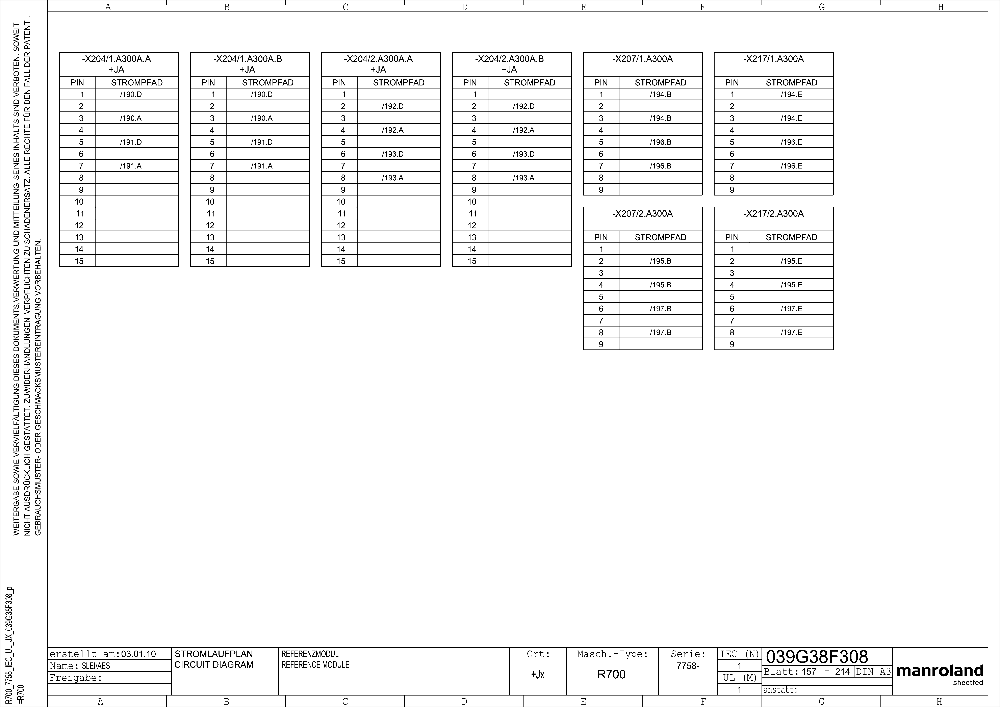

# +Jx — Sheet 157 of 214 — REFERENZMODUL

**REFERENCE MODULE**

> Part of the manroland **R700** printing press IEC/UL circuit diagrams.
> Drawing class: **Stromlaufplan / Circuit diagram** (DIN A3).
> Document `+Jx` covers the **1st printing module + feed register** machine section.

## At a glance

| Field | Value |
|---|---|
| Document | `+Jx`  (039G38F308) |
| Sheet | **157** of 214 |
| Section (DE) | REFERENZMODUL |
| Section (EN) | REFERENCE MODULE |
| Section type | REFERENCE_MODULE — Reference module |
| Machine type | `R700` |
| Series | `7758` |
| Created | 03.01.10 |
| Replaces | — |
| Columns used | A, B, C, D, E, F, G |
| Path numbers | — |
| Labels on sheet | 156 |
| Cross-refs out | 32 |
| Cross-refs in | 0 |

**Previous:** [+Jx sheet 156](SHEET_0156.md) · **Next:** [+Jx sheet 158](SHEET_0158.md) · **Document TOC:** [_TOC.md](_TOC.md)  (+Jx) · **Master TOC:** [all sheets](../_MASTER_TOC.md)

## Sheet image (300 DPI, exact vector render)



_Rendered directly from the PDF vector layer at 300 DPI (1-bit), no OCR and no resampling. Use it to confirm anything ambiguous in the text below._

## Cross-references on this sheet

Each entry is a wire leaving this sheet. The printed token is `/sheet.column`; the link resolves to that sheet inside the same document.

| Ref | Target sheet | Col | Path | Destination on target | Target section | From col |
|---|---|---|---|---|---|---|
| `/194.B` | [+Jx sheet 194](SHEET_0194.md) | B | — | — | OPTION: ZWISCHENTROCKNER, VORBEREITUNG | F |
| `/194.E` | [+Jx sheet 194](SHEET_0194.md) | E | — | — | OPTION: ZWISCHENTROCKNER, VORBEREITUNG | G |
| `/190.D` | [+Jx sheet 190](SHEET_0190.md) | D | — | — | OPTION: ZWISCHENTROCKNER, VORBEREITUNG | A |
| `/190.D` | [+Jx sheet 190](SHEET_0190.md) | D | — | — | OPTION: ZWISCHENTROCKNER, VORBEREITUNG | B |
| `/192.D` | [+Jx sheet 192](SHEET_0192.md) | D | — | — | OPTION: ZWISCHENTROCKNER, VORBEREITUNG | C |
| `/192.D` | [+Jx sheet 192](SHEET_0192.md) | D | — | — | OPTION: ZWISCHENTROCKNER, VORBEREITUNG | E |
| `/190.A` | [+Jx sheet 190](SHEET_0190.md) | A | — | — | OPTION: ZWISCHENTROCKNER, VORBEREITUNG | A |
| `/190.A` | [+Jx sheet 190](SHEET_0190.md) | A | — | — | OPTION: ZWISCHENTROCKNER, VORBEREITUNG | B |
| `/194.B` | [+Jx sheet 194](SHEET_0194.md) | B | — | — | OPTION: ZWISCHENTROCKNER, VORBEREITUNG | F |
| `/194.E` | [+Jx sheet 194](SHEET_0194.md) | E | — | — | OPTION: ZWISCHENTROCKNER, VORBEREITUNG | G |
| `/192.A` | [+Jx sheet 192](SHEET_0192.md) | A | — | — | OPTION: ZWISCHENTROCKNER, VORBEREITUNG | C |
| `/192.A` | [+Jx sheet 192](SHEET_0192.md) | A | — | — | OPTION: ZWISCHENTROCKNER, VORBEREITUNG | D |
| `/196.B` | [+Jx sheet 196](SHEET_0196.md) | B | — | — | OPTION: ZWISCHENTROCKNER, VORBEREITUNG | F |
| `/196.E` | [+Jx sheet 196](SHEET_0196.md) | E | — | — | OPTION: ZWISCHENTROCKNER, VORBEREITUNG | G |
| `/191.D` | [+Jx sheet 191](SHEET_0191.md) | D | — | — | OPTION: ZWISCHENTROCKNER, VORBEREITUNG | A |
| `/191.D` | [+Jx sheet 191](SHEET_0191.md) | D | — | — | OPTION: ZWISCHENTROCKNER, VORBEREITUNG | B |
| `/193.D` | [+Jx sheet 193](SHEET_0193.md) | D | — | — | OPTION: ZWISCHENTROCKNER, VORBEREITUNG | C |
| `/193.D` | [+Jx sheet 193](SHEET_0193.md) | D | — | — | OPTION: ZWISCHENTROCKNER, VORBEREITUNG | E |
| `/191.A` | [+Jx sheet 191](SHEET_0191.md) | A | — | — | OPTION: ZWISCHENTROCKNER, VORBEREITUNG | A |
| `/191.A` | [+Jx sheet 191](SHEET_0191.md) | A | — | — | OPTION: ZWISCHENTROCKNER, VORBEREITUNG | B |
| `/196.B` | [+Jx sheet 196](SHEET_0196.md) | B | — | — | OPTION: ZWISCHENTROCKNER, VORBEREITUNG | F |
| `/196.E` | [+Jx sheet 196](SHEET_0196.md) | E | — | — | OPTION: ZWISCHENTROCKNER, VORBEREITUNG | G |
| `/193.A` | [+Jx sheet 193](SHEET_0193.md) | A | — | — | OPTION: ZWISCHENTROCKNER, VORBEREITUNG | C |
| `/193.A` | [+Jx sheet 193](SHEET_0193.md) | A | — | — | OPTION: ZWISCHENTROCKNER, VORBEREITUNG | D |
| `/195.B` | [+Jx sheet 195](SHEET_0195.md) | B | — | — | OPTION: ZWISCHENTROCKNER, VORBEREITUNG | F |
| `/195.E` | [+Jx sheet 195](SHEET_0195.md) | E | — | — | OPTION: ZWISCHENTROCKNER, VORBEREITUNG | G |
| `/195.B` | [+Jx sheet 195](SHEET_0195.md) | B | — | — | OPTION: ZWISCHENTROCKNER, VORBEREITUNG | F |
| `/195.E` | [+Jx sheet 195](SHEET_0195.md) | E | — | — | OPTION: ZWISCHENTROCKNER, VORBEREITUNG | G |
| `/197.B` | [+Jx sheet 197](SHEET_0197.md) | B | — | — | OPTION: ZWISCHENTROCKNER, VORBEREITUNG | F |
| `/197.E` | [+Jx sheet 197](SHEET_0197.md) | E | — | — | OPTION: ZWISCHENTROCKNER, VORBEREITUNG | G |
| `/197.B` | [+Jx sheet 197](SHEET_0197.md) | B | — | — | OPTION: ZWISCHENTROCKNER, VORBEREITUNG | F |
| `/197.E` | [+Jx sheet 197](SHEET_0197.md) | E | — | — | OPTION: ZWISCHENTROCKNER, VORBEREITUNG | G |

## Devices on this sheet

| Tag | Class | Class meaning (IEC) | Col | Sub | Terminal | Sign |
|---|---|---|---|---|---|---|
| `X204/1.A300A.A` | — | cross-device reference | A | — | — | — |
| `X204/2.A300A.A` | — | cross-device reference | C | — | — | — |
| `X207/2.A300A` | — | cross-device reference | E | — | — | — |
| `X207/1.A300A` | — | cross-device reference | E | — | — | — |
| `X217/1.A300A` | — | cross-device reference | G | — | — | — |
| `X217/2.A300A` | — | cross-device reference | G | — | — | — |
| `X204/2.A300A.B` | — | cross-device reference | D | — | — | — |
| `X204/1.A300A.B` | — | cross-device reference | B | — | — | — |

## Potentials / nets

_No named potentials on this sheet._

## Wire-end annotations (grouped as printed)

A wire that continues elsewhere is annotated with a small cluster: the destination description, the path/line number `#NN`, and the `/sheet.column` cross reference. Each row below is one such cluster exactly as it is grouped on the drawing.

| Col | Y | Path | Cross-ref | Text on the wire |
|---|---|---|---|---|
| A | 65.4 | — | — | `X204/1.A300A.A` |
| B | 65.4 | — | — | `X204/1.A300A.B` |
| C | 65.4 | — | — | `X204/2.A300A.A` |
| D | 65.4 | — | — | `X204/2.A300A.B` |
| E | 65.4 | — | — | `X207/1.A300A` |
| G | 65.4 | — | — | `X217/1.A300A` |
| A | 78.1 | — | — | `+JA` |
| B | 78.1 | — | — | `+JA` |
| C | 78.1 | — | — | `+JA` |
| D | 78.1 | — | — | `+JA` |
| A | 94.1 | — | — | `PIN 10 12 13 14 15 11 2 3 4 5 6 7 8 9 1 STROMPFAD` |
| B | 94.1 | — | — | `PIN 10 12 13 14 15 11 2 3 4 5 6 7 8 9 1 STROMPFAD` |
| C | 94.1 | — | — | `PIN 10 12 13 14 15 11 2 3 4 5 6 7 8 9 1 STROMPFAD` |
| D | 94.1 | — | — | `PIN 10 12 13 14 15 11 2 3 4 5 6 7 8 9 1 STROMPFAD` |
| E | 94.1 | — | — | `PIN 2 3 5 6 7 8 9 4 1 STROMPFAD` |
| G | 94.1 | — | — | `PIN 2 3 5 6 7 8 9 4 1 STROMPFAD` |
| F | 108.6 | — | `/194.B` | — |
| G | 108.6 | — | `/194.E` | — |
| A | 108.7 | — | `/190.D` | — |
| B | 108.7 | — | `/190.D` | — |
| C | 122.8 | — | `/192.D` | — |
| E | 122.8 | — | `/192.D` | — |
| A | 137.0 | — | `/190.A` | — |
| B | 137.0 | — | `/190.A` | — |
| F | 137.0 | — | `/194.B` | — |
| G | 137.0 | — | `/194.E` | — |
| C | 151.2 | — | `/192.A` | — |
| D | 151.2 | — | `/192.A` | — |
| A | 165.3 | — | `/191.D` | — |
| B | 165.3 | — | `/191.D` | — |
| F | 165.3 | — | `/196.B` | — |
| G | 165.3 | — | `/196.E` | — |
| C | 179.5 | — | `/193.D` | — |
| E | 179.5 | — | `/193.D` | — |
| A | 193.7 | — | `/191.A` | — |
| B | 193.7 | — | `/191.A` | — |
| F | 193.7 | — | `/196.B` | — |
| G | 193.7 | — | `/196.E` | — |
| C | 207.8 | — | `/193.A` | — |
| D | 207.8 | — | `/193.A` | — |
| E | 249.7 | — | — | `X207/2.A300A` |
| G | 249.7 | — | — | `X217/2.A300A` |
| E | 278.3 | — | — | `PIN 2 3 5 6 7 8 9 4 1 STROMPFAD` |
| G | 278.3 | — | — | `PIN 2 3 5 6 7 8 9 4 1 STROMPFAD` |
| F | 307.1 | — | `/195.B` | — |
| G | 307.1 | — | `/195.E` | — |
| F | 335.4 | — | `/195.B` | — |
| G | 335.4 | — | `/195.E` | — |
| F | 363.8 | — | `/197.B` | — |
| G | 363.8 | — | `/197.E` | — |
| F | 392.1 | — | `/197.B` | — |
| G | 392.1 | — | `/197.E` | — |


## Reconstructed tables

This sheet carries tabular content (pin map / terminal assignment / index). The grid below was rebuilt from the drawing's own rule lines, so each row is exactly one physical row of the table.

### Table 1 — 15 data rows × 2 columns (at x=70.9, y=62.4) — **X204/1.A300A.A +JA**

| PIN | STROMPFAD |
|---|---|
| `1` | `/190.D` |
| `2` |  |
| `3` | `/190.A` |
| `4` |  |
| `5` | `/191.D` |
| `6` |  |
| `7` | `/191.A` |
| `8` |  |
| `9` |  |
| `10` |  |
| `11` |  |
| `12` |  |
| `13` |  |
| `14` |  |
| `15` |  |


### Table 2 — 15 data rows × 2 columns (at x=226.8, y=62.4) — **X204/1.A300A.B +JA**

| PIN | STROMPFAD |
|---|---|
| `1` | `/190.D` |
| `2` |  |
| `3` | `/190.A` |
| `4` |  |
| `5` | `/191.D` |
| `6` |  |
| `7` | `/191.A` |
| `8` |  |
| `9` |  |
| `10` |  |
| `11` |  |
| `12` |  |
| `13` |  |
| `14` |  |
| `15` |  |


### Table 3 — 15 data rows × 2 columns (at x=382.7, y=62.4) — **X204/2.A300A.A +JA**

| PIN | STROMPFAD |
|---|---|
| `1` |  |
| `2` | `/192.D` |
| `3` |  |
| `4` | `/192.A` |
| `5` |  |
| `6` | `/193.D` |
| `7` |  |
| `8` | `/193.A` |
| `9` |  |
| `10` |  |
| `11` |  |
| `12` |  |
| `13` |  |
| `14` |  |
| `15` |  |


### Table 4 — 15 data rows × 2 columns (at x=538.6, y=62.4) — **X204/2.A300A.B +JA**

| PIN | STROMPFAD |
|---|---|
| `1` |  |
| `2` | `/192.D` |
| `3` |  |
| `4` | `/192.A` |
| `5` |  |
| `6` | `/193.D` |
| `7` |  |
| `8` | `/193.A` |
| `9` |  |
| `10` |  |
| `11` |  |
| `12` |  |
| `13` |  |
| `14` |  |
| `15` |  |


### Table 5 — 20 data rows × 2 columns (at x=694.5, y=62.4) — **X207/1.A300A**

| PIN | STROMPFAD |
|---|---|
| `1` | `/194.B` |
| `2` |  |
| `3` | `/194.B` |
| `4` |  |
| `5` | `/196.B` |
| `6` |  |
| `7` | `/196.B` |
| `8` |  |
| `9` |  |
|  | `X207/2.A300A` |
| `PIN` | `STROMPFAD` |
| `1` |  |
| `2` | `/195.B` |
| `3` |  |
| `4` | `/195.B` |
| `5` |  |
| `6` | `/197.B` |
| `7` |  |
| `8` | `/197.B` |
| `9` |  |


### Table 6 — 20 data rows × 2 columns (at x=850.4, y=62.4) — **X217/1.A300A**

| PIN | STROMPFAD |
|---|---|
| `1` | `/194.E` |
| `2` |  |
| `3` | `/194.E` |
| `4` |  |
| `5` | `/196.E` |
| `6` |  |
| `7` | `/196.E` |
| `8` |  |
| `9` |  |
|  | `X217/2.A300A` |
| `PIN` | `STROMPFAD` |
| `1` |  |
| `2` | `/195.E` |
| `3` |  |
| `4` | `/195.E` |
| `5` |  |
| `6` | `/197.E` |
| `7` |  |
| `8` | `/197.E` |
| `9` |  |


## Notes and free text on this sheet

| Text | Col | Y (pt) |
|---|---|---|
| `PIN` | A | 94.13 |
| `STROMPFAD` | A | 94.09 |
| `+JA` | A | 78.1 |
| `PIN` | C | 94.13 |
| `STROMPFAD` | C | 94.09 |
| `+JA` | C | 78.1 |
| `PIN` | E | 278.38 |
| `STROMPFAD` | F | 278.34 |
| `PIN` | F | 94.13 |
| `STROMPFAD` | G | 94.09 |
| `PIN` | D | 94.13 |
| `STROMPFAD` | E | 94.09 |
| `+JA` | D | 78.1 |
| `PIN` | B | 94.13 |
| `STROMPFAD` | B | 94.09 |
| `+JA` | B | 78.1 |

## Complete label inventory (exact text from the drawing)

Every text object inside the drawing area of this sheet, in DIN reading order (column A→H, then top→bottom). This is the authoritative list: if a string is not here it is not printed on this sheet.

| Col | Y | X | Dir | Type | Text |
|---|---|---|---|---|---|
| A | 65.4 | 97.8 | → | device ref | `X204/1.A300A.A` |
| A | 78.1 | 129.3 | → | text | `+JA` |
| A | 94.1 | 84.0 | → | text | `PIN` |
| A | 94.1 | 132.4 | → | text | `STROMPFAD` |
| A | 108.3 | 95.5 | → | number | `1` |
| A | 108.7 | 143.1 | → | cross-reference | `/190.D` |
| A | 122.5 | 94.1 | → | number | `2` |
| A | 136.7 | 94.1 | → | number | `3` |
| A | 137.0 | 143.1 | → | cross-reference | `/190.A` |
| A | 150.8 | 94.1 | → | number | `4` |
| A | 165.0 | 94.1 | → | number | `5` |
| A | 165.4 | 143.1 | → | cross-reference | `/191.D` |
| A | 179.2 | 94.1 | → | number | `6` |
| A | 193.3 | 94.1 | → | number | `7` |
| A | 193.7 | 143.1 | → | cross-reference | `/191.A` |
| A | 207.5 | 94.1 | → | number | `8` |
| A | 221.7 | 94.1 | → | number | `9` |
| A | 235.9 | 88.7 | → | number | `10` |
| A | 250.0 | 90.1 | → | number | `11` |
| A | 264.2 | 88.7 | → | number | `12` |
| A | 278.4 | 88.7 | → | number | `13` |
| A | 292.6 | 88.7 | → | number | `14` |
| A | 306.7 | 88.7 | → | number | `15` |
| B | 65.4 | 254.0 | → | device ref | `X204/1.A300A.B` |
| B | 78.1 | 285.2 | → | text | `+JA` |
| B | 94.1 | 240.0 | → | text | `PIN` |
| B | 94.1 | 288.3 | → | text | `STROMPFAD` |
| B | 108.3 | 251.4 | → | number | `1` |
| B | 108.7 | 299.1 | → | cross-reference | `/190.D` |
| B | 122.5 | 250.0 | → | number | `2` |
| B | 136.7 | 250.0 | → | number | `3` |
| B | 137.0 | 299.1 | → | cross-reference | `/190.A` |
| B | 150.8 | 250.0 | → | number | `4` |
| B | 165.0 | 250.0 | → | number | `5` |
| B | 165.4 | 299.1 | → | cross-reference | `/191.D` |
| B | 179.2 | 250.0 | → | number | `6` |
| B | 193.3 | 250.0 | → | number | `7` |
| B | 193.7 | 299.1 | → | cross-reference | `/191.A` |
| B | 207.5 | 250.0 | → | number | `8` |
| B | 221.7 | 250.0 | → | number | `9` |
| B | 235.9 | 244.6 | → | number | `10` |
| B | 250.0 | 246.0 | → | number | `11` |
| B | 264.2 | 244.6 | → | number | `12` |
| B | 278.4 | 244.6 | → | number | `13` |
| B | 292.6 | 244.6 | → | number | `14` |
| B | 306.7 | 244.6 | → | number | `15` |
| C | 65.4 | 409.6 | → | device ref | `X204/2.A300A.A` |
| C | 78.1 | 441.1 | → | text | `+JA` |
| C | 94.1 | 395.9 | → | text | `PIN` |
| C | 94.1 | 444.2 | → | text | `STROMPFAD` |
| C | 108.3 | 407.3 | → | number | `1` |
| C | 122.5 | 405.9 | → | number | `2` |
| C | 122.8 | 455.0 | → | cross-reference | `/192.D` |
| C | 136.7 | 405.9 | → | number | `3` |
| C | 150.8 | 405.9 | → | number | `4` |
| C | 151.2 | 455.0 | → | cross-reference | `/192.A` |
| C | 165.0 | 405.9 | → | number | `5` |
| C | 179.2 | 405.9 | → | number | `6` |
| C | 179.5 | 455.0 | → | cross-reference | `/193.D` |
| C | 193.3 | 405.9 | → | number | `7` |
| C | 207.5 | 405.9 | → | number | `8` |
| C | 207.8 | 455.0 | → | cross-reference | `/193.A` |
| C | 221.7 | 405.9 | → | number | `9` |
| C | 235.9 | 400.5 | → | number | `10` |
| C | 250.0 | 402.0 | → | number | `11` |
| C | 264.2 | 400.5 | → | number | `12` |
| C | 278.4 | 400.5 | → | number | `13` |
| C | 292.6 | 400.5 | → | number | `14` |
| C | 306.7 | 400.5 | → | number | `15` |
| D | 65.4 | 565.8 | → | device ref | `X204/2.A300A.B` |
| D | 78.1 | 597.0 | → | text | `+JA` |
| D | 94.1 | 551.8 | → | text | `PIN` |
| D | 108.3 | 563.2 | → | number | `1` |
| D | 122.5 | 561.8 | → | number | `2` |
| D | 136.7 | 561.8 | → | number | `3` |
| D | 150.8 | 561.8 | → | number | `4` |
| D | 151.2 | 610.9 | → | cross-reference | `/192.A` |
| D | 165.0 | 561.8 | → | number | `5` |
| D | 179.2 | 561.8 | → | number | `6` |
| D | 193.3 | 561.8 | → | number | `7` |
| D | 207.5 | 561.8 | → | number | `8` |
| D | 207.8 | 610.9 | → | cross-reference | `/193.A` |
| D | 221.7 | 561.8 | → | number | `9` |
| D | 235.9 | 556.4 | → | number | `10` |
| D | 250.0 | 557.9 | → | number | `11` |
| D | 264.2 | 556.4 | → | number | `12` |
| D | 278.4 | 556.4 | → | number | `13` |
| D | 292.6 | 556.4 | → | number | `14` |
| D | 306.7 | 556.4 | → | number | `15` |
| E | 65.4 | 729.2 | → | device ref | `X207/1.A300A` |
| E | 94.1 | 600.1 | → | text | `STROMPFAD` |
| E | 94.1 | 707.7 | → | text | `PIN` |
| E | 108.3 | 713.5 | → | number | `1` |
| E | 122.5 | 713.1 | → | number | `2` |
| E | 122.8 | 610.9 | → | cross-reference | `/192.D` |
| E | 136.7 | 713.1 | → | number | `3` |
| E | 150.8 | 713.2 | → | number | `4` |
| E | 165.0 | 713.1 | → | number | `5` |
| E | 179.2 | 713.1 | → | number | `6` |
| E | 179.5 | 610.9 | → | cross-reference | `/193.D` |
| E | 193.3 | 713.1 | → | number | `7` |
| E | 207.5 | 713.1 | → | number | `8` |
| E | 221.7 | 713.1 | → | number | `9` |
| E | 249.7 | 729.2 | → | device ref | `X207/2.A300A` |
| E | 278.4 | 707.7 | → | text | `PIN` |
| E | 292.6 | 713.5 | → | number | `1` |
| E | 306.7 | 713.1 | → | number | `2` |
| E | 320.9 | 713.1 | → | number | `3` |
| E | 335.1 | 713.2 | → | number | `4` |
| E | 349.3 | 713.1 | → | number | `5` |
| E | 363.4 | 713.1 | → | number | `6` |
| E | 377.6 | 713.1 | → | number | `7` |
| E | 391.8 | 713.1 | → | number | `8` |
| E | 405.9 | 713.1 | → | number | `9` |
| F | 94.1 | 756.0 | → | text | `STROMPFAD` |
| F | 94.1 | 863.6 | → | text | `PIN` |
| F | 108.3 | 869.4 | → | number | `1` |
| F | 108.6 | 774.0 | → | cross-reference | `/194.B` |
| F | 122.5 | 869.0 | → | number | `2` |
| F | 136.7 | 869.0 | → | number | `3` |
| F | 137.0 | 774.0 | → | cross-reference | `/194.B` |
| F | 150.8 | 869.1 | → | number | `4` |
| F | 165.0 | 869.0 | → | number | `5` |
| F | 165.3 | 774.0 | → | cross-reference | `/196.B` |
| F | 179.2 | 869.0 | → | number | `6` |
| F | 193.3 | 869.0 | → | number | `7` |
| F | 193.7 | 774.0 | → | cross-reference | `/196.B` |
| F | 207.5 | 869.0 | → | number | `8` |
| F | 221.7 | 869.0 | → | number | `9` |
| F | 278.3 | 756.0 | → | text | `STROMPFAD` |
| F | 278.4 | 863.6 | → | text | `PIN` |
| F | 292.6 | 869.4 | → | number | `1` |
| F | 306.7 | 869.0 | → | number | `2` |
| F | 307.1 | 774.0 | → | cross-reference | `/195.B` |
| F | 320.9 | 869.0 | → | number | `3` |
| F | 335.1 | 869.1 | → | number | `4` |
| F | 335.4 | 774.0 | → | cross-reference | `/195.B` |
| F | 349.3 | 869.0 | → | number | `5` |
| F | 363.4 | 869.0 | → | number | `6` |
| F | 363.7 | 774.0 | → | cross-reference | `/197.B` |
| F | 377.6 | 869.0 | → | number | `7` |
| F | 391.8 | 869.0 | → | number | `8` |
| F | 392.1 | 774.0 | → | cross-reference | `/197.B` |
| F | 405.9 | 869.0 | → | number | `9` |
| G | 65.4 | 885.1 | → | device ref | `X217/1.A300A` |
| G | 94.1 | 911.9 | → | text | `STROMPFAD` |
| G | 108.6 | 929.9 | → | cross-reference | `/194.E` |
| G | 137.0 | 929.9 | → | cross-reference | `/194.E` |
| G | 165.3 | 929.9 | → | cross-reference | `/196.E` |
| G | 193.7 | 929.9 | → | cross-reference | `/196.E` |
| G | 249.7 | 885.1 | → | device ref | `X217/2.A300A` |
| G | 278.3 | 911.9 | → | text | `STROMPFAD` |
| G | 307.1 | 929.9 | → | cross-reference | `/195.E` |
| G | 335.4 | 929.9 | → | cross-reference | `/195.E` |
| G | 363.7 | 929.9 | → | cross-reference | `/197.E` |
| G | 392.1 | 929.9 | → | cross-reference | `/197.E` |

## Reading-order text block

The same content as a plain block, grouped by DIN column — convenient to paste or to match against a visual description.

```text
=== Column A ===
  65.4   97.8  devref       X204/1.A300A.A
  78.1  129.3  text         +JA
  94.1   84.0  text         PIN
  94.1  132.4  text         STROMPFAD
 108.3   95.5  numeric      1
 108.7  143.1  xref         /190.D
 122.5   94.1  numeric      2
 136.7   94.1  numeric      3
 137.0  143.1  xref         /190.A
 150.8   94.1  numeric      4
 165.0   94.1  numeric      5
 165.4  143.1  xref         /191.D
 179.2   94.1  numeric      6
 193.3   94.1  numeric      7
 193.7  143.1  xref         /191.A
 207.5   94.1  numeric      8
 221.7   94.1  numeric      9
 235.9   88.7  numeric      10
 250.0   90.1  numeric      11
 264.2   88.7  numeric      12
 278.4   88.7  numeric      13
 292.6   88.7  numeric      14
 306.7   88.7  numeric      15
=== Column B ===
  65.4  254.0  devref       X204/1.A300A.B
  78.1  285.2  text         +JA
  94.1  240.0  text         PIN
  94.1  288.3  text         STROMPFAD
 108.3  251.4  numeric      1
 108.7  299.1  xref         /190.D
 122.5  250.0  numeric      2
 136.7  250.0  numeric      3
 137.0  299.1  xref         /190.A
 150.8  250.0  numeric      4
 165.0  250.0  numeric      5
 165.4  299.1  xref         /191.D
 179.2  250.0  numeric      6
 193.3  250.0  numeric      7
 193.7  299.1  xref         /191.A
 207.5  250.0  numeric      8
 221.7  250.0  numeric      9
 235.9  244.6  numeric      10
 250.0  246.0  numeric      11
 264.2  244.6  numeric      12
 278.4  244.6  numeric      13
 292.6  244.6  numeric      14
 306.7  244.6  numeric      15
=== Column C ===
  65.4  409.6  devref       X204/2.A300A.A
  78.1  441.1  text         +JA
  94.1  395.9  text         PIN
  94.1  444.2  text         STROMPFAD
 108.3  407.3  numeric      1
 122.5  405.9  numeric      2
 122.8  455.0  xref         /192.D
 136.7  405.9  numeric      3
 150.8  405.9  numeric      4
 151.2  455.0  xref         /192.A
 165.0  405.9  numeric      5
 179.2  405.9  numeric      6
 179.5  455.0  xref         /193.D
 193.3  405.9  numeric      7
 207.5  405.9  numeric      8
 207.8  455.0  xref         /193.A
 221.7  405.9  numeric      9
 235.9  400.5  numeric      10
 250.0  402.0  numeric      11
 264.2  400.5  numeric      12
 278.4  400.5  numeric      13
 292.6  400.5  numeric      14
 306.7  400.5  numeric      15
=== Column D ===
  65.4  565.8  devref       X204/2.A300A.B
  78.1  597.0  text         +JA
  94.1  551.8  text         PIN
 108.3  563.2  numeric      1
 122.5  561.8  numeric      2
 136.7  561.8  numeric      3
 150.8  561.8  numeric      4
 151.2  610.9  xref         /192.A
 165.0  561.8  numeric      5
 179.2  561.8  numeric      6
 193.3  561.8  numeric      7
 207.5  561.8  numeric      8
 207.8  610.9  xref         /193.A
 221.7  561.8  numeric      9
 235.9  556.4  numeric      10
 250.0  557.9  numeric      11
 264.2  556.4  numeric      12
 278.4  556.4  numeric      13
 292.6  556.4  numeric      14
 306.7  556.4  numeric      15
=== Column E ===
  65.4  729.2  devref       X207/1.A300A
  94.1  600.1  text         STROMPFAD
  94.1  707.7  text         PIN
 108.3  713.5  numeric      1
 122.5  713.1  numeric      2
 122.8  610.9  xref         /192.D
 136.7  713.1  numeric      3
 150.8  713.2  numeric      4
 165.0  713.1  numeric      5
 179.2  713.1  numeric      6
 179.5  610.9  xref         /193.D
 193.3  713.1  numeric      7
 207.5  713.1  numeric      8
 221.7  713.1  numeric      9
 249.7  729.2  devref       X207/2.A300A
 278.4  707.7  text         PIN
 292.6  713.5  numeric      1
 306.7  713.1  numeric      2
 320.9  713.1  numeric      3
 335.1  713.2  numeric      4
 349.3  713.1  numeric      5
 363.4  713.1  numeric      6
 377.6  713.1  numeric      7
 391.8  713.1  numeric      8
 405.9  713.1  numeric      9
=== Column F ===
  94.1  756.0  text         STROMPFAD
  94.1  863.6  text         PIN
 108.3  869.4  numeric      1
 108.6  774.0  xref         /194.B
 122.5  869.0  numeric      2
 136.7  869.0  numeric      3
 137.0  774.0  xref         /194.B
 150.8  869.1  numeric      4
 165.0  869.0  numeric      5
 165.3  774.0  xref         /196.B
 179.2  869.0  numeric      6
 193.3  869.0  numeric      7
 193.7  774.0  xref         /196.B
 207.5  869.0  numeric      8
 221.7  869.0  numeric      9
 278.3  756.0  text         STROMPFAD
 278.4  863.6  text         PIN
 292.6  869.4  numeric      1
 306.7  869.0  numeric      2
 307.1  774.0  xref         /195.B
 320.9  869.0  numeric      3
 335.1  869.1  numeric      4
 335.4  774.0  xref         /195.B
 349.3  869.0  numeric      5
 363.4  869.0  numeric      6
 363.7  774.0  xref         /197.B
 377.6  869.0  numeric      7
 391.8  869.0  numeric      8
 392.1  774.0  xref         /197.B
 405.9  869.0  numeric      9
=== Column G ===
  65.4  885.1  devref       X217/1.A300A
  94.1  911.9  text         STROMPFAD
 108.6  929.9  xref         /194.E
 137.0  929.9  xref         /194.E
 165.3  929.9  xref         /196.E
 193.7  929.9  xref         /196.E
 249.7  885.1  devref       X217/2.A300A
 278.3  911.9  text         STROMPFAD
 307.1  929.9  xref         /195.E
 335.4  929.9  xref         /195.E
 363.7  929.9  xref         /197.E
 392.1  929.9  xref         /197.E
```

---
_Generated from the PDF vector text layer; no OCR. Source: `R700_7758_IEC_UL_JX_039G38F308_p`, sheet 157._
