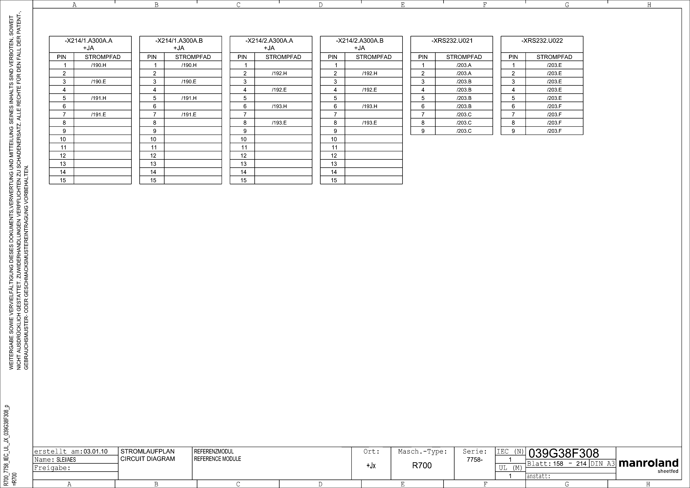

# +Jx — Sheet 158 of 214 — REFERENZMODUL

**REFERENCE MODULE**

> Part of the manroland **R700** printing press IEC/UL circuit diagrams.
> Drawing class: **Stromlaufplan / Circuit diagram** (DIN A3).
> Document `+Jx` covers the **1st printing module + feed register** machine section.

## At a glance

| Field | Value |
|---|---|
| Document | `+Jx`  (039G38F308) |
| Sheet | **158** of 214 |
| Section (DE) | REFERENZMODUL |
| Section (EN) | REFERENCE MODULE |
| Section type | REFERENCE_MODULE — Reference module |
| Machine type | `R700` |
| Series | `7758` |
| Created | 03.01.10 |
| Replaces | — |
| Columns used | A, B, C, D, E, F, G |
| Path numbers | — |
| Labels on sheet | 134 |
| Cross-refs out | 34 |
| Cross-refs in | 0 |

**Previous:** [+Jx sheet 157](SHEET_0157.md) · **Next:** [+Jx sheet 159](SHEET_0159.md) · **Document TOC:** [_TOC.md](_TOC.md)  (+Jx) · **Master TOC:** [all sheets](../_MASTER_TOC.md)

## Sheet image (300 DPI, exact vector render)



_Rendered directly from the PDF vector layer at 300 DPI (1-bit), no OCR and no resampling. Use it to confirm anything ambiguous in the text below._

## Cross-references on this sheet

Each entry is a wire leaving this sheet. The printed token is `/sheet.column`; the link resolves to that sheet inside the same document.

| Ref | Target sheet | Col | Path | Destination on target | Target section | From col |
|---|---|---|---|---|---|---|
| `/203.A` | [+Jx sheet 203](SHEET_0203.md) | A | — | — | OPTION: TELEPRESENCE | F |
| `/203.E` | [+Jx sheet 203](SHEET_0203.md) | E | — | — | OPTION: TELEPRESENCE | G |
| `/190.H` | [+Jx sheet 190](SHEET_0190.md) | H | — | — | OPTION: ZWISCHENTROCKNER, VORBEREITUNG | A |
| `/190.H` | [+Jx sheet 190](SHEET_0190.md) | H | — | — | OPTION: ZWISCHENTROCKNER, VORBEREITUNG | B |
| `/203.A` | [+Jx sheet 203](SHEET_0203.md) | A | — | — | OPTION: TELEPRESENCE | F |
| `/203.E` | [+Jx sheet 203](SHEET_0203.md) | E | — | — | OPTION: TELEPRESENCE | G |
| `/192.H` | [+Jx sheet 192](SHEET_0192.md) | H | — | — | OPTION: ZWISCHENTROCKNER, VORBEREITUNG | D |
| `/192.H` | [+Jx sheet 192](SHEET_0192.md) | H | — | — | OPTION: ZWISCHENTROCKNER, VORBEREITUNG | E |
| `/190.E` | [+Jx sheet 190](SHEET_0190.md) | E | — | — | OPTION: ZWISCHENTROCKNER, VORBEREITUNG | A |
| `/190.E` | [+Jx sheet 190](SHEET_0190.md) | E | — | — | OPTION: ZWISCHENTROCKNER, VORBEREITUNG | B |
| `/203.B` | [+Jx sheet 203](SHEET_0203.md) | B | — | — | OPTION: TELEPRESENCE | F |
| `/203.E` | [+Jx sheet 203](SHEET_0203.md) | E | — | — | OPTION: TELEPRESENCE | G |
| `/192.E` | [+Jx sheet 192](SHEET_0192.md) | E | — | — | OPTION: ZWISCHENTROCKNER, VORBEREITUNG | C |
| `/192.E` | [+Jx sheet 192](SHEET_0192.md) | E | — | — | OPTION: ZWISCHENTROCKNER, VORBEREITUNG | E |
| `/203.B` | [+Jx sheet 203](SHEET_0203.md) | B | — | — | OPTION: TELEPRESENCE | F |
| `/203.E` | [+Jx sheet 203](SHEET_0203.md) | E | — | — | OPTION: TELEPRESENCE | G |
| `/203.B` | [+Jx sheet 203](SHEET_0203.md) | B | — | — | OPTION: TELEPRESENCE | F |
| `/203.E` | [+Jx sheet 203](SHEET_0203.md) | E | — | — | OPTION: TELEPRESENCE | G |
| `/191.H` | [+Jx sheet 191](SHEET_0191.md) | H | — | — | OPTION: ZWISCHENTROCKNER, VORBEREITUNG | A |
| `/191.H` | [+Jx sheet 191](SHEET_0191.md) | H | — | — | OPTION: ZWISCHENTROCKNER, VORBEREITUNG | B |
| `/203.B` | [+Jx sheet 203](SHEET_0203.md) | B | — | — | OPTION: TELEPRESENCE | F |
| `/203.F` | [+Jx sheet 203](SHEET_0203.md) | F | — | — | OPTION: TELEPRESENCE | G |
| `/193.H` | [+Jx sheet 193](SHEET_0193.md) | H | — | — | OPTION: ZWISCHENTROCKNER, VORBEREITUNG | D |
| `/193.H` | [+Jx sheet 193](SHEET_0193.md) | H | — | — | OPTION: ZWISCHENTROCKNER, VORBEREITUNG | E |
| `/191.E` | [+Jx sheet 191](SHEET_0191.md) | E | — | — | OPTION: ZWISCHENTROCKNER, VORBEREITUNG | A |
| `/191.E` | [+Jx sheet 191](SHEET_0191.md) | E | — | — | OPTION: ZWISCHENTROCKNER, VORBEREITUNG | B |
| `/203.F` | [+Jx sheet 203](SHEET_0203.md) | F | — | — | OPTION: TELEPRESENCE | G |
| `/203.C` | [+Jx sheet 203](SHEET_0203.md) | C | — | — | OPTION: TELEPRESENCE | F |
| `/193.E` | [+Jx sheet 193](SHEET_0193.md) | E | — | — | OPTION: ZWISCHENTROCKNER, VORBEREITUNG | C |
| `/193.E` | [+Jx sheet 193](SHEET_0193.md) | E | — | — | OPTION: ZWISCHENTROCKNER, VORBEREITUNG | E |
| `/203.F` | [+Jx sheet 203](SHEET_0203.md) | F | — | — | OPTION: TELEPRESENCE | G |
| `/203.C` | [+Jx sheet 203](SHEET_0203.md) | C | — | — | OPTION: TELEPRESENCE | F |
| `/203.F` | [+Jx sheet 203](SHEET_0203.md) | F | — | — | OPTION: TELEPRESENCE | G |
| `/203.C` | [+Jx sheet 203](SHEET_0203.md) | C | — | — | OPTION: TELEPRESENCE | F |

## Devices on this sheet

| Tag | Class | Class meaning (IEC) | Col | Sub | Terminal | Sign |
|---|---|---|---|---|---|---|
| `X214/1.A300A.A` | — | cross-device reference | A | — | — | — |
| `X214/2.A300A.A` | — | cross-device reference | C | — | — | — |
| `XRS232.U021` | — | cross-device reference | F | — | — | — |
| `X214/2.A300A.B` | — | cross-device reference | D | — | — | — |
| `X214/1.A300A.B` | — | cross-device reference | B | — | — | — |
| `XRS232.U022` | — | cross-device reference | G | — | — | — |

## Potentials / nets

_No named potentials on this sheet._

## Wire-end annotations (grouped as printed)

A wire that continues elsewhere is annotated with a small cluster: the destination description, the path/line number `#NN`, and the `/sheet.column` cross reference. Each row below is one such cluster exactly as it is grouped on the drawing.

| Col | Y | Path | Cross-ref | Text on the wire |
|---|---|---|---|---|
| A | 65.4 | — | — | `X214/1.A300A.A` |
| B | 65.4 | — | — | `X214/1.A300A.B` |
| C | 65.4 | — | — | `X214/2.A300A.A` |
| D | 65.4 | — | — | `X214/2.A300A.B` |
| F | 65.4 | — | — | `XRS232.U021` |
| G | 65.4 | — | — | `XRS232.U022` |
| A | 78.1 | — | — | `+JA` |
| B | 78.1 | — | — | `+JA` |
| C | 78.1 | — | — | `+JA` |
| D | 78.1 | — | — | `+JA` |
| A | 94.1 | — | — | `PIN 10 12 13 14 15 11 2 3 4 5 6 7 8 9 1 STROMPFAD` |
| B | 94.1 | — | — | `PIN 10 12 13 14 15 11 2 3 4 5 6 7 8 9 1 STROMPFAD` |
| C | 94.1 | — | — | `PIN 10 12 13 14 15 11 2 3 4 5 6 7 8 9 1 STROMPFAD` |
| D | 94.1 | — | — | `PIN 10 12 13 14 15 11 2 3 4 5 6 7 8 9 1 STROMPFAD` |
| F | 94.1 | — | — | `PIN 2 3 5 6 7 8 9 4 1 STROMPFAD` |
| G | 94.1 | — | — | `PIN 2 3 5 6 7 8 9 4 1 STROMPFAD` |
| F | 108.6 | — | `/203.A` | — |
| G | 108.6 | — | `/203.E` | — |
| A | 108.7 | — | `/190.H` | — |
| B | 108.7 | — | `/190.H` | — |
| D | 122.8 | — | `/192.H` | — |
| E | 122.8 | — | `/192.H` | — |
| F | 122.8 | — | `/203.A` | — |
| G | 122.8 | — | `/203.E` | — |
| A | 137.0 | — | `/190.E` | — |
| B | 137.0 | — | `/190.E` | — |
| F | 137.0 | — | `/203.B` | — |
| G | 137.0 | — | `/203.E` | — |
| C | 151.2 | — | `/192.E` | — |
| E | 151.2 | — | `/192.E` | — |
| F | 151.2 | — | `/203.B` | — |
| G | 151.2 | — | `/203.E` | — |
| A | 165.3 | — | `/191.H` | — |
| B | 165.3 | — | `/191.H` | — |
| F | 165.3 | — | `/203.B` | — |
| G | 165.3 | — | `/203.E` | — |
| D | 179.5 | — | `/193.H` | — |
| E | 179.5 | — | `/193.H` | — |
| F | 179.5 | — | `/203.B` | — |
| G | 179.5 | — | `/203.F` | — |
| A | 193.7 | — | `/191.E` | — |
| B | 193.7 | — | `/191.E` | — |
| F | 193.7 | — | `/203.C` | — |
| G | 193.7 | — | `/203.F` | — |
| C | 207.8 | — | `/193.E` | — |
| E | 207.8 | — | `/193.E` | — |
| G | 207.8 | — | `/203.F` | — |
| F | 207.9 | — | `/203.C` | — |
| F | 222.0 | — | `/203.C` | — |
| G | 222.0 | — | `/203.F` | — |


## Reconstructed tables

This sheet carries tabular content (pin map / terminal assignment / index). The grid below was rebuilt from the drawing's own rule lines, so each row is exactly one physical row of the table.

### Table 1 — 15 data rows × 2 columns (at x=85.0, y=62.4) — **X214/1.A300A.A +JA**

| PIN | STROMPFAD |
|---|---|
| `1` | `/190.H` |
| `2` |  |
| `3` | `/190.E` |
| `4` |  |
| `5` | `/191.H` |
| `6` |  |
| `7` | `/191.E` |
| `8` |  |
| `9` |  |
| `10` |  |
| `11` |  |
| `12` |  |
| `13` |  |
| `14` |  |
| `15` |  |


### Table 2 — 15 data rows × 2 columns (at x=240.9, y=62.4) — **X214/1.A300A.B +JA**

| PIN | STROMPFAD |
|---|---|
| `1` | `/190.H` |
| `2` |  |
| `3` | `/190.E` |
| `4` |  |
| `5` | `/191.H` |
| `6` |  |
| `7` | `/191.E` |
| `8` |  |
| `9` |  |
| `10` |  |
| `11` |  |
| `12` |  |
| `13` |  |
| `14` |  |
| `15` |  |


### Table 3 — 15 data rows × 2 columns (at x=396.9, y=62.4) — **X214/2.A300A.A +JA**

| PIN | STROMPFAD |
|---|---|
| `1` |  |
| `2` | `/192.H` |
| `3` |  |
| `4` | `/192.E` |
| `5` |  |
| `6` | `/193.H` |
| `7` |  |
| `8` | `/193.E` |
| `9` |  |
| `10` |  |
| `11` |  |
| `12` |  |
| `13` |  |
| `14` |  |
| `15` |  |


### Table 4 — 15 data rows × 2 columns (at x=552.8, y=62.4) — **X214/2.A300A.B +JA**

| PIN | STROMPFAD |
|---|---|
| `1` |  |
| `2` | `/192.H` |
| `3` |  |
| `4` | `/192.E` |
| `5` |  |
| `6` | `/193.H` |
| `7` |  |
| `8` | `/193.E` |
| `9` |  |
| `10` |  |
| `11` |  |
| `12` |  |
| `13` |  |
| `14` |  |
| `15` |  |


### Table 5 — 9 data rows × 2 columns (at x=708.7, y=62.4) — **XRS232.U021**

| PIN | STROMPFAD |
|---|---|
| `1` | `/203.A` |
| `2` | `/203.A` |
| `3` | `/203.B` |
| `4` | `/203.B` |
| `5` | `/203.B` |
| `6` | `/203.B` |
| `7` | `/203.C` |
| `8` | `/203.C` |
| `9` | `/203.C` |


### Table 6 — 9 data rows × 2 columns (at x=864.6, y=62.4) — **XRS232.U022**

| PIN | STROMPFAD |
|---|---|
| `1` | `/203.E` |
| `2` | `/203.E` |
| `3` | `/203.E` |
| `4` | `/203.E` |
| `5` | `/203.E` |
| `6` | `/203.F` |
| `7` | `/203.F` |
| `8` | `/203.F` |
| `9` | `/203.F` |


## Notes and free text on this sheet

| Text | Col | Y (pt) |
|---|---|---|
| `PIN` | A | 94.13 |
| `STROMPFAD` | A | 94.09 |
| `+JA` | A | 78.1 |
| `PIN` | C | 94.13 |
| `STROMPFAD` | D | 94.09 |
| `+JA` | C | 78.1 |
| `PIN` | E | 94.13 |
| `STROMPFAD` | F | 94.09 |
| `PIN` | D | 94.13 |
| `STROMPFAD` | E | 94.09 |
| `+JA` | D | 78.1 |
| `PIN` | B | 94.13 |
| `STROMPFAD` | B | 94.09 |
| `+JA` | B | 78.1 |
| `PIN` | F | 94.13 |
| `STROMPFAD` | G | 94.09 |

## Complete label inventory (exact text from the drawing)

Every text object inside the drawing area of this sheet, in DIN reading order (column A→H, then top→bottom). This is the authoritative list: if a string is not here it is not printed on this sheet.

| Col | Y | X | Dir | Type | Text |
|---|---|---|---|---|---|
| A | 65.4 | 112.0 | → | device ref | `X214/1.A300A.A` |
| A | 78.1 | 143.4 | → | text | `+JA` |
| A | 94.1 | 98.2 | → | text | `PIN` |
| A | 94.1 | 146.6 | → | text | `STROMPFAD` |
| A | 108.3 | 109.7 | → | number | `1` |
| A | 108.7 | 157.5 | → | cross-reference | `/190.H` |
| A | 122.5 | 108.3 | → | number | `2` |
| A | 136.7 | 108.3 | → | number | `3` |
| A | 137.0 | 157.5 | → | cross-reference | `/190.E` |
| A | 150.8 | 108.3 | → | number | `4` |
| A | 165.0 | 108.3 | → | number | `5` |
| A | 165.4 | 157.5 | → | cross-reference | `/191.H` |
| A | 179.2 | 108.3 | → | number | `6` |
| A | 193.3 | 108.3 | → | number | `7` |
| A | 193.7 | 157.5 | → | cross-reference | `/191.E` |
| A | 207.5 | 108.3 | → | number | `8` |
| A | 221.7 | 108.3 | → | number | `9` |
| A | 235.9 | 102.9 | → | number | `10` |
| A | 250.0 | 104.3 | → | number | `11` |
| A | 264.2 | 102.9 | → | number | `12` |
| A | 278.4 | 102.9 | → | number | `13` |
| A | 292.6 | 102.9 | → | number | `14` |
| A | 306.7 | 102.9 | → | number | `15` |
| B | 65.4 | 268.2 | → | device ref | `X214/1.A300A.B` |
| B | 78.1 | 299.3 | → | text | `+JA` |
| B | 94.1 | 254.1 | → | text | `PIN` |
| B | 94.1 | 302.5 | → | text | `STROMPFAD` |
| B | 108.3 | 265.6 | → | number | `1` |
| B | 108.7 | 313.4 | → | cross-reference | `/190.H` |
| B | 122.5 | 264.2 | → | number | `2` |
| B | 136.7 | 264.2 | → | number | `3` |
| B | 137.0 | 313.4 | → | cross-reference | `/190.E` |
| B | 150.8 | 264.2 | → | number | `4` |
| B | 165.0 | 264.2 | → | number | `5` |
| B | 165.4 | 313.4 | → | cross-reference | `/191.H` |
| B | 179.2 | 264.2 | → | number | `6` |
| B | 193.3 | 264.2 | → | number | `7` |
| B | 193.7 | 313.4 | → | cross-reference | `/191.E` |
| B | 207.5 | 264.2 | → | number | `8` |
| B | 221.7 | 264.2 | → | number | `9` |
| B | 235.9 | 258.8 | → | number | `10` |
| B | 250.0 | 260.2 | → | number | `11` |
| B | 264.2 | 258.8 | → | number | `12` |
| B | 278.4 | 258.8 | → | number | `13` |
| B | 292.6 | 258.8 | → | number | `14` |
| B | 306.7 | 258.8 | → | number | `15` |
| C | 65.4 | 423.8 | → | device ref | `X214/2.A300A.A` |
| C | 78.1 | 455.2 | → | text | `+JA` |
| C | 94.1 | 410.0 | → | text | `PIN` |
| C | 108.3 | 421.5 | → | number | `1` |
| C | 122.5 | 420.1 | → | number | `2` |
| C | 136.7 | 420.1 | → | number | `3` |
| C | 150.8 | 420.1 | → | number | `4` |
| C | 151.2 | 469.3 | → | cross-reference | `/192.E` |
| C | 165.0 | 420.1 | → | number | `5` |
| C | 179.2 | 420.1 | → | number | `6` |
| C | 193.3 | 420.1 | → | number | `7` |
| C | 207.5 | 420.1 | → | number | `8` |
| C | 207.8 | 469.3 | → | cross-reference | `/193.E` |
| C | 221.7 | 420.1 | → | number | `9` |
| C | 235.9 | 414.7 | → | number | `10` |
| C | 250.0 | 416.1 | → | number | `11` |
| C | 264.2 | 414.7 | → | number | `12` |
| C | 278.4 | 414.7 | → | number | `13` |
| C | 292.6 | 414.7 | → | number | `14` |
| C | 306.7 | 414.7 | → | number | `15` |
| D | 65.4 | 580.0 | → | device ref | `X214/2.A300A.B` |
| D | 78.1 | 611.1 | → | text | `+JA` |
| D | 94.1 | 458.4 | → | text | `STROMPFAD` |
| D | 94.1 | 565.9 | → | text | `PIN` |
| D | 108.3 | 577.4 | → | number | `1` |
| D | 122.5 | 576.0 | → | number | `2` |
| D | 122.8 | 469.3 | → | cross-reference | `/192.H` |
| D | 136.7 | 576.0 | → | number | `3` |
| D | 150.8 | 576.0 | → | number | `4` |
| D | 165.0 | 576.0 | → | number | `5` |
| D | 179.2 | 576.0 | → | number | `6` |
| D | 179.5 | 469.3 | → | cross-reference | `/193.H` |
| D | 193.3 | 576.0 | → | number | `7` |
| D | 207.5 | 576.0 | → | number | `8` |
| D | 221.7 | 576.0 | → | number | `9` |
| D | 235.9 | 570.6 | → | number | `10` |
| D | 250.0 | 572.0 | → | number | `11` |
| D | 264.2 | 570.6 | → | number | `12` |
| D | 278.4 | 570.6 | → | number | `13` |
| D | 292.6 | 570.6 | → | number | `14` |
| D | 306.7 | 570.6 | → | number | `15` |
| E | 94.1 | 614.3 | → | text | `STROMPFAD` |
| E | 94.1 | 721.8 | → | text | `PIN` |
| E | 108.3 | 727.7 | → | number | `1` |
| E | 122.5 | 727.2 | → | number | `2` |
| E | 122.8 | 625.2 | → | cross-reference | `/192.H` |
| E | 136.7 | 727.2 | → | number | `3` |
| E | 150.8 | 727.4 | → | number | `4` |
| E | 151.2 | 625.2 | → | cross-reference | `/192.E` |
| E | 165.0 | 727.2 | → | number | `5` |
| E | 179.2 | 727.2 | → | number | `6` |
| E | 179.5 | 625.2 | → | cross-reference | `/193.H` |
| E | 193.3 | 727.2 | → | number | `7` |
| E | 207.5 | 727.2 | → | number | `8` |
| E | 207.8 | 625.2 | → | cross-reference | `/193.E` |
| E | 221.7 | 727.2 | → | number | `9` |
| F | 65.4 | 744.7 | → | device ref | `XRS232.U021` |
| F | 94.1 | 770.2 | → | text | `STROMPFAD` |
| F | 94.1 | 877.7 | → | text | `PIN` |
| F | 108.3 | 883.6 | → | number | `1` |
| F | 108.6 | 788.0 | → | cross-reference | `/203.A` |
| F | 122.5 | 883.1 | → | number | `2` |
| F | 122.8 | 788.0 | → | cross-reference | `/203.A` |
| F | 136.7 | 883.1 | → | number | `3` |
| F | 137.0 | 788.2 | → | cross-reference | `/203.B` |
| F | 150.8 | 883.3 | → | number | `4` |
| F | 151.2 | 788.2 | → | cross-reference | `/203.B` |
| F | 165.0 | 883.1 | → | number | `5` |
| F | 165.3 | 788.2 | → | cross-reference | `/203.B` |
| F | 179.2 | 883.1 | → | number | `6` |
| F | 179.5 | 788.2 | → | cross-reference | `/203.B` |
| F | 193.3 | 883.1 | → | number | `7` |
| F | 193.7 | 788.0 | → | cross-reference | `/203.C` |
| F | 207.5 | 883.1 | → | number | `8` |
| F | 207.9 | 788.0 | → | cross-reference | `/203.C` |
| F | 221.7 | 883.1 | → | number | `9` |
| F | 222.0 | 788.0 | → | cross-reference | `/203.C` |
| G | 65.4 | 899.9 | → | device ref | `XRS232.U022` |
| G | 94.1 | 926.1 | → | text | `STROMPFAD` |
| G | 108.6 | 944.1 | → | cross-reference | `/203.E` |
| G | 122.8 | 944.1 | → | cross-reference | `/203.E` |
| G | 137.0 | 944.1 | → | cross-reference | `/203.E` |
| G | 151.2 | 944.1 | → | cross-reference | `/203.E` |
| G | 165.3 | 944.1 | → | cross-reference | `/203.E` |
| G | 179.5 | 944.4 | → | cross-reference | `/203.F` |
| G | 193.7 | 944.4 | → | cross-reference | `/203.F` |
| G | 207.9 | 944.4 | → | cross-reference | `/203.F` |
| G | 222.0 | 944.4 | → | cross-reference | `/203.F` |

## Reading-order text block

The same content as a plain block, grouped by DIN column — convenient to paste or to match against a visual description.

```text
=== Column A ===
  65.4  112.0  devref       X214/1.A300A.A
  78.1  143.4  text         +JA
  94.1   98.2  text         PIN
  94.1  146.6  text         STROMPFAD
 108.3  109.7  numeric      1
 108.7  157.5  xref         /190.H
 122.5  108.3  numeric      2
 136.7  108.3  numeric      3
 137.0  157.5  xref         /190.E
 150.8  108.3  numeric      4
 165.0  108.3  numeric      5
 165.4  157.5  xref         /191.H
 179.2  108.3  numeric      6
 193.3  108.3  numeric      7
 193.7  157.5  xref         /191.E
 207.5  108.3  numeric      8
 221.7  108.3  numeric      9
 235.9  102.9  numeric      10
 250.0  104.3  numeric      11
 264.2  102.9  numeric      12
 278.4  102.9  numeric      13
 292.6  102.9  numeric      14
 306.7  102.9  numeric      15
=== Column B ===
  65.4  268.2  devref       X214/1.A300A.B
  78.1  299.3  text         +JA
  94.1  254.1  text         PIN
  94.1  302.5  text         STROMPFAD
 108.3  265.6  numeric      1
 108.7  313.4  xref         /190.H
 122.5  264.2  numeric      2
 136.7  264.2  numeric      3
 137.0  313.4  xref         /190.E
 150.8  264.2  numeric      4
 165.0  264.2  numeric      5
 165.4  313.4  xref         /191.H
 179.2  264.2  numeric      6
 193.3  264.2  numeric      7
 193.7  313.4  xref         /191.E
 207.5  264.2  numeric      8
 221.7  264.2  numeric      9
 235.9  258.8  numeric      10
 250.0  260.2  numeric      11
 264.2  258.8  numeric      12
 278.4  258.8  numeric      13
 292.6  258.8  numeric      14
 306.7  258.8  numeric      15
=== Column C ===
  65.4  423.8  devref       X214/2.A300A.A
  78.1  455.2  text         +JA
  94.1  410.0  text         PIN
 108.3  421.5  numeric      1
 122.5  420.1  numeric      2
 136.7  420.1  numeric      3
 150.8  420.1  numeric      4
 151.2  469.3  xref         /192.E
 165.0  420.1  numeric      5
 179.2  420.1  numeric      6
 193.3  420.1  numeric      7
 207.5  420.1  numeric      8
 207.8  469.3  xref         /193.E
 221.7  420.1  numeric      9
 235.9  414.7  numeric      10
 250.0  416.1  numeric      11
 264.2  414.7  numeric      12
 278.4  414.7  numeric      13
 292.6  414.7  numeric      14
 306.7  414.7  numeric      15
=== Column D ===
  65.4  580.0  devref       X214/2.A300A.B
  78.1  611.1  text         +JA
  94.1  458.4  text         STROMPFAD
  94.1  565.9  text         PIN
 108.3  577.4  numeric      1
 122.5  576.0  numeric      2
 122.8  469.3  xref         /192.H
 136.7  576.0  numeric      3
 150.8  576.0  numeric      4
 165.0  576.0  numeric      5
 179.2  576.0  numeric      6
 179.5  469.3  xref         /193.H
 193.3  576.0  numeric      7
 207.5  576.0  numeric      8
 221.7  576.0  numeric      9
 235.9  570.6  numeric      10
 250.0  572.0  numeric      11
 264.2  570.6  numeric      12
 278.4  570.6  numeric      13
 292.6  570.6  numeric      14
 306.7  570.6  numeric      15
=== Column E ===
  94.1  614.3  text         STROMPFAD
  94.1  721.8  text         PIN
 108.3  727.7  numeric      1
 122.5  727.2  numeric      2
 122.8  625.2  xref         /192.H
 136.7  727.2  numeric      3
 150.8  727.4  numeric      4
 151.2  625.2  xref         /192.E
 165.0  727.2  numeric      5
 179.2  727.2  numeric      6
 179.5  625.2  xref         /193.H
 193.3  727.2  numeric      7
 207.5  727.2  numeric      8
 207.8  625.2  xref         /193.E
 221.7  727.2  numeric      9
=== Column F ===
  65.4  744.7  devref       XRS232.U021
  94.1  770.2  text         STROMPFAD
  94.1  877.7  text         PIN
 108.3  883.6  numeric      1
 108.6  788.0  xref         /203.A
 122.5  883.1  numeric      2
 122.8  788.0  xref         /203.A
 136.7  883.1  numeric      3
 137.0  788.2  xref         /203.B
 150.8  883.3  numeric      4
 151.2  788.2  xref         /203.B
 165.0  883.1  numeric      5
 165.3  788.2  xref         /203.B
 179.2  883.1  numeric      6
 179.5  788.2  xref         /203.B
 193.3  883.1  numeric      7
 193.7  788.0  xref         /203.C
 207.5  883.1  numeric      8
 207.9  788.0  xref         /203.C
 221.7  883.1  numeric      9
 222.0  788.0  xref         /203.C
=== Column G ===
  65.4  899.9  devref       XRS232.U022
  94.1  926.1  text         STROMPFAD
 108.6  944.1  xref         /203.E
 122.8  944.1  xref         /203.E
 137.0  944.1  xref         /203.E
 151.2  944.1  xref         /203.E
 165.3  944.1  xref         /203.E
 179.5  944.4  xref         /203.F
 193.7  944.4  xref         /203.F
 207.9  944.4  xref         /203.F
 222.0  944.4  xref         /203.F
```

---
_Generated from the PDF vector text layer; no OCR. Source: `R700_7758_IEC_UL_JX_039G38F308_p`, sheet 158._
