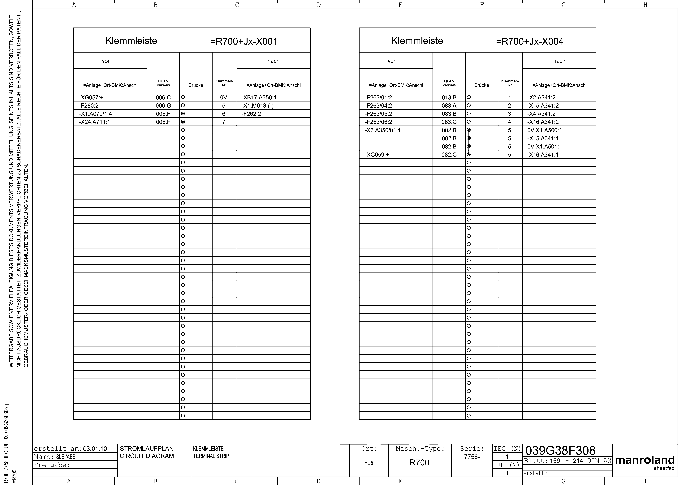

# +Jx — Sheet 159 of 214 — KLEMMLEISTE

**TERMINAL STRIP**

> Part of the manroland **R700** printing press IEC/UL circuit diagrams.
> Drawing class: **Stromlaufplan / Circuit diagram** (DIN A3).
> Document `+Jx` covers the **1st printing module + feed register** machine section.

## At a glance

| Field | Value |
|---|---|
| Document | `+Jx`  (039G38F308) |
| Sheet | **159** of 214 |
| Section (DE) | KLEMMLEISTE |
| Section (EN) | TERMINAL STRIP |
| Section type | TERMINALS — Terminal strip |
| Machine type | `R700` |
| Series | `7758` |
| Created | 03.01.10 |
| Replaces | — |
| Columns used | A, B, C, E, F, G |
| Path numbers | — |
| Labels on sheet | 67 |
| Cross-refs out | 0 |
| Cross-refs in | 0 |

**Previous:** [+Jx sheet 158](SHEET_0158.md) · **Next:** [+Jx sheet 160](SHEET_0160.md) · **Document TOC:** [_TOC.md](_TOC.md)  (+Jx) · **Master TOC:** [all sheets](../_MASTER_TOC.md)

## Sheet image (300 DPI, exact vector render)



_Rendered directly from the PDF vector layer at 300 DPI (1-bit), no OCR and no resampling. Use it to confirm anything ambiguous in the text below._

## Cross-references on this sheet

Each entry is a wire leaving this sheet. The printed token is `/sheet.column`; the link resolves to that sheet inside the same document.

_No outgoing cross-references on this sheet._

## Devices on this sheet

| Tag | Class | Class meaning (IEC) | Col | Sub | Terminal | Sign |
|---|---|---|---|---|---|---|
| `F280:2` | F | Schutz / protection device (fuse, circuit breaker) | A | — | 2 | — |
| `F262:2` | F | Schutz / protection device (fuse, circuit breaker) | C | — | 2 | — |
| `F263/01:2` | F | Schutz / protection device (fuse, circuit breaker) | E | 01 | 2 | — |
| `F263/04:2` | F | Schutz / protection device (fuse, circuit breaker) | E | 04 | 2 | — |
| `F263/05:2` | F | Schutz / protection device (fuse, circuit breaker) | E | 05 | 2 | — |
| `F263/06:2` | F | Schutz / protection device (fuse, circuit breaker) | E | 06 | 2 | — |
| `Nr.` | — | cross-device reference | C | — | — | — |
| `006.C` | — | cross-device reference | B | — | — | — |
| `XB17.A350:1` | — | cross-device reference | C | — | 1 | — |
| `006.G` | — | cross-device reference | B | — | — | — |
| `X1.M013:( )` | — | cross-device reference | C | — | — | — |
| `006.F` | — | cross-device reference | B | — | — | — |
| `006.F` | — | cross-device reference | B | — | — | — |
| `X24.A711:1` | — | cross-device reference | A | — | 1 | — |
| `Nr.` | — | cross-device reference | F | — | — | — |
| `013.B` | — | cross-device reference | F | — | — | — |
| `X2.A341:2` | — | cross-device reference | G | — | 2 | — |
| `083.A` | — | cross-device reference | F | — | — | — |
| `X15.A341:2` | — | cross-device reference | G | — | 2 | — |
| `083.B` | — | cross-device reference | F | — | — | — |
| `X4.A341:2` | — | cross-device reference | G | — | 2 | — |
| `083.C` | — | cross-device reference | F | — | — | — |
| `X16.A341:2` | — | cross-device reference | G | — | 2 | — |
| `082.B` | — | cross-device reference | F | — | — | — |
| `082.B` | — | cross-device reference | F | — | — | — |
| `X15.A341:1` | — | cross-device reference | G | — | 1 | — |
| `082.B` | — | cross-device reference | F | — | — | — |
| `082.C` | — | cross-device reference | F | — | — | — |
| `X16.A341:1` | — | cross-device reference | G | — | 1 | — |

## Potentials / nets

| Potential | Count | Columns | Attached devices | Terminals |
|---|---|---|---|---|
| `0V` | 3 | C, G | `A500`, `A501`, `X1` | `1` |


A potential such as `L24+/4` or `M24+` is a named supply/return rail; every place it appears on this sheet is electrically common.

## Wire-end annotations (grouped as printed)

A wire that continues elsewhere is annotated with a small cluster: the destination description, the path/line number `#NN`, and the `/sheet.column` cross reference. Each row below is one such cluster exactly as it is grouped on the drawing.

| Col | Y | Path | Cross-ref | Text on the wire |
|---|---|---|---|---|
| B | 63.2 | — | — | `Klemmleiste` |
| E | 63.2 | — | — | `Klemmleiste` |
| C | 64.7 | — | — | `=R700+Jx X001` |
| G | 64.7 | — | — | `=R700+Jx X004` |
| C | 101.2 | — | — | `nach` |
| G | 101.2 | — | — | `nach` |
| A | 101.3 | — | — | `von` |
| E | 101.3 | — | — | `von` |
| B | 137.7 | — | — | `Quer` |
| C | 137.7 | — | — | `Klemmen =Anlage+Ort BMK:Anschl` |
| F | 137.7 | — | — | `Quer` |
| G | 137.7 | — | — | `Klemmen =Anlage+Ort BMK:Anschl` |
| A | 144.3 | — | — | `=Anlage+Ort BMK:Anschl` |
| C | 144.3 | — | — | `Brücke Nr.` |
| E | 144.3 | — | — | `=Anlage+Ort BMK:Anschl` |
| F | 144.3 | — | — | `Brücke Nr.` |
| B | 144.9 | — | — | `verweis` |
| F | 144.9 | — | — | `verweis` |
| B | 165.0 | — | — | `XG057:+ F280:2 X1.A070/1:4 X24.A711:1 006.G 006.C 006.F 006.F 0V 5 6 7 XB17.A350:1 X1.M013:( ) F262:2` |
| F | 165.0 | — | — | `F263/01:2 F263/04:2 F263/05:2 F263/06:2 X3.A350/01:1 XG059:+ 083.C 082.C 083.A 013.B 083.B 082.B 082.B 082.B 2 3 5 5 5 5 4 1 X2.A341:2 X15.A341:2 X4.A341:2 X16.A341:2 0V.X1.A500:1 X15.A341:1 0V.X1.A501:1 X16.A341:1` |


## Reconstructed tables

This sheet carries tabular content (pin map / terminal assignment / index). The grid below was rebuilt from the drawing's own rule lines, so each row is exactly one physical row of the table.

### Table 1 — 4 data rows × 3 columns (at x=255.1, y=48.2)

| Quer verweis | Brücke | Klemmen Nr. |
|---|---|---|
| `006.C` |  | `0V` |
| `006.G` |  | `5` |
| `006.F` |  | `6` |
| `006.F` |  | `7` |


### Table 2 — 8 data rows × 3 columns (at x=751.2, y=48.2)

| Quer verweis | Brücke | Klemmen Nr. |
|---|---|---|
| `013.B` |  | `1` |
| `083.A` |  | `2` |
| `083.B` |  | `3` |
| `083.C` |  | `4` |
| `082.B` |  | `5` |
| `082.B` |  | `5` |
| `082.B` |  | `5` |
| `082.C` |  | `5` |


## Notes and free text on this sheet

| Text | Col | Y (pt) |
|---|---|---|
| `von` | A | 101.3 |
| `=Anlage+Ort BMK:Anschl` | A | 144.29 |
| `Quer` | B | 137.71 |
| `Klemmleiste` | B | 63.21 |
| `verweis` | B | 144.9 |
| `nach` | C | 101.23 |
| `=Anlage+Ort BMK:Anschl` | C | 144.29 |
| `Klemmen` | C | 137.73 |
| `Brücke` | B | 144.3 |
| `=R700+Jx X001` | C | 64.71 |
| `XG057:+` | A | 164.96 |
| `X1.A070/1:4` | A | 193.3 |
| `von` | E | 101.3 |
| `=Anlage+Ort BMK:Anschl` | E | 144.29 |
| `Quer` | F | 137.71 |
| `Klemmleiste` | E | 63.21 |
| `verweis` | F | 144.9 |
| `nach` | G | 101.23 |
| `=Anlage+Ort BMK:Anschl` | G | 144.29 |
| `Klemmen` | F | 137.73 |
| `Brücke` | F | 144.3 |
| `=R700+Jx X004` | G | 64.71 |
| `X3.A350/01:1` | E | 221.65 |
| `XG059:+` | E | 264.17 |

## Complete label inventory (exact text from the drawing)

Every text object inside the drawing area of this sheet, in DIN reading order (column A→H, then top→bottom). This is the authoritative list: if a string is not here it is not printed on this sheet.

| Col | Y | X | Dir | Type | Text |
|---|---|---|---|---|---|
| A | 101.3 | 176.9 | → | text | `von` |
| A | 144.3 | 144.4 | → | text | `=Anlage+Ort BMK:Anschl` |
| A | 165.0 | 137.2 | → | text | `XG057:+` |
| A | 179.1 | 137.2 | → | device tag | `F280:2` |
| A | 193.3 | 137.2 | → | text | `X1.A070/1:4` |
| A | 207.5 | 137.2 | → | device ref | `X24.A711:1` |
| B | 63.2 | 183.1 | → | text | `Klemmleiste` |
| B | 137.7 | 274.5 | → | text | `Quer` |
| B | 144.3 | 327.3 | → | text | `Brücke` |
| B | 144.9 | 272.6 | → | text | `verweis` |
| B | 165.0 | 270.4 | → | device ref | `006.C` |
| B | 179.1 | 270.3 | → | device ref | `006.G` |
| B | 193.3 | 271.0 | → | device ref | `006.F` |
| B | 207.5 | 271.0 | → | device ref | `006.F` |
| C | 64.7 | 364.8 | → | text | `=R700+Jx X001` |
| C | 101.2 | 464.3 | → | text | `nach` |
| C | 137.7 | 373.9 | → | text | `Klemmen` |
| C | 144.3 | 427.9 | → | text | `=Anlage+Ort BMK:Anschl` |
| C | 144.8 | 385.4 | → | device ref | `Nr.` |
| C | 165.0 | 382.3 | → | potential | `0V` |
| C | 165.0 | 419.2 | → | device ref | `XB17.A350:1` |
| C | 179.1 | 419.2 | → | device ref | `X1.M013:( )` |
| C | 179.2 | 385.7 | → | number | `5` |
| C | 193.3 | 385.7 | → | number | `6` |
| C | 193.3 | 419.2 | → | device tag | `F262:2` |
| C | 207.5 | 385.7 | → | number | `7` |
| E | 63.2 | 679.2 | → | text | `Klemmleiste` |
| E | 101.3 | 672.9 | → | text | `von` |
| E | 144.3 | 640.5 | → | text | `=Anlage+Ort BMK:Anschl` |
| E | 165.0 | 633.3 | → | device tag | `F263/01:2` |
| E | 179.1 | 633.3 | → | device tag | `F263/04:2` |
| E | 193.3 | 633.3 | → | device tag | `F263/05:2` |
| E | 207.5 | 633.3 | → | device tag | `F263/06:2` |
| E | 221.7 | 633.3 | → | text | `X3.A350/01:1` |
| E | 264.2 | 633.3 | → | text | `XG059:+` |
| F | 137.7 | 770.6 | → | text | `Quer` |
| F | 137.7 | 870.0 | → | text | `Klemmen` |
| F | 144.3 | 823.3 | → | text | `Brücke` |
| F | 144.8 | 881.4 | → | device ref | `Nr.` |
| F | 144.9 | 768.6 | → | text | `verweis` |
| F | 165.0 | 766.9 | → | device ref | `013.B` |
| F | 165.0 | 882.1 | → | number | `1` |
| F | 179.1 | 766.6 | → | device ref | `083.A` |
| F | 179.2 | 881.7 | → | number | `2` |
| F | 193.3 | 766.9 | → | device ref | `083.B` |
| F | 193.3 | 881.7 | → | number | `3` |
| F | 207.5 | 766.5 | → | device ref | `083.C` |
| F | 207.5 | 881.9 | → | number | `4` |
| F | 221.7 | 766.9 | → | device ref | `082.B` |
| F | 221.7 | 881.7 | → | number | `5` |
| F | 235.8 | 766.9 | → | device ref | `082.B` |
| F | 235.9 | 881.7 | → | number | `5` |
| F | 250.0 | 766.9 | → | device ref | `082.B` |
| F | 250.0 | 881.7 | → | number | `5` |
| F | 264.2 | 766.5 | → | device ref | `082.C` |
| F | 264.2 | 881.7 | → | number | `5` |
| G | 64.7 | 860.9 | → | text | `=R700+Jx X004` |
| G | 101.2 | 960.4 | → | text | `nach` |
| G | 144.3 | 924.0 | → | text | `=Anlage+Ort BMK:Anschl` |
| G | 165.0 | 915.3 | → | device ref | `X2.A341:2` |
| G | 179.1 | 915.3 | → | device ref | `X15.A341:2` |
| G | 193.3 | 915.3 | → | device ref | `X4.A341:2` |
| G | 207.5 | 915.3 | → | device ref | `X16.A341:2` |
| G | 221.7 | 915.3 | → | potential | `0V.X1.A500:1` |
| G | 235.8 | 915.3 | → | device ref | `X15.A341:1` |
| G | 250.0 | 915.3 | → | potential | `0V.X1.A501:1` |
| G | 264.2 | 915.3 | → | device ref | `X16.A341:1` |

## Reading-order text block

The same content as a plain block, grouped by DIN column — convenient to paste or to match against a visual description.

```text
=== Column A ===
 101.3  176.9  text         von
 144.3  144.4  text         =Anlage+Ort BMK:Anschl
 165.0  137.2  text         XG057:+
 179.1  137.2  devtag       F280:2
 193.3  137.2  text         X1.A070/1:4
 207.5  137.2  devref       X24.A711:1
=== Column B ===
  63.2  183.1  text         Klemmleiste
 137.7  274.5  text         Quer
 144.3  327.3  text         Brücke
 144.9  272.6  text         verweis
 165.0  270.4  devref       006.C
 179.1  270.3  devref       006.G
 193.3  271.0  devref       006.F
 207.5  271.0  devref       006.F
=== Column C ===
  64.7  364.8  text         =R700+Jx X001
 101.2  464.3  text         nach
 137.7  373.9  text         Klemmen
 144.3  427.9  text         =Anlage+Ort BMK:Anschl
 144.8  385.4  devref       Nr.
 165.0  382.3  net          0V
 165.0  419.2  devref       XB17.A350:1
 179.1  419.2  devref       X1.M013:( )
 179.2  385.7  numeric      5
 193.3  385.7  numeric      6
 193.3  419.2  devtag       F262:2
 207.5  385.7  numeric      7
=== Column E ===
  63.2  679.2  text         Klemmleiste
 101.3  672.9  text         von
 144.3  640.5  text         =Anlage+Ort BMK:Anschl
 165.0  633.3  devtag       F263/01:2
 179.1  633.3  devtag       F263/04:2
 193.3  633.3  devtag       F263/05:2
 207.5  633.3  devtag       F263/06:2
 221.7  633.3  text         X3.A350/01:1
 264.2  633.3  text         XG059:+
=== Column F ===
 137.7  770.6  text         Quer
 137.7  870.0  text         Klemmen
 144.3  823.3  text         Brücke
 144.8  881.4  devref       Nr.
 144.9  768.6  text         verweis
 165.0  766.9  devref       013.B
 165.0  882.1  numeric      1
 179.1  766.6  devref       083.A
 179.2  881.7  numeric      2
 193.3  766.9  devref       083.B
 193.3  881.7  numeric      3
 207.5  766.5  devref       083.C
 207.5  881.9  numeric      4
 221.7  766.9  devref       082.B
 221.7  881.7  numeric      5
 235.8  766.9  devref       082.B
 235.9  881.7  numeric      5
 250.0  766.9  devref       082.B
 250.0  881.7  numeric      5
 264.2  766.5  devref       082.C
 264.2  881.7  numeric      5
=== Column G ===
  64.7  860.9  text         =R700+Jx X004
 101.2  960.4  text         nach
 144.3  924.0  text         =Anlage+Ort BMK:Anschl
 165.0  915.3  devref       X2.A341:2
 179.1  915.3  devref       X15.A341:2
 193.3  915.3  devref       X4.A341:2
 207.5  915.3  devref       X16.A341:2
 221.7  915.3  net          0V.X1.A500:1
 235.8  915.3  devref       X15.A341:1
 250.0  915.3  net          0V.X1.A501:1
 264.2  915.3  devref       X16.A341:1
```

---
_Generated from the PDF vector text layer; no OCR. Source: `R700_7758_IEC_UL_JX_039G38F308_p`, sheet 159._
