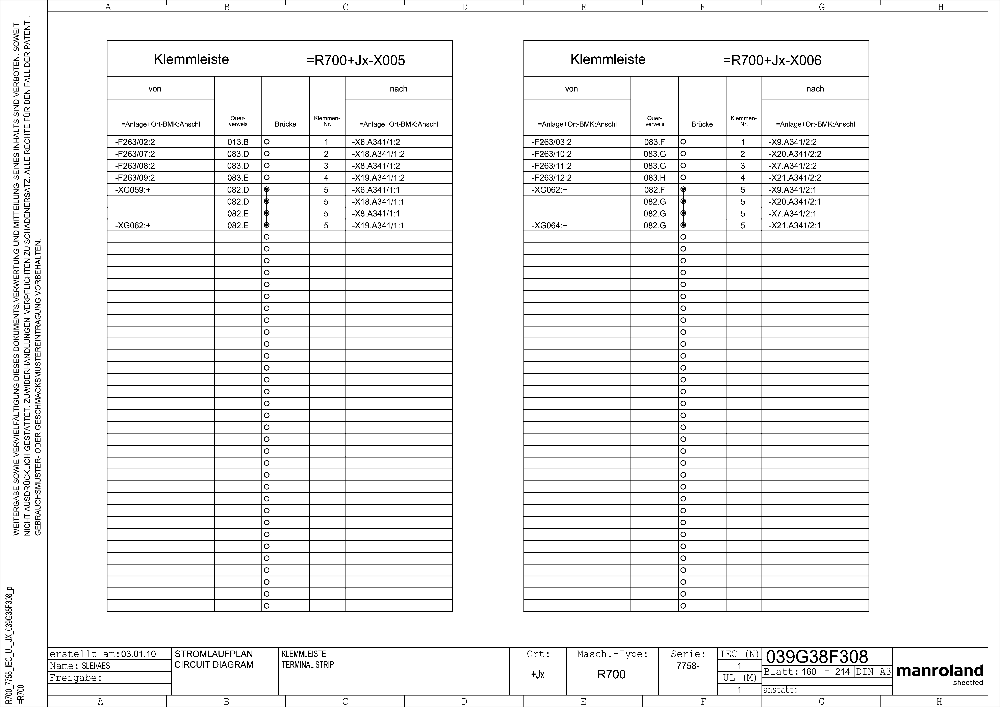

# +Jx — Sheet 160 of 214 — KLEMMLEISTE

**TERMINAL STRIP**

> Part of the manroland **R700** printing press IEC/UL circuit diagrams.
> Drawing class: **Stromlaufplan / Circuit diagram** (DIN A3).
> Document `+Jx` covers the **1st printing module + feed register** machine section.

## At a glance

| Field | Value |
|---|---|
| Document | `+Jx`  (039G38F308) |
| Sheet | **160** of 214 |
| Section (DE) | KLEMMLEISTE |
| Section (EN) | TERMINAL STRIP |
| Section type | TERMINALS — Terminal strip |
| Machine type | `R700` |
| Series | `7758` |
| Created | 03.01.10 |
| Replaces | — |
| Columns used | A, B, C, E, F, G |
| Path numbers | — |
| Labels on sheet | 82 |
| Cross-refs out | 0 |
| Cross-refs in | 0 |

**Previous:** [+Jx sheet 159](SHEET_0159.md) · **Next:** [+Jx sheet 161](SHEET_0161.md) · **Document TOC:** [_TOC.md](_TOC.md)  (+Jx) · **Master TOC:** [all sheets](../_MASTER_TOC.md)

## Sheet image (300 DPI, exact vector render)



_Rendered directly from the PDF vector layer at 300 DPI (1-bit), no OCR and no resampling. Use it to confirm anything ambiguous in the text below._

## Cross-references on this sheet

Each entry is a wire leaving this sheet. The printed token is `/sheet.column`; the link resolves to that sheet inside the same document.

_No outgoing cross-references on this sheet._

## Devices on this sheet

| Tag | Class | Class meaning (IEC) | Col | Sub | Terminal | Sign |
|---|---|---|---|---|---|---|
| `F263/02:2` | F | Schutz / protection device (fuse, circuit breaker) | A | 02 | 2 | — |
| `F263/07:2` | F | Schutz / protection device (fuse, circuit breaker) | A | 07 | 2 | — |
| `F263/08:2` | F | Schutz / protection device (fuse, circuit breaker) | A | 08 | 2 | — |
| `F263/09:2` | F | Schutz / protection device (fuse, circuit breaker) | A | 09 | 2 | — |
| `F263/03:2` | F | Schutz / protection device (fuse, circuit breaker) | E | 03 | 2 | — |
| `F263/10:2` | F | Schutz / protection device (fuse, circuit breaker) | E | 10 | 2 | — |
| `F263/11:2` | F | Schutz / protection device (fuse, circuit breaker) | E | 11 | 2 | — |
| `F263/12:2` | F | Schutz / protection device (fuse, circuit breaker) | E | 12 | 2 | — |
| `Nr.` | — | cross-device reference | C | — | — | — |
| `013.B` | — | cross-device reference | B | — | — | — |
| `083.D` | — | cross-device reference | B | — | — | — |
| `083.D` | — | cross-device reference | B | — | — | — |
| `083.E` | — | cross-device reference | B | — | — | — |
| `082.D` | — | cross-device reference | B | — | — | — |
| `082.D` | — | cross-device reference | B | — | — | — |
| `082.E` | — | cross-device reference | B | — | — | — |
| `082.E` | — | cross-device reference | B | — | — | — |
| `Nr.` | — | cross-device reference | F | — | — | — |
| `083.F` | — | cross-device reference | F | — | — | — |
| `083.G` | — | cross-device reference | F | — | — | — |
| `083.G` | — | cross-device reference | F | — | — | — |
| `083.H` | — | cross-device reference | F | — | — | — |
| `082.F` | — | cross-device reference | F | — | — | — |
| `082.G` | — | cross-device reference | F | — | — | — |
| `082.G` | — | cross-device reference | F | — | — | — |
| `082.G` | — | cross-device reference | F | — | — | — |

## Potentials / nets

_No named potentials on this sheet._

## Wire-end annotations (grouped as printed)

A wire that continues elsewhere is annotated with a small cluster: the destination description, the path/line number `#NN`, and the `/sheet.column` cross reference. Each row below is one such cluster exactly as it is grouped on the drawing.

| Col | Y | Path | Cross-ref | Text on the wire |
|---|---|---|---|---|
| B | 63.2 | — | — | `Klemmleiste` |
| E | 63.2 | — | — | `Klemmleiste` |
| C | 64.7 | — | — | `=R700+Jx X005` |
| G | 64.7 | — | — | `=R700+Jx X006` |
| C | 101.2 | — | — | `nach` |
| G | 101.2 | — | — | `nach` |
| A | 101.3 | — | — | `von` |
| E | 101.3 | — | — | `von` |
| B | 137.7 | — | — | `Quer` |
| C | 137.7 | — | — | `Klemmen =Anlage+Ort BMK:Anschl` |
| F | 137.7 | — | — | `Quer` |
| G | 137.7 | — | — | `Klemmen =Anlage+Ort BMK:Anschl` |
| A | 144.3 | — | — | `=Anlage+Ort BMK:Anschl` |
| C | 144.3 | — | — | `Brücke Nr.` |
| E | 144.3 | — | — | `=Anlage+Ort BMK:Anschl` |
| F | 144.3 | — | — | `Brücke Nr.` |
| B | 144.9 | — | — | `verweis` |
| F | 144.9 | — | — | `verweis` |
| B | 164.9 | — | — | `F263/02:2 F263/07:2 F263/08:2 F263/09:2 XG059:+ XG062:+ 083.D 083.D 082.D 082.D 083.E 082.E 082.E 013.B 2 3 5 5 5 5 4 1 X6.A341/1:2 X18.A341/1:2 X8.A341/1:2 X19.A341/1:2 X6.A341/1:1 X18.A341/1:1 X8.A341/1:1 X19.A341/1:1` |
| F | 164.9 | — | — | `F263/03:2 F263/10:2 F263/11:2 F263/12:2 XG062:+ XG064:+ 083.G 083.G 082.G 082.G 082.G 083.H 083.F 082.F 2 3 5 5 5 5 4 1 X9.A341/2:2 X20.A341/2:2 X7.A341/2:2 X21.A341/2:2 X9.A341/2:1 X20.A341/2:1 X7.A341/2:1 X21.A341/2:1` |


## Reconstructed tables

This sheet carries tabular content (pin map / terminal assignment / index). The grid below was rebuilt from the drawing's own rule lines, so each row is exactly one physical row of the table.

### Table 1 — 8 data rows × 3 columns (at x=255.1, y=48.2)

| Quer verweis | Brücke | Klemmen Nr. |
|---|---|---|
| `013.B` |  | `1` |
| `083.D` |  | `2` |
| `083.D` |  | `3` |
| `083.E` |  | `4` |
| `082.D` |  | `5` |
| `082.D` |  | `5` |
| `082.E` |  | `5` |
| `082.E` |  | `5` |


### Table 2 — 8 data rows × 3 columns (at x=751.2, y=48.2)

| Quer verweis | Brücke | Klemmen Nr. |
|---|---|---|
| `083.F` |  | `1` |
| `083.G` |  | `2` |
| `083.G` |  | `3` |
| `083.H` |  | `4` |
| `082.F` |  | `5` |
| `082.G` |  | `5` |
| `082.G` |  | `5` |
| `082.G` |  | `5` |


## Notes and free text on this sheet

| Text | Col | Y (pt) |
|---|---|---|
| `von` | A | 101.3 |
| `=Anlage+Ort BMK:Anschl` | A | 144.29 |
| `Quer` | B | 137.71 |
| `Klemmleiste` | B | 63.21 |
| `verweis` | B | 144.9 |
| `nach` | C | 101.23 |
| `=Anlage+Ort BMK:Anschl` | C | 144.29 |
| `Klemmen` | C | 137.73 |
| `Brücke` | B | 144.3 |
| `=R700+Jx X005` | C | 64.71 |
| `X6.A341/1:2` | C | 164.95 |
| `X18.A341/1:2` | C | 179.13 |
| `X8.A341/1:2` | C | 193.3 |
| `X19.A341/1:2` | C | 207.48 |
| `XG059:+` | A | 221.65 |
| `X6.A341/1:1` | C | 221.65 |
| `X18.A341/1:1` | C | 235.82 |
| `X8.A341/1:1` | C | 249.99 |
| `XG062:+` | A | 264.17 |
| `X19.A341/1:1` | C | 264.17 |
| `von` | E | 101.3 |
| `=Anlage+Ort BMK:Anschl` | E | 144.29 |
| `Quer` | F | 137.71 |
| `Klemmleiste` | E | 63.21 |
| `verweis` | F | 144.9 |
| `nach` | G | 101.23 |
| `=Anlage+Ort BMK:Anschl` | G | 144.29 |
| `Klemmen` | F | 137.73 |
| `Brücke` | F | 144.3 |
| `=R700+Jx X006` | G | 64.71 |
| `X9.A341/2:2` | G | 164.95 |
| `X20.A341/2:2` | G | 179.13 |
| `X7.A341/2:2` | G | 193.3 |
| `X21.A341/2:2` | G | 207.48 |
| `XG062:+` | E | 221.65 |
| `X9.A341/2:1` | G | 221.65 |
| `X20.A341/2:1` | G | 235.82 |
| `X7.A341/2:1` | G | 249.99 |
| `XG064:+` | E | 264.17 |
| `X21.A341/2:1` | G | 264.17 |

## Complete label inventory (exact text from the drawing)

Every text object inside the drawing area of this sheet, in DIN reading order (column A→H, then top→bottom). This is the authoritative list: if a string is not here it is not printed on this sheet.

| Col | Y | X | Dir | Type | Text |
|---|---|---|---|---|---|
| A | 101.3 | 176.9 | → | text | `von` |
| A | 144.3 | 144.4 | → | text | `=Anlage+Ort BMK:Anschl` |
| A | 165.0 | 137.2 | → | device tag | `F263/02:2` |
| A | 179.1 | 137.2 | → | device tag | `F263/07:2` |
| A | 193.3 | 137.2 | → | device tag | `F263/08:2` |
| A | 207.5 | 137.2 | → | device tag | `F263/09:2` |
| A | 221.6 | 137.2 | → | text | `XG059:+` |
| A | 264.2 | 137.2 | → | text | `XG062:+` |
| B | 63.2 | 183.1 | → | text | `Klemmleiste` |
| B | 137.7 | 274.5 | → | text | `Quer` |
| B | 144.3 | 327.3 | → | text | `Brücke` |
| B | 144.9 | 272.6 | → | text | `verweis` |
| B | 165.0 | 270.9 | → | device ref | `013.B` |
| B | 179.1 | 270.6 | → | device ref | `083.D` |
| B | 193.3 | 270.6 | → | device ref | `083.D` |
| B | 207.5 | 270.7 | → | device ref | `083.E` |
| B | 221.7 | 270.6 | → | device ref | `082.D` |
| B | 235.8 | 270.6 | → | device ref | `082.D` |
| B | 250.0 | 270.7 | → | device ref | `082.E` |
| B | 264.2 | 270.7 | → | device ref | `082.E` |
| C | 64.7 | 364.8 | → | text | `=R700+Jx X005` |
| C | 101.2 | 464.3 | → | text | `nach` |
| C | 137.7 | 373.9 | → | text | `Klemmen` |
| C | 144.3 | 427.9 | → | text | `=Anlage+Ort BMK:Anschl` |
| C | 144.8 | 385.4 | → | device ref | `Nr.` |
| C | 165.0 | 386.1 | → | number | `1` |
| C | 165.0 | 419.2 | → | text | `X6.A341/1:2` |
| C | 179.1 | 419.2 | → | text | `X18.A341/1:2` |
| C | 179.2 | 385.7 | → | number | `2` |
| C | 193.3 | 385.7 | → | number | `3` |
| C | 193.3 | 419.2 | → | text | `X8.A341/1:2` |
| C | 207.5 | 385.8 | → | number | `4` |
| C | 207.5 | 419.2 | → | text | `X19.A341/1:2` |
| C | 221.6 | 419.2 | → | text | `X6.A341/1:1` |
| C | 221.7 | 385.7 | → | number | `5` |
| C | 235.8 | 419.2 | → | text | `X18.A341/1:1` |
| C | 235.9 | 385.7 | → | number | `5` |
| C | 250.0 | 385.7 | → | number | `5` |
| C | 250.0 | 419.2 | → | text | `X8.A341/1:1` |
| C | 264.2 | 385.7 | → | number | `5` |
| C | 264.2 | 419.2 | → | text | `X19.A341/1:1` |
| E | 63.2 | 679.2 | → | text | `Klemmleiste` |
| E | 101.3 | 672.9 | → | text | `von` |
| E | 144.3 | 640.5 | → | text | `=Anlage+Ort BMK:Anschl` |
| E | 165.0 | 633.3 | → | device tag | `F263/03:2` |
| E | 179.1 | 633.3 | → | device tag | `F263/10:2` |
| E | 193.3 | 633.3 | → | device tag | `F263/11:2` |
| E | 207.5 | 633.3 | → | device tag | `F263/12:2` |
| E | 221.6 | 633.3 | → | text | `XG062:+` |
| E | 264.2 | 633.3 | → | text | `XG064:+` |
| F | 137.7 | 770.6 | → | text | `Quer` |
| F | 137.7 | 870.0 | → | text | `Klemmen` |
| F | 144.3 | 823.3 | → | text | `Brücke` |
| F | 144.8 | 881.4 | → | device ref | `Nr.` |
| F | 144.9 | 768.6 | → | text | `verweis` |
| F | 165.0 | 767.1 | → | device ref | `083.F` |
| F | 165.0 | 882.1 | → | number | `1` |
| F | 179.1 | 766.3 | → | device ref | `083.G` |
| F | 179.2 | 881.7 | → | number | `2` |
| F | 193.3 | 766.3 | → | device ref | `083.G` |
| F | 193.3 | 881.7 | → | number | `3` |
| F | 207.5 | 766.6 | → | device ref | `083.H` |
| F | 207.5 | 881.9 | → | number | `4` |
| F | 221.7 | 767.1 | → | device ref | `082.F` |
| F | 221.7 | 881.7 | → | number | `5` |
| F | 235.8 | 766.3 | → | device ref | `082.G` |
| F | 235.9 | 881.7 | → | number | `5` |
| F | 250.0 | 766.3 | → | device ref | `082.G` |
| F | 250.0 | 881.7 | → | number | `5` |
| F | 264.2 | 766.3 | → | device ref | `082.G` |
| F | 264.2 | 881.7 | → | number | `5` |
| G | 64.7 | 860.9 | → | text | `=R700+Jx X006` |
| G | 101.2 | 960.4 | → | text | `nach` |
| G | 144.3 | 924.0 | → | text | `=Anlage+Ort BMK:Anschl` |
| G | 165.0 | 915.3 | → | text | `X9.A341/2:2` |
| G | 179.1 | 915.3 | → | text | `X20.A341/2:2` |
| G | 193.3 | 915.3 | → | text | `X7.A341/2:2` |
| G | 207.5 | 915.3 | → | text | `X21.A341/2:2` |
| G | 221.6 | 915.3 | → | text | `X9.A341/2:1` |
| G | 235.8 | 915.3 | → | text | `X20.A341/2:1` |
| G | 250.0 | 915.3 | → | text | `X7.A341/2:1` |
| G | 264.2 | 915.3 | → | text | `X21.A341/2:1` |

## Reading-order text block

The same content as a plain block, grouped by DIN column — convenient to paste or to match against a visual description.

```text
=== Column A ===
 101.3  176.9  text         von
 144.3  144.4  text         =Anlage+Ort BMK:Anschl
 165.0  137.2  devtag       F263/02:2
 179.1  137.2  devtag       F263/07:2
 193.3  137.2  devtag       F263/08:2
 207.5  137.2  devtag       F263/09:2
 221.6  137.2  text         XG059:+
 264.2  137.2  text         XG062:+
=== Column B ===
  63.2  183.1  text         Klemmleiste
 137.7  274.5  text         Quer
 144.3  327.3  text         Brücke
 144.9  272.6  text         verweis
 165.0  270.9  devref       013.B
 179.1  270.6  devref       083.D
 193.3  270.6  devref       083.D
 207.5  270.7  devref       083.E
 221.7  270.6  devref       082.D
 235.8  270.6  devref       082.D
 250.0  270.7  devref       082.E
 264.2  270.7  devref       082.E
=== Column C ===
  64.7  364.8  text         =R700+Jx X005
 101.2  464.3  text         nach
 137.7  373.9  text         Klemmen
 144.3  427.9  text         =Anlage+Ort BMK:Anschl
 144.8  385.4  devref       Nr.
 165.0  386.1  numeric      1
 165.0  419.2  text         X6.A341/1:2
 179.1  419.2  text         X18.A341/1:2
 179.2  385.7  numeric      2
 193.3  385.7  numeric      3
 193.3  419.2  text         X8.A341/1:2
 207.5  385.8  numeric      4
 207.5  419.2  text         X19.A341/1:2
 221.6  419.2  text         X6.A341/1:1
 221.7  385.7  numeric      5
 235.8  419.2  text         X18.A341/1:1
 235.9  385.7  numeric      5
 250.0  385.7  numeric      5
 250.0  419.2  text         X8.A341/1:1
 264.2  385.7  numeric      5
 264.2  419.2  text         X19.A341/1:1
=== Column E ===
  63.2  679.2  text         Klemmleiste
 101.3  672.9  text         von
 144.3  640.5  text         =Anlage+Ort BMK:Anschl
 165.0  633.3  devtag       F263/03:2
 179.1  633.3  devtag       F263/10:2
 193.3  633.3  devtag       F263/11:2
 207.5  633.3  devtag       F263/12:2
 221.6  633.3  text         XG062:+
 264.2  633.3  text         XG064:+
=== Column F ===
 137.7  770.6  text         Quer
 137.7  870.0  text         Klemmen
 144.3  823.3  text         Brücke
 144.8  881.4  devref       Nr.
 144.9  768.6  text         verweis
 165.0  767.1  devref       083.F
 165.0  882.1  numeric      1
 179.1  766.3  devref       083.G
 179.2  881.7  numeric      2
 193.3  766.3  devref       083.G
 193.3  881.7  numeric      3
 207.5  766.6  devref       083.H
 207.5  881.9  numeric      4
 221.7  767.1  devref       082.F
 221.7  881.7  numeric      5
 235.8  766.3  devref       082.G
 235.9  881.7  numeric      5
 250.0  766.3  devref       082.G
 250.0  881.7  numeric      5
 264.2  766.3  devref       082.G
 264.2  881.7  numeric      5
=== Column G ===
  64.7  860.9  text         =R700+Jx X006
 101.2  960.4  text         nach
 144.3  924.0  text         =Anlage+Ort BMK:Anschl
 165.0  915.3  text         X9.A341/2:2
 179.1  915.3  text         X20.A341/2:2
 193.3  915.3  text         X7.A341/2:2
 207.5  915.3  text         X21.A341/2:2
 221.6  915.3  text         X9.A341/2:1
 235.8  915.3  text         X20.A341/2:1
 250.0  915.3  text         X7.A341/2:1
 264.2  915.3  text         X21.A341/2:1
```

---
_Generated from the PDF vector text layer; no OCR. Source: `R700_7758_IEC_UL_JX_039G38F308_p`, sheet 160._
