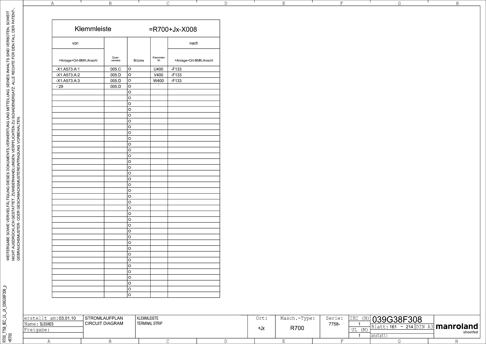

# +Jx — Sheet 161 of 214 — KLEMMLEISTE

**TERMINAL STRIP**

> Part of the manroland **R700** printing press IEC/UL circuit diagrams.
> Drawing class: **Stromlaufplan / Circuit diagram** (DIN A3).
> Document `+Jx` covers the **1st printing module + feed register** machine section.

## At a glance

| Field | Value |
|---|---|
| Document | `+Jx`  (039G38F308) |
| Sheet | **161** of 214 |
| Section (DE) | KLEMMLEISTE |
| Section (EN) | TERMINAL STRIP |
| Section type | TERMINALS — Terminal strip |
| Machine type | `R700` |
| Series | `7758` |
| Created | 03.01.10 |
| Replaces | — |
| Columns used | A, B, C |
| Path numbers | — |
| Labels on sheet | 26 |
| Cross-refs out | 0 |
| Cross-refs in | 0 |

**Previous:** [+Jx sheet 160](SHEET_0160.md) · **Next:** [+Jx sheet 162](SHEET_0162.md) · **Document TOC:** [_TOC.md](_TOC.md)  (+Jx) · **Master TOC:** [all sheets](../_MASTER_TOC.md)

## Sheet image (300 DPI, exact vector render)



_Rendered directly from the PDF vector layer at 300 DPI (1-bit), no OCR and no resampling. Use it to confirm anything ambiguous in the text below._

## Cross-references on this sheet

Each entry is a wire leaving this sheet. The printed token is `/sheet.column`; the link resolves to that sheet inside the same document.

_No outgoing cross-references on this sheet._

## Devices on this sheet

| Tag | Class | Class meaning (IEC) | Col | Sub | Terminal | Sign |
|---|---|---|---|---|---|---|
| `U400` | U | Umrichter / frequency converter | C | — | — | — |
| `F133` | F | Schutz / protection device (fuse, circuit breaker) | C | — | — | — |
| `V400` | V | Diode / semiconductor valve | C | — | — | — |
| `F133` | F | Schutz / protection device (fuse, circuit breaker) | C | — | — | — |
| `W400` | W | Kabel / cable, line, bus | C | — | — | — |
| `F133` | F | Schutz / protection device (fuse, circuit breaker) | C | — | — | — |
| `Nr.` | — | cross-device reference | C | — | — | — |
| `005.C` | — | cross-device reference | B | — | — | — |
| `X1.A573.A:1` | — | cross-device reference | A | — | 1 | — |
| `005.D` | — | cross-device reference | B | — | — | — |
| `X1.A573.A:2` | — | cross-device reference | A | — | 2 | — |
| `005.D` | — | cross-device reference | B | — | — | — |
| `X1.A573.A:3` | — | cross-device reference | A | — | 3 | — |
| `005.D` | — | cross-device reference | B | — | — | — |

## Potentials / nets

_No named potentials on this sheet._

## Wire-end annotations (grouped as printed)

A wire that continues elsewhere is annotated with a small cluster: the destination description, the path/line number `#NN`, and the `/sheet.column` cross reference. Each row below is one such cluster exactly as it is grouped on the drawing.

| Col | Y | Path | Cross-ref | Text on the wire |
|---|---|---|---|---|
| B | 63.2 | — | — | `Klemmleiste` |
| C | 64.7 | — | — | `=R700+Jx X008` |
| C | 101.2 | — | — | `nach` |
| A | 101.3 | — | — | `von` |
| B | 137.7 | — | — | `Quer` |
| C | 137.7 | — | — | `Klemmen =Anlage+Ort BMK:Anschl` |
| A | 144.3 | — | — | `=Anlage+Ort BMK:Anschl` |
| C | 144.3 | — | — | `Brücke Nr.` |
| B | 144.9 | — | — | `verweis` |
| B | 164.9 | — | — | `X1.A573.A:1 X1.A573.A:2 X1.A573.A:3 '29 005.C 005.D 005.D 005.D W400 U400 V400 ' F133 F133 F133` |


## Reconstructed tables

This sheet carries tabular content (pin map / terminal assignment / index). The grid below was rebuilt from the drawing's own rule lines, so each row is exactly one physical row of the table.

### Table 1 — 4 data rows × 3 columns (at x=255.1, y=48.2)

| Quer verweis | Brücke | Klemmen Nr. |
|---|---|---|
| `005.C` |  | `U400` |
| `005.D` |  | `V400` |
| `005.D` |  | `W400` |
| `005.D` |  | `'` |


## Notes and free text on this sheet

| Text | Col | Y (pt) |
|---|---|---|
| `von` | A | 101.3 |
| `=Anlage+Ort BMK:Anschl` | A | 144.29 |
| `Quer` | B | 137.71 |
| `Klemmleiste` | B | 63.21 |
| `verweis` | B | 144.9 |
| `nach` | C | 101.23 |
| `=Anlage+Ort BMK:Anschl` | C | 144.29 |
| `Klemmen` | C | 137.73 |
| `Brücke` | B | 144.3 |
| `=R700+Jx X008` | C | 64.71 |

## Complete label inventory (exact text from the drawing)

Every text object inside the drawing area of this sheet, in DIN reading order (column A→H, then top→bottom). This is the authoritative list: if a string is not here it is not printed on this sheet.

| Col | Y | X | Dir | Type | Text |
|---|---|---|---|---|---|
| A | 101.3 | 176.9 | → | text | `von` |
| A | 144.3 | 144.4 | → | text | `=Anlage+Ort BMK:Anschl` |
| A | 165.0 | 137.2 | → | device ref | `X1.A573.A:1` |
| A | 179.1 | 137.2 | → | device ref | `X1.A573.A:2` |
| A | 193.3 | 137.2 | → | device ref | `X1.A573.A:3` |
| A | 207.4 | 137.2 | → | other | `'29` |
| B | 63.2 | 183.1 | → | text | `Klemmleiste` |
| B | 137.7 | 274.5 | → | text | `Quer` |
| B | 144.3 | 327.3 | → | text | `Brücke` |
| B | 144.9 | 272.6 | → | text | `verweis` |
| B | 165.0 | 270.4 | → | device ref | `005.C` |
| B | 179.1 | 270.6 | → | device ref | `005.D` |
| B | 193.3 | 270.6 | → | device ref | `005.D` |
| B | 207.5 | 270.6 | → | device ref | `005.D` |
| C | 64.7 | 364.8 | → | text | `=R700+Jx X008` |
| C | 101.2 | 464.3 | → | text | `nach` |
| C | 137.7 | 373.9 | → | text | `Klemmen` |
| C | 144.3 | 427.9 | → | text | `=Anlage+Ort BMK:Anschl` |
| C | 144.8 | 385.4 | → | device ref | `Nr.` |
| C | 165.0 | 376.6 | → | device tag | `U400` |
| C | 165.0 | 419.2 | → | device tag | `F133` |
| C | 179.1 | 419.2 | → | device tag | `F133` |
| C | 179.2 | 377.1 | → | device tag | `V400` |
| C | 193.2 | 375.3 | → | device tag | `W400` |
| C | 193.3 | 419.2 | → | device tag | `F133` |
| C | 207.3 | 387.1 | → | other | `'` |

## Reading-order text block

The same content as a plain block, grouped by DIN column — convenient to paste or to match against a visual description.

```text
=== Column A ===
 101.3  176.9  text         von
 144.3  144.4  text         =Anlage+Ort BMK:Anschl
 165.0  137.2  devref       X1.A573.A:1
 179.1  137.2  devref       X1.A573.A:2
 193.3  137.2  devref       X1.A573.A:3
 207.4  137.2  other        `29
=== Column B ===
  63.2  183.1  text         Klemmleiste
 137.7  274.5  text         Quer
 144.3  327.3  text         Brücke
 144.9  272.6  text         verweis
 165.0  270.4  devref       005.C
 179.1  270.6  devref       005.D
 193.3  270.6  devref       005.D
 207.5  270.6  devref       005.D
=== Column C ===
  64.7  364.8  text         =R700+Jx X008
 101.2  464.3  text         nach
 137.7  373.9  text         Klemmen
 144.3  427.9  text         =Anlage+Ort BMK:Anschl
 144.8  385.4  devref       Nr.
 165.0  376.6  devtag       U400
 165.0  419.2  devtag       F133
 179.1  419.2  devtag       F133
 179.2  377.1  devtag       V400
 193.2  375.3  devtag       W400
 193.3  419.2  devtag       F133
 207.3  387.1  other        `
```

---
_Generated from the PDF vector text layer; no OCR. Source: `R700_7758_IEC_UL_JX_039G38F308_p`, sheet 161._
