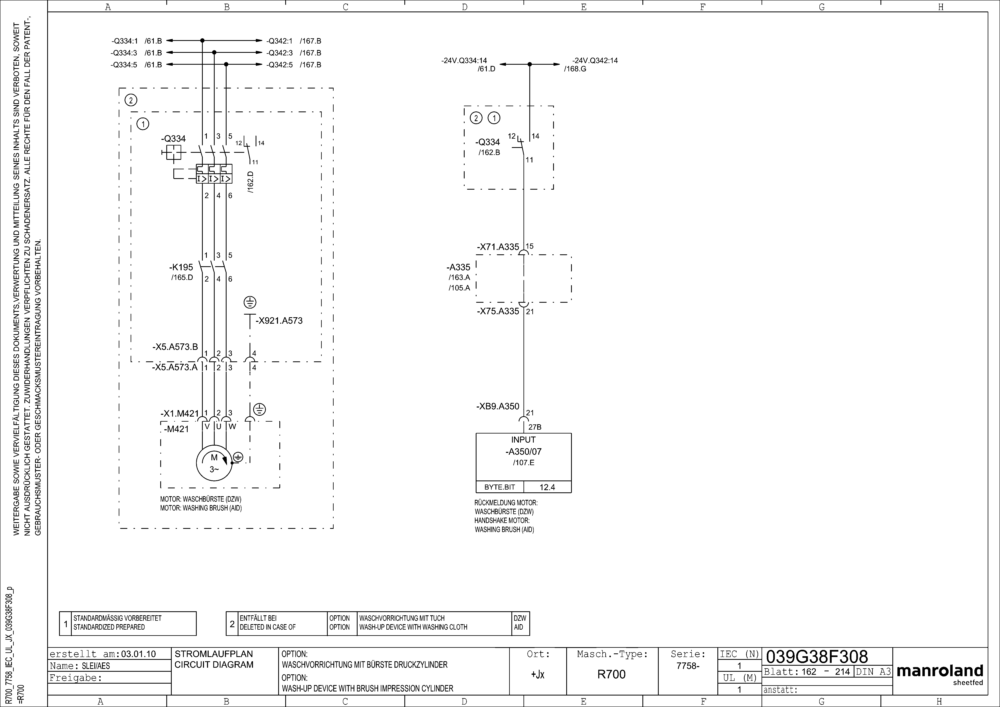

# +Jx — Sheet 162 of 214 — OPTION:

**WASCHVORRICHTUNG MIT BÜRSTE DRUCKZYLINDER**

> Part of the manroland **R700** printing press IEC/UL circuit diagrams.
> Drawing class: **Stromlaufplan / Circuit diagram** (DIN A3).
> Document `+Jx` covers the **1st printing module + feed register** machine section.

## At a glance

| Field | Value |
|---|---|
| Document | `+Jx`  (039G38F308) |
| Sheet | **162** of 214 |
| Section (DE) | OPTION: |
| Section (EN) | WASCHVORRICHTUNG MIT BÜRSTE DRUCKZYLINDER |
| Section type | CIRCUIT — Circuit diagram |
| Machine type | `R700` |
| Series | `7758` |
| Created | 03.01.10 |
| Replaces | — |
| Columns used | A, B, C, D, E |
| Path numbers | — |
| Labels on sheet | 98 |
| Cross-refs out | 14 |
| Cross-refs in | 29 |

**Previous:** [+Jx sheet 161](SHEET_0161.md) · **Next:** [+Jx sheet 163](SHEET_0163.md) · **Document TOC:** [_TOC.md](_TOC.md)  (+Jx) · **Master TOC:** [all sheets](../_MASTER_TOC.md)

## Sheet image (300 DPI, exact vector render)



_Rendered directly from the PDF vector layer at 300 DPI (1-bit), no OCR and no resampling. Use it to confirm anything ambiguous in the text below._

## Cross-references on this sheet

Each entry is a wire leaving this sheet. The printed token is `/sheet.column`; the link resolves to that sheet inside the same document.

| Ref | Target sheet | Col | Path | Destination on target | Target section | From col |
|---|---|---|---|---|---|---|
| `/61.B` | [+Jx sheet 61](SHEET_0061.md) | B | — | Q334:1 | GTW | A |
| `/167.B` | [+Jx sheet 167](SHEET_0167.md) | B | — | Q342:1 | OPTION: | C |
| `/61.B` | [+Jx sheet 61](SHEET_0061.md) | B | — | Q334:3 | GTW | A |
| `/167.B` | [+Jx sheet 167](SHEET_0167.md) | B | — | Q342:3 | OPTION: | C |
| `/167.B` | [+Jx sheet 167](SHEET_0167.md) | B | — | 24V.Q334:14 Q342:5 | OPTION: | C |
| `/61.D` | [+Jx sheet 61](SHEET_0061.md) | D | — | 24V.Q334:14 Q342:5 | GTW | C |
| `/61.B` | [+Jx sheet 61](SHEET_0061.md) | B | — | Q334:5 | GTW | A |
| `/168.G` | [+Jx sheet 168](SHEET_0168.md) | G | — | — | OPTION: | E |
| `/162.B` | [+Jx sheet 162](SHEET_0162.md) | B | — | — | OPTION: | D |
| `/162.D` | [+Jx sheet 162](SHEET_0162.md) | D | — | — | OPTION: | B |
| `/163.A` | [+Jx sheet 163](SHEET_0163.md) | A | — | — | OPTION: | D |
| `/105.A` | [+Jx sheet 105](SHEET_0105.md) | A | — | — | RESERVE | D |
| `/165.D` | [+Jx sheet 165](SHEET_0165.md) | D | — | — | OPTION: | B |
| `/107.E` | [+Jx sheet 107](SHEET_0107.md) | E | — | — | REFERENZMODUL | E |

### Incoming references (sheets that point here)

Every other sheet that sends a wire to this one. `Back-ref` is the token printed on *that* sheet; `Path` is its line number.

| From sheet | Cols | Back-ref | Path | Refs | What continues there |
|---|---|---|---|---|---|
| [+Jx#61](SHEET_0061.md) | B, E | `/61.B`, `/61.E` | — | 4 | Q334:1; Q334:3; Q334:5 |
| [+Jx#105](SHEET_0105.md) | A | `/105.A` | — | 1 | — |
| [+Jx#107](SHEET_0107.md) | E | `/107.E` | — | 1 | — |
| [+Jx#119](SHEET_0119.md) | A | `/119.A` | — | 4 | — |
| [+Jx#132](SHEET_0132.md) | D | `/132.D` | — | 8 | — |
| [+Jx#134](SHEET_0134.md) | G | `/134.G` | — | 1 | — |
| [+Jx#153](SHEET_0153.md) | B | `/153.B` | — | 1 | — |
| [+Jx#155](SHEET_0155.md) | A | `/155.A` | — | 1 | — |
| [+Jx#162](SHEET_0162.md) | B, D | `/162.B`, `/162.D` | — | 2 | — |
| [+Jx#163](SHEET_0163.md) | A | `/163.A` | — | 1 | — |
| [+Jx#165](SHEET_0165.md) | D | `/165.D` | — | 1 | — |
| [+Jx#167](SHEET_0167.md) | B | `/167.B` | — | 3 | Q342:1; Q342:3; Q342:5 |
| [+Jx#168](SHEET_0168.md) | F | `/168.F` | — | 1 | 24V.Q342:14 |


## Devices on this sheet

| Tag | Class | Class meaning (IEC) | Col | Sub | Terminal | Sign |
|---|---|---|---|---|---|---|
| `Q334` | Q | Leistungsschalter / power switching device | B | — | — | — |
| `K195` | K | Relais / relay, contactor | B | — | — | — |
| `Q334` | Q | Leistungsschalter / power switching device | D | — | — | — |
| `A350/07` | A | Baugruppe / assembly, module, PC board | D | 07 | — | — |
| `A335` | A | Baugruppe / assembly, module, PC board | D | — | — | — |
| `Q334:5` | Q | Leistungsschalter / power switching device | A | — | 5 | — |
| `Q342:1` | Q | Leistungsschalter / power switching device | B | — | 1 | — |
| `Q334:3` | Q | Leistungsschalter / power switching device | A | — | 3 | — |
| `Q334:1` | Q | Leistungsschalter / power switching device | A | — | 1 | — |
| `Q342:3` | Q | Leistungsschalter / power switching device | B | — | 3 | — |
| `Q342:5` | Q | Leistungsschalter / power switching device | B | — | 5 | — |
| `X5.A573.B` | — | cross-device reference | B | — | — | — |
| `X5.A573.A` | — | cross-device reference | B | — | — | — |
| `X1.M421` | — | cross-device reference | B | — | — | — |
| `XB9.A350` | — | cross-device reference | D | — | — | — |
| `12.4` | — | cross-device reference | E | — | — | — |
| `X75.A335` | — | cross-device reference | D | — | — | — |
| `X71.A335` | — | cross-device reference | D | — | — | — |
| `X921.A573` | — | cross-device reference | B | — | — | — |

## Potentials / nets

| Potential | Count | Columns | Attached devices | Terminals |
|---|---|---|---|---|
| `24V` | 2 | D, E | `Q334`, `Q342` | `14` |
| `M421` | 1 | B | — | — |


A potential such as `L24+/4` or `M24+` is a named supply/return rail; every place it appears on this sheet is electrically common.

## Wire-end annotations (grouped as printed)

A wire that continues elsewhere is annotated with a small cluster: the destination description, the path/line number `#NN`, and the `/sheet.column` cross reference. Each row below is one such cluster exactly as it is grouped on the drawing.

| Col | Y | Path | Cross-ref | Text on the wire |
|---|---|---|---|---|
| A | 44.8 | — | `/61.B` | `Q334:1` |
| C | 44.9 | — | `/167.B` | `Q342:1` |
| A | 59.0 | — | `/61.B` | `Q334:3` |
| C | 59.0 | — | `/167.B` | `Q342:3` |
| C | 68.3 | — | `/167.B`, `/61.D` | `Q342:5 24V.Q334:14` |
| E | 68.3 | — | — | `24V.Q342:14` |
| A | 73.2 | — | `/61.B` | `Q334:5` |
| E | 78.2 | — | `/168.G` | — |
| A | 116.5 | — | — | `2` |
| D | 137.3 | — | — | `2 1` |
| A | 144.3 | — | — | `1` |
| B | 158.3 | — | — | `1` |
| B | 158.3 | — | — | `3` |
| B | 158.3 | — | — | `5` |
| D | 158.3 | — | — | `Q334 14` |
| D | 158.3 | — | — | `12` |
| B | 160.4 | — | — | `Q334` |
| B | 167.4 | — | — | `12 14` |
| D | 177.7 | — | `/162.B` | — |
| E | 186.7 | — | — | `11` |
| B | 190.1 | — | — | `11` |
| B | 203.8 | — | `/162.D` | — |
| B | 229.2 | — | — | `2` |
| B | 229.2 | — | — | `4` |
| B | 229.2 | — | — | `6` |
| D | 289.4 | — | — | `X71.A335 15` |
| B | 300.0 | — | — | `1` |
| B | 300.0 | — | — | `3` |
| B | 300.0 | — | — | `5` |
| B | 313.5 | — | — | `K195 6` |
| D | 313.5 | — | — | `A335` |
| B | 326.6 | — | `/165.D` | — |
| D | 326.6 | — | `/163.A`, `/105.A` | — |
| B | 328.4 | — | — | `2` |
| B | 328.4 | — | — | `4` |
| D | 365.9 | — | — | `X75.A335 21` |
| B | 377.2 | — | — | `X921.A573` |
| B | 408.4 | — | — | `X5.A573.B 1` |
| B | 417.0 | — | — | `2 3` |
| B | 417.0 | — | — | `4` |
| B | 432.5 | — | — | `X5.A573.A 1 2 3` |
| B | 434.0 | — | — | `4` |
| D | 479.3 | — | — | `XB9.A350 21` |
| B | 487.8 | — | — | `X1.M421 1` |
| B | 487.8 | — | — | `2 3` |
| B | 503.8 | — | — | `V U W` |
| E | 504.8 | — | — | `27B` |
| B | 506.2 | — | — | `M421` |
| D | 519.3 | — | — | `INPUT` |
| D | 533.1 | — | — | `A350/07` |
| B | 540.5 | — | — | `3~ M` |
| E | 546.9 | — | `/107.E` | — |
| D | 576.0 | — | — | `BYTE.BIT 12.4` |
| B | 591.6 | — | — | `MOTOR: WASCHBÜRSTE (DZW) MOTOR: WASHING BRUSH (AID)` |
| D | 595.9 | — | — | `RÜCKMELDUNG MOTOR:` |
| D | 606.5 | — | — | `HANDSHAKE MOTOR: WASCHBÜRSTE (DZW)` |
| D | 627.7 | — | — | `WASHING BRUSH (AID)` |
| D | 733.2 | — | — | `DZW` |
| B | 733.3 | — | — | `1 STANDARDMÄSSIG VORBEREITET STANDARDIZED PREPARED ENTFÄLLT BEI DELETED IN CASE OF` |
| C | 733.3 | — | — | `OPTION OPTION` |
| D | 733.3 | — | — | `WASCHVORRICHTUNG MIT TUCH WASH UP DEVICE WITH WASHING CLOTH` |
| B | 738.6 | — | — | `2` |
| D | 743.9 | — | — | `AID` |


## Reconstructed tables

This sheet carries tabular content (pin map / terminal assignment / index). The grid below was rebuilt from the drawing's own rule lines, so each row is exactly one physical row of the table.

### Table 1 — 1 data rows × 3 columns (at x=198.4, y=48.2) — **Q334**

|  | X5.A573.B X5.A573.A X1.M421 | K195 /165.D |
|---|---|---|
|  | `M421` |  |


### Table 2 — 3 data rows × 1 columns (at x=240.9, y=48.2)

| C1 |
|---|
| `1` |
| `2 1 2 1 1 1` |
| `V` |


### Table 3 — 3 data rows × 1 columns (at x=255.1, y=48.2)

| C1 |
|---|
| `3` |
| `4 3 4 2 2 2` |
| `U M 3~` |


### Table 4 — 4 data rows × 3 columns (at x=269.3, y=48.2) — **Q342:1 Q342:3**

| 5 | 12 | Q342:5 14 |
|---|---|---|
|  |  | `11` |
|  |  | `/162.D` |
| `6 5 6 3 3 3` |  | `X921.A573 4 4` |
|  | `W` |  |


### Table 5 — 1 data rows × 3 columns (at x=566.9, y=515.9)

| INPUT | A350/07 /107.E |  |
|---|---|---|
| `BYTE.BIT` |  | `12.4` |


## Notes and free text on this sheet

| Text | Col | Y (pt) |
|---|---|---|
| `V` | B | 504.03 |
| `U` | B | 504.14 |
| `W` | B | 503.76 |
| `M` | B | 540.52 |
| `MOTOR: WASCHBÜRSTE (DZW)` | B | 591.58 |
| `MOTOR: WASHING BRUSH (AID)` | B | 602.23 |
| `27B` | E | 504.8 |
| `INPUT` | D | 519.31 |
| `BYTE.BIT` | D | 576.58 |
| `RÜCKMELDUNG MOTOR:` | D | 595.88 |
| `WASCHBÜRSTE (DZW)` | D | 606.45 |
| `HANDSHAKE MOTOR:` | D | 617.12 |
| `WASHING BRUSH (AID)` | D | 627.74 |
| `STANDARDMÄSSIG VORBEREITET` | A | 733.34 |
| `STANDARDIZED PREPARED` | A | 743.97 |
| `ENTFÄLLT BEI` | B | 733.3 |
| `DELETED IN CASE OF` | B | 743.96 |
| `OPTION` | C | 733.32 |
| `WASCHVORRICHTUNG MIT TUCH` | C | 733.34 |
| `WASH UP DEVICE WITH WASHING CLOTH` | D | 743.93 |
| `DZW` | D | 733.22 |
| `AID` | D | 743.94 |

## Complete label inventory (exact text from the drawing)

Every text object inside the drawing area of this sheet, in DIN reading order (column A→H, then top→bottom). This is the authoritative list: if a string is not here it is not printed on this sheet.

| Col | Y | X | Dir | Type | Text |
|---|---|---|---|---|---|
| A | 44.8 | 172.3 | → | cross-reference | `/61.B` |
| A | 44.9 | 132.9 | → | device tag | `Q334:1` |
| A | 59.0 | 172.3 | → | cross-reference | `/61.B` |
| A | 59.1 | 131.8 | → | device tag | `Q334:3` |
| A | 73.2 | 131.8 | → | device tag | `Q334:5` |
| A | 73.2 | 172.3 | → | cross-reference | `/61.B` |
| A | 116.5 | 153.9 | → | number | `2` |
| A | 144.3 | 168.2 | → | number | `1` |
| A | 733.3 | 87.6 | → | text | `STANDARDMÄSSIG VORBEREITET` |
| A | 738.6 | 75.4 | → | number | `1` |
| A | 744.0 | 87.6 | → | text | `STANDARDIZED PREPARED` |
| B | 44.9 | 317.2 | → | device tag | `Q342:1` |
| B | 59.1 | 317.2 | → | device tag | `Q342:3` |
| B | 73.2 | 317.2 | → | device tag | `Q342:5` |
| B | 158.3 | 242.9 | → | number | `1` |
| B | 158.3 | 257.7 | → | number | `3` |
| B | 158.3 | 271.8 | → | number | `5` |
| B | 160.4 | 191.9 | → | device tag | `Q334` |
| B | 167.4 | 280.1 | → | number | `12` |
| B | 167.4 | 307.0 | → | number | `14` |
| B | 190.1 | 299.9 | → | number | `11` |
| B | 203.8 | 294.3 | ↕ | cross-reference | `/162.D` |
| B | 229.2 | 243.8 | → | number | `2` |
| B | 229.2 | 258.0 | → | number | `4` |
| B | 229.2 | 271.8 | → | number | `6` |
| B | 300.0 | 242.9 | → | number | `1` |
| B | 300.0 | 257.7 | → | number | `3` |
| B | 300.0 | 271.8 | → | number | `5` |
| B | 313.5 | 201.5 | → | device tag | `K195` |
| B | 326.6 | 204.1 | → | cross-reference | `/165.D` |
| B | 328.4 | 243.8 | → | number | `2` |
| B | 328.4 | 258.0 | → | number | `4` |
| B | 328.4 | 271.8 | → | number | `6` |
| B | 377.2 | 304.4 | → | device ref | `X921.A573` |
| B | 408.4 | 181.7 | → | device ref | `X5.A573.B` |
| B | 417.0 | 242.9 | → | number | `1` |
| B | 417.0 | 258.0 | → | number | `2` |
| B | 417.0 | 271.8 | → | number | `3` |
| B | 417.0 | 300.5 | → | number | `4` |
| B | 432.5 | 181.1 | → | device ref | `X5.A573.A` |
| B | 434.0 | 242.9 | → | number | `1` |
| B | 434.0 | 258.0 | → | number | `2` |
| B | 434.0 | 271.8 | → | number | `3` |
| B | 434.0 | 300.5 | → | number | `4` |
| B | 487.8 | 191.3 | → | device ref | `X1.M421` |
| B | 487.8 | 242.9 | → | number | `1` |
| B | 487.8 | 258.0 | → | number | `2` |
| B | 487.8 | 271.8 | → | number | `3` |
| B | 503.8 | 272.1 | → | text | `W` |
| B | 504.0 | 243.8 | → | text | `V` |
| B | 504.1 | 257.4 | → | text | `U` |
| B | 506.2 | 195.3 | → | potential | `M421` |
| B | 540.5 | 251.0 | → | text | `M` |
| B | 554.8 | 249.6 | → | other | `3~` |
| B | 591.6 | 190.8 | → | text | `MOTOR: WASCHBÜRSTE (DZW)` |
| B | 602.2 | 190.8 | → | text | `MOTOR: WASHING BRUSH (AID)` |
| B | 733.3 | 285.7 | → | text | `ENTFÄLLT BEI` |
| B | 738.6 | 273.5 | → | number | `2` |
| B | 744.0 | 285.7 | → | text | `DELETED IN CASE OF` |
| C | 44.9 | 357.2 | → | cross-reference | `/167.B` |
| C | 59.0 | 357.2 | → | cross-reference | `/167.B` |
| C | 73.2 | 357.2 | → | cross-reference | `/167.B` |
| C | 733.3 | 392.3 | → | text | `OPTION` |
| C | 733.3 | 428.0 | → | text | `WASCHVORRICHTUNG MIT TUCH` |
| C | 743.9 | 392.3 | → | text | `OPTION` |
| D | 68.3 | 525.5 | → | potential | `24V.Q334:14` |
| D | 78.2 | 568.9 | → | cross-reference | `/61.D` |
| D | 137.3 | 586.3 | → | number | `1` |
| D | 137.7 | 564.9 | → | number | `2` |
| D | 158.3 | 604.3 | → | number | `12` |
| D | 164.6 | 566.1 | → | device tag | `Q334` |
| D | 177.7 | 570.0 | → | cross-reference | `/162.B` |
| D | 289.4 | 568.1 | → | device ref | `X71.A335` |
| D | 313.5 | 531.8 | → | device tag | `A335` |
| D | 326.5 | 534.3 | → | cross-reference | `/163.A` |
| D | 338.9 | 534.3 | → | cross-reference | `/105.A` |
| D | 365.9 | 568.1 | → | device ref | `X75.A335` |
| D | 479.3 | 567.2 | → | device ref | `XB9.A350` |
| D | 519.3 | 608.7 | → | text | `INPUT` |
| D | 533.1 | 602.1 | → | device tag | `A350/07` |
| D | 576.6 | 576.9 | → | text | `BYTE.BIT` |
| D | 595.9 | 564.9 | → | text | `RÜCKMELDUNG MOTOR:` |
| D | 606.5 | 565.5 | → | text | `WASCHBÜRSTE (DZW)` |
| D | 617.1 | 564.9 | → | text | `HANDSHAKE MOTOR:` |
| D | 627.7 | 565.5 | → | text | `WASHING BRUSH (AID)` |
| D | 733.2 | 611.7 | → | text | `DZW` |
| D | 743.9 | 428.0 | → | text | `WASH UP DEVICE WITH WASHING CLOTH` |
| D | 743.9 | 612.3 | → | text | `AID` |
| E | 68.3 | 681.4 | → | potential | `24V.Q342:14` |
| E | 78.2 | 671.8 | → | cross-reference | `/168.G` |
| E | 158.3 | 632.7 | → | number | `14` |
| E | 186.6 | 625.6 | → | number | `11` |
| E | 289.4 | 625.6 | → | number | `15` |
| E | 367.4 | 626.5 | → | number | `21` |
| E | 487.8 | 626.5 | → | number | `21` |
| E | 504.8 | 629.3 | → | text | `27B` |
| E | 546.9 | 611.0 | → | cross-reference | `/107.E` |
| E | 576.0 | 642.2 | → | device ref | `12.4` |

## Reading-order text block

The same content as a plain block, grouped by DIN column — convenient to paste or to match against a visual description.

```text
=== Column A ===
  44.8  172.3  xref         /61.B
  44.9  132.9  devtag       Q334:1
  59.0  172.3  xref         /61.B
  59.1  131.8  devtag       Q334:3
  73.2  131.8  devtag       Q334:5
  73.2  172.3  xref         /61.B
 116.5  153.9  numeric      2
 144.3  168.2  numeric      1
 733.3   87.6  text         STANDARDMÄSSIG VORBEREITET
 738.6   75.4  numeric      1
 744.0   87.6  text         STANDARDIZED PREPARED
=== Column B ===
  44.9  317.2  devtag       Q342:1
  59.1  317.2  devtag       Q342:3
  73.2  317.2  devtag       Q342:5
 158.3  242.9  numeric      1
 158.3  257.7  numeric      3
 158.3  271.8  numeric      5
 160.4  191.9  devtag       Q334
 167.4  280.1  numeric      12
 167.4  307.0  numeric      14
 190.1  299.9  numeric      11
 203.8  294.3  xref         /162.D
 229.2  243.8  numeric      2
 229.2  258.0  numeric      4
 229.2  271.8  numeric      6
 300.0  242.9  numeric      1
 300.0  257.7  numeric      3
 300.0  271.8  numeric      5
 313.5  201.5  devtag       K195
 326.6  204.1  xref         /165.D
 328.4  243.8  numeric      2
 328.4  258.0  numeric      4
 328.4  271.8  numeric      6
 377.2  304.4  devref       X921.A573
 408.4  181.7  devref       X5.A573.B
 417.0  242.9  numeric      1
 417.0  258.0  numeric      2
 417.0  271.8  numeric      3
 417.0  300.5  numeric      4
 432.5  181.1  devref       X5.A573.A
 434.0  242.9  numeric      1
 434.0  258.0  numeric      2
 434.0  271.8  numeric      3
 434.0  300.5  numeric      4
 487.8  191.3  devref       X1.M421
 487.8  242.9  numeric      1
 487.8  258.0  numeric      2
 487.8  271.8  numeric      3
 503.8  272.1  text         W
 504.0  243.8  text         V
 504.1  257.4  text         U
 506.2  195.3  net          M421
 540.5  251.0  text         M
 554.8  249.6  other        3~
 591.6  190.8  text         MOTOR: WASCHBÜRSTE (DZW)
 602.2  190.8  text         MOTOR: WASHING BRUSH (AID)
 733.3  285.7  text         ENTFÄLLT BEI
 738.6  273.5  numeric      2
 744.0  285.7  text         DELETED IN CASE OF
=== Column C ===
  44.9  357.2  xref         /167.B
  59.0  357.2  xref         /167.B
  73.2  357.2  xref         /167.B
 733.3  392.3  text         OPTION
 733.3  428.0  text         WASCHVORRICHTUNG MIT TUCH
 743.9  392.3  text         OPTION
=== Column D ===
  68.3  525.5  net          24V.Q334:14
  78.2  568.9  xref         /61.D
 137.3  586.3  numeric      1
 137.7  564.9  numeric      2
 158.3  604.3  numeric      12
 164.6  566.1  devtag       Q334
 177.7  570.0  xref         /162.B
 289.4  568.1  devref       X71.A335
 313.5  531.8  devtag       A335
 326.5  534.3  xref         /163.A
 338.9  534.3  xref         /105.A
 365.9  568.1  devref       X75.A335
 479.3  567.2  devref       XB9.A350
 519.3  608.7  text         INPUT
 533.1  602.1  devtag       A350/07
 576.6  576.9  text         BYTE.BIT
 595.9  564.9  text         RÜCKMELDUNG MOTOR:
 606.5  565.5  text         WASCHBÜRSTE (DZW)
 617.1  564.9  text         HANDSHAKE MOTOR:
 627.7  565.5  text         WASHING BRUSH (AID)
 733.2  611.7  text         DZW
 743.9  428.0  text         WASH UP DEVICE WITH WASHING CLOTH
 743.9  612.3  text         AID
=== Column E ===
  68.3  681.4  net          24V.Q342:14
  78.2  671.8  xref         /168.G
 158.3  632.7  numeric      14
 186.6  625.6  numeric      11
 289.4  625.6  numeric      15
 367.4  626.5  numeric      21
 487.8  626.5  numeric      21
 504.8  629.3  text         27B
 546.9  611.0  xref         /107.E
 576.0  642.2  devref       12.4
```

---
_Generated from the PDF vector text layer; no OCR. Source: `R700_7758_IEC_UL_JX_039G38F308_p`, sheet 162._
