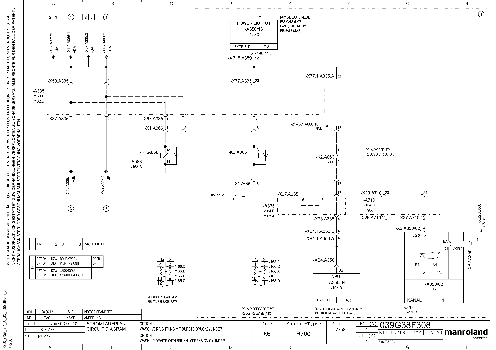

# +Jx — Sheet 163 of 214 — OPTION:

**WASCHVORRICHTUNG MIT BÜRSTE DRUCKZYLINDER**

> Part of the manroland **R700** printing press IEC/UL circuit diagrams.
> Drawing class: **Stromlaufplan / Circuit diagram** (DIN A3).
> Document `+Jx` covers the **1st printing module + feed register** machine section.

## At a glance

| Field | Value |
|---|---|
| Document | `+Jx`  (039G38F308) |
| Sheet | **163** of 214 |
| Section (DE) | OPTION: |
| Section (EN) | WASCHVORRICHTUNG MIT BÜRSTE DRUCKZYLINDER |
| Section type | CIRCUIT — Circuit diagram |
| Machine type | `R700` |
| Series | `7758` |
| Created | 03.01.10 |
| Replaces | — |
| Columns used | A, B, C, D, E, F, G, H |
| Path numbers | — |
| Labels on sheet | 196 |
| Cross-refs out | 23 |
| Cross-refs in | 52 |

**Previous:** [+Jx sheet 162](SHEET_0162.md) · **Next:** [+Jx sheet 164](SHEET_0164.md) · **Document TOC:** [_TOC.md](_TOC.md)  (+Jx) · **Master TOC:** [all sheets](../_MASTER_TOC.md)

## Sheet image (300 DPI, exact vector render)



_Rendered directly from the PDF vector layer at 300 DPI (1-bit), no OCR and no resampling. Use it to confirm anything ambiguous in the text below._

## Cross-references on this sheet

Each entry is a wire leaving this sheet. The printed token is `/sheet.column`; the link resolves to that sheet inside the same document.

| Ref | Target sheet | Col | Path | Destination on target | Target section | From col |
|---|---|---|---|---|---|---|
| `/109.D` | [+Jx sheet 109](SHEET_0109.md) | D | — | — | REFERENZMODUL | D |
| `/163.E` | [+Jx sheet 163](SHEET_0163.md) | E | — | — | OPTION: | A |
| `/162.D` | [+Jx sheet 162](SHEET_0162.md) | D | — | — | OPTION: | A |
| `/9.E` | [+Jx sheet 9](SHEET_0009.md) | E | — | 24V.X1.A066:18 | SPANNUNGSVERSORGUNG, SCHALTSCHRANKBELÜFTUNG | E |
| `/163.E` | [+Jx sheet 163](SHEET_0163.md) | E | — | — | OPTION: | F |
| `/165.B` | [+Jx sheet 165](SHEET_0165.md) | B | — | — | OPTION: | B |
| `/10.F` | [+Jx sheet 10](SHEET_0010.md) | F | — | 0V.X1.A066:16 | SPANNUNGSVERSORGUNG, SCHALTSCHRANKBELÜFTUNG | D |
| `/76.B` | [+Jx sheet 76](SHEET_0076.md) | B | — | XB2.A350:4 | BUSVERBINDUNGEN: SICHERHEITSKREIS | H |
| `/164.C` | [+Jx sheet 164](SHEET_0164.md) | C | — | — | OPTION: | F |
| `/95.F` | [+Jx sheet 95](SHEET_0095.md) | F | — | — | RESERVE | F |
| `/164.B` | [+Jx sheet 164](SHEET_0164.md) | B | — | — | OPTION: | E |
| `/163.A` | [+Jx sheet 163](SHEET_0163.md) | A | — | — | OPTION: | E |
| `/163.F` | [+Jx sheet 163](SHEET_0163.md) | F | — | — | OPTION: | E |
| `/166.C` | [+Jx sheet 166](SHEET_0166.md) | C | — | — | OPTION: | E |
| `/166.A` | [+Jx sheet 166](SHEET_0166.md) | A | — | — | OPTION: | E |
| `/166.E` | [+Jx sheet 166](SHEET_0166.md) | E | — | — | OPTION: | E |
| `/165.D` | [+Jx sheet 165](SHEET_0165.md) | D | — | — | OPTION: | E |
| `/166.D` | [+Jx sheet 166](SHEET_0166.md) | D | — | — | OPTION: | C |
| `/166.B` | [+Jx sheet 166](SHEET_0166.md) | B | — | — | OPTION: | C |
| `/166.F` | [+Jx sheet 166](SHEET_0166.md) | F | — | — | OPTION: | C |
| `/165.C` | [+Jx sheet 165](SHEET_0165.md) | C | — | — | OPTION: | C |
| `/107.B` | [+Jx sheet 107](SHEET_0107.md) | B | — | — | REFERENZMODUL | F |
| `/106.D` | [+Jx sheet 106](SHEET_0106.md) | D | — | — | REFERENZMODUL | G |

### Incoming references (sheets that point here)

Every other sheet that sends a wire to this one. `Back-ref` is the token printed on *that* sheet; `Path` is its line number.

| From sheet | Cols | Back-ref | Path | Refs | What continues there |
|---|---|---|---|---|---|
| [+Jx#9](SHEET_0009.md) | E | `/9.E` | — | 1 | 24V.X1.A066:18 |
| [+Jx#10](SHEET_0010.md) | F | `/10.F` | — | 1 | — |
| [+Jx#76](SHEET_0076.md) | B | `/76.B` | — | 1 | XB2.A350:4 |
| [+Jx#95](SHEET_0095.md) | F | `/95.F` | — | 1 | — |
| [+Jx#106](SHEET_0106.md) | D | `/106.D` | — | 1 | — |
| [+Jx#107](SHEET_0107.md) | B | `/107.B` | — | 1 | — |
| [+Jx#109](SHEET_0109.md) | D | `/109.D` | — | 1 | — |
| [+Jx#112](SHEET_0112.md) | A, B | `/112.A`, `/112.B` | — | 6 | — |
| [+Jx#126](SHEET_0126.md) | E | `/126.E` | — | 2 | — |
| [+Jx#130](SHEET_0130.md) | A, B, D | `/130.A`, `/130.B`, `/130.D` | — | 3 | — |
| [+Jx#139](SHEET_0139.md) | B | `/139.B` | — | 1 | — |
| [+Jx#143](SHEET_0143.md) | F | `/143.F` | — | 1 | — |
| [+Jx#144](SHEET_0144.md) | C | `/144.C` | — | 1 | — |
| [+Jx#147](SHEET_0147.md) | B | `/147.B` | — | 2 | — |
| [+Jx#151](SHEET_0151.md) | F | `/151.F` | — | 2 | — |
| [+Jx#152](SHEET_0152.md) | C | `/152.C` | — | 6 | — |
| [+Jx#153](SHEET_0153.md) | E | `/153.E` | — | 1 | — |
| [+Jx#155](SHEET_0155.md) | D | `/155.D` | — | 1 | — |
| [+Jx#156](SHEET_0156.md) | A, H | `/156.A`, `/156.H` | — | 3 | — |
| [+Jx#162](SHEET_0162.md) | D | `/162.D` | — | 1 | — |
| [+Jx#163](SHEET_0163.md) | A, E, F | `/163.A`, `/163.E`, `/163.F` | — | 4 | — |
| [+Jx#164](SHEET_0164.md) | A, C | `/164.A`, `/164.C` | — | 2 | — |
| [+Jx#165](SHEET_0165.md) | B, C, D | `/165.B`, `/165.C`, `/165.D` | — | 3 | — |
| [+Jx#166](SHEET_0166.md) | A, B, C, D, E | `/166.A`, `/166.B`, `/166.C`, `/166.D`, `/166.E` | — | 6 | — |


## Devices on this sheet

| Tag | Class | Class meaning (IEC) | Col | Sub | Terminal | Sign |
|---|---|---|---|---|---|---|
| `A350/13` | A | Baugruppe / assembly, module, PC board | D | 13 | — | — |
| `A350/04` | A | Baugruppe / assembly, module, PC board | F | 04 | — | — |
| `A335` | A | Baugruppe / assembly, module, PC board | A | — | — | — |
| `A066` | A | Baugruppe / assembly, module, PC board | B | — | — | — |
| `A335` | A | Baugruppe / assembly, module, PC board | E | — | — | — |
| `A710` | A | Baugruppe / assembly, module, PC board | F | — | — | — |
| `S4` | S | Schalter / switch | G | — | — | — |
| `A4` | A | Baugruppe / assembly, module, PC board | G | — | — | — |
| `X1` | X | Klemme / terminal, plug connector | H | — | — | — |
| `X2` | X | Klemme / terminal, plug connector | G | — | — | — |
| `XB2` | XB |  | H | — | — | — |
| `A350/02` | A | Baugruppe / assembly, module, PC board | G | 02 | — | — |
| `X67.A335` | — | cross-device reference | C | — | — | — |
| `XB15.A350` | — | cross-device reference | D | — | — | — |
| `17.3` | — | cross-device reference | E | — | — | — |
| `XB4.A350` | — | cross-device reference | F | — | — | — |
| `4.3` | — | cross-device reference | F | — | — | — |
| `X77.1.A335.A` | — | cross-device reference | F | — | — | — |
| `X77.A335` | — | cross-device reference | D | — | — | — |
| `X1.A066` | — | cross-device reference | C | — | — | — |
| `K1.A066` | — | cross-device reference | C | — | — | — |
| `K2.A066` | — | cross-device reference | F | — | — | — |
| `X1.A066` | — | cross-device reference | D | — | — | — |
| `K2.A066` | — | cross-device reference | D | — | — | — |
| `X87.A335` | — | cross-device reference | A | — | — | — |
| `X59.A335` | — | cross-device reference | A | — | — | — |
| `X1.2.A066:1` | — | cross-device reference | A | — | 1 | — |
| `X87.A335:1` | — | cross-device reference | A | — | 1 | — |
| `X1.2.A066:2` | — | cross-device reference | B | — | 2 | — |
| `X87.A335:2` | — | cross-device reference | B | — | 2 | — |
| `X59.A335:1` | — | cross-device reference | A | — | 1 | — |
| `X59.A335:2` | — | cross-device reference | B | — | 2 | — |
| `X27.A710` | — | cross-device reference | G | — | — | — |
| `X29.A710` | — | cross-device reference | F | — | — | — |
| `X26.A710` | — | cross-device reference | F | — | — | — |
| `XB2.A350` | — | cross-device reference | H | — | — | — |
| `XB4.1.A350.B` | — | cross-device reference | F | — | — | — |
| `XB4.1.A350.A` | — | cross-device reference | F | — | — | — |
| `X73.A335` | — | cross-device reference | F | — | — | — |
| `XB2.A350:4` | — | cross-device reference | H | — | 4 | — |
| `NR.` | — | cross-device reference | A | — | — | — |
| `28.06.12` | — | cross-device reference | A | — | — | — |
| `X67.A335` | — | cross-device reference | E | — | — | — |

## Potentials / nets

| Potential | Count | Columns | Attached devices | Terminals |
|---|---|---|---|---|
| `0V` | 1 | D | `A066`, `X1` | `16` |
| `24V` | 1 | E | `A066`, `X1` | `18` |


A potential such as `L24+/4` or `M24+` is a named supply/return rail; every place it appears on this sheet is electrically common.

## Wire-end annotations (grouped as printed)

A wire that continues elsewhere is annotated with a small cluster: the destination description, the path/line number `#NN`, and the `/sheet.column` cross reference. Each row below is one such cluster exactly as it is grouped on the drawing.

| Col | Y | Path | Cross-ref | Text on the wire |
|---|---|---|---|---|
| H | 31.5 | — | — | `4` |
| D | 36.4 | — | — | `14A` |
| A | 37.8 | — | — | `2 3 1 2 3 1` |
| E | 38.9 | — | — | `RÜCKMELDUNG RELAIS: FREIGABE (UWR) HANDSHAKE RELAY: RELEASE (UWR)` |
| D | 51.5 | — | — | `POWER QUTPUT` |
| D | 65.4 | — | — | `A350/13` |
| A | 76.5 | — | — | `X1.2.A066:1` |
| B | 76.5 | — | — | `X1.2.A066:2` |
| A | 79.1 | — | — | `X87.A335:1` |
| B | 79.1 | — | — | `X87.A335:2` |
| D | 79.2 | — | `/109.D` | — |
| D | 108.3 | — | — | `BYTE.BIT 17.3` |
| A | 110.5 | — | — | `+DA` |
| B | 110.5 | — | — | `+DA` |
| A | 112.2 | — | — | `+JA` |
| B | 112.2 | — | — | `+JA` |
| E | 124.3 | — | — | `14B(14C)` |
| D | 134.9 | — | — | `XB15.A350 12` |
| E | 178.1 | — | — | `X77.A335 23 X77.1.A335.A 23` |
| A | 190.2 | — | — | `X59.A335 1` |
| B | 190.2 | — | — | `2` |
| A | 214.2 | — | — | `A335` |
| A | 227.3 | — | `/163.E`, `/162.D` | — |
| A | 280.9 | — | — | `X87.A335 1` |
| C | 280.9 | — | — | `X67.A335 1 2` |
| B | 282.3 | — | — | `2` |
| D | 282.3 | — | — | `6` |
| E | 295.0 | — | `/9.E` | `24V.X1.A066:18` |
| C | 303.6 | — | — | `X1.A066 1` |
| C | 303.6 | — | — | `2` |
| D | 303.6 | — | — | `15` |
| F | 303.6 | — | — | `18` |
| C | 356.7 | — | — | `13` |
| D | 356.7 | — | — | `13` |
| F | 356.7 | — | — | `1` |
| G | 357.7 | — | — | `RELAISVERTEILER RELAIS DISTRIBUTOR` |
| C | 361.7 | — | — | `K1.A066` |
| D | 361.7 | — | — | `K2.A066` |
| F | 373.0 | — | — | `K2.A066 2` |
| B | 384.3 | — | — | `A066` |
| C | 385.1 | — | — | `14` |
| D | 385.1 | — | — | `14` |
| F | 386.1 | — | `/163.E` | — |
| B | 397.4 | — | `/165.B` | — |
| A | 420.9 | — | — | `X59.A335:1` |
| A | 422.1 | — | — | `+JB` |
| B | 422.1 | — | — | `X59.A335:2` |
| B | 422.1 | — | — | `+JB` |
| E | 436.8 | — | — | `X1.A066 16 17` |
| F | 459.4 | — | — | `X29.A710 23` |
| F | 459.5 | — | — | `17` |
| G | 459.5 | — | — | `24` |
| E | 462.3 | — | — | `X67.A335` |
| D | 465.1 | — | `/10.F` | `0V.X1.A066:16` |
| F | 476.4 | — | — | `A710` |
| E | 476.5 | — | — | `A335 5 15` |
| H | 486.1 | — | `/76.B` | `XB2.A350:4` |
| F | 489.6 | — | `/164.C` | — |
| B | 499.1 | — | — | `3 3` |
| F | 501.9 | — | `/95.F` | — |
| E | 503.7 | — | `/164.B`, `/163.A` | — |
| F | 519.0 | — | — | `X26.A710 4` |
| G | 519.0 | — | — | `X27.A710 4` |
| F | 521.8 | — | — | `X73.A335 4` |
| G | 544.5 | — | — | `X2.A350/02 4` |
| F | 551.6 | — | — | `XB4.1.A350.B 4` |
| G | 562.9 | — | — | `X2` |
| H | 564.4 | — | — | `4 4` |
| F | 568.6 | — | — | `XB4.1.A350.A 4` |
| H | 572.9 | — | — | `4` |
| H | 577.1 | — | — | `5A` |
| A | 582.7 | — | — | `1 +JA 2 +JB 3 R700 LL, LTL, LTTL` |
| H | 594.1 | — | — | `X1` |
| H | 594.1 | — | — | `XB2` |
| H | 600.4 | — | — | `XB2.A350` |
| C | 619.6 | — | — | `1 2` |
| E | 619.6 | — | — | `1 2` |
| A | 619.8 | — | — | `DZW` |
| A | 619.9 | — | — | `OPTION OPTION` |
| A | 619.9 | — | — | `DRUCKWERK PRINTING UNIT` |
| B | 620.0 | — | — | `ODER OR` |
| F | 621.0 | — | — | `XB4.A350 4` |
| E | 626.0 | — | `/163.F`, `/166.C`, `/166.A`, `/166.E`, `/165.D` | — |
| A | 630.5 | — | — | `AID` |
| C | 630.9 | — | — | `4 6 3 5` |
| D | 630.9 | — | — | `4 6 3 5` |
| G | 633.1 | — | — | `S4 A4` |
| C | 637.3 | — | `/166.D`, `/166.B`, `/166.F`, `/165.C` | — |
| A | 639.4 | — | — | `4` |
| F | 646.5 | — | — | `6B` |
| A | 648.2 | — | — | `DZW` |
| A | 648.3 | — | — | `OPTION OPTION` |
| A | 648.3 | — | — | `LACKMODUL COATING MODULE` |
| C | 653.6 | — | — | `8` |
| C | 653.6 | — | — | `7` |
| D | 653.6 | — | — | `8` |
| E | 653.6 | — | — | `7` |
| A | 658.9 | — | — | `AID` |
| F | 661.0 | — | — | `INPUT` |
| C | 664.9 | — | — | `10 12 11 9` |
| D | 664.9 | — | — | `10 12 11 9` |
| F | 674.9 | — | — | `A350/04` |
| G | 679.1 | — | — | `A350/02` |
| F | 688.7 | — | `/107.B` | — |
| G | 691.5 | — | `/106.D` | — |
| C | 712.0 | — | — | `RELAIS: FREIGABE (UWR) RELAY: RELEASE (UWR)` |
| G | 717.4 | — | — | `KANAL 4` |
| F | 717.7 | — | — | `BYTE.BIT 4.3` |
| G | 737.8 | — | — | `KANAL 4 CHANNEL 4` |
| D | 740.4 | — | — | `RELAIS: FREIGABE (DZW) RELAY: RELEASE (AID)` |
| F | 740.6 | — | — | `RÜCKMELDUNG RELAIS: FREIGABE (DZW) HANDSHAKE RELAY: RELEASE (AID)` |
| A | 747.1 | — | — | `001 28.06.12 SLEI INDEX 3 GEÄNDERT` |
| A | 761.3 | — | — | `NR. TAG NAME ÄNDERUNG` |


## Reconstructed tables

This sheet carries tabular content (pin map / terminal assignment / index). The grid below was rebuilt from the drawing's own rule lines, so each row is exactly one physical row of the table.

### Table 1 — 10 data rows × 14 columns (at x=552.8, y=48.2)

| POWER | A350/13 /109.D | QUTPUT |  | FREIGABE (UWR) HANDSHAKE RELAY: RELEASE (UWR) |  |  |  |  |  |  |  |  |  |
|---|---|---|---|---|---|---|---|---|---|---|---|---|---|
| `BYTE.BIT` |  | `17.3` |  |  |  |  |  |  |  |  |  |  |  |
| `XB15.A350` | `12` | `14B(14C)` |  |  |  |  |  |  |  |  |  |  |  |
| `X77.A335 K2.A066 X1.A066` | `23 6 15 13 14 16` |  |  | `24V.X1.A066:18` | `X77.1.A335.A /9.E K2.A066 /163.E` | `23 18 1 2 17` | `RELAISVERTEILER RELAIS` | `DISTRIBUTOR` |  |  |  |  |  |
| `/10.F` |  |  |  | `X67.A335 5` | `15` | `17` | `X29.A710 A710 /164.C` | `23` |  | `24` |  |  |  |
|  |  |  | `A335 /164.B /163.A` |  | `X73.A335 XB4.1.A350.B` | `4 4` | `/95.F X26.A710` | `4` | `X27.A710 X2.A350/02` | `4 4` |  |  | `XB2.A350:4` |
|  |  |  |  |  | `XB4.1.A350.A` | `4` |  |  | `X2` | `4` | `5A` |  | `4 4` |
|  | `1 4 6` | `2 3 5` | `/163.F /166.C /166.A` |  | `XB4.A350` | `4 6B` |  |  | `S4` | `A4` | `X1` | `XB2` | `XB2.A350` |
|  | `8 10` | `7 9` | `/166.E` |  | `INPUT` |  |  |  |  |  |  |  |  |
|  | `12` | `11` | `/165.D` |  | `A350/04` | `/107.B` |  |  |  | `A350/02 /106.D` |  |  |  |
|  |  |  |  |  | `BYTE.BIT` | `4.3` |  |  | `KANAL` |  | `4` |  |  |


## Notes and free text on this sheet

| Text | Col | Y (pt) |
|---|---|---|
| `14A` | D | 36.37 |
| `14B(14C)` | E | 124.28 |
| `POWER QUTPUT` | D | 51.52 |
| `BYTE.BIT` | D | 108.86 |
| `RELAIS: FREIGABE (DZW)` | D | 740.39 |
| `RELAY: RELEASE (AID)` | D | 751.04 |
| `6B` | F | 646.51 |
| `INPUT` | F | 661.05 |
| `BYTE.BIT` | F | 718.31 |
| `RÜCKMELDUNG RELAIS: FREIGABE (DZW)` | F | 740.58 |
| `HANDSHAKE RELAY: RELEASE (AID)` | F | 750.55 |
| `RELAIS: FREIGABE (UWR)` | C | 712.05 |
| `RELAY: RELEASE (UWR)` | C | 722.68 |
| `RÜCKMELDUNG RELAIS:` | E | 38.85 |
| `FREIGABE (UWR)` | E | 49.45 |
| `HANDSHAKE RELAY:` | E | 60.1 |
| `RELEASE (UWR)` | E | 70.71 |
| `+DA` | A | 110.55 |
| `+JA` | A | 112.25 |
| `+DA` | B | 110.55 |
| `+JA` | B | 112.25 |
| `RELAISVERTEILER` | F | 357.73 |
| `RELAIS DISTRIBUTOR` | G | 368.37 |
| `+JB` | A | 422.08 |
| `+JB` | B | 422.08 |
| `KANAL 4` | G | 737.75 |
| `CHANNEL 4` | G | 747.69 |
| `5A` | H | 577.06 |
| `KANAL` | G | 717.4 |
| `X2.A350/02` | G | 544.49 |
| `TAG` | A | 761.41 |
| `NAME` | A | 761.4 |
| `ÄNDERUNG` | B | 761.42 |
| `SLEI` | A | 747.24 |
| `INDEX 3 GEÄNDERT` | B | 747.26 |
| `R700 LL, LTL, LTTL` | B | 584.52 |
| `OPTION` | A | 619.93 |
| `DZW` | A | 619.83 |
| `AID` | A | 630.55 |
| `DRUCKWERK` | A | 619.93 |
| `PRINTING UNIT` | A | 630.59 |
| `LACKMODUL` | A | 648.32 |
| `COATING MODULE` | A | 658.95 |
| `ODER` | B | 619.97 |
| `OR` | B | 630.6 |

## Complete label inventory (exact text from the drawing)

Every text object inside the drawing area of this sheet, in DIN reading order (column A→H, then top→bottom). This is the authoritative list: if a string is not here it is not printed on this sheet.

| Col | Y | X | Dir | Type | Text |
|---|---|---|---|---|---|
| A | 37.8 | 118.2 | → | number | `2` |
| A | 37.8 | 132.2 | → | number | `3` |
| A | 38.0 | 168.2 | → | number | `1` |
| A | 76.5 | 161.1 | ↕ | device ref | `X1.2.A066:1` |
| A | 79.1 | 118.6 | ↕ | device ref | `X87.A335:1` |
| A | 110.6 | 175.3 | ↕ | text | `+DA` |
| A | 112.3 | 132.7 | ↕ | text | `+JA` |
| A | 190.2 | 114.5 | → | device ref | `X59.A335` |
| A | 190.2 | 172.1 | → | number | `1` |
| A | 214.2 | 78.2 | → | device tag | `A335` |
| A | 227.3 | 81.1 | → | cross-reference | `/163.E` |
| A | 239.8 | 80.8 | → | cross-reference | `/162.D` |
| A | 280.9 | 114.5 | → | device ref | `X87.A335` |
| A | 282.3 | 172.1 | → | number | `1` |
| A | 420.9 | 158.3 | ↕ | device ref | `X59.A335:1` |
| A | 422.1 | 172.4 | ↕ | text | `+JB` |
| A | 499.1 | 168.1 | → | number | `3` |
| A | 582.7 | 75.4 | → | number | `1` |
| A | 582.7 | 131.8 | → | number | `2` |
| A | 582.7 | 188.4 | → | number | `3` |
| A | 584.4 | 145.0 | → | text | `+JB` |
| A | 584.5 | 88.3 | → | text | `+JA` |
| A | 619.8 | 122.7 | → | text | `DZW` |
| A | 619.9 | 87.6 | → | text | `OPTION` |
| A | 619.9 | 144.0 | → | text | `DRUCKWERK` |
| A | 630.6 | 87.6 | → | text | `OPTION` |
| A | 630.6 | 123.3 | → | text | `AID` |
| A | 630.6 | 144.0 | → | text | `PRINTING UNIT` |
| A | 639.4 | 75.1 | → | number | `4` |
| A | 648.2 | 122.7 | → | text | `DZW` |
| A | 648.3 | 87.6 | → | text | `OPTION` |
| A | 648.3 | 144.0 | → | text | `LACKMODUL` |
| A | 658.9 | 87.6 | → | text | `OPTION` |
| A | 658.9 | 123.3 | → | text | `AID` |
| A | 658.9 | 144.3 | → | text | `COATING MODULE` |
| A | 747.1 | 65.6 | → | number | `001` |
| A | 747.2 | 162.8 | → | text | `SLEI` |
| A | 747.3 | 99.8 | → | device ref | `28.06.12` |
| A | 761.3 | 64.8 | → | device ref | `NR.` |
| A | 761.4 | 106.4 | → | text | `TAG` |
| A | 761.4 | 159.8 | → | text | `NAME` |
| B | 37.8 | 203.2 | → | number | `2` |
| B | 37.8 | 217.3 | → | number | `3` |
| B | 38.0 | 253.3 | → | number | `1` |
| B | 76.5 | 246.1 | ↕ | device ref | `X1.2.A066:2` |
| B | 79.1 | 203.6 | ↕ | device ref | `X87.A335:2` |
| B | 110.6 | 260.3 | ↕ | text | `+DA` |
| B | 112.3 | 217.7 | ↕ | text | `+JA` |
| B | 190.2 | 258.0 | → | number | `2` |
| B | 282.3 | 258.0 | → | number | `2` |
| B | 384.3 | 312.1 | → | device tag | `A066` |
| B | 397.4 | 314.9 | → | cross-reference | `/165.B` |
| B | 422.1 | 243.3 | ↕ | device ref | `X59.A335:2` |
| B | 422.1 | 257.4 | ↕ | text | `+JB` |
| B | 499.1 | 253.1 | → | number | `3` |
| B | 584.5 | 201.4 | → | text | `R700 LL, LTL, LTTL` |
| B | 620.0 | 222.2 | → | text | `ODER` |
| B | 630.6 | 222.2 | → | text | `OR` |
| B | 747.3 | 201.4 | → | text | `INDEX 3 GEÄNDERT` |
| B | 761.4 | 202.0 | → | text | `ÄNDERUNG` |
| C | 280.9 | 341.3 | → | device ref | `X67.A335` |
| C | 282.3 | 398.8 | → | number | `1` |
| C | 282.3 | 442.2 | → | number | `2` |
| C | 303.5 | 347.2 | → | device ref | `X1.A066` |
| C | 303.6 | 398.8 | → | number | `1` |
| C | 303.6 | 442.2 | → | number | `2` |
| C | 356.7 | 398.8 | → | number | `13` |
| C | 361.7 | 335.9 | → | device ref | `K1.A066` |
| C | 385.1 | 398.8 | → | number | `14` |
| C | 619.6 | 384.4 | → | number | `1` |
| C | 619.6 | 405.1 | → | number | `2` |
| C | 630.9 | 382.7 | → | number | `4` |
| C | 630.9 | 405.1 | → | number | `3` |
| C | 637.3 | 419.5 | → | cross-reference | `/166.D` |
| C | 642.2 | 382.7 | → | number | `6` |
| C | 642.2 | 405.1 | → | number | `5` |
| C | 648.6 | 419.5 | → | cross-reference | `/166.B` |
| C | 653.6 | 383.0 | → | number | `8` |
| C | 653.6 | 405.1 | → | number | `7` |
| C | 660.0 | 419.5 | → | cross-reference | `/166.F` |
| C | 664.9 | 377.0 | → | number | `10` |
| C | 664.9 | 405.1 | → | number | `9` |
| C | 671.3 | 419.5 | → | cross-reference | `/165.C` |
| C | 676.3 | 377.0 | → | number | `12` |
| C | 676.3 | 404.2 | → | number | `11` |
| C | 712.0 | 353.8 | → | text | `RELAIS: FREIGABE (UWR)` |
| C | 722.7 | 353.8 | → | text | `RELAY: RELEASE (UWR)` |
| D | 36.4 | 611.4 | → | text | `14A` |
| D | 51.5 | 568.6 | → | text | `POWER QUTPUT` |
| D | 65.4 | 587.9 | → | device tag | `A350/13` |
| D | 79.2 | 596.7 | → | cross-reference | `/109.D` |
| D | 108.9 | 562.7 | → | text | `BYTE.BIT` |
| D | 134.9 | 547.1 | → | device ref | `XB15.A350` |
| D | 136.3 | 611.4 | → | number | `12` |
| D | 190.2 | 553.9 | → | device ref | `X77.A335` |
| D | 190.2 | 612.3 | → | number | `23` |
| D | 282.3 | 612.0 | → | number | `6` |
| D | 303.6 | 611.4 | → | number | `15` |
| D | 356.7 | 611.4 | → | number | `13` |
| D | 361.7 | 548.5 | → | device ref | `K2.A066` |
| D | 385.1 | 611.4 | → | number | `14` |
| D | 436.8 | 559.8 | → | device ref | `X1.A066` |
| D | 438.2 | 611.4 | → | number | `16` |
| D | 465.1 | 506.6 | → | potential | `0V.X1.A066:16` |
| D | 475.0 | 555.6 | → | cross-reference | `/10.F` |
| D | 619.6 | 611.1 | → | number | `1` |
| D | 630.9 | 609.4 | → | number | `4` |
| D | 642.2 | 609.4 | → | number | `6` |
| D | 653.6 | 609.7 | → | number | `8` |
| D | 664.9 | 603.8 | → | number | `10` |
| D | 676.3 | 603.8 | → | number | `12` |
| D | 740.4 | 580.5 | → | text | `RELAIS: FREIGABE (DZW)` |
| D | 751.0 | 580.5 | → | text | `RELAY: RELEASE (AID)` |
| E | 38.9 | 672.7 | → | text | `RÜCKMELDUNG RELAIS:` |
| E | 49.4 | 672.7 | → | text | `FREIGABE (UWR)` |
| E | 60.1 | 672.7 | → | text | `HANDSHAKE RELAY:` |
| E | 70.7 | 672.7 | → | text | `RELEASE (UWR)` |
| E | 108.3 | 628.0 | → | device ref | `17.3` |
| E | 124.3 | 617.1 | → | text | `14B(14C)` |
| E | 295.0 | 697.3 | → | potential | `24V.X1.A066:18` |
| E | 462.3 | 665.9 | → | device ref | `X67.A335` |
| E | 476.5 | 725.4 | → | number | `5` |
| E | 490.6 | 631.0 | → | device tag | `A335` |
| E | 503.7 | 633.8 | → | cross-reference | `/164.B` |
| E | 516.1 | 633.5 | → | cross-reference | `/163.A` |
| E | 619.6 | 631.8 | → | number | `2` |
| E | 626.0 | 646.3 | → | cross-reference | `/163.F` |
| E | 630.9 | 631.8 | → | number | `3` |
| E | 637.3 | 646.3 | → | cross-reference | `/166.C` |
| E | 642.2 | 631.8 | → | number | `5` |
| E | 648.6 | 646.3 | → | cross-reference | `/166.A` |
| E | 653.6 | 631.8 | → | number | `7` |
| E | 660.0 | 646.3 | → | cross-reference | `/166.E` |
| E | 664.9 | 631.8 | → | number | `9` |
| E | 671.3 | 646.3 | → | cross-reference | `/165.D` |
| E | 676.3 | 631.0 | → | number | `11` |
| F | 178.1 | 733.3 | → | device ref | `X77.1.A335.A` |
| F | 180.3 | 810.7 | → | number | `23` |
| F | 303.6 | 809.9 | → | number | `18` |
| F | 304.9 | 758.3 | → | cross-reference | `/9.E` |
| F | 356.7 | 809.9 | → | number | `1` |
| F | 357.7 | 878.2 | → | text | `RELAISVERTEILER` |
| F | 373.0 | 758.3 | → | device ref | `K2.A066` |
| F | 385.1 | 810.7 | → | number | `2` |
| F | 386.1 | 777.0 | → | cross-reference | `/163.E` |
| F | 438.2 | 809.9 | → | number | `17` |
| F | 459.4 | 866.0 | → | device ref | `X29.A710` |
| F | 459.5 | 809.9 | → | number | `17` |
| F | 476.5 | 767.3 | → | number | `15` |
| F | 476.5 | 872.2 | → | device tag | `A710` |
| F | 489.6 | 874.5 | → | cross-reference | `/164.C` |
| F | 501.9 | 880.2 | → | cross-reference | `/95.F` |
| F | 519.0 | 864.6 | → | device ref | `X26.A710` |
| F | 521.8 | 752.3 | → | device ref | `X73.A335` |
| F | 523.3 | 810.7 | → | number | `4` |
| F | 551.6 | 732.8 | → | device ref | `XB4.1.A350.B` |
| F | 551.6 | 810.7 | → | number | `4` |
| F | 568.6 | 810.7 | → | number | `4` |
| F | 569.3 | 732.2 | → | device ref | `XB4.1.A350.A` |
| F | 621.0 | 751.5 | → | device ref | `XB4.A350` |
| F | 629.6 | 810.7 | → | number | `4` |
| F | 646.5 | 813.3 | → | text | `6B` |
| F | 661.0 | 793.0 | → | text | `INPUT` |
| F | 674.9 | 786.3 | → | device tag | `A350/04` |
| F | 688.7 | 795.3 | → | cross-reference | `/107.B` |
| F | 717.7 | 829.6 | → | device ref | `4.3` |
| F | 718.3 | 761.1 | → | text | `BYTE.BIT` |
| F | 740.6 | 750.6 | → | text | `RÜCKMELDUNG RELAIS: FREIGABE (DZW)` |
| F | 750.5 | 750.6 | → | text | `HANDSHAKE RELAY: RELEASE (AID)` |
| G | 368.4 | 878.2 | → | text | `RELAIS DISTRIBUTOR` |
| G | 459.5 | 924.1 | → | number | `23` |
| G | 459.5 | 1016.2 | → | number | `24` |
| G | 519.0 | 956.7 | → | device ref | `X27.A710` |
| G | 523.3 | 924.1 | → | number | `4` |
| G | 523.3 | 1016.2 | → | number | `4` |
| G | 544.5 | 949.3 | → | text | `X2.A350/02` |
| G | 544.5 | 1016.2 | → | number | `4` |
| G | 562.9 | 991.8 | → | device tag | `X2` |
| G | 564.4 | 1019.1 | → | number | `4` |
| G | 633.1 | 993.0 | → | device tag | `S4` |
| G | 633.1 | 1035.5 | → | device tag | `A4` |
| G | 679.1 | 1020.3 | → | device tag | `A350/02` |
| G | 691.5 | 1029.0 | → | cross-reference | `/106.D` |
| G | 717.4 | 977.4 | → | text | `KANAL` |
| G | 737.7 | 968.9 | → | text | `KANAL 4` |
| G | 747.7 | 969.2 | → | text | `CHANNEL 4` |
| H | 31.5 | 1153.3 | → | number | `4` |
| H | 486.1 | 1146.8 | ↕ | device ref | `XB2.A350:4` |
| H | 525.0 | 1156.7 | ↕ | cross-reference | `/76.B` |
| H | 572.9 | 1143.5 | → | number | `4` |
| H | 574.3 | 1118.3 | → | number | `4` |
| H | 577.1 | 1063.6 | → | text | `5A` |
| H | 594.1 | 1062.1 | → | device tag | `X1` |
| H | 594.1 | 1086.8 | → | device tag | `XB2` |
| H | 600.4 | 1122.8 | ↕ | device ref | `XB2.A350` |
| H | 717.4 | 1060.2 | → | number | `4` |

## Reading-order text block

The same content as a plain block, grouped by DIN column — convenient to paste or to match against a visual description.

```text
=== Column A ===
  37.8  118.2  numeric      2
  37.8  132.2  numeric      3
  38.0  168.2  numeric      1
  76.5  161.1  devref       X1.2.A066:1
  79.1  118.6  devref       X87.A335:1
 110.6  175.3  text         +DA
 112.3  132.7  text         +JA
 190.2  114.5  devref       X59.A335
 190.2  172.1  numeric      1
 214.2   78.2  devtag       A335
 227.3   81.1  xref         /163.E
 239.8   80.8  xref         /162.D
 280.9  114.5  devref       X87.A335
 282.3  172.1  numeric      1
 420.9  158.3  devref       X59.A335:1
 422.1  172.4  text         +JB
 499.1  168.1  numeric      3
 582.7   75.4  numeric      1
 582.7  131.8  numeric      2
 582.7  188.4  numeric      3
 584.4  145.0  text         +JB
 584.5   88.3  text         +JA
 619.8  122.7  text         DZW
 619.9   87.6  text         OPTION
 619.9  144.0  text         DRUCKWERK
 630.6   87.6  text         OPTION
 630.6  123.3  text         AID
 630.6  144.0  text         PRINTING UNIT
 639.4   75.1  numeric      4
 648.2  122.7  text         DZW
 648.3   87.6  text         OPTION
 648.3  144.0  text         LACKMODUL
 658.9   87.6  text         OPTION
 658.9  123.3  text         AID
 658.9  144.3  text         COATING MODULE
 747.1   65.6  numeric      001
 747.2  162.8  text         SLEI
 747.3   99.8  devref       28.06.12
 761.3   64.8  devref       NR.
 761.4  106.4  text         TAG
 761.4  159.8  text         NAME
=== Column B ===
  37.8  203.2  numeric      2
  37.8  217.3  numeric      3
  38.0  253.3  numeric      1
  76.5  246.1  devref       X1.2.A066:2
  79.1  203.6  devref       X87.A335:2
 110.6  260.3  text         +DA
 112.3  217.7  text         +JA
 190.2  258.0  numeric      2
 282.3  258.0  numeric      2
 384.3  312.1  devtag       A066
 397.4  314.9  xref         /165.B
 422.1  243.3  devref       X59.A335:2
 422.1  257.4  text         +JB
 499.1  253.1  numeric      3
 584.5  201.4  text         R700 LL, LTL, LTTL
 620.0  222.2  text         ODER
 630.6  222.2  text         OR
 747.3  201.4  text         INDEX 3 GEÄNDERT
 761.4  202.0  text         ÄNDERUNG
=== Column C ===
 280.9  341.3  devref       X67.A335
 282.3  398.8  numeric      1
 282.3  442.2  numeric      2
 303.5  347.2  devref       X1.A066
 303.6  398.8  numeric      1
 303.6  442.2  numeric      2
 356.7  398.8  numeric      13
 361.7  335.9  devref       K1.A066
 385.1  398.8  numeric      14
 619.6  384.4  numeric      1
 619.6  405.1  numeric      2
 630.9  382.7  numeric      4
 630.9  405.1  numeric      3
 637.3  419.5  xref         /166.D
 642.2  382.7  numeric      6
 642.2  405.1  numeric      5
 648.6  419.5  xref         /166.B
 653.6  383.0  numeric      8
 653.6  405.1  numeric      7
 660.0  419.5  xref         /166.F
 664.9  377.0  numeric      10
 664.9  405.1  numeric      9
 671.3  419.5  xref         /165.C
 676.3  377.0  numeric      12
 676.3  404.2  numeric      11
 712.0  353.8  text         RELAIS: FREIGABE (UWR)
 722.7  353.8  text         RELAY: RELEASE (UWR)
=== Column D ===
  36.4  611.4  text         14A
  51.5  568.6  text         POWER QUTPUT
  65.4  587.9  devtag       A350/13
  79.2  596.7  xref         /109.D
 108.9  562.7  text         BYTE.BIT
 134.9  547.1  devref       XB15.A350
 136.3  611.4  numeric      12
 190.2  553.9  devref       X77.A335
 190.2  612.3  numeric      23
 282.3  612.0  numeric      6
 303.6  611.4  numeric      15
 356.7  611.4  numeric      13
 361.7  548.5  devref       K2.A066
 385.1  611.4  numeric      14
 436.8  559.8  devref       X1.A066
 438.2  611.4  numeric      16
 465.1  506.6  net          0V.X1.A066:16
 475.0  555.6  xref         /10.F
 619.6  611.1  numeric      1
 630.9  609.4  numeric      4
 642.2  609.4  numeric      6
 653.6  609.7  numeric      8
 664.9  603.8  numeric      10
 676.3  603.8  numeric      12
 740.4  580.5  text         RELAIS: FREIGABE (DZW)
 751.0  580.5  text         RELAY: RELEASE (AID)
=== Column E ===
  38.9  672.7  text         RÜCKMELDUNG RELAIS:
  49.4  672.7  text         FREIGABE (UWR)
  60.1  672.7  text         HANDSHAKE RELAY:
  70.7  672.7  text         RELEASE (UWR)
 108.3  628.0  devref       17.3
 124.3  617.1  text         14B(14C)
 295.0  697.3  net          24V.X1.A066:18
 462.3  665.9  devref       X67.A335
 476.5  725.4  numeric      5
 490.6  631.0  devtag       A335
 503.7  633.8  xref         /164.B
 516.1  633.5  xref         /163.A
 619.6  631.8  numeric      2
 626.0  646.3  xref         /163.F
 630.9  631.8  numeric      3
 637.3  646.3  xref         /166.C
 642.2  631.8  numeric      5
 648.6  646.3  xref         /166.A
 653.6  631.8  numeric      7
 660.0  646.3  xref         /166.E
 664.9  631.8  numeric      9
 671.3  646.3  xref         /165.D
 676.3  631.0  numeric      11
=== Column F ===
 178.1  733.3  devref       X77.1.A335.A
 180.3  810.7  numeric      23
 303.6  809.9  numeric      18
 304.9  758.3  xref         /9.E
 356.7  809.9  numeric      1
 357.7  878.2  text         RELAISVERTEILER
 373.0  758.3  devref       K2.A066
 385.1  810.7  numeric      2
 386.1  777.0  xref         /163.E
 438.2  809.9  numeric      17
 459.4  866.0  devref       X29.A710
 459.5  809.9  numeric      17
 476.5  767.3  numeric      15
 476.5  872.2  devtag       A710
 489.6  874.5  xref         /164.C
 501.9  880.2  xref         /95.F
 519.0  864.6  devref       X26.A710
 521.8  752.3  devref       X73.A335
 523.3  810.7  numeric      4
 551.6  732.8  devref       XB4.1.A350.B
 551.6  810.7  numeric      4
 568.6  810.7  numeric      4
 569.3  732.2  devref       XB4.1.A350.A
 621.0  751.5  devref       XB4.A350
 629.6  810.7  numeric      4
 646.5  813.3  text         6B
 661.0  793.0  text         INPUT
 674.9  786.3  devtag       A350/04
 688.7  795.3  xref         /107.B
 717.7  829.6  devref       4.3
 718.3  761.1  text         BYTE.BIT
 740.6  750.6  text         RÜCKMELDUNG RELAIS: FREIGABE (DZW)
 750.5  750.6  text         HANDSHAKE RELAY: RELEASE (AID)
=== Column G ===
 368.4  878.2  text         RELAIS DISTRIBUTOR
 459.5  924.1  numeric      23
 459.5 1016.2  numeric      24
 519.0  956.7  devref       X27.A710
 523.3  924.1  numeric      4
 523.3 1016.2  numeric      4
 544.5  949.3  text         X2.A350/02
 544.5 1016.2  numeric      4
 562.9  991.8  devtag       X2
 564.4 1019.1  numeric      4
 633.1  993.0  devtag       S4
 633.1 1035.5  devtag       A4
 679.1 1020.3  devtag       A350/02
 691.5 1029.0  xref         /106.D
 717.4  977.4  text         KANAL
 737.7  968.9  text         KANAL 4
 747.7  969.2  text         CHANNEL 4
=== Column H ===
  31.5 1153.3  numeric      4
 486.1 1146.8  devref       XB2.A350:4
 525.0 1156.7  xref         /76.B
 572.9 1143.5  numeric      4
 574.3 1118.3  numeric      4
 577.1 1063.6  text         5A
 594.1 1062.1  devtag       X1
 594.1 1086.8  devtag       XB2
 600.4 1122.8  devref       XB2.A350
 717.4 1060.2  numeric      4
```

---
_Generated from the PDF vector text layer; no OCR. Source: `R700_7758_IEC_UL_JX_039G38F308_p`, sheet 163._
