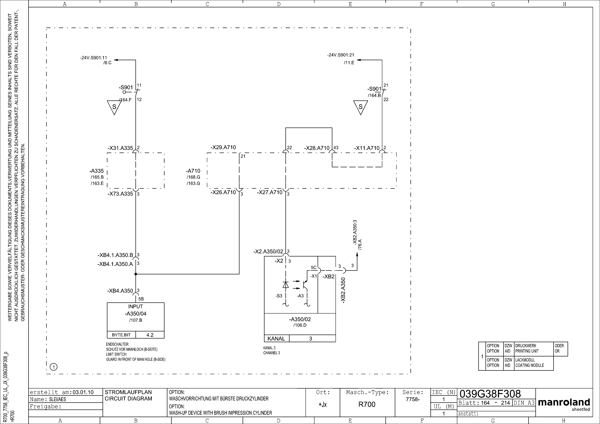

# +Jx — Sheet 164 of 214 — OPTION:

**WASCHVORRICHTUNG MIT BÜRSTE DRUCKZYLINDER**

> Part of the manroland **R700** printing press IEC/UL circuit diagrams.
> Drawing class: **Stromlaufplan / Circuit diagram** (DIN A3).
> Document `+Jx` covers the **1st printing module + feed register** machine section.

## At a glance

| Field | Value |
|---|---|
| Document | `+Jx`  (039G38F308) |
| Sheet | **164** of 214 |
| Section (DE) | OPTION: |
| Section (EN) | WASCHVORRICHTUNG MIT BÜRSTE DRUCKZYLINDER |
| Section type | CIRCUIT — Circuit diagram |
| Machine type | `R700` |
| Series | `7758` |
| Created | 03.01.10 |
| Replaces | — |
| Columns used | A, B, C, D, E, F, G, H |
| Path numbers | — |
| Labels on sheet | 87 |
| Cross-refs out | 11 |
| Cross-refs in | 24 |

**Previous:** [+Jx sheet 163](SHEET_0163.md) · **Next:** [+Jx sheet 165](SHEET_0165.md) · **Document TOC:** [_TOC.md](_TOC.md)  (+Jx) · **Master TOC:** [all sheets](../_MASTER_TOC.md)

## Sheet image (300 DPI, exact vector render)



_Rendered directly from the PDF vector layer at 300 DPI (1-bit), no OCR and no resampling. Use it to confirm anything ambiguous in the text below._

## Cross-references on this sheet

Each entry is a wire leaving this sheet. The printed token is `/sheet.column`; the link resolves to that sheet inside the same document.

| Ref | Target sheet | Col | Path | Destination on target | Target section | From col |
|---|---|---|---|---|---|---|
| `/8.C` | [+Jx sheet 8](SHEET_0008.md) | C | — | 24V.S901:11 | SPANNUNGSVERSORGUNG, SCHALTSCHRANKBELÜFTUNG | A |
| `/11.E` | [+Jx sheet 11](SHEET_0011.md) | E | — | — | SPANNUNGSVERSORGUNG, SCHALTSCHRANKBELÜFTUNG | E |
| `/164.B` | [+Jx sheet 164](SHEET_0164.md) | B | — | — | OPTION: | E |
| `/164.F` | [+Jx sheet 164](SHEET_0164.md) | F | — | — | OPTION: | B |
| `/165.B` | [+Jx sheet 165](SHEET_0165.md) | B | — | — | OPTION: | A |
| `/163.E` | [+Jx sheet 163](SHEET_0163.md) | E | — | — | OPTION: | A |
| `/168.G` | [+Jx sheet 168](SHEET_0168.md) | G | — | — | OPTION: | C |
| `/163.G` | [+Jx sheet 163](SHEET_0163.md) | G | — | — | OPTION: | C |
| `/76.A` | [+Jx sheet 76](SHEET_0076.md) | A | — | XB2.A350:3 | BUSVERBINDUNGEN: SICHERHEITSKREIS | E |
| `/107.B` | [+Jx sheet 107](SHEET_0107.md) | B | — | — | REFERENZMODUL | B |
| `/106.D` | [+Jx sheet 106](SHEET_0106.md) | D | — | — | REFERENZMODUL | D |

### Incoming references (sheets that point here)

Every other sheet that sends a wire to this one. `Back-ref` is the token printed on *that* sheet; `Path` is its line number.

| From sheet | Cols | Back-ref | Path | Refs | What continues there |
|---|---|---|---|---|---|
| [+Jx#8](SHEET_0008.md) | C | `/8.C` | — | 1 | — |
| [+Jx#11](SHEET_0011.md) | E | `/11.E` | — | 1 | 24V.S901:21 |
| [+Jx#76](SHEET_0076.md) | A | `/76.A` | — | 1 | XB2.A350:3 |
| [+Jx#106](SHEET_0106.md) | D | `/106.D` | — | 1 | — |
| [+Jx#107](SHEET_0107.md) | B | `/107.B` | — | 1 | — |
| [+Jx#126](SHEET_0126.md) | E | `/126.E` | — | 2 | — |
| [+Jx#130](SHEET_0130.md) | A, B, D | `/130.A`, `/130.B`, `/130.D` | — | 3 | — |
| [+Jx#136](SHEET_0136.md) | H | `/136.H` | — | 1 | — |
| [+Jx#143](SHEET_0143.md) | F | `/143.F` | — | 1 | — |
| [+Jx#144](SHEET_0144.md) | C | `/144.C` | — | 1 | — |
| [+Jx#146](SHEET_0146.md) | B | `/146.B` | — | 1 | — |
| [+Jx#147](SHEET_0147.md) | B | `/147.B` | — | 2 | — |
| [+Jx#148](SHEET_0148.md) | C | `/148.C` | — | 1 | — |
| [+Jx#153](SHEET_0153.md) | E | `/153.E` | — | 1 | — |
| [+Jx#163](SHEET_0163.md) | E, F | `/163.E`, `/163.F` | — | 2 | — |
| [+Jx#164](SHEET_0164.md) | B, E | `/164.B`, `/164.E` | — | 2 | — |
| [+Jx#165](SHEET_0165.md) | B | `/165.B` | — | 1 | — |
| [+Jx#168](SHEET_0168.md) | G | `/168.G` | — | 1 | — |


## Devices on this sheet

| Tag | Class | Class meaning (IEC) | Col | Sub | Terminal | Sign |
|---|---|---|---|---|---|---|
| `A335` | A | Baugruppe / assembly, module, PC board | A | — | — | — |
| `A350/04` | A | Baugruppe / assembly, module, PC board | B | 04 | — | — |
| `S3` | S | Schalter / switch | D | — | — | — |
| `A3` | A | Baugruppe / assembly, module, PC board | D | — | — | — |
| `X1` | X | Klemme / terminal, plug connector | D | — | — | — |
| `X2` | X | Klemme / terminal, plug connector | D | — | — | — |
| `XB2` | XB |  | E | — | — | — |
| `A350/02` | A | Baugruppe / assembly, module, PC board | D | 02 | — | — |
| `A710` | A | Baugruppe / assembly, module, PC board | C | — | — | — |
| `S901` | S | Schalter / switch | B | — | — | — |
| `S901` | S | Schalter / switch | E | — | — | — |
| `X73.A335` | — | cross-device reference | B | — | — | — |
| `X31.A335` | — | cross-device reference | B | — | — | — |
| `4.2` | — | cross-device reference | B | — | — | — |
| `XB4.A350` | — | cross-device reference | B | — | — | — |
| `XB4.1.A350.B` | — | cross-device reference | B | — | — | — |
| `XB4.1.A350.A` | — | cross-device reference | B | — | — | — |
| `XB2.A350` | — | cross-device reference | E | — | — | — |
| `X28.A710` | — | cross-device reference | E | — | — | — |
| `X11.A710` | — | cross-device reference | E | — | — | — |
| `X27.A710` | — | cross-device reference | D | — | — | — |
| `X26.A710` | — | cross-device reference | C | — | — | — |
| `XB2.A350:3` | — | cross-device reference | E | — | 3 | — |
| `X29.A710` | — | cross-device reference | C | — | — | — |

## Potentials / nets

| Potential | Count | Columns | Attached devices | Terminals |
|---|---|---|---|---|
| `24V` | 2 | A, E | `S901` | `11`, `21` |


A potential such as `L24+/4` or `M24+` is a named supply/return rail; every place it appears on this sheet is electrically common.

## Wire-end annotations (grouped as printed)

A wire that continues elsewhere is annotated with a small cluster: the destination description, the path/line number `#NN`, and the `/sheet.column` cross reference. Each row below is one such cluster exactly as it is grouped on the drawing.

| Col | Y | Path | Cross-ref | Text on the wire |
|---|---|---|---|---|
| E | 105.1 | — | — | `24V.S901:21` |
| A | 110.8 | — | `/8.C` | `24V.S901:11` |
| E | 120.7 | — | `/11.E` | — |
| D | 165.4 | — | — | `S901 21` |
| B | 165.4 | — | — | `11` |
| E | 171.7 | — | — | `S901` |
| E | 185.5 | — | `/164.B` | — |
| B | 193.7 | — | — | `12` |
| F | 193.7 | — | — | `22` |
| B | 194.4 | — | `/164.F` | — |
| C | 206.5 | — | — | `S S` |
| C | 287.9 | — | — | `X29.A710` |
| B | 289.4 | — | — | `X31.A335 2` |
| D | 289.4 | — | — | `22` |
| E | 289.4 | — | — | `X28.A710 43 X11.A710 2` |
| D | 306.4 | — | — | `21` |
| A | 334.7 | — | — | `A335` |
| C | 334.7 | — | — | `A710` |
| A | 347.8 | — | `/165.B`, `/163.E` | — |
| C | 347.8 | — | `/168.G`, `/163.G` | — |
| D | 377.2 | — | — | `X26.A710 3 X27.A710 3` |
| B | 380.1 | — | — | `X73.A335 3` |
| E | 436.5 | — | `/76.A` | `XB2.A350:3` |
| D | 494.9 | — | — | `X2.A350/02 3` |
| B | 502.0 | — | — | `XB4.1.A350.B 3` |
| D | 513.3 | — | — | `X2` |
| C | 514.8 | — | — | `XB4.1.A350.A 3 3 3` |
| E | 523.3 | — | — | `3` |
| D | 527.5 | — | — | `5C` |
| D | 544.5 | — | — | `X1` |
| E | 544.5 | — | — | `XB2` |
| E | 550.8 | — | — | `XB2.A350` |
| B | 572.8 | — | — | `XB4.A350 3` |
| D | 583.5 | — | — | `S3 A3` |
| B | 589.8 | — | — | `5B` |
| B | 604.4 | — | — | `INPUT` |
| B | 618.2 | — | — | `A350/04` |
| D | 629.5 | — | — | `A350/02` |
| B | 632.0 | — | `/107.B` | — |
| D | 641.9 | — | `/106.D` | — |
| B | 661.0 | — | — | `BYTE.BIT 4.2` |
| D | 667.8 | — | — | `KANAL 3` |
| B | 681.0 | — | — | `ENDSCHALTER: LIMIT SWITCH: SCHUTZ VOR MANNLOCH (B SEITE) GUARD IN FRONT OF MAN HOLE (B SIDE)` |
| G | 683.6 | — | — | `DZW` |
| G | 683.7 | — | — | `OPTION OPTION` |
| G | 683.7 | — | — | `DRUCKWERK PRINTING UNIT` |
| H | 683.8 | — | — | `ODER OR` |
| D | 688.1 | — | — | `KANAL 3 CHANNEL 3` |
| G | 694.3 | — | — | `AID` |
| G | 703.2 | — | — | `1` |
| G | 712.0 | — | — | `DZW` |
| G | 712.1 | — | — | `OPTION OPTION` |
| H | 712.1 | — | — | `LACKMODUL COATING MODULE` |
| G | 722.7 | — | — | `AID` |
| A | 725.5 | — | — | `1` |


## Reconstructed tables

This sheet carries tabular content (pin map / terminal assignment / index). The grid below was rebuilt from the drawing's own rule lines, so each row is exactly one physical row of the table.

### Table 1 — 2 data rows × 2 columns (at x=212.6, y=544.3)

| XB4.A350 | 3 5B |
|---|---|
| `INPUT A350/04` | `/107.B` |
| `BYTE.BIT` | `4.2` |


### Table 2 — 5 data rows × 5 columns (at x=474.8, y=253.7)

| 21 |  | 22 | X28.A710 |  |
|---|---|---|---|---|
| `3` | `X27.A710 X2.A350/02` | `3 3` |  |  |
|  | `X2` | `3` | `5C` |  |
|  | `S3` | `A3` | `X1` | `XB2` |
|  |  | `A350/02 /106.D` |  |  |
|  | `KANAL` |  | `3` |  |


### Table 3 — 3 data rows × 2 columns (at x=666.1, y=253.7)

| 43 | X11.A710 |
|---|---|
| `XB2.A350:3` | `/76.A` |
| `3 3` |  |
| `XB2.A350` |  |


## Notes and free text on this sheet

| Text | Col | Y (pt) |
|---|---|---|
| `5B` | B | 589.82 |
| `INPUT` | B | 604.35 |
| `BYTE.BIT` | B | 661.61 |
| `ENDSCHALTER:` | B | 681.03 |
| `SCHUTZ VOR MANNLOCH (B SEITE)` | B | 690.99 |
| `LIMIT SWITCH:` | B | 700.92 |
| `GUARD IN FRONT OF MAN HOLE (B SIDE)` | B | 710.89 |
| `KANAL 3` | D | 688.14 |
| `CHANNEL 3` | D | 698.08 |
| `5C` | D | 527.52 |
| `KANAL` | D | 667.79 |
| `X2.A350/02` | D | 494.89 |
| `OPTION` | G | 683.71 |
| `DZW` | G | 683.61 |
| `AID` | G | 694.33 |
| `DRUCKWERK` | G | 683.71 |
| `PRINTING UNIT` | G | 694.37 |
| `LACKMODUL` | G | 712.1 |
| `COATING MODULE` | H | 722.73 |
| `ODER` | H | 683.75 |
| `OR` | H | 694.38 |
| `S` | B | 206.52 |
| `S` | E | 206.52 |

## Complete label inventory (exact text from the drawing)

Every text object inside the drawing area of this sheet, in DIN reading order (column A→H, then top→bottom). This is the authoritative list: if a string is not here it is not printed on this sheet.

| Col | Y | X | Dir | Type | Text |
|---|---|---|---|---|---|
| A | 110.8 | 159.0 | → | potential | `24V.S901:11` |
| A | 334.7 | 177.4 | → | device tag | `A335` |
| A | 347.8 | 180.3 | → | cross-reference | `/165.B` |
| A | 360.2 | 180.3 | → | cross-reference | `/163.E` |
| A | 725.4 | 104.4 | → | number | `1` |
| B | 120.7 | 205.2 | → | cross-reference | `/8.C` |
| B | 165.4 | 271.3 | → | number | `11` |
| B | 168.9 | 235.8 | → | device tag | `S901` |
| B | 193.7 | 271.3 | → | number | `12` |
| B | 194.4 | 236.1 | → | cross-reference | `/164.F` |
| B | 206.5 | 222.7 | → | text | `S` |
| B | 289.4 | 213.7 | → | device ref | `X31.A335` |
| B | 289.4 | 272.1 | → | number | `2` |
| B | 380.1 | 213.7 | → | device ref | `X73.A335` |
| B | 381.5 | 271.8 | → | number | `3` |
| B | 502.0 | 194.2 | → | device ref | `XB4.1.A350.B` |
| B | 502.0 | 271.8 | → | number | `3` |
| B | 519.0 | 271.8 | → | number | `3` |
| B | 519.7 | 193.6 | → | device ref | `XB4.1.A350.A` |
| B | 572.8 | 212.9 | → | device ref | `XB4.A350` |
| B | 572.9 | 271.8 | → | number | `3` |
| B | 589.8 | 274.7 | → | text | `5B` |
| B | 604.4 | 254.4 | → | text | `INPUT` |
| B | 618.2 | 247.7 | → | device tag | `A350/04` |
| B | 632.0 | 256.7 | → | cross-reference | `/107.B` |
| B | 661.0 | 291.0 | → | device ref | `4.2` |
| B | 661.6 | 222.5 | → | text | `BYTE.BIT` |
| B | 681.0 | 210.6 | → | text | `ENDSCHALTER:` |
| B | 691.0 | 210.9 | → | text | `SCHUTZ VOR MANNLOCH (B SEITE)` |
| B | 700.9 | 210.6 | → | text | `LIMIT SWITCH:` |
| B | 710.9 | 210.9 | → | text | `GUARD IN FRONT OF MAN HOLE (B SIDE)` |
| C | 288.0 | 418.1 | → | device ref | `X29.A710` |
| C | 334.7 | 369.1 | → | device tag | `A710` |
| C | 347.8 | 370.8 | → | cross-reference | `/168.G` |
| C | 360.2 | 370.8 | → | cross-reference | `/163.G` |
| C | 377.2 | 418.1 | → | device ref | `X26.A710` |
| C | 381.5 | 477.4 | → | number | `3` |
| D | 289.4 | 569.8 | → | number | `22` |
| D | 306.4 | 477.6 | → | number | `21` |
| D | 377.2 | 510.2 | → | device ref | `X27.A710` |
| D | 381.5 | 569.5 | → | number | `3` |
| D | 494.9 | 502.9 | → | text | `X2.A350/02` |
| D | 494.9 | 569.5 | → | number | `3` |
| D | 513.3 | 545.4 | → | device tag | `X2` |
| D | 514.8 | 572.3 | → | number | `3` |
| D | 527.5 | 617.1 | → | text | `5C` |
| D | 544.5 | 615.7 | → | device tag | `X1` |
| D | 583.5 | 546.5 | → | device tag | `S3` |
| D | 583.5 | 589.0 | → | device tag | `A3` |
| D | 629.5 | 573.9 | → | device tag | `A350/02` |
| D | 641.9 | 582.5 | → | cross-reference | `/106.D` |
| D | 667.8 | 530.9 | → | text | `KANAL` |
| D | 667.8 | 613.6 | → | number | `3` |
| D | 688.1 | 522.4 | → | text | `KANAL 3` |
| D | 698.1 | 522.7 | → | text | `CHANNEL 3` |
| E | 105.1 | 649.4 | → | potential | `24V.S901:21` |
| E | 120.7 | 682.6 | → | cross-reference | `/11.E` |
| E | 171.7 | 729.1 | → | device tag | `S901` |
| E | 185.5 | 730.2 | → | cross-reference | `/164.B` |
| E | 206.5 | 711.6 | → | text | `S` |
| E | 289.4 | 603.8 | → | device ref | `X28.A710` |
| E | 289.4 | 661.9 | → | number | `43` |
| E | 289.4 | 703.0 | → | device ref | `X11.A710` |
| E | 289.4 | 761.1 | → | number | `2` |
| E | 436.5 | 700.4 | ↕ | device ref | `XB2.A350:3` |
| E | 475.4 | 710.3 | ↕ | cross-reference | `/76.A` |
| E | 523.3 | 697.0 | → | number | `3` |
| E | 524.7 | 671.5 | → | number | `3` |
| E | 544.5 | 640.3 | → | device tag | `XB2` |
| E | 550.8 | 676.3 | ↕ | device ref | `XB2.A350` |
| F | 165.4 | 761.1 | → | number | `21` |
| F | 193.7 | 761.1 | → | number | `22` |
| G | 683.6 | 1001.5 | → | text | `DZW` |
| G | 683.7 | 966.3 | → | text | `OPTION` |
| G | 683.7 | 1022.7 | → | text | `DRUCKWERK` |
| G | 694.3 | 966.3 | → | text | `OPTION` |
| G | 694.3 | 1002.0 | → | text | `AID` |
| G | 694.4 | 1022.7 | → | text | `PRINTING UNIT` |
| G | 703.2 | 954.1 | → | number | `1` |
| G | 712.0 | 1001.5 | → | text | `DZW` |
| G | 712.1 | 966.3 | → | text | `OPTION` |
| G | 712.1 | 1022.7 | → | text | `LACKMODUL` |
| G | 722.7 | 966.3 | → | text | `OPTION` |
| G | 722.7 | 1002.0 | → | text | `AID` |
| H | 683.7 | 1101.0 | → | text | `ODER` |
| H | 694.4 | 1101.0 | → | text | `OR` |
| H | 722.7 | 1023.0 | → | text | `COATING MODULE` |

## Reading-order text block

The same content as a plain block, grouped by DIN column — convenient to paste or to match against a visual description.

```text
=== Column A ===
 110.8  159.0  net          24V.S901:11
 334.7  177.4  devtag       A335
 347.8  180.3  xref         /165.B
 360.2  180.3  xref         /163.E
 725.4  104.4  numeric      1
=== Column B ===
 120.7  205.2  xref         /8.C
 165.4  271.3  numeric      11
 168.9  235.8  devtag       S901
 193.7  271.3  numeric      12
 194.4  236.1  xref         /164.F
 206.5  222.7  text         S
 289.4  213.7  devref       X31.A335
 289.4  272.1  numeric      2
 380.1  213.7  devref       X73.A335
 381.5  271.8  numeric      3
 502.0  194.2  devref       XB4.1.A350.B
 502.0  271.8  numeric      3
 519.0  271.8  numeric      3
 519.7  193.6  devref       XB4.1.A350.A
 572.8  212.9  devref       XB4.A350
 572.9  271.8  numeric      3
 589.8  274.7  text         5B
 604.4  254.4  text         INPUT
 618.2  247.7  devtag       A350/04
 632.0  256.7  xref         /107.B
 661.0  291.0  devref       4.2
 661.6  222.5  text         BYTE.BIT
 681.0  210.6  text         ENDSCHALTER:
 691.0  210.9  text         SCHUTZ VOR MANNLOCH (B SEITE)
 700.9  210.6  text         LIMIT SWITCH:
 710.9  210.9  text         GUARD IN FRONT OF MAN HOLE (B SIDE)
=== Column C ===
 288.0  418.1  devref       X29.A710
 334.7  369.1  devtag       A710
 347.8  370.8  xref         /168.G
 360.2  370.8  xref         /163.G
 377.2  418.1  devref       X26.A710
 381.5  477.4  numeric      3
=== Column D ===
 289.4  569.8  numeric      22
 306.4  477.6  numeric      21
 377.2  510.2  devref       X27.A710
 381.5  569.5  numeric      3
 494.9  502.9  text         X2.A350/02
 494.9  569.5  numeric      3
 513.3  545.4  devtag       X2
 514.8  572.3  numeric      3
 527.5  617.1  text         5C
 544.5  615.7  devtag       X1
 583.5  546.5  devtag       S3
 583.5  589.0  devtag       A3
 629.5  573.9  devtag       A350/02
 641.9  582.5  xref         /106.D
 667.8  530.9  text         KANAL
 667.8  613.6  numeric      3
 688.1  522.4  text         KANAL 3
 698.1  522.7  text         CHANNEL 3
=== Column E ===
 105.1  649.4  net          24V.S901:21
 120.7  682.6  xref         /11.E
 171.7  729.1  devtag       S901
 185.5  730.2  xref         /164.B
 206.5  711.6  text         S
 289.4  603.8  devref       X28.A710
 289.4  661.9  numeric      43
 289.4  703.0  devref       X11.A710
 289.4  761.1  numeric      2
 436.5  700.4  devref       XB2.A350:3
 475.4  710.3  xref         /76.A
 523.3  697.0  numeric      3
 524.7  671.5  numeric      3
 544.5  640.3  devtag       XB2
 550.8  676.3  devref       XB2.A350
=== Column F ===
 165.4  761.1  numeric      21
 193.7  761.1  numeric      22
=== Column G ===
 683.6 1001.5  text         DZW
 683.7  966.3  text         OPTION
 683.7 1022.7  text         DRUCKWERK
 694.3  966.3  text         OPTION
 694.3 1002.0  text         AID
 694.4 1022.7  text         PRINTING UNIT
 703.2  954.1  numeric      1
 712.0 1001.5  text         DZW
 712.1  966.3  text         OPTION
 712.1 1022.7  text         LACKMODUL
 722.7  966.3  text         OPTION
 722.7 1002.0  text         AID
=== Column H ===
 683.7 1101.0  text         ODER
 694.4 1101.0  text         OR
 722.7 1023.0  text         COATING MODULE
```

---
_Generated from the PDF vector text layer; no OCR. Source: `R700_7758_IEC_UL_JX_039G38F308_p`, sheet 164._
