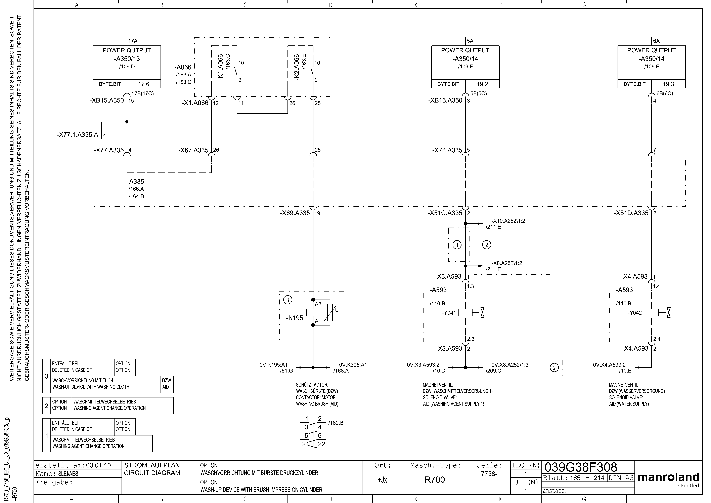

# +Jx — Sheet 165 of 214 — OPTION:

**WASCHVORRICHTUNG MIT BÜRSTE DRUCKZYLINDER**

> Part of the manroland **R700** printing press IEC/UL circuit diagrams.
> Drawing class: **Stromlaufplan / Circuit diagram** (DIN A3).
> Document `+Jx` covers the **1st printing module + feed register** machine section.

## At a glance

| Field | Value |
|---|---|
| Document | `+Jx`  (039G38F308) |
| Sheet | **165** of 214 |
| Section (DE) | OPTION: |
| Section (EN) | WASCHVORRICHTUNG MIT BÜRSTE DRUCKZYLINDER |
| Section type | CIRCUIT — Circuit diagram |
| Machine type | `R700` |
| Series | `7758` |
| Created | 03.01.10 |
| Replaces | — |
| Columns used | A, B, C, D, E, F, G, H |
| Path numbers | — |
| Labels on sheet | 143 |
| Cross-refs out | 19 |
| Cross-refs in | 39 |

**Previous:** [+Jx sheet 164](SHEET_0164.md) · **Next:** [+Jx sheet 166](SHEET_0166.md) · **Document TOC:** [_TOC.md](_TOC.md)  (+Jx) · **Master TOC:** [all sheets](../_MASTER_TOC.md)

## Sheet image (300 DPI, exact vector render)



_Rendered directly from the PDF vector layer at 300 DPI (1-bit), no OCR and no resampling. Use it to confirm anything ambiguous in the text below._

## Cross-references on this sheet

Each entry is a wire leaving this sheet. The printed token is `/sheet.column`; the link resolves to that sheet inside the same document.

| Ref | Target sheet | Col | Path | Destination on target | Target section | From col |
|---|---|---|---|---|---|---|
| `/163.C` | [+Jx sheet 163](SHEET_0163.md) | C | — | — | OPTION: | C |
| `/163.E` | [+Jx sheet 163](SHEET_0163.md) | E | — | — | OPTION: | D |
| `/109.F` | [+Jx sheet 109](SHEET_0109.md) | F | — | — | REFERENZMODUL | F |
| `/109.F` | [+Jx sheet 109](SHEET_0109.md) | F | — | — | REFERENZMODUL | H |
| `/109.D` | [+Jx sheet 109](SHEET_0109.md) | D | — | — | REFERENZMODUL | B |
| `/166.A` | [+Jx sheet 166](SHEET_0166.md) | A | — | — | OPTION: | B |
| `/163.C` | [+Jx sheet 163](SHEET_0163.md) | C | — | — | OPTION: | B |
| `/166.A` | [+Jx sheet 166](SHEET_0166.md) | A | — | — | OPTION: | B |
| `/164.B` | [+Jx sheet 164](SHEET_0164.md) | B | — | — | OPTION: | B |
| `/211.E` | [+Jx sheet 211](SHEET_0211.md) | E | — | — | OPTION: WASCHMITTELWECHSELBETRIEB | F |
| `/211.E` | [+Jx sheet 211](SHEET_0211.md) | E | — | — | OPTION: WASCHMITTELWECHSELBETRIEB | F |
| `/110.B` | [+Jx sheet 110](SHEET_0110.md) | B | — | — | REFERENZMODUL | E |
| `/110.B` | [+Jx sheet 110](SHEET_0110.md) | B | — | — | REFERENZMODUL | G |
| `/168.A` | [+Jx sheet 168](SHEET_0168.md) | A | — | 0V.K195:A1 | OPTION: | D |
| `/61.G` | [+Jx sheet 61](SHEET_0061.md) | G | — | 0V.K195:A1 | GTW | D |
| `/209.C` | [+Jx sheet 209](SHEET_0209.md) | C | — | 0V.K305:A1 | OPTION: WASCHMITTELWECHSELBETRIEB | E |
| `/10.E` | [+Jx sheet 10](SHEET_0010.md) | E | — | 0V.X3.A593:2 0V.X4.A593:2 | SPANNUNGSVERSORGUNG, SCHALTSCHRANKBELÜFTUNG | F |
| `/10.D` | [+Jx sheet 10](SHEET_0010.md) | D | — | 0V.X3.A593:2 0V.X4.A593:2 | SPANNUNGSVERSORGUNG, SCHALTSCHRANKBELÜFTUNG | F |
| `/162.B` | [+Jx sheet 162](SHEET_0162.md) | B | — | — | OPTION: | D |

### Incoming references (sheets that point here)

Every other sheet that sends a wire to this one. `Back-ref` is the token printed on *that* sheet; `Path` is its line number.

| From sheet | Cols | Back-ref | Path | Refs | What continues there |
|---|---|---|---|---|---|
| [+Jx#10](SHEET_0010.md) | D | `/10.D` | — | 2 | — |
| [+Jx#61](SHEET_0061.md) | G | `/61.G` | — | 1 | — |
| [+Jx#109](SHEET_0109.md) | D, F | `/109.D`, `/109.F` | — | 3 | — |
| [+Jx#110](SHEET_0110.md) | B | `/110.B` | — | 2 | — |
| [+Jx#112](SHEET_0112.md) | A, B | `/112.A`, `/112.B` | — | 4 | — |
| [+Jx#128](SHEET_0128.md) | H | `/128.H` | — | 2 | — |
| [+Jx#130](SHEET_0130.md) | F | `/130.F` | — | 2 | — |
| [+Jx#139](SHEET_0139.md) | B, G | `/139.B`, `/139.G` | — | 3 | — |
| [+Jx#151](SHEET_0151.md) | A | `/151.A` | — | 2 | — |
| [+Jx#152](SHEET_0152.md) | D, G | `/152.D`, `/152.G` | — | 3 | — |
| [+Jx#155](SHEET_0155.md) | D | `/155.D` | — | 1 | — |
| [+Jx#156](SHEET_0156.md) | A, C | `/156.A`, `/156.C` | — | 3 | — |
| [+Jx#162](SHEET_0162.md) | B | `/162.B` | — | 1 | — |
| [+Jx#163](SHEET_0163.md) | B, C, E | `/163.B`, `/163.C`, `/163.E` | — | 3 | — |
| [+Jx#164](SHEET_0164.md) | A | `/164.A` | — | 1 | — |
| [+Jx#166](SHEET_0166.md) | A | `/166.A` | — | 2 | — |
| [+Jx#168](SHEET_0168.md) | A | `/168.A` | — | 1 | 0V.K305:A1 |
| [+Jx#209](SHEET_0209.md) | C | `/209.C` | — | 1 | — |
| [+Jx#211](SHEET_0211.md) | C, D | `/211.C`, `/211.D` | — | 2 | X10.A252\1:1 X10.A252\1:2; X8.A252\1:2 |


## Devices on this sheet

| Tag | Class | Class meaning (IEC) | Col | Sub | Terminal | Sign |
|---|---|---|---|---|---|---|
| `Y042` | Y | Magnetventil / solenoid valve, actuator | H | — | — | — |
| `A593` | A | Baugruppe / assembly, module, PC board | G | — | — | — |
| `A350/14` | A | Baugruppe / assembly, module, PC board | H | 14 | — | — |
| `Y041` | Y | Magnetventil / solenoid valve, actuator | E | — | — | — |
| `A593` | A | Baugruppe / assembly, module, PC board | E | — | — | — |
| `A350/14` | A | Baugruppe / assembly, module, PC board | F | 14 | — | — |
| `A066` | A | Baugruppe / assembly, module, PC board | B | — | — | — |
| `A1` | A | Baugruppe / assembly, module, PC board | D | — | — | — |
| `A2` | A | Baugruppe / assembly, module, PC board | D | — | — | — |
| `K195` | K | Relais / relay, contactor | D | — | — | — |
| `A335` | A | Baugruppe / assembly, module, PC board | B | — | — | — |
| `A350/13` | A | Baugruppe / assembly, module, PC board | B | 13 | — | — |
| `1.4` | — | cross-device reference | H | — | — | — |
| `2.4` | — | cross-device reference | H | — | — | — |
| `X4.A593` | — | cross-device reference | H | — | — | — |
| `X4.A593` | — | cross-device reference | H | — | — | — |
| `X51D.A335` | — | cross-device reference | H | — | — | — |
| `19.3` | — | cross-device reference | H | — | — | — |
| `1.3` | — | cross-device reference | F | — | — | — |
| `2.3` | — | cross-device reference | F | — | — | — |
| `X3.A593` | — | cross-device reference | E | — | — | — |
| `X3.A593` | — | cross-device reference | E | — | — | — |
| `X78.A335` | — | cross-device reference | E | — | — | — |
| `X51C.A335` | — | cross-device reference | E | — | — | — |
| `19.2` | — | cross-device reference | F | — | — | — |
| `XB16.A350` | — | cross-device reference | E | — | — | — |
| `X67.A335` | — | cross-device reference | B | — | — | — |
| `X1.A066` | — | cross-device reference | B | — | — | — |
| `K1.A066` | — | cross-device reference | C | — | — | — |
| `X69.A335` | — | cross-device reference | D | — | — | — |
| `K2.A066` | — | cross-device reference | D | — | — | — |
| `X77.A335` | — | cross-device reference | A | — | — | — |
| `17.6` | — | cross-device reference | B | — | — | — |
| `XB15.A350` | — | cross-device reference | A | — | — | — |
| `X77.1.A335.A` | — | cross-device reference | A | — | — | — |
| `X8.A252\1:2` | — | cross-device reference | F | — | 2 | — |
| `X10.A252\1:2` | — | cross-device reference | F | — | 2 | — |

## Potentials / nets

| Potential | Count | Columns | Attached devices | Terminals |
|---|---|---|---|---|
| `0V` | 5 | C, D, E, F, G | `A252\1`, `A593`, `K195`, `K305`, `X3`, `X4`, `X8` | `2`, `3`, `A1` |


A potential such as `L24+/4` or `M24+` is a named supply/return rail; every place it appears on this sheet is electrically common.

## Wire-end annotations (grouped as printed)

A wire that continues elsewhere is annotated with a small cluster: the destination description, the path/line number `#NN`, and the `/sheet.column` cross reference. Each row below is one such cluster exactly as it is grouped on the drawing.

| Col | Y | Path | Cross-ref | Text on the wire |
|---|---|---|---|---|
| B | 64.7 | — | — | `17A` |
| F | 64.7 | — | — | `5A` |
| H | 64.7 | — | — | `6A` |
| B | 79.9 | — | — | `POWER QUTPUT` |
| F | 79.9 | — | — | `POWER QUTPUT` |
| H | 79.9 | — | — | `POWER QUTPUT` |
| C | 90.4 | — | — | `K1.A066` |
| C | 90.4 | — | `/163.C` | — |
| D | 90.4 | — | — | `K2.A066` |
| D | 90.4 | — | `/163.E` | — |
| B | 93.8 | — | — | `A350/13` |
| F | 93.8 | — | — | `A350/14` |
| H | 93.8 | — | — | `A350/14` |
| C | 101.6 | — | — | `10` |
| D | 101.6 | — | — | `10` |
| B | 107.6 | — | `/109.D` | — |
| F | 107.6 | — | `/109.F` | — |
| H | 107.6 | — | `/109.F` | — |
| B | 108.0 | — | — | `A066` |
| B | 121.0 | — | `/166.A`, `/163.C` | — |
| C | 129.9 | — | — | `9` |
| D | 129.9 | — | — | `9` |
| B | 136.6 | — | — | `BYTE.BIT 17.6` |
| F | 136.6 | — | — | `BYTE.BIT 19.2` |
| H | 136.6 | — | — | `BYTE.BIT 19.3` |
| B | 152.6 | — | — | `17B(17C)` |
| F | 152.6 | — | — | `5B(5C)` |
| H | 152.6 | — | — | `6B(6C)` |
| A | 163.2 | — | — | `XB15.A350 15` |
| E | 163.2 | — | — | `XB16.A350 3` |
| H | 164.7 | — | — | `4` |
| C | 167.5 | — | — | `X1.A066 12 11` |
| D | 168.9 | — | — | `26 25` |
| A | 220.6 | — | — | `X77.1.A335.A 4` |
| A | 246.8 | — | — | `X77.A335 4` |
| B | 246.8 | — | — | `X67.A335 26` |
| E | 246.8 | — | — | `X78.A335 5` |
| D | 246.9 | — | — | `25` |
| H | 246.9 | — | — | `7` |
| B | 299.3 | — | — | `A335` |
| B | 312.4 | — | `/166.A`, `/164.B` | — |
| D | 351.7 | — | — | `X69.A335 19` |
| E | 351.7 | — | — | `X51C.A335 2` |
| H | 351.7 | — | — | `X51D.A335 2` |
| F | 365.9 | — | — | `X10.A252\1:2` |
| F | 375.8 | — | `/211.E` | — |
| F | 406.6 | — | — | `1 2` |
| F | 436.8 | — | — | `X8.A252\1:2` |
| F | 446.7 | — | `/211.E` | — |
| E | 458.0 | — | — | `X3.A593 1` |
| H | 458.0 | — | — | `X4.A593 1` |
| F | 475.0 | — | — | `1.3` |
| H | 475.0 | — | — | `1.4` |
| E | 480.7 | — | — | `A593` |
| G | 480.7 | — | — | `A593` |
| C | 499.1 | — | — | `3` |
| E | 504.1 | — | `/110.B` | — |
| G | 504.1 | — | `/110.B` | — |
| D | 505.5 | — | — | `A2` |
| D | 515.6 | — | — | `U` |
| E | 519.7 | — | — | `Y041` |
| H | 519.7 | — | — | `Y042` |
| D | 527.5 | — | — | `K195` |
| D | 533.8 | — | — | `A1` |
| F | 563.6 | — | — | `2.3` |
| H | 563.6 | — | — | `2.4` |
| E | 578.5 | — | — | `X3.A593 2` |
| H | 578.5 | — | — | `X4.A593 2` |
| A | 605.7 | — | — | `ENTFÄLLT BEI DELETED IN CASE OF` |
| B | 605.8 | — | — | `OPTION OPTION` |
| D | 606.8 | — | `/168.A`, `/61.G` | `0V.K195:A1` |
| E | 606.8 | — | `/209.C` | `0V.K305:A1` |
| F | 606.8 | — | `/10.E`, `/10.D` | `0V.X3.A593:2 0V.X4.A593:2` |
| F | 606.8 | — | — | `0V.X8.A252\1:3` |
| G | 612.5 | — | — | `2` |
| A | 625.2 | — | — | `3` |
| B | 634.0 | — | — | `DZW` |
| A | 634.1 | — | — | `WASCHVORRICHTUNG MIT TUCH WASH UP DEVICE WITH WASHING CLOTH` |
| D | 641.2 | — | — | `SCHÜTZ: MOTOR, CONTACTOR: MOTOR, WASCHBÜRSTE (DZW) WASHING BRUSH (AID)` |
| F | 641.2 | — | — | `MAGNETVENTIL: DZW (WASCHMITTELVERSORGUNG 1) SOLENOID VALVE: AID (WASHING AGENT SUPPLY 1)` |
| H | 641.2 | — | — | `MAGNETVENTIL: DZW (WASSERVERSORGUNG) SOLENOID VALVE: AID (WATER SUPPLY)` |
| B | 644.7 | — | — | `AID` |
| A | 669.5 | — | — | `2 OPTION OPTION` |
| A | 669.5 | — | — | `WASCHMITTELWECHSELBETRIEB WASHING AGENT CHANGE OPERATION` |
| D | 696.1 | — | — | `21 3 5 1` |
| D | 696.1 | — | — | `2 6 22 4` |
| D | 703.9 | — | `/162.B` | — |
| A | 705.0 | — | — | `ENTFÄLLT BEI DELETED IN CASE OF` |
| B | 705.0 | — | — | `OPTION OPTION` |
| A | 724.5 | — | — | `1` |
| A | 733.3 | — | — | `WASCHMITTELWECHSELBETRIEB WASHING AGENT CHANGE OPERATION` |


## Reconstructed tables

This sheet carries tabular content (pin map / terminal assignment / index). The grid below was rebuilt from the drawing's own rule lines, so each row is exactly one physical row of the table.

### Table 1 — 3 data rows × 7 columns (at x=155.9, y=76.5)

| POWER A350/13 | QUTPUT /109.D | A066 /166.A | K1.A066 /163.C | 10 | /163.E K2.A066 | 10 |
|---|---|---|---|---|---|---|
| `BYTE.BIT` | `17.6` | `/163.C` |  | `9` |  | `9` |
| `XB15.A350` | `17B(17C) 15` | `X1.A066` | `12` | `11` | `26` | `25` |
| `4 X77.A335` | `4` | `X67.A335` | `26` |  |  | `25` |


### Table 2 — 1 data rows × 2 columns (at x=722.8, y=76.5)

| POWER | QUTPUT A350/14 /109.F |
|---|---|
| `BYTE.BIT` | `19.2` |


### Table 3 — 1 data rows × 2 columns (at x=1034.6, y=76.5)

| POWER | QUTPUT A350/14 /109.F |
|---|---|
| `BYTE.BIT` | `19.3` |


## Notes and free text on this sheet

| Text | Col | Y (pt) |
|---|---|---|
| `MAGNETVENTIL:` | G | 641.2 |
| `DZW (WASSERVERSORGUNG)` | H | 651.82 |
| `SOLENOID VALVE:` | G | 662.45 |
| `AID (WATER SUPPLY)` | H | 673.08 |
| `6A` | H | 64.7 |
| `6B(6C)` | H | 152.62 |
| `POWER QUTPUT` | H | 79.87 |
| `BYTE.BIT` | H | 137.21 |
| `MAGNETVENTIL:` | E | 641.2 |
| `DZW (WASCHMITTELVERSORGUNG 1)` | F | 651.83 |
| `SOLENOID VALVE:` | E | 662.45 |
| `AID (WASHING AGENT SUPPLY 1)` | E | 673.09 |
| `5A` | F | 64.7 |
| `5B(5C)` | F | 152.62 |
| `POWER QUTPUT` | F | 79.87 |
| `BYTE.BIT` | E | 137.21 |
| `SCHÜTZ: MOTOR,` | D | 641.22 |
| `WASCHBÜRSTE (DZW)` | D | 651.81 |
| `CONTACTOR: MOTOR,` | D | 662.49 |
| `WASHING BRUSH (AID)` | D | 673.09 |
| `U` | D | 515.62 |
| `17A` | B | 64.72 |
| `17B(17C)` | B | 152.63 |
| `POWER QUTPUT` | B | 79.87 |
| `BYTE.BIT` | A | 137.21 |
| `ENTFÄLLT BEI` | A | 704.96 |
| `DELETED IN CASE OF` | A | 715.61 |
| `OPTION` | B | 704.97 |
| `WASCHMITTELWECHSELBETRIEB` | A | 733.31 |
| `WASHING AGENT CHANGE OPERATION` | A | 743.96 |
| `OPTION` | A | 669.54 |
| `WASCHVORRICHTUNG MIT TUCH` | A | 634.13 |
| `WASH UP DEVICE WITH WASHING CLOTH` | A | 644.72 |
| `DZW` | B | 634.01 |
| `AID` | B | 644.73 |

## Complete label inventory (exact text from the drawing)

Every text object inside the drawing area of this sheet, in DIN reading order (column A→H, then top→bottom). This is the authoritative list: if a string is not here it is not printed on this sheet.

| Col | Y | X | Dir | Type | Text |
|---|---|---|---|---|---|
| A | 137.2 | 165.8 | → | text | `BYTE.BIT` |
| A | 163.2 | 150.2 | → | device ref | `XB15.A350` |
| A | 220.6 | 95.5 | → | device ref | `X77.1.A335.A` |
| A | 222.8 | 172.9 | → | number | `4` |
| A | 246.8 | 157.0 | → | device ref | `X77.A335` |
| A | 605.7 | 87.3 | → | text | `ENTFÄLLT BEI` |
| A | 616.4 | 87.3 | → | text | `DELETED IN CASE OF` |
| A | 625.2 | 75.0 | → | number | `3` |
| A | 634.1 | 87.9 | → | text | `WASCHVORRICHTUNG MIT TUCH` |
| A | 644.7 | 87.9 | → | text | `WASH UP DEVICE WITH WASHING CLOTH` |
| A | 669.5 | 87.6 | → | text | `OPTION` |
| A | 669.5 | 123.3 | → | text | `WASCHMITTELWECHSELBETRIEB` |
| A | 674.8 | 75.1 | → | number | `2` |
| A | 680.2 | 87.6 | → | text | `OPTION` |
| A | 680.2 | 123.3 | → | text | `WASHING AGENT CHANGE OPERATION` |
| A | 705.0 | 87.3 | → | text | `ENTFÄLLT BEI` |
| A | 715.6 | 87.3 | → | text | `DELETED IN CASE OF` |
| A | 724.5 | 75.4 | → | number | `1` |
| A | 733.3 | 87.9 | → | text | `WASCHMITTELWECHSELBETRIEB` |
| A | 744.0 | 87.9 | → | text | `WASHING AGENT CHANGE OPERATION` |
| B | 64.7 | 214.6 | → | text | `17A` |
| B | 79.9 | 171.8 | → | text | `POWER QUTPUT` |
| B | 93.8 | 191.1 | → | device tag | `A350/13` |
| B | 107.6 | 199.8 | → | cross-reference | `/109.D` |
| B | 108.0 | 292.3 | → | device tag | `A066` |
| B | 121.0 | 294.8 | → | cross-reference | `/166.A` |
| B | 133.5 | 294.8 | → | cross-reference | `/163.C` |
| B | 136.6 | 231.2 | → | device ref | `17.6` |
| B | 152.6 | 220.3 | → | text | `17B(17C)` |
| B | 164.7 | 214.6 | → | number | `15` |
| B | 167.5 | 304.7 | → | device ref | `X1.A066` |
| B | 246.8 | 298.8 | → | device ref | `X67.A335` |
| B | 246.9 | 215.4 | → | number | `4` |
| B | 299.3 | 212.9 | → | device tag | `A335` |
| B | 312.4 | 215.4 | → | cross-reference | `/166.A` |
| B | 324.8 | 215.7 | → | cross-reference | `/164.B` |
| B | 605.8 | 193.9 | → | text | `OPTION` |
| B | 616.4 | 193.9 | → | text | `OPTION` |
| B | 634.0 | 271.6 | → | text | `DZW` |
| B | 644.7 | 272.1 | → | text | `AID` |
| B | 705.0 | 193.9 | → | text | `OPTION` |
| B | 715.6 | 193.9 | → | text | `OPTION` |
| C | 90.4 | 364.5 | ↕ | device ref | `K1.A066` |
| C | 90.4 | 377.6 | ↕ | cross-reference | `/163.C` |
| C | 101.6 | 398.8 | → | number | `10` |
| C | 130.0 | 399.4 | → | number | `9` |
| C | 168.9 | 356.3 | → | number | `12` |
| C | 168.9 | 398.8 | → | number | `11` |
| C | 246.9 | 357.2 | → | number | `26` |
| C | 499.1 | 479.9 | → | number | `3` |
| C | 606.8 | 434.8 | → | potential | `0V.K195:A1` |
| C | 616.7 | 469.1 | → | cross-reference | `/61.G` |
| D | 90.4 | 492.1 | ↕ | device ref | `K2.A066` |
| D | 90.4 | 505.1 | ↕ | cross-reference | `/163.E` |
| D | 101.6 | 526.4 | → | number | `10` |
| D | 130.0 | 527.0 | → | number | `9` |
| D | 168.9 | 484.7 | → | number | `26` |
| D | 168.9 | 527.2 | → | number | `25` |
| D | 246.9 | 527.2 | → | number | `25` |
| D | 351.7 | 468.9 | → | device ref | `X69.A335` |
| D | 353.2 | 526.4 | → | number | `19` |
| D | 505.5 | 527.2 | → | device tag | `A2` |
| D | 515.6 | 561.1 | → | text | `U` |
| D | 527.5 | 479.3 | → | device tag | `K195` |
| D | 533.8 | 527.2 | → | device tag | `A1` |
| D | 606.8 | 568.1 | → | potential | `0V.K305:A1` |
| D | 616.7 | 558.4 | → | cross-reference | `/168.A` |
| D | 641.2 | 495.8 | → | text | `SCHÜTZ: MOTOR,` |
| D | 651.8 | 496.1 | → | text | `WASCHBÜRSTE (DZW)` |
| D | 662.5 | 495.8 | → | text | `CONTACTOR: MOTOR,` |
| D | 673.1 | 496.1 | → | text | `WASHING BRUSH (AID)` |
| D | 696.1 | 511.9 | → | number | `1` |
| D | 696.1 | 532.6 | → | number | `2` |
| D | 703.9 | 549.9 | → | cross-reference | `/162.B` |
| D | 710.3 | 510.2 | → | number | `3` |
| D | 710.3 | 532.9 | → | number | `4` |
| D | 724.5 | 510.2 | → | number | `5` |
| D | 724.5 | 532.6 | → | number | `6` |
| D | 738.6 | 506.0 | → | number | `21` |
| D | 738.6 | 532.6 | → | number | `22` |
| E | 137.2 | 732.8 | → | text | `BYTE.BIT` |
| E | 163.2 | 717.2 | → | device ref | `XB16.A350` |
| E | 246.8 | 724.0 | → | device ref | `X78.A335` |
| E | 351.7 | 716.3 | → | device ref | `X51C.A335` |
| E | 458.0 | 728.5 | → | device ref | `X3.A593` |
| E | 480.7 | 719.7 | → | device tag | `A593` |
| E | 504.1 | 720.0 | → | cross-reference | `/110.B` |
| E | 519.7 | 740.7 | → | device tag | `Y041` |
| E | 578.5 | 729.9 | → | device ref | `X3.A593` |
| E | 606.8 | 681.4 | → | potential | `0V.X3.A593:2` |
| E | 616.8 | 724.8 | → | cross-reference | `/10.D` |
| E | 641.2 | 708.1 | → | text | `MAGNETVENTIL:` |
| E | 662.5 | 708.4 | → | text | `SOLENOID VALVE:` |
| E | 673.1 | 708.7 | → | text | `AID (WASHING AGENT SUPPLY 1)` |
| F | 64.7 | 782.1 | → | text | `5A` |
| F | 79.9 | 738.7 | → | text | `POWER QUTPUT` |
| F | 93.8 | 758.0 | → | device tag | `A350/14` |
| F | 107.6 | 767.2 | → | cross-reference | `/109.F` |
| F | 136.6 | 798.1 | → | device ref | `19.2` |
| F | 152.6 | 787.7 | → | text | `5B(5C)` |
| F | 164.7 | 782.1 | → | number | `3` |
| F | 246.9 | 782.1 | → | number | `5` |
| F | 353.2 | 782.4 | → | number | `2` |
| F | 365.9 | 823.2 | → | device ref | `X10.A252\1:2` |
| F | 375.8 | 813.5 | → | cross-reference | `/211.E` |
| F | 406.6 | 763.5 | → | number | `1` |
| F | 407.0 | 813.0 | → | number | `2` |
| F | 436.8 | 823.2 | → | device ref | `X8.A252\1:2` |
| F | 446.7 | 813.5 | → | cross-reference | `/211.E` |
| F | 459.5 | 781.5 | → | number | `1` |
| F | 475.0 | 781.5 | → | device ref | `1.3` |
| F | 563.6 | 782.4 | → | device ref | `2.3` |
| F | 580.0 | 782.4 | → | number | `2` |
| F | 606.8 | 823.2 | → | potential | `0V.X8.A252\1:3` |
| F | 616.8 | 813.5 | → | cross-reference | `/209.C` |
| F | 651.8 | 708.1 | → | text | `DZW (WASCHMITTELVERSORGUNG 1)` |
| G | 480.7 | 1031.5 | → | device tag | `A593` |
| G | 504.1 | 1031.8 | → | cross-reference | `/110.B` |
| G | 606.8 | 993.3 | → | potential | `0V.X4.A593:2` |
| G | 612.5 | 926.4 | → | number | `2` |
| G | 616.7 | 1036.9 | → | cross-reference | `/10.E` |
| G | 641.2 | 1019.9 | → | text | `MAGNETVENTIL:` |
| G | 662.5 | 1020.2 | → | text | `SOLENOID VALVE:` |
| H | 64.7 | 1093.9 | → | text | `6A` |
| H | 79.9 | 1050.5 | → | text | `POWER QUTPUT` |
| H | 93.8 | 1069.8 | → | device tag | `A350/14` |
| H | 107.6 | 1079.0 | → | cross-reference | `/109.F` |
| H | 136.6 | 1109.9 | → | device ref | `19.3` |
| H | 137.2 | 1044.6 | → | text | `BYTE.BIT` |
| H | 152.6 | 1099.6 | → | text | `6B(6C)` |
| H | 164.7 | 1094.2 | → | number | `4` |
| H | 246.9 | 1093.9 | → | number | `7` |
| H | 351.7 | 1028.1 | → | device ref | `X51D.A335` |
| H | 353.2 | 1094.2 | → | number | `2` |
| H | 458.0 | 1040.3 | → | device ref | `X4.A593` |
| H | 459.5 | 1093.3 | → | number | `1` |
| H | 475.0 | 1093.3 | → | device ref | `1.4` |
| H | 519.7 | 1051.4 | → | device tag | `Y042` |
| H | 563.6 | 1094.2 | → | device ref | `2.4` |
| H | 578.5 | 1041.7 | → | device ref | `X4.A593` |
| H | 580.0 | 1094.2 | → | number | `2` |
| H | 651.8 | 1019.9 | → | text | `DZW (WASSERVERSORGUNG)` |
| H | 673.1 | 1020.5 | → | text | `AID (WATER SUPPLY)` |

## Reading-order text block

The same content as a plain block, grouped by DIN column — convenient to paste or to match against a visual description.

```text
=== Column A ===
 137.2  165.8  text         BYTE.BIT
 163.2  150.2  devref       XB15.A350
 220.6   95.5  devref       X77.1.A335.A
 222.8  172.9  numeric      4
 246.8  157.0  devref       X77.A335
 605.7   87.3  text         ENTFÄLLT BEI
 616.4   87.3  text         DELETED IN CASE OF
 625.2   75.0  numeric      3
 634.1   87.9  text         WASCHVORRICHTUNG MIT TUCH
 644.7   87.9  text         WASH UP DEVICE WITH WASHING CLOTH
 669.5   87.6  text         OPTION
 669.5  123.3  text         WASCHMITTELWECHSELBETRIEB
 674.8   75.1  numeric      2
 680.2   87.6  text         OPTION
 680.2  123.3  text         WASHING AGENT CHANGE OPERATION
 705.0   87.3  text         ENTFÄLLT BEI
 715.6   87.3  text         DELETED IN CASE OF
 724.5   75.4  numeric      1
 733.3   87.9  text         WASCHMITTELWECHSELBETRIEB
 744.0   87.9  text         WASHING AGENT CHANGE OPERATION
=== Column B ===
  64.7  214.6  text         17A
  79.9  171.8  text         POWER QUTPUT
  93.8  191.1  devtag       A350/13
 107.6  199.8  xref         /109.D
 108.0  292.3  devtag       A066
 121.0  294.8  xref         /166.A
 133.5  294.8  xref         /163.C
 136.6  231.2  devref       17.6
 152.6  220.3  text         17B(17C)
 164.7  214.6  numeric      15
 167.5  304.7  devref       X1.A066
 246.8  298.8  devref       X67.A335
 246.9  215.4  numeric      4
 299.3  212.9  devtag       A335
 312.4  215.4  xref         /166.A
 324.8  215.7  xref         /164.B
 605.8  193.9  text         OPTION
 616.4  193.9  text         OPTION
 634.0  271.6  text         DZW
 644.7  272.1  text         AID
 705.0  193.9  text         OPTION
 715.6  193.9  text         OPTION
=== Column C ===
  90.4  364.5  devref       K1.A066
  90.4  377.6  xref         /163.C
 101.6  398.8  numeric      10
 130.0  399.4  numeric      9
 168.9  356.3  numeric      12
 168.9  398.8  numeric      11
 246.9  357.2  numeric      26
 499.1  479.9  numeric      3
 606.8  434.8  net          0V.K195:A1
 616.7  469.1  xref         /61.G
=== Column D ===
  90.4  492.1  devref       K2.A066
  90.4  505.1  xref         /163.E
 101.6  526.4  numeric      10
 130.0  527.0  numeric      9
 168.9  484.7  numeric      26
 168.9  527.2  numeric      25
 246.9  527.2  numeric      25
 351.7  468.9  devref       X69.A335
 353.2  526.4  numeric      19
 505.5  527.2  devtag       A2
 515.6  561.1  text         U
 527.5  479.3  devtag       K195
 533.8  527.2  devtag       A1
 606.8  568.1  net          0V.K305:A1
 616.7  558.4  xref         /168.A
 641.2  495.8  text         SCHÜTZ: MOTOR,
 651.8  496.1  text         WASCHBÜRSTE (DZW)
 662.5  495.8  text         CONTACTOR: MOTOR,
 673.1  496.1  text         WASHING BRUSH (AID)
 696.1  511.9  numeric      1
 696.1  532.6  numeric      2
 703.9  549.9  xref         /162.B
 710.3  510.2  numeric      3
 710.3  532.9  numeric      4
 724.5  510.2  numeric      5
 724.5  532.6  numeric      6
 738.6  506.0  numeric      21
 738.6  532.6  numeric      22
=== Column E ===
 137.2  732.8  text         BYTE.BIT
 163.2  717.2  devref       XB16.A350
 246.8  724.0  devref       X78.A335
 351.7  716.3  devref       X51C.A335
 458.0  728.5  devref       X3.A593
 480.7  719.7  devtag       A593
 504.1  720.0  xref         /110.B
 519.7  740.7  devtag       Y041
 578.5  729.9  devref       X3.A593
 606.8  681.4  net          0V.X3.A593:2
 616.8  724.8  xref         /10.D
 641.2  708.1  text         MAGNETVENTIL:
 662.5  708.4  text         SOLENOID VALVE:
 673.1  708.7  text         AID (WASHING AGENT SUPPLY 1)
=== Column F ===
  64.7  782.1  text         5A
  79.9  738.7  text         POWER QUTPUT
  93.8  758.0  devtag       A350/14
 107.6  767.2  xref         /109.F
 136.6  798.1  devref       19.2
 152.6  787.7  text         5B(5C)
 164.7  782.1  numeric      3
 246.9  782.1  numeric      5
 353.2  782.4  numeric      2
 365.9  823.2  devref       X10.A252\1:2
 375.8  813.5  xref         /211.E
 406.6  763.5  numeric      1
 407.0  813.0  numeric      2
 436.8  823.2  devref       X8.A252\1:2
 446.7  813.5  xref         /211.E
 459.5  781.5  numeric      1
 475.0  781.5  devref       1.3
 563.6  782.4  devref       2.3
 580.0  782.4  numeric      2
 606.8  823.2  net          0V.X8.A252\1:3
 616.8  813.5  xref         /209.C
 651.8  708.1  text         DZW (WASCHMITTELVERSORGUNG 1)
=== Column G ===
 480.7 1031.5  devtag       A593
 504.1 1031.8  xref         /110.B
 606.8  993.3  net          0V.X4.A593:2
 612.5  926.4  numeric      2
 616.7 1036.9  xref         /10.E
 641.2 1019.9  text         MAGNETVENTIL:
 662.5 1020.2  text         SOLENOID VALVE:
=== Column H ===
  64.7 1093.9  text         6A
  79.9 1050.5  text         POWER QUTPUT
  93.8 1069.8  devtag       A350/14
 107.6 1079.0  xref         /109.F
 136.6 1109.9  devref       19.3
 137.2 1044.6  text         BYTE.BIT
 152.6 1099.6  text         6B(6C)
 164.7 1094.2  numeric      4
 246.9 1093.9  numeric      7
 351.7 1028.1  devref       X51D.A335
 353.2 1094.2  numeric      2
 458.0 1040.3  devref       X4.A593
 459.5 1093.3  numeric      1
 475.0 1093.3  devref       1.4
 519.7 1051.4  devtag       Y042
 563.6 1094.2  devref       2.4
 578.5 1041.7  devref       X4.A593
 580.0 1094.2  numeric      2
 651.8 1019.9  text         DZW (WASSERVERSORGUNG)
 673.1 1020.5  text         AID (WATER SUPPLY)
```

---
_Generated from the PDF vector text layer; no OCR. Source: `R700_7758_IEC_UL_JX_039G38F308_p`, sheet 165._
