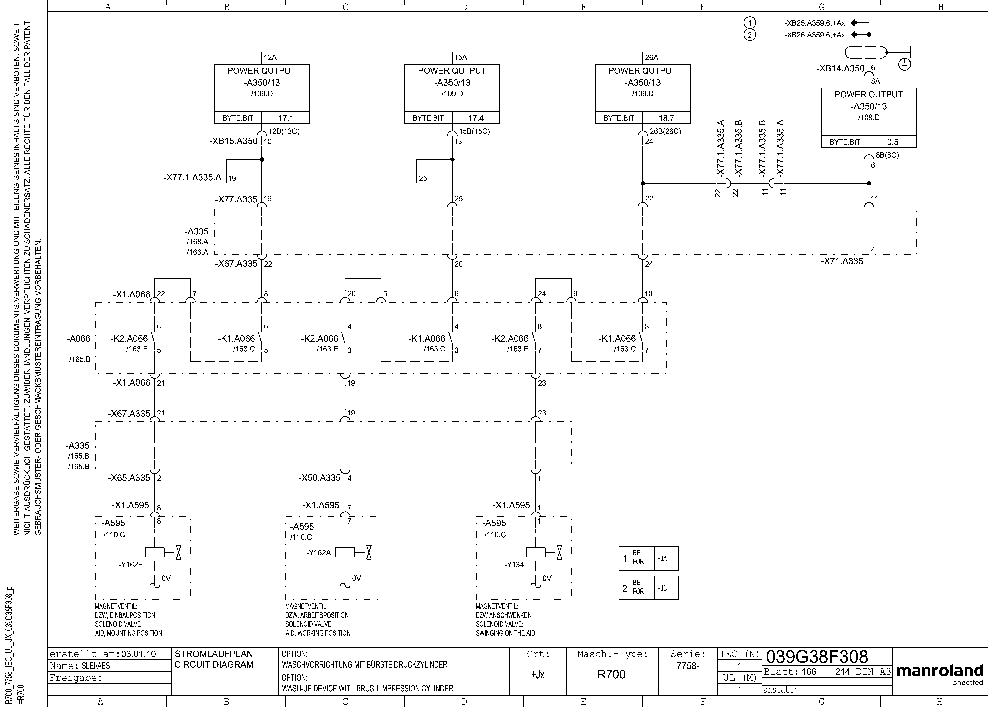

# +Jx — Sheet 166 of 214 — OPTION:

**WASCHVORRICHTUNG MIT BÜRSTE DRUCKZYLINDER**

> Part of the manroland **R700** printing press IEC/UL circuit diagrams.
> Drawing class: **Stromlaufplan / Circuit diagram** (DIN A3).
> Document `+Jx` covers the **1st printing module + feed register** machine section.

## At a glance

| Field | Value |
|---|---|
| Document | `+Jx`  (039G38F308) |
| Sheet | **166** of 214 |
| Section (DE) | OPTION: |
| Section (EN) | WASCHVORRICHTUNG MIT BÜRSTE DRUCKZYLINDER |
| Section type | CIRCUIT — Circuit diagram |
| Machine type | `R700` |
| Series | `7758` |
| Created | 03.01.10 |
| Replaces | — |
| Columns used | A, B, C, D, E, F, G, H |
| Path numbers | — |
| Labels on sheet | 157 |
| Cross-refs out | 18 |
| Cross-refs in | 58 |

**Previous:** [+Jx sheet 165](SHEET_0165.md) · **Next:** [+Jx sheet 167](SHEET_0167.md) · **Document TOC:** [_TOC.md](_TOC.md)  (+Jx) · **Master TOC:** [all sheets](../_MASTER_TOC.md)

## Sheet image (300 DPI, exact vector render)



_Rendered directly from the PDF vector layer at 300 DPI (1-bit), no OCR and no resampling. Use it to confirm anything ambiguous in the text below._

## Cross-references on this sheet

Each entry is a wire leaving this sheet. The printed token is `/sheet.column`; the link resolves to that sheet inside the same document.

| Ref | Target sheet | Col | Path | Destination on target | Target section | From col |
|---|---|---|---|---|---|---|
| `/109.D` | [+Jx sheet 109](SHEET_0109.md) | D | — | — | REFERENZMODUL | B |
| `/109.D` | [+Jx sheet 109](SHEET_0109.md) | D | — | — | REFERENZMODUL | D |
| `/109.D` | [+Jx sheet 109](SHEET_0109.md) | D | — | — | REFERENZMODUL | F |
| `/109.D` | [+Jx sheet 109](SHEET_0109.md) | D | — | — | REFERENZMODUL | G |
| `/168.A` | [+Jx sheet 168](SHEET_0168.md) | A | — | — | OPTION: | B |
| `/166.A` | [+Jx sheet 166](SHEET_0166.md) | A | — | — | OPTION: | B |
| `/163.E` | [+Jx sheet 163](SHEET_0163.md) | E | — | — | OPTION: | A |
| `/163.E` | [+Jx sheet 163](SHEET_0163.md) | E | — | — | OPTION: | C |
| `/163.E` | [+Jx sheet 163](SHEET_0163.md) | E | — | — | OPTION: | D |
| `/163.C` | [+Jx sheet 163](SHEET_0163.md) | C | — | — | OPTION: | B |
| `/163.C` | [+Jx sheet 163](SHEET_0163.md) | C | — | — | OPTION: | D |
| `/163.C` | [+Jx sheet 163](SHEET_0163.md) | C | — | — | OPTION: | E |
| `/165.B` | [+Jx sheet 165](SHEET_0165.md) | B | — | — | OPTION: | A |
| `/166.B` | [+Jx sheet 166](SHEET_0166.md) | B | — | — | OPTION: | A |
| `/165.B` | [+Jx sheet 165](SHEET_0165.md) | B | — | — | OPTION: | A |
| `/110.C` | [+Jx sheet 110](SHEET_0110.md) | C | — | A595 | REFERENZMODUL | C |
| `/110.C` | [+Jx sheet 110](SHEET_0110.md) | C | — | — | REFERENZMODUL | A |
| `/110.C` | [+Jx sheet 110](SHEET_0110.md) | C | — | — | REFERENZMODUL | D |

### Incoming references (sheets that point here)

Every other sheet that sends a wire to this one. `Back-ref` is the token printed on *that* sheet; `Path` is its line number.

| From sheet | Cols | Back-ref | Path | Refs | What continues there |
|---|---|---|---|---|---|
| [+Jx#109](SHEET_0109.md) | D | `/109.D` | — | 4 | — |
| [+Jx#110](SHEET_0110.md) | C | `/110.C` | — | 3 | — |
| [+Jx#112](SHEET_0112.md) | A, B | `/112.A`, `/112.B` | — | 12 | — |
| [+Jx#115](SHEET_0115.md) | C | `/115.C` | — | 3 | — |
| [+Jx#138](SHEET_0138.md) | E | `/138.E` | — | 1 | — |
| [+Jx#139](SHEET_0139.md) | B | `/139.B` | — | 4 | — |
| [+Jx#150](SHEET_0150.md) | H | `/150.H` | — | 2 | — |
| [+Jx#151](SHEET_0151.md) | H | `/151.H` | — | 1 | — |
| [+Jx#152](SHEET_0152.md) | D | `/152.D` | — | 6 | — |
| [+Jx#153](SHEET_0153.md) | B | `/153.B` | — | 1 | — |
| [+Jx#155](SHEET_0155.md) | D | `/155.D` | — | 4 | — |
| [+Jx#156](SHEET_0156.md) | A, B | `/156.A`, `/156.B` | — | 6 | — |
| [+Jx#163](SHEET_0163.md) | C, E | `/163.C`, `/163.E` | — | 6 | — |
| [+Jx#165](SHEET_0165.md) | B | `/165.B` | — | 2 | — |
| [+Jx#166](SHEET_0166.md) | A, B | `/166.A`, `/166.B` | — | 2 | — |
| [+Jx#168](SHEET_0168.md) | A | `/168.A` | — | 1 | — |


## Devices on this sheet

| Tag | Class | Class meaning (IEC) | Col | Sub | Terminal | Sign |
|---|---|---|---|---|---|---|
| `A066` | A | Baugruppe / assembly, module, PC board | A | — | — | — |
| `A595` | A | Baugruppe / assembly, module, PC board | A | — | — | — |
| `A595` | A | Baugruppe / assembly, module, PC board | C | — | — | — |
| `Y134` | Y | Magnetventil / solenoid valve, actuator | D | — | — | — |
| `A595` | A | Baugruppe / assembly, module, PC board | D | — | — | — |
| `A335` | A | Baugruppe / assembly, module, PC board | A | — | — | — |
| `A335` | A | Baugruppe / assembly, module, PC board | B | — | — | — |
| `A350/13` | A | Baugruppe / assembly, module, PC board | G | 13 | — | — |
| `A350/13` | A | Baugruppe / assembly, module, PC board | B | 13 | — | — |
| `A350/13` | A | Baugruppe / assembly, module, PC board | D | 13 | — | — |
| `A350/13` | A | Baugruppe / assembly, module, PC board | F | 13 | — | — |
| `K2.A066` | — | cross-device reference | A | — | — | — |
| `X1.A066` | — | cross-device reference | A | — | — | — |
| `X1.A066` | — | cross-device reference | A | — | — | — |
| `X1.A595` | — | cross-device reference | A | — | — | — |
| `K2.A066` | — | cross-device reference | C | — | — | — |
| `X1.A595` | — | cross-device reference | C | — | — | — |
| `K2.A066` | — | cross-device reference | D | — | — | — |
| `X1.A595` | — | cross-device reference | D | — | — | — |
| `X67.A335` | — | cross-device reference | A | — | — | — |
| `X65.A335` | — | cross-device reference | A | — | — | — |
| `X50.A335` | — | cross-device reference | C | — | — | — |
| `X77.A335` | — | cross-device reference | B | — | — | — |
| `K1.A066` | — | cross-device reference | B | — | — | — |
| `K1.A066` | — | cross-device reference | D | — | — | — |
| `K1.A066` | — | cross-device reference | E | — | — | — |
| `X67.A335` | — | cross-device reference | B | — | — | — |
| `X77.1.A335.B` | — | cross-device reference | G | — | — | — |
| `X77.1.A335.A` | — | cross-device reference | G | — | — | — |
| `X77.1.A335.B` | — | cross-device reference | F | — | — | — |
| `X77.1.A335.A` | — | cross-device reference | F | — | — | — |
| `0.5` | — | cross-device reference | H | — | — | — |
| `XB14.A350` | — | cross-device reference | G | — | — | — |
| `XB15.A350` | — | cross-device reference | B | — | — | — |
| `17.1` | — | cross-device reference | C | — | — | — |
| `17.4` | — | cross-device reference | D | — | — | — |
| `18.7` | — | cross-device reference | F | — | — | — |
| `X77.1.A335.A` | — | cross-device reference | B | — | — | — |
| `X71.A335` | — | cross-device reference | G | — | — | — |

## Potentials / nets

| Potential | Count | Columns | Attached devices | Terminals |
|---|---|---|---|---|
| `0V` | 3 | A, C, E | — | — |


A potential such as `L24+/4` or `M24+` is a named supply/return rail; every place it appears on this sheet is electrically common.

## Wire-end annotations (grouped as printed)

A wire that continues elsewhere is annotated with a small cluster: the destination description, the path/line number `#NN`, and the `/sheet.column` cross reference. Each row below is one such cluster exactly as it is grouped on the drawing.

| Col | Y | Path | Cross-ref | Text on the wire |
|---|---|---|---|---|
| G | 23.6 | — | — | `XB25.A359:6,+Ax` |
| F | 23.9 | — | — | `1` |
| G | 37.8 | — | — | `XB26.A359:6,+Ax` |
| F | 38.5 | — | — | `2` |
| B | 64.7 | — | — | `12A` |
| D | 64.7 | — | — | `15A` |
| F | 64.7 | — | — | `26A` |
| G | 76.8 | — | — | `XB14.A350 6` |
| B | 79.9 | — | — | `POWER QUTPUT` |
| D | 79.9 | — | — | `POWER QUTPUT` |
| E | 79.9 | — | — | `POWER QUTPUT` |
| G | 93.0 | — | — | `8A` |
| B | 93.8 | — | — | `A350/13` |
| D | 93.8 | — | — | `A350/13` |
| F | 93.8 | — | — | `A350/13` |
| B | 107.6 | — | `/109.D` | — |
| D | 107.6 | — | `/109.D` | — |
| F | 107.6 | — | `/109.D` | — |
| G | 108.2 | — | — | `POWER OUTPUT` |
| G | 122.1 | — | — | `A350/13` |
| G | 135.9 | — | `/109.D` | — |
| B | 136.6 | — | — | `BYTE.BIT 17.1` |
| D | 136.6 | — | — | `BYTE.BIT 17.4` |
| E | 136.6 | — | — | `BYTE.BIT 18.7` |
| F | 142.6 | — | — | `22 X77.1.A335.A` |
| F | 142.6 | — | — | `22 X77.1.A335.B` |
| G | 142.6 | — | — | `X77.1.A335.B 11` |
| G | 142.6 | — | — | `X77.1.A335.A 11` |
| B | 152.6 | — | — | `12B(12C)` |
| D | 152.6 | — | — | `15B(15C)` |
| F | 152.6 | — | — | `26B(26C)` |
| B | 163.2 | — | — | `XB15.A350 10` |
| D | 164.7 | — | — | `13` |
| F | 164.7 | — | — | `24` |
| G | 165.0 | — | — | `BYTE.BIT 0.5` |
| H | 181.0 | — | — | `8B(8C)` |
| G | 193.0 | — | — | `6` |
| C | 206.5 | — | — | `X77.1.A335.A 19 25` |
| B | 232.7 | — | — | `X77.A335 19` |
| D | 232.7 | — | — | `25` |
| F | 232.7 | — | — | `22` |
| G | 232.7 | — | — | `11` |
| B | 270.9 | — | — | `A335` |
| B | 284.0 | — | `/168.A`, `/166.A` | — |
| G | 293.6 | — | — | `4` |
| G | 306.4 | — | — | `X71.A335` |
| D | 309.2 | — | — | `X67.A335 22 20 24` |
| A | 346.1 | — | — | `X1.A066 22` |
| B | 346.1 | — | — | `7` |
| B | 346.1 | — | — | `8` |
| C | 346.1 | — | — | `20` |
| D | 346.1 | — | — | `5 24` |
| D | 346.1 | — | — | `6` |
| E | 346.1 | — | — | `9` |
| F | 346.1 | — | — | `10` |
| A | 385.1 | — | — | `6` |
| B | 385.1 | — | — | `6` |
| C | 385.1 | — | — | `4` |
| D | 385.1 | — | — | `4` |
| E | 385.1 | — | — | `8` |
| F | 385.1 | — | — | `8` |
| A | 398.5 | — | — | `A066` |
| A | 398.5 | — | — | `K2.A066 5` |
| B | 398.5 | — | — | `K1.A066 5` |
| C | 398.5 | — | — | `K2.A066 3` |
| D | 398.5 | — | — | `K1.A066 3` |
| D | 398.5 | — | — | `K2.A066 7` |
| E | 398.5 | — | — | `K1.A066 7` |
| A | 411.6 | — | `/163.E` | — |
| B | 411.6 | — | `/163.C` | — |
| C | 411.6 | — | `/163.E` | — |
| D | 411.6 | — | `/163.C` | — |
| D | 411.6 | — | `/163.E` | — |
| E | 411.6 | — | `/163.C` | — |
| A | 424.0 | — | `/165.B` | — |
| A | 450.9 | — | — | `X1.A066 21` |
| C | 452.4 | — | — | `19` |
| E | 452.4 | — | — | `23` |
| A | 487.8 | — | — | `X67.A335 21` |
| C | 487.8 | — | — | `19` |
| E | 487.8 | — | — | `23` |
| A | 526.1 | — | — | `A335` |
| A | 539.1 | — | `/166.B`, `/165.B` | — |
| A | 564.3 | — | — | `X65.A335 2` |
| D | 564.3 | — | — | `X50.A335 4 1` |
| A | 596.9 | — | — | `X1.A595 8` |
| C | 596.9 | — | — | `X1.A595 7` |
| D | 596.9 | — | — | `X1.A595 1` |
| A | 616.8 | — | — | `8` |
| C | 616.8 | — | — | `7` |
| E | 616.8 | — | — | `1` |
| A | 618.2 | — | — | `A595` |
| D | 618.2 | — | — | `A595` |
| C | 622.4 | — | `/110.C` | `A595` |
| A | 633.1 | — | `/110.C` | — |
| D | 633.1 | — | `/110.C` | — |
| C | 654.3 | — | — | `Y162A` |
| E | 655.2 | — | — | `1 BEI FOR` |
| F | 662.4 | — | — | `+JA` |
| A | 668.5 | — | — | `Y162E` |
| D | 668.5 | — | — | `Y134` |
| A | 684.8 | — | — | `0V` |
| C | 684.8 | — | — | `0V` |
| E | 684.8 | — | — | `0V` |
| E | 690.6 | — | — | `BEI FOR` |
| E | 696.1 | — | — | `2` |
| F | 697.8 | — | — | `+JB` |
| A | 719.1 | — | — | `MAGNETVENTIL: DZW, EINBAUPOSITION SOLENOID VALVE: AID, MOUNTING POSITION` |
| C | 719.1 | — | — | `MAGNETVENTIL: DZW, ARBEITSPOSITION SOLENOID VALVE: AID, WORKING POSITION` |
| D | 719.1 | — | — | `MAGNETVENTIL: DZW ANSCHWENKEN SOLENOID VALVE: SWINGING ON THE AID` |


## Reconstructed tables

This sheet carries tabular content (pin map / terminal assignment / index). The grid below was rebuilt from the drawing's own rule lines, so each row is exactly one physical row of the table.

### Table 1 — 5 data rows × 14 columns (at x=184.3, y=76.5)

|  |  | POWER | QUTPUT A350/13 /109.D |  |  |  | POWER A350/13 | QUTPUT /109.D |  |  |  | POWER A350/13 | QUTPUT /109.D |
|---|---|---|---|---|---|---|---|---|---|---|---|---|---|
|  |  | `BYTE.BIT` | `17.1` |  |  |  | `BYTE.BIT` | `17.4` |  |  |  | `BYTE.BIT` | `18.7` |
|  |  | `XB15.A350` | `12B(12C) 10` |  |  |  |  | `15B(15C) 13` |  |  |  |  | `26B(26C) 24` |
|  | `X77.1.A335.A` | `19` |  |  |  |  | `25` |  |  |  |  |  |  |
|  | `A335 /168.A /166.A` | `X77.A335 X67.A335` | `19 22` |  |  |  |  | `25 20` |  |  |  |  | `22 24` |
| `22 6 5` | `7` | `K1.A066 /163.C` | `8 6 5` | `K2.A066 /163.E` | `20 4 3` | `5` | `K1.A066 /163.C` | `6 4 3` | `K2.A066 /163.E` | `24 8 7` | `9` | `K1.A066 /163.C` | `10 8 7` |


### Table 2 — 2 data rows × 2 columns (at x=978.0, y=104.9)

| POWER | OUTPUT A350/13 /109.D |
|---|---|
| `BYTE.BIT` | `0.5` |
|  | `8B(8C) 6` |


## Notes and free text on this sheet

| Text | Col | Y (pt) |
|---|---|---|
| `MAGNETVENTIL:` | A | 719.15 |
| `DZW, EINBAUPOSITION` | A | 729.76 |
| `SOLENOID VALVE:` | A | 740.41 |
| `AID, MOUNTING POSITION` | A | 751.06 |
| `Y162E` | A | 668.5 |
| `MAGNETVENTIL:` | C | 719.15 |
| `DZW, ARBEITSPOSITION` | C | 729.75 |
| `SOLENOID VALVE:` | C | 740.41 |
| `AID, WORKING POSITION` | C | 751.03 |
| `Y162A` | C | 654.33 |
| `MAGNETVENTIL:` | D | 719.15 |
| `DZW ANSCHWENKEN` | D | 729.75 |
| `SOLENOID VALVE:` | D | 740.41 |
| `SWINGING ON THE AID` | D | 751.04 |
| `XB25.A359:6,+Ax` | G | 23.62 |
| `XB26.A359:6,+Ax` | G | 37.79 |
| `8A` | G | 93.05 |
| `8B(8C)` | H | 180.97 |
| `POWER OUTPUT` | G | 108.21 |
| `BYTE.BIT` | G | 165.55 |
| `12A` | B | 64.72 |
| `12B(12C)` | B | 152.63 |
| `POWER QUTPUT` | B | 79.87 |
| `BYTE.BIT` | B | 137.21 |
| `15A` | D | 64.72 |
| `15B(15C)` | D | 152.63 |
| `POWER QUTPUT` | D | 79.87 |
| `BYTE.BIT` | D | 137.21 |
| `26A` | F | 64.72 |
| `26B(26C)` | F | 152.63 |
| `POWER QUTPUT` | E | 79.87 |
| `BYTE.BIT` | E | 137.21 |
| `BEI` | E | 655.22 |
| `FOR` | E | 666.01 |
| `+JA` | F | 662.42 |
| `+JB` | F | 697.83 |

## Complete label inventory (exact text from the drawing)

Every text object inside the drawing area of this sheet, in DIN reading order (column A→H, then top→bottom). This is the authoritative list: if a string is not here it is not printed on this sheet.

| Col | Y | X | Dir | Type | Text |
|---|---|---|---|---|---|
| A | 346.1 | 134.6 | → | device ref | `X1.A066` |
| A | 346.1 | 187.1 | → | number | `22` |
| A | 385.1 | 186.8 | → | number | `6` |
| A | 398.5 | 79.7 | → | device tag | `A066` |
| A | 398.5 | 131.8 | → | device ref | `K2.A066` |
| A | 411.6 | 150.5 | → | cross-reference | `/163.E` |
| A | 413.4 | 186.8 | → | number | `5` |
| A | 424.0 | 82.5 | → | cross-reference | `/165.B` |
| A | 450.9 | 134.6 | → | device ref | `X1.A066` |
| A | 452.4 | 187.1 | → | number | `21` |
| A | 487.8 | 128.7 | → | device ref | `X67.A335` |
| A | 487.8 | 187.1 | → | number | `21` |
| A | 526.1 | 78.2 | → | device tag | `A335` |
| A | 539.1 | 81.1 | → | cross-reference | `/166.B` |
| A | 551.5 | 81.1 | → | cross-reference | `/165.B` |
| A | 564.3 | 128.7 | → | device ref | `X65.A335` |
| A | 565.8 | 187.1 | → | number | `2` |
| A | 596.9 | 133.2 | → | device ref | `X1.A595` |
| A | 601.2 | 186.8 | → | number | `8` |
| A | 616.8 | 186.8 | → | number | `8` |
| A | 618.2 | 120.8 | → | device tag | `A595` |
| A | 633.1 | 123.3 | → | cross-reference | `/110.C` |
| A | 668.5 | 141.2 | → | text | `Y162E` |
| A | 684.8 | 192.5 | → | potential | `0V` |
| A | 719.1 | 112.8 | → | text | `MAGNETVENTIL:` |
| A | 729.8 | 112.8 | → | text | `DZW, EINBAUPOSITION` |
| A | 740.4 | 113.1 | → | text | `SOLENOID VALVE:` |
| A | 751.1 | 113.4 | → | text | `AID, MOUNTING POSITION` |
| B | 64.7 | 313.8 | → | text | `12A` |
| B | 79.9 | 271.0 | → | text | `POWER QUTPUT` |
| B | 93.8 | 290.3 | → | device tag | `A350/13` |
| B | 107.6 | 299.1 | → | cross-reference | `/109.D` |
| B | 137.2 | 265.0 | → | text | `BYTE.BIT` |
| B | 152.6 | 319.5 | → | text | `12B(12C)` |
| B | 163.2 | 249.4 | → | device ref | `XB15.A350` |
| B | 164.7 | 313.8 | → | number | `10` |
| B | 206.5 | 194.7 | → | device ref | `X77.1.A335.A` |
| B | 208.6 | 271.3 | → | number | `19` |
| B | 232.7 | 256.3 | → | device ref | `X77.A335` |
| B | 232.7 | 313.8 | → | number | `19` |
| B | 270.9 | 220.0 | → | device tag | `A335` |
| B | 284.0 | 222.5 | → | cross-reference | `/168.A` |
| B | 296.4 | 222.5 | → | cross-reference | `/166.A` |
| B | 309.2 | 256.3 | → | device ref | `X67.A335` |
| B | 310.7 | 314.6 | → | number | `22` |
| B | 346.1 | 229.3 | → | number | `7` |
| B | 346.1 | 314.4 | → | number | `8` |
| B | 385.1 | 314.4 | → | number | `6` |
| B | 398.5 | 259.4 | → | device ref | `K1.A066` |
| B | 411.6 | 277.8 | → | cross-reference | `/163.C` |
| B | 413.4 | 314.4 | → | number | `5` |
| C | 136.6 | 331.1 | → | device ref | `17.1` |
| C | 346.1 | 413.9 | → | number | `20` |
| C | 346.1 | 456.1 | → | number | `5` |
| C | 385.1 | 413.9 | → | number | `4` |
| C | 398.5 | 358.6 | → | device ref | `K2.A066` |
| C | 411.6 | 377.3 | → | cross-reference | `/163.E` |
| C | 413.4 | 413.6 | → | number | `3` |
| C | 452.4 | 413.0 | → | number | `19` |
| C | 487.8 | 413.0 | → | number | `19` |
| C | 564.3 | 355.5 | → | device ref | `X50.A335` |
| C | 565.8 | 413.9 | → | number | `4` |
| C | 596.9 | 360.0 | → | device ref | `X1.A595` |
| C | 601.2 | 413.6 | → | number | `7` |
| C | 616.8 | 413.6 | → | number | `7` |
| C | 622.4 | 345.5 | → | device tag | `A595` |
| C | 635.5 | 345.8 | → | cross-reference | `/110.C` |
| C | 654.3 | 364.8 | → | text | `Y162A` |
| C | 684.8 | 419.2 | → | potential | `0V` |
| C | 719.1 | 339.6 | → | text | `MAGNETVENTIL:` |
| C | 729.8 | 339.6 | → | text | `DZW, ARBEITSPOSITION` |
| C | 740.4 | 339.9 | → | text | `SOLENOID VALVE:` |
| C | 751.0 | 340.2 | → | text | `AID, WORKING POSITION` |
| D | 64.7 | 540.6 | → | text | `15A` |
| D | 79.9 | 497.8 | → | text | `POWER QUTPUT` |
| D | 93.8 | 517.0 | → | device tag | `A350/13` |
| D | 107.6 | 525.8 | → | cross-reference | `/109.D` |
| D | 136.6 | 557.1 | → | device ref | `17.4` |
| D | 137.2 | 491.8 | → | text | `BYTE.BIT` |
| D | 152.6 | 546.2 | → | text | `15B(15C)` |
| D | 164.7 | 540.6 | → | number | `13` |
| D | 208.6 | 498.9 | → | number | `25` |
| D | 232.7 | 541.4 | → | number | `25` |
| D | 310.7 | 541.4 | → | number | `20` |
| D | 346.1 | 541.1 | → | number | `6` |
| D | 385.1 | 541.4 | → | number | `4` |
| D | 398.5 | 486.1 | → | device ref | `K1.A066` |
| D | 398.5 | 585.4 | → | device ref | `K2.A066` |
| D | 411.6 | 504.6 | → | cross-reference | `/163.C` |
| D | 411.6 | 604.1 | → | cross-reference | `/163.E` |
| D | 413.4 | 541.1 | → | number | `3` |
| D | 596.9 | 586.8 | → | device ref | `X1.A595` |
| D | 618.2 | 574.3 | → | device tag | `A595` |
| D | 633.1 | 576.9 | → | cross-reference | `/110.C` |
| D | 668.5 | 600.7 | → | device tag | `Y134` |
| D | 719.1 | 566.4 | → | text | `MAGNETVENTIL:` |
| D | 729.7 | 566.4 | → | text | `DZW ANSCHWENKEN` |
| D | 740.4 | 566.6 | → | text | `SOLENOID VALVE:` |
| D | 751.0 | 566.6 | → | text | `SWINGING ON THE AID` |
| E | 79.9 | 724.5 | → | text | `POWER QUTPUT` |
| E | 137.2 | 718.6 | → | text | `BYTE.BIT` |
| E | 346.1 | 640.6 | → | number | `24` |
| E | 346.1 | 682.9 | → | number | `9` |
| E | 385.1 | 640.3 | → | number | `8` |
| E | 398.5 | 712.9 | → | device ref | `K1.A066` |
| E | 411.6 | 731.3 | → | cross-reference | `/163.C` |
| E | 413.4 | 640.3 | → | number | `7` |
| E | 452.4 | 640.6 | → | number | `23` |
| E | 487.8 | 640.6 | → | number | `23` |
| E | 565.8 | 639.8 | → | number | `1` |
| E | 601.2 | 639.8 | → | number | `1` |
| E | 616.8 | 639.8 | → | number | `1` |
| E | 655.2 | 753.4 | → | text | `BEI` |
| E | 660.7 | 741.5 | → | number | `1` |
| E | 666.0 | 753.4 | → | text | `FOR` |
| E | 684.8 | 646.0 | → | potential | `0V` |
| E | 690.7 | 753.4 | → | text | `BEI` |
| E | 696.1 | 741.3 | → | number | `2` |
| E | 701.4 | 753.4 | → | text | `FOR` |
| F | 23.9 | 891.1 | → | number | `1` |
| F | 38.5 | 890.9 | → | number | `2` |
| F | 64.7 | 768.2 | → | text | `26A` |
| F | 93.8 | 743.8 | → | device tag | `A350/13` |
| F | 107.6 | 752.6 | → | cross-reference | `/109.D` |
| F | 136.6 | 783.9 | → | device ref | `18.7` |
| F | 142.6 | 853.5 | ↕ | device ref | `X77.1.A335.A` |
| F | 142.6 | 874.7 | ↕ | device ref | `X77.1.A335.B` |
| F | 152.6 | 773.9 | → | text | `26B(26C)` |
| F | 164.7 | 768.2 | → | number | `24` |
| F | 225.1 | 850.7 | ↕ | number | `22` |
| F | 225.1 | 871.9 | ↕ | number | `22` |
| F | 232.7 | 768.2 | → | number | `22` |
| F | 310.7 | 768.2 | → | number | `24` |
| F | 346.1 | 767.3 | → | number | `10` |
| F | 385.1 | 767.9 | → | number | `8` |
| F | 413.4 | 767.9 | → | number | `7` |
| F | 662.4 | 782.8 | → | text | `+JA` |
| F | 697.8 | 782.8 | → | text | `+JB` |
| G | 23.6 | 934.0 | → | text | `XB25.A359:6,+Ax` |
| G | 37.8 | 934.0 | → | text | `XB26.A359:6,+Ax` |
| G | 76.8 | 972.3 | → | device ref | `XB14.A350` |
| G | 76.8 | 1037.2 | → | number | `6` |
| G | 93.0 | 1037.2 | → | text | `8A` |
| G | 108.2 | 993.8 | → | text | `POWER OUTPUT` |
| G | 122.1 | 1013.1 | → | device tag | `A350/13` |
| G | 135.9 | 1021.9 | → | cross-reference | `/109.D` |
| G | 142.6 | 903.1 | ↕ | device ref | `X77.1.A335.B` |
| G | 142.6 | 924.3 | ↕ | device ref | `X77.1.A335.A` |
| G | 165.6 | 987.9 | → | text | `BYTE.BIT` |
| G | 193.0 | 1037.2 | → | number | `6` |
| G | 223.7 | 907.4 | ↕ | number | `11` |
| G | 223.7 | 928.6 | ↕ | number | `11` |
| G | 232.7 | 1036.6 | → | number | `11` |
| G | 293.7 | 1037.5 | → | number | `4` |
| G | 306.4 | 977.7 | → | device ref | `X71.A335` |
| H | 165.0 | 1056.2 | → | device ref | `0.5` |
| H | 181.0 | 1042.9 | → | text | `8B(8C)` |

## Reading-order text block

The same content as a plain block, grouped by DIN column — convenient to paste or to match against a visual description.

```text
=== Column A ===
 346.1  134.6  devref       X1.A066
 346.1  187.1  numeric      22
 385.1  186.8  numeric      6
 398.5   79.7  devtag       A066
 398.5  131.8  devref       K2.A066
 411.6  150.5  xref         /163.E
 413.4  186.8  numeric      5
 424.0   82.5  xref         /165.B
 450.9  134.6  devref       X1.A066
 452.4  187.1  numeric      21
 487.8  128.7  devref       X67.A335
 487.8  187.1  numeric      21
 526.1   78.2  devtag       A335
 539.1   81.1  xref         /166.B
 551.5   81.1  xref         /165.B
 564.3  128.7  devref       X65.A335
 565.8  187.1  numeric      2
 596.9  133.2  devref       X1.A595
 601.2  186.8  numeric      8
 616.8  186.8  numeric      8
 618.2  120.8  devtag       A595
 633.1  123.3  xref         /110.C
 668.5  141.2  text         Y162E
 684.8  192.5  net          0V
 719.1  112.8  text         MAGNETVENTIL:
 729.8  112.8  text         DZW, EINBAUPOSITION
 740.4  113.1  text         SOLENOID VALVE:
 751.1  113.4  text         AID, MOUNTING POSITION
=== Column B ===
  64.7  313.8  text         12A
  79.9  271.0  text         POWER QUTPUT
  93.8  290.3  devtag       A350/13
 107.6  299.1  xref         /109.D
 137.2  265.0  text         BYTE.BIT
 152.6  319.5  text         12B(12C)
 163.2  249.4  devref       XB15.A350
 164.7  313.8  numeric      10
 206.5  194.7  devref       X77.1.A335.A
 208.6  271.3  numeric      19
 232.7  256.3  devref       X77.A335
 232.7  313.8  numeric      19
 270.9  220.0  devtag       A335
 284.0  222.5  xref         /168.A
 296.4  222.5  xref         /166.A
 309.2  256.3  devref       X67.A335
 310.7  314.6  numeric      22
 346.1  229.3  numeric      7
 346.1  314.4  numeric      8
 385.1  314.4  numeric      6
 398.5  259.4  devref       K1.A066
 411.6  277.8  xref         /163.C
 413.4  314.4  numeric      5
=== Column C ===
 136.6  331.1  devref       17.1
 346.1  413.9  numeric      20
 346.1  456.1  numeric      5
 385.1  413.9  numeric      4
 398.5  358.6  devref       K2.A066
 411.6  377.3  xref         /163.E
 413.4  413.6  numeric      3
 452.4  413.0  numeric      19
 487.8  413.0  numeric      19
 564.3  355.5  devref       X50.A335
 565.8  413.9  numeric      4
 596.9  360.0  devref       X1.A595
 601.2  413.6  numeric      7
 616.8  413.6  numeric      7
 622.4  345.5  devtag       A595
 635.5  345.8  xref         /110.C
 654.3  364.8  text         Y162A
 684.8  419.2  net          0V
 719.1  339.6  text         MAGNETVENTIL:
 729.8  339.6  text         DZW, ARBEITSPOSITION
 740.4  339.9  text         SOLENOID VALVE:
 751.0  340.2  text         AID, WORKING POSITION
=== Column D ===
  64.7  540.6  text         15A
  79.9  497.8  text         POWER QUTPUT
  93.8  517.0  devtag       A350/13
 107.6  525.8  xref         /109.D
 136.6  557.1  devref       17.4
 137.2  491.8  text         BYTE.BIT
 152.6  546.2  text         15B(15C)
 164.7  540.6  numeric      13
 208.6  498.9  numeric      25
 232.7  541.4  numeric      25
 310.7  541.4  numeric      20
 346.1  541.1  numeric      6
 385.1  541.4  numeric      4
 398.5  486.1  devref       K1.A066
 398.5  585.4  devref       K2.A066
 411.6  504.6  xref         /163.C
 411.6  604.1  xref         /163.E
 413.4  541.1  numeric      3
 596.9  586.8  devref       X1.A595
 618.2  574.3  devtag       A595
 633.1  576.9  xref         /110.C
 668.5  600.7  devtag       Y134
 719.1  566.4  text         MAGNETVENTIL:
 729.7  566.4  text         DZW ANSCHWENKEN
 740.4  566.6  text         SOLENOID VALVE:
 751.0  566.6  text         SWINGING ON THE AID
=== Column E ===
  79.9  724.5  text         POWER QUTPUT
 137.2  718.6  text         BYTE.BIT
 346.1  640.6  numeric      24
 346.1  682.9  numeric      9
 385.1  640.3  numeric      8
 398.5  712.9  devref       K1.A066
 411.6  731.3  xref         /163.C
 413.4  640.3  numeric      7
 452.4  640.6  numeric      23
 487.8  640.6  numeric      23
 565.8  639.8  numeric      1
 601.2  639.8  numeric      1
 616.8  639.8  numeric      1
 655.2  753.4  text         BEI
 660.7  741.5  numeric      1
 666.0  753.4  text         FOR
 684.8  646.0  net          0V
 690.7  753.4  text         BEI
 696.1  741.3  numeric      2
 701.4  753.4  text         FOR
=== Column F ===
  23.9  891.1  numeric      1
  38.5  890.9  numeric      2
  64.7  768.2  text         26A
  93.8  743.8  devtag       A350/13
 107.6  752.6  xref         /109.D
 136.6  783.9  devref       18.7
 142.6  853.5  devref       X77.1.A335.A
 142.6  874.7  devref       X77.1.A335.B
 152.6  773.9  text         26B(26C)
 164.7  768.2  numeric      24
 225.1  850.7  numeric      22
 225.1  871.9  numeric      22
 232.7  768.2  numeric      22
 310.7  768.2  numeric      24
 346.1  767.3  numeric      10
 385.1  767.9  numeric      8
 413.4  767.9  numeric      7
 662.4  782.8  text         +JA
 697.8  782.8  text         +JB
=== Column G ===
  23.6  934.0  text         XB25.A359:6,+Ax
  37.8  934.0  text         XB26.A359:6,+Ax
  76.8  972.3  devref       XB14.A350
  76.8 1037.2  numeric      6
  93.0 1037.2  text         8A
 108.2  993.8  text         POWER OUTPUT
 122.1 1013.1  devtag       A350/13
 135.9 1021.9  xref         /109.D
 142.6  903.1  devref       X77.1.A335.B
 142.6  924.3  devref       X77.1.A335.A
 165.6  987.9  text         BYTE.BIT
 193.0 1037.2  numeric      6
 223.7  907.4  numeric      11
 223.7  928.6  numeric      11
 232.7 1036.6  numeric      11
 293.7 1037.5  numeric      4
 306.4  977.7  devref       X71.A335
=== Column H ===
 165.0 1056.2  devref       0.5
 181.0 1042.9  text         8B(8C)
```

---
_Generated from the PDF vector text layer; no OCR. Source: `R700_7758_IEC_UL_JX_039G38F308_p`, sheet 166._
