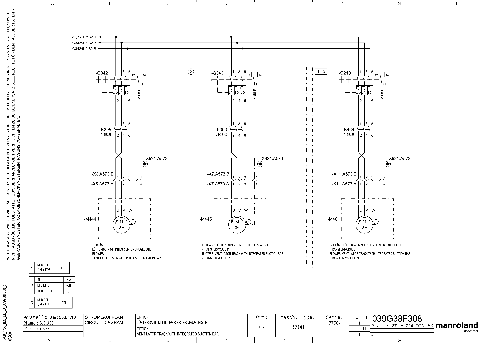

# +Jx — Sheet 167 of 214 — OPTION:

**LÜFTERBAHN MIT INTEGRIERTER SAUGLEISTE**

> Part of the manroland **R700** printing press IEC/UL circuit diagrams.
> Drawing class: **Stromlaufplan / Circuit diagram** (DIN A3).
> Document `+Jx` covers the **1st printing module + feed register** machine section.

## At a glance

| Field | Value |
|---|---|
| Document | `+Jx`  (039G38F308) |
| Sheet | **167** of 214 |
| Section (DE) | OPTION: |
| Section (EN) | LÜFTERBAHN MIT INTEGRIERTER SAUGLEISTE |
| Section type | CIRCUIT — Circuit diagram |
| Machine type | `R700` |
| Series | `7758` |
| Created | 03.01.10 |
| Replaces | — |
| Columns used | A, B, C, D, E, F, G |
| Path numbers | — |
| Labels on sheet | 144 |
| Cross-refs out | 9 |
| Cross-refs in | 33 |

**Previous:** [+Jx sheet 166](SHEET_0166.md) · **Next:** [+Jx sheet 168](SHEET_0168.md) · **Document TOC:** [_TOC.md](_TOC.md)  (+Jx) · **Master TOC:** [all sheets](../_MASTER_TOC.md)

## Sheet image (300 DPI, exact vector render)



_Rendered directly from the PDF vector layer at 300 DPI (1-bit), no OCR and no resampling. Use it to confirm anything ambiguous in the text below._

## Cross-references on this sheet

Each entry is a wire leaving this sheet. The printed token is `/sheet.column`; the link resolves to that sheet inside the same document.

| Ref | Target sheet | Col | Path | Destination on target | Target section | From col |
|---|---|---|---|---|---|---|
| `/162.B` | [+Jx sheet 162](SHEET_0162.md) | B | — | Q342:1 | OPTION: | B |
| `/162.B` | [+Jx sheet 162](SHEET_0162.md) | B | — | Q342:3 | OPTION: | B |
| `/162.B` | [+Jx sheet 162](SHEET_0162.md) | B | — | Q342:5 | OPTION: | B |
| `/168.F` | [+Jx sheet 168](SHEET_0168.md) | F | — | — | OPTION: | C |
| `/168.F` | [+Jx sheet 168](SHEET_0168.md) | F | — | — | OPTION: | E |
| `/168.F` | [+Jx sheet 168](SHEET_0168.md) | F | — | — | OPTION: | G |
| `/168.B` | [+Jx sheet 168](SHEET_0168.md) | B | — | — | OPTION: | B |
| `/168.E` | [+Jx sheet 168](SHEET_0168.md) | E | — | — | OPTION: | F |
| `/168.C` | [+Jx sheet 168](SHEET_0168.md) | C | — | — | OPTION: | D |

### Incoming references (sheets that point here)

Every other sheet that sends a wire to this one. `Back-ref` is the token printed on *that* sheet; `Path` is its line number.

| From sheet | Cols | Back-ref | Path | Refs | What continues there |
|---|---|---|---|---|---|
| [+Jx#132](SHEET_0132.md) | H | `/132.H` | — | 8 | — |
| [+Jx#133](SHEET_0133.md) | E | `/133.E` | — | 8 | — |
| [+Jx#136](SHEET_0136.md) | H | `/136.H` | — | 8 | — |
| [+Jx#162](SHEET_0162.md) | C | `/162.C` | — | 3 | 24V.Q334:14 Q342:5; Q342:1; Q342:3 |
| [+Jx#168](SHEET_0168.md) | B, C, E, F | `/168.B`, `/168.C`, `/168.E`, `/168.F` | — | 6 | — |


## Devices on this sheet

| Tag | Class | Class meaning (IEC) | Col | Sub | Terminal | Sign |
|---|---|---|---|---|---|---|
| `K305` | K | Relais / relay, contactor | B | — | — | — |
| `K306` | K | Relais / relay, contactor | D | — | — | — |
| `K464` | K | Relais / relay, contactor | F | — | — | — |
| `Q342` | Q | Leistungsschalter / power switching device | B | — | — | — |
| `Q343` | Q | Leistungsschalter / power switching device | D | — | — | — |
| `Q210` | Q | Leistungsschalter / power switching device | F | — | — | — |
| `Q342:1` | Q | Leistungsschalter / power switching device | A | — | 1 | — |
| `Q342:3` | Q | Leistungsschalter / power switching device | A | — | 3 | — |
| `Q342:5` | Q | Leistungsschalter / power switching device | A | — | 5 | — |
| `X6.A573.A` | — | cross-device reference | B | — | — | — |
| `X6.A573.B` | — | cross-device reference | B | — | — | — |
| `X7.A573.A` | — | cross-device reference | D | — | — | — |
| `X7.A573.B` | — | cross-device reference | D | — | — | — |
| `X11.A573.A` | — | cross-device reference | F | — | — | — |
| `X11.A573.B` | — | cross-device reference | F | — | — | — |
| `X921.A573` | — | cross-device reference | C | — | — | — |
| `X924.A573` | — | cross-device reference | E | — | — | — |
| `X921.A573` | — | cross-device reference | G | — | — | — |

## Potentials / nets

| Potential | Count | Columns | Attached devices | Terminals |
|---|---|---|---|---|
| `M444` | 1 | B | — | — |
| `M445` | 1 | D | — | — |
| `M481` | 1 | F | — | — |


A potential such as `L24+/4` or `M24+` is a named supply/return rail; every place it appears on this sheet is electrically common.

## Wire-end annotations (grouped as printed)

A wire that continues elsewhere is annotated with a small cluster: the destination description, the path/line number `#NN`, and the `/sheet.column` cross reference. Each row below is one such cluster exactly as it is grouped on the drawing.

| Col | Y | Path | Cross-ref | Text on the wire |
|---|---|---|---|---|
| B | 87.4 | — | `/162.B` | `Q342:1` |
| B | 101.5 | — | `/162.B` | `Q342:3` |
| B | 115.7 | — | `/162.B` | `Q342:5` |
| B | 172.5 | — | — | `1` |
| B | 172.5 | — | — | `3` |
| B | 172.5 | — | — | `5` |
| E | 172.5 | — | — | `2 1 3` |
| D | 172.5 | — | — | `1` |
| D | 172.5 | — | — | `3` |
| D | 172.5 | — | — | `5` |
| F | 172.5 | — | — | `1` |
| F | 172.5 | — | — | `3` |
| G | 172.5 | — | — | `5` |
| B | 174.6 | — | — | `Q342` |
| D | 174.6 | — | — | `Q343` |
| F | 174.6 | — | — | `Q210` |
| B | 181.6 | — | — | `12 14` |
| D | 181.6 | — | — | `12 14` |
| G | 181.6 | — | — | `12 14` |
| C | 204.2 | — | — | `11` |
| E | 204.2 | — | — | `11` |
| G | 204.2 | — | — | `11` |
| C | 218.0 | — | `/168.F` | — |
| E | 218.0 | — | `/168.F` | — |
| G | 218.0 | — | `/168.F` | — |
| B | 243.3 | — | — | `2` |
| B | 243.3 | — | — | `4` |
| B | 243.3 | — | — | `6` |
| D | 243.3 | — | — | `2` |
| D | 243.3 | — | — | `4` |
| D | 243.3 | — | — | `6` |
| F | 243.3 | — | — | `2` |
| F | 243.3 | — | — | `4` |
| G | 243.3 | — | — | `6` |
| B | 300.0 | — | — | `1` |
| B | 300.0 | — | — | `3` |
| B | 300.0 | — | — | `5` |
| D | 300.0 | — | — | `1` |
| D | 300.0 | — | — | `3` |
| D | 300.0 | — | — | `5` |
| F | 300.0 | — | — | `1` |
| F | 300.0 | — | — | `3` |
| G | 300.0 | — | — | `5` |
| B | 313.5 | — | — | `K305 6` |
| D | 313.5 | — | — | `K306 6` |
| F | 313.5 | — | — | `K464 6` |
| B | 326.6 | — | `/168.B` | — |
| D | 326.6 | — | `/168.C` | — |
| F | 326.6 | — | `/168.E` | — |
| B | 328.4 | — | — | `2` |
| B | 328.4 | — | — | `4` |
| D | 328.4 | — | — | `2` |
| D | 328.4 | — | — | `4` |
| F | 328.4 | — | — | `2` |
| F | 328.4 | — | — | `4` |
| E | 384.3 | — | — | `X921.A573 X924.A573 X921.A573` |
| B | 422.6 | — | — | `X6.A573.B 1` |
| D | 422.6 | — | — | `X7.A573.B 1` |
| F | 422.6 | — | — | `X11.A573.B 1` |
| B | 431.1 | — | — | `2 3` |
| C | 431.1 | — | — | `4` |
| D | 431.1 | — | — | `2 3 4` |
| G | 431.1 | — | — | `2 3 4` |
| B | 446.7 | — | — | `X6.A573.A 1 2 3` |
| D | 446.7 | — | — | `X7.A573.A 1 2 3` |
| F | 446.7 | — | — | `4 X11.A573.A 1 2 3` |
| C | 448.1 | — | — | `4` |
| G | 448.1 | — | — | `4` |
| B | 512.3 | — | — | `U V W` |
| D | 512.3 | — | — | `U V W` |
| F | 512.3 | — | — | `U V W` |
| B | 533.2 | — | — | `M444` |
| D | 533.2 | — | — | `M445` |
| F | 533.2 | — | — | `M481` |
| B | 540.5 | — | — | `3~ M` |
| D | 540.5 | — | — | `3~ M` |
| F | 540.5 | — | — | `3~ M` |
| B | 598.6 | — | — | `LÜFTERBAHN MIT INTEGRIERTER SAUGLEISTE BLOWER: GEBLÄSE:` |
| D | 598.7 | — | — | `BLOWER: VENTILATOR TRACK WITH INTEGRATED SUCTION BAR GEBLÄSE: LÜFTERBAHN MIT INTEGRIERTER SAUGLEISTE (TRANSFERMODUL 1) (TRANSFER MODULE 1)` |
| F | 598.7 | — | — | `BLOWER: VENTILATOR TRACK WITH INTEGRATED SUCTION BAR GEBLÄSE: LÜFTERBAHN MIT INTEGRIERTER SAUGLEISTE (TRANSFERMODUL 2) (TRANSFER MODULE 2)` |
| B | 630.6 | — | — | `VENTILATOR TRACK WITH INTEGRATED SUCTION BAR` |
| A | 648.3 | — | — | `1 NUR BEI ONLY FOR +JB` |
| A | 683.7 | — | — | `TL` |
| A | 683.7 | — | — | `+JA` |
| A | 696.1 | — | — | `2 +Jx` |
| A | 697.8 | — | — | `+JB` |
| A | 697.9 | — | — | `LTL, LTTL` |
| A | 712.1 | — | — | `TLTL, TLTTL` |
| A | 733.3 | — | — | `3 NUR BEI ONLY FOR LTTL` |


## Notes and free text on this sheet

| Text | Col | Y (pt) |
|---|---|---|
| `GEBLÄSE:` | B | 598.64 |
| `LÜFTERBAHN MIT INTEGRIERTER SAUGLEISTE` | B | 609.32 |
| `BLOWER:` | B | 619.87 |
| `VENTILATOR TRACK WITH INTEGRATED SUCTION BAR` | B | 630.58 |
| `U` | B | 512.64 |
| `V` | B | 512.53 |
| `W` | B | 512.27 |
| `M` | B | 540.52 |
| `GEBLÄSE: LÜFTERBAHN MIT INTEGRIERTER SAUGLEISTE` | D | 598.69 |
| `(TRANSFERMODUL 1)` | D | 609.35 |
| `BLOWER: VENTILATOR TRACK WITH INTEGRATED SUCTION BAR` | D | 619.94 |
| `(TRANSFER MODULE 1)` | D | 630.61 |
| `U` | D | 512.64 |
| `V` | D | 512.53 |
| `W` | D | 512.27 |
| `M` | D | 540.52 |
| `GEBLÄSE: LÜFTERBAHN MIT INTEGRIERTER SAUGLEISTE` | F | 598.69 |
| `(TRANSFERMODUL 2)` | F | 609.35 |
| `BLOWER: VENTILATOR TRACK WITH INTEGRATED SUCTION BAR` | F | 619.94 |
| `(TRANSFER MODULE 2)` | F | 630.61 |
| `U` | F | 512.64 |
| `V` | F | 512.53 |
| `W` | G | 512.27 |
| `M` | F | 540.52 |
| `NUR BEI` | A | 648.26 |
| `ONLY FOR` | A | 658.94 |
| `+JB` | A | 655.31 |
| `TL` | A | 683.72 |
| `LTL, LTTL` | A | 697.89 |
| `TLTL, TLTTL` | A | 712.08 |
| `+JA` | A | 683.68 |
| `+Jx` | A | 712.13 |
| `LTTL` | A | 740.4 |

## Complete label inventory (exact text from the drawing)

Every text object inside the drawing area of this sheet, in DIN reading order (column A→H, then top→bottom). This is the authoritative list: if a string is not here it is not printed on this sheet.

| Col | Y | X | Dir | Type | Text |
|---|---|---|---|---|---|
| A | 87.4 | 175.5 | → | device tag | `Q342:1` |
| A | 101.6 | 174.3 | → | device tag | `Q342:3` |
| A | 115.8 | 174.3 | → | device tag | `Q342:5` |
| A | 648.3 | 91.6 | → | text | `NUR BEI` |
| A | 653.6 | 75.4 | → | number | `1` |
| A | 655.3 | 148.5 | → | text | `+JB` |
| A | 658.9 | 91.8 | → | text | `ONLY FOR` |
| A | 683.7 | 92.1 | → | text | `TL` |
| A | 683.7 | 162.7 | → | text | `+JA` |
| A | 696.1 | 75.1 | → | number | `2` |
| A | 697.8 | 162.7 | → | text | `+JB` |
| A | 697.9 | 91.6 | → | text | `LTL, LTTL` |
| A | 712.1 | 92.1 | → | text | `TLTL, TLTTL` |
| A | 712.1 | 162.7 | → | text | `+Jx` |
| A | 733.3 | 91.6 | → | text | `NUR BEI` |
| A | 738.6 | 75.0 | → | number | `3` |
| A | 740.4 | 148.3 | → | text | `LTTL` |
| A | 744.0 | 91.8 | → | text | `ONLY FOR` |
| B | 87.4 | 210.0 | → | cross-reference | `/162.B` |
| B | 101.5 | 210.0 | → | cross-reference | `/162.B` |
| B | 115.7 | 210.0 | → | cross-reference | `/162.B` |
| B | 172.5 | 285.4 | → | number | `1` |
| B | 172.5 | 300.2 | → | number | `3` |
| B | 172.5 | 314.4 | → | number | `5` |
| B | 174.6 | 234.7 | → | device tag | `Q342` |
| B | 181.6 | 322.6 | → | number | `12` |
| B | 243.3 | 286.3 | → | number | `2` |
| B | 243.3 | 300.5 | → | number | `4` |
| B | 243.3 | 314.4 | → | number | `6` |
| B | 300.0 | 285.4 | → | number | `1` |
| B | 300.0 | 300.2 | → | number | `3` |
| B | 300.0 | 314.4 | → | number | `5` |
| B | 313.5 | 244.1 | → | device tag | `K305` |
| B | 326.5 | 246.9 | → | cross-reference | `/168.B` |
| B | 328.4 | 286.3 | → | number | `2` |
| B | 328.4 | 300.5 | → | number | `4` |
| B | 328.4 | 314.4 | → | number | `6` |
| B | 422.6 | 224.2 | → | device ref | `X6.A573.B` |
| B | 431.1 | 285.4 | → | number | `1` |
| B | 431.1 | 300.5 | → | number | `2` |
| B | 431.1 | 314.4 | → | number | `3` |
| B | 446.7 | 223.7 | → | device ref | `X6.A573.A` |
| B | 448.1 | 285.4 | → | number | `1` |
| B | 448.1 | 300.5 | → | number | `2` |
| B | 448.1 | 314.4 | → | number | `3` |
| B | 512.3 | 314.6 | → | text | `W` |
| B | 512.5 | 300.5 | → | text | `V` |
| B | 512.6 | 285.7 | → | text | `U` |
| B | 533.2 | 205.5 | → | potential | `M444` |
| B | 540.5 | 293.5 | → | text | `M` |
| B | 554.8 | 292.1 | → | other | `3~` |
| B | 598.6 | 226.5 | → | text | `GEBLÄSE:` |
| B | 609.3 | 226.2 | → | text | `LÜFTERBAHN MIT INTEGRIERTER SAUGLEISTE` |
| B | 619.9 | 226.2 | → | text | `BLOWER:` |
| B | 630.6 | 226.8 | → | text | `VENTILATOR TRACK WITH INTEGRATED SUCTION BAR` |
| C | 173.2 | 465.7 | → | number | `2` |
| C | 181.6 | 349.5 | → | number | `14` |
| C | 204.2 | 342.4 | → | number | `11` |
| C | 218.0 | 336.8 | ↕ | cross-reference | `/168.F` |
| C | 384.3 | 354.0 | → | device ref | `X921.A573` |
| C | 431.1 | 343.0 | → | number | `4` |
| C | 448.1 | 343.0 | → | number | `4` |
| D | 172.5 | 568.9 | → | number | `1` |
| D | 172.5 | 583.7 | → | number | `3` |
| D | 172.5 | 597.8 | → | number | `5` |
| D | 174.6 | 517.9 | → | device tag | `Q343` |
| D | 181.6 | 606.0 | → | number | `12` |
| D | 243.3 | 569.8 | → | number | `2` |
| D | 243.3 | 583.9 | → | number | `4` |
| D | 243.3 | 597.8 | → | number | `6` |
| D | 300.0 | 568.9 | → | number | `1` |
| D | 300.0 | 583.7 | → | number | `3` |
| D | 300.0 | 597.8 | → | number | `5` |
| D | 313.5 | 527.5 | → | device tag | `K306` |
| D | 326.6 | 530.1 | → | cross-reference | `/168.C` |
| D | 328.4 | 569.8 | → | number | `2` |
| D | 328.4 | 583.9 | → | number | `4` |
| D | 328.4 | 597.8 | → | number | `6` |
| D | 422.6 | 507.7 | → | device ref | `X7.A573.B` |
| D | 431.1 | 568.9 | → | number | `1` |
| D | 431.1 | 583.9 | → | number | `2` |
| D | 431.1 | 597.8 | → | number | `3` |
| D | 446.7 | 507.1 | → | device ref | `X7.A573.A` |
| D | 448.1 | 568.9 | → | number | `1` |
| D | 448.1 | 583.9 | → | number | `2` |
| D | 448.1 | 597.8 | → | number | `3` |
| D | 512.3 | 598.1 | → | text | `W` |
| D | 512.5 | 583.9 | → | text | `V` |
| D | 512.6 | 569.2 | → | text | `U` |
| D | 533.2 | 489.0 | → | potential | `M445` |
| D | 540.5 | 577.0 | → | text | `M` |
| D | 554.8 | 575.6 | → | other | `3~` |
| D | 598.7 | 495.8 | → | text | `GEBLÄSE: LÜFTERBAHN MIT INTEGRIERTER SAUGLEISTE` |
| D | 609.4 | 495.8 | → | text | `(TRANSFERMODUL 1)` |
| D | 619.9 | 495.5 | → | text | `BLOWER: VENTILATOR TRACK WITH INTEGRATED SUCTION BAR` |
| D | 630.6 | 495.8 | → | text | `(TRANSFER MODULE 1)` |
| E | 181.6 | 633.0 | → | number | `14` |
| E | 204.2 | 625.9 | → | number | `11` |
| E | 218.0 | 620.3 | ↕ | cross-reference | `/168.F` |
| E | 384.3 | 637.5 | → | device ref | `X924.A573` |
| E | 431.1 | 626.5 | → | number | `4` |
| E | 448.1 | 626.5 | → | number | `4` |
| F | 172.5 | 777.4 | → | number | `1` |
| F | 172.5 | 791.3 | → | number | `3` |
| F | 172.5 | 880.7 | → | number | `1` |
| F | 172.5 | 895.5 | → | number | `3` |
| F | 174.6 | 830.0 | → | device tag | `Q210` |
| F | 243.3 | 881.6 | → | number | `2` |
| F | 243.3 | 895.7 | → | number | `4` |
| F | 300.0 | 880.7 | → | number | `1` |
| F | 300.0 | 895.5 | → | number | `3` |
| F | 313.5 | 839.3 | → | device tag | `K464` |
| F | 326.5 | 842.2 | → | cross-reference | `/168.E` |
| F | 328.4 | 881.6 | → | number | `2` |
| F | 328.4 | 895.7 | → | number | `4` |
| F | 422.6 | 813.5 | → | device ref | `X11.A573.B` |
| F | 431.1 | 880.7 | → | number | `1` |
| F | 431.1 | 895.7 | → | number | `2` |
| F | 446.7 | 813.0 | → | device ref | `X11.A573.A` |
| F | 448.1 | 880.7 | → | number | `1` |
| F | 448.1 | 895.7 | → | number | `2` |
| F | 512.5 | 895.7 | → | text | `V` |
| F | 512.6 | 881.0 | → | text | `U` |
| F | 533.2 | 802.5 | → | potential | `M481` |
| F | 540.5 | 888.8 | → | text | `M` |
| F | 554.8 | 887.4 | → | other | `3~` |
| F | 598.7 | 807.6 | → | text | `GEBLÄSE: LÜFTERBAHN MIT INTEGRIERTER SAUGLEISTE` |
| F | 609.4 | 807.6 | → | text | `(TRANSFERMODUL 2)` |
| F | 619.9 | 807.3 | → | text | `BLOWER: VENTILATOR TRACK WITH INTEGRATED SUCTION BAR` |
| F | 630.6 | 807.6 | → | text | `(TRANSFER MODULE 2)` |
| G | 172.5 | 909.6 | → | number | `5` |
| G | 181.6 | 917.9 | → | number | `12` |
| G | 181.6 | 944.8 | → | number | `14` |
| G | 204.2 | 937.7 | → | number | `11` |
| G | 218.0 | 932.1 | ↕ | cross-reference | `/168.F` |
| G | 243.3 | 909.6 | → | number | `6` |
| G | 300.0 | 909.6 | → | number | `5` |
| G | 328.4 | 909.6 | → | number | `6` |
| G | 384.3 | 949.3 | → | device ref | `X921.A573` |
| G | 431.1 | 909.6 | → | number | `3` |
| G | 431.1 | 938.3 | → | number | `4` |
| G | 448.1 | 909.6 | → | number | `3` |
| G | 448.1 | 938.3 | → | number | `4` |
| G | 512.3 | 909.9 | → | text | `W` |

## Reading-order text block

The same content as a plain block, grouped by DIN column — convenient to paste or to match against a visual description.

```text
=== Column A ===
  87.4  175.5  devtag       Q342:1
 101.6  174.3  devtag       Q342:3
 115.8  174.3  devtag       Q342:5
 648.3   91.6  text         NUR BEI
 653.6   75.4  numeric      1
 655.3  148.5  text         +JB
 658.9   91.8  text         ONLY FOR
 683.7   92.1  text         TL
 683.7  162.7  text         +JA
 696.1   75.1  numeric      2
 697.8  162.7  text         +JB
 697.9   91.6  text         LTL, LTTL
 712.1   92.1  text         TLTL, TLTTL
 712.1  162.7  text         +Jx
 733.3   91.6  text         NUR BEI
 738.6   75.0  numeric      3
 740.4  148.3  text         LTTL
 744.0   91.8  text         ONLY FOR
=== Column B ===
  87.4  210.0  xref         /162.B
 101.5  210.0  xref         /162.B
 115.7  210.0  xref         /162.B
 172.5  285.4  numeric      1
 172.5  300.2  numeric      3
 172.5  314.4  numeric      5
 174.6  234.7  devtag       Q342
 181.6  322.6  numeric      12
 243.3  286.3  numeric      2
 243.3  300.5  numeric      4
 243.3  314.4  numeric      6
 300.0  285.4  numeric      1
 300.0  300.2  numeric      3
 300.0  314.4  numeric      5
 313.5  244.1  devtag       K305
 326.5  246.9  xref         /168.B
 328.4  286.3  numeric      2
 328.4  300.5  numeric      4
 328.4  314.4  numeric      6
 422.6  224.2  devref       X6.A573.B
 431.1  285.4  numeric      1
 431.1  300.5  numeric      2
 431.1  314.4  numeric      3
 446.7  223.7  devref       X6.A573.A
 448.1  285.4  numeric      1
 448.1  300.5  numeric      2
 448.1  314.4  numeric      3
 512.3  314.6  text         W
 512.5  300.5  text         V
 512.6  285.7  text         U
 533.2  205.5  net          M444
 540.5  293.5  text         M
 554.8  292.1  other        3~
 598.6  226.5  text         GEBLÄSE:
 609.3  226.2  text         LÜFTERBAHN MIT INTEGRIERTER SAUGLEISTE
 619.9  226.2  text         BLOWER:
 630.6  226.8  text         VENTILATOR TRACK WITH INTEGRATED SUCTION BAR
=== Column C ===
 173.2  465.7  numeric      2
 181.6  349.5  numeric      14
 204.2  342.4  numeric      11
 218.0  336.8  xref         /168.F
 384.3  354.0  devref       X921.A573
 431.1  343.0  numeric      4
 448.1  343.0  numeric      4
=== Column D ===
 172.5  568.9  numeric      1
 172.5  583.7  numeric      3
 172.5  597.8  numeric      5
 174.6  517.9  devtag       Q343
 181.6  606.0  numeric      12
 243.3  569.8  numeric      2
 243.3  583.9  numeric      4
 243.3  597.8  numeric      6
 300.0  568.9  numeric      1
 300.0  583.7  numeric      3
 300.0  597.8  numeric      5
 313.5  527.5  devtag       K306
 326.6  530.1  xref         /168.C
 328.4  569.8  numeric      2
 328.4  583.9  numeric      4
 328.4  597.8  numeric      6
 422.6  507.7  devref       X7.A573.B
 431.1  568.9  numeric      1
 431.1  583.9  numeric      2
 431.1  597.8  numeric      3
 446.7  507.1  devref       X7.A573.A
 448.1  568.9  numeric      1
 448.1  583.9  numeric      2
 448.1  597.8  numeric      3
 512.3  598.1  text         W
 512.5  583.9  text         V
 512.6  569.2  text         U
 533.2  489.0  net          M445
 540.5  577.0  text         M
 554.8  575.6  other        3~
 598.7  495.8  text         GEBLÄSE: LÜFTERBAHN MIT INTEGRIERTER SAUGLEISTE
 609.4  495.8  text         (TRANSFERMODUL 1)
 619.9  495.5  text         BLOWER: VENTILATOR TRACK WITH INTEGRATED SUCTION BAR
 630.6  495.8  text         (TRANSFER MODULE 1)
=== Column E ===
 181.6  633.0  numeric      14
 204.2  625.9  numeric      11
 218.0  620.3  xref         /168.F
 384.3  637.5  devref       X924.A573
 431.1  626.5  numeric      4
 448.1  626.5  numeric      4
=== Column F ===
 172.5  777.4  numeric      1
 172.5  791.3  numeric      3
 172.5  880.7  numeric      1
 172.5  895.5  numeric      3
 174.6  830.0  devtag       Q210
 243.3  881.6  numeric      2
 243.3  895.7  numeric      4
 300.0  880.7  numeric      1
 300.0  895.5  numeric      3
 313.5  839.3  devtag       K464
 326.5  842.2  xref         /168.E
 328.4  881.6  numeric      2
 328.4  895.7  numeric      4
 422.6  813.5  devref       X11.A573.B
 431.1  880.7  numeric      1
 431.1  895.7  numeric      2
 446.7  813.0  devref       X11.A573.A
 448.1  880.7  numeric      1
 448.1  895.7  numeric      2
 512.5  895.7  text         V
 512.6  881.0  text         U
 533.2  802.5  net          M481
 540.5  888.8  text         M
 554.8  887.4  other        3~
 598.7  807.6  text         GEBLÄSE: LÜFTERBAHN MIT INTEGRIERTER SAUGLEISTE
 609.4  807.6  text         (TRANSFERMODUL 2)
 619.9  807.3  text         BLOWER: VENTILATOR TRACK WITH INTEGRATED SUCTION BAR
 630.6  807.6  text         (TRANSFER MODULE 2)
=== Column G ===
 172.5  909.6  numeric      5
 181.6  917.9  numeric      12
 181.6  944.8  numeric      14
 204.2  937.7  numeric      11
 218.0  932.1  xref         /168.F
 243.3  909.6  numeric      6
 300.0  909.6  numeric      5
 328.4  909.6  numeric      6
 384.3  949.3  devref       X921.A573
 431.1  909.6  numeric      3
 431.1  938.3  numeric      4
 448.1  909.6  numeric      3
 448.1  938.3  numeric      4
 512.3  909.9  text         W
```

---
_Generated from the PDF vector text layer; no OCR. Source: `R700_7758_IEC_UL_JX_039G38F308_p`, sheet 167._
