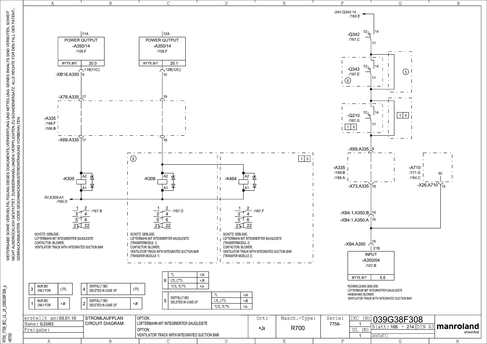

# +Jx — Sheet 168 of 214 — OPTION:

**LÜFTERBAHN MIT INTEGRIERTER SAUGLEISTE**

> Part of the manroland **R700** printing press IEC/UL circuit diagrams.
> Drawing class: **Stromlaufplan / Circuit diagram** (DIN A3).
> Document `+Jx` covers the **1st printing module + feed register** machine section.

## At a glance

| Field | Value |
|---|---|
| Document | `+Jx`  (039G38F308) |
| Sheet | **168** of 214 |
| Section (DE) | OPTION: |
| Section (EN) | LÜFTERBAHN MIT INTEGRIERTER SAUGLEISTE |
| Section type | CIRCUIT — Circuit diagram |
| Machine type | `R700` |
| Series | `7758` |
| Created | 03.01.10 |
| Replaces | — |
| Columns used | A, B, C, D, E, F, G, H |
| Path numbers | — |
| Labels on sheet | 167 |
| Cross-refs out | 17 |
| Cross-refs in | 29 |

**Previous:** [+Jx sheet 167](SHEET_0167.md) · **Next:** [+Jx sheet 169](SHEET_0169.md) · **Document TOC:** [_TOC.md](_TOC.md)  (+Jx) · **Master TOC:** [all sheets](../_MASTER_TOC.md)

## Sheet image (300 DPI, exact vector render)



_Rendered directly from the PDF vector layer at 300 DPI (1-bit), no OCR and no resampling. Use it to confirm anything ambiguous in the text below._

## Cross-references on this sheet

Each entry is a wire leaving this sheet. The printed token is `/sheet.column`; the link resolves to that sheet inside the same document.

| Ref | Target sheet | Col | Path | Destination on target | Target section | From col |
|---|---|---|---|---|---|---|
| `/162.E` | [+Jx sheet 162](SHEET_0162.md) | E | — | 24V.Q342:14 | OPTION: | F |
| `/167.C` | [+Jx sheet 167](SHEET_0167.md) | C | — | — | OPTION: | F |
| `/109.F` | [+Jx sheet 109](SHEET_0109.md) | F | — | — | REFERENZMODUL | A |
| `/109.F` | [+Jx sheet 109](SHEET_0109.md) | F | — | — | REFERENZMODUL | C |
| `/167.E` | [+Jx sheet 167](SHEET_0167.md) | E | — | — | OPTION: | F |
| `/167.G` | [+Jx sheet 167](SHEET_0167.md) | G | — | — | OPTION: | F |
| `/168.F` | [+Jx sheet 168](SHEET_0168.md) | F | — | — | OPTION: | A |
| `/166.B` | [+Jx sheet 166](SHEET_0166.md) | B | — | — | OPTION: | A |
| `/169.B` | [+Jx sheet 169](SHEET_0169.md) | B | — | — | OPTION: BOGENFÜHRUNG ÜBER DRUCKZYLINDER / | F |
| `/168.A` | [+Jx sheet 168](SHEET_0168.md) | A | — | — | OPTION: | F |
| `/171.G` | [+Jx sheet 171](SHEET_0171.md) | G | — | — | OPTION: AUTOMATISCHEM SPÜLEN | G |
| `/164.C` | [+Jx sheet 164](SHEET_0164.md) | C | — | — | OPTION: | G |
| `/165.D` | [+Jx sheet 165](SHEET_0165.md) | D | — | 0V.K305:A1 | OPTION: | A |
| `/167.B` | [+Jx sheet 167](SHEET_0167.md) | B | — | — | OPTION: | B |
| `/167.F` | [+Jx sheet 167](SHEET_0167.md) | F | — | — | OPTION: | E |
| `/167.D` | [+Jx sheet 167](SHEET_0167.md) | D | — | — | OPTION: | C |
| `/107.B` | [+Jx sheet 107](SHEET_0107.md) | B | — | — | REFERENZMODUL | G |

### Incoming references (sheets that point here)

Every other sheet that sends a wire to this one. `Back-ref` is the token printed on *that* sheet; `Path` is its line number.

| From sheet | Cols | Back-ref | Path | Refs | What continues there |
|---|---|---|---|---|---|
| [+Jx#107](SHEET_0107.md) | B | `/107.B` | — | 1 | — |
| [+Jx#109](SHEET_0109.md) | F | `/109.F` | — | 2 | — |
| [+Jx#130](SHEET_0130.md) | A, B, D | `/130.A`, `/130.B`, `/130.D` | — | 3 | — |
| [+Jx#139](SHEET_0139.md) | G | `/139.G` | — | 2 | — |
| [+Jx#143](SHEET_0143.md) | F | `/143.F` | — | 1 | — |
| [+Jx#152](SHEET_0152.md) | G | `/152.G` | — | 3 | — |
| [+Jx#153](SHEET_0153.md) | E | `/153.E` | — | 1 | — |
| [+Jx#156](SHEET_0156.md) | C | `/156.C` | — | 2 | — |
| [+Jx#162](SHEET_0162.md) | E | `/162.E` | — | 1 | — |
| [+Jx#164](SHEET_0164.md) | C | `/164.C` | — | 1 | — |
| [+Jx#165](SHEET_0165.md) | D | `/165.D` | — | 1 | 0V.K195:A1 |
| [+Jx#166](SHEET_0166.md) | B | `/166.B` | — | 1 | — |
| [+Jx#167](SHEET_0167.md) | B, C, D, E, F, G | `/167.B`, `/167.C`, `/167.D`, `/167.E`, `/167.F`, `/167.G` | — | 6 | — |
| [+Jx#168](SHEET_0168.md) | A, F | `/168.A`, `/168.F` | — | 2 | — |
| [+Jx#169](SHEET_0169.md) | B | `/169.B` | — | 1 | — |
| [+Jx#171](SHEET_0171.md) | G | `/171.G` | — | 1 | — |


## Devices on this sheet

| Tag | Class | Class meaning (IEC) | Col | Sub | Terminal | Sign |
|---|---|---|---|---|---|---|
| `A2` | A | Baugruppe / assembly, module, PC board | B | — | — | — |
| `A1` | A | Baugruppe / assembly, module, PC board | B | — | — | — |
| `K305` | K | Relais / relay, contactor | A | — | — | — |
| `A2` | A | Baugruppe / assembly, module, PC board | C | — | — | — |
| `A1` | A | Baugruppe / assembly, module, PC board | C | — | — | — |
| `K306` | K | Relais / relay, contactor | C | — | — | — |
| `A2` | A | Baugruppe / assembly, module, PC board | D | — | — | — |
| `A1` | A | Baugruppe / assembly, module, PC board | D | — | — | — |
| `K464` | K | Relais / relay, contactor | D | — | — | — |
| `A335` | A | Baugruppe / assembly, module, PC board | A | — | — | — |
| `A350/14` | A | Baugruppe / assembly, module, PC board | A | 14 | — | — |
| `A350/14` | A | Baugruppe / assembly, module, PC board | C | 14 | — | — |
| `A335` | A | Baugruppe / assembly, module, PC board | F | — | — | — |
| `Q210` | Q | Leistungsschalter / power switching device | F | — | — | — |
| `Q343` | Q | Leistungsschalter / power switching device | F | — | — | — |
| `Q342` | Q | Leistungsschalter / power switching device | F | — | — | — |
| `A710` | A | Baugruppe / assembly, module, PC board | G | — | — | — |
| `A350/04` | A | Baugruppe / assembly, module, PC board | F | 04 | — | — |
| `X69.A335` | — | cross-device reference | A | — | — | — |
| `X78.A335` | — | cross-device reference | A | — | — | — |
| `20.0` | — | cross-device reference | B | — | — | — |
| `XB16.A350` | — | cross-device reference | A | — | — | — |
| `20.1` | — | cross-device reference | C | — | — | — |
| `X69.A335` | — | cross-device reference | F | — | — | — |
| `X73.A335` | — | cross-device reference | F | — | — | — |
| `X26.A710` | — | cross-device reference | G | — | — | — |
| `XB4.1.A350.B` | — | cross-device reference | F | — | — | — |
| `XB4.1.A350.A` | — | cross-device reference | F | — | — | — |
| `XB4.A350` | — | cross-device reference | F | — | — | — |
| `5.6` | — | cross-device reference | G | — | — | — |

## Potentials / nets

| Potential | Count | Columns | Attached devices | Terminals |
|---|---|---|---|---|
| `0V` | 1 | A | `K305` | `A1` |
| `24V` | 1 | F | `Q342` | `14` |


A potential such as `L24+/4` or `M24+` is a named supply/return rail; every place it appears on this sheet is electrically common.

## Wire-end annotations (grouped as printed)

A wire that continues elsewhere is annotated with a small cluster: the destination description, the path/line number `#NN`, and the `/sheet.column` cross reference. Each row below is one such cluster exactly as it is grouped on the drawing.

| Col | Y | Path | Cross-ref | Text on the wire |
|---|---|---|---|---|
| F | 25.8 | — | `/162.E` | `24V.Q342:14` |
| F | 73.3 | — | — | `Q342 14` |
| F | 73.3 | — | — | `12` |
| B | 78.9 | — | — | `11A` |
| C | 78.9 | — | — | `12A` |
| F | 92.7 | — | `/167.C` | — |
| A | 94.0 | — | — | `POWER QUTPUT` |
| C | 94.0 | — | — | `POWER QUTPUT` |
| G | 101.6 | — | — | `11` |
| A | 108.0 | — | — | `A350/14` |
| C | 108.0 | — | — | `A350/14` |
| A | 121.8 | — | `/109.F` | — |
| C | 121.8 | — | `/109.F` | — |
| A | 150.8 | — | — | `BYTE.BIT 20.0` |
| C | 150.8 | — | — | `BYTE.BIT 20.1` |
| F | 158.3 | — | — | `Q343 14` |
| F | 158.3 | — | — | `12` |
| B | 166.8 | — | — | `11B(11C)` |
| C | 166.8 | — | — | `12B(12C)` |
| G | 173.2 | — | — | `5` |
| A | 177.4 | — | — | `XB16.A350 9` |
| F | 177.7 | — | `/167.E` | — |
| C | 178.8 | — | — | `10` |
| G | 186.7 | — | — | `11` |
| F | 194.4 | — | — | `6` |
| A | 232.7 | — | — | `X78.A335 17` |
| C | 232.7 | — | — | `19` |
| F | 271.7 | — | — | `Q210 14` |
| F | 271.7 | — | — | `12` |
| G | 278.8 | — | — | `1 4` |
| A | 285.1 | — | — | `A335` |
| F | 291.1 | — | `/167.G` | — |
| A | 298.2 | — | `/168.F`, `/166.B` | — |
| G | 300.0 | — | — | `11` |
| F | 307.1 | — | — | `1 3` |
| A | 337.6 | — | — | `X69.A335 17` |
| C | 339.0 | — | — | `18` |
| F | 360.2 | — | — | `X69.A335 6` |
| D | 385.1 | — | — | `6 1 3` |
| F | 405.6 | — | — | `A335` |
| G | 405.6 | — | — | `A710` |
| F | 418.7 | — | `/169.B`, `/168.A` | — |
| G | 418.7 | — | `/171.G` | — |
| H | 421.5 | — | — | `NC` |
| B | 427.5 | — | — | `A2` |
| C | 427.5 | — | — | `A2` |
| D | 427.5 | — | — | `A2` |
| G | 431.1 | — | `/164.C` | — |
| A | 432.5 | — | — | `K305` |
| C | 432.5 | — | — | `K306` |
| D | 432.5 | — | — | `K464` |
| H | 448.1 | — | — | `X26.A710 15` |
| F | 450.9 | — | — | `X73.A335 15` |
| B | 455.9 | — | — | `A1` |
| C | 455.9 | — | — | `A1` |
| D | 455.9 | — | — | `A1` |
| A | 479.3 | — | `/165.D` | `0V.K305:A1` |
| A | 504.8 | — | — | `21 3 5 1` |
| B | 504.8 | — | — | `2 6 22 4` |
| C | 504.8 | — | — | `21 3 5 1` |
| C | 504.8 | — | — | `2 6 22 4` |
| D | 504.8 | — | — | `21 3 5 1` |
| D | 504.8 | — | — | `2 6 22 4` |
| B | 512.6 | — | `/167.B` | — |
| C | 512.6 | — | `/167.D` | — |
| E | 512.6 | — | `/167.F` | — |
| F | 516.1 | — | — | `XB4.1.A350.B 15` |
| F | 533.2 | — | — | `XB4.1.A350.A 15` |
| A | 570.3 | — | — | `LÜFTERBAHN MIT INTEGRIERTER SAUGLEISTE SCHÜTZ: GEBLÄSE, CONTACTOR: BLOWER, VENTILATOR TRACK WITH INTEGRATED SUCTION BAR` |
| C | 570.3 | — | — | `LÜFTERBAHN MIT INTEGRIERTER SAUGLEISTE SCHÜTZ: GEBLÄSE, (TRANSFERMODUL 1) CONTACTOR: BLOWER, (TRANSFER MODULE 1) VENTILATOR TRACK WITH INTEGRATED SUCTION BAR` |
| E | 570.3 | — | — | `LÜFTERBAHN MIT INTEGRIERTER SAUGLEISTE SCHÜTZ: GEBLÄSE, (TRANSFERMODUL 2) CONTACTOR: BLOWER, (TRANSFER MODULE 2) VENTILATOR TRACK WITH INTEGRATED SUCTION BAR` |
| F | 587.0 | — | — | `XB4.A350 15` |
| G | 604.0 | — | — | `21B` |
| F | 618.5 | — | — | `INPUT` |
| F | 632.4 | — | — | `A350/04` |
| G | 646.1 | — | `/107.B` | — |
| C | 669.5 | — | — | `TL` |
| D | 669.5 | — | — | `+JA` |
| F | 675.2 | — | — | `BYTE.BIT 5.6` |
| C | 681.9 | — | — | `6 +Jx` |
| C | 683.7 | — | — | `LTL, LTTL` |
| D | 683.7 | — | — | `+JB` |
| B | 697.9 | — | — | `3 NUR BEI ONLY FOR LTTL 4 ENTFÄLLT BEI DELETED IN CASE OF LTTL` |
| C | 697.9 | — | — | `TLTL, TLTTL` |
| G | 698.1 | — | — | `RÜCKMELDUNG GEBLÄSE: LÜFTERBAHN MIT INTEGRIERTER SAUGLEISTE HANDSHAKE BLOWER:` |
| D | 719.1 | — | — | `+JA` |
| D | 719.2 | — | — | `TL` |
| C | 726.2 | — | — | `5 ENTFÄLLT BEI DELETED IN CASE OF` |
| G | 727.9 | — | — | `VENTILATOR TRACK WITH INTEGRATED SUCTION BAR` |
| B | 733.3 | — | — | `1 NUR BEI ONLY FOR +JB 2 ENTFÄLLT BEI DELETED IN CASE OF +JB` |
| D | 733.3 | — | — | `LTL, LTTL` |
| D | 733.3 | — | — | `+JB` |
| D | 747.5 | — | — | `TLTL, TLTTL` |
| D | 747.6 | — | — | `+Jx` |


## Reconstructed tables

This sheet carries tabular content (pin map / terminal assignment / index). The grid below was rebuilt from the drawing's own rule lines, so each row is exactly one physical row of the table.

### Table 1 — 3 data rows × 7 columns (at x=141.7, y=90.7)

| POWER | QUTPUT A350/14 /109.F |  |  | POWER A350/14 | QUTPUT /109.F |  |
|---|---|---|---|---|---|---|
| `BYTE.BIT` |  | `20.0` |  | `BYTE.BIT` |  | `20.1` |
| `XB16.A350 X78.A335 X69.A335` | `11B(11C) 9 17 17` |  | `6` |  | `12B(12C) 10 19 18` |  |
| `K305` | `A2 A1` |  |  | `K306` | `A2 A1` |  |


### Table 2 — 5 data rows × 3 columns (at x=850.4, y=133.2)

| 12 Q343 /167.E | 11 | 14 |
|---|---|---|
| `12 Q210 /167.G 1 3` | `11` | `14` |
| `X69.A335 X73.A335 XB4.1.A350.B XB4.1.A350.A` | `6 15 15 15` |  |
| `XB4.A350` | `15` | `21B` |
| `INPUT A350/04` | `/107.B` |  |
| `BYTE.BIT` |  | `5.6` |


## Notes and free text on this sheet

| Text | Col | Y (pt) |
|---|---|---|
| `SCHÜTZ: GEBLÄSE,` | A | 570.32 |
| `LÜFTERBAHN MIT INTEGRIERTER SAUGLEISTE` | A | 580.98 |
| `CONTACTOR: BLOWER,` | A | 591.59 |
| `VENTILATOR TRACK WITH INTEGRATED SUCTION BAR` | A | 602.24 |
| `SCHÜTZ: GEBLÄSE,` | C | 570.32 |
| `LÜFTERBAHN MIT INTEGRIERTER SAUGLEISTE` | C | 580.98 |
| `(TRANSFERMODUL 1)` | C | 591.64 |
| `CONTACTOR: BLOWER,` | C | 602.22 |
| `VENTILATOR TRACK WITH INTEGRATED SUCTION BAR` | C | 612.87 |
| `(TRANSFER MODULE 1)` | C | 623.53 |
| `SCHÜTZ: GEBLÄSE,` | D | 570.32 |
| `LÜFTERBAHN MIT INTEGRIERTER SAUGLEISTE` | D | 580.98 |
| `(TRANSFERMODUL 2)` | D | 591.64 |
| `CONTACTOR: BLOWER,` | D | 602.22 |
| `VENTILATOR TRACK WITH INTEGRATED SUCTION BAR` | E | 612.87 |
| `(TRANSFER MODULE 2)` | D | 623.53 |
| `11A` | B | 78.89 |
| `11B(11C)` | B | 166.8 |
| `POWER QUTPUT` | A | 94.04 |
| `BYTE.BIT` | A | 151.38 |
| `12A` | C | 78.89 |
| `12B(12C)` | C | 166.8 |
| `POWER QUTPUT` | C | 94.04 |
| `BYTE.BIT` | C | 151.38 |
| `21B` | G | 604.01 |
| `INPUT` | F | 618.53 |
| `BYTE.BIT` | F | 675.79 |
| `RÜCKMELDUNG GEBLÄSE:` | F | 698.07 |
| `LÜFTERBAHN MIT INTEGRIERTER SAUGLEISTE` | G | 708.01 |
| `HANDSHAKE BLOWER:` | F | 717.93 |
| `VENTILATOR TRACK WITH INTEGRATED SUCTION BAR` | G | 727.88 |
| `NUR BEI` | A | 733.3 |
| `ONLY FOR` | A | 743.98 |
| `+JB` | A | 740.35 |
| `ENTFÄLLT BEI` | B | 733.3 |
| `DELETED IN CASE OF` | B | 743.96 |
| `+JB` | B | 740.35 |
| `LTTL` | B | 704.97 |
| `LTTL` | A | 704.97 |
| `TL` | D | 719.16 |
| `LTL, LTTL` | D | 733.32 |
| `TLTL, TLTTL` | D | 747.51 |
| `+JA` | D | 719.12 |
| `+JB` | D | 733.27 |
| `+Jx` | D | 747.56 |
| `ENTFÄLLT BEI` | C | 726.22 |
| `DELETED IN CASE OF` | C | 736.87 |
| `TL` | C | 669.55 |
| `LTL, LTTL` | C | 683.72 |
| `TLTL, TLTTL` | C | 697.91 |
| `NC` | H | 421.51 |

## Complete label inventory (exact text from the drawing)

Every text object inside the drawing area of this sheet, in DIN reading order (column A→H, then top→bottom). This is the authoritative list: if a string is not here it is not printed on this sheet.

| Col | Y | X | Dir | Type | Text |
|---|---|---|---|---|---|
| A | 94.0 | 157.6 | → | text | `POWER QUTPUT` |
| A | 108.0 | 176.9 | → | device tag | `A350/14` |
| A | 121.8 | 186.1 | → | cross-reference | `/109.F` |
| A | 151.4 | 151.7 | → | text | `BYTE.BIT` |
| A | 177.4 | 136.1 | → | device ref | `XB16.A350` |
| A | 232.7 | 142.9 | → | device ref | `X78.A335` |
| A | 285.1 | 108.0 | → | device tag | `A335` |
| A | 298.2 | 111.4 | → | cross-reference | `/168.F` |
| A | 310.6 | 110.8 | → | cross-reference | `/166.B` |
| A | 337.6 | 142.9 | → | device ref | `X69.A335` |
| A | 432.5 | 153.4 | → | device tag | `K305` |
| A | 479.3 | 108.9 | → | potential | `0V.K305:A1` |
| A | 489.2 | 138.9 | → | cross-reference | `/165.D` |
| A | 504.8 | 186.0 | → | number | `1` |
| A | 518.9 | 184.3 | → | number | `3` |
| A | 533.1 | 184.3 | → | number | `5` |
| A | 547.3 | 180.0 | → | number | `21` |
| A | 570.3 | 84.8 | → | text | `SCHÜTZ: GEBLÄSE,` |
| A | 581.0 | 84.5 | → | text | `LÜFTERBAHN MIT INTEGRIERTER SAUGLEISTE` |
| A | 591.6 | 84.8 | → | text | `CONTACTOR: BLOWER,` |
| A | 602.2 | 85.0 | → | text | `VENTILATOR TRACK WITH INTEGRATED SUCTION BAR` |
| A | 697.9 | 91.6 | → | text | `NUR BEI` |
| A | 703.2 | 75.0 | → | number | `3` |
| A | 705.0 | 148.3 | → | text | `LTTL` |
| A | 708.5 | 91.8 | → | text | `ONLY FOR` |
| A | 733.3 | 91.6 | → | text | `NUR BEI` |
| A | 738.6 | 75.4 | → | number | `1` |
| A | 740.4 | 148.5 | → | text | `+JB` |
| A | 744.0 | 91.8 | → | text | `ONLY FOR` |
| B | 78.9 | 200.4 | → | text | `11A` |
| B | 150.8 | 217.3 | → | device ref | `20.0` |
| B | 166.8 | 206.1 | → | text | `11B(11C)` |
| B | 178.9 | 201.0 | → | number | `9` |
| B | 232.7 | 200.4 | → | number | `17` |
| B | 339.0 | 200.4 | → | number | `17` |
| B | 385.8 | 324.0 | → | number | `6` |
| B | 427.5 | 201.3 | → | device tag | `A2` |
| B | 455.9 | 201.3 | → | device tag | `A1` |
| B | 504.8 | 206.6 | → | number | `2` |
| B | 512.6 | 223.9 | → | cross-reference | `/167.B` |
| B | 518.9 | 206.9 | → | number | `4` |
| B | 533.1 | 206.6 | → | number | `6` |
| B | 547.3 | 206.6 | → | number | `22` |
| B | 697.9 | 219.1 | → | text | `ENTFÄLLT BEI` |
| B | 703.2 | 202.7 | → | number | `4` |
| B | 705.0 | 325.4 | → | text | `LTTL` |
| B | 708.5 | 219.1 | → | text | `DELETED IN CASE OF` |
| B | 733.3 | 219.1 | → | text | `ENTFÄLLT BEI` |
| B | 738.6 | 202.7 | → | number | `2` |
| B | 740.4 | 325.7 | → | text | `+JB` |
| B | 744.0 | 219.1 | → | text | `DELETED IN CASE OF` |
| C | 78.9 | 398.8 | → | text | `12A` |
| C | 94.0 | 356.0 | → | text | `POWER QUTPUT` |
| C | 108.0 | 375.3 | → | device tag | `A350/14` |
| C | 121.8 | 384.5 | → | cross-reference | `/109.F` |
| C | 150.8 | 416.4 | → | device ref | `20.1` |
| C | 151.4 | 350.1 | → | text | `BYTE.BIT` |
| C | 166.8 | 404.5 | → | text | `12B(12C)` |
| C | 178.9 | 398.8 | → | number | `10` |
| C | 232.7 | 398.8 | → | number | `19` |
| C | 339.0 | 398.8 | → | number | `18` |
| C | 427.5 | 399.7 | → | device tag | `A2` |
| C | 432.5 | 351.8 | → | device tag | `K306` |
| C | 455.9 | 399.7 | → | device tag | `A1` |
| C | 504.8 | 384.4 | → | number | `1` |
| C | 504.8 | 405.1 | → | number | `2` |
| C | 512.6 | 422.4 | → | cross-reference | `/167.D` |
| C | 518.9 | 382.7 | → | number | `3` |
| C | 518.9 | 405.4 | → | number | `4` |
| C | 533.1 | 382.7 | → | number | `5` |
| C | 533.1 | 405.1 | → | number | `6` |
| C | 547.3 | 378.4 | → | number | `21` |
| C | 547.3 | 405.1 | → | number | `22` |
| C | 570.3 | 318.6 | → | text | `SCHÜTZ: GEBLÄSE,` |
| C | 581.0 | 318.3 | → | text | `LÜFTERBAHN MIT INTEGRIERTER SAUGLEISTE` |
| C | 591.6 | 318.6 | → | text | `(TRANSFERMODUL 1)` |
| C | 602.2 | 318.6 | → | text | `CONTACTOR: BLOWER,` |
| C | 612.9 | 318.9 | → | text | `VENTILATOR TRACK WITH INTEGRATED SUCTION BAR` |
| C | 623.5 | 318.6 | → | text | `(TRANSFER MODULE 1)` |
| C | 669.6 | 418.1 | → | text | `TL` |
| C | 681.9 | 401.0 | → | number | `6` |
| C | 683.7 | 417.5 | → | text | `LTL, LTTL` |
| C | 697.9 | 418.1 | → | text | `TLTL, TLTTL` |
| C | 726.2 | 417.5 | → | text | `ENTFÄLLT BEI` |
| C | 731.5 | 401.0 | → | number | `5` |
| C | 736.9 | 417.5 | → | text | `DELETED IN CASE OF` |
| D | 427.5 | 598.1 | → | device tag | `A2` |
| D | 432.5 | 550.2 | → | device tag | `K464` |
| D | 455.9 | 598.1 | → | device tag | `A1` |
| D | 504.8 | 582.8 | → | number | `1` |
| D | 504.8 | 603.5 | → | number | `2` |
| D | 518.9 | 581.1 | → | number | `3` |
| D | 518.9 | 603.8 | → | number | `4` |
| D | 533.1 | 581.1 | → | number | `5` |
| D | 533.1 | 603.5 | → | number | `6` |
| D | 547.3 | 576.9 | → | number | `21` |
| D | 547.3 | 603.5 | → | number | `22` |
| D | 570.3 | 545.4 | → | text | `SCHÜTZ: GEBLÄSE,` |
| D | 581.0 | 545.1 | → | text | `LÜFTERBAHN MIT INTEGRIERTER SAUGLEISTE` |
| D | 591.6 | 545.4 | → | text | `(TRANSFERMODUL 2)` |
| D | 602.2 | 545.4 | → | text | `CONTACTOR: BLOWER,` |
| D | 623.5 | 545.4 | → | text | `(TRANSFER MODULE 2)` |
| D | 669.5 | 488.7 | → | text | `+JA` |
| D | 683.7 | 488.7 | → | text | `+JB` |
| D | 698.0 | 488.7 | → | text | `+Jx` |
| D | 719.1 | 595.0 | → | text | `+JA` |
| D | 719.2 | 524.4 | → | text | `TL` |
| D | 733.3 | 523.8 | → | text | `LTL, LTTL` |
| D | 733.3 | 595.0 | → | text | `+JB` |
| D | 747.5 | 524.4 | → | text | `TLTL, TLTTL` |
| D | 747.6 | 595.0 | → | text | `+Jx` |
| E | 385.1 | 734.9 | → | number | `1` |
| E | 385.1 | 748.8 | → | number | `3` |
| E | 512.6 | 620.8 | → | cross-reference | `/167.F` |
| E | 612.9 | 545.7 | → | text | `VENTILATOR TRACK WITH INTEGRATED SUCTION BAR` |
| F | 25.8 | 816.1 | → | potential | `24V.Q342:14` |
| F | 35.6 | 854.9 | → | cross-reference | `/162.E` |
| F | 73.3 | 887.8 | → | number | `12` |
| F | 79.6 | 849.8 | → | device tag | `Q342` |
| F | 92.7 | 853.2 | → | cross-reference | `/167.C` |
| F | 158.3 | 887.8 | → | number | `12` |
| F | 164.6 | 849.5 | → | device tag | `Q343` |
| F | 177.7 | 853.5 | → | cross-reference | `/167.E` |
| F | 194.4 | 848.4 | → | number | `6` |
| F | 271.7 | 887.8 | → | number | `12` |
| F | 278.0 | 849.8 | → | device tag | `Q210` |
| F | 291.1 | 852.7 | → | cross-reference | `/167.G` |
| F | 307.1 | 848.3 | → | number | `1` |
| F | 307.1 | 862.2 | → | number | `3` |
| F | 360.2 | 851.5 | → | device ref | `X69.A335` |
| F | 405.6 | 815.2 | → | device tag | `A335` |
| F | 418.7 | 818.1 | → | cross-reference | `/169.B` |
| F | 431.1 | 817.8 | → | cross-reference | `/168.A` |
| F | 450.9 | 851.5 | → | device ref | `X73.A335` |
| F | 516.2 | 832.0 | → | device ref | `XB4.1.A350.B` |
| F | 533.9 | 831.4 | → | device ref | `XB4.1.A350.A` |
| F | 592.7 | 842.2 | → | device ref | `XB4.A350` |
| F | 618.5 | 892.2 | → | text | `INPUT` |
| F | 632.4 | 885.5 | → | device tag | `A350/04` |
| F | 675.8 | 860.3 | → | text | `BYTE.BIT` |
| F | 698.1 | 849.8 | → | text | `RÜCKMELDUNG GEBLÄSE:` |
| F | 717.9 | 849.8 | → | text | `HANDSHAKE BLOWER:` |
| G | 73.3 | 916.2 | → | number | `14` |
| G | 101.6 | 909.1 | → | number | `11` |
| G | 158.3 | 916.2 | → | number | `14` |
| G | 173.2 | 990.1 | → | number | `5` |
| G | 186.6 | 909.1 | → | number | `11` |
| G | 271.7 | 916.2 | → | number | `14` |
| G | 278.8 | 975.8 | → | number | `1` |
| G | 278.8 | 989.9 | → | number | `4` |
| G | 300.0 | 909.1 | → | number | `11` |
| G | 360.3 | 909.6 | → | number | `6` |
| G | 405.6 | 999.8 | → | device tag | `A710` |
| G | 418.7 | 1001.5 | → | cross-reference | `/171.G` |
| G | 431.1 | 1002.0 | → | cross-reference | `/164.C` |
| G | 448.1 | 1020.5 | → | device ref | `X26.A710` |
| G | 452.4 | 909.1 | → | number | `15` |
| G | 516.2 | 909.1 | → | number | `15` |
| G | 533.2 | 909.1 | → | number | `15` |
| G | 587.0 | 909.1 | → | number | `15` |
| G | 604.0 | 912.8 | → | text | `21B` |
| G | 646.2 | 894.5 | → | cross-reference | `/107.B` |
| G | 675.2 | 928.6 | → | device ref | `5.6` |
| G | 708.0 | 849.8 | → | text | `LÜFTERBAHN MIT INTEGRIERTER SAUGLEISTE` |
| G | 727.9 | 850.4 | → | text | `VENTILATOR TRACK WITH INTEGRATED SUCTION BAR` |
| H | 421.5 | 1072.5 | → | text | `NC` |
| H | 452.4 | 1079.1 | → | number | `15` |

## Reading-order text block

The same content as a plain block, grouped by DIN column — convenient to paste or to match against a visual description.

```text
=== Column A ===
  94.0  157.6  text         POWER QUTPUT
 108.0  176.9  devtag       A350/14
 121.8  186.1  xref         /109.F
 151.4  151.7  text         BYTE.BIT
 177.4  136.1  devref       XB16.A350
 232.7  142.9  devref       X78.A335
 285.1  108.0  devtag       A335
 298.2  111.4  xref         /168.F
 310.6  110.8  xref         /166.B
 337.6  142.9  devref       X69.A335
 432.5  153.4  devtag       K305
 479.3  108.9  net          0V.K305:A1
 489.2  138.9  xref         /165.D
 504.8  186.0  numeric      1
 518.9  184.3  numeric      3
 533.1  184.3  numeric      5
 547.3  180.0  numeric      21
 570.3   84.8  text         SCHÜTZ: GEBLÄSE,
 581.0   84.5  text         LÜFTERBAHN MIT INTEGRIERTER SAUGLEISTE
 591.6   84.8  text         CONTACTOR: BLOWER,
 602.2   85.0  text         VENTILATOR TRACK WITH INTEGRATED SUCTION BAR
 697.9   91.6  text         NUR BEI
 703.2   75.0  numeric      3
 705.0  148.3  text         LTTL
 708.5   91.8  text         ONLY FOR
 733.3   91.6  text         NUR BEI
 738.6   75.4  numeric      1
 740.4  148.5  text         +JB
 744.0   91.8  text         ONLY FOR
=== Column B ===
  78.9  200.4  text         11A
 150.8  217.3  devref       20.0
 166.8  206.1  text         11B(11C)
 178.9  201.0  numeric      9
 232.7  200.4  numeric      17
 339.0  200.4  numeric      17
 385.8  324.0  numeric      6
 427.5  201.3  devtag       A2
 455.9  201.3  devtag       A1
 504.8  206.6  numeric      2
 512.6  223.9  xref         /167.B
 518.9  206.9  numeric      4
 533.1  206.6  numeric      6
 547.3  206.6  numeric      22
 697.9  219.1  text         ENTFÄLLT BEI
 703.2  202.7  numeric      4
 705.0  325.4  text         LTTL
 708.5  219.1  text         DELETED IN CASE OF
 733.3  219.1  text         ENTFÄLLT BEI
 738.6  202.7  numeric      2
 740.4  325.7  text         +JB
 744.0  219.1  text         DELETED IN CASE OF
=== Column C ===
  78.9  398.8  text         12A
  94.0  356.0  text         POWER QUTPUT
 108.0  375.3  devtag       A350/14
 121.8  384.5  xref         /109.F
 150.8  416.4  devref       20.1
 151.4  350.1  text         BYTE.BIT
 166.8  404.5  text         12B(12C)
 178.9  398.8  numeric      10
 232.7  398.8  numeric      19
 339.0  398.8  numeric      18
 427.5  399.7  devtag       A2
 432.5  351.8  devtag       K306
 455.9  399.7  devtag       A1
 504.8  384.4  numeric      1
 504.8  405.1  numeric      2
 512.6  422.4  xref         /167.D
 518.9  382.7  numeric      3
 518.9  405.4  numeric      4
 533.1  382.7  numeric      5
 533.1  405.1  numeric      6
 547.3  378.4  numeric      21
 547.3  405.1  numeric      22
 570.3  318.6  text         SCHÜTZ: GEBLÄSE,
 581.0  318.3  text         LÜFTERBAHN MIT INTEGRIERTER SAUGLEISTE
 591.6  318.6  text         (TRANSFERMODUL 1)
 602.2  318.6  text         CONTACTOR: BLOWER,
 612.9  318.9  text         VENTILATOR TRACK WITH INTEGRATED SUCTION BAR
 623.5  318.6  text         (TRANSFER MODULE 1)
 669.6  418.1  text         TL
 681.9  401.0  numeric      6
 683.7  417.5  text         LTL, LTTL
 697.9  418.1  text         TLTL, TLTTL
 726.2  417.5  text         ENTFÄLLT BEI
 731.5  401.0  numeric      5
 736.9  417.5  text         DELETED IN CASE OF
=== Column D ===
 427.5  598.1  devtag       A2
 432.5  550.2  devtag       K464
 455.9  598.1  devtag       A1
 504.8  582.8  numeric      1
 504.8  603.5  numeric      2
 518.9  581.1  numeric      3
 518.9  603.8  numeric      4
 533.1  581.1  numeric      5
 533.1  603.5  numeric      6
 547.3  576.9  numeric      21
 547.3  603.5  numeric      22
 570.3  545.4  text         SCHÜTZ: GEBLÄSE,
 581.0  545.1  text         LÜFTERBAHN MIT INTEGRIERTER SAUGLEISTE
 591.6  545.4  text         (TRANSFERMODUL 2)
 602.2  545.4  text         CONTACTOR: BLOWER,
 623.5  545.4  text         (TRANSFER MODULE 2)
 669.5  488.7  text         +JA
 683.7  488.7  text         +JB
 698.0  488.7  text         +Jx
 719.1  595.0  text         +JA
 719.2  524.4  text         TL
 733.3  523.8  text         LTL, LTTL
 733.3  595.0  text         +JB
 747.5  524.4  text         TLTL, TLTTL
 747.6  595.0  text         +Jx
=== Column E ===
 385.1  734.9  numeric      1
 385.1  748.8  numeric      3
 512.6  620.8  xref         /167.F
 612.9  545.7  text         VENTILATOR TRACK WITH INTEGRATED SUCTION BAR
=== Column F ===
  25.8  816.1  net          24V.Q342:14
  35.6  854.9  xref         /162.E
  73.3  887.8  numeric      12
  79.6  849.8  devtag       Q342
  92.7  853.2  xref         /167.C
 158.3  887.8  numeric      12
 164.6  849.5  devtag       Q343
 177.7  853.5  xref         /167.E
 194.4  848.4  numeric      6
 271.7  887.8  numeric      12
 278.0  849.8  devtag       Q210
 291.1  852.7  xref         /167.G
 307.1  848.3  numeric      1
 307.1  862.2  numeric      3
 360.2  851.5  devref       X69.A335
 405.6  815.2  devtag       A335
 418.7  818.1  xref         /169.B
 431.1  817.8  xref         /168.A
 450.9  851.5  devref       X73.A335
 516.2  832.0  devref       XB4.1.A350.B
 533.9  831.4  devref       XB4.1.A350.A
 592.7  842.2  devref       XB4.A350
 618.5  892.2  text         INPUT
 632.4  885.5  devtag       A350/04
 675.8  860.3  text         BYTE.BIT
 698.1  849.8  text         RÜCKMELDUNG GEBLÄSE:
 717.9  849.8  text         HANDSHAKE BLOWER:
=== Column G ===
  73.3  916.2  numeric      14
 101.6  909.1  numeric      11
 158.3  916.2  numeric      14
 173.2  990.1  numeric      5
 186.6  909.1  numeric      11
 271.7  916.2  numeric      14
 278.8  975.8  numeric      1
 278.8  989.9  numeric      4
 300.0  909.1  numeric      11
 360.3  909.6  numeric      6
 405.6  999.8  devtag       A710
 418.7 1001.5  xref         /171.G
 431.1 1002.0  xref         /164.C
 448.1 1020.5  devref       X26.A710
 452.4  909.1  numeric      15
 516.2  909.1  numeric      15
 533.2  909.1  numeric      15
 587.0  909.1  numeric      15
 604.0  912.8  text         21B
 646.2  894.5  xref         /107.B
 675.2  928.6  devref       5.6
 708.0  849.8  text         LÜFTERBAHN MIT INTEGRIERTER SAUGLEISTE
 727.9  850.4  text         VENTILATOR TRACK WITH INTEGRATED SUCTION BAR
=== Column H ===
 421.5 1072.5  text         NC
 452.4 1079.1  numeric      15
```

---
_Generated from the PDF vector text layer; no OCR. Source: `R700_7758_IEC_UL_JX_039G38F308_p`, sheet 168._
