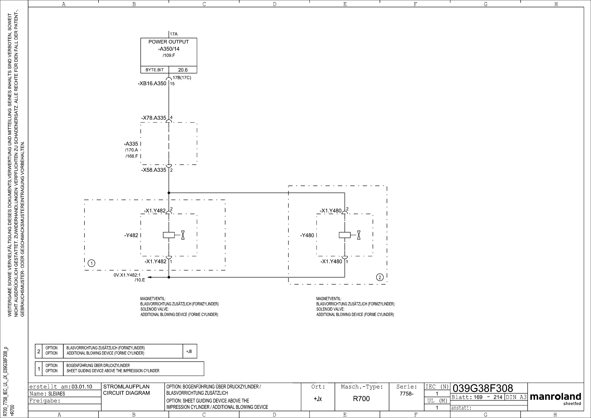

# +Jx — Sheet 169 of 214 — OPTION: BOGENFÜHRUNG ÜBER DRUCKZYLINDER /

**BLASVORRICHTUNG ZUSÄTZLICH**

> Part of the manroland **R700** printing press IEC/UL circuit diagrams.
> Drawing class: **Stromlaufplan / Circuit diagram** (DIN A3).
> Document `+Jx` covers the **1st printing module + feed register** machine section.

## At a glance

| Field | Value |
|---|---|
| Document | `+Jx`  (039G38F308) |
| Sheet | **169** of 214 |
| Section (DE) | OPTION: BOGENFÜHRUNG ÜBER DRUCKZYLINDER / |
| Section (EN) | BLASVORRICHTUNG ZUSÄTZLICH |
| Section type | CIRCUIT — Circuit diagram |
| Machine type | `R700` |
| Series | `7758` |
| Created | 03.01.10 |
| Replaces | — |
| Columns used | A, B, C, D, E, F |
| Path numbers | — |
| Labels on sheet | 49 |
| Cross-refs out | 4 |
| Cross-refs in | 11 |

**Previous:** [+Jx sheet 168](SHEET_0168.md) · **Next:** [+Jx sheet 170](SHEET_0170.md) · **Document TOC:** [_TOC.md](_TOC.md)  (+Jx) · **Master TOC:** [all sheets](../_MASTER_TOC.md)

## Sheet image (300 DPI, exact vector render)



_Rendered directly from the PDF vector layer at 300 DPI (1-bit), no OCR and no resampling. Use it to confirm anything ambiguous in the text below._

## Cross-references on this sheet

Each entry is a wire leaving this sheet. The printed token is `/sheet.column`; the link resolves to that sheet inside the same document.

| Ref | Target sheet | Col | Path | Destination on target | Target section | From col |
|---|---|---|---|---|---|---|
| `/109.F` | [+Jx sheet 109](SHEET_0109.md) | F | — | — | REFERENZMODUL | B |
| `/170.A` | [+Jx sheet 170](SHEET_0170.md) | A | — | — | OPTION: AUTOMATISCHEM SPÜLEN | B |
| `/168.F` | [+Jx sheet 168](SHEET_0168.md) | F | — | — | OPTION: | B |
| `/10.E` | [+Jx sheet 10](SHEET_0010.md) | E | — | 0V.X1.Y482:1 | SPANNUNGSVERSORGUNG, SCHALTSCHRANKBELÜFTUNG | B |

### Incoming references (sheets that point here)

Every other sheet that sends a wire to this one. `Back-ref` is the token printed on *that* sheet; `Path` is its line number.

| From sheet | Cols | Back-ref | Path | Refs | What continues there |
|---|---|---|---|---|---|
| [+Jx#10](SHEET_0010.md) | E | `/10.E` | — | 1 | — |
| [+Jx#109](SHEET_0109.md) | F | `/109.F` | — | 1 | — |
| [+Jx#121](SHEET_0121.md) | G | `/121.G` | — | 4 | — |
| [+Jx#139](SHEET_0139.md) | G | `/139.G` | — | 1 | — |
| [+Jx#151](SHEET_0151.md) | F | `/151.F` | — | 1 | — |
| [+Jx#156](SHEET_0156.md) | C | `/156.C` | — | 1 | — |
| [+Jx#168](SHEET_0168.md) | F | `/168.F` | — | 1 | — |
| [+Jx#170](SHEET_0170.md) | A | `/170.A` | — | 1 | — |


## Devices on this sheet

| Tag | Class | Class meaning (IEC) | Col | Sub | Terminal | Sign |
|---|---|---|---|---|---|---|
| `A350/14` | A | Baugruppe / assembly, module, PC board | B | 14 | — | — |
| `A335` | A | Baugruppe / assembly, module, PC board | B | — | — | — |
| `Y482` | Y | Magnetventil / solenoid valve, actuator | B | — | — | — |
| `Y480` | Y | Magnetventil / solenoid valve, actuator | D | — | — | — |
| `X1.Y482` | — | cross-device reference | B | — | — | — |
| `X58.A335` | — | cross-device reference | B | — | — | — |
| `20.6` | — | cross-device reference | C | — | — | — |
| `XB16.A350` | — | cross-device reference | B | — | — | — |
| `X1.Y482` | — | cross-device reference | B | — | — | — |
| `X78.A335` | — | cross-device reference | B | — | — | — |
| `X1.Y480` | — | cross-device reference | E | — | — | — |
| `X1.Y480` | — | cross-device reference | E | — | — | — |

## Potentials / nets

| Potential | Count | Columns | Attached devices | Terminals |
|---|---|---|---|---|
| `0V` | 1 | B | `X1`, `Y482` | `1` |


A potential such as `L24+/4` or `M24+` is a named supply/return rail; every place it appears on this sheet is electrically common.

## Wire-end annotations (grouped as printed)

A wire that continues elsewhere is annotated with a small cluster: the destination description, the path/line number `#NN`, and the `/sheet.column` cross reference. Each row below is one such cluster exactly as it is grouped on the drawing.

| Col | Y | Path | Cross-ref | Text on the wire |
|---|---|---|---|---|
| C | 64.7 | — | — | `17A` |
| B | 79.9 | — | — | `POWER OUTPUT` |
| B | 93.8 | — | — | `A350/14` |
| B | 107.6 | — | `/109.F` | — |
| B | 136.6 | — | — | `BYTE.BIT 20.6` |
| C | 152.6 | — | — | `17B(17C)` |
| B | 163.2 | — | — | `XB16.A350 15` |
| B | 232.7 | — | — | `X78.A335 4` |
| B | 285.1 | — | — | `A335` |
| B | 298.2 | — | `/170.A` | — |
| B | 310.6 | — | `/168.F` | — |
| B | 337.6 | — | — | `X58.A335 2` |
| B | 417.0 | — | — | `X1.Y482 2` |
| E | 417.0 | — | — | `X1.Y480 2` |
| B | 469.4 | — | — | `Y482` |
| D | 469.4 | — | — | `Y480` |
| B | 521.9 | — | — | `X1.Y482 1` |
| E | 521.9 | — | — | `X1.Y480 1` |
| A | 527.0 | — | — | `1` |
| B | 550.1 | — | `/10.E` | `0V.X1.Y482:1` |
| F | 555.8 | — | — | `2` |
| C | 598.7 | — | — | `MAGNETVENTIL: BLASVORRICHTUNG ZUSÄTZLICH (FORMZYLINDER) SOLENOID VALVE: ADDITIONAL BLOWING DEVICE (FORME CYLINDER)` |
| E | 598.7 | — | — | `MAGNETVENTIL: BLASVORRICHTUNG ZUSÄTZLICH (FORMZYLINDER) SOLENOID VALVE: ADDITIONAL BLOWING DEVICE (FORME CYLINDER)` |
| A | 697.9 | — | — | `2 OPTION OPTION BLASVORRICHTUNG ZUSÄTZLICH (FORMZYLINDER)` |
| B | 704.9 | — | — | `ADDITIONAL BLOWING DEVICE (FORME CYLINDER) +JB` |
| A | 733.3 | — | — | `1 OPTION OPTION BOGENFÜHRUNG ÜBER DRUCKZYLINDER SHEET GUIDING DEVICE ABOVE THE IMPRESSION CYLINDER` |


## Reconstructed tables

This sheet carries tabular content (pin map / terminal assignment / index). The grid below was rebuilt from the drawing's own rule lines, so each row is exactly one physical row of the table.

### Table 1 — 3 data rows × 2 columns (at x=283.5, y=76.5)

| POWER A350/14 | OUTPUT /109.F |
|---|---|
| `BYTE.BIT` | `20.6` |
| `XB16.A350 X78.A335 X58.A335` | `17B(17C) 15 4 2` |
| `X1.Y482 X1.Y482` | `2 1` |


## Notes and free text on this sheet

| Text | Col | Y (pt) |
|---|---|---|
| `17A` | C | 64.72 |
| `17B(17C)` | C | 152.63 |
| `POWER OUTPUT` | B | 79.87 |
| `BYTE.BIT` | B | 137.21 |
| `MAGNETVENTIL:` | B | 598.68 |
| `BLASVORRICHTUNG ZUSÄTZLICH (FORMZYLINDER)` | C | 609.34 |
| `SOLENOID VALVE:` | B | 619.93 |
| `ADDITIONAL BLOWING DEVICE (FORME CYLINDER)` | C | 630.59 |
| `MAGNETVENTIL:` | E | 598.68 |
| `BLASVORRICHTUNG ZUSÄTZLICH (FORMZYLINDER)` | E | 609.34 |
| `SOLENOID VALVE:` | E | 619.93 |
| `ADDITIONAL BLOWING DEVICE (FORME CYLINDER)` | E | 630.59 |
| `OPTION` | A | 733.32 |
| `BOGENFÜHRUNG ÜBER DRUCKZYLINDER` | A | 733.36 |
| `SHEET GUIDING DEVICE ABOVE THE IMPRESSION CYLINDER` | B | 743.97 |
| `BLASVORRICHTUNG ZUSÄTZLICH (FORMZYLINDER)` | B | 697.92 |
| `ADDITIONAL BLOWING DEVICE (FORME CYLINDER)` | B | 708.54 |
| `+JB` | C | 704.92 |

## Complete label inventory (exact text from the drawing)

Every text object inside the drawing area of this sheet, in DIN reading order (column A→H, then top→bottom). This is the authoritative list: if a string is not here it is not printed on this sheet.

| Col | Y | X | Dir | Type | Text |
|---|---|---|---|---|---|
| A | 527.0 | 182.4 | → | number | `1` |
| A | 697.9 | 91.8 | → | text | `OPTION` |
| A | 703.2 | 75.1 | → | number | `2` |
| A | 708.5 | 91.8 | → | text | `OPTION` |
| A | 733.3 | 91.8 | → | text | `OPTION` |
| A | 733.4 | 134.1 | → | text | `BOGENFÜHRUNG ÜBER DRUCKZYLINDER` |
| A | 738.6 | 75.4 | → | number | `1` |
| A | 743.9 | 91.8 | → | text | `OPTION` |
| B | 79.9 | 299.3 | → | text | `POWER OUTPUT` |
| B | 93.8 | 318.6 | → | device tag | `A350/14` |
| B | 107.6 | 327.8 | → | cross-reference | `/109.F` |
| B | 137.2 | 293.4 | → | text | `BYTE.BIT` |
| B | 163.2 | 277.8 | → | device ref | `XB16.A350` |
| B | 232.7 | 284.6 | → | device ref | `X78.A335` |
| B | 285.1 | 249.7 | → | device tag | `A335` |
| B | 298.2 | 252.3 | → | cross-reference | `/170.A` |
| B | 310.6 | 253.1 | → | cross-reference | `/168.F` |
| B | 337.6 | 284.6 | → | device ref | `X58.A335` |
| B | 419.8 | 290.0 | → | device ref | `X1.Y482` |
| B | 469.5 | 250.6 | → | device tag | `Y482` |
| B | 521.9 | 291.4 | → | device ref | `X1.Y482` |
| B | 550.1 | 229.0 | → | potential | `0V.X1.Y482:1` |
| B | 560.0 | 271.6 | → | cross-reference | `/10.E` |
| B | 598.7 | 282.9 | → | text | `MAGNETVENTIL:` |
| B | 619.9 | 283.2 | → | text | `SOLENOID VALVE:` |
| B | 697.9 | 134.1 | → | text | `BLASVORRICHTUNG ZUSÄTZLICH (FORMZYLINDER)` |
| B | 708.5 | 134.6 | → | text | `ADDITIONAL BLOWING DEVICE (FORME CYLINDER)` |
| B | 744.0 | 134.4 | → | text | `SHEET GUIDING DEVICE ABOVE THE IMPRESSION CYLINDER` |
| C | 64.7 | 342.1 | → | text | `17A` |
| C | 136.6 | 359.0 | → | device ref | `20.6` |
| C | 152.6 | 347.8 | → | text | `17B(17C)` |
| C | 164.7 | 342.1 | → | number | `15` |
| C | 232.7 | 343.0 | → | number | `4` |
| C | 339.0 | 343.0 | → | number | `2` |
| C | 417.0 | 343.0 | → | number | `2` |
| C | 523.3 | 342.1 | → | number | `1` |
| C | 609.3 | 282.9 | → | text | `BLASVORRICHTUNG ZUSÄTZLICH (FORMZYLINDER)` |
| C | 630.6 | 283.5 | → | text | `ADDITIONAL BLOWING DEVICE (FORME CYLINDER)` |
| C | 704.9 | 375.3 | → | text | `+JB` |
| D | 469.5 | 604.9 | → | device tag | `Y480` |
| E | 417.0 | 697.3 | → | number | `2` |
| E | 419.8 | 644.3 | → | device ref | `X1.Y480` |
| E | 521.9 | 645.7 | → | device ref | `X1.Y480` |
| E | 523.3 | 696.5 | → | number | `1` |
| E | 598.7 | 637.2 | → | text | `MAGNETVENTIL:` |
| E | 609.3 | 637.2 | → | text | `BLASVORRICHTUNG ZUSÄTZLICH (FORMZYLINDER)` |
| E | 619.9 | 637.5 | → | text | `SOLENOID VALVE:` |
| E | 630.6 | 637.8 | → | text | `ADDITIONAL BLOWING DEVICE (FORME CYLINDER)` |
| F | 555.8 | 763.4 | → | number | `2` |

## Reading-order text block

The same content as a plain block, grouped by DIN column — convenient to paste or to match against a visual description.

```text
=== Column A ===
 527.0  182.4  numeric      1
 697.9   91.8  text         OPTION
 703.2   75.1  numeric      2
 708.5   91.8  text         OPTION
 733.3   91.8  text         OPTION
 733.4  134.1  text         BOGENFÜHRUNG ÜBER DRUCKZYLINDER
 738.6   75.4  numeric      1
 743.9   91.8  text         OPTION
=== Column B ===
  79.9  299.3  text         POWER OUTPUT
  93.8  318.6  devtag       A350/14
 107.6  327.8  xref         /109.F
 137.2  293.4  text         BYTE.BIT
 163.2  277.8  devref       XB16.A350
 232.7  284.6  devref       X78.A335
 285.1  249.7  devtag       A335
 298.2  252.3  xref         /170.A
 310.6  253.1  xref         /168.F
 337.6  284.6  devref       X58.A335
 419.8  290.0  devref       X1.Y482
 469.5  250.6  devtag       Y482
 521.9  291.4  devref       X1.Y482
 550.1  229.0  net          0V.X1.Y482:1
 560.0  271.6  xref         /10.E
 598.7  282.9  text         MAGNETVENTIL:
 619.9  283.2  text         SOLENOID VALVE:
 697.9  134.1  text         BLASVORRICHTUNG ZUSÄTZLICH (FORMZYLINDER)
 708.5  134.6  text         ADDITIONAL BLOWING DEVICE (FORME CYLINDER)
 744.0  134.4  text         SHEET GUIDING DEVICE ABOVE THE IMPRESSION CYLINDER
=== Column C ===
  64.7  342.1  text         17A
 136.6  359.0  devref       20.6
 152.6  347.8  text         17B(17C)
 164.7  342.1  numeric      15
 232.7  343.0  numeric      4
 339.0  343.0  numeric      2
 417.0  343.0  numeric      2
 523.3  342.1  numeric      1
 609.3  282.9  text         BLASVORRICHTUNG ZUSÄTZLICH (FORMZYLINDER)
 630.6  283.5  text         ADDITIONAL BLOWING DEVICE (FORME CYLINDER)
 704.9  375.3  text         +JB
=== Column D ===
 469.5  604.9  devtag       Y480
=== Column E ===
 417.0  697.3  numeric      2
 419.8  644.3  devref       X1.Y480
 521.9  645.7  devref       X1.Y480
 523.3  696.5  numeric      1
 598.7  637.2  text         MAGNETVENTIL:
 609.3  637.2  text         BLASVORRICHTUNG ZUSÄTZLICH (FORMZYLINDER)
 619.9  637.5  text         SOLENOID VALVE:
 630.6  637.8  text         ADDITIONAL BLOWING DEVICE (FORME CYLINDER)
=== Column F ===
 555.8  763.4  numeric      2
```

---
_Generated from the PDF vector text layer; no OCR. Source: `R700_7758_IEC_UL_JX_039G38F308_p`, sheet 169._
