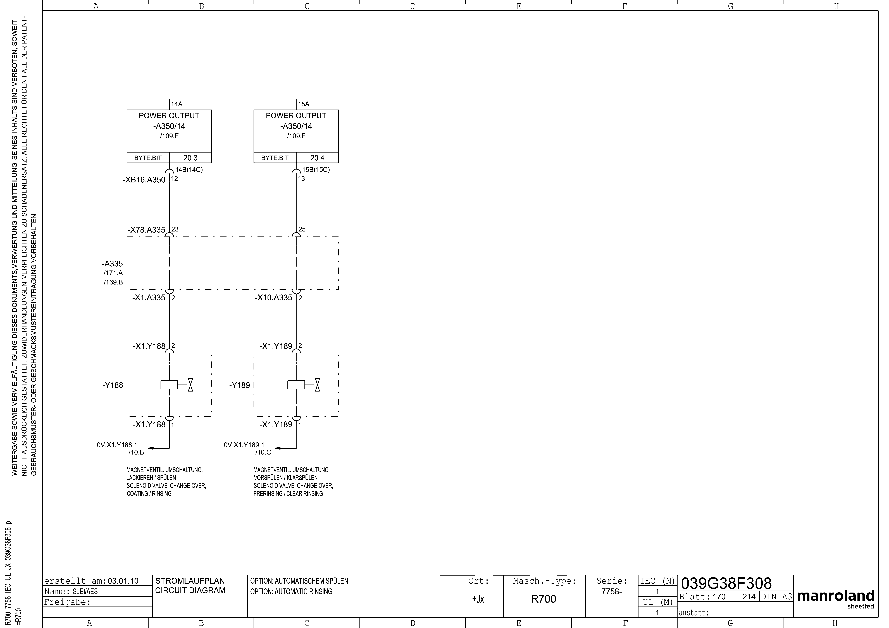

# +Jx — Sheet 170 of 214 — OPTION: AUTOMATISCHEM SPÜLEN

**OPTION: AUTOMATIC RINSING**

> Part of the manroland **R700** printing press IEC/UL circuit diagrams.
> Drawing class: **Stromlaufplan / Circuit diagram** (DIN A3).
> Document `+Jx` covers the **1st printing module + feed register** machine section.

## At a glance

| Field | Value |
|---|---|
| Document | `+Jx`  (039G38F308) |
| Sheet | **170** of 214 |
| Section (DE) | OPTION: AUTOMATISCHEM SPÜLEN |
| Section (EN) | OPTION: AUTOMATIC RINSING |
| Section type | CIRCUIT — Circuit diagram |
| Machine type | `R700` |
| Series | `7758` |
| Created | 03.01.10 |
| Replaces | — |
| Columns used | A, B, C |
| Path numbers | — |
| Labels on sheet | 49 |
| Cross-refs out | 6 |
| Cross-refs in | 16 |

**Previous:** [+Jx sheet 169](SHEET_0169.md) · **Next:** [+Jx sheet 171](SHEET_0171.md) · **Document TOC:** [_TOC.md](_TOC.md)  (+Jx) · **Master TOC:** [all sheets](../_MASTER_TOC.md)

## Sheet image (300 DPI, exact vector render)



_Rendered directly from the PDF vector layer at 300 DPI (1-bit), no OCR and no resampling. Use it to confirm anything ambiguous in the text below._

## Cross-references on this sheet

Each entry is a wire leaving this sheet. The printed token is `/sheet.column`; the link resolves to that sheet inside the same document.

| Ref | Target sheet | Col | Path | Destination on target | Target section | From col |
|---|---|---|---|---|---|---|
| `/109.F` | [+Jx sheet 109](SHEET_0109.md) | F | — | — | REFERENZMODUL | B |
| `/109.F` | [+Jx sheet 109](SHEET_0109.md) | F | — | — | REFERENZMODUL | C |
| `/171.A` | [+Jx sheet 171](SHEET_0171.md) | A | — | — | OPTION: AUTOMATISCHEM SPÜLEN | A |
| `/169.B` | [+Jx sheet 169](SHEET_0169.md) | B | — | — | OPTION: BOGENFÜHRUNG ÜBER DRUCKZYLINDER / | A |
| `/10.B` | [+Jx sheet 10](SHEET_0010.md) | B | — | 0V.X1.Y188:1 0V.X1.Y189:1 | SPANNUNGSVERSORGUNG, SCHALTSCHRANKBELÜFTUNG | B |
| `/10.C` | [+Jx sheet 10](SHEET_0010.md) | C | — | 0V.X1.Y188:1 0V.X1.Y189:1 | SPANNUNGSVERSORGUNG, SCHALTSCHRANKBELÜFTUNG | B |

### Incoming references (sheets that point here)

Every other sheet that sends a wire to this one. `Back-ref` is the token printed on *that* sheet; `Path` is its line number.

| From sheet | Cols | Back-ref | Path | Refs | What continues there |
|---|---|---|---|---|---|
| [+Jx#10](SHEET_0010.md) | B, C | `/10.B`, `/10.C` | — | 2 | 0V.X1.Y188:1; 0V.X1.Y189:1 |
| [+Jx#109](SHEET_0109.md) | F | `/109.F` | — | 2 | — |
| [+Jx#113](SHEET_0113.md) | G | `/113.G` | — | 1 | — |
| [+Jx#120](SHEET_0120.md) | F | `/120.F` | — | 4 | — |
| [+Jx#135](SHEET_0135.md) | C | `/135.C` | — | 1 | — |
| [+Jx#139](SHEET_0139.md) | G | `/139.G` | — | 2 | — |
| [+Jx#156](SHEET_0156.md) | C | `/156.C` | — | 2 | — |
| [+Jx#169](SHEET_0169.md) | B | `/169.B` | — | 1 | — |
| [+Jx#171](SHEET_0171.md) | A | `/171.A` | — | 1 | — |


## Devices on this sheet

| Tag | Class | Class meaning (IEC) | Col | Sub | Terminal | Sign |
|---|---|---|---|---|---|---|
| `A335` | A | Baugruppe / assembly, module, PC board | A | — | — | — |
| `A350/14` | A | Baugruppe / assembly, module, PC board | B | 14 | — | — |
| `Y188` | Y | Magnetventil / solenoid valve, actuator | A | — | — | — |
| `A350/14` | A | Baugruppe / assembly, module, PC board | C | 14 | — | — |
| `Y189` | Y | Magnetventil / solenoid valve, actuator | B | — | — | — |
| `X1.A335` | — | cross-device reference | B | — | — | — |
| `20.3` | — | cross-device reference | B | — | — | — |
| `XB16.A350` | — | cross-device reference | A | — | — | — |
| `X1.Y188` | — | cross-device reference | B | — | — | — |
| `X1.Y188` | — | cross-device reference | B | — | — | — |
| `X78.A335` | — | cross-device reference | A | — | — | — |
| `X10.A335` | — | cross-device reference | C | — | — | — |
| `20.4` | — | cross-device reference | C | — | — | — |
| `X1.Y189` | — | cross-device reference | C | — | — | — |
| `X1.Y189` | — | cross-device reference | C | — | — | — |

## Potentials / nets

| Potential | Count | Columns | Attached devices | Terminals |
|---|---|---|---|---|
| `0V` | 2 | A, B | `X1`, `Y188`, `Y189` | `1` |


A potential such as `L24+/4` or `M24+` is a named supply/return rail; every place it appears on this sheet is electrically common.

## Wire-end annotations (grouped as printed)

A wire that continues elsewhere is annotated with a small cluster: the destination description, the path/line number `#NN`, and the `/sheet.column` cross reference. Each row below is one such cluster exactly as it is grouped on the drawing.

| Col | Y | Path | Cross-ref | Text on the wire |
|---|---|---|---|---|
| B | 135.6 | — | — | `14A` |
| C | 135.6 | — | — | `15A` |
| B | 150.7 | — | — | `POWER OUTPUT` |
| C | 150.7 | — | — | `POWER OUTPUT` |
| B | 164.7 | — | — | `A350/14` |
| C | 164.7 | — | — | `A350/14` |
| B | 178.4 | — | `/109.F` | — |
| C | 178.4 | — | `/109.F` | — |
| B | 207.5 | — | — | `BYTE.BIT 20.3` |
| C | 207.5 | — | — | `BYTE.BIT 20.4` |
| B | 223.5 | — | — | `14B(14C)` |
| C | 223.5 | — | — | `15B(15C)` |
| B | 235.5 | — | — | `XB16.A350 12` |
| C | 235.5 | — | — | `13` |
| B | 303.5 | — | — | `X78.A335 23` |
| C | 303.6 | — | — | `25` |
| A | 348.9 | — | — | `A335` |
| A | 362.0 | — | `/171.A`, `/169.B` | — |
| C | 394.2 | — | — | `X10.A335 2` |
| B | 394.3 | — | — | `X1.A335 2` |
| B | 459.5 | — | — | `X1.Y188 2` |
| C | 459.5 | — | — | `X1.Y189 2` |
| A | 512.0 | — | — | `Y188` |
| B | 512.0 | — | — | `Y189` |
| B | 564.4 | — | — | `X1.Y188 1` |
| C | 564.4 | — | — | `X1.Y189 1` |
| B | 592.6 | — | `/10.B`, `/10.C` | `0V.X1.Y188:1 0V.X1.Y189:1` |
| B | 627.0 | — | — | `MAGNETVENTIL: UMSCHALTUNG, LACKIEREN / SPÜLEN SOLENOID VALVE: CHANGE OVER, COATING / RINSING` |
| C | 627.0 | — | — | `MAGNETVENTIL: UMSCHALTUNG,` |
| C | 637.7 | — | — | `PRERINSING / CLEAR RINSING SOLENOID VALVE: CHANGE OVER, VORSPÜLEN / KLARSPÜLEN` |


## Reconstructed tables

This sheet carries tabular content (pin map / terminal assignment / index). The grid below was rebuilt from the drawing's own rule lines, so each row is exactly one physical row of the table.

### Table 1 — 1 data rows × 2 columns (at x=170.1, y=147.4)

| POWER A350/14 | OUTPUT /109.F |
|---|---|
| `BYTE.BIT` | `20.3` |


### Table 2 — 1 data rows × 2 columns (at x=340.2, y=147.4)

| POWER A350/14 | OUTPUT /109.F |
|---|---|
| `BYTE.BIT` | `20.4` |


## Notes and free text on this sheet

| Text | Col | Y (pt) |
|---|---|---|
| `14A` | B | 135.58 |
| `14B(14C)` | B | 223.49 |
| `POWER OUTPUT` | B | 150.73 |
| `BYTE.BIT` | A | 208.07 |
| `MAGNETVENTIL: UMSCHALTUNG,` | B | 627.05 |
| `LACKIEREN / SPÜLEN` | B | 637.66 |
| `SOLENOID VALVE: CHANGE OVER,` | B | 648.3 |
| `COATING / RINSING` | B | 658.93 |
| `15A` | C | 135.58 |
| `15B(15C)` | C | 223.49 |
| `POWER OUTPUT` | C | 150.73 |
| `BYTE.BIT` | C | 208.07 |
| `MAGNETVENTIL: UMSCHALTUNG,` | C | 627.05 |
| `VORSPÜLEN / KLARSPÜLEN` | C | 637.67 |
| `SOLENOID VALVE: CHANGE OVER,` | C | 648.3 |
| `PRERINSING / CLEAR RINSING` | C | 658.93 |

## Complete label inventory (exact text from the drawing)

Every text object inside the drawing area of this sheet, in DIN reading order (column A→H, then top→bottom). This is the authoritative list: if a string is not here it is not printed on this sheet.

| Col | Y | X | Dir | Type | Text |
|---|---|---|---|---|---|
| A | 208.1 | 180.0 | → | text | `BYTE.BIT` |
| A | 236.2 | 164.4 | → | device ref | `XB16.A350` |
| A | 303.5 | 171.2 | → | device ref | `X78.A335` |
| A | 348.9 | 136.3 | → | device tag | `A335` |
| A | 362.0 | 138.9 | → | cross-reference | `/171.A` |
| A | 374.4 | 139.2 | → | cross-reference | `/169.B` |
| A | 512.0 | 137.2 | → | device tag | `Y188` |
| A | 592.6 | 129.8 | → | potential | `0V.X1.Y188:1` |
| A | 602.6 | 172.3 | → | cross-reference | `/10.B` |
| B | 135.6 | 228.8 | → | text | `14A` |
| B | 150.7 | 186.0 | → | text | `POWER OUTPUT` |
| B | 164.6 | 205.2 | → | device tag | `A350/14` |
| B | 178.4 | 214.4 | → | cross-reference | `/109.F` |
| B | 207.5 | 245.6 | → | device ref | `20.3` |
| B | 223.5 | 234.4 | → | text | `14B(14C)` |
| B | 235.5 | 228.8 | → | number | `12` |
| B | 303.6 | 229.6 | → | number | `23` |
| B | 394.3 | 177.2 | → | device ref | `X1.A335` |
| B | 395.7 | 229.6 | → | number | `2` |
| B | 459.5 | 178.0 | → | device ref | `X1.Y188` |
| B | 459.5 | 229.6 | → | number | `2` |
| B | 512.0 | 307.0 | → | device tag | `Y189` |
| B | 564.4 | 178.0 | → | device ref | `X1.Y188` |
| B | 565.8 | 228.8 | → | number | `1` |
| B | 592.6 | 299.9 | → | potential | `0V.X1.Y189:1` |
| B | 627.0 | 169.5 | → | text | `MAGNETVENTIL: UMSCHALTUNG,` |
| B | 637.7 | 169.5 | → | text | `LACKIEREN / SPÜLEN` |
| B | 648.3 | 169.8 | → | text | `SOLENOID VALVE: CHANGE OVER,` |
| B | 658.9 | 169.8 | → | text | `COATING / RINSING` |
| C | 135.6 | 398.8 | → | text | `15A` |
| C | 150.7 | 356.0 | → | text | `POWER OUTPUT` |
| C | 164.6 | 375.3 | → | device tag | `A350/14` |
| C | 178.4 | 384.5 | → | cross-reference | `/109.F` |
| C | 207.5 | 415.7 | → | device ref | `20.4` |
| C | 208.1 | 350.1 | → | text | `BYTE.BIT` |
| C | 223.5 | 404.5 | → | text | `15B(15C)` |
| C | 235.5 | 398.8 | → | number | `13` |
| C | 303.6 | 399.7 | → | number | `25` |
| C | 394.3 | 341.3 | → | device ref | `X10.A335` |
| C | 395.7 | 399.7 | → | number | `2` |
| C | 459.5 | 347.8 | → | device ref | `X1.Y189` |
| C | 459.5 | 399.7 | → | number | `2` |
| C | 564.4 | 347.8 | → | device ref | `X1.Y189` |
| C | 565.8 | 398.8 | → | number | `1` |
| C | 602.6 | 342.1 | → | cross-reference | `/10.C` |
| C | 627.0 | 339.6 | → | text | `MAGNETVENTIL: UMSCHALTUNG,` |
| C | 637.7 | 340.2 | → | text | `VORSPÜLEN / KLARSPÜLEN` |
| C | 648.3 | 339.9 | → | text | `SOLENOID VALVE: CHANGE OVER,` |
| C | 658.9 | 339.6 | → | text | `PRERINSING / CLEAR RINSING` |

## Reading-order text block

The same content as a plain block, grouped by DIN column — convenient to paste or to match against a visual description.

```text
=== Column A ===
 208.1  180.0  text         BYTE.BIT
 236.2  164.4  devref       XB16.A350
 303.5  171.2  devref       X78.A335
 348.9  136.3  devtag       A335
 362.0  138.9  xref         /171.A
 374.4  139.2  xref         /169.B
 512.0  137.2  devtag       Y188
 592.6  129.8  net          0V.X1.Y188:1
 602.6  172.3  xref         /10.B
=== Column B ===
 135.6  228.8  text         14A
 150.7  186.0  text         POWER OUTPUT
 164.6  205.2  devtag       A350/14
 178.4  214.4  xref         /109.F
 207.5  245.6  devref       20.3
 223.5  234.4  text         14B(14C)
 235.5  228.8  numeric      12
 303.6  229.6  numeric      23
 394.3  177.2  devref       X1.A335
 395.7  229.6  numeric      2
 459.5  178.0  devref       X1.Y188
 459.5  229.6  numeric      2
 512.0  307.0  devtag       Y189
 564.4  178.0  devref       X1.Y188
 565.8  228.8  numeric      1
 592.6  299.9  net          0V.X1.Y189:1
 627.0  169.5  text         MAGNETVENTIL: UMSCHALTUNG,
 637.7  169.5  text         LACKIEREN / SPÜLEN
 648.3  169.8  text         SOLENOID VALVE: CHANGE OVER,
 658.9  169.8  text         COATING / RINSING
=== Column C ===
 135.6  398.8  text         15A
 150.7  356.0  text         POWER OUTPUT
 164.6  375.3  devtag       A350/14
 178.4  384.5  xref         /109.F
 207.5  415.7  devref       20.4
 208.1  350.1  text         BYTE.BIT
 223.5  404.5  text         15B(15C)
 235.5  398.8  numeric      13
 303.6  399.7  numeric      25
 394.3  341.3  devref       X10.A335
 395.7  399.7  numeric      2
 459.5  347.8  devref       X1.Y189
 459.5  399.7  numeric      2
 564.4  347.8  devref       X1.Y189
 565.8  398.8  numeric      1
 602.6  342.1  xref         /10.C
 627.0  339.6  text         MAGNETVENTIL: UMSCHALTUNG,
 637.7  340.2  text         VORSPÜLEN / KLARSPÜLEN
 648.3  339.9  text         SOLENOID VALVE: CHANGE OVER,
 658.9  339.6  text         PRERINSING / CLEAR RINSING
```

---
_Generated from the PDF vector text layer; no OCR. Source: `R700_7758_IEC_UL_JX_039G38F308_p`, sheet 170._
