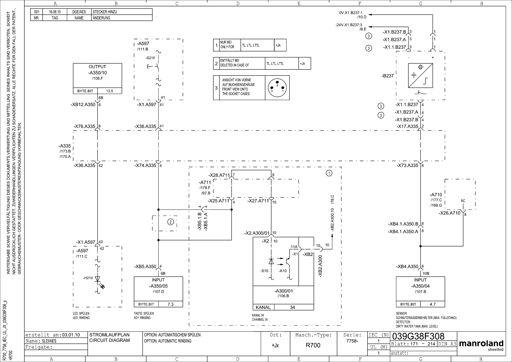

# +Jx — Sheet 171 of 214 — OPTION: AUTOMATISCHEM SPÜLEN

**OPTION: AUTOMATIC RINSING**

> Part of the manroland **R700** printing press IEC/UL circuit diagrams.
> Drawing class: **Stromlaufplan / Circuit diagram** (DIN A3).
> Document `+Jx` covers the **1st printing module + feed register** machine section.

## At a glance

| Field | Value |
|---|---|
| Document | `+Jx`  (039G38F308) |
| Sheet | **171** of 214 |
| Section (DE) | OPTION: AUTOMATISCHEM SPÜLEN |
| Section (EN) | OPTION: AUTOMATIC RINSING |
| Section type | CIRCUIT — Circuit diagram |
| Machine type | `R700` |
| Series | `7758` |
| Created | 03.01.10 |
| Replaces | — |
| Columns used | A, B, C, D, E, F, G, H |
| Path numbers | — |
| Labels on sheet | 156 |
| Cross-refs out | 15 |
| Cross-refs in | 46 |

**Previous:** [+Jx sheet 170](SHEET_0170.md) · **Next:** [+Jx sheet 172](SHEET_0172.md) · **Document TOC:** [_TOC.md](_TOC.md)  (+Jx) · **Master TOC:** [all sheets](../_MASTER_TOC.md)

## Sheet image (300 DPI, exact vector render)



_Rendered directly from the PDF vector layer at 300 DPI (1-bit), no OCR and no resampling. Use it to confirm anything ambiguous in the text below._

## Cross-references on this sheet

Each entry is a wire leaving this sheet. The printed token is `/sheet.column`; the link resolves to that sheet inside the same document.

| Ref | Target sheet | Col | Path | Destination on target | Target section | From col |
|---|---|---|---|---|---|---|
| `/10.D` | [+Jx sheet 10](SHEET_0010.md) | D | — | 0V.X1.B237:1 | SPANNUNGSVERSORGUNG, SCHALTSCHRANKBELÜFTUNG | F |
| `/8.E` | [+Jx sheet 8](SHEET_0008.md) | E | — | 24V.X1.B237:3 | SPANNUNGSVERSORGUNG, SCHALTSCHRANKBELÜFTUNG | F |
| `/111.B` | [+Jx sheet 111](SHEET_0111.md) | B | — | A597 | REFERENZMODUL | B |
| `/108.F` | [+Jx sheet 108](SHEET_0108.md) | F | — | — | REFERENZMODUL | B |
| `/173.B` | [+Jx sheet 173](SHEET_0173.md) | B | — | — | OPTION: | A |
| `/170.A` | [+Jx sheet 170](SHEET_0170.md) | A | — | — | OPTION: AUTOMATISCHEM SPÜLEN | A |
| `/178.F` | [+Jx sheet 178](SHEET_0178.md) | F | — | — | OPTION: TRANSFERMODUL 1 NACH | C |
| `/97.B` | [+Jx sheet 97](SHEET_0097.md) | B | — | — | RESERVE | C |
| `/78.C` | [+Jx sheet 78](SHEET_0078.md) | C | — | XB2.A300:10 | BUSVERBINDUNGEN: SICHERHEITSKREIS | F |
| `/177.C` | [+Jx sheet 177](SHEET_0177.md) | C | — | — | SCHUTZEINRICHTUNGEN | G |
| `/168.G` | [+Jx sheet 168](SHEET_0168.md) | G | — | — | OPTION: | G |
| `/111.C` | [+Jx sheet 111](SHEET_0111.md) | C | — | A597 | REFERENZMODUL | A |
| `/107.B` | [+Jx sheet 107](SHEET_0107.md) | B | — | — | REFERENZMODUL | G |
| `/107.D` | [+Jx sheet 107](SHEET_0107.md) | D | — | — | REFERENZMODUL | C |
| `/106.B` | [+Jx sheet 106](SHEET_0106.md) | B | — | — | REFERENZMODUL | E |

### Incoming references (sheets that point here)

Every other sheet that sends a wire to this one. `Back-ref` is the token printed on *that* sheet; `Path` is its line number.

| From sheet | Cols | Back-ref | Path | Refs | What continues there |
|---|---|---|---|---|---|
| [+Jx#8](SHEET_0008.md) | E | `/8.E` | — | 1 | 24V.X1.B237:3 |
| [+Jx#10](SHEET_0010.md) | D | `/10.D` | — | 1 | 0V.X1.B237:1 |
| [+Jx#78](SHEET_0078.md) | C | `/78.C` | — | 1 | XB2.A300:10 |
| [+Jx#97](SHEET_0097.md) | B | `/97.B` | — | 1 | — |
| [+Jx#106](SHEET_0106.md) | B | `/106.B` | — | 1 | — |
| [+Jx#107](SHEET_0107.md) | B, D | `/107.B`, `/107.D` | — | 2 | — |
| [+Jx#108](SHEET_0108.md) | F | `/108.F` | — | 1 | — |
| [+Jx#111](SHEET_0111.md) | B, C | `/111.B`, `/111.C` | — | 2 | — |
| [+Jx#115](SHEET_0115.md) | F | `/115.F` | — | 2 | — |
| [+Jx#117](SHEET_0117.md) | A | `/117.A` | — | 9 | — |
| [+Jx#124](SHEET_0124.md) | E, G | `/124.E`, `/124.G` | — | 2 | — |
| [+Jx#130](SHEET_0130.md) | A, B, D | `/130.A`, `/130.B`, `/130.D` | — | 3 | — |
| [+Jx#131](SHEET_0131.md) | A, B | `/131.A`, `/131.B` | — | 2 | — |
| [+Jx#132](SHEET_0132.md) | C | `/132.C` | — | 1 | — |
| [+Jx#137](SHEET_0137.md) | H | `/137.H` | — | 1 | — |
| [+Jx#140](SHEET_0140.md) | A | `/140.A` | — | 1 | — |
| [+Jx#143](SHEET_0143.md) | B, F | `/143.B`, `/143.F` | — | 2 | — |
| [+Jx#144](SHEET_0144.md) | F | `/144.F` | — | 1 | — |
| [+Jx#146](SHEET_0146.md) | C | `/146.C` | — | 2 | — |
| [+Jx#149](SHEET_0149.md) | G | `/149.G` | — | 2 | — |
| [+Jx#153](SHEET_0153.md) | E | `/153.E` | — | 1 | — |
| [+Jx#154](SHEET_0154.md) | A | `/154.A` | — | 1 | — |
| [+Jx#155](SHEET_0155.md) | B | `/155.B` | — | 1 | — |
| [+Jx#168](SHEET_0168.md) | G | `/168.G` | — | 1 | — |
| [+Jx#170](SHEET_0170.md) | A | `/170.A` | — | 1 | — |
| [+Jx#173](SHEET_0173.md) | A | `/173.A` | — | 1 | — |
| [+Jx#177](SHEET_0177.md) | C | `/177.C` | — | 1 | — |
| [+Jx#178](SHEET_0178.md) | F | `/178.F` | — | 1 | — |


## Devices on this sheet

| Tag | Class | Class meaning (IEC) | Col | Sub | Terminal | Sign |
|---|---|---|---|---|---|---|
| `B237` | B | Umformer / transducer, sensor | F | — | — | — |
| `A350/10` | A | Baugruppe / assembly, module, PC board | B | 10 | — | — |
| `S210` | S | Schalter / switch | C | — | — | — |
| `A597` | A | Baugruppe / assembly, module, PC board | B | — | — | — |
| `A597` | A | Baugruppe / assembly, module, PC board | A | — | — | — |
| `A350/05` | A | Baugruppe / assembly, module, PC board | C | 05 | — | — |
| `A350/04` | A | Baugruppe / assembly, module, PC board | G | 04 | — | — |
| `A335` | A | Baugruppe / assembly, module, PC board | A | — | — | — |
| `A711` | A | Baugruppe / assembly, module, PC board | C | — | — | — |
| `S10` | S | Schalter / switch | D | — | — | — |
| `A10` | A | Baugruppe / assembly, module, PC board | E | — | — | — |
| `X1` | X | Klemme / terminal, plug connector | E | — | — | — |
| `X2` | X | Klemme / terminal, plug connector | D | — | — | — |
| `XB2` | XB |  | E | — | — | — |
| `A300/01` | A | Baugruppe / assembly, module, PC board | E | 01 | — | — |
| `A710` | A | Baugruppe / assembly, module, PC board | G | — | — | — |
| `X1.1.B237` | — | cross-device reference | G | — | — | — |
| `X1.1.B237` | — | cross-device reference | G | — | — | — |
| `13.5` | — | cross-device reference | B | — | — | — |
| `XB12.A350` | — | cross-device reference | A | — | — | — |
| `X1.A597` | — | cross-device reference | C | — | — | — |
| `X1.A597` | — | cross-device reference | B | — | — | — |
| `7.3` | — | cross-device reference | C | — | — | — |
| `XB5.A350` | — | cross-device reference | B | — | — | — |
| `4.7` | — | cross-device reference | G | — | — | — |
| `XB4.A350` | — | cross-device reference | G | — | — | — |
| `X17.A335` | — | cross-device reference | G | — | — | — |
| `X73.A335` | — | cross-device reference | G | — | — | — |
| `X76.A335` | — | cross-device reference | A | — | — | — |
| `X36.A335` | — | cross-device reference | A | — | — | — |
| `X36.A335` | — | cross-device reference | B | — | — | — |
| `X74.A335` | — | cross-device reference | B | — | — | — |
| `X28.A711` | — | cross-device reference | D | — | — | — |
| `X25.A711` | — | cross-device reference | D | — | — | — |
| `XB5.1.A` | — | cross-device reference | C | — | — | — |
| `XB5.1.B` | — | cross-device reference | C | — | — | — |
| `XB2.A300` | — | cross-device reference | E | — | — | — |
| `X27.A711` | — | cross-device reference | D | — | — | — |
| `XB4.1.A350.B` | — | cross-device reference | G | — | — | — |
| `XB4.1.A350.A` | — | cross-device reference | G | — | — | — |
| `X26.A710` | — | cross-device reference | G | — | — | — |
| `X1.B237.B` | — | cross-device reference | G | — | — | — |
| `X1.B237.A` | — | cross-device reference | G | — | — | — |
| `X1.B237.A` | — | cross-device reference | G | — | — | — |
| `X1.B237.B` | — | cross-device reference | G | — | — | — |
| `NR.` | — | cross-device reference | A | — | — | — |
| `19.08.10` | — | cross-device reference | A | — | — | — |
| `XB2.A300:10` | — | cross-device reference | F | — | 10 | — |

## Potentials / nets

| Potential | Count | Columns | Attached devices | Terminals |
|---|---|---|---|---|
| `0V` | 1 | F | `B237`, `X1` | `1` |
| `24V` | 1 | F | `B237`, `X1` | `3` |
| `H210` | 1 | B | — | — |


A potential such as `L24+/4` or `M24+` is a named supply/return rail; every place it appears on this sheet is electrically common.

## Wire-end annotations (grouped as printed)

A wire that continues elsewhere is annotated with a small cluster: the destination description, the path/line number `#NN`, and the `/sheet.column` cross reference. Each row below is one such cluster exactly as it is grouped on the drawing.

| Col | Y | Path | Cross-ref | Text on the wire |
|---|---|---|---|---|
| A | 24.3 | — | — | `001 19.08.10 DGE/AES STECKER HINZU` |
| F | 25.7 | — | `/10.D` | `0V.X1.B237:1` |
| A | 38.5 | — | — | `NR. TAG NAME ÄNDERUNG` |
| F | 54.1 | — | `/8.E` | `24V.X1.B237:3` |
| G | 69.7 | — | — | `X1.B237.B 3 1` |
| F | 81.0 | — | — | `3` |
| G | 86.7 | — | — | `X1.B237.A 3 1` |
| D | 95.5 | — | — | `1 NUR BEI ONLY FOR TL, LTL, LTTL` |
| B | 96.6 | — | `/111.B` | `A597` |
| E | 102.6 | — | — | `+JA` |
| G | 105.1 | — | — | `X1.1.B237 3 1` |
| F | 109.4 | — | — | `3` |
| G | 129.9 | — | — | `+` |
| C | 131.1 | — | — | `S210` |
| D | 138.0 | — | — | `2 ENTFÄLLT BEI DELETED IN CASE OF TL, LTL, LTTL` |
| E | 145.1 | — | — | `+JA` |
| B | 150.8 | — | — | `OUTPUT` |
| B | 164.7 | — | — | `A350/10` |
| F | 171.7 | — | — | `B237` |
| B | 178.4 | — | `/108.F` | — |
| D | 183.4 | — | — | `FRONT VIEW ONTO ANSICHT VON VORNE AUF BUCHSENGEHÄUSE` |
| E | 195.7 | — | — | `4` |
| D | 200.0 | — | — | `3 3 1` |
| B | 208.1 | — | — | `BYTE.BIT 13.5` |
| D | 215.3 | — | — | `THE SOCKET CASES` |
| C | 222.8 | — | — | `41` |
| B | 223.4 | — | — | `8B` |
| B | 238.3 | — | — | `XB12.A350 6 X1.A597 41` |
| G | 238.4 | — | — | `X1.1.B237 4` |
| F | 244.0 | — | — | `3` |
| G | 256.1 | — | — | `X1.B237.A 4` |
| F | 265.3 | — | — | `3` |
| G | 273.8 | — | — | `X1.B237.B 4` |
| B | 289.4 | — | — | `X76.A335 6` |
| C | 289.4 | — | — | `X36.A335 41` |
| G | 289.4 | — | — | `X17.A335 2` |
| A | 334.7 | — | — | `A335` |
| A | 347.8 | — | `/173.B`, `/170.A` | — |
| B | 380.1 | — | — | `X36.A335 42` |
| C | 380.1 | — | — | `X74.A335 4` |
| G | 380.1 | — | — | `X73.A335 8` |
| F | 399.5 | — | — | `1` |
| D | 402.8 | — | — | `X28.A711 7` |
| E | 402.8 | — | — | `8` |
| C | 419.8 | — | — | `A711` |
| C | 432.9 | — | `/178.F` | — |
| C | 445.2 | — | `/97.B` | — |
| G | 448.1 | — | — | `A710` |
| F | 453.1 | — | `/78.C` | `XB2.A300:10` |
| G | 461.2 | — | `/177.C`, `/168.G` | — |
| D | 462.3 | — | — | `X25.A711 4` |
| D | 462.3 | — | — | `X27.A711 10` |
| H | 464.0 | — | — | `NC` |
| C | 477.9 | — | — | `XB5.1.B 4` |
| C | 477.9 | — | — | `XB5.1.A 4` |
| H | 490.6 | — | — | `X26.A710 8` |
| C | 513.3 | — | — | `2` |
| G | 516.1 | — | — | `XB4.1.A350.B 8` |
| G | 533.2 | — | — | `XB4.1.A350.A 8` |
| D | 537.4 | — | — | `X2.A300/01 10` |
| D | 555.9 | — | — | `X2` |
| E | 557.3 | — | — | `10 10` |
| B | 558.7 | — | — | `X1.A597 42` |
| E | 565.8 | — | — | `10` |
| E | 570.0 | — | — | `11A` |
| B | 574.3 | — | — | `42` |
| A | 578.5 | — | `/111.C` | `A597` |
| E | 587.0 | — | — | `X1` |
| E | 587.0 | — | — | `XB2` |
| E | 593.3 | — | — | `XB2.A300` |
| C | 615.4 | — | — | `XB5.A350 4` |
| G | 615.4 | — | — | `XB4.A350 8` |
| E | 626.0 | — | — | `S10 A10` |
| C | 632.3 | — | — | `6B` |
| G | 632.4 | — | — | `10B` |
| B | 642.7 | — | — | `H210` |
| C | 646.9 | — | — | `INPUT` |
| G | 646.9 | — | — | `INPUT` |
| C | 660.7 | — | — | `A350/05` |
| G | 660.7 | — | — | `A350/04` |
| E | 672.0 | — | — | `A300/01` |
| C | 674.5 | — | `/107.D` | — |
| G | 674.5 | — | `/107.B` | — |
| E | 684.4 | — | `/106.B` | — |
| C | 703.5 | — | — | `BYTE.BIT 7.3` |
| G | 703.5 | — | — | `BYTE.BIT 4.7` |
| E | 710.3 | — | — | `KANAL 34` |
| A | 726.4 | — | — | `LED: SPÜLEN LED: RINSING` |
| B | 726.4 | — | — | `KEY: RINSING TASTE: SPÜLEN` |
| G | 726.4 | — | — | `DETECTOR: DIRTY WATER TANK (MAX. LEVEL) SENSOR: SCHMUTZWASSERBEHÄLTER (MAX. FÜLLSTAND)` |
| D | 730.7 | — | — | `KANAL 34 CHANNEL 34` |


## Reconstructed tables

This sheet carries tabular content (pin map / terminal assignment / index). The grid below was rebuilt from the drawing's own rule lines, so each row is exactly one physical row of the table.

### Table 1 — 6 data rows × 2 columns (at x=170.1, y=90.7)

| OUTPUT | A350/10 /108.F |
|---|---|
| `BYTE.BIT` | `13.5` |
|  | `8B` |
| `XB12.A350 X76.A335 X36.A335` | `6 6 42` |
| `X1.A597` | `42` |
| `A597 /111.C` | `42` |
| `H210` |  |


### Table 2 — 4 data rows × 2 columns (at x=311.8, y=90.7) — **A597 /111.B S210 41**

| X1.A597 X36.A335 X74.A335 | 41 41 4 |
|---|---|
|  | `2` |
| `XB5.A350` | `4 6B` |
| `INPUT` | `A350/05 /107.D` |
| `BYTE.BIT` | `7.3` |


### Table 3 — 4 data rows × 6 columns (at x=538.6, y=395.4)

| 7 4 | X27.A711 | 8 10 |  |  | 1 |
|---|---|---|---|---|---|
|  | `X2.A300/01` | `10` |  |  |  |
|  | `X2 S10` | `10 A10` | `11A X1` | `XB2` | `10 10 XB2.A300` |
|  |  | `A300/01 /106.B` |  |  |  |
|  | `KANAL` |  | `34` |  |  |


### Table 4 — 4 data rows × 5 columns (at x=921.3, y=34.0)

|  | 3 3 3 | + | 1 1 1 |  |
|---|---|---|---|---|
| `X1.1.B237 X1.B237.A X1.B237.B X17.A335 X73.A335 XB4.1.A350.B XB4.1.A350.A` |  | `4 4 4 2 8 8 8` | `A710 /177.C /168.G` | `NC X26.A710` |
| `XB4.A350` |  | `8 10B` |  |  |
|  | `INPUT A350/04` | `/107.B` |  |  |
| `BYTE.BIT` |  |  | `4.7` |  |


## Notes and free text on this sheet

| Text | Col | Y (pt) |
|---|---|---|
| `8B` | B | 223.44 |
| `OUTPUT` | B | 150.79 |
| `BYTE.BIT` | A | 208.07 |
| `LED: SPÜLEN` | A | 726.4 |
| `LED: RINSING` | A | 736.37 |
| `6B` | C | 632.34 |
| `INPUT` | C | 646.87 |
| `BYTE.BIT` | B | 704.13 |
| `TASTE: SPÜLEN` | B | 726.39 |
| `KEY: RINSING` | B | 736.38 |
| `10B` | G | 632.36 |
| `INPUT` | G | 646.87 |
| `BYTE.BIT` | G | 704.13 |
| `SENSOR:` | G | 726.39 |
| `SCHMUTZWASSERBEHÄLTER (MAX. FÜLLSTAND)` | G | 736.35 |
| `DETECTOR:` | G | 746.23 |
| `DIRTY WATER TANK (MAX. LEVEL)` | G | 756.23 |
| `KANAL 34` | D | 730.66 |
| `CHANNEL 34` | D | 740.6 |
| `11A` | E | 569.99 |
| `KANAL` | D | 710.31 |
| `X2.A300/01` | D | 537.41 |
| `TAG` | A | 38.57 |
| `NAME` | A | 38.56 |
| `ÄNDERUNG` | B | 38.59 |
| `DGE/AES` | A | 24.4 |
| `STECKER HINZU` | B | 24.42 |
| `NUR BEI` | D | 95.5 |
| `ONLY FOR` | D | 106.19 |
| `TL, LTL, LTTL` | D | 102.63 |
| `ENTFÄLLT BEI` | D | 138.03 |
| `DELETED IN CASE OF` | D | 148.68 |
| `TL, LTL, LTTL` | E | 145.15 |
| `NC` | H | 464.03 |
| `+JA` | E | 145.1 |
| `ANSICHT VON VORNE` | D | 183.42 |
| `AUF BUCHSENGEHÄUSE` | D | 194.06 |
| `FRONT VIEW ONTO` | D | 204.65 |
| `THE SOCKET CASES` | D | 215.3 |

## Complete label inventory (exact text from the drawing)

Every text object inside the drawing area of this sheet, in DIN reading order (column A→H, then top→bottom). This is the authoritative list: if a string is not here it is not printed on this sheet.

| Col | Y | X | Dir | Type | Text |
|---|---|---|---|---|---|
| A | 24.3 | 79.7 | → | number | `001` |
| A | 24.4 | 113.6 | → | device ref | `19.08.10` |
| A | 24.4 | 168.5 | → | text | `DGE/AES` |
| A | 38.5 | 78.9 | → | device ref | `NR.` |
| A | 38.6 | 120.6 | → | text | `TAG` |
| A | 38.6 | 173.9 | → | text | `NAME` |
| A | 208.1 | 180.0 | → | text | `BYTE.BIT` |
| A | 238.3 | 164.4 | → | device ref | `XB12.A350` |
| A | 289.4 | 171.2 | → | device ref | `X76.A335` |
| A | 334.7 | 136.3 | → | device tag | `A335` |
| A | 347.8 | 139.2 | → | cross-reference | `/173.B` |
| A | 360.2 | 138.9 | → | cross-reference | `/170.A` |
| A | 380.1 | 171.2 | → | device ref | `X36.A335` |
| A | 578.5 | 176.9 | → | device tag | `A597` |
| A | 592.3 | 177.2 | → | cross-reference | `/111.C` |
| A | 726.4 | 169.5 | → | text | `LED: SPÜLEN` |
| A | 736.4 | 169.5 | → | text | `LED: RINSING` |
| B | 24.4 | 215.9 | → | text | `STECKER HINZU` |
| B | 38.6 | 216.1 | → | text | `ÄNDERUNG` |
| B | 96.6 | 318.6 | → | device tag | `A597` |
| B | 110.4 | 318.9 | → | cross-reference | `/111.B` |
| B | 150.8 | 206.5 | → | text | `OUTPUT` |
| B | 164.6 | 205.4 | → | device tag | `A350/10` |
| B | 178.4 | 214.4 | → | cross-reference | `/108.F` |
| B | 208.1 | 246.9 | → | device ref | `13.5` |
| B | 223.4 | 229.3 | → | text | `8B` |
| B | 239.8 | 229.3 | → | number | `6` |
| B | 289.4 | 229.3 | → | number | `6` |
| B | 289.4 | 312.9 | → | device ref | `X36.A335` |
| B | 380.1 | 312.9 | → | device ref | `X74.A335` |
| B | 381.5 | 229.6 | → | number | `42` |
| B | 558.7 | 177.2 | → | device ref | `X1.A597` |
| B | 558.7 | 229.6 | → | number | `42` |
| B | 574.3 | 232.4 | → | number | `42` |
| B | 615.4 | 312.1 | → | device ref | `XB5.A350` |
| B | 642.7 | 193.3 | → | potential | `H210` |
| B | 704.1 | 321.7 | → | text | `BYTE.BIT` |
| B | 726.4 | 311.5 | → | text | `TASTE: SPÜLEN` |
| B | 736.4 | 311.2 | → | text | `KEY: RINSING` |
| C | 131.1 | 338.5 | → | device tag | `S210` |
| C | 222.8 | 374.2 | → | number | `41` |
| C | 238.4 | 318.9 | → | device ref | `X1.A597` |
| C | 239.8 | 371.3 | → | number | `41` |
| C | 289.4 | 371.3 | → | number | `41` |
| C | 381.5 | 371.3 | → | number | `4` |
| C | 419.8 | 462.6 | → | device tag | `A711` |
| C | 432.9 | 464.3 | → | cross-reference | `/178.F` |
| C | 445.2 | 468.6 | → | cross-reference | `/97.B` |
| C | 477.9 | 460.9 | ↕ | number | `4` |
| C | 477.9 | 475.1 | ↕ | number | `4` |
| C | 494.1 | 459.5 | ↕ | device ref | `XB5.1.B` |
| C | 494.6 | 473.6 | ↕ | device ref | `XB5.1.A` |
| C | 513.3 | 394.9 | → | number | `2` |
| C | 615.4 | 371.3 | → | number | `4` |
| C | 632.3 | 373.9 | → | text | `6B` |
| C | 646.9 | 353.6 | → | text | `INPUT` |
| C | 660.7 | 347.0 | → | device tag | `A350/05` |
| C | 674.5 | 355.7 | → | cross-reference | `/107.D` |
| C | 703.5 | 390.0 | → | device ref | `7.3` |
| D | 95.5 | 512.5 | → | text | `NUR BEI` |
| D | 100.8 | 500.6 | → | number | `1` |
| D | 102.6 | 563.4 | → | text | `TL, LTL, LTTL` |
| D | 106.2 | 512.8 | → | text | `ONLY FOR` |
| D | 138.0 | 512.5 | → | text | `ENTFÄLLT BEI` |
| D | 143.4 | 500.3 | → | number | `2` |
| D | 148.7 | 512.5 | → | text | `DELETED IN CASE OF` |
| D | 183.4 | 517.3 | → | text | `ANSICHT VON VORNE` |
| D | 194.1 | 517.3 | → | text | `AUF BUCHSENGEHÄUSE` |
| D | 200.0 | 500.2 | → | number | `3` |
| D | 204.6 | 516.8 | → | text | `FRONT VIEW ONTO` |
| D | 215.3 | 517.3 | → | text | `THE SOCKET CASES` |
| D | 402.8 | 484.7 | → | device ref | `X28.A711` |
| D | 402.8 | 541.1 | → | number | `7` |
| D | 462.3 | 483.3 | → | device ref | `X25.A711` |
| D | 462.3 | 575.4 | → | device ref | `X27.A711` |
| D | 466.6 | 541.4 | → | number | `4` |
| D | 537.4 | 568.1 | → | text | `X2.A300/01` |
| D | 555.8 | 609.2 | → | device tag | `X2` |
| D | 626.0 | 605.5 | → | device tag | `S10` |
| D | 710.3 | 594.7 | → | text | `KANAL` |
| D | 730.7 | 586.2 | → | text | `KANAL 34` |
| D | 740.6 | 586.5 | → | text | `CHANNEL 34` |
| E | 102.6 | 641.1 | → | text | `+JA` |
| E | 145.1 | 620.1 | → | text | `TL, LTL, LTTL` |
| E | 145.1 | 697.7 | → | text | `+JA` |
| E | 195.7 | 643.0 | → | number | `4` |
| E | 208.5 | 630.1 | → | number | `3` |
| E | 208.5 | 655.9 | → | number | `1` |
| E | 402.8 | 633.3 | → | number | `8` |
| E | 466.6 | 632.7 | → | number | `10` |
| E | 537.4 | 632.7 | → | number | `10` |
| E | 557.3 | 635.5 | → | number | `10` |
| E | 565.8 | 756.0 | → | number | `10` |
| E | 567.2 | 734.7 | → | number | `10` |
| E | 570.0 | 676.1 | → | text | `11A` |
| E | 587.0 | 679.5 | → | device tag | `X1` |
| E | 587.0 | 704.1 | → | device tag | `XB2` |
| E | 593.3 | 740.1 | ↕ | device ref | `XB2.A300` |
| E | 626.0 | 648.0 | → | device tag | `A10` |
| E | 672.0 | 638.4 | → | device tag | `A300/01` |
| E | 684.4 | 646.4 | → | cross-reference | `/106.B` |
| E | 710.3 | 674.4 | → | number | `34` |
| F | 25.7 | 788.9 | → | potential | `0V.X1.B237:1` |
| F | 35.7 | 831.1 | → | cross-reference | `/10.D` |
| F | 54.1 | 780.1 | → | potential | `24V.X1.B237:3` |
| F | 63.9 | 836.2 | → | cross-reference | `/8.E` |
| F | 81.0 | 855.5 | → | number | `3` |
| F | 109.4 | 855.5 | → | number | `3` |
| F | 171.7 | 887.5 | → | device tag | `B237` |
| F | 244.0 | 883.8 | → | number | `3` |
| F | 265.3 | 883.8 | → | number | `3` |
| F | 399.5 | 763.5 | → | number | `1` |
| F | 453.1 | 769.1 | ↕ | cross-reference | `/78.C` |
| F | 484.2 | 769.1 | ↕ | device ref | `XB2.A300:10` |
| G | 69.7 | 890.4 | → | device ref | `X1.B237.B` |
| G | 69.7 | 952.2 | → | number | `3` |
| G | 69.7 | 1008.3 | → | number | `1` |
| G | 86.7 | 952.2 | → | number | `3` |
| G | 86.7 | 1008.3 | → | number | `1` |
| G | 87.4 | 889.8 | → | device ref | `X1.B237.A` |
| G | 105.1 | 891.2 | → | device ref | `X1.1.B237` |
| G | 105.1 | 952.2 | → | number | `3` |
| G | 105.1 | 1008.3 | → | number | `1` |
| G | 129.9 | 1003.7 | → | number | `+` |
| G | 238.4 | 919.6 | → | device ref | `X1.1.B237` |
| G | 239.8 | 980.8 | → | number | `4` |
| G | 256.1 | 918.1 | → | device ref | `X1.B237.A` |
| G | 258.2 | 980.8 | → | number | `4` |
| G | 273.8 | 918.7 | → | device ref | `X1.B237.B` |
| G | 275.2 | 980.8 | → | number | `4` |
| G | 289.4 | 922.4 | → | device ref | `X17.A335` |
| G | 289.4 | 980.8 | → | number | `2` |
| G | 380.1 | 922.4 | → | device ref | `X73.A335` |
| G | 381.5 | 980.5 | → | number | `8` |
| G | 448.1 | 999.8 | → | device tag | `A710` |
| G | 461.2 | 1002.0 | → | cross-reference | `/177.C` |
| G | 473.6 | 1001.5 | → | cross-reference | `/168.G` |
| G | 490.6 | 1020.5 | → | device ref | `X26.A710` |
| G | 516.2 | 902.8 | → | device ref | `XB4.1.A350.B` |
| G | 516.2 | 980.5 | → | number | `8` |
| G | 533.2 | 980.5 | → | number | `8` |
| G | 533.9 | 902.3 | → | device ref | `XB4.1.A350.A` |
| G | 615.4 | 921.5 | → | device ref | `XB4.A350` |
| G | 615.4 | 980.5 | → | number | `8` |
| G | 632.4 | 982.8 | → | text | `10B` |
| G | 646.9 | 963.1 | → | text | `INPUT` |
| G | 660.7 | 956.4 | → | device tag | `A350/04` |
| G | 674.5 | 965.3 | → | cross-reference | `/107.B` |
| G | 703.5 | 999.6 | → | device ref | `4.7` |
| G | 704.1 | 931.2 | → | text | `BYTE.BIT` |
| G | 726.4 | 921.0 | → | text | `SENSOR:` |
| G | 736.3 | 921.0 | → | text | `SCHMUTZWASSERBEHÄLTER (MAX. FÜLLSTAND)` |
| G | 746.2 | 920.7 | → | text | `DETECTOR:` |
| G | 756.2 | 920.7 | → | text | `DIRTY WATER TANK (MAX. LEVEL)` |
| H | 464.0 | 1072.5 | → | text | `NC` |
| H | 494.9 | 1079.7 | → | number | `8` |

## Reading-order text block

The same content as a plain block, grouped by DIN column — convenient to paste or to match against a visual description.

```text
=== Column A ===
  24.3   79.7  numeric      001
  24.4  113.6  devref       19.08.10
  24.4  168.5  text         DGE/AES
  38.5   78.9  devref       NR.
  38.6  120.6  text         TAG
  38.6  173.9  text         NAME
 208.1  180.0  text         BYTE.BIT
 238.3  164.4  devref       XB12.A350
 289.4  171.2  devref       X76.A335
 334.7  136.3  devtag       A335
 347.8  139.2  xref         /173.B
 360.2  138.9  xref         /170.A
 380.1  171.2  devref       X36.A335
 578.5  176.9  devtag       A597
 592.3  177.2  xref         /111.C
 726.4  169.5  text         LED: SPÜLEN
 736.4  169.5  text         LED: RINSING
=== Column B ===
  24.4  215.9  text         STECKER HINZU
  38.6  216.1  text         ÄNDERUNG
  96.6  318.6  devtag       A597
 110.4  318.9  xref         /111.B
 150.8  206.5  text         OUTPUT
 164.6  205.4  devtag       A350/10
 178.4  214.4  xref         /108.F
 208.1  246.9  devref       13.5
 223.4  229.3  text         8B
 239.8  229.3  numeric      6
 289.4  229.3  numeric      6
 289.4  312.9  devref       X36.A335
 380.1  312.9  devref       X74.A335
 381.5  229.6  numeric      42
 558.7  177.2  devref       X1.A597
 558.7  229.6  numeric      42
 574.3  232.4  numeric      42
 615.4  312.1  devref       XB5.A350
 642.7  193.3  net          H210
 704.1  321.7  text         BYTE.BIT
 726.4  311.5  text         TASTE: SPÜLEN
 736.4  311.2  text         KEY: RINSING
=== Column C ===
 131.1  338.5  devtag       S210
 222.8  374.2  numeric      41
 238.4  318.9  devref       X1.A597
 239.8  371.3  numeric      41
 289.4  371.3  numeric      41
 381.5  371.3  numeric      4
 419.8  462.6  devtag       A711
 432.9  464.3  xref         /178.F
 445.2  468.6  xref         /97.B
 477.9  460.9  numeric      4
 477.9  475.1  numeric      4
 494.1  459.5  devref       XB5.1.B
 494.6  473.6  devref       XB5.1.A
 513.3  394.9  numeric      2
 615.4  371.3  numeric      4
 632.3  373.9  text         6B
 646.9  353.6  text         INPUT
 660.7  347.0  devtag       A350/05
 674.5  355.7  xref         /107.D
 703.5  390.0  devref       7.3
=== Column D ===
  95.5  512.5  text         NUR BEI
 100.8  500.6  numeric      1
 102.6  563.4  text         TL, LTL, LTTL
 106.2  512.8  text         ONLY FOR
 138.0  512.5  text         ENTFÄLLT BEI
 143.4  500.3  numeric      2
 148.7  512.5  text         DELETED IN CASE OF
 183.4  517.3  text         ANSICHT VON VORNE
 194.1  517.3  text         AUF BUCHSENGEHÄUSE
 200.0  500.2  numeric      3
 204.6  516.8  text         FRONT VIEW ONTO
 215.3  517.3  text         THE SOCKET CASES
 402.8  484.7  devref       X28.A711
 402.8  541.1  numeric      7
 462.3  483.3  devref       X25.A711
 462.3  575.4  devref       X27.A711
 466.6  541.4  numeric      4
 537.4  568.1  text         X2.A300/01
 555.8  609.2  devtag       X2
 626.0  605.5  devtag       S10
 710.3  594.7  text         KANAL
 730.7  586.2  text         KANAL 34
 740.6  586.5  text         CHANNEL 34
=== Column E ===
 102.6  641.1  text         +JA
 145.1  620.1  text         TL, LTL, LTTL
 145.1  697.7  text         +JA
 195.7  643.0  numeric      4
 208.5  630.1  numeric      3
 208.5  655.9  numeric      1
 402.8  633.3  numeric      8
 466.6  632.7  numeric      10
 537.4  632.7  numeric      10
 557.3  635.5  numeric      10
 565.8  756.0  numeric      10
 567.2  734.7  numeric      10
 570.0  676.1  text         11A
 587.0  679.5  devtag       X1
 587.0  704.1  devtag       XB2
 593.3  740.1  devref       XB2.A300
 626.0  648.0  devtag       A10
 672.0  638.4  devtag       A300/01
 684.4  646.4  xref         /106.B
 710.3  674.4  numeric      34
=== Column F ===
  25.7  788.9  net          0V.X1.B237:1
  35.7  831.1  xref         /10.D
  54.1  780.1  net          24V.X1.B237:3
  63.9  836.2  xref         /8.E
  81.0  855.5  numeric      3
 109.4  855.5  numeric      3
 171.7  887.5  devtag       B237
 244.0  883.8  numeric      3
 265.3  883.8  numeric      3
 399.5  763.5  numeric      1
 453.1  769.1  xref         /78.C
 484.2  769.1  devref       XB2.A300:10
=== Column G ===
  69.7  890.4  devref       X1.B237.B
  69.7  952.2  numeric      3
  69.7 1008.3  numeric      1
  86.7  952.2  numeric      3
  86.7 1008.3  numeric      1
  87.4  889.8  devref       X1.B237.A
 105.1  891.2  devref       X1.1.B237
 105.1  952.2  numeric      3
 105.1 1008.3  numeric      1
 129.9 1003.7  numeric      +
 238.4  919.6  devref       X1.1.B237
 239.8  980.8  numeric      4
 256.1  918.1  devref       X1.B237.A
 258.2  980.8  numeric      4
 273.8  918.7  devref       X1.B237.B
 275.2  980.8  numeric      4
 289.4  922.4  devref       X17.A335
 289.4  980.8  numeric      2
 380.1  922.4  devref       X73.A335
 381.5  980.5  numeric      8
 448.1  999.8  devtag       A710
 461.2 1002.0  xref         /177.C
 473.6 1001.5  xref         /168.G
 490.6 1020.5  devref       X26.A710
 516.2  902.8  devref       XB4.1.A350.B
 516.2  980.5  numeric      8
 533.2  980.5  numeric      8
 533.9  902.3  devref       XB4.1.A350.A
 615.4  921.5  devref       XB4.A350
 615.4  980.5  numeric      8
 632.4  982.8  text         10B
 646.9  963.1  text         INPUT
 660.7  956.4  devtag       A350/04
 674.5  965.3  xref         /107.B
 703.5  999.6  devref       4.7
 704.1  931.2  text         BYTE.BIT
 726.4  921.0  text         SENSOR:
 736.3  921.0  text         SCHMUTZWASSERBEHÄLTER (MAX. FÜLLSTAND)
 746.2  920.7  text         DETECTOR:
 756.2  920.7  text         DIRTY WATER TANK (MAX. LEVEL)
=== Column H ===
 464.0 1072.5  text         NC
 494.9 1079.7  numeric      8
```

---
_Generated from the PDF vector text layer; no OCR. Source: `R700_7758_IEC_UL_JX_039G38F308_p`, sheet 171._
