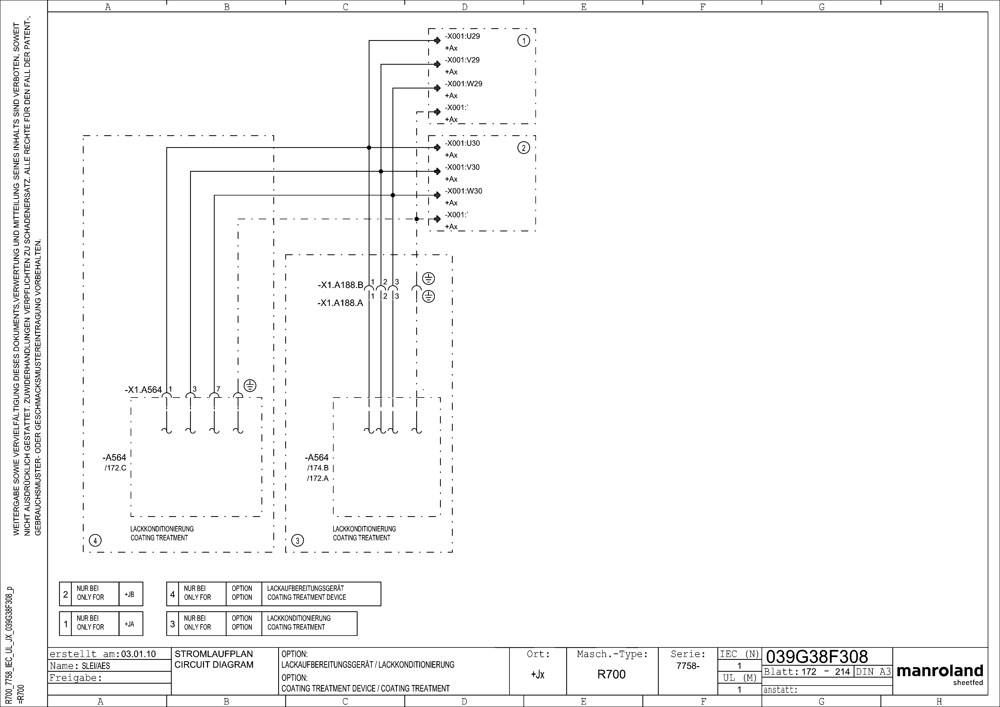

# +Jx — Sheet 172 of 214 — OPTION:

**LACKAUFBEREITUNGSGERÄT / LACKKONDITIONIERUNG**

> Part of the manroland **R700** printing press IEC/UL circuit diagrams.
> Drawing class: **Stromlaufplan / Circuit diagram** (DIN A3).
> Document `+Jx` covers the **1st printing module + feed register** machine section.

## At a glance

| Field | Value |
|---|---|
| Document | `+Jx`  (039G38F308) |
| Sheet | **172** of 214 |
| Section (DE) | OPTION: |
| Section (EN) | LACKAUFBEREITUNGSGERÄT / LACKKONDITIONIERUNG |
| Section type | CIRCUIT — Circuit diagram |
| Machine type | `R700` |
| Series | `7758` |
| Created | 03.01.10 |
| Replaces | — |
| Columns used | A, B, C, D, E |
| Path numbers | — |
| Labels on sheet | 64 |
| Cross-refs out | 3 |
| Cross-refs in | 15 |

**Previous:** [+Jx sheet 171](SHEET_0171.md) · **Next:** [+Jx sheet 173](SHEET_0173.md) · **Document TOC:** [_TOC.md](_TOC.md)  (+Jx) · **Master TOC:** [all sheets](../_MASTER_TOC.md)

## Sheet image (300 DPI, exact vector render)



_Rendered directly from the PDF vector layer at 300 DPI (1-bit), no OCR and no resampling. Use it to confirm anything ambiguous in the text below._

## Cross-references on this sheet

Each entry is a wire leaving this sheet. The printed token is `/sheet.column`; the link resolves to that sheet inside the same document.

| Ref | Target sheet | Col | Path | Destination on target | Target section | From col |
|---|---|---|---|---|---|---|
| `/174.B` | [+Jx sheet 174](SHEET_0174.md) | B | — | — | OPTION: | C |
| `/172.A` | [+Jx sheet 172](SHEET_0172.md) | A | — | — | OPTION: | C |
| `/172.C` | [+Jx sheet 172](SHEET_0172.md) | C | — | — | OPTION: | A |

### Incoming references (sheets that point here)

Every other sheet that sends a wire to this one. `Back-ref` is the token printed on *that* sheet; `Path` is its line number.

| From sheet | Cols | Back-ref | Path | Refs | What continues there |
|---|---|---|---|---|---|
| [+Jx#113](SHEET_0113.md) | F | `/113.F` | — | 8 | — |
| [+Jx#115](SHEET_0115.md) | A | `/115.A` | — | 4 | — |
| [+Jx#172](SHEET_0172.md) | A, C | `/172.A`, `/172.C` | — | 2 | — |
| [+Jx#174](SHEET_0174.md) | B | `/174.B` | — | 1 | — |


## Devices on this sheet

| Tag | Class | Class meaning (IEC) | Col | Sub | Terminal | Sign |
|---|---|---|---|---|---|---|
| `X001:W30` | X | Klemme / terminal, plug connector | D | — | W30 | — |
| `X001:V30` | X | Klemme / terminal, plug connector | D | — | V30 | — |
| `X001:U30` | X | Klemme / terminal, plug connector | D | — | U30 | — |
| `X001:W29` | X | Klemme / terminal, plug connector | D | — | W29 | — |
| `X001:V29` | X | Klemme / terminal, plug connector | D | — | V29 | — |
| `X001:U29` | X | Klemme / terminal, plug connector | D | — | U29 | — |
| `A564` | A | Baugruppe / assembly, module, PC board | C | — | — | — |
| `A564` | A | Baugruppe / assembly, module, PC board | A | — | — | — |
| `X1.A188.A` | — | cross-device reference | C | — | — | — |
| `X1.A188.B` | — | cross-device reference | C | — | — | — |
| `X1.A564` | — | cross-device reference | A | — | — | — |

## Potentials / nets

_No named potentials on this sheet._

## Wire-end annotations (grouped as printed)

A wire that continues elsewhere is annotated with a small cluster: the destination description, the path/line number `#NN`, and the `/sheet.column` cross reference. Each row below is one such cluster exactly as it is grouped on the drawing.

| Col | Y | Path | Cross-ref | Text on the wire |
|---|---|---|---|---|
| D | 39.2 | — | — | `X001:U29` |
| E | 45.1 | — | — | `1` |
| D | 53.5 | — | — | `+Ax` |
| D | 67.5 | — | — | `X001:V29` |
| D | 81.8 | — | — | `+Ax` |
| D | 95.8 | — | — | `X001:W29` |
| D | 110.1 | — | — | `+Ax` |
| D | 124.3 | — | — | `X001:'` |
| D | 138.5 | — | — | `+Ax` |
| D | 166.8 | — | — | `X001:U30` |
| D | 173.2 | — | — | `2` |
| D | 181.0 | — | — | `+Ax` |
| D | 195.1 | — | — | `X001:V30` |
| D | 209.4 | — | — | `+Ax` |
| D | 223.4 | — | — | `X001:W30` |
| D | 237.7 | — | — | `+Ax` |
| D | 251.8 | — | — | `X001:'` |
| D | 266.1 | — | — | `+Ax` |
| C | 331.9 | — | — | `X1.A188.B 1 2 3` |
| C | 348.9 | — | — | `X1.A188.A 1` |
| C | 348.9 | — | — | `2 3` |
| B | 459.4 | — | — | `X1.A564 1 3 7 '` |
| A | 540.2 | — | — | `A564` |
| C | 540.2 | — | — | `A564` |
| A | 553.3 | — | `/172.C` | — |
| C | 553.3 | — | `/174.B`, `/172.A` | — |
| A | 627.0 | — | — | `LACKKONDITIONIERUNG COATING TREATMENT` |
| C | 627.0 | — | — | `LACKKONDITIONIERUNG COATING TREATMENT` |
| B | 640.9 | — | — | `4 3` |
| A | 697.9 | — | — | `2 NUR BEI ONLY FOR +JB` |
| B | 697.9 | — | — | `4 NUR BEI ONLY FOR OPTION OPTION` |
| C | 697.9 | — | — | `LACKAUFBEREITUNGSGERÄT COATING TREATMENT DEVICE` |
| A | 733.3 | — | — | `1 NUR BEI ONLY FOR +JA` |
| B | 733.3 | — | — | `3 NUR BEI ONLY FOR OPTION OPTION` |
| C | 733.4 | — | — | `LACKKONDITIONIERUNG COATING TREATMENT` |


## Notes and free text on this sheet

| Text | Col | Y (pt) |
|---|---|---|
| `+Ax` | D | 237.7 |
| `X001:'` | D | 251.82 |
| `LACKKONDITIONIERUNG` | C | 627.05 |
| `COATING TREATMENT` | C | 637.68 |
| `LACKKONDITIONIERUNG` | A | 627.05 |
| `COATING TREATMENT` | A | 637.68 |
| `NUR BEI` | A | 733.3 |
| `ONLY FOR` | A | 743.98 |
| `+JA` | A | 740.38 |
| `+JB` | A | 704.92 |
| `NUR BEI` | B | 733.3 |
| `ONLY FOR` | B | 743.98 |
| `OPTION` | B | 733.32 |
| `LACKAUFBEREITUNGSGERÄT` | C | 697.91 |
| `COATING TREATMENT DEVICE` | C | 708.54 |

## Complete label inventory (exact text from the drawing)

Every text object inside the drawing area of this sheet, in DIN reading order (column A→H, then top→bottom). This is the authoritative list: if a string is not here it is not printed on this sheet.

| Col | Y | X | Dir | Type | Text |
|---|---|---|---|---|---|
| A | 459.5 | 148.8 | → | device ref | `X1.A564` |
| A | 540.2 | 122.2 | → | device tag | `A564` |
| A | 553.3 | 124.7 | → | cross-reference | `/172.C` |
| A | 627.0 | 155.3 | → | text | `LACKKONDITIONIERUNG` |
| A | 637.7 | 155.6 | → | text | `COATING TREATMENT` |
| A | 640.9 | 111.6 | → | number | `4` |
| A | 697.9 | 91.6 | → | text | `NUR BEI` |
| A | 703.2 | 75.1 | → | number | `2` |
| A | 704.9 | 148.5 | → | text | `+JB` |
| A | 708.5 | 91.8 | → | text | `ONLY FOR` |
| A | 733.3 | 91.6 | → | text | `NUR BEI` |
| A | 738.6 | 75.4 | → | number | `1` |
| A | 740.4 | 148.5 | → | text | `+JA` |
| A | 744.0 | 91.8 | → | text | `ONLY FOR` |
| B | 459.5 | 200.4 | → | number | `1` |
| B | 459.5 | 229.3 | → | number | `3` |
| B | 459.5 | 257.7 | → | number | `7` |
| B | 697.9 | 219.1 | → | text | `NUR BEI` |
| B | 697.9 | 276.1 | → | text | `OPTION` |
| B | 703.2 | 202.7 | → | number | `4` |
| B | 708.5 | 219.4 | → | text | `ONLY FOR` |
| B | 708.5 | 276.1 | → | text | `OPTION` |
| B | 733.3 | 219.1 | → | text | `NUR BEI` |
| B | 733.3 | 276.1 | → | text | `OPTION` |
| B | 738.6 | 202.5 | → | number | `3` |
| B | 743.9 | 276.1 | → | text | `OPTION` |
| B | 744.0 | 219.4 | → | text | `ONLY FOR` |
| C | 331.9 | 441.4 | → | number | `1` |
| C | 331.9 | 456.4 | → | number | `2` |
| C | 331.9 | 470.3 | → | number | `3` |
| C | 334.7 | 378.7 | → | device ref | `X1.A188.B` |
| C | 348.9 | 441.4 | → | number | `1` |
| C | 348.9 | 456.4 | → | number | `2` |
| C | 348.9 | 470.3 | → | number | `3` |
| C | 356.0 | 378.1 | → | device ref | `X1.A188.A` |
| C | 540.2 | 363.1 | → | device tag | `A564` |
| C | 553.3 | 366.0 | → | cross-reference | `/174.B` |
| C | 565.7 | 365.7 | → | cross-reference | `/172.A` |
| C | 627.0 | 396.3 | → | text | `LACKKONDITIONIERUNG` |
| C | 637.7 | 396.6 | → | text | `COATING TREATMENT` |
| C | 640.9 | 352.3 | → | number | `3` |
| C | 697.9 | 318.3 | → | text | `LACKAUFBEREITUNGSGERÄT` |
| C | 708.5 | 318.6 | → | text | `COATING TREATMENT DEVICE` |
| C | 733.3 | 318.3 | → | text | `LACKKONDITIONIERUNG` |
| C | 744.0 | 318.6 | → | text | `COATING TREATMENT` |
| D | 39.2 | 529.8 | → | device tag | `X001:U29` |
| D | 53.5 | 529.8 | → | text | `+Ax` |
| D | 67.6 | 529.8 | → | device tag | `X001:V29` |
| D | 81.8 | 529.8 | → | text | `+Ax` |
| D | 95.8 | 529.8 | → | device tag | `X001:W29` |
| D | 110.1 | 529.8 | → | text | `+Ax` |
| D | 124.3 | 529.8 | → | text | `X001:'` |
| D | 138.5 | 529.8 | → | text | `+Ax` |
| D | 166.8 | 529.8 | → | device tag | `X001:U30` |
| D | 173.2 | 621.6 | → | number | `2` |
| D | 181.0 | 529.8 | → | text | `+Ax` |
| D | 195.1 | 529.8 | → | device tag | `X001:V30` |
| D | 209.4 | 529.8 | → | text | `+Ax` |
| D | 223.4 | 529.8 | → | device tag | `X001:W30` |
| D | 237.7 | 529.8 | → | text | `+Ax` |
| D | 251.8 | 529.8 | → | text | `X001:'` |
| D | 266.1 | 529.8 | → | text | `+Ax` |
| D | 463.1 | 502.9 | → | other | `'` |
| E | 45.1 | 621.8 | → | number | `1` |

## Reading-order text block

The same content as a plain block, grouped by DIN column — convenient to paste or to match against a visual description.

```text
=== Column A ===
 459.5  148.8  devref       X1.A564
 540.2  122.2  devtag       A564
 553.3  124.7  xref         /172.C
 627.0  155.3  text         LACKKONDITIONIERUNG
 637.7  155.6  text         COATING TREATMENT
 640.9  111.6  numeric      4
 697.9   91.6  text         NUR BEI
 703.2   75.1  numeric      2
 704.9  148.5  text         +JB
 708.5   91.8  text         ONLY FOR
 733.3   91.6  text         NUR BEI
 738.6   75.4  numeric      1
 740.4  148.5  text         +JA
 744.0   91.8  text         ONLY FOR
=== Column B ===
 459.5  200.4  numeric      1
 459.5  229.3  numeric      3
 459.5  257.7  numeric      7
 697.9  219.1  text         NUR BEI
 697.9  276.1  text         OPTION
 703.2  202.7  numeric      4
 708.5  219.4  text         ONLY FOR
 708.5  276.1  text         OPTION
 733.3  219.1  text         NUR BEI
 733.3  276.1  text         OPTION
 738.6  202.5  numeric      3
 743.9  276.1  text         OPTION
 744.0  219.4  text         ONLY FOR
=== Column C ===
 331.9  441.4  numeric      1
 331.9  456.4  numeric      2
 331.9  470.3  numeric      3
 334.7  378.7  devref       X1.A188.B
 348.9  441.4  numeric      1
 348.9  456.4  numeric      2
 348.9  470.3  numeric      3
 356.0  378.1  devref       X1.A188.A
 540.2  363.1  devtag       A564
 553.3  366.0  xref         /174.B
 565.7  365.7  xref         /172.A
 627.0  396.3  text         LACKKONDITIONIERUNG
 637.7  396.6  text         COATING TREATMENT
 640.9  352.3  numeric      3
 697.9  318.3  text         LACKAUFBEREITUNGSGERÄT
 708.5  318.6  text         COATING TREATMENT DEVICE
 733.3  318.3  text         LACKKONDITIONIERUNG
 744.0  318.6  text         COATING TREATMENT
=== Column D ===
  39.2  529.8  devtag       X001:U29
  53.5  529.8  text         +Ax
  67.6  529.8  devtag       X001:V29
  81.8  529.8  text         +Ax
  95.8  529.8  devtag       X001:W29
 110.1  529.8  text         +Ax
 124.3  529.8  text         X001:`
 138.5  529.8  text         +Ax
 166.8  529.8  devtag       X001:U30
 173.2  621.6  numeric      2
 181.0  529.8  text         +Ax
 195.1  529.8  devtag       X001:V30
 209.4  529.8  text         +Ax
 223.4  529.8  devtag       X001:W30
 237.7  529.8  text         +Ax
 251.8  529.8  text         X001:`
 266.1  529.8  text         +Ax
 463.1  502.9  other        `
=== Column E ===
  45.1  621.8  numeric      1
```

---
_Generated from the PDF vector text layer; no OCR. Source: `R700_7758_IEC_UL_JX_039G38F308_p`, sheet 172._
