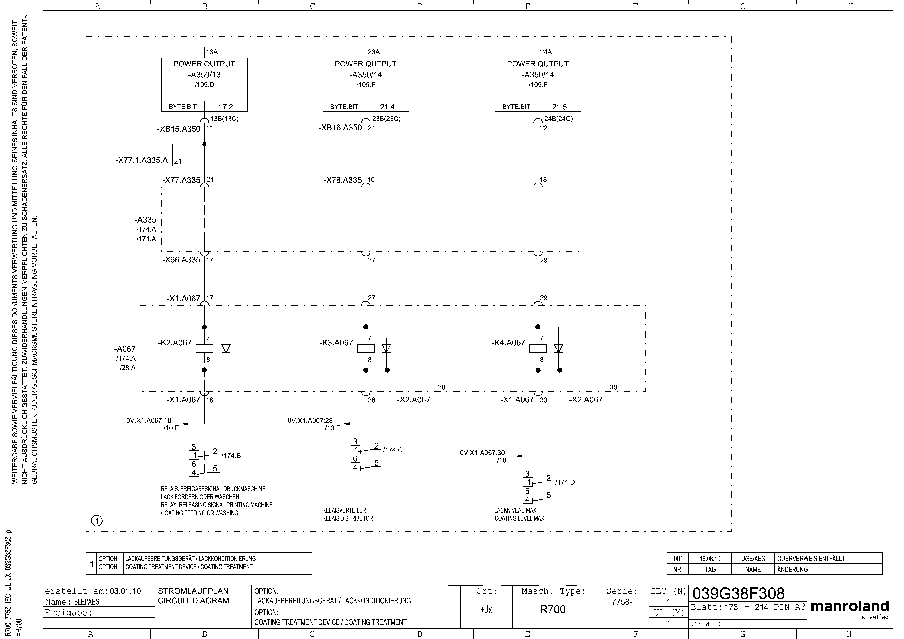

# +Jx — Sheet 173 of 214 — OPTION:

**LACKAUFBEREITUNGSGERÄT / LACKKONDITIONIERUNG**

> Part of the manroland **R700** printing press IEC/UL circuit diagrams.
> Drawing class: **Stromlaufplan / Circuit diagram** (DIN A3).
> Document `+Jx` covers the **1st printing module + feed register** machine section.

## At a glance

| Field | Value |
|---|---|
| Document | `+Jx`  (039G38F308) |
| Sheet | **173** of 214 |
| Section (DE) | OPTION: |
| Section (EN) | LACKAUFBEREITUNGSGERÄT / LACKKONDITIONIERUNG |
| Section type | CIRCUIT — Circuit diagram |
| Machine type | `R700` |
| Series | `7758` |
| Created | 03.01.10 |
| Replaces | — |
| Columns used | A, B, C, D, E, F, G, H |
| Path numbers | — |
| Labels on sheet | 114 |
| Cross-refs out | 13 |
| Cross-refs in | 31 |

**Previous:** [+Jx sheet 172](SHEET_0172.md) · **Next:** [+Jx sheet 174](SHEET_0174.md) · **Document TOC:** [_TOC.md](_TOC.md)  (+Jx) · **Master TOC:** [all sheets](../_MASTER_TOC.md)

## Sheet image (300 DPI, exact vector render)



_Rendered directly from the PDF vector layer at 300 DPI (1-bit), no OCR and no resampling. Use it to confirm anything ambiguous in the text below._

## Cross-references on this sheet

Each entry is a wire leaving this sheet. The printed token is `/sheet.column`; the link resolves to that sheet inside the same document.

| Ref | Target sheet | Col | Path | Destination on target | Target section | From col |
|---|---|---|---|---|---|---|
| `/109.F` | [+Jx sheet 109](SHEET_0109.md) | F | — | — | REFERENZMODUL | C |
| `/109.F` | [+Jx sheet 109](SHEET_0109.md) | F | — | — | REFERENZMODUL | E |
| `/109.D` | [+Jx sheet 109](SHEET_0109.md) | D | — | — | REFERENZMODUL | B |
| `/174.A` | [+Jx sheet 174](SHEET_0174.md) | A | — | — | OPTION: | A |
| `/171.A` | [+Jx sheet 171](SHEET_0171.md) | A | — | — | OPTION: AUTOMATISCHEM SPÜLEN | A |
| `/174.A` | [+Jx sheet 174](SHEET_0174.md) | A | — | — | OPTION: | A |
| `/28.A` | [+Jx sheet 28](SHEET_0028.md) | A | — | — | KAMMERRAKEL | A |
| `/10.F` | [+Jx sheet 10](SHEET_0010.md) | F | — | 0V.X1.A067:18 0V.X1.A067:28 | SPANNUNGSVERSORGUNG, SCHALTSCHRANKBELÜFTUNG | B |
| `/10.F` | [+Jx sheet 10](SHEET_0010.md) | F | — | 0V.X1.A067:18 0V.X1.A067:28 | SPANNUNGSVERSORGUNG, SCHALTSCHRANKBELÜFTUNG | B |
| `/174.C` | [+Jx sheet 174](SHEET_0174.md) | C | — | — | OPTION: | D |
| `/10.F` | [+Jx sheet 10](SHEET_0010.md) | F | — | 0V.X1.A067:30 | SPANNUNGSVERSORGUNG, SCHALTSCHRANKBELÜFTUNG | E |
| `/174.B` | [+Jx sheet 174](SHEET_0174.md) | B | — | — | OPTION: | B |
| `/174.D` | [+Jx sheet 174](SHEET_0174.md) | D | — | — | OPTION: | E |

### Incoming references (sheets that point here)

Every other sheet that sends a wire to this one. `Back-ref` is the token printed on *that* sheet; `Path` is its line number.

| From sheet | Cols | Back-ref | Path | Refs | What continues there |
|---|---|---|---|---|---|
| [+Jx#10](SHEET_0010.md) | F | `/10.F` | — | 3 | — |
| [+Jx#28](SHEET_0028.md) | A | `/28.A` | — | 1 | — |
| [+Jx#109](SHEET_0109.md) | D, F | `/109.D`, `/109.F` | — | 3 | — |
| [+Jx#112](SHEET_0112.md) | C, D | `/112.C`, `/112.D` | — | 6 | — |
| [+Jx#123](SHEET_0123.md) | B | `/123.B` | — | 2 | — |
| [+Jx#139](SHEET_0139.md) | B, G | `/139.B`, `/139.G` | — | 3 | — |
| [+Jx#152](SHEET_0152.md) | A, B | `/152.A`, `/152.B` | — | 3 | — |
| [+Jx#155](SHEET_0155.md) | D | `/155.D` | — | 1 | — |
| [+Jx#156](SHEET_0156.md) | A, C | `/156.A`, `/156.C` | — | 3 | — |
| [+Jx#171](SHEET_0171.md) | A | `/171.A` | — | 1 | — |
| [+Jx#174](SHEET_0174.md) | A, B, C, D | `/174.A`, `/174.B`, `/174.C`, `/174.D` | — | 5 | — |


## Devices on this sheet

| Tag | Class | Class meaning (IEC) | Col | Sub | Terminal | Sign |
|---|---|---|---|---|---|---|
| `A350/13` | A | Baugruppe / assembly, module, PC board | B | 13 | — | — |
| `A350/14` | A | Baugruppe / assembly, module, PC board | C | 14 | — | — |
| `A350/14` | A | Baugruppe / assembly, module, PC board | E | 14 | — | — |
| `A067` | A | Baugruppe / assembly, module, PC board | A | — | — | — |
| `A335` | A | Baugruppe / assembly, module, PC board | A | — | — | — |
| `17.2` | — | cross-device reference | B | — | — | — |
| `XB15.A350` | — | cross-device reference | B | — | — | — |
| `XB16.A350` | — | cross-device reference | C | — | — | — |
| `21.4` | — | cross-device reference | D | — | — | — |
| `21.5` | — | cross-device reference | E | — | — | — |
| `X1.A067` | — | cross-device reference | B | — | — | — |
| `K2.A067` | — | cross-device reference | B | — | — | — |
| `K3.A067` | — | cross-device reference | C | — | — | — |
| `K4.A067` | — | cross-device reference | E | — | — | — |
| `X1.A067` | — | cross-device reference | B | — | — | — |
| `X1.A067` | — | cross-device reference | E | — | — | — |
| `X77.A335` | — | cross-device reference | B | — | — | — |
| `X66.A335` | — | cross-device reference | B | — | — | — |
| `X78.A335` | — | cross-device reference | C | — | — | — |
| `X77.1.A335.A` | — | cross-device reference | A | — | — | — |
| `NR.` | — | cross-device reference | F | — | — | — |
| `19.08.10` | — | cross-device reference | G | — | — | — |
| `X2.A067` | — | cross-device reference | D | — | — | — |
| `X2.A067` | — | cross-device reference | F | — | — | — |

## Potentials / nets

| Potential | Count | Columns | Attached devices | Terminals |
|---|---|---|---|---|
| `0V` | 3 | A, C, E | `A067`, `X1` | `18`, `28`, `30` |


A potential such as `L24+/4` or `M24+` is a named supply/return rail; every place it appears on this sheet is electrically common.

## Wire-end annotations (grouped as printed)

A wire that continues elsewhere is annotated with a small cluster: the destination description, the path/line number `#NN`, and the `/sheet.column` cross reference. Each row below is one such cluster exactly as it is grouped on the drawing.

| Col | Y | Path | Cross-ref | Text on the wire |
|---|---|---|---|---|
| B | 64.7 | — | — | `13A` |
| D | 64.7 | — | — | `23A` |
| E | 64.7 | — | — | `24A` |
| B | 79.9 | — | — | `POWER OUTPUT` |
| C | 79.9 | — | — | `POWER QUTPUT` |
| E | 79.9 | — | — | `POWER QUTPUT` |
| B | 93.8 | — | — | `A350/13` |
| C | 93.8 | — | — | `A350/14` |
| E | 93.8 | — | — | `A350/14` |
| B | 107.6 | — | `/109.D` | — |
| C | 107.6 | — | `/109.F` | — |
| E | 107.6 | — | `/109.F` | — |
| B | 136.6 | — | — | `BYTE.BIT 17.2` |
| C | 136.6 | — | — | `BYTE.BIT 21.4` |
| E | 136.6 | — | — | `BYTE.BIT 21.5` |
| B | 152.6 | — | — | `13B(13C)` |
| D | 152.6 | — | — | `23B(23C)` |
| E | 152.6 | — | — | `24B(24C)` |
| C | 163.2 | — | — | `XB15.A350 11 XB16.A350 21` |
| E | 164.7 | — | — | `22` |
| A | 206.5 | — | — | `X77.1.A335.A 21` |
| B | 232.7 | — | — | `X77.A335 21` |
| C | 232.7 | — | — | `X78.A335 16` |
| E | 232.7 | — | — | `18` |
| A | 285.1 | — | — | `A335` |
| A | 298.2 | — | `/174.A`, `/171.A` | — |
| B | 337.6 | — | — | `X66.A335 17` |
| D | 339.0 | — | — | `27` |
| E | 339.0 | — | — | `29` |
| B | 388.6 | — | — | `X1.A067 17` |
| D | 388.6 | — | — | `27 29` |
| B | 441.8 | — | — | `7` |
| D | 441.8 | — | — | `7` |
| E | 441.8 | — | — | `7` |
| B | 446.7 | — | — | `K2.A067` |
| C | 446.7 | — | — | `K3.A067` |
| E | 446.7 | — | — | `K4.A067` |
| A | 455.2 | — | — | `A067` |
| A | 468.3 | — | `/174.A` | — |
| B | 470.1 | — | — | `8` |
| D | 470.1 | — | — | `8` |
| E | 470.1 | — | — | `8` |
| A | 480.7 | — | `/28.A` | — |
| E | 506.2 | — | — | `28 30` |
| C | 521.8 | — | — | `X1.A067 18 28 X1.A067 30` |
| E | 521.8 | — | — | `X2.A067 X2.A067` |
| B | 550.1 | — | `/10.F`, `/10.F` | `0V.X1.A067:18 0V.X1.A067:28` |
| C | 577.0 | — | — | `3 6 4 1` |
| D | 582.7 | — | — | `2` |
| B | 584.1 | — | — | `3 6 4 1` |
| D | 589.1 | — | `/174.C` | — |
| B | 589.8 | — | — | `2` |
| E | 592.6 | — | `/10.F` | `0V.X1.A067:30` |
| B | 596.2 | — | `/174.B` | — |
| D | 605.4 | — | — | `5` |
| B | 612.5 | — | — | `5` |
| E | 619.6 | — | — | `3 6 4 1` |
| E | 625.2 | — | — | `2` |
| E | 631.6 | — | `/174.D` | — |
| B | 641.2 | — | — | `RELAIS: FREIGABESIGNAL DRUCKMASCHINE LACK FÖRDERN ODER WASCHEN RELAY: RELEASING SIGNAL PRINTING MACHINE COATING FEEDING OR WASHING` |
| E | 647.9 | — | — | `5` |
| C | 669.5 | — | — | `RELAISVERTEILER RELAIS DISTRIBUTOR` |
| E | 669.5 | — | — | `LACKNIVEAU MAX COATING LEVEL MAX` |
| A | 682.9 | — | — | `1` |
| G | 733.0 | — | — | `001 19.08.10 DGE/AES QUERVERWEIS ENTFÄLLT` |
| B | 733.3 | — | — | `1 OPTION OPTION LACKAUFBEREITUNGSGERÄT / LACKKONDITIONIERUNG COATING TREATMENT DEVICE / COATING TREATMENT` |
| G | 747.1 | — | — | `NR. TAG NAME ÄNDERUNG` |


## Reconstructed tables

This sheet carries tabular content (pin map / terminal assignment / index). The grid below was rebuilt from the drawing's own rule lines, so each row is exactly one physical row of the table.

### Table 1 — 3 data rows × 2 columns (at x=212.6, y=76.5)

| POWER A350/13 | OUTPUT /109.D |
|---|---|
| `BYTE.BIT` | `17.2` |
| `XB15.A350` | `13B(13C) 11` |
| `21 X77.A335 X66.A335 X1.A067 K2.A067` | `21 17 17 7 8` |


### Table 2 — 3 data rows × 3 columns (at x=425.2, y=76.5)

| POWER A350/14 | QUTPUT /109.F |  |
|---|---|---|
| `BYTE.BIT` |  | `21.4` |
| `XB16.A350` | `21` | `23B(23C)` |
| `X78.A335 K3.A067` | `16 27 27 7 8` |  |


### Table 3 — 2 data rows × 3 columns (at x=652.0, y=76.5)

| POWER A350/14 | QUTPUT /109.F |  |
|---|---|---|
| `BYTE.BIT` |  | `21.5` |
| `K4.A067` | `22 18 29 29 7 8` | `24B(24C)` |


## Notes and free text on this sheet

| Text | Col | Y (pt) |
|---|---|---|
| `13A` | B | 64.72 |
| `13B(13C)` | B | 152.63 |
| `POWER OUTPUT` | B | 79.87 |
| `BYTE.BIT` | B | 137.21 |
| `23A` | D | 64.72 |
| `23B(23C)` | D | 152.63 |
| `POWER QUTPUT` | C | 79.87 |
| `BYTE.BIT` | C | 137.21 |
| `24A` | E | 64.72 |
| `24B(24C)` | E | 152.63 |
| `POWER QUTPUT` | E | 79.87 |
| `BYTE.BIT` | E | 137.21 |
| `RELAISVERTEILER` | C | 669.55 |
| `RELAIS DISTRIBUTOR` | C | 680.19 |
| `RELAIS: FREIGABESIGNAL DRUCKMASCHINE` | B | 641.21 |
| `LACK FÖRDERN ODER WASCHEN` | B | 651.84 |
| `RELAY: RELEASING SIGNAL PRINTING MACHINE` | B | 662.48 |
| `COATING FEEDING OR WASHING` | B | 673.1 |
| `LACKNIVEAU MAX` | E | 669.55 |
| `COATING LEVEL MAX` | E | 680.19 |
| `TAG` | G | 747.23 |
| `NAME` | G | 747.22 |
| `ÄNDERUNG` | G | 747.25 |
| `DGE/AES` | G | 733.06 |
| `QUERVERWEIS ENTFÄLLT` | H | 733.07 |
| `LACKAUFBEREITUNGSGERÄT / LACKKONDITIONIERUNG` | B | 733.34 |
| `COATING TREATMENT DEVICE / COATING TREATMENT` | B | 743.97 |
| `OPTION` | A | 733.32 |

## Complete label inventory (exact text from the drawing)

Every text object inside the drawing area of this sheet, in DIN reading order (column A→H, then top→bottom). This is the authoritative list: if a string is not here it is not printed on this sheet.

| Col | Y | X | Dir | Type | Text |
|---|---|---|---|---|---|
| A | 206.5 | 152.2 | → | device ref | `X77.1.A335.A` |
| A | 285.1 | 177.4 | → | device tag | `A335` |
| A | 298.2 | 180.0 | → | cross-reference | `/174.A` |
| A | 310.6 | 180.0 | → | cross-reference | `/171.A` |
| A | 455.2 | 150.5 | → | device tag | `A067` |
| A | 468.3 | 153.1 | → | cross-reference | `/174.A` |
| A | 480.7 | 157.9 | → | cross-reference | `/28.A` |
| A | 550.1 | 166.4 | → | potential | `0V.X1.A067:18` |
| A | 682.9 | 125.7 | → | number | `1` |
| A | 733.3 | 130.1 | → | text | `OPTION` |
| A | 738.6 | 117.9 | → | number | `1` |
| A | 743.9 | 130.1 | → | text | `OPTION` |
| B | 64.7 | 271.3 | → | text | `13A` |
| B | 79.9 | 228.5 | → | text | `POWER OUTPUT` |
| B | 93.8 | 247.7 | → | device tag | `A350/13` |
| B | 107.6 | 256.5 | → | cross-reference | `/109.D` |
| B | 136.6 | 287.9 | → | device ref | `17.2` |
| B | 137.2 | 222.5 | → | text | `BYTE.BIT` |
| B | 152.6 | 276.9 | → | text | `13B(13C)` |
| B | 164.7 | 271.3 | → | number | `11` |
| B | 165.4 | 206.9 | → | device ref | `XB15.A350` |
| B | 208.6 | 229.6 | → | number | `21` |
| B | 232.7 | 213.7 | → | device ref | `X77.A335` |
| B | 232.7 | 272.1 | → | number | `21` |
| B | 337.6 | 213.7 | → | device ref | `X66.A335` |
| B | 339.0 | 271.3 | → | number | `17` |
| B | 388.6 | 219.7 | → | device ref | `X1.A067` |
| B | 388.6 | 271.3 | → | number | `17` |
| B | 441.8 | 271.8 | → | number | `7` |
| B | 446.7 | 208.3 | → | device ref | `K2.A067` |
| B | 470.1 | 271.8 | → | number | `8` |
| B | 521.8 | 219.7 | → | device ref | `X1.A067` |
| B | 523.3 | 271.3 | → | number | `18` |
| B | 560.0 | 215.4 | → | cross-reference | `/10.F` |
| B | 584.1 | 252.3 | → | number | `3` |
| B | 589.8 | 280.3 | → | number | `2` |
| B | 595.5 | 254.0 | → | number | `1` |
| B | 596.2 | 292.0 | → | cross-reference | `/174.B` |
| B | 606.8 | 252.3 | → | number | `6` |
| B | 612.5 | 280.3 | → | number | `5` |
| B | 618.2 | 252.3 | → | number | `4` |
| B | 641.2 | 212.0 | → | text | `RELAIS: FREIGABESIGNAL DRUCKMASCHINE` |
| B | 651.8 | 212.0 | → | text | `LACK FÖRDERN ODER WASCHEN` |
| B | 662.5 | 212.0 | → | text | `RELAY: RELEASING SIGNAL PRINTING MACHINE` |
| B | 673.1 | 212.3 | → | text | `COATING FEEDING OR WASHING` |
| B | 733.3 | 165.3 | → | text | `LACKAUFBEREITUNGSGERÄT / LACKKONDITIONIERUNG` |
| B | 744.0 | 165.5 | → | text | `COATING TREATMENT DEVICE / COATING TREATMENT` |
| C | 79.9 | 441.1 | → | text | `POWER QUTPUT` |
| C | 93.8 | 460.3 | → | device tag | `A350/14` |
| C | 107.6 | 469.6 | → | cross-reference | `/109.F` |
| C | 137.2 | 435.1 | → | text | `BYTE.BIT` |
| C | 163.2 | 419.5 | → | device ref | `XB16.A350` |
| C | 232.7 | 426.3 | → | device ref | `X78.A335` |
| C | 446.7 | 420.9 | → | device ref | `K3.A067` |
| C | 550.1 | 379.0 | → | potential | `0V.X1.A067:28` |
| C | 560.0 | 428.0 | → | cross-reference | `/10.F` |
| C | 577.1 | 464.9 | → | number | `3` |
| C | 588.4 | 466.6 | → | number | `1` |
| C | 599.7 | 464.9 | → | number | `6` |
| C | 611.1 | 464.9 | → | number | `4` |
| C | 669.5 | 424.6 | → | text | `RELAISVERTEILER` |
| C | 680.2 | 424.6 | → | text | `RELAIS DISTRIBUTOR` |
| D | 64.7 | 484.7 | → | text | `23A` |
| D | 136.6 | 500.7 | → | device ref | `21.4` |
| D | 152.6 | 490.4 | → | text | `23B(23C)` |
| D | 164.7 | 484.7 | → | number | `21` |
| D | 232.7 | 483.9 | → | number | `16` |
| D | 339.0 | 484.7 | → | number | `27` |
| D | 388.6 | 484.7 | → | number | `27` |
| D | 441.8 | 484.4 | → | number | `7` |
| D | 470.1 | 484.4 | → | number | `8` |
| D | 506.3 | 576.9 | → | number | `28` |
| D | 521.8 | 523.0 | → | device ref | `X2.A067` |
| D | 523.3 | 484.7 | → | number | `28` |
| D | 582.7 | 492.9 | → | number | `2` |
| D | 589.1 | 504.6 | → | cross-reference | `/174.C` |
| D | 605.4 | 492.9 | → | number | `5` |
| E | 64.7 | 711.5 | → | text | `24A` |
| E | 79.9 | 667.8 | → | text | `POWER QUTPUT` |
| E | 93.8 | 687.1 | → | device tag | `A350/14` |
| E | 107.6 | 696.3 | → | cross-reference | `/109.F` |
| E | 136.6 | 727.5 | → | device ref | `21.5` |
| E | 137.2 | 661.9 | → | text | `BYTE.BIT` |
| E | 152.6 | 717.2 | → | text | `24B(24C)` |
| E | 164.7 | 711.5 | → | number | `22` |
| E | 232.7 | 710.6 | → | number | `18` |
| E | 339.0 | 711.5 | → | number | `29` |
| E | 388.6 | 711.5 | → | number | `29` |
| E | 441.8 | 711.2 | → | number | `7` |
| E | 446.7 | 647.7 | → | device ref | `K4.A067` |
| E | 470.1 | 711.2 | → | number | `8` |
| E | 521.8 | 659.1 | → | device ref | `X1.A067` |
| E | 523.3 | 711.2 | → | number | `30` |
| E | 592.7 | 605.8 | → | potential | `0V.X1.A067:30` |
| E | 602.6 | 654.8 | → | cross-reference | `/10.F` |
| E | 619.6 | 691.7 | → | number | `3` |
| E | 625.2 | 719.7 | → | number | `2` |
| E | 630.9 | 693.4 | → | number | `1` |
| E | 631.7 | 731.3 | → | cross-reference | `/174.D` |
| E | 642.2 | 691.7 | → | number | `6` |
| E | 647.9 | 719.7 | → | number | `5` |
| E | 653.6 | 691.7 | → | number | `4` |
| E | 669.6 | 651.4 | → | text | `LACKNIVEAU MAX` |
| E | 680.2 | 651.7 | → | text | `COATING LEVEL MAX` |
| F | 506.3 | 803.3 | → | number | `30` |
| F | 521.8 | 749.8 | → | device ref | `X2.A067` |
| F | 733.0 | 887.6 | → | number | `001` |
| F | 747.1 | 886.8 | → | device ref | `NR.` |
| G | 733.1 | 921.5 | → | device ref | `19.08.10` |
| G | 733.1 | 976.4 | → | text | `DGE/AES` |
| G | 747.2 | 928.5 | → | text | `TAG` |
| G | 747.2 | 981.8 | → | text | `NAME` |
| G | 747.3 | 1024.0 | → | text | `ÄNDERUNG` |
| H | 733.1 | 1023.7 | → | text | `QUERVERWEIS ENTFÄLLT` |

## Reading-order text block

The same content as a plain block, grouped by DIN column — convenient to paste or to match against a visual description.

```text
=== Column A ===
 206.5  152.2  devref       X77.1.A335.A
 285.1  177.4  devtag       A335
 298.2  180.0  xref         /174.A
 310.6  180.0  xref         /171.A
 455.2  150.5  devtag       A067
 468.3  153.1  xref         /174.A
 480.7  157.9  xref         /28.A
 550.1  166.4  net          0V.X1.A067:18
 682.9  125.7  numeric      1
 733.3  130.1  text         OPTION
 738.6  117.9  numeric      1
 743.9  130.1  text         OPTION
=== Column B ===
  64.7  271.3  text         13A
  79.9  228.5  text         POWER OUTPUT
  93.8  247.7  devtag       A350/13
 107.6  256.5  xref         /109.D
 136.6  287.9  devref       17.2
 137.2  222.5  text         BYTE.BIT
 152.6  276.9  text         13B(13C)
 164.7  271.3  numeric      11
 165.4  206.9  devref       XB15.A350
 208.6  229.6  numeric      21
 232.7  213.7  devref       X77.A335
 232.7  272.1  numeric      21
 337.6  213.7  devref       X66.A335
 339.0  271.3  numeric      17
 388.6  219.7  devref       X1.A067
 388.6  271.3  numeric      17
 441.8  271.8  numeric      7
 446.7  208.3  devref       K2.A067
 470.1  271.8  numeric      8
 521.8  219.7  devref       X1.A067
 523.3  271.3  numeric      18
 560.0  215.4  xref         /10.F
 584.1  252.3  numeric      3
 589.8  280.3  numeric      2
 595.5  254.0  numeric      1
 596.2  292.0  xref         /174.B
 606.8  252.3  numeric      6
 612.5  280.3  numeric      5
 618.2  252.3  numeric      4
 641.2  212.0  text         RELAIS: FREIGABESIGNAL DRUCKMASCHINE
 651.8  212.0  text         LACK FÖRDERN ODER WASCHEN
 662.5  212.0  text         RELAY: RELEASING SIGNAL PRINTING MACHINE
 673.1  212.3  text         COATING FEEDING OR WASHING
 733.3  165.3  text         LACKAUFBEREITUNGSGERÄT / LACKKONDITIONIERUNG
 744.0  165.5  text         COATING TREATMENT DEVICE / COATING TREATMENT
=== Column C ===
  79.9  441.1  text         POWER QUTPUT
  93.8  460.3  devtag       A350/14
 107.6  469.6  xref         /109.F
 137.2  435.1  text         BYTE.BIT
 163.2  419.5  devref       XB16.A350
 232.7  426.3  devref       X78.A335
 446.7  420.9  devref       K3.A067
 550.1  379.0  net          0V.X1.A067:28
 560.0  428.0  xref         /10.F
 577.1  464.9  numeric      3
 588.4  466.6  numeric      1
 599.7  464.9  numeric      6
 611.1  464.9  numeric      4
 669.5  424.6  text         RELAISVERTEILER
 680.2  424.6  text         RELAIS DISTRIBUTOR
=== Column D ===
  64.7  484.7  text         23A
 136.6  500.7  devref       21.4
 152.6  490.4  text         23B(23C)
 164.7  484.7  numeric      21
 232.7  483.9  numeric      16
 339.0  484.7  numeric      27
 388.6  484.7  numeric      27
 441.8  484.4  numeric      7
 470.1  484.4  numeric      8
 506.3  576.9  numeric      28
 521.8  523.0  devref       X2.A067
 523.3  484.7  numeric      28
 582.7  492.9  numeric      2
 589.1  504.6  xref         /174.C
 605.4  492.9  numeric      5
=== Column E ===
  64.7  711.5  text         24A
  79.9  667.8  text         POWER QUTPUT
  93.8  687.1  devtag       A350/14
 107.6  696.3  xref         /109.F
 136.6  727.5  devref       21.5
 137.2  661.9  text         BYTE.BIT
 152.6  717.2  text         24B(24C)
 164.7  711.5  numeric      22
 232.7  710.6  numeric      18
 339.0  711.5  numeric      29
 388.6  711.5  numeric      29
 441.8  711.2  numeric      7
 446.7  647.7  devref       K4.A067
 470.1  711.2  numeric      8
 521.8  659.1  devref       X1.A067
 523.3  711.2  numeric      30
 592.7  605.8  net          0V.X1.A067:30
 602.6  654.8  xref         /10.F
 619.6  691.7  numeric      3
 625.2  719.7  numeric      2
 630.9  693.4  numeric      1
 631.7  731.3  xref         /174.D
 642.2  691.7  numeric      6
 647.9  719.7  numeric      5
 653.6  691.7  numeric      4
 669.6  651.4  text         LACKNIVEAU MAX
 680.2  651.7  text         COATING LEVEL MAX
=== Column F ===
 506.3  803.3  numeric      30
 521.8  749.8  devref       X2.A067
 733.0  887.6  numeric      001
 747.1  886.8  devref       NR.
=== Column G ===
 733.1  921.5  devref       19.08.10
 733.1  976.4  text         DGE/AES
 747.2  928.5  text         TAG
 747.2  981.8  text         NAME
 747.3 1024.0  text         ÄNDERUNG
=== Column H ===
 733.1 1023.7  text         QUERVERWEIS ENTFÄLLT
```

---
_Generated from the PDF vector text layer; no OCR. Source: `R700_7758_IEC_UL_JX_039G38F308_p`, sheet 173._
