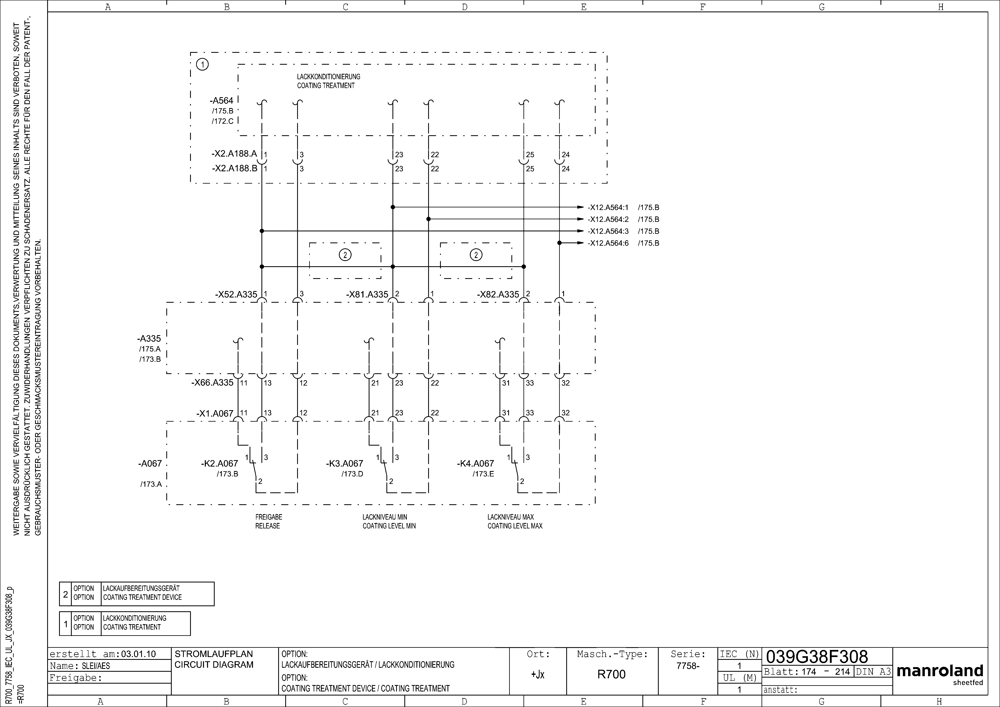

# +Jx — Sheet 174 of 214 — OPTION:

**LACKAUFBEREITUNGSGERÄT / LACKKONDITIONIERUNG**

> Part of the manroland **R700** printing press IEC/UL circuit diagrams.
> Drawing class: **Stromlaufplan / Circuit diagram** (DIN A3).
> Document `+Jx` covers the **1st printing module + feed register** machine section.

## At a glance

| Field | Value |
|---|---|
| Document | `+Jx`  (039G38F308) |
| Sheet | **174** of 214 |
| Section (DE) | OPTION: |
| Section (EN) | LACKAUFBEREITUNGSGERÄT / LACKKONDITIONIERUNG |
| Section type | CIRCUIT — Circuit diagram |
| Machine type | `R700` |
| Series | `7758` |
| Created | 03.01.10 |
| Replaces | — |
| Columns used | A, B, C, D, E, F |
| Path numbers | — |
| Labels on sheet | 95 |
| Cross-refs out | 12 |
| Cross-refs in | 48 |

**Previous:** [+Jx sheet 173](SHEET_0173.md) · **Next:** [+Jx sheet 175](SHEET_0175.md) · **Document TOC:** [_TOC.md](_TOC.md)  (+Jx) · **Master TOC:** [all sheets](../_MASTER_TOC.md)

## Sheet image (300 DPI, exact vector render)



_Rendered directly from the PDF vector layer at 300 DPI (1-bit), no OCR and no resampling. Use it to confirm anything ambiguous in the text below._

## Cross-references on this sheet

Each entry is a wire leaving this sheet. The printed token is `/sheet.column`; the link resolves to that sheet inside the same document.

| Ref | Target sheet | Col | Path | Destination on target | Target section | From col |
|---|---|---|---|---|---|---|
| `/175.B` | [+Jx sheet 175](SHEET_0175.md) | B | — | — | OPTION: | B |
| `/172.C` | [+Jx sheet 172](SHEET_0172.md) | C | — | — | OPTION: | B |
| `/175.B` | [+Jx sheet 175](SHEET_0175.md) | B | — | X12.A564:1 | OPTION: | E |
| `/175.B` | [+Jx sheet 175](SHEET_0175.md) | B | — | X12.A564:2 | OPTION: | E |
| `/175.B` | [+Jx sheet 175](SHEET_0175.md) | B | — | X12.A564:3 | OPTION: | E |
| `/175.B` | [+Jx sheet 175](SHEET_0175.md) | B | — | X12.A564:6 | OPTION: | E |
| `/175.A` | [+Jx sheet 175](SHEET_0175.md) | A | — | — | OPTION: | A |
| `/173.B` | [+Jx sheet 173](SHEET_0173.md) | B | — | — | OPTION: | A |
| `/173.B` | [+Jx sheet 173](SHEET_0173.md) | B | — | — | OPTION: | B |
| `/173.E` | [+Jx sheet 173](SHEET_0173.md) | E | — | — | OPTION: | D |
| `/173.D` | [+Jx sheet 173](SHEET_0173.md) | D | — | — | OPTION: | C |
| `/173.A` | [+Jx sheet 173](SHEET_0173.md) | A | — | — | OPTION: | A |

### Incoming references (sheets that point here)

Every other sheet that sends a wire to this one. `Back-ref` is the token printed on *that* sheet; `Path` is its line number.

| From sheet | Cols | Back-ref | Path | Refs | What continues there |
|---|---|---|---|---|---|
| [+Jx#112](SHEET_0112.md) | C, D | `/112.C`, `/112.D` | — | 9 | — |
| [+Jx#124](SHEET_0124.md) | A, B | `/124.A`, `/124.B` | — | 12 | — |
| [+Jx#151](SHEET_0151.md) | B | `/151.B` | — | 2 | — |
| [+Jx#152](SHEET_0152.md) | A, B | `/152.A`, `/152.B` | — | 9 | — |
| [+Jx#156](SHEET_0156.md) | E | `/156.E` | — | 4 | — |
| [+Jx#172](SHEET_0172.md) | C | `/172.C` | — | 1 | — |
| [+Jx#173](SHEET_0173.md) | A, B, D, E | `/173.A`, `/173.B`, `/173.D`, `/173.E` | — | 5 | — |
| [+Jx#175](SHEET_0175.md) | A | `/175.A` | — | 6 | X12.A564:1; X12.A564:2; X12.A564:3; X12.A564:6 |


## Devices on this sheet

| Tag | Class | Class meaning (IEC) | Col | Sub | Terminal | Sign |
|---|---|---|---|---|---|---|
| `A067` | A | Baugruppe / assembly, module, PC board | A | — | — | — |
| `A335` | A | Baugruppe / assembly, module, PC board | A | — | — | — |
| `A564` | A | Baugruppe / assembly, module, PC board | B | — | — | — |
| `K2.A067` | — | cross-device reference | B | — | — | — |
| `X1.A067` | — | cross-device reference | B | — | — | — |
| `X52.A335` | — | cross-device reference | B | — | — | — |
| `X66.A335` | — | cross-device reference | B | — | — | — |
| `K3.A067` | — | cross-device reference | C | — | — | — |
| `X81.A335` | — | cross-device reference | C | — | — | — |
| `K4.A067` | — | cross-device reference | D | — | — | — |
| `X82.A335` | — | cross-device reference | D | — | — | — |
| `X2.A188.A` | — | cross-device reference | B | — | — | — |
| `X2.A188.B` | — | cross-device reference | B | — | — | — |
| `X12.A564:2` | — | cross-device reference | E | — | 2 | — |
| `X12.A564:3` | — | cross-device reference | E | — | 3 | — |
| `X12.A564:6` | — | cross-device reference | E | — | 6 | — |
| `X12.A564:1` | — | cross-device reference | E | — | 1 | — |

## Potentials / nets

_No named potentials on this sheet._

## Wire-end annotations (grouped as printed)

A wire that continues elsewhere is annotated with a small cluster: the destination description, the path/line number `#NN`, and the `/sheet.column` cross reference. Each row below is one such cluster exactly as it is grouped on the drawing.

| Col | Y | Path | Cross-ref | Text on the wire |
|---|---|---|---|---|
| B | 73.5 | — | — | `1` |
| C | 88.5 | — | — | `LACKKONDITIONIERUNG COATING TREATMENT` |
| B | 115.0 | — | — | `A564` |
| B | 128.1 | — | `/175.B`, `/172.C` | — |
| B | 178.1 | — | — | `X2.A188.A 1` |
| C | 180.3 | — | — | `3` |
| C | 180.3 | — | — | `23` |
| D | 180.3 | — | — | `22` |
| E | 180.3 | — | — | `25` |
| E | 180.3 | — | — | `24` |
| B | 195.8 | — | — | `X2.A188.B 1` |
| C | 197.3 | — | — | `3` |
| C | 197.3 | — | — | `23` |
| D | 197.3 | — | — | `22` |
| E | 197.3 | — | — | `25` |
| E | 197.3 | — | — | `24` |
| E | 243.3 | — | `/175.B` | `X12.A564:1` |
| E | 257.4 | — | `/175.B` | `X12.A564:2` |
| E | 271.6 | — | `/175.B` | `X12.A564:3` |
| E | 285.8 | — | `/175.B` | `X12.A564:6` |
| D | 300.7 | — | — | `2 2` |
| B | 346.1 | — | — | `X52.A335 1` |
| C | 346.1 | — | — | `3` |
| C | 346.1 | — | — | `X81.A335 2` |
| D | 346.1 | — | — | `1` |
| D | 346.1 | — | — | `X82.A335 2` |
| E | 346.1 | — | — | `1` |
| A | 398.5 | — | — | `A335` |
| A | 411.6 | — | `/175.A`, `/173.B` | — |
| B | 450.9 | — | — | `X66.A335 11 13` |
| C | 452.4 | — | — | `12` |
| C | 452.4 | — | — | `21 23` |
| D | 452.4 | — | — | `22` |
| D | 452.4 | — | — | `31 33` |
| E | 452.4 | — | — | `32` |
| B | 487.8 | — | — | `X1.A067 11 13` |
| C | 487.8 | — | — | `12` |
| C | 487.8 | — | — | `21 23` |
| D | 487.8 | — | — | `22` |
| D | 487.8 | — | — | `31 33` |
| E | 487.8 | — | — | `32` |
| B | 541.0 | — | — | `K2.A067 3` |
| B | 541.0 | — | — | `1` |
| C | 541.0 | — | — | `K3.A067 3` |
| C | 541.0 | — | — | `1` |
| D | 541.0 | — | — | `K4.A067 3` |
| D | 541.0 | — | — | `1` |
| A | 547.3 | — | — | `A067` |
| B | 560.4 | — | `/173.B` | — |
| C | 560.4 | — | `/173.D` | — |
| D | 560.4 | — | `/173.E` | — |
| B | 569.3 | — | — | `2` |
| C | 569.3 | — | — | `2` |
| D | 569.3 | — | — | `2` |
| A | 572.8 | — | `/173.A` | — |
| C | 612.8 | — | — | `FREIGABE RELEASE LACKNIVEAU MAX COATING LEVEL MAX` |
| C | 612.9 | — | — | `LACKNIVEAU MIN COATING LEVEL MIN` |
| A | 697.9 | — | — | `OPTION OPTION` |
| A | 697.9 | — | — | `LACKAUFBEREITUNGSGERÄT COATING TREATMENT DEVICE` |
| A | 703.2 | — | — | `2` |
| A | 733.3 | — | — | `OPTION OPTION` |
| A | 733.4 | — | — | `LACKKONDITIONIERUNG COATING TREATMENT` |
| A | 738.6 | — | — | `1` |


## Reconstructed tables

This sheet carries tabular content (pin map / terminal assignment / index). The grid below was rebuilt from the drawing's own rule lines, so each row is exactly one physical row of the table.

### Table 1 — 1 data rows × 8 columns (at x=283.5, y=246.6)

|  |  | 2 |  |  | 2 |  |  |
|---|---|---|---|---|---|---|---|
| `11 11 1 2` | `1 13 13 3` | `X81.A335 3 12 12 K3.A067 /173.D` | `21 21 1 2` | `2 23 23 3` | `X82.A335 1 22 22 K4.A067 /173.E` | `31 31 1 2` | `2 33 33 3` |


## Notes and free text on this sheet

| Text | Col | Y (pt) |
|---|---|---|
| `LACKKONDITIONIERUNG` | C | 88.46 |
| `COATING TREATMENT` | C | 99.1 |
| `OPTION` | A | 697.88 |
| `LACKAUFBEREITUNGSGERÄT` | A | 697.91 |
| `COATING TREATMENT DEVICE` | A | 708.54 |
| `LACKKONDITIONIERUNG` | A | 733.35 |
| `COATING TREATMENT` | A | 743.98 |
| `LACKNIVEAU MIN` | C | 612.86 |
| `COATING LEVEL MIN` | C | 623.5 |
| `LACKNIVEAU MAX` | D | 612.86 |
| `COATING LEVEL MAX` | D | 623.5 |
| `FREIGABE` | B | 612.83 |
| `RELEASE` | B | 623.46 |

## Complete label inventory (exact text from the drawing)

Every text object inside the drawing area of this sheet, in DIN reading order (column A→H, then top→bottom). This is the authoritative list: if a string is not here it is not printed on this sheet.

| Col | Y | X | Dir | Type | Text |
|---|---|---|---|---|---|
| A | 398.5 | 163.3 | → | device tag | `A335` |
| A | 411.6 | 165.8 | → | cross-reference | `/175.A` |
| A | 424.0 | 166.1 | → | cross-reference | `/173.B` |
| A | 547.3 | 164.7 | → | device tag | `A067` |
| A | 572.8 | 167.2 | → | cross-reference | `/173.A` |
| A | 697.9 | 87.6 | → | text | `OPTION` |
| A | 697.9 | 122.7 | → | text | `LACKAUFBEREITUNGSGERÄT` |
| A | 703.2 | 75.1 | → | number | `2` |
| A | 708.5 | 87.6 | → | text | `OPTION` |
| A | 708.5 | 123.0 | → | text | `COATING TREATMENT DEVICE` |
| A | 733.3 | 87.6 | → | text | `OPTION` |
| A | 733.3 | 122.7 | → | text | `LACKKONDITIONIERUNG` |
| A | 738.6 | 75.4 | → | number | `1` |
| A | 743.9 | 87.6 | → | text | `OPTION` |
| A | 744.0 | 123.0 | → | text | `COATING TREATMENT` |
| B | 73.5 | 239.1 | → | number | `1` |
| B | 115.0 | 249.7 | → | device tag | `A564` |
| B | 128.1 | 252.6 | → | cross-reference | `/175.B` |
| B | 140.5 | 252.3 | → | cross-reference | `/172.C` |
| B | 178.1 | 252.0 | → | device ref | `X2.A188.A` |
| B | 180.3 | 313.8 | → | number | `1` |
| B | 195.8 | 252.6 | → | device ref | `X2.A188.B` |
| B | 197.3 | 313.8 | → | number | `1` |
| B | 346.1 | 256.3 | → | device ref | `X52.A335` |
| B | 346.1 | 313.8 | → | number | `1` |
| B | 450.9 | 227.9 | → | device ref | `X66.A335` |
| B | 452.4 | 285.4 | → | number | `11` |
| B | 452.4 | 313.8 | → | number | `13` |
| B | 487.8 | 233.9 | → | device ref | `X1.A067` |
| B | 487.8 | 285.4 | → | number | `11` |
| B | 487.8 | 313.8 | → | number | `13` |
| B | 541.0 | 291.4 | → | number | `1` |
| B | 541.0 | 314.4 | → | number | `3` |
| B | 547.3 | 239.5 | → | device ref | `K2.A067` |
| B | 560.4 | 258.2 | → | cross-reference | `/173.B` |
| B | 569.3 | 307.6 | → | number | `2` |
| B | 612.8 | 304.2 | → | text | `FREIGABE` |
| B | 623.5 | 304.2 | → | text | `RELEASE` |
| C | 88.5 | 353.8 | → | text | `LACKKONDITIONIERUNG` |
| C | 99.1 | 354.0 | → | text | `COATING TREATMENT` |
| C | 180.3 | 356.9 | → | number | `3` |
| C | 180.3 | 470.6 | → | number | `23` |
| C | 197.3 | 356.9 | → | number | `3` |
| C | 197.3 | 470.6 | → | number | `23` |
| C | 300.7 | 409.0 | → | number | `2` |
| C | 346.1 | 356.9 | → | number | `3` |
| C | 346.1 | 412.2 | → | device ref | `X81.A335` |
| C | 346.1 | 470.6 | → | number | `2` |
| C | 452.4 | 356.3 | → | number | `12` |
| C | 452.4 | 442.2 | → | number | `21` |
| C | 452.4 | 470.6 | → | number | `23` |
| C | 487.8 | 356.3 | → | number | `12` |
| C | 487.8 | 442.2 | → | number | `21` |
| C | 487.8 | 470.6 | → | number | `23` |
| C | 541.0 | 447.3 | → | number | `1` |
| C | 541.0 | 470.3 | → | number | `3` |
| C | 547.3 | 388.3 | → | device ref | `K3.A067` |
| C | 560.4 | 406.8 | → | cross-reference | `/173.D` |
| C | 569.3 | 463.5 | → | number | `2` |
| C | 612.9 | 431.7 | → | text | `LACKNIVEAU MIN` |
| C | 623.5 | 432.0 | → | text | `COATING LEVEL MIN` |
| D | 180.3 | 513.1 | → | number | `22` |
| D | 197.3 | 513.1 | → | number | `22` |
| D | 300.7 | 564.9 | → | number | `2` |
| D | 346.1 | 512.2 | → | number | `1` |
| D | 346.1 | 568.1 | → | device ref | `X82.A335` |
| D | 452.4 | 513.1 | → | number | `22` |
| D | 452.4 | 597.8 | → | number | `31` |
| D | 487.8 | 513.1 | → | number | `22` |
| D | 487.8 | 597.8 | → | number | `31` |
| D | 541.0 | 603.2 | → | number | `1` |
| D | 547.3 | 544.3 | → | device ref | `K4.A067` |
| D | 560.4 | 563.0 | → | cross-reference | `/173.E` |
| D | 569.3 | 619.4 | → | number | `2` |
| D | 612.9 | 580.5 | → | text | `LACKNIVEAU MAX` |
| D | 623.5 | 580.8 | → | text | `COATING LEVEL MAX` |
| E | 180.3 | 626.5 | → | number | `25` |
| E | 180.3 | 669.0 | → | number | `24` |
| E | 197.3 | 626.5 | → | number | `25` |
| E | 197.3 | 669.0 | → | number | `24` |
| E | 243.3 | 699.9 | → | device ref | `X12.A564:1` |
| E | 257.5 | 699.9 | → | device ref | `X12.A564:2` |
| E | 271.6 | 699.9 | → | device ref | `X12.A564:3` |
| E | 285.8 | 699.9 | → | device ref | `X12.A564:6` |
| E | 346.1 | 626.5 | → | number | `2` |
| E | 346.1 | 668.1 | → | number | `1` |
| E | 452.4 | 626.2 | → | number | `33` |
| E | 452.4 | 668.7 | → | number | `32` |
| E | 487.8 | 626.2 | → | number | `33` |
| E | 487.8 | 668.7 | → | number | `32` |
| E | 541.0 | 626.2 | → | number | `3` |
| F | 243.3 | 759.7 | → | cross-reference | `/175.B` |
| F | 257.5 | 759.7 | → | cross-reference | `/175.B` |
| F | 271.6 | 759.7 | → | cross-reference | `/175.B` |
| F | 285.8 | 759.7 | → | cross-reference | `/175.B` |

## Reading-order text block

The same content as a plain block, grouped by DIN column — convenient to paste or to match against a visual description.

```text
=== Column A ===
 398.5  163.3  devtag       A335
 411.6  165.8  xref         /175.A
 424.0  166.1  xref         /173.B
 547.3  164.7  devtag       A067
 572.8  167.2  xref         /173.A
 697.9   87.6  text         OPTION
 697.9  122.7  text         LACKAUFBEREITUNGSGERÄT
 703.2   75.1  numeric      2
 708.5   87.6  text         OPTION
 708.5  123.0  text         COATING TREATMENT DEVICE
 733.3   87.6  text         OPTION
 733.3  122.7  text         LACKKONDITIONIERUNG
 738.6   75.4  numeric      1
 743.9   87.6  text         OPTION
 744.0  123.0  text         COATING TREATMENT
=== Column B ===
  73.5  239.1  numeric      1
 115.0  249.7  devtag       A564
 128.1  252.6  xref         /175.B
 140.5  252.3  xref         /172.C
 178.1  252.0  devref       X2.A188.A
 180.3  313.8  numeric      1
 195.8  252.6  devref       X2.A188.B
 197.3  313.8  numeric      1
 346.1  256.3  devref       X52.A335
 346.1  313.8  numeric      1
 450.9  227.9  devref       X66.A335
 452.4  285.4  numeric      11
 452.4  313.8  numeric      13
 487.8  233.9  devref       X1.A067
 487.8  285.4  numeric      11
 487.8  313.8  numeric      13
 541.0  291.4  numeric      1
 541.0  314.4  numeric      3
 547.3  239.5  devref       K2.A067
 560.4  258.2  xref         /173.B
 569.3  307.6  numeric      2
 612.8  304.2  text         FREIGABE
 623.5  304.2  text         RELEASE
=== Column C ===
  88.5  353.8  text         LACKKONDITIONIERUNG
  99.1  354.0  text         COATING TREATMENT
 180.3  356.9  numeric      3
 180.3  470.6  numeric      23
 197.3  356.9  numeric      3
 197.3  470.6  numeric      23
 300.7  409.0  numeric      2
 346.1  356.9  numeric      3
 346.1  412.2  devref       X81.A335
 346.1  470.6  numeric      2
 452.4  356.3  numeric      12
 452.4  442.2  numeric      21
 452.4  470.6  numeric      23
 487.8  356.3  numeric      12
 487.8  442.2  numeric      21
 487.8  470.6  numeric      23
 541.0  447.3  numeric      1
 541.0  470.3  numeric      3
 547.3  388.3  devref       K3.A067
 560.4  406.8  xref         /173.D
 569.3  463.5  numeric      2
 612.9  431.7  text         LACKNIVEAU MIN
 623.5  432.0  text         COATING LEVEL MIN
=== Column D ===
 180.3  513.1  numeric      22
 197.3  513.1  numeric      22
 300.7  564.9  numeric      2
 346.1  512.2  numeric      1
 346.1  568.1  devref       X82.A335
 452.4  513.1  numeric      22
 452.4  597.8  numeric      31
 487.8  513.1  numeric      22
 487.8  597.8  numeric      31
 541.0  603.2  numeric      1
 547.3  544.3  devref       K4.A067
 560.4  563.0  xref         /173.E
 569.3  619.4  numeric      2
 612.9  580.5  text         LACKNIVEAU MAX
 623.5  580.8  text         COATING LEVEL MAX
=== Column E ===
 180.3  626.5  numeric      25
 180.3  669.0  numeric      24
 197.3  626.5  numeric      25
 197.3  669.0  numeric      24
 243.3  699.9  devref       X12.A564:1
 257.5  699.9  devref       X12.A564:2
 271.6  699.9  devref       X12.A564:3
 285.8  699.9  devref       X12.A564:6
 346.1  626.5  numeric      2
 346.1  668.1  numeric      1
 452.4  626.2  numeric      33
 452.4  668.7  numeric      32
 487.8  626.2  numeric      33
 487.8  668.7  numeric      32
 541.0  626.2  numeric      3
=== Column F ===
 243.3  759.7  xref         /175.B
 257.5  759.7  xref         /175.B
 271.6  759.7  xref         /175.B
 285.8  759.7  xref         /175.B
```

---
_Generated from the PDF vector text layer; no OCR. Source: `R700_7758_IEC_UL_JX_039G38F308_p`, sheet 174._
