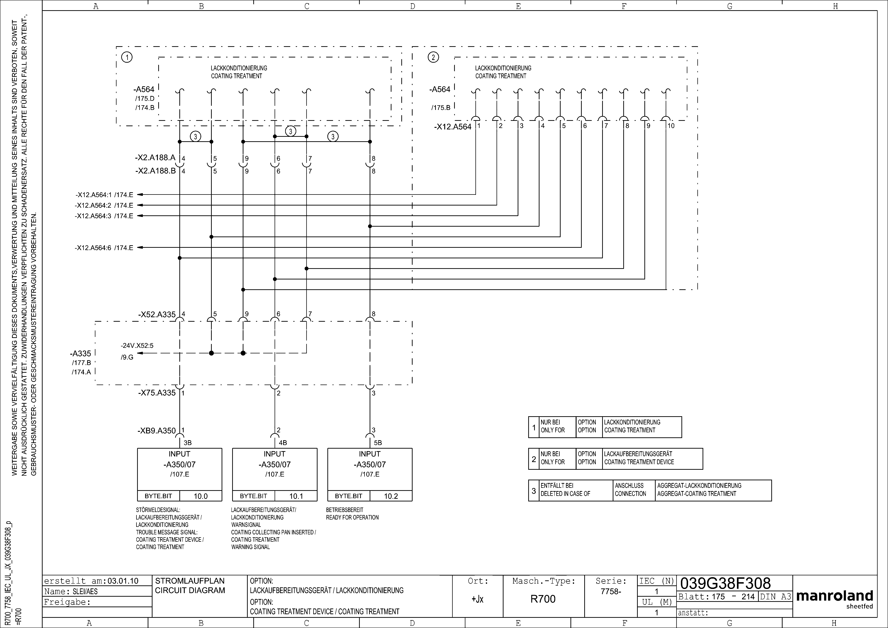

# +Jx — Sheet 175 of 214 — OPTION:

**LACKAUFBEREITUNGSGERÄT / LACKKONDITIONIERUNG**

> Part of the manroland **R700** printing press IEC/UL circuit diagrams.
> Drawing class: **Stromlaufplan / Circuit diagram** (DIN A3).
> Document `+Jx` covers the **1st printing module + feed register** machine section.

## At a glance

| Field | Value |
|---|---|
| Document | `+Jx`  (039G38F308) |
| Sheet | **175** of 214 |
| Section (DE) | OPTION: |
| Section (EN) | LACKAUFBEREITUNGSGERÄT / LACKKONDITIONIERUNG |
| Section type | CIRCUIT — Circuit diagram |
| Machine type | `R700` |
| Series | `7758` |
| Created | 03.01.10 |
| Replaces | — |
| Columns used | A, B, C, D, E, F, G |
| Path numbers | — |
| Labels on sheet | 120 |
| Cross-refs out | 13 |
| Cross-refs in | 47 |

**Previous:** [+Jx sheet 174](SHEET_0174.md) · **Next:** [+Jx sheet 176](SHEET_0176.md) · **Document TOC:** [_TOC.md](_TOC.md)  (+Jx) · **Master TOC:** [all sheets](../_MASTER_TOC.md)

## Sheet image (300 DPI, exact vector render)



_Rendered directly from the PDF vector layer at 300 DPI (1-bit), no OCR and no resampling. Use it to confirm anything ambiguous in the text below._

## Cross-references on this sheet

Each entry is a wire leaving this sheet. The printed token is `/sheet.column`; the link resolves to that sheet inside the same document.

| Ref | Target sheet | Col | Path | Destination on target | Target section | From col |
|---|---|---|---|---|---|---|
| `/175.D` | [+Jx sheet 175](SHEET_0175.md) | D | — | — | OPTION: | A |
| `/174.B` | [+Jx sheet 174](SHEET_0174.md) | B | — | — | OPTION: | A |
| `/175.B` | [+Jx sheet 175](SHEET_0175.md) | B | — | — | OPTION: | D |
| `/174.E` | [+Jx sheet 174](SHEET_0174.md) | E | — | X12.A564:1 | OPTION: | A |
| `/174.E` | [+Jx sheet 174](SHEET_0174.md) | E | — | X12.A564:2 | OPTION: | A |
| `/174.E` | [+Jx sheet 174](SHEET_0174.md) | E | — | X12.A564:3 | OPTION: | A |
| `/174.E` | [+Jx sheet 174](SHEET_0174.md) | E | — | X12.A564:6 | OPTION: | A |
| `/9.G` | [+Jx sheet 9](SHEET_0009.md) | G | — | — | SPANNUNGSVERSORGUNG, SCHALTSCHRANKBELÜFTUNG | A |
| `/177.B` | [+Jx sheet 177](SHEET_0177.md) | B | — | — | SCHUTZEINRICHTUNGEN | A |
| `/174.A` | [+Jx sheet 174](SHEET_0174.md) | A | — | — | OPTION: | A |
| `/107.E` | [+Jx sheet 107](SHEET_0107.md) | E | — | — | REFERENZMODUL | B |
| `/107.E` | [+Jx sheet 107](SHEET_0107.md) | E | — | — | REFERENZMODUL | C |
| `/107.E` | [+Jx sheet 107](SHEET_0107.md) | E | — | — | REFERENZMODUL | D |

### Incoming references (sheets that point here)

Every other sheet that sends a wire to this one. `Back-ref` is the token printed on *that* sheet; `Path` is its line number.

| From sheet | Cols | Back-ref | Path | Refs | What continues there |
|---|---|---|---|---|---|
| [+Jx#9](SHEET_0009.md) | G | `/9.G` | — | 1 | — |
| [+Jx#107](SHEET_0107.md) | E | `/107.E` | — | 3 | — |
| [+Jx#124](SHEET_0124.md) | A, B | `/124.A`, `/124.B` | — | 12 | — |
| [+Jx#134](SHEET_0134.md) | G | `/134.G` | — | 3 | — |
| [+Jx#138](SHEET_0138.md) | A | `/138.A` | — | 10 | — |
| [+Jx#151](SHEET_0151.md) | B | `/151.B` | — | 6 | — |
| [+Jx#155](SHEET_0155.md) | A | `/155.A` | — | 3 | — |
| [+Jx#174](SHEET_0174.md) | A, B, E | `/174.A`, `/174.B`, `/174.E` | — | 6 | X12.A564:1; X12.A564:2; X12.A564:3; X12.A564:6 |
| [+Jx#175](SHEET_0175.md) | A, D | `/175.A`, `/175.D` | — | 2 | — |
| [+Jx#177](SHEET_0177.md) | A | `/177.A` | — | 1 | — |


## Devices on this sheet

| Tag | Class | Class meaning (IEC) | Col | Sub | Terminal | Sign |
|---|---|---|---|---|---|---|
| `A564` | A | Baugruppe / assembly, module, PC board | D | — | — | — |
| `A564` | A | Baugruppe / assembly, module, PC board | A | — | — | — |
| `A335` | A | Baugruppe / assembly, module, PC board | A | — | — | — |
| `A350/07` | A | Baugruppe / assembly, module, PC board | D | 07 | — | — |
| `A350/07` | A | Baugruppe / assembly, module, PC board | C | 07 | — | — |
| `A350/07` | A | Baugruppe / assembly, module, PC board | B | 07 | — | — |
| `X2.A188.A` | — | cross-device reference | B | — | — | — |
| `X2.A188.B` | — | cross-device reference | B | — | — | — |
| `X52.A335` | — | cross-device reference | B | — | — | — |
| `X75.A335` | — | cross-device reference | B | — | — | — |
| `10.2` | — | cross-device reference | D | — | — | — |
| `10.1` | — | cross-device reference | C | — | — | — |
| `XB9.A350` | — | cross-device reference | B | — | — | — |
| `10.0` | — | cross-device reference | B | — | — | — |
| `X12.A564` | — | cross-device reference | D | — | — | — |
| `X12.A564:2` | — | cross-device reference | A | — | 2 | — |
| `X12.A564:3` | — | cross-device reference | A | — | 3 | — |
| `X12.A564:6` | — | cross-device reference | A | — | 6 | — |
| `X12.A564:1` | — | cross-device reference | A | — | 1 | — |

## Potentials / nets

| Potential | Count | Columns | Attached devices | Terminals |
|---|---|---|---|---|
| `24V` | 1 | A | `X52` | `5` |


A potential such as `L24+/4` or `M24+` is a named supply/return rail; every place it appears on this sheet is electrically common.

## Wire-end annotations (grouped as printed)

A wire that continues elsewhere is annotated with a small cluster: the destination description, the path/line number `#NN`, and the `/sheet.column` cross reference. Each row below is one such cluster exactly as it is grouped on the drawing.

| Col | Y | Path | Cross-ref | Text on the wire |
|---|---|---|---|---|
| C | 73.5 | — | — | `1 2` |
| B | 88.5 | — | — | `LACKKONDITIONIERUNG COATING TREATMENT` |
| E | 88.5 | — | — | `LACKKONDITIONIERUNG COATING TREATMENT` |
| A | 115.0 | — | — | `A564` |
| D | 115.0 | — | — | `A564` |
| A | 128.2 | — | `/175.D`, `/174.B` | — |
| D | 140.5 | — | `/175.B` | — |
| E | 164.7 | — | — | `X12.A564 1 2 3 4 5 6 7 8 9 10` |
| C | 173.2 | — | — | `3 3 3` |
| B | 206.5 | — | — | `X2.A188.A 4 5` |
| B | 208.6 | — | — | `9` |
| C | 208.6 | — | — | `6 7` |
| D | 208.6 | — | — | `8` |
| B | 224.2 | — | — | `X2.A188.B 4 5` |
| B | 225.6 | — | — | `9` |
| C | 225.6 | — | — | `6 7` |
| D | 225.6 | — | — | `8` |
| A | 257.4 | — | `/174.E` | `X12.A564:1` |
| A | 271.6 | — | `/174.E` | `X12.A564:2` |
| A | 285.8 | — | `/174.E` | `X12.A564:3` |
| A | 328.3 | — | `/174.E` | `X12.A564:6` |
| C | 416.9 | — | — | `X52.A335 4 5 9 6 7 8` |
| A | 459.4 | — | — | `24V.X52:5` |
| A | 469.4 | — | — | `A335` |
| A | 475.0 | — | `/9.G` | — |
| A | 482.4 | — | `/177.B`, `/174.A` | — |
| C | 521.8 | — | — | `X75.A335 1 2 3` |
| E | 563.2 | — | — | `1 NUR BEI ONLY FOR` |
| F | 563.2 | — | — | `OPTION OPTION` |
| F | 563.3 | — | — | `LACKKONDITIONIERUNG COATING TREATMENT` |
| B | 572.8 | — | — | `XB9.A350 1` |
| C | 572.9 | — | — | `2` |
| D | 572.9 | — | — | `3` |
| B | 589.8 | — | — | `3B` |
| C | 589.8 | — | — | `4B` |
| D | 589.8 | — | — | `5B` |
| B | 604.4 | — | — | `INPUT` |
| C | 604.4 | — | — | `INPUT` |
| D | 604.4 | — | — | `INPUT` |
| E | 605.7 | — | — | `2 NUR BEI ONLY FOR` |
| F | 605.8 | — | — | `OPTION OPTION` |
| F | 605.8 | — | — | `LACKAUFBEREITUNGSGERÄT COATING TREATMENT DEVICE` |
| B | 618.2 | — | — | `A350/07` |
| C | 618.2 | — | — | `A350/07` |
| D | 618.2 | — | — | `A350/07` |
| B | 632.0 | — | `/107.E` | — |
| C | 632.0 | — | `/107.E` | — |
| D | 632.0 | — | `/107.E` | — |
| F | 648.3 | — | — | `3 ENTFÄLLT BEI DELETED IN CASE OF CONNECTION ANSCHLUSS AGGREGAT LACKKONDITIONIERUNG AGGREGAT COATING TREATMENT` |
| B | 661.0 | — | — | `BYTE.BIT 10.0` |
| C | 661.0 | — | — | `BYTE.BIT 10.1` |
| D | 661.0 | — | — | `BYTE.BIT 10.2` |
| C | 681.0 | — | — | `LACKAUFBEREITUNGSGERÄT/ LACKKONDITIONIERUNG` |
| B | 681.1 | — | — | `LACKAUFBEREITUNGSGERÄT / LACKKONDITIONIERUNG STÖRMELDESIGNAL: TROUBLE MESSAGE SIGNAL: COATING TREATMENT DEVICE / COATING TREATMENT` |
| C | 681.1 | — | — | `BETRIEBSBEREIT READY FOR OPERATION` |
| C | 700.9 | — | — | `COATING COLLECTING PAN INSERTED / COATING TREATMENT WARNSIGNAL WARNING SIGNAL` |


## Reconstructed tables

This sheet carries tabular content (pin map / terminal assignment / index). The grid below was rebuilt from the drawing's own rule lines, so each row is exactly one physical row of the table.

### Table 1 — 4 data rows × 3 columns (at x=184.3, y=182.8) — **3**

| X2.A188.A X2.A188.B | 4 4 | 5 5 |
|---|---|---|
| `X52.A335` | `4` | `5` |
| `X75.A335 XB9.A350` | `1 1 3B` |  |
| `INPUT` | `A350/07 /107.E` |  |
| `BYTE.BIT` | `10.0` |  |


### Table 2 — 4 data rows × 3 columns (at x=326.0, y=182.8)

| 9 9 | 6 6 | 7 7 |
|---|---|---|
| `9` | `6` | `7` |
|  | `2 2 4B` |  |
| `INPUT` | `A350/07 /107.E` |  |
| `BYTE.BIT` | `10.1` |  |


### Table 3 — 6 data rows × 2 columns (at x=439.4, y=182.8)

| C1 | C2 |
|---|---|
| `3` |  |
|  | `8 8` |
|  | `8` |
|  | `3 3 5B` |
| `INPUT A350/07` | `/107.E` |
| `BYTE.BIT` | `10.2` |


### Table 4 — 2 data rows × 7 columns (at x=694.5, y=182.8)

| 1 | NUR BEI ONLY FOR |  | OPTION OPTION | COATING | LACKKONDITIONIERUNG TREATMENT |  |
|---|---|---|---|---|---|---|
| `2` | `NUR BEI ONLY FOR ENTFÄLLT` | `BEI` | `OPTION OPTION` | `COATING` | `LACKAUFBEREITUNGSGERÄT TREATMENT ANSCHLUSS` | `DEVICE` |
| `3` | `DELETED` | `IN CASE` | `OF` |  | `CONNECTION` |  |


## Notes and free text on this sheet

| Text | Col | Y (pt) |
|---|---|---|
| `LACKKONDITIONIERUNG` | E | 88.46 |
| `COATING TREATMENT` | E | 99.1 |
| `LACKKONDITIONIERUNG` | B | 88.46 |
| `COATING TREATMENT` | B | 99.1 |
| `5B` | D | 589.82 |
| `INPUT` | D | 604.35 |
| `BYTE.BIT` | C | 661.61 |
| `BETRIEBSBEREIT` | C | 681.06 |
| `READY FOR OPERATION` | C | 690.99 |
| `4B` | C | 589.82 |
| `INPUT` | C | 604.35 |
| `BYTE.BIT` | B | 661.61 |
| `LACKAUFBEREITUNGSGERÄT/` | C | 681.03 |
| `LACKKONDITIONIERUNG` | C | 691 |
| `WARNSIGNAL` | B | 700.92 |
| `COATING COLLECTING PAN INSERTED /` | C | 710.89 |
| `COATING TREATMENT` | C | 720.81 |
| `WARNING SIGNAL` | B | 730.78 |
| `3B` | B | 589.82 |
| `INPUT` | B | 604.35 |
| `STÖRMELDESIGNAL:` | B | 681.06 |
| `LACKAUFBEREITUNGSGERÄT /` | B | 690.99 |
| `TROUBLE MESSAGE SIGNAL:` | B | 710.9 |
| `COATING TREATMENT DEVICE /` | B | 720.83 |
| `AGGREGAT LACKKONDITIONIERUNG` | G | 648.31 |
| `AGGREGAT COATING TREATMENT` | G | 658.94 |
| `ANSCHLUSS` | F | 648.31 |
| `CONNECTION` | F | 658.94 |
| `ENTFÄLLT BEI` | E | 648.26 |
| `DELETED IN CASE OF` | E | 658.92 |
| `NUR BEI` | E | 563.22 |
| `ONLY FOR` | E | 573.9 |
| `OPTION` | F | 563.24 |
| `LACKKONDITIONIERUNG` | F | 563.27 |
| `COATING TREATMENT` | F | 573.9 |
| `LACKAUFBEREITUNGSGERÄT` | F | 605.78 |
| `COATING TREATMENT DEVICE` | F | 616.41 |

## Complete label inventory (exact text from the drawing)

Every text object inside the drawing area of this sheet, in DIN reading order (column A→H, then top→bottom). This is the authoritative list: if a string is not here it is not printed on this sheet.

| Col | Y | X | Dir | Type | Text |
|---|---|---|---|---|---|
| A | 73.5 | 168.2 | → | number | `1` |
| A | 115.0 | 178.9 | → | device tag | `A564` |
| A | 128.1 | 181.4 | → | cross-reference | `/175.D` |
| A | 140.5 | 181.7 | → | cross-reference | `/174.B` |
| A | 257.5 | 101.5 | → | device ref | `X12.A564:1` |
| A | 257.5 | 153.4 | → | cross-reference | `/174.E` |
| A | 271.6 | 100.3 | → | device ref | `X12.A564:2` |
| A | 271.6 | 153.4 | → | cross-reference | `/174.E` |
| A | 285.8 | 100.3 | → | device ref | `X12.A564:3` |
| A | 285.8 | 153.4 | → | cross-reference | `/174.E` |
| A | 328.3 | 100.3 | → | device ref | `X12.A564:6` |
| A | 328.3 | 153.4 | → | cross-reference | `/174.E` |
| A | 459.4 | 161.9 | → | potential | `24V.X52:5` |
| A | 469.4 | 93.8 | → | device tag | `A335` |
| A | 475.0 | 162.1 | → | cross-reference | `/9.G` |
| A | 482.5 | 96.7 | → | cross-reference | `/177.B` |
| A | 494.9 | 96.4 | → | cross-reference | `/174.A` |
| B | 88.5 | 282.9 | → | text | `LACKKONDITIONIERUNG` |
| B | 99.1 | 283.2 | → | text | `COATING TREATMENT` |
| B | 180.2 | 260.2 | → | number | `3` |
| B | 206.5 | 181.1 | → | device ref | `X2.A188.A` |
| B | 208.6 | 243.8 | → | number | `4` |
| B | 208.6 | 286.0 | → | number | `5` |
| B | 208.6 | 328.5 | → | number | `9` |
| B | 224.2 | 181.7 | → | device ref | `X2.A188.B` |
| B | 225.6 | 243.8 | → | number | `4` |
| B | 225.6 | 286.0 | → | number | `5` |
| B | 225.6 | 328.5 | → | number | `9` |
| B | 416.9 | 185.4 | → | device ref | `X52.A335` |
| B | 417.0 | 243.8 | → | number | `4` |
| B | 417.0 | 286.0 | → | number | `5` |
| B | 417.0 | 328.5 | → | number | `9` |
| B | 521.8 | 185.4 | → | device ref | `X75.A335` |
| B | 523.3 | 242.9 | → | number | `1` |
| B | 572.8 | 184.5 | → | device ref | `XB9.A350` |
| B | 572.9 | 242.9 | → | number | `1` |
| B | 589.8 | 246.3 | → | text | `3B` |
| B | 604.4 | 226.1 | → | text | `INPUT` |
| B | 618.2 | 219.4 | → | device tag | `A350/07` |
| B | 632.0 | 228.3 | → | cross-reference | `/107.E` |
| B | 661.0 | 259.5 | → | device ref | `10.0` |
| B | 661.6 | 194.2 | → | text | `BYTE.BIT` |
| B | 661.6 | 321.7 | → | text | `BYTE.BIT` |
| B | 681.1 | 182.6 | → | text | `STÖRMELDESIGNAL:` |
| B | 691.0 | 182.3 | → | text | `LACKAUFBEREITUNGSGERÄT /` |
| B | 700.9 | 182.3 | → | text | `LACKKONDITIONIERUNG` |
| B | 700.9 | 310.4 | → | text | `WARNSIGNAL` |
| B | 710.9 | 182.6 | → | text | `TROUBLE MESSAGE SIGNAL:` |
| B | 720.8 | 182.6 | → | text | `COATING TREATMENT DEVICE /` |
| B | 730.8 | 182.6 | → | text | `COATING TREATMENT` |
| B | 730.8 | 310.4 | → | text | `WARNING SIGNAL` |
| C | 173.2 | 387.8 | → | number | `3` |
| C | 180.2 | 444.5 | → | number | `3` |
| C | 208.6 | 371.1 | → | number | `6` |
| C | 208.6 | 413.6 | → | number | `7` |
| C | 225.6 | 371.1 | → | number | `6` |
| C | 225.6 | 413.6 | → | number | `7` |
| C | 417.0 | 371.1 | → | number | `6` |
| C | 417.0 | 413.6 | → | number | `7` |
| C | 523.3 | 371.3 | → | number | `2` |
| C | 572.9 | 371.3 | → | number | `2` |
| C | 589.8 | 374.2 | → | text | `4B` |
| C | 604.4 | 353.6 | → | text | `INPUT` |
| C | 618.2 | 347.0 | → | device tag | `A350/07` |
| C | 632.0 | 355.9 | → | cross-reference | `/107.E` |
| C | 661.0 | 387.8 | → | device ref | `10.1` |
| C | 661.6 | 449.3 | → | text | `BYTE.BIT` |
| C | 681.0 | 309.8 | → | text | `LACKAUFBEREITUNGSGERÄT/` |
| C | 681.1 | 437.4 | → | text | `BETRIEBSBEREIT` |
| C | 691.0 | 309.8 | → | text | `LACKKONDITIONIERUNG` |
| C | 691.0 | 437.4 | → | text | `READY FOR OPERATION` |
| C | 710.9 | 310.1 | → | text | `COATING COLLECTING PAN INSERTED /` |
| C | 720.8 | 310.1 | → | text | `COATING TREATMENT` |
| D | 73.9 | 579.1 | → | number | `2` |
| D | 115.0 | 575.7 | → | device tag | `A564` |
| D | 140.5 | 578.6 | → | cross-reference | `/175.B` |
| D | 165.4 | 582.2 | → | device ref | `X12.A564` |
| D | 208.6 | 498.6 | → | number | `8` |
| D | 225.6 | 498.6 | → | number | `8` |
| D | 417.0 | 498.6 | → | number | `8` |
| D | 523.3 | 498.6 | → | number | `3` |
| D | 572.9 | 498.6 | → | number | `3` |
| D | 589.8 | 501.4 | → | text | `5B` |
| D | 604.4 | 481.2 | → | text | `INPUT` |
| D | 618.2 | 474.5 | → | device tag | `A350/07` |
| D | 632.0 | 483.4 | → | cross-reference | `/107.E` |
| D | 661.0 | 514.6 | → | device ref | `10.2` |
| E | 88.5 | 637.2 | → | text | `LACKKONDITIONIERUNG` |
| E | 99.1 | 637.5 | → | text | `COATING TREATMENT` |
| E | 164.7 | 639.8 | → | number | `1` |
| E | 164.7 | 669.0 | → | number | `2` |
| E | 164.7 | 697.0 | → | number | `3` |
| E | 164.7 | 725.7 | → | number | `4` |
| E | 164.7 | 753.7 | → | number | `5` |
| E | 563.2 | 725.1 | → | text | `NUR BEI` |
| E | 568.5 | 713.2 | → | number | `1` |
| E | 573.9 | 725.4 | → | text | `ONLY FOR` |
| E | 605.7 | 725.1 | → | text | `NUR BEI` |
| E | 611.1 | 712.9 | → | number | `2` |
| E | 616.4 | 725.4 | → | text | `ONLY FOR` |
| E | 648.3 | 725.1 | → | text | `ENTFÄLLT BEI` |
| E | 653.6 | 712.8 | → | number | `3` |
| E | 658.9 | 725.1 | → | text | `DELETED IN CASE OF` |
| F | 164.7 | 782.1 | → | number | `6` |
| F | 164.7 | 810.4 | → | number | `7` |
| F | 164.7 | 838.8 | → | number | `8` |
| F | 164.7 | 867.1 | → | number | `9` |
| F | 164.7 | 894.9 | → | number | `10` |
| F | 563.2 | 775.0 | → | text | `OPTION` |
| F | 563.3 | 810.1 | → | text | `LACKKONDITIONIERUNG` |
| F | 573.9 | 775.0 | → | text | `OPTION` |
| F | 573.9 | 810.4 | → | text | `COATING TREATMENT` |
| F | 605.8 | 775.0 | → | text | `OPTION` |
| F | 605.8 | 810.1 | → | text | `LACKAUFBEREITUNGSGERÄT` |
| F | 616.4 | 775.0 | → | text | `OPTION` |
| F | 616.4 | 810.4 | → | text | `COATING TREATMENT DEVICE` |
| F | 648.3 | 824.9 | → | text | `ANSCHLUSS` |
| F | 658.9 | 824.6 | → | text | `CONNECTION` |
| G | 648.3 | 881.6 | → | text | `AGGREGAT LACKKONDITIONIERUNG` |
| G | 658.9 | 881.6 | → | text | `AGGREGAT COATING TREATMENT` |

## Reading-order text block

The same content as a plain block, grouped by DIN column — convenient to paste or to match against a visual description.

```text
=== Column A ===
  73.5  168.2  numeric      1
 115.0  178.9  devtag       A564
 128.1  181.4  xref         /175.D
 140.5  181.7  xref         /174.B
 257.5  101.5  devref       X12.A564:1
 257.5  153.4  xref         /174.E
 271.6  100.3  devref       X12.A564:2
 271.6  153.4  xref         /174.E
 285.8  100.3  devref       X12.A564:3
 285.8  153.4  xref         /174.E
 328.3  100.3  devref       X12.A564:6
 328.3  153.4  xref         /174.E
 459.4  161.9  net          24V.X52:5
 469.4   93.8  devtag       A335
 475.0  162.1  xref         /9.G
 482.5   96.7  xref         /177.B
 494.9   96.4  xref         /174.A
=== Column B ===
  88.5  282.9  text         LACKKONDITIONIERUNG
  99.1  283.2  text         COATING TREATMENT
 180.2  260.2  numeric      3
 206.5  181.1  devref       X2.A188.A
 208.6  243.8  numeric      4
 208.6  286.0  numeric      5
 208.6  328.5  numeric      9
 224.2  181.7  devref       X2.A188.B
 225.6  243.8  numeric      4
 225.6  286.0  numeric      5
 225.6  328.5  numeric      9
 416.9  185.4  devref       X52.A335
 417.0  243.8  numeric      4
 417.0  286.0  numeric      5
 417.0  328.5  numeric      9
 521.8  185.4  devref       X75.A335
 523.3  242.9  numeric      1
 572.8  184.5  devref       XB9.A350
 572.9  242.9  numeric      1
 589.8  246.3  text         3B
 604.4  226.1  text         INPUT
 618.2  219.4  devtag       A350/07
 632.0  228.3  xref         /107.E
 661.0  259.5  devref       10.0
 661.6  194.2  text         BYTE.BIT
 661.6  321.7  text         BYTE.BIT
 681.1  182.6  text         STÖRMELDESIGNAL:
 691.0  182.3  text         LACKAUFBEREITUNGSGERÄT /
 700.9  182.3  text         LACKKONDITIONIERUNG
 700.9  310.4  text         WARNSIGNAL
 710.9  182.6  text         TROUBLE MESSAGE SIGNAL:
 720.8  182.6  text         COATING TREATMENT DEVICE /
 730.8  182.6  text         COATING TREATMENT
 730.8  310.4  text         WARNING SIGNAL
=== Column C ===
 173.2  387.8  numeric      3
 180.2  444.5  numeric      3
 208.6  371.1  numeric      6
 208.6  413.6  numeric      7
 225.6  371.1  numeric      6
 225.6  413.6  numeric      7
 417.0  371.1  numeric      6
 417.0  413.6  numeric      7
 523.3  371.3  numeric      2
 572.9  371.3  numeric      2
 589.8  374.2  text         4B
 604.4  353.6  text         INPUT
 618.2  347.0  devtag       A350/07
 632.0  355.9  xref         /107.E
 661.0  387.8  devref       10.1
 661.6  449.3  text         BYTE.BIT
 681.0  309.8  text         LACKAUFBEREITUNGSGERÄT/
 681.1  437.4  text         BETRIEBSBEREIT
 691.0  309.8  text         LACKKONDITIONIERUNG
 691.0  437.4  text         READY FOR OPERATION
 710.9  310.1  text         COATING COLLECTING PAN INSERTED /
 720.8  310.1  text         COATING TREATMENT
=== Column D ===
  73.9  579.1  numeric      2
 115.0  575.7  devtag       A564
 140.5  578.6  xref         /175.B
 165.4  582.2  devref       X12.A564
 208.6  498.6  numeric      8
 225.6  498.6  numeric      8
 417.0  498.6  numeric      8
 523.3  498.6  numeric      3
 572.9  498.6  numeric      3
 589.8  501.4  text         5B
 604.4  481.2  text         INPUT
 618.2  474.5  devtag       A350/07
 632.0  483.4  xref         /107.E
 661.0  514.6  devref       10.2
=== Column E ===
  88.5  637.2  text         LACKKONDITIONIERUNG
  99.1  637.5  text         COATING TREATMENT
 164.7  639.8  numeric      1
 164.7  669.0  numeric      2
 164.7  697.0  numeric      3
 164.7  725.7  numeric      4
 164.7  753.7  numeric      5
 563.2  725.1  text         NUR BEI
 568.5  713.2  numeric      1
 573.9  725.4  text         ONLY FOR
 605.7  725.1  text         NUR BEI
 611.1  712.9  numeric      2
 616.4  725.4  text         ONLY FOR
 648.3  725.1  text         ENTFÄLLT BEI
 653.6  712.8  numeric      3
 658.9  725.1  text         DELETED IN CASE OF
=== Column F ===
 164.7  782.1  numeric      6
 164.7  810.4  numeric      7
 164.7  838.8  numeric      8
 164.7  867.1  numeric      9
 164.7  894.9  numeric      10
 563.2  775.0  text         OPTION
 563.3  810.1  text         LACKKONDITIONIERUNG
 573.9  775.0  text         OPTION
 573.9  810.4  text         COATING TREATMENT
 605.8  775.0  text         OPTION
 605.8  810.1  text         LACKAUFBEREITUNGSGERÄT
 616.4  775.0  text         OPTION
 616.4  810.4  text         COATING TREATMENT DEVICE
 648.3  824.9  text         ANSCHLUSS
 658.9  824.6  text         CONNECTION
=== Column G ===
 648.3  881.6  text         AGGREGAT LACKKONDITIONIERUNG
 658.9  881.6  text         AGGREGAT COATING TREATMENT
```

---
_Generated from the PDF vector text layer; no OCR. Source: `R700_7758_IEC_UL_JX_039G38F308_p`, sheet 175._
