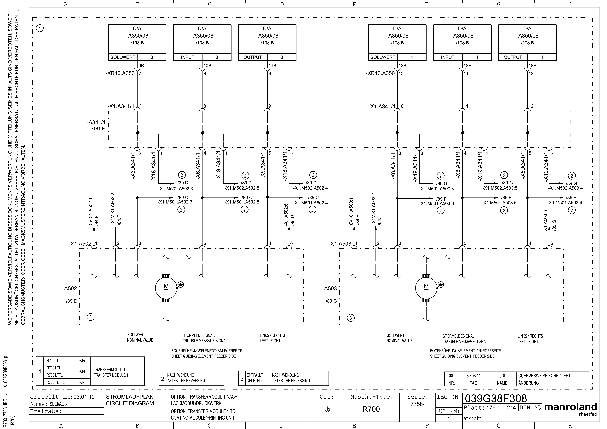

# +Jx — Sheet 176 of 214 — OPTION: TRANSFERMODUL 1 NACH

**LACKMODUL/DRUCKWERK**

> Part of the manroland **R700** printing press IEC/UL circuit diagrams.
> Drawing class: **Stromlaufplan / Circuit diagram** (DIN A3).
> Document `+Jx` covers the **1st printing module + feed register** machine section.

## At a glance

| Field | Value |
|---|---|
| Document | `+Jx`  (039G38F308) |
| Sheet | **176** of 214 |
| Section (DE) | OPTION: TRANSFERMODUL 1 NACH |
| Section (EN) | LACKMODUL/DRUCKWERK |
| Section type | CIRCUIT — Circuit diagram |
| Machine type | `R700` |
| Series | `7758` |
| Created | 03.01.10 |
| Replaces | — |
| Columns used | A, B, C, D, E, F, G, H |
| Path numbers | — |
| Labels on sheet | 191 |
| Cross-refs out | 27 |
| Cross-refs in | 62 |

**Previous:** [+Jx sheet 175](SHEET_0175.md) · **Next:** [+Jx sheet 177](SHEET_0177.md) · **Document TOC:** [_TOC.md](_TOC.md)  (+Jx) · **Master TOC:** [all sheets](../_MASTER_TOC.md)

## Sheet image (300 DPI, exact vector render)



_Rendered directly from the PDF vector layer at 300 DPI (1-bit), no OCR and no resampling. Use it to confirm anything ambiguous in the text below._

## Cross-references on this sheet

Each entry is a wire leaving this sheet. The printed token is `/sheet.column`; the link resolves to that sheet inside the same document.

| Ref | Target sheet | Col | Path | Destination on target | Target section | From col |
|---|---|---|---|---|---|---|
| `/108.B` | [+Jx sheet 108](SHEET_0108.md) | B | — | — | REFERENZMODUL | B |
| `/108.B` | [+Jx sheet 108](SHEET_0108.md) | B | — | — | REFERENZMODUL | C |
| `/108.B` | [+Jx sheet 108](SHEET_0108.md) | B | — | — | REFERENZMODUL | D |
| `/108.B` | [+Jx sheet 108](SHEET_0108.md) | B | — | — | REFERENZMODUL | F |
| `/108.B` | [+Jx sheet 108](SHEET_0108.md) | B | — | — | REFERENZMODUL | G |
| `/108.B` | [+Jx sheet 108](SHEET_0108.md) | B | — | — | REFERENZMODUL | G |
| `/181.E` | [+Jx sheet 181](SHEET_0181.md) | E | — | — | OPTION: TRANSFERMODUL 2 | A |
| `/89.G` | [+Jx sheet 89](SHEET_0089.md) | G | — | X1.M502.A503:5 | BOGENFÜHRUNG, NACH WENDUNG | G |
| `/89.D` | [+Jx sheet 89](SHEET_0089.md) | D | — | X1.M502.A502:3 | BOGENFÜHRUNG, NACH WENDUNG | C |
| `/89.D` | [+Jx sheet 89](SHEET_0089.md) | D | — | X1.M502.A502:5 | BOGENFÜHRUNG, NACH WENDUNG | C |
| `/89.D` | [+Jx sheet 89](SHEET_0089.md) | D | — | X1.M502.A502:4 | BOGENFÜHRUNG, NACH WENDUNG | D |
| `/89.G` | [+Jx sheet 89](SHEET_0089.md) | G | — | X1.M502.A503:3 | BOGENFÜHRUNG, NACH WENDUNG | F |
| `/89.G` | [+Jx sheet 89](SHEET_0089.md) | G | — | X1.M502.A503:4 | BOGENFÜHRUNG, NACH WENDUNG | H |
| `/84.F` | [+Jx sheet 84](SHEET_0084.md) | F | — | 24V.X1.A503:2 | BOGENFÜHRUNG | E |
| `/84.F` | [+Jx sheet 84](SHEET_0084.md) | F | — | 24V.X1.A502:2 | BOGENFÜHRUNG | B |
| `/89.F` | [+Jx sheet 89](SHEET_0089.md) | F | — | X1.M501.A503:5 | BOGENFÜHRUNG, NACH WENDUNG | G |
| `/89.F` | [+Jx sheet 89](SHEET_0089.md) | F | — | X1.M501.A503:4 | BOGENFÜHRUNG, NACH WENDUNG | H |
| `/89.C` | [+Jx sheet 89](SHEET_0089.md) | C | — | X1.M501.A502:3 | BOGENFÜHRUNG, NACH WENDUNG | C |
| `/89.C` | [+Jx sheet 89](SHEET_0089.md) | C | — | X1.M501.A502:5 | BOGENFÜHRUNG, NACH WENDUNG | C |
| `/89.C` | [+Jx sheet 89](SHEET_0089.md) | C | — | X1.M501.A502:4 | BOGENFÜHRUNG, NACH WENDUNG | D |
| `/89.F` | [+Jx sheet 89](SHEET_0089.md) | F | — | X1.M501.A503:3 | BOGENFÜHRUNG, NACH WENDUNG | F |
| `/84.F` | [+Jx sheet 84](SHEET_0084.md) | F | — | 0V.X1.A503:1 | BOGENFÜHRUNG | E |
| `/84.E` | [+Jx sheet 84](SHEET_0084.md) | E | — | 0V.X1.A502:1 | BOGENFÜHRUNG | A |
| `/85.G` | [+Jx sheet 85](SHEET_0085.md) | G | — | X1.A502:6 | BOGENFÜHRUNG | D |
| `/85.G` | [+Jx sheet 85](SHEET_0085.md) | G | — | — | BOGENFÜHRUNG | H |
| `/89.E` | [+Jx sheet 89](SHEET_0089.md) | E | — | — | BOGENFÜHRUNG, NACH WENDUNG | A |
| `/89.G` | [+Jx sheet 89](SHEET_0089.md) | G | — | — | BOGENFÜHRUNG, NACH WENDUNG | E |

### Incoming references (sheets that point here)

Every other sheet that sends a wire to this one. `Back-ref` is the token printed on *that* sheet; `Path` is its line number.

| From sheet | Cols | Back-ref | Path | Refs | What continues there |
|---|---|---|---|---|---|
| [+Jx#84](SHEET_0084.md) | E, F | `/84.E`, `/84.F` | — | 4 | 0V.X1.A502:1; 0V.X1.A503:1; 24V.X1.A502:2; 24V.X1.A503:2 |
| [+Jx#85](SHEET_0085.md) | G | `/85.G` | — | 2 | X1.A502:6; X1.A503:6 |
| [+Jx#89](SHEET_0089.md) | C, D, E, F, G | `/89.C`, `/89.D`, `/89.E`, `/89.F`, `/89.G` | — | 14 | A502; A503; X1.M501.A502:3; X1.M501.A502:4; X1.M501.A502:5; X1.M501.A503:3; X1.M501.A503:4; X1.M501.A503:5; X1.M502.A502:3; X1.M502.A502:4; X1.M502.A502:5; X1.M |
| [+Jx#108](SHEET_0108.md) | B | `/108.B` | — | 6 | — |
| [+Jx#114](SHEET_0114.md) | A, E | `/114.A`, `/114.E` | — | 17 | — |
| [+Jx#132](SHEET_0132.md) | G | `/132.G` | — | 3 | — |
| [+Jx#133](SHEET_0133.md) | H | `/133.H` | — | 3 | — |
| [+Jx#135](SHEET_0135.md) | E | `/135.E` | — | 6 | — |
| [+Jx#140](SHEET_0140.md) | F | `/140.F` | — | 3 | — |
| [+Jx#141](SHEET_0141.md) | A | `/141.A` | — | 3 | — |
| [+Jx#181](SHEET_0181.md) | E | `/181.E` | — | 1 | — |


## Devices on this sheet

| Tag | Class | Class meaning (IEC) | Col | Sub | Terminal | Sign |
|---|---|---|---|---|---|---|
| `A502` | A | Baugruppe / assembly, module, PC board | A | — | — | — |
| `A503` | A | Baugruppe / assembly, module, PC board | E | — | — | — |
| `A350/08` | A | Baugruppe / assembly, module, PC board | B | 08 | — | — |
| `A350/08` | A | Baugruppe / assembly, module, PC board | C | 08 | — | — |
| `A350/08` | A | Baugruppe / assembly, module, PC board | D | 08 | — | — |
| `A350/08` | A | Baugruppe / assembly, module, PC board | F | 08 | — | — |
| `A350/08` | A | Baugruppe / assembly, module, PC board | G | 08 | — | — |
| `A350/08` | A | Baugruppe / assembly, module, PC board | G | 08 | — | — |
| `A341/1` | A | Baugruppe / assembly, module, PC board | A | 1 | — | — |
| `X1.A502` | — | cross-device reference | A | — | — | — |
| `XB10.A350` | — | cross-device reference | B | — | — | — |
| `X1.A503` | — | cross-device reference | E | — | — | — |
| `XB10.A350` | — | cross-device reference | E | — | — | — |
| `X1.A502:6` | — | cross-device reference | D | — | 6 | — |
| `X1.A503:6` | — | cross-device reference | H | — | 6 | — |
| `NR.` | — | cross-device reference | F | — | — | — |
| `30.08.11` | — | cross-device reference | G | — | — | — |
| `X1.M501.A502:3` | — | cross-device reference | C | — | 3 | — |
| `X1.M502.A502:3` | — | cross-device reference | C | — | 3 | — |
| `X1.M501.A503:3` | — | cross-device reference | F | — | 3 | — |
| `X1.M502.A503:3` | — | cross-device reference | F | — | 3 | — |
| `X1.M501.A502:5` | — | cross-device reference | C | — | 5 | — |
| `X1.M501.A502:4` | — | cross-device reference | D | — | 4 | — |
| `X1.M502.A502:5` | — | cross-device reference | C | — | 5 | — |
| `X1.M502.A502:4` | — | cross-device reference | D | — | 4 | — |
| `X1.M501.A503:5` | — | cross-device reference | G | — | 5 | — |
| `X1.M501.A503:4` | — | cross-device reference | H | — | 4 | — |
| `X1.M502.A503:5` | — | cross-device reference | G | — | 5 | — |
| `X1.M502.A503:4` | — | cross-device reference | H | — | 4 | — |

## Potentials / nets

| Potential | Count | Columns | Attached devices | Terminals |
|---|---|---|---|---|
| `0V` | 2 | A, E | `A502`, `A503`, `X1` | `1` |
| `24V` | 2 | B, E | `A502`, `A503`, `X1` | `2` |


A potential such as `L24+/4` or `M24+` is a named supply/return rail; every place it appears on this sheet is electrically common.

## Wire-end annotations (grouped as printed)

A wire that continues elsewhere is annotated with a small cluster: the destination description, the path/line number `#NN`, and the `/sheet.column` cross reference. Each row below is one such cluster exactly as it is grouped on the drawing.

| Col | Y | Path | Cross-ref | Text on the wire |
|---|---|---|---|---|
| B | 51.5 | — | — | `D/A` |
| C | 51.5 | — | — | `D/A` |
| D | 51.5 | — | — | `D/A` |
| F | 51.5 | — | — | `D/A` |
| F | 51.5 | — | — | `D/A` |
| G | 51.5 | — | — | `D/A` |
| A | 52.2 | — | — | `1` |
| B | 65.4 | — | — | `A350/08` |
| C | 65.4 | — | — | `A350/08` |
| D | 65.4 | — | — | `A350/08` |
| F | 65.4 | — | — | `A350/08` |
| G | 65.4 | — | — | `A350/08` |
| G | 65.4 | — | — | `A350/08` |
| B | 80.3 | — | `/108.B` | — |
| C | 80.3 | — | `/108.B` | — |
| D | 80.3 | — | `/108.B` | — |
| F | 80.3 | — | `/108.B` | — |
| G | 80.3 | — | `/108.B` | — |
| G | 80.3 | — | `/108.B` | — |
| B | 108.6 | — | — | `SOLLWERT 3` |
| F | 108.6 | — | — | `SOLLWERT 4` |
| C | 108.7 | — | — | `INPUT 3` |
| D | 108.7 | — | — | `OUTPUT 3` |
| F | 108.7 | — | — | `INPUT 4` |
| G | 108.7 | — | — | `OUTPUT 4` |
| B | 124.9 | — | — | `9B` |
| C | 125.0 | — | — | `10B` |
| D | 125.0 | — | — | `11B` |
| F | 125.0 | — | — | `12B` |
| G | 125.0 | — | — | `13B` |
| G | 125.0 | — | — | `18B` |
| C | 139.1 | — | — | `XB10.A350 7 8 9` |
| F | 139.1 | — | — | `XB10.A350 10 11 12` |
| B | 202.9 | — | — | `X1.A341/1 7` |
| F | 204.3 | — | — | `X1.A341/1 10 11 12` |
| C | 204.4 | — | — | `8 9` |
| A | 235.5 | — | — | `A341/1` |
| A | 248.6 | — | `/181.E` | — |
| C | 294.9 | — | — | `X18.A341/1` |
| D | 296.3 | — | — | `X18.A341/1` |
| F | 296.3 | — | — | `X8.A341/1` |
| G | 296.3 | — | — | `X19.A341/1` |
| C | 296.5 | — | — | `4` |
| D | 296.5 | — | — | `5` |
| G | 296.5 | — | — | `4` |
| G | 296.5 | — | — | `5` |
| B | 297.0 | — | — | `3` |
| C | 297.0 | — | — | `4` |
| D | 297.0 | — | — | `5` |
| F | 297.0 | — | — | `3` |
| F | 297.0 | — | — | `3` |
| G | 297.0 | — | — | `4` |
| H | 297.0 | — | — | `5` |
| B | 297.5 | — | — | `X18.A341/1` |
| B | 297.6 | — | — | `3` |
| B | 297.8 | — | — | `X6.A341/1` |
| D | 297.8 | — | — | `X6.A341/1` |
| F | 297.8 | — | — | `X19.A341/1` |
| G | 297.8 | — | — | `X8.A341/1` |
| H | 297.8 | — | — | `X19.A341/1` |
| C | 299.2 | — | — | `X6.A341/1` |
| F | 299.2 | — | — | `X8.A341/1` |
| E | 340.7 | — | — | `2 2 2 2 2 2` |
| C | 354.9 | — | `/89.D` | `X1.M502.A502:3` |
| C | 354.9 | — | `/89.D` | `X1.M502.A502:5` |
| D | 354.9 | — | `/89.D` | `X1.M502.A502:4` |
| G | 354.9 | — | `/89.G` | `X1.M502.A503:5` |
| F | 356.4 | — | `/89.G` | `X1.M502.A503:3` |
| H | 356.4 | — | `/89.G` | `X1.M502.A503:4` |
| B | 378.6 | — | `/84.F` | `24V.X1.A502:2` |
| E | 378.6 | — | `/84.F` | `24V.X1.A503:2` |
| C | 383.8 | — | `/89.C` | `X1.M501.A502:3` |
| C | 383.8 | — | `/89.C` | `X1.M501.A502:5` |
| G | 383.8 | — | `/89.F` | `X1.M501.A503:5` |
| H | 383.8 | — | `/89.F` | `X1.M501.A503:4` |
| D | 383.9 | — | `/89.C` | `X1.M501.A502:4` |
| F | 386.7 | — | `/89.F` | `X1.M501.A503:3` |
| A | 387.3 | — | `/84.E` | `0V.X1.A502:1` |
| E | 387.3 | — | `/84.F` | `0V.X1.A503:1` |
| D | 399.2 | — | `/85.G` | `X1.A502:6` |
| E | 408.6 | — | — | `2 2 2 2 2 2` |
| H | 412.2 | — | — | `X1.A503:6` |
| H | 431.4 | — | `/85.G` | — |
| A | 473.6 | — | — | `X1.A502 1 2` |
| C | 473.6 | — | — | `3 5 4` |
| D | 473.6 | — | — | `6` |
| F | 473.6 | — | — | `X1.A503 1 2 5` |
| G | 473.6 | — | — | `3 4 6` |
| B | 557.0 | — | — | `M` |
| F | 557.0 | — | — | `M` |
| A | 561.5 | — | — | `A502` |
| E | 561.5 | — | — | `A503` |
| A | 587.0 | — | `/89.E` | — |
| E | 587.0 | — | `/89.G` | — |
| A | 619.7 | — | — | `3` |
| E | 621.1 | — | — | `3` |
| B | 653.9 | — | — | `NOMINAL VALUE SOLLWERT` |
| C | 655.4 | — | — | `STÖRMELDESIGNAL: TROUBLE MESSAGE SIGNAL:` |
| D | 655.4 | — | — | `LINKS / RECHTS LEFT / RIGHT` |
| F | 655.4 | — | — | `NOMINAL VALUE SOLLWERT` |
| G | 656.8 | — | — | `STÖRMELDESIGNAL: TROUBLE MESSAGE SIGNAL:` |
| G | 656.8 | — | — | `LINKS / RECHTS LEFT / RIGHT` |
| C | 685.8 | — | — | `BOGENFÜHRUNGSELEMENT: ANLEGERSEITE SHEET GUIDING ELEMENT: FEEDER SIDE` |
| G | 685.8 | — | — | `BOGENFÜHRUNGSELEMENT: ANLEGERSEITE SHEET GUIDING ELEMENT: FEEDER SIDE` |
| A | 704.9 | — | — | `+JA` |
| A | 705.0 | — | — | `R700 TL` |
| A | 719.1 | — | — | `R700 LTL,` |
| B | 722.7 | — | — | `1 +JB TRANSFERMODUL 1 TRANSFER MODULE 1 2 NACH WENDUNG` |
| C | 733.3 | — | — | `AFTER THE REVERSING 3 ENTFÄLLT DELETED` |
| D | 733.3 | — | — | `NACH WENDUNG` |
| A | 733.4 | — | — | `R700 LTTL` |
| G | 734.2 | — | — | `001 30.08.11 JDI QUERVERWEISE KORRIGIERT` |
| D | 744.0 | — | — | `AFTER THE REVERSING` |
| A | 747.5 | — | — | `R700 TLTTL +Jx` |
| G | 748.3 | — | — | `NR. TAG NAME ÄNDERUNG` |


## Reconstructed tables

This sheet carries tabular content (pin map / terminal assignment / index). The grid below was rebuilt from the drawing's own rule lines, so each row is exactly one physical row of the table.

### Table 1 — 2 data rows × 3 columns (at x=226.8, y=48.2) — **D/A A350/08 /108.B**

| SOLLWERT | 3 |  |
|---|---|---|
| `XB10.A350 X1.A341/1` | `9B 7 7` |  |
| `X6.A341/1` | `3 X18.A341/1` | `3` |


### Table 2 — 3 data rows × 4 columns (at x=340.2, y=48.2)

|  | D/A | A350/08 /108.B |  |
|---|---|---|---|
| `INPUT` |  | `3` |  |
|  |  | `10B 8 8` |  |
| `2 /89.D X1.M502.A502:3` | `X6.A341/1` | `X18.A341/1 4` | `4` |


### Table 3 — 3 data rows × 3 columns (at x=467.7, y=48.2)

| D/A | A350/08 /108.B |  |
|---|---|---|
| `OUTPUT` | `3` |  |
|  | `11B 9 9` |  |
| `X6.A341/1 2 /89.D X1.M502.A502:5` | `X18.A341/1 5` | `5` |


### Table 4 — 2 data rows × 3 columns (at x=737.0, y=48.2) — **D/A A350/08 /108.B**

| SOLLWERT | 4 |  |
|---|---|---|
| `XB10.A350 X1.A341/1` | `12B 10 10` |  |
| `X8.A341/1` | `3 X19.A341/1` | `3` |


### Table 5 — 3 data rows × 4 columns (at x=850.4, y=48.2)

|  | D/A | A350/08 /108.B |  |
|---|---|---|---|
| `INPUT` |  | `4` |  |
|  |  | `13B 11 11` |  |
| `2 /89.G X1.M502.A503:3` | `X8.A341/1` | `X19.A341/1 4` | `4` |


### Table 6 — 3 data rows × 3 columns (at x=978.0, y=48.2)

| D/A | A350/08 /108.B |  |
|---|---|---|
| `OUTPUT` | `4` |  |
|  | `18B 12 12` |  |
| `X8.A341/1 2 /89.G X1.M502.A503:5` | `5 X19.A341/1` | `5` |


## Notes and free text on this sheet

| Text | Col | Y (pt) |
|---|---|---|
| `BOGENFÜHRUNGSELEMENT: ANLEGERSEITE` | C | 685.75 |
| `SHEET GUIDING ELEMENT: FEEDER SIDE` | C | 696.37 |
| `BOGENFÜHRUNGSELEMENT: ANLEGERSEITE` | G | 685.75 |
| `SHEET GUIDING ELEMENT: FEEDER SIDE` | F | 696.37 |
| `M` | B | 557.02 |
| `9B` | B | 124.94 |
| `D/A` | B | 51.55 |
| `SOLLWERT` | B | 108.6 |
| `NOMINAL VALUE` | B | 664.57 |
| `10B` | C | 124.95 |
| `D/A` | C | 51.55 |
| `INPUT` | C | 108.65 |
| `STÖRMELDESIGNAL:` | C | 655.38 |
| `TROUBLE MESSAGE SIGNAL:` | C | 666.01 |
| `11B` | D | 124.95 |
| `D/A` | D | 51.55 |
| `OUTPUT` | D | 108.66 |
| `LINKS / RECHTS` | D | 655.37 |
| `LEFT / RIGHT` | D | 666 |
| `M` | F | 557.02 |
| `12B` | F | 124.95 |
| `D/A` | F | 51.55 |
| `SOLLWERT` | E | 108.6 |
| `SOLLWERT` | F | 655.35 |
| `NOMINAL VALUE` | F | 666.02 |
| `13B` | G | 124.95 |
| `INPUT` | F | 108.65 |
| `STÖRMELDESIGNAL:` | F | 656.83 |
| `TROUBLE MESSAGE SIGNAL:` | G | 667.46 |
| `18B` | G | 124.95 |
| `D/A` | G | 51.55 |
| `OUTPUT` | G | 108.66 |
| `LINKS / RECHTS` | G | 656.81 |
| `LEFT / RIGHT` | G | 667.45 |
| `X6.A341/1` | C | 299.23 |
| `X6.A341/1` | D | 297.78 |
| `X1.A341/1` | E | 204.34 |
| `X8.A341/1` | F | 296.34 |
| `X8.A341/1` | G | 297.78 |
| `TAG` | G | 748.42 |
| `NAME` | G | 748.41 |
| `ÄNDERUNG` | G | 748.44 |
| `JDI` | G | 734.17 |
| `QUERVERWEISE KORRIGIERT` | H | 734.27 |
| `X18.A341/1` | B | 297.47 |
| `X18.A341/1` | C | 294.89 |
| `X18.A341/1` | D | 296.34 |
| `X19.A341/1` | G | 296.34 |
| `X19.A341/1` | H | 297.78 |
| `X19.A341/1` | F | 297.78 |
| `X6.A341/1` | B | 297.78 |
| `X1.A341/1` | B | 203.86 |
| `R700 TL` | A | 704.99 |
| `R700 LTL,` | A | 719.15 |
| `+JA` | A | 704.94 |
| `R700 TLTTL` | A | 747.52 |
| `+Jx` | A | 747.56 |
| `R700 LTTL` | A | 733.35 |
| `+JB` | A | 726.18 |
| `TRANSFERMODUL 1` | B | 722.72 |
| `TRANSFER MODULE 1` | B | 733.34 |
| `NACH WENDUNG` | C | 733.32 |
| `AFTER THE REVERSING` | C | 743.97 |
| `ENTFÄLLT` | D | 733.33 |
| `DELETED` | D | 743.96 |
| `NACH WENDUNG` | D | 733.32 |
| `AFTER THE REVERSING` | D | 743.97 |

## Complete label inventory (exact text from the drawing)

Every text object inside the drawing area of this sheet, in DIN reading order (column A→H, then top→bottom). This is the authoritative list: if a string is not here it is not printed on this sheet.

| Col | Y | X | Dir | Type | Text |
|---|---|---|---|---|---|
| A | 52.2 | 76.1 | → | number | `1` |
| A | 235.5 | 170.4 | → | device tag | `A341/1` |
| A | 248.6 | 180.3 | → | cross-reference | `/181.E` |
| A | 387.3 | 173.8 | ↕ | potential | `0V.X1.A502:1` |
| A | 422.2 | 185.4 | ↕ | cross-reference | `/84.E` |
| A | 473.6 | 134.9 | → | device ref | `X1.A502` |
| A | 473.7 | 186.2 | → | number | `1` |
| A | 561.5 | 122.5 | → | device tag | `A502` |
| A | 587.0 | 129.8 | → | cross-reference | `/89.E` |
| A | 619.7 | 175.7 | → | number | `3` |
| A | 704.9 | 155.6 | → | text | `+JA` |
| A | 705.0 | 91.6 | → | text | `R700 TL` |
| A | 719.1 | 91.6 | → | text | `R700 LTL,` |
| A | 724.5 | 75.4 | → | number | `1` |
| A | 726.2 | 155.6 | → | text | `+JB` |
| A | 733.3 | 91.6 | → | text | `R700 LTTL` |
| A | 747.5 | 91.6 | → | text | `R700 TLTTL` |
| A | 747.6 | 155.6 | → | text | `+Jx` |
| B | 51.5 | 260.8 | → | text | `D/A` |
| B | 65.4 | 247.9 | → | device tag | `A350/08` |
| B | 80.3 | 256.7 | → | cross-reference | `/108.B` |
| B | 108.6 | 216.3 | → | text | `SOLLWERT` |
| B | 108.7 | 295.2 | → | number | `3` |
| B | 124.9 | 271.8 | → | text | `9B` |
| B | 139.1 | 206.9 | → | device ref | `XB10.A350` |
| B | 140.6 | 271.8 | → | number | `7` |
| B | 202.9 | 272.7 | → | number | `7` |
| B | 203.9 | 210.8 | → | text | `X1.A341/1` |
| B | 297.0 | 271.4 | → | number | `3` |
| B | 297.5 | 296.6 | ↕ | text | `X18.A341/1` |
| B | 297.6 | 313.4 | → | number | `3` |
| B | 297.8 | 256.3 | ↕ | text | `X6.A341/1` |
| B | 378.6 | 217.0 | ↕ | potential | `24V.X1.A502:2` |
| B | 421.7 | 230.0 | ↕ | cross-reference | `/84.F` |
| B | 473.7 | 229.6 | → | number | `2` |
| B | 473.7 | 271.8 | → | number | `3` |
| B | 557.0 | 321.4 | → | text | `M` |
| B | 653.9 | 249.8 | → | text | `SOLLWERT` |
| B | 664.6 | 249.5 | → | text | `NOMINAL VALUE` |
| B | 722.7 | 184.3 | → | text | `TRANSFERMODUL 1` |
| B | 733.3 | 184.3 | → | text | `TRANSFER MODULE 1` |
| B | 738.6 | 316.1 | → | number | `2` |
| C | 51.5 | 388.3 | → | text | `D/A` |
| C | 65.4 | 375.4 | → | device tag | `A350/08` |
| C | 80.3 | 384.2 | → | cross-reference | `/108.B` |
| C | 108.6 | 354.9 | → | text | `INPUT` |
| C | 108.7 | 422.8 | → | number | `3` |
| C | 125.0 | 398.8 | → | text | `10B` |
| C | 140.6 | 399.4 | → | number | `8` |
| C | 204.4 | 399.4 | → | number | `8` |
| C | 294.9 | 424.0 | ↕ | text | `X18.A341/1` |
| C | 296.5 | 399.7 | → | number | `4` |
| C | 297.0 | 440.9 | → | number | `4` |
| C | 299.2 | 383.5 | ↕ | text | `X6.A341/1` |
| C | 340.7 | 354.9 | → | number | `2` |
| C | 342.1 | 479.3 | → | number | `2` |
| C | 354.9 | 348.4 | → | cross-reference | `/89.D` |
| C | 365.1 | 440.6 | → | device ref | `X1.M502.A502:5` |
| C | 366.5 | 310.5 | → | device ref | `X1.M502.A502:3` |
| C | 383.8 | 348.4 | → | cross-reference | `/89.C` |
| C | 392.5 | 309.1 | → | device ref | `X1.M501.A502:3` |
| C | 392.5 | 440.6 | → | device ref | `X1.M501.A502:5` |
| C | 408.6 | 353.5 | → | number | `2` |
| C | 408.6 | 477.8 | → | number | `2` |
| C | 473.7 | 399.4 | → | number | `5` |
| C | 655.4 | 358.2 | → | text | `STÖRMELDESIGNAL:` |
| C | 666.0 | 358.5 | → | text | `TROUBLE MESSAGE SIGNAL:` |
| C | 685.7 | 336.3 | → | text | `BOGENFÜHRUNGSELEMENT: ANLEGERSEITE` |
| C | 696.4 | 336.6 | → | text | `SHEET GUIDING ELEMENT: FEEDER SIDE` |
| C | 733.3 | 328.3 | → | text | `NACH WENDUNG` |
| C | 738.6 | 471.8 | → | number | `3` |
| C | 744.0 | 328.8 | → | text | `AFTER THE REVERSING` |
| D | 51.5 | 515.9 | → | text | `D/A` |
| D | 65.4 | 503.0 | → | device tag | `A350/08` |
| D | 80.3 | 511.8 | → | cross-reference | `/108.B` |
| D | 108.7 | 477.9 | → | text | `OUTPUT` |
| D | 108.7 | 550.3 | → | number | `3` |
| D | 125.0 | 526.4 | → | text | `11B` |
| D | 140.6 | 527.0 | → | number | `9` |
| D | 204.4 | 527.0 | → | number | `9` |
| D | 296.3 | 554.1 | ↕ | text | `X18.A341/1` |
| D | 296.5 | 527.0 | → | number | `5` |
| D | 297.0 | 569.3 | → | number | `5` |
| D | 297.8 | 510.7 | ↕ | text | `X6.A341/1` |
| D | 340.7 | 612.3 | → | number | `2` |
| D | 354.9 | 472.7 | → | cross-reference | `/89.D` |
| D | 354.9 | 600.0 | → | cross-reference | `/89.D` |
| D | 365.1 | 575.1 | → | device ref | `X1.M502.A502:4` |
| D | 383.8 | 474.2 | → | cross-reference | `/89.C` |
| D | 384.0 | 604.3 | → | cross-reference | `/89.C` |
| D | 394.1 | 575.1 | → | device ref | `X1.M501.A502:4` |
| D | 399.2 | 557.2 | ↕ | device ref | `X1.A502:6` |
| D | 408.6 | 610.8 | → | number | `2` |
| D | 421.3 | 570.2 | ↕ | cross-reference | `/85.G` |
| D | 473.7 | 527.2 | → | number | `4` |
| D | 473.7 | 569.5 | → | number | `6` |
| D | 655.4 | 509.8 | → | text | `LINKS / RECHTS` |
| D | 666.0 | 509.8 | → | text | `LEFT / RIGHT` |
| D | 733.3 | 484.2 | → | text | `ENTFÄLLT` |
| D | 733.3 | 533.8 | → | text | `NACH WENDUNG` |
| D | 744.0 | 484.2 | → | text | `DELETED` |
| D | 744.0 | 534.3 | → | text | `AFTER THE REVERSING` |
| E | 108.6 | 726.5 | → | text | `SOLLWERT` |
| E | 139.1 | 717.2 | → | device ref | `XB10.A350` |
| E | 204.3 | 722.8 | → | text | `X1.A341/1` |
| E | 378.6 | 728.7 | ↕ | potential | `24V.X1.A503:2` |
| E | 387.3 | 684.8 | ↕ | potential | `0V.X1.A503:1` |
| E | 421.3 | 697.8 | ↕ | cross-reference | `/84.F` |
| E | 421.7 | 740.3 | ↕ | cross-reference | `/84.F` |
| E | 473.6 | 644.9 | → | device ref | `X1.A503` |
| E | 473.7 | 696.5 | → | number | `1` |
| E | 473.7 | 739.8 | → | number | `2` |
| E | 561.5 | 632.4 | → | device tag | `A503` |
| E | 587.0 | 639.2 | → | cross-reference | `/89.G` |
| E | 621.1 | 686.0 | → | number | `3` |
| F | 51.5 | 771.0 | → | text | `D/A` |
| F | 51.5 | 898.6 | → | text | `D/A` |
| F | 65.4 | 758.1 | → | device tag | `A350/08` |
| F | 80.3 | 766.9 | → | cross-reference | `/108.B` |
| F | 108.6 | 865.1 | → | text | `INPUT` |
| F | 108.7 | 805.6 | → | number | `4` |
| F | 125.0 | 781.5 | → | text | `12B` |
| F | 140.6 | 781.5 | → | number | `10` |
| F | 204.4 | 781.5 | → | number | `10` |
| F | 296.3 | 893.8 | ↕ | text | `X8.A341/1` |
| F | 297.0 | 781.8 | → | number | `3` |
| F | 297.0 | 825.1 | → | number | `3` |
| F | 297.8 | 810.0 | ↕ | text | `X19.A341/1` |
| F | 299.2 | 766.6 | ↕ | text | `X8.A341/1` |
| F | 342.1 | 862.4 | → | number | `2` |
| F | 356.4 | 855.8 | → | cross-reference | `/89.G` |
| F | 366.5 | 822.3 | → | device ref | `X1.M502.A503:3` |
| F | 386.7 | 855.8 | → | cross-reference | `/89.F` |
| F | 395.4 | 822.3 | → | device ref | `X1.M501.A503:3` |
| F | 410.1 | 862.4 | → | number | `2` |
| F | 473.7 | 782.1 | → | number | `3` |
| F | 557.0 | 831.7 | → | text | `M` |
| F | 655.3 | 758.7 | → | text | `SOLLWERT` |
| F | 656.8 | 868.6 | → | text | `STÖRMELDESIGNAL:` |
| F | 666.0 | 758.4 | → | text | `NOMINAL VALUE` |
| F | 696.4 | 844.0 | → | text | `SHEET GUIDING ELEMENT: FEEDER SIDE` |
| F | 734.2 | 880.6 | → | number | `001` |
| F | 748.3 | 879.8 | → | device ref | `NR.` |
| G | 51.5 | 1026.1 | → | text | `D/A` |
| G | 65.4 | 885.7 | → | device tag | `A350/08` |
| G | 65.4 | 1013.2 | → | device tag | `A350/08` |
| G | 80.3 | 894.5 | → | cross-reference | `/108.B` |
| G | 80.3 | 1022.0 | → | cross-reference | `/108.B` |
| G | 108.7 | 933.2 | → | number | `4` |
| G | 108.7 | 988.2 | → | text | `OUTPUT` |
| G | 125.0 | 909.1 | → | text | `13B` |
| G | 125.0 | 1036.6 | → | text | `18B` |
| G | 140.6 | 909.1 | → | number | `11` |
| G | 140.6 | 1036.6 | → | number | `12` |
| G | 204.4 | 909.1 | → | number | `11` |
| G | 204.4 | 1036.6 | → | number | `12` |
| G | 296.3 | 937.2 | ↕ | text | `X19.A341/1` |
| G | 296.5 | 909.9 | → | number | `4` |
| G | 296.5 | 1037.2 | → | number | `5` |
| G | 297.0 | 952.6 | → | number | `4` |
| G | 297.8 | 1021.1 | ↕ | text | `X8.A341/1` |
| G | 340.9 | 986.8 | → | number | `2` |
| G | 354.9 | 984.5 | → | cross-reference | `/89.G` |
| G | 365.1 | 946.6 | → | device ref | `X1.M502.A503:5` |
| G | 383.8 | 983.1 | → | cross-reference | `/89.F` |
| G | 394.0 | 945.2 | → | device ref | `X1.M501.A503:5` |
| G | 410.1 | 986.7 | → | number | `2` |
| G | 473.7 | 909.6 | → | number | `5` |
| G | 473.7 | 1037.5 | → | number | `4` |
| G | 656.8 | 1015.7 | → | text | `LINKS / RECHTS` |
| G | 667.4 | 1015.7 | → | text | `LEFT / RIGHT` |
| G | 667.5 | 868.8 | → | text | `TROUBLE MESSAGE SIGNAL:` |
| G | 685.7 | 843.7 | → | text | `BOGENFÜHRUNGSELEMENT: ANLEGERSEITE` |
| G | 734.2 | 915.4 | → | device ref | `30.08.11` |
| G | 734.2 | 980.0 | → | text | `JDI` |
| G | 748.4 | 921.5 | → | text | `TAG` |
| G | 748.4 | 974.8 | → | text | `NAME` |
| G | 748.4 | 1017.0 | → | text | `ÄNDERUNG` |
| H | 108.7 | 1060.7 | → | number | `4` |
| H | 297.0 | 1079.6 | → | number | `5` |
| H | 297.8 | 1065.9 | ↕ | text | `X19.A341/1` |
| H | 342.1 | 1119.7 | → | number | `2` |
| H | 356.4 | 1110.3 | → | cross-reference | `/89.G` |
| H | 365.1 | 1075.3 | → | device ref | `X1.M502.A503:4` |
| H | 383.8 | 1110.3 | → | cross-reference | `/89.F` |
| H | 394.0 | 1073.8 | → | device ref | `X1.M501.A503:4` |
| H | 410.1 | 1119.7 | → | number | `2` |
| H | 412.2 | 1066.0 | ↕ | device ref | `X1.A503:6` |
| H | 431.4 | 1083.3 | ↕ | cross-reference | `/85.G` |
| H | 473.7 | 1079.7 | → | number | `6` |
| H | 734.3 | 1016.7 | → | text | `QUERVERWEISE KORRIGIERT` |

## Reading-order text block

The same content as a plain block, grouped by DIN column — convenient to paste or to match against a visual description.

```text
=== Column A ===
  52.2   76.1  numeric      1
 235.5  170.4  devtag       A341/1
 248.6  180.3  xref         /181.E
 387.3  173.8  net          0V.X1.A502:1
 422.2  185.4  xref         /84.E
 473.6  134.9  devref       X1.A502
 473.7  186.2  numeric      1
 561.5  122.5  devtag       A502
 587.0  129.8  xref         /89.E
 619.7  175.7  numeric      3
 704.9  155.6  text         +JA
 705.0   91.6  text         R700 TL
 719.1   91.6  text         R700 LTL,
 724.5   75.4  numeric      1
 726.2  155.6  text         +JB
 733.3   91.6  text         R700 LTTL
 747.5   91.6  text         R700 TLTTL
 747.6  155.6  text         +Jx
=== Column B ===
  51.5  260.8  text         D/A
  65.4  247.9  devtag       A350/08
  80.3  256.7  xref         /108.B
 108.6  216.3  text         SOLLWERT
 108.7  295.2  numeric      3
 124.9  271.8  text         9B
 139.1  206.9  devref       XB10.A350
 140.6  271.8  numeric      7
 202.9  272.7  numeric      7
 203.9  210.8  text         X1.A341/1
 297.0  271.4  numeric      3
 297.5  296.6  text         X18.A341/1
 297.6  313.4  numeric      3
 297.8  256.3  text         X6.A341/1
 378.6  217.0  net          24V.X1.A502:2
 421.7  230.0  xref         /84.F
 473.7  229.6  numeric      2
 473.7  271.8  numeric      3
 557.0  321.4  text         M
 653.9  249.8  text         SOLLWERT
 664.6  249.5  text         NOMINAL VALUE
 722.7  184.3  text         TRANSFERMODUL 1
 733.3  184.3  text         TRANSFER MODULE 1
 738.6  316.1  numeric      2
=== Column C ===
  51.5  388.3  text         D/A
  65.4  375.4  devtag       A350/08
  80.3  384.2  xref         /108.B
 108.6  354.9  text         INPUT
 108.7  422.8  numeric      3
 125.0  398.8  text         10B
 140.6  399.4  numeric      8
 204.4  399.4  numeric      8
 294.9  424.0  text         X18.A341/1
 296.5  399.7  numeric      4
 297.0  440.9  numeric      4
 299.2  383.5  text         X6.A341/1
 340.7  354.9  numeric      2
 342.1  479.3  numeric      2
 354.9  348.4  xref         /89.D
 365.1  440.6  devref       X1.M502.A502:5
 366.5  310.5  devref       X1.M502.A502:3
 383.8  348.4  xref         /89.C
 392.5  309.1  devref       X1.M501.A502:3
 392.5  440.6  devref       X1.M501.A502:5
 408.6  353.5  numeric      2
 408.6  477.8  numeric      2
 473.7  399.4  numeric      5
 655.4  358.2  text         STÖRMELDESIGNAL:
 666.0  358.5  text         TROUBLE MESSAGE SIGNAL:
 685.7  336.3  text         BOGENFÜHRUNGSELEMENT: ANLEGERSEITE
 696.4  336.6  text         SHEET GUIDING ELEMENT: FEEDER SIDE
 733.3  328.3  text         NACH WENDUNG
 738.6  471.8  numeric      3
 744.0  328.8  text         AFTER THE REVERSING
=== Column D ===
  51.5  515.9  text         D/A
  65.4  503.0  devtag       A350/08
  80.3  511.8  xref         /108.B
 108.7  477.9  text         OUTPUT
 108.7  550.3  numeric      3
 125.0  526.4  text         11B
 140.6  527.0  numeric      9
 204.4  527.0  numeric      9
 296.3  554.1  text         X18.A341/1
 296.5  527.0  numeric      5
 297.0  569.3  numeric      5
 297.8  510.7  text         X6.A341/1
 340.7  612.3  numeric      2
 354.9  472.7  xref         /89.D
 354.9  600.0  xref         /89.D
 365.1  575.1  devref       X1.M502.A502:4
 383.8  474.2  xref         /89.C
 384.0  604.3  xref         /89.C
 394.1  575.1  devref       X1.M501.A502:4
 399.2  557.2  devref       X1.A502:6
 408.6  610.8  numeric      2
 421.3  570.2  xref         /85.G
 473.7  527.2  numeric      4
 473.7  569.5  numeric      6
 655.4  509.8  text         LINKS / RECHTS
 666.0  509.8  text         LEFT / RIGHT
 733.3  484.2  text         ENTFÄLLT
 733.3  533.8  text         NACH WENDUNG
 744.0  484.2  text         DELETED
 744.0  534.3  text         AFTER THE REVERSING
=== Column E ===
 108.6  726.5  text         SOLLWERT
 139.1  717.2  devref       XB10.A350
 204.3  722.8  text         X1.A341/1
 378.6  728.7  net          24V.X1.A503:2
 387.3  684.8  net          0V.X1.A503:1
 421.3  697.8  xref         /84.F
 421.7  740.3  xref         /84.F
 473.6  644.9  devref       X1.A503
 473.7  696.5  numeric      1
 473.7  739.8  numeric      2
 561.5  632.4  devtag       A503
 587.0  639.2  xref         /89.G
 621.1  686.0  numeric      3
=== Column F ===
  51.5  771.0  text         D/A
  51.5  898.6  text         D/A
  65.4  758.1  devtag       A350/08
  80.3  766.9  xref         /108.B
 108.6  865.1  text         INPUT
 108.7  805.6  numeric      4
 125.0  781.5  text         12B
 140.6  781.5  numeric      10
 204.4  781.5  numeric      10
 296.3  893.8  text         X8.A341/1
 297.0  781.8  numeric      3
 297.0  825.1  numeric      3
 297.8  810.0  text         X19.A341/1
 299.2  766.6  text         X8.A341/1
 342.1  862.4  numeric      2
 356.4  855.8  xref         /89.G
 366.5  822.3  devref       X1.M502.A503:3
 386.7  855.8  xref         /89.F
 395.4  822.3  devref       X1.M501.A503:3
 410.1  862.4  numeric      2
 473.7  782.1  numeric      3
 557.0  831.7  text         M
 655.3  758.7  text         SOLLWERT
 656.8  868.6  text         STÖRMELDESIGNAL:
 666.0  758.4  text         NOMINAL VALUE
 696.4  844.0  text         SHEET GUIDING ELEMENT: FEEDER SIDE
 734.2  880.6  numeric      001
 748.3  879.8  devref       NR.
=== Column G ===
  51.5 1026.1  text         D/A
  65.4  885.7  devtag       A350/08
  65.4 1013.2  devtag       A350/08
  80.3  894.5  xref         /108.B
  80.3 1022.0  xref         /108.B
 108.7  933.2  numeric      4
 108.7  988.2  text         OUTPUT
 125.0  909.1  text         13B
 125.0 1036.6  text         18B
 140.6  909.1  numeric      11
 140.6 1036.6  numeric      12
 204.4  909.1  numeric      11
 204.4 1036.6  numeric      12
 296.3  937.2  text         X19.A341/1
 296.5  909.9  numeric      4
 296.5 1037.2  numeric      5
 297.0  952.6  numeric      4
 297.8 1021.1  text         X8.A341/1
 340.9  986.8  numeric      2
 354.9  984.5  xref         /89.G
 365.1  946.6  devref       X1.M502.A503:5
 383.8  983.1  xref         /89.F
 394.0  945.2  devref       X1.M501.A503:5
 410.1  986.7  numeric      2
 473.7  909.6  numeric      5
 473.7 1037.5  numeric      4
 656.8 1015.7  text         LINKS / RECHTS
 667.4 1015.7  text         LEFT / RIGHT
 667.5  868.8  text         TROUBLE MESSAGE SIGNAL:
 685.7  843.7  text         BOGENFÜHRUNGSELEMENT: ANLEGERSEITE
 734.2  915.4  devref       30.08.11
 734.2  980.0  text         JDI
 748.4  921.5  text         TAG
 748.4  974.8  text         NAME
 748.4 1017.0  text         ÄNDERUNG
=== Column H ===
 108.7 1060.7  numeric      4
 297.0 1079.6  numeric      5
 297.8 1065.9  text         X19.A341/1
 342.1 1119.7  numeric      2
 356.4 1110.3  xref         /89.G
 365.1 1075.3  devref       X1.M502.A503:4
 383.8 1110.3  xref         /89.F
 394.0 1073.8  devref       X1.M501.A503:4
 410.1 1119.7  numeric      2
 412.2 1066.0  devref       X1.A503:6
 431.4 1083.3  xref         /85.G
 473.7 1079.7  numeric      6
 734.3 1016.7  text         QUERVERWEISE KORRIGIERT
```

---
_Generated from the PDF vector text layer; no OCR. Source: `R700_7758_IEC_UL_JX_039G38F308_p`, sheet 176._
