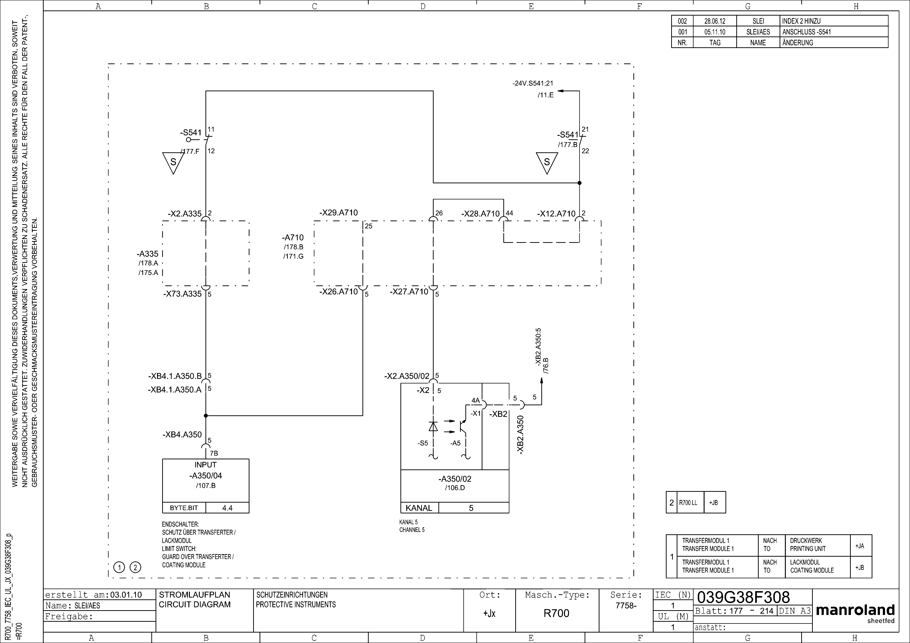

# +Jx — Sheet 177 of 214 — SCHUTZEINRICHTUNGEN

**PROTECTIVE INSTRUMENTS**

> Part of the manroland **R700** printing press IEC/UL circuit diagrams.
> Drawing class: **Stromlaufplan / Circuit diagram** (DIN A3).
> Document `+Jx` covers the **1st printing module + feed register** machine section.

## At a glance

| Field | Value |
|---|---|
| Document | `+Jx`  (039G38F308) |
| Sheet | **177** of 214 |
| Section (DE) | SCHUTZEINRICHTUNGEN |
| Section (EN) | PROTECTIVE INSTRUMENTS |
| Section type | CIRCUIT — Circuit diagram |
| Machine type | `R700` |
| Series | `7758` |
| Created | 03.01.10 |
| Replaces | — |
| Columns used | A, B, C, D, E, F, G, H |
| Path numbers | — |
| Labels on sheet | 103 |
| Cross-refs out | 10 |
| Cross-refs in | 23 |

**Previous:** [+Jx sheet 176](SHEET_0176.md) · **Next:** [+Jx sheet 178](SHEET_0178.md) · **Document TOC:** [_TOC.md](_TOC.md)  (+Jx) · **Master TOC:** [all sheets](../_MASTER_TOC.md)

## Sheet image (300 DPI, exact vector render)



_Rendered directly from the PDF vector layer at 300 DPI (1-bit), no OCR and no resampling. Use it to confirm anything ambiguous in the text below._

## Cross-references on this sheet

Each entry is a wire leaving this sheet. The printed token is `/sheet.column`; the link resolves to that sheet inside the same document.

| Ref | Target sheet | Col | Path | Destination on target | Target section | From col |
|---|---|---|---|---|---|---|
| `/11.E` | [+Jx sheet 11](SHEET_0011.md) | E | — | — | SPANNUNGSVERSORGUNG, SCHALTSCHRANKBELÜFTUNG | E |
| `/177.B` | [+Jx sheet 177](SHEET_0177.md) | B | — | — | SCHUTZEINRICHTUNGEN | E |
| `/177.F` | [+Jx sheet 177](SHEET_0177.md) | F | — | — | SCHUTZEINRICHTUNGEN | B |
| `/178.B` | [+Jx sheet 178](SHEET_0178.md) | B | — | — | OPTION: TRANSFERMODUL 1 NACH | C |
| `/171.G` | [+Jx sheet 171](SHEET_0171.md) | G | — | — | OPTION: AUTOMATISCHEM SPÜLEN | C |
| `/178.A` | [+Jx sheet 178](SHEET_0178.md) | A | — | — | OPTION: TRANSFERMODUL 1 NACH | A |
| `/175.A` | [+Jx sheet 175](SHEET_0175.md) | A | — | — | OPTION: | A |
| `/76.B` | [+Jx sheet 76](SHEET_0076.md) | B | — | XB2.A350:5 | BUSVERBINDUNGEN: SICHERHEITSKREIS | E |
| `/107.B` | [+Jx sheet 107](SHEET_0107.md) | B | — | — | REFERENZMODUL | B |
| `/106.D` | [+Jx sheet 106](SHEET_0106.md) | D | — | — | REFERENZMODUL | D |

### Incoming references (sheets that point here)

Every other sheet that sends a wire to this one. `Back-ref` is the token printed on *that* sheet; `Path` is its line number.

| From sheet | Cols | Back-ref | Path | Refs | What continues there |
|---|---|---|---|---|---|
| [+Jx#11](SHEET_0011.md) | E | `/11.E` | — | 1 | 24V.S541:21 |
| [+Jx#76](SHEET_0076.md) | B | `/76.B` | — | 1 | XB2.A350:5 |
| [+Jx#106](SHEET_0106.md) | D | `/106.D` | — | 1 | — |
| [+Jx#107](SHEET_0107.md) | B | `/107.B` | — | 1 | — |
| [+Jx#126](SHEET_0126.md) | A, E | `/126.A`, `/126.E` | — | 3 | — |
| [+Jx#130](SHEET_0130.md) | A, B, D | `/130.A`, `/130.B`, `/130.D` | — | 3 | — |
| [+Jx#138](SHEET_0138.md) | A | `/138.A` | — | 1 | — |
| [+Jx#143](SHEET_0143.md) | F | `/143.F` | — | 1 | — |
| [+Jx#144](SHEET_0144.md) | C | `/144.C` | — | 1 | — |
| [+Jx#146](SHEET_0146.md) | B | `/146.B` | — | 1 | — |
| [+Jx#147](SHEET_0147.md) | B, C | `/147.B`, `/147.C` | — | 2 | — |
| [+Jx#153](SHEET_0153.md) | E | `/153.E` | — | 1 | — |
| [+Jx#171](SHEET_0171.md) | G | `/171.G` | — | 1 | — |
| [+Jx#175](SHEET_0175.md) | A | `/175.A` | — | 1 | — |
| [+Jx#177](SHEET_0177.md) | B, E | `/177.B`, `/177.E` | — | 2 | — |
| [+Jx#178](SHEET_0178.md) | A, B | `/178.A`, `/178.B` | — | 2 | — |


## Devices on this sheet

| Tag | Class | Class meaning (IEC) | Col | Sub | Terminal | Sign |
|---|---|---|---|---|---|---|
| `A350/04` | A | Baugruppe / assembly, module, PC board | B | 04 | — | — |
| `A710` | A | Baugruppe / assembly, module, PC board | C | — | — | — |
| `S5` | S | Schalter / switch | D | — | — | — |
| `A5` | A | Baugruppe / assembly, module, PC board | D | — | — | — |
| `X1` | X | Klemme / terminal, plug connector | D | — | — | — |
| `X2` | X | Klemme / terminal, plug connector | D | — | — | — |
| `XB2` | XB |  | E | — | — | — |
| `A350/02` | A | Baugruppe / assembly, module, PC board | D | 02 | — | — |
| `A335` | A | Baugruppe / assembly, module, PC board | A | — | — | — |
| `S541` | S | Schalter / switch | B | — | — | — |
| `S541` | S | Schalter / switch | E | — | — | — |
| `4.4` | — | cross-device reference | B | — | — | — |
| `XB4.A350` | — | cross-device reference | B | — | — | — |
| `XB4.1.A350.B` | — | cross-device reference | B | — | — | — |
| `XB4.1.A350.A` | — | cross-device reference | B | — | — | — |
| `X27.A710` | — | cross-device reference | D | — | — | — |
| `X26.A710` | — | cross-device reference | C | — | — | — |
| `XB2.A350` | — | cross-device reference | E | — | — | — |
| `X28.A710` | — | cross-device reference | E | — | — | — |
| `X12.A710` | — | cross-device reference | E | — | — | — |
| `X2.A335` | — | cross-device reference | B | — | — | — |
| `X73.A335` | — | cross-device reference | B | — | — | — |
| `NR.` | — | cross-device reference | F | — | — | — |
| `05.11.10` | — | cross-device reference | G | — | — | — |
| `XB2.A350:5` | — | cross-device reference | E | — | 5 | — |
| `28.06.12` | — | cross-device reference | G | — | — | — |
| `X29.A710` | — | cross-device reference | C | — | — | — |

## Potentials / nets

| Potential | Count | Columns | Attached devices | Terminals |
|---|---|---|---|---|
| `24V` | 1 | E | `S541` | `21` |


A potential such as `L24+/4` or `M24+` is a named supply/return rail; every place it appears on this sheet is electrically common.

## Wire-end annotations (grouped as printed)

A wire that continues elsewhere is annotated with a small cluster: the destination description, the path/line number `#NN`, and the `/sheet.column` cross reference. Each row below is one such cluster exactly as it is grouped on the drawing.

| Col | Y | Path | Cross-ref | Text on the wire |
|---|---|---|---|---|
| G | 24.4 | — | — | `002 28.06.12 SLEI INDEX 2 HINZU` |
| G | 38.5 | — | — | `001 05.11.10 SLEI/AES ANSCHLUSS S541` |
| G | 52.6 | — | — | `NR. TAG NAME ÄNDERUNG` |
| E | 105.1 | — | — | `24V.S541:21` |
| E | 120.7 | — | `/11.E` | — |
| D | 165.4 | — | — | `S541 21` |
| B | 165.4 | — | — | `11` |
| E | 171.7 | — | — | `S541` |
| E | 185.5 | — | `/177.B` | — |
| B | 193.7 | — | — | `12` |
| F | 193.7 | — | — | `22` |
| B | 194.4 | — | `/177.F` | — |
| C | 206.5 | — | — | `S S` |
| C | 273.8 | — | — | `X29.A710` |
| B | 275.2 | — | — | `X2.A335 2` |
| D | 275.2 | — | — | `26` |
| E | 275.2 | — | — | `X28.A710 44 X12.A710 2` |
| C | 292.2 | — | — | `A710 25` |
| C | 319.5 | — | `/178.B`, `/171.G` | — |
| A | 327.6 | — | — | `A335` |
| A | 340.7 | — | `/178.A`, `/175.A` | — |
| D | 377.2 | — | — | `X26.A710 5 X27.A710 5` |
| B | 380.1 | — | — | `X73.A335 5` |
| E | 429.4 | — | `/76.B` | `XB2.A350:5` |
| B | 487.8 | — | — | `XB4.1.A350.B 5` |
| D | 487.8 | — | — | `X2.A350/02 5` |
| B | 504.8 | — | — | `XB4.1.A350.A 5` |
| D | 506.2 | — | — | `X2` |
| E | 507.7 | — | — | `5 5` |
| E | 516.2 | — | — | `5` |
| D | 520.4 | — | — | `4A` |
| D | 537.4 | — | — | `X1` |
| E | 537.4 | — | — | `XB2` |
| E | 543.7 | — | — | `XB2.A350` |
| B | 564.3 | — | — | `XB4.A350 5` |
| D | 576.4 | — | — | `S5 A5` |
| B | 589.8 | — | — | `7B` |
| B | 604.4 | — | — | `INPUT` |
| B | 618.2 | — | — | `A350/04` |
| D | 622.4 | — | — | `A350/02` |
| B | 632.0 | — | `/107.B` | — |
| D | 634.8 | — | `/106.D` | — |
| G | 653.6 | — | — | `2 R700 LL +JB` |
| D | 660.7 | — | — | `KANAL 5` |
| B | 661.0 | — | — | `BYTE.BIT 4.4` |
| D | 681.0 | — | — | `KANAL 5 CHANNEL 5` |
| B | 683.7 | — | — | `ENDSCHALTER: LACKMODUL LIMIT SWITCH: SCHUTZ ÜBER TRANSFERTER / GUARD OVER TRANSFERTER / COATING MODULE` |
| G | 705.0 | — | — | `TRANSFERMODUL 1 TRANSFER MODULE 1` |
| G | 705.0 | — | — | `NACH` |
| H | 705.0 | — | — | `DRUCKWERK PRINTING UNIT` |
| H | 712.0 | — | — | `+JA` |
| G | 715.6 | — | — | `TO` |
| D | 724.5 | — | — | `1 1` |
| G | 733.3 | — | — | `NACH` |
| G | 733.4 | — | — | `TRANSFERMODUL 1 TRANSFER MODULE 1` |
| H | 733.4 | — | — | `LACKMODUL COATING MODULE` |
| A | 740.1 | — | — | `2` |
| H | 740.4 | — | — | `+JB` |
| G | 744.0 | — | — | `TO` |


## Reconstructed tables

This sheet carries tabular content (pin map / terminal assignment / index). The grid below was rebuilt from the drawing's own rule lines, so each row is exactly one physical row of the table.

### Table 1 — 3 data rows × 2 columns (at x=212.6, y=119.1)

| S541 /177.F S X2.A335 X73.A335 XB4.1.A350.B XB4.1.A350.A | 11 12 2 5 5 5 |
|---|---|
| `XB4.A350` | `5 7B` |
| `INPUT A350/04` | `/107.B` |
| `BYTE.BIT` | `4.4` |


### Table 2 — 5 data rows × 7 columns (at x=474.8, y=119.1) — **/11.E S541 /177.B S**

| 25 |  | 26 | X28.A710 |  | 44 | X12.A710 |
|---|---|---|---|---|---|---|
| `5` | `X27.A710 X2.A350/02` | `5 5` |  |  | `XB2.A350:5` | `/76.B` |
|  | `X2` | `5` | `4A X1` | `XB2` | `5 5` |  |
|  | `S5` | `A5` |  |  | `XB2.A350` |  |
|  |  | `A350/02 /106.D` |  |  |  |  |
|  | `KANAL` |  | `5` |  |  |  |


## Notes and free text on this sheet

| Text | Col | Y (pt) |
|---|---|---|
| `7B` | B | 589.82 |
| `INPUT` | B | 604.35 |
| `BYTE.BIT` | B | 661.61 |
| `ENDSCHALTER:` | B | 683.72 |
| `SCHUTZ ÜBER TRANSFERTER /` | B | 694.37 |
| `LACKMODUL` | B | 705.02 |
| `LIMIT SWITCH:` | B | 715.57 |
| `GUARD OVER TRANSFERTER /` | B | 726.27 |
| `COATING MODULE` | B | 736.91 |
| `KANAL 5` | D | 681.05 |
| `CHANNEL 5` | D | 691 |
| `4A` | D | 520.37 |
| `KANAL` | D | 660.7 |
| `X2.A350/02` | D | 487.8 |
| `TAG` | G | 52.75 |
| `NAME` | G | 52.73 |
| `ÄNDERUNG` | G | 52.76 |
| `SLEI/AES` | G | 38.6 |
| `ANSCHLUSS S541` | H | 38.58 |
| `SLEI` | G | 24.4 |
| `INDEX 2 HINZU` | G | 24.42 |
| `TRANSFERMODUL 1` | G | 705 |
| `TRANSFER MODULE 1` | G | 715.63 |
| `NACH` | G | 704.98 |
| `TO` | G | 715.61 |
| `DRUCKWERK` | H | 704.97 |
| `PRINTING UNIT` | H | 715.63 |
| `LACKMODUL` | H | 733.36 |
| `COATING MODULE` | H | 743.99 |
| `+JA` | H | 712.03 |
| `+JB` | H | 740.35 |
| `S` | B | 206.52 |
| `S` | E | 206.52 |
| `R700 LL` | F | 655.39 |
| `+JB` | G | 655.31 |

## Complete label inventory (exact text from the drawing)

Every text object inside the drawing area of this sheet, in DIN reading order (column A→H, then top→bottom). This is the authoritative list: if a string is not here it is not printed on this sheet.

| Col | Y | X | Dir | Type | Text |
|---|---|---|---|---|---|
| A | 327.6 | 178.9 | → | device tag | `A335` |
| A | 340.7 | 181.4 | → | cross-reference | `/178.A` |
| A | 353.1 | 181.4 | → | cross-reference | `/175.A` |
| A | 739.6 | 154.0 | → | number | `1` |
| A | 740.1 | 175.2 | → | number | `2` |
| B | 165.4 | 271.3 | → | number | `11` |
| B | 168.9 | 235.8 | → | device tag | `S541` |
| B | 193.7 | 271.3 | → | number | `12` |
| B | 194.4 | 236.1 | → | cross-reference | `/177.F` |
| B | 206.5 | 222.7 | → | text | `S` |
| B | 275.2 | 219.7 | → | device ref | `X2.A335` |
| B | 275.2 | 272.1 | → | number | `2` |
| B | 380.1 | 213.7 | → | device ref | `X73.A335` |
| B | 381.5 | 271.8 | → | number | `5` |
| B | 487.8 | 194.2 | → | device ref | `XB4.1.A350.B` |
| B | 487.8 | 271.8 | → | number | `5` |
| B | 504.8 | 271.8 | → | number | `5` |
| B | 505.5 | 193.6 | → | device ref | `XB4.1.A350.A` |
| B | 564.3 | 212.9 | → | device ref | `XB4.A350` |
| B | 572.9 | 271.8 | → | number | `5` |
| B | 589.8 | 274.7 | → | text | `7B` |
| B | 604.4 | 254.4 | → | text | `INPUT` |
| B | 618.2 | 247.7 | → | device tag | `A350/04` |
| B | 632.0 | 256.7 | → | cross-reference | `/107.B` |
| B | 661.0 | 291.0 | → | device ref | `4.4` |
| B | 661.6 | 222.5 | → | text | `BYTE.BIT` |
| B | 683.7 | 212.0 | → | text | `ENDSCHALTER:` |
| B | 694.4 | 212.3 | → | text | `SCHUTZ ÜBER TRANSFERTER /` |
| B | 705.0 | 212.0 | → | text | `LACKMODUL` |
| B | 715.6 | 212.0 | → | text | `LIMIT SWITCH:` |
| B | 726.3 | 212.3 | → | text | `GUARD OVER TRANSFERTER /` |
| B | 736.9 | 212.3 | → | text | `COATING MODULE` |
| C | 273.8 | 418.1 | → | device ref | `X29.A710` |
| C | 306.4 | 369.1 | → | device tag | `A710` |
| C | 319.5 | 371.6 | → | cross-reference | `/178.B` |
| C | 331.9 | 370.8 | → | cross-reference | `/171.G` |
| C | 377.2 | 418.1 | → | device ref | `X26.A710` |
| C | 381.5 | 477.4 | → | number | `5` |
| D | 275.2 | 569.8 | → | number | `26` |
| D | 292.2 | 477.6 | → | number | `25` |
| D | 377.2 | 510.2 | → | device ref | `X27.A710` |
| D | 381.5 | 569.5 | → | number | `5` |
| D | 487.8 | 502.9 | → | text | `X2.A350/02` |
| D | 487.8 | 569.5 | → | number | `5` |
| D | 506.2 | 545.4 | → | device tag | `X2` |
| D | 507.7 | 572.3 | → | number | `5` |
| D | 520.4 | 617.1 | → | text | `4A` |
| D | 537.4 | 615.7 | → | device tag | `X1` |
| D | 576.4 | 546.5 | → | device tag | `S5` |
| D | 576.4 | 589.0 | → | device tag | `A5` |
| D | 622.4 | 573.9 | → | device tag | `A350/02` |
| D | 634.8 | 582.5 | → | cross-reference | `/106.D` |
| D | 660.7 | 530.9 | → | text | `KANAL` |
| D | 660.7 | 613.6 | → | number | `5` |
| D | 681.1 | 522.4 | → | text | `KANAL 5` |
| D | 691.0 | 522.7 | → | text | `CHANNEL 5` |
| E | 105.1 | 670.7 | → | potential | `24V.S541:21` |
| E | 120.7 | 703.8 | → | cross-reference | `/11.E` |
| E | 171.7 | 729.1 | → | device tag | `S541` |
| E | 185.5 | 730.2 | → | cross-reference | `/177.B` |
| E | 206.5 | 711.6 | → | text | `S` |
| E | 275.2 | 603.8 | → | device ref | `X28.A710` |
| E | 275.2 | 661.9 | → | number | `44` |
| E | 275.2 | 703.0 | → | device ref | `X12.A710` |
| E | 275.2 | 761.1 | → | number | `2` |
| E | 429.5 | 700.4 | ↕ | device ref | `XB2.A350:5` |
| E | 468.3 | 710.3 | ↕ | cross-reference | `/76.B` |
| E | 516.2 | 697.0 | → | number | `5` |
| E | 517.6 | 671.5 | → | number | `5` |
| E | 537.4 | 640.3 | → | device tag | `XB2` |
| E | 543.7 | 676.3 | ↕ | device ref | `XB2.A350` |
| F | 24.4 | 887.1 | → | number | `002` |
| F | 38.5 | 887.6 | → | number | `001` |
| F | 52.6 | 886.8 | → | device ref | `NR.` |
| F | 165.4 | 761.1 | → | number | `21` |
| F | 193.7 | 761.1 | → | number | `22` |
| F | 653.6 | 875.9 | → | number | `2` |
| F | 655.4 | 888.8 | → | text | `R700 LL` |
| F | 724.5 | 876.2 | → | number | `1` |
| G | 24.4 | 921.9 | → | device ref | `28.06.12` |
| G | 24.4 | 984.8 | → | text | `SLEI` |
| G | 24.4 | 1023.4 | → | text | `INDEX 2 HINZU` |
| G | 38.6 | 921.9 | → | device ref | `05.11.10` |
| G | 38.6 | 976.6 | → | text | `SLEI/AES` |
| G | 52.7 | 928.5 | → | text | `TAG` |
| G | 52.7 | 981.8 | → | text | `NAME` |
| G | 52.8 | 1024.0 | → | text | `ÄNDERUNG` |
| G | 655.3 | 928.1 | → | text | `+JB` |
| G | 705.0 | 892.9 | → | text | `TRANSFERMODUL 1` |
| G | 705.0 | 998.6 | → | text | `NACH` |
| G | 715.6 | 892.9 | → | text | `TRANSFER MODULE 1` |
| G | 715.6 | 999.2 | → | text | `TO` |
| G | 733.3 | 892.9 | → | text | `TRANSFERMODUL 1` |
| G | 733.3 | 998.6 | → | text | `NACH` |
| G | 744.0 | 892.9 | → | text | `TRANSFER MODULE 1` |
| G | 744.0 | 999.2 | → | text | `TO` |
| H | 38.6 | 1024.0 | → | text | `ANSCHLUSS S541` |
| H | 705.0 | 1034.1 | → | text | `DRUCKWERK` |
| H | 712.0 | 1119.4 | → | text | `+JA` |
| H | 715.6 | 1034.1 | → | text | `PRINTING UNIT` |
| H | 733.4 | 1034.1 | → | text | `LACKMODUL` |
| H | 740.4 | 1119.4 | → | text | `+JB` |
| H | 744.0 | 1034.4 | → | text | `COATING MODULE` |

## Reading-order text block

The same content as a plain block, grouped by DIN column — convenient to paste or to match against a visual description.

```text
=== Column A ===
 327.6  178.9  devtag       A335
 340.7  181.4  xref         /178.A
 353.1  181.4  xref         /175.A
 739.6  154.0  numeric      1
 740.1  175.2  numeric      2
=== Column B ===
 165.4  271.3  numeric      11
 168.9  235.8  devtag       S541
 193.7  271.3  numeric      12
 194.4  236.1  xref         /177.F
 206.5  222.7  text         S
 275.2  219.7  devref       X2.A335
 275.2  272.1  numeric      2
 380.1  213.7  devref       X73.A335
 381.5  271.8  numeric      5
 487.8  194.2  devref       XB4.1.A350.B
 487.8  271.8  numeric      5
 504.8  271.8  numeric      5
 505.5  193.6  devref       XB4.1.A350.A
 564.3  212.9  devref       XB4.A350
 572.9  271.8  numeric      5
 589.8  274.7  text         7B
 604.4  254.4  text         INPUT
 618.2  247.7  devtag       A350/04
 632.0  256.7  xref         /107.B
 661.0  291.0  devref       4.4
 661.6  222.5  text         BYTE.BIT
 683.7  212.0  text         ENDSCHALTER:
 694.4  212.3  text         SCHUTZ ÜBER TRANSFERTER /
 705.0  212.0  text         LACKMODUL
 715.6  212.0  text         LIMIT SWITCH:
 726.3  212.3  text         GUARD OVER TRANSFERTER /
 736.9  212.3  text         COATING MODULE
=== Column C ===
 273.8  418.1  devref       X29.A710
 306.4  369.1  devtag       A710
 319.5  371.6  xref         /178.B
 331.9  370.8  xref         /171.G
 377.2  418.1  devref       X26.A710
 381.5  477.4  numeric      5
=== Column D ===
 275.2  569.8  numeric      26
 292.2  477.6  numeric      25
 377.2  510.2  devref       X27.A710
 381.5  569.5  numeric      5
 487.8  502.9  text         X2.A350/02
 487.8  569.5  numeric      5
 506.2  545.4  devtag       X2
 507.7  572.3  numeric      5
 520.4  617.1  text         4A
 537.4  615.7  devtag       X1
 576.4  546.5  devtag       S5
 576.4  589.0  devtag       A5
 622.4  573.9  devtag       A350/02
 634.8  582.5  xref         /106.D
 660.7  530.9  text         KANAL
 660.7  613.6  numeric      5
 681.1  522.4  text         KANAL 5
 691.0  522.7  text         CHANNEL 5
=== Column E ===
 105.1  670.7  net          24V.S541:21
 120.7  703.8  xref         /11.E
 171.7  729.1  devtag       S541
 185.5  730.2  xref         /177.B
 206.5  711.6  text         S
 275.2  603.8  devref       X28.A710
 275.2  661.9  numeric      44
 275.2  703.0  devref       X12.A710
 275.2  761.1  numeric      2
 429.5  700.4  devref       XB2.A350:5
 468.3  710.3  xref         /76.B
 516.2  697.0  numeric      5
 517.6  671.5  numeric      5
 537.4  640.3  devtag       XB2
 543.7  676.3  devref       XB2.A350
=== Column F ===
  24.4  887.1  numeric      002
  38.5  887.6  numeric      001
  52.6  886.8  devref       NR.
 165.4  761.1  numeric      21
 193.7  761.1  numeric      22
 653.6  875.9  numeric      2
 655.4  888.8  text         R700 LL
 724.5  876.2  numeric      1
=== Column G ===
  24.4  921.9  devref       28.06.12
  24.4  984.8  text         SLEI
  24.4 1023.4  text         INDEX 2 HINZU
  38.6  921.9  devref       05.11.10
  38.6  976.6  text         SLEI/AES
  52.7  928.5  text         TAG
  52.7  981.8  text         NAME
  52.8 1024.0  text         ÄNDERUNG
 655.3  928.1  text         +JB
 705.0  892.9  text         TRANSFERMODUL 1
 705.0  998.6  text         NACH
 715.6  892.9  text         TRANSFER MODULE 1
 715.6  999.2  text         TO
 733.3  892.9  text         TRANSFERMODUL 1
 733.3  998.6  text         NACH
 744.0  892.9  text         TRANSFER MODULE 1
 744.0  999.2  text         TO
=== Column H ===
  38.6 1024.0  text         ANSCHLUSS S541
 705.0 1034.1  text         DRUCKWERK
 712.0 1119.4  text         +JA
 715.6 1034.1  text         PRINTING UNIT
 733.4 1034.1  text         LACKMODUL
 740.4 1119.4  text         +JB
 744.0 1034.4  text         COATING MODULE
```

---
_Generated from the PDF vector text layer; no OCR. Source: `R700_7758_IEC_UL_JX_039G38F308_p`, sheet 177._
