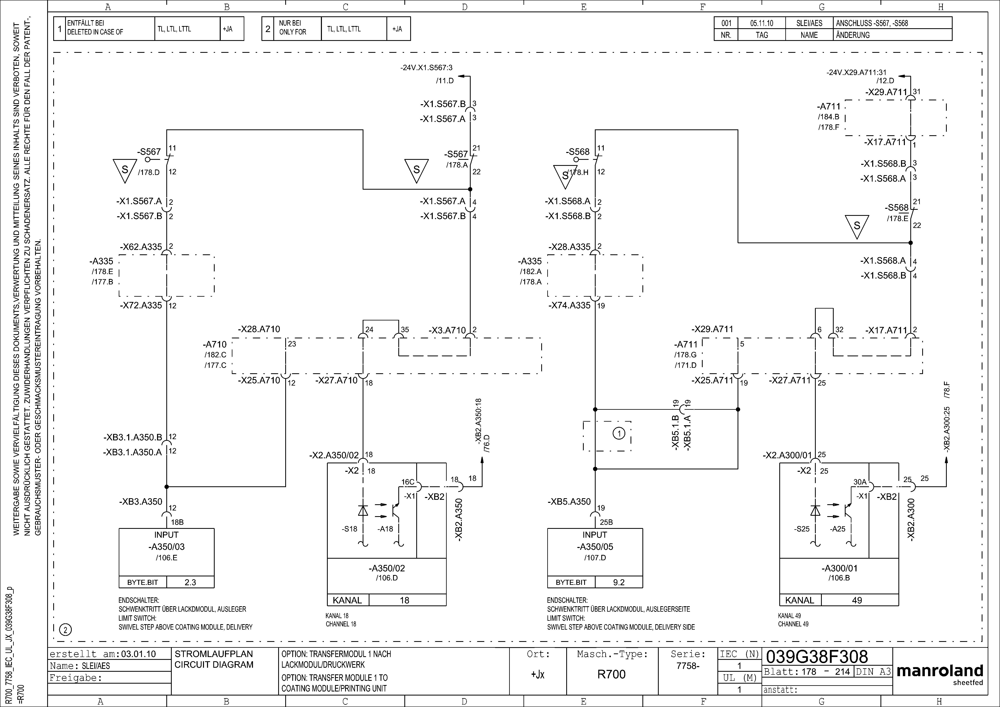

# +Jx — Sheet 178 of 214 — OPTION: TRANSFERMODUL 1 NACH

**LACKMODUL/DRUCKWERK**

> Part of the manroland **R700** printing press IEC/UL circuit diagrams.
> Drawing class: **Stromlaufplan / Circuit diagram** (DIN A3).
> Document `+Jx` covers the **1st printing module + feed register** machine section.

## At a glance

| Field | Value |
|---|---|
| Document | `+Jx`  (039G38F308) |
| Sheet | **178** of 214 |
| Section (DE) | OPTION: TRANSFERMODUL 1 NACH |
| Section (EN) | LACKMODUL/DRUCKWERK |
| Section type | CIRCUIT — Circuit diagram |
| Machine type | `R700` |
| Series | `7758` |
| Created | 03.01.10 |
| Replaces | — |
| Columns used | A, B, C, D, E, F, G, H |
| Path numbers | — |
| Labels on sheet | 187 |
| Cross-refs out | 22 |
| Cross-refs in | 62 |

**Previous:** [+Jx sheet 177](SHEET_0177.md) · **Next:** [+Jx sheet 179](SHEET_0179.md) · **Document TOC:** [_TOC.md](_TOC.md)  (+Jx) · **Master TOC:** [all sheets](../_MASTER_TOC.md)

## Sheet image (300 DPI, exact vector render)



_Rendered directly from the PDF vector layer at 300 DPI (1-bit), no OCR and no resampling. Use it to confirm anything ambiguous in the text below._

## Cross-references on this sheet

Each entry is a wire leaving this sheet. The printed token is `/sheet.column`; the link resolves to that sheet inside the same document.

| Ref | Target sheet | Col | Path | Destination on target | Target section | From col |
|---|---|---|---|---|---|---|
| `/12.D` | [+Jx sheet 12](SHEET_0012.md) | D | — | 24V.X29.A711:31 | SPANNUNGSVERSORGUNG, SCHALTSCHRANKBELÜFTUNG | G |
| `/11.D` | [+Jx sheet 11](SHEET_0011.md) | D | — | — | SPANNUNGSVERSORGUNG, SCHALTSCHRANKBELÜFTUNG | D |
| `/184.B` | [+Jx sheet 184](SHEET_0184.md) | B | — | — | OPTION: TRANSFERMODUL 1 + 2 | G |
| `/178.F` | [+Jx sheet 178](SHEET_0178.md) | F | — | — | OPTION: TRANSFERMODUL 1 NACH | G |
| `/178.A` | [+Jx sheet 178](SHEET_0178.md) | A | — | — | OPTION: TRANSFERMODUL 1 NACH | D |
| `/178.D` | [+Jx sheet 178](SHEET_0178.md) | D | — | — | OPTION: TRANSFERMODUL 1 NACH | A |
| `/178.H` | [+Jx sheet 178](SHEET_0178.md) | H | — | — | OPTION: TRANSFERMODUL 1 NACH | E |
| `/178.E` | [+Jx sheet 178](SHEET_0178.md) | E | — | — | OPTION: TRANSFERMODUL 1 NACH | H |
| `/178.E` | [+Jx sheet 178](SHEET_0178.md) | E | — | — | OPTION: TRANSFERMODUL 1 NACH | A |
| `/177.B` | [+Jx sheet 177](SHEET_0177.md) | B | — | — | SCHUTZEINRICHTUNGEN | A |
| `/182.A` | [+Jx sheet 182](SHEET_0182.md) | A | — | — | OPTION: TRANSFERMODUL 2 | E |
| `/178.A` | [+Jx sheet 178](SHEET_0178.md) | A | — | — | OPTION: TRANSFERMODUL 1 NACH | E |
| `/178.G` | [+Jx sheet 178](SHEET_0178.md) | G | — | A711 | OPTION: TRANSFERMODUL 1 NACH | F |
| `/182.C` | [+Jx sheet 182](SHEET_0182.md) | C | — | — | OPTION: TRANSFERMODUL 2 | B |
| `/177.C` | [+Jx sheet 177](SHEET_0177.md) | C | — | — | SCHUTZEINRICHTUNGEN | B |
| `/171.D` | [+Jx sheet 171](SHEET_0171.md) | D | — | — | OPTION: AUTOMATISCHEM SPÜLEN | F |
| `/78.F` | [+Jx sheet 78](SHEET_0078.md) | F | — | XB2.A300:25 | BUSVERBINDUNGEN: SICHERHEITSKREIS | H |
| `/76.D` | [+Jx sheet 76](SHEET_0076.md) | D | — | XB2.A350:18 | BUSVERBINDUNGEN: SICHERHEITSKREIS | D |
| `/106.E` | [+Jx sheet 106](SHEET_0106.md) | E | — | — | REFERENZMODUL | A |
| `/107.D` | [+Jx sheet 107](SHEET_0107.md) | D | — | — | REFERENZMODUL | E |
| `/106.B` | [+Jx sheet 106](SHEET_0106.md) | B | — | — | REFERENZMODUL | G |
| `/106.D` | [+Jx sheet 106](SHEET_0106.md) | D | — | — | REFERENZMODUL | C |

### Incoming references (sheets that point here)

Every other sheet that sends a wire to this one. `Back-ref` is the token printed on *that* sheet; `Path` is its line number.

| From sheet | Cols | Back-ref | Path | Refs | What continues there |
|---|---|---|---|---|---|
| [+Jx#11](SHEET_0011.md) | D | `/11.D` | — | 1 | 24V.X1.S567:3 |
| [+Jx#12](SHEET_0012.md) | D | `/12.D` | — | 1 | — |
| [+Jx#76](SHEET_0076.md) | D | `/76.D` | — | 1 | XB2.A350:18 |
| [+Jx#78](SHEET_0078.md) | F | `/78.F` | — | 1 | XB2.A300:25 |
| [+Jx#106](SHEET_0106.md) | B, D, E | `/106.B`, `/106.D`, `/106.E` | — | 3 | — |
| [+Jx#107](SHEET_0107.md) | D | `/107.D` | — | 1 | — |
| [+Jx#119](SHEET_0119.md) | G, H | `/119.G`, `/119.H` | — | 12 | — |
| [+Jx#124](SHEET_0124.md) | F, H | `/124.F`, `/124.H` | — | 2 | — |
| [+Jx#126](SHEET_0126.md) | F | `/126.F` | — | 2 | — |
| [+Jx#128](SHEET_0128.md) | C, D, F, H | `/128.C`, `/128.D`, `/128.F`, `/128.H` | — | 4 | — |
| [+Jx#131](SHEET_0131.md) | A, B | `/131.A`, `/131.B` | — | 2 | — |
| [+Jx#132](SHEET_0132.md) | C | `/132.C` | — | 1 | — |
| [+Jx#140](SHEET_0140.md) | C | `/140.C` | — | 2 | — |
| [+Jx#143](SHEET_0143.md) | A, B | `/143.A`, `/143.B` | — | 2 | — |
| [+Jx#144](SHEET_0144.md) | D, G | `/144.D`, `/144.G` | — | 2 | — |
| [+Jx#145](SHEET_0145.md) | A | `/145.A` | — | 1 | — |
| [+Jx#146](SHEET_0146.md) | A, B | `/146.A`, `/146.B` | — | 3 | — |
| [+Jx#147](SHEET_0147.md) | D, E | `/147.D`, `/147.E` | — | 4 | — |
| [+Jx#151](SHEET_0151.md) | G | `/151.G` | — | 1 | — |
| [+Jx#153](SHEET_0153.md) | C | `/153.C` | — | 1 | — |
| [+Jx#154](SHEET_0154.md) | A | `/154.A` | — | 1 | — |
| [+Jx#171](SHEET_0171.md) | C | `/171.C` | — | 1 | — |
| [+Jx#177](SHEET_0177.md) | A, C | `/177.A`, `/177.C` | — | 2 | — |
| [+Jx#178](SHEET_0178.md) | A, D, E, F, G, H | `/178.A`, `/178.D`, `/178.E`, `/178.F`, `/178.G`, `/178.H` | — | 8 | A711 |
| [+Jx#182](SHEET_0182.md) | A, C | `/182.A`, `/182.C` | — | 2 | — |
| [+Jx#184](SHEET_0184.md) | B | `/184.B` | — | 1 | — |


## Devices on this sheet

| Tag | Class | Class meaning (IEC) | Col | Sub | Terminal | Sign |
|---|---|---|---|---|---|---|
| `S25` | S | Schalter / switch | G | — | — | — |
| `A25` | A | Baugruppe / assembly, module, PC board | G | — | — | — |
| `X1` | X | Klemme / terminal, plug connector | G | — | — | — |
| `X2` | X | Klemme / terminal, plug connector | G | — | — | — |
| `XB2` | XB |  | H | — | — | — |
| `A300/01` | A | Baugruppe / assembly, module, PC board | G | 01 | — | — |
| `A350/03` | A | Baugruppe / assembly, module, PC board | A | 03 | — | — |
| `A350/05` | A | Baugruppe / assembly, module, PC board | E | 05 | — | — |
| `S18` | S | Schalter / switch | C | — | — | — |
| `A18` | A | Baugruppe / assembly, module, PC board | C | — | — | — |
| `X1` | X | Klemme / terminal, plug connector | D | — | — | — |
| `X2` | X | Klemme / terminal, plug connector | C | — | — | — |
| `XB2` | XB |  | D | — | — | — |
| `A350/02` | A | Baugruppe / assembly, module, PC board | C | 02 | — | — |
| `A710` | A | Baugruppe / assembly, module, PC board | B | — | — | — |
| `A335` | A | Baugruppe / assembly, module, PC board | A | — | — | — |
| `A335` | A | Baugruppe / assembly, module, PC board | E | — | — | — |
| `S568` | S | Schalter / switch | H | — | — | — |
| `S568` | S | Schalter / switch | E | — | — | — |
| `S567` | S | Schalter / switch | A | — | — | — |
| `S567` | S | Schalter / switch | D | — | — | — |
| `A711` | A | Baugruppe / assembly, module, PC board | F | — | — | — |
| `A711` | A | Baugruppe / assembly, module, PC board | G | — | — | — |
| `XB5.1.A` | — | cross-device reference | F | — | — | — |
| `XB5.1.B` | — | cross-device reference | F | — | — | — |
| `XB2.A300` | — | cross-device reference | H | — | — | — |
| `X25.A711` | — | cross-device reference | F | — | — | — |
| `X27.A711` | — | cross-device reference | G | — | — | — |
| `X1.S568.A` | — | cross-device reference | H | — | — | — |
| `X1.S568.B` | — | cross-device reference | H | — | — | — |
| `X1.S568.B` | — | cross-device reference | H | — | — | — |
| `X1.S568.A` | — | cross-device reference | H | — | — | — |
| `2.3` | — | cross-device reference | B | — | — | — |
| `XB3.A350` | — | cross-device reference | A | — | — | — |
| `9.2` | — | cross-device reference | E | — | — | — |
| `XB5.A350` | — | cross-device reference | E | — | — | — |
| `XB2.A350` | — | cross-device reference | D | — | — | — |
| `XB3.1.A350.B` | — | cross-device reference | A | — | — | — |
| `XB3.1.A350.A` | — | cross-device reference | A | — | — | — |
| `X62.A335` | — | cross-device reference | A | — | — | — |
| `X1.S567.B` | — | cross-device reference | A | — | — | — |
| `X1.S567.A` | — | cross-device reference | A | — | — | — |
| `X28.A335` | — | cross-device reference | E | — | — | — |
| `X1.S568.B` | — | cross-device reference | E | — | — | — |
| `X1.S568.A` | — | cross-device reference | E | — | — | — |
| `X72.A335` | — | cross-device reference | A | — | — | — |
| `X74.A335` | — | cross-device reference | E | — | — | — |
| `X27.A710` | — | cross-device reference | C | — | — | — |
| `X25.A710` | — | cross-device reference | B | — | — | — |
| `X3.A710` | — | cross-device reference | D | — | — | — |
| `X1.S567.A` | — | cross-device reference | D | — | — | — |
| `X1.S567.B` | — | cross-device reference | D | — | — | — |
| `X1.S567.B` | — | cross-device reference | D | — | — | — |
| `X1.S567.A` | — | cross-device reference | D | — | — | — |
| `X17.A711` | — | cross-device reference | H | — | — | — |
| `X17.A711` | — | cross-device reference | H | — | — | — |
| `X29.A711` | — | cross-device reference | H | — | — | — |
| `NR.` | — | cross-device reference | F | — | — | — |
| `05.11.10` | — | cross-device reference | F | — | — | — |
| `XB2.A300:25` | — | cross-device reference | H | — | 25 | — |
| `XB2.A350:18` | — | cross-device reference | D | — | 18 | — |
| `X28.A710` | — | cross-device reference | B | — | — | — |
| `X29.A711` | — | cross-device reference | F | — | — | — |

## Potentials / nets

| Potential | Count | Columns | Attached devices | Terminals |
|---|---|---|---|---|
| `24V` | 2 | D, G | `A711`, `S567`, `X1`, `X29` | `3`, `31` |


A potential such as `L24+/4` or `M24+` is a named supply/return rail; every place it appears on this sheet is electrically common.

## Wire-end annotations (grouped as printed)

A wire that continues elsewhere is annotated with a small cluster: the destination description, the path/line number `#NN`, and the `/sheet.column` cross reference. Each row below is one such cluster exactly as it is grouped on the drawing.

| Col | Y | Path | Cross-ref | Text on the wire |
|---|---|---|---|---|
| G | 24.3 | — | — | `001 05.11.10 SLEI/AES ANSCHLUSS S567, S568` |
| A | 24.6 | — | — | `1 ENTFÄLLT BEI DELETED IN CASE OF TL, LTL, LTTL` |
| C | 24.6 | — | — | `+JA 2 NUR BEI ONLY FOR TL, LTL, LTTL +JA` |
| G | 38.5 | — | — | `NR. TAG NAME ÄNDERUNG` |
| D | 76.8 | — | — | `24V.X1.S567:3` |
| G | 82.4 | — | `/12.D` | `24V.X29.A711:31` |
| D | 92.3 | — | `/11.D` | — |
| H | 105.1 | — | — | `X29.A711 31` |
| D | 119.3 | — | — | `X1.S567.B 3` |
| G | 122.1 | — | — | `A711` |
| G | 135.2 | — | `/184.B` | — |
| D | 136.3 | — | — | `X1.S567.A 3` |
| G | 147.6 | — | `/178.F` | — |
| H | 164.7 | — | — | `X17.A711 1` |
| B | 172.5 | — | — | `11` |
| D | 172.5 | — | — | `21` |
| E | 172.5 | — | — | `11` |
| A | 176.0 | — | — | `S567` |
| E | 176.0 | — | — | `S568` |
| D | 178.8 | — | — | `S567` |
| H | 190.2 | — | — | `X1.S568.B 3` |
| D | 192.6 | — | `/178.A` | — |
| B | 196.6 | — | — | `S S` |
| B | 200.8 | — | — | `12` |
| D | 200.8 | — | — | `22` |
| E | 200.8 | — | — | `12` |
| A | 201.5 | — | `/178.D` | — |
| E | 201.5 | — | `/178.H` | — |
| E | 203.7 | — | — | `S` |
| H | 207.2 | — | — | `X1.S568.A 3` |
| A | 234.8 | — | — | `X1.S567.A 2` |
| D | 234.8 | — | — | `X1.S567.A 4` |
| E | 234.8 | — | — | `X1.S568.A 2` |
| H | 236.2 | — | — | `21` |
| H | 242.6 | — | — | `S568` |
| A | 252.5 | — | — | `X1.S567.B 2` |
| D | 252.5 | — | — | `X1.S567.B 4` |
| E | 252.5 | — | — | `X1.S568.B 2` |
| H | 256.4 | — | `/178.E` | — |
| G | 263.2 | — | — | `S` |
| H | 264.6 | — | — | `22` |
| A | 289.4 | — | — | `X62.A335 2` |
| E | 289.4 | — | — | `X28.A335 2` |
| H | 305.7 | — | — | `X1.S568.A 4` |
| A | 306.4 | — | — | `A335` |
| E | 306.4 | — | — | `A335` |
| A | 319.5 | — | `/178.E`, `/177.B` | — |
| E | 319.5 | — | `/182.A`, `/178.A` | — |
| H | 323.4 | — | — | `X1.S568.B 4` |
| C | 358.8 | — | — | `X72.A335 12 X74.A335 19` |
| B | 387.2 | — | — | `X28.A710` |
| F | 387.2 | — | — | `X29.A711` |
| C | 388.6 | — | — | `24` |
| D | 388.6 | — | — | `35 X3.A710 2` |
| G | 388.6 | — | — | `6 32 X17.A711 2` |
| B | 405.6 | — | — | `A710` |
| C | 405.6 | — | — | `23` |
| F | 405.6 | — | `/178.G` | `A711` |
| F | 405.6 | — | — | `5` |
| B | 418.7 | — | `/182.C`, `/177.C` | — |
| F | 431.1 | — | `/171.D` | — |
| C | 448.1 | — | — | `X25.A710 12 X27.A710 18` |
| F | 448.1 | — | — | `X25.A711 19 X27.A711 25` |
| H | 454.0 | — | `/78.F` | `XB2.A300:25` |
| D | 474.2 | — | `/76.D` | `XB2.A350:18` |
| F | 475.9 | — | — | `XB5.1.B 19` |
| F | 475.9 | — | — | `XB5.1.A 19` |
| E | 512.9 | — | — | `1` |
| A | 516.1 | — | — | `XB3.1.A350.B 12` |
| A | 533.2 | — | — | `XB3.1.A350.A 12` |
| C | 537.4 | — | — | `X2.A350/02 18` |
| G | 537.4 | — | — | `X2.A300/01 25` |
| C | 555.9 | — | — | `X2` |
| G | 555.9 | — | — | `X2` |
| D | 557.3 | — | — | `18 18` |
| G | 557.3 | — | — | `25 25` |
| D | 565.8 | — | — | `18` |
| H | 565.8 | — | — | `25` |
| D | 570.0 | — | — | `16C` |
| G | 570.0 | — | — | `30A` |
| D | 587.0 | — | — | `X1` |
| D | 587.0 | — | — | `XB2` |
| G | 587.0 | — | — | `X1` |
| H | 587.0 | — | — | `XB2` |
| A | 592.7 | — | — | `XB3.A350 12` |
| E | 592.7 | — | — | `XB5.A350 19` |
| D | 593.3 | — | — | `XB2.A350` |
| H | 593.3 | — | — | `XB2.A300` |
| B | 618.2 | — | — | `18B` |
| E | 618.2 | — | — | `25B` |
| C | 626.0 | — | — | `S18 A18` |
| G | 626.0 | — | — | `S25 A25` |
| A | 632.7 | — | — | `INPUT` |
| E | 632.7 | — | — | `INPUT` |
| A | 646.5 | — | — | `A350/03` |
| E | 646.5 | — | — | `A350/05` |
| A | 660.3 | — | `/106.E` | — |
| E | 660.4 | — | `/107.D` | — |
| C | 672.0 | — | — | `A350/02` |
| G | 672.0 | — | — | `A300/01` |
| G | 684.4 | — | `/106.B` | — |
| C | 684.5 | — | `/106.D` | — |
| A | 689.4 | — | — | `BYTE.BIT 2.3` |
| E | 689.4 | — | — | `BYTE.BIT 9.2` |
| C | 710.3 | — | — | `KANAL 18` |
| G | 710.3 | — | — | `KANAL 49` |
| B | 712.1 | — | — | `ENDSCHALTER: LIMIT SWITCH: SCHWENKTRITT ÜBER LACKDMODUL, AUSLEGER SWIVEL STEP ABOVE COATING MODULE, DELIVERY` |
| E | 712.1 | — | — | `ENDSCHALTER: LIMIT SWITCH: SCHWENKTRITT ÜBER LACKDMODUL, AUSLEGERSEITE SWIVEL STEP ABOVE COATING MODULE, DELIVERY SIDE` |
| C | 730.7 | — | — | `KANAL 18 CHANNEL 18` |
| G | 730.7 | — | — | `KANAL 49 CHANNEL 49` |
| A | 747.2 | — | — | `2` |


## Reconstructed tables

This sheet carries tabular content (pin map / terminal assignment / index). The grid below was rebuilt from the drawing's own rule lines, so each row is exactly one physical row of the table.

### Table 1 — 10 data rows × 13 columns (at x=141.7, y=154.5)

| S567 S /178.D | 11 12 |  |  |  |  | S |  | S567 /178.A | 21 22 |  | S568 /178.H S | 11 12 |
|---|---|---|---|---|---|---|---|---|---|---|---|---|
| `X1.S567.A X1.S567.B X62.A335 X72.A335` | `2 2 2 12` |  |  |  |  |  | `X1.S567.A X1.S567.B` |  | `4 4` | `A335 /182.A /178.A` | `X1.S568.A X1.S568.B X28.A335 X74.A335` | `2 2 2 19` |
|  |  | `X28.A710 A710 /182.C` | `23` |  | `24` | `35` |  | `X3.A710` | `2` |  |  |  |
|  |  | `/177.C X25.A710` | `12` | `X27.A710` | `18` |  |  |  |  |  |  |  |
| `XB3.1.A350.B XB3.1.A350.A` | `12 12` |  |  | `X2.A350/02` | `18` |  |  |  | `XB2.A350:18` | `/76.D` |  | `1` |
|  |  |  |  | `X2` | `18` | `16C` |  | `18` | `18` |  |  |  |
| `XB3.A350` | `12 18B` |  |  |  |  | `X1` | `XB2` | `XB2.A350` |  |  | `XB5.A350` | `19 25B` |
| `INPUT` | `A350/03` |  |  | `S18` | `A18` |  |  |  |  |  | `INPUT A350/05` |  |
|  | `/106.E` |  |  |  | `A350/02` |  |  |  |  |  |  | `/107.D` |
| `BYTE.BIT` | `2.3` |  |  |  | `/106.D` |  |  |  |  |  | `BYTE.BIT` | `9.2` |
| `ENDSCHALTER:` |  |  |  | `KANAL` |  | `18` |  |  |  |  | `ENDSCHALTER:` |  |


### Table 2 — 6 data rows × 8 columns (at x=878.7, y=154.5)

|  |  |  |  | S | X17.A711 X1.S568.B X1.S568.A S568 /178.E |  | 1 3 3 21 22 |
|---|---|---|---|---|---|---|---|
| `5` |  | `6` | `32` |  | `X1.S568.A X1.S568.B X17.A711` |  | `4 4 2` |
| `19` | `X27.A711` | `25` |  |  |  |  |  |
|  | `X2.A300/01` | `25` |  |  |  |  |  |
|  | `X2 S25` | `25` | `A25` | `30A X1` | `XB2` | `25` | `25 XB2.A300` |
|  |  |  | `A300/01 /106.B` |  |  |  |  |
|  | `KANAL` |  |  | `49` |  |  |  |


## Notes and free text on this sheet

| Text | Col | Y (pt) |
|---|---|---|
| `KANAL 49` | G | 730.66 |
| `CHANNEL 49` | G | 740.6 |
| `30A` | G | 569.99 |
| `KANAL` | G | 710.31 |
| `X2.A300/01` | G | 537.41 |
| `18B` | B | 618.18 |
| `INPUT` | A | 632.7 |
| `BYTE.BIT` | A | 689.96 |
| `ENDSCHALTER:` | A | 712.07 |
| `SCHWENKTRITT ÜBER LACKDMODUL, AUSLEGER` | B | 722.71 |
| `LIMIT SWITCH:` | A | 733.28 |
| `SWIVEL STEP ABOVE COATING MODULE, DELIVERY` | B | 743.96 |
| `25B` | E | 618.18 |
| `INPUT` | E | 632.7 |
| `BYTE.BIT` | E | 689.96 |
| `ENDSCHALTER:` | E | 712.07 |
| `SCHWENKTRITT ÜBER LACKDMODUL, AUSLEGERSEITE` | E | 722.71 |
| `LIMIT SWITCH:` | E | 733.28 |
| `SWIVEL STEP ABOVE COATING MODULE, DELIVERY SIDE` | E | 743.96 |
| `KANAL 18` | C | 730.66 |
| `CHANNEL 18` | C | 740.6 |
| `16C` | D | 570.04 |
| `KANAL` | C | 710.31 |
| `X2.A350/02` | C | 537.41 |
| `TAG` | G | 38.57 |
| `NAME` | G | 38.56 |
| `ÄNDERUNG` | G | 38.59 |
| `SLEI/AES` | G | 24.43 |
| `ANSCHLUSS S567, S568` | G | 24.43 |
| `ENTFÄLLT BEI` | A | 24.64 |
| `DELETED IN CASE OF` | A | 35.29 |
| `TL, LTL, LTTL` | B | 31.76 |
| `S` | G | 263.21 |
| `S` | E | 203.69 |
| `NUR BEI` | C | 24.63 |
| `ONLY FOR` | C | 35.32 |
| `TL, LTL, LTTL` | C | 31.76 |
| `+JA` | C | 31.71 |
| `+JA` | B | 31.71 |
| `S` | A | 196.6 |
| `S` | D | 196.6 |

## Complete label inventory (exact text from the drawing)

Every text object inside the drawing area of this sheet, in DIN reading order (column A→H, then top→bottom). This is the authoritative list: if a string is not here it is not printed on this sheet.

| Col | Y | X | Dir | Type | Text |
|---|---|---|---|---|---|
| A | 24.6 | 80.2 | → | text | `ENTFÄLLT BEI` |
| A | 30.0 | 68.3 | → | number | `1` |
| A | 35.3 | 80.2 | → | text | `DELETED IN CASE OF` |
| A | 176.0 | 163.3 | → | device tag | `S567` |
| A | 196.6 | 144.7 | → | text | `S` |
| A | 201.5 | 164.4 | → | cross-reference | `/178.D` |
| A | 234.8 | 138.6 | → | device ref | `X1.S567.A` |
| A | 252.5 | 139.2 | → | device ref | `X1.S567.B` |
| A | 289.4 | 142.9 | → | device ref | `X62.A335` |
| A | 306.4 | 106.6 | → | device tag | `A335` |
| A | 319.5 | 109.4 | → | cross-reference | `/178.E` |
| A | 331.9 | 109.4 | → | cross-reference | `/177.B` |
| A | 358.8 | 142.9 | → | device ref | `X72.A335` |
| A | 516.2 | 123.3 | → | device ref | `XB3.1.A350.B` |
| A | 533.9 | 122.7 | → | device ref | `XB3.1.A350.A` |
| A | 592.7 | 142.0 | → | device ref | `XB3.A350` |
| A | 632.7 | 183.5 | → | text | `INPUT` |
| A | 646.5 | 176.9 | → | device tag | `A350/03` |
| A | 660.3 | 185.8 | → | cross-reference | `/106.E` |
| A | 690.0 | 151.7 | → | text | `BYTE.BIT` |
| A | 712.1 | 141.2 | → | text | `ENDSCHALTER:` |
| A | 733.3 | 141.2 | → | text | `LIMIT SWITCH:` |
| A | 747.2 | 76.0 | → | number | `2` |
| B | 30.0 | 316.1 | → | number | `2` |
| B | 31.7 | 265.5 | → | text | `+JA` |
| B | 31.8 | 187.8 | → | text | `TL, LTL, LTTL` |
| B | 172.5 | 200.4 | → | number | `11` |
| B | 200.8 | 200.4 | → | number | `12` |
| B | 237.0 | 201.3 | → | number | `2` |
| B | 254.0 | 201.3 | → | number | `2` |
| B | 289.4 | 201.3 | → | number | `2` |
| B | 360.3 | 200.4 | → | number | `12` |
| B | 387.2 | 283.5 | → | device ref | `X28.A710` |
| B | 405.6 | 241.5 | → | device tag | `A710` |
| B | 418.7 | 243.8 | → | cross-reference | `/182.C` |
| B | 431.1 | 243.8 | → | cross-reference | `/177.C` |
| B | 448.1 | 283.5 | → | device ref | `X25.A710` |
| B | 516.2 | 200.4 | → | number | `12` |
| B | 533.2 | 200.4 | → | number | `12` |
| B | 601.2 | 200.4 | → | number | `12` |
| B | 618.2 | 203.2 | → | text | `18B` |
| B | 689.4 | 220.0 | → | device ref | `2.3` |
| B | 722.7 | 141.4 | → | text | `SCHWENKTRITT ÜBER LACKDMODUL, AUSLEGER` |
| B | 744.0 | 141.4 | → | text | `SWIVEL STEP ABOVE COATING MODULE, DELIVERY` |
| C | 24.6 | 332.5 | → | text | `NUR BEI` |
| C | 31.7 | 467.4 | → | text | `+JA` |
| C | 31.8 | 389.8 | → | text | `TL, LTL, LTTL` |
| C | 35.3 | 332.8 | → | text | `ONLY FOR` |
| C | 388.6 | 435.1 | → | number | `24` |
| C | 405.6 | 343.0 | → | number | `23` |
| C | 448.1 | 375.6 | → | device ref | `X27.A710` |
| C | 452.4 | 342.1 | → | number | `12` |
| C | 452.4 | 434.3 | → | number | `18` |
| C | 537.4 | 368.2 | → | text | `X2.A350/02` |
| C | 537.4 | 434.3 | → | number | `18` |
| C | 555.8 | 410.7 | → | device tag | `X2` |
| C | 557.3 | 437.1 | → | number | `18` |
| C | 626.0 | 407.1 | → | device tag | `S18` |
| C | 626.0 | 449.6 | → | device tag | `A18` |
| C | 672.0 | 439.2 | → | device tag | `A350/02` |
| C | 684.4 | 447.9 | → | cross-reference | `/106.D` |
| C | 710.3 | 396.3 | → | text | `KANAL` |
| C | 710.3 | 475.7 | → | number | `18` |
| C | 730.7 | 387.8 | → | text | `KANAL 18` |
| C | 740.6 | 388.1 | → | text | `CHANNEL 18` |
| D | 76.8 | 476.8 | → | potential | `24V.X1.S567:3` |
| D | 92.4 | 519.3 | → | cross-reference | `/11.D` |
| D | 119.3 | 500.6 | → | device ref | `X1.S567.B` |
| D | 119.3 | 562.4 | → | number | `3` |
| D | 136.3 | 562.4 | → | number | `3` |
| D | 137.0 | 500.0 | → | device ref | `X1.S567.A` |
| D | 172.5 | 562.7 | → | number | `21` |
| D | 178.8 | 528.9 | → | device tag | `S567` |
| D | 192.6 | 531.5 | → | cross-reference | `/178.A` |
| D | 196.6 | 492.0 | → | text | `S` |
| D | 200.8 | 562.7 | → | number | `22` |
| D | 234.8 | 500.0 | → | device ref | `X1.S567.A` |
| D | 237.0 | 562.7 | → | number | `4` |
| D | 252.5 | 500.6 | → | device ref | `X1.S567.B` |
| D | 254.0 | 562.7 | → | number | `4` |
| D | 388.6 | 477.4 | → | number | `35` |
| D | 388.6 | 510.5 | → | device ref | `X3.A710` |
| D | 388.6 | 562.7 | → | number | `2` |
| D | 474.2 | 565.7 | ↕ | device ref | `XB2.A350:18` |
| D | 517.6 | 575.7 | ↕ | cross-reference | `/76.D` |
| D | 565.8 | 557.6 | → | number | `18` |
| D | 567.2 | 536.3 | → | number | `18` |
| D | 570.0 | 477.6 | → | text | `16C` |
| D | 587.0 | 481.0 | → | device tag | `X1` |
| D | 587.0 | 505.7 | → | device tag | `XB2` |
| D | 593.3 | 541.7 | ↕ | device ref | `XB2.A350` |
| E | 172.5 | 710.6 | → | number | `11` |
| E | 176.0 | 673.8 | → | device tag | `S568` |
| E | 200.8 | 710.6 | → | number | `12` |
| E | 201.5 | 674.9 | → | cross-reference | `/178.H` |
| E | 203.7 | 669.1 | → | text | `S` |
| E | 234.8 | 648.9 | → | device ref | `X1.S568.A` |
| E | 237.0 | 711.5 | → | number | `2` |
| E | 252.5 | 649.4 | → | device ref | `X1.S568.B` |
| E | 254.0 | 711.5 | → | number | `2` |
| E | 289.4 | 653.1 | → | device ref | `X28.A335` |
| E | 289.4 | 711.5 | → | number | `2` |
| E | 306.4 | 616.8 | → | device tag | `A335` |
| E | 319.5 | 619.4 | → | cross-reference | `/182.A` |
| E | 331.9 | 619.4 | → | cross-reference | `/178.A` |
| E | 358.8 | 653.1 | → | device ref | `X74.A335` |
| E | 360.3 | 710.6 | → | number | `19` |
| E | 512.9 | 735.2 | → | number | `1` |
| E | 592.7 | 652.3 | → | device ref | `XB5.A350` |
| E | 601.2 | 710.6 | → | number | `19` |
| E | 618.2 | 714.3 | → | text | `25B` |
| E | 632.7 | 693.8 | → | text | `INPUT` |
| E | 646.5 | 687.1 | → | device tag | `A350/05` |
| E | 660.4 | 695.9 | → | cross-reference | `/107.D` |
| E | 689.4 | 730.2 | → | device ref | `9.2` |
| E | 690.0 | 661.9 | → | text | `BYTE.BIT` |
| E | 712.1 | 651.4 | → | text | `ENDSCHALTER:` |
| E | 722.7 | 651.7 | → | text | `SCHWENKTRITT ÜBER LACKDMODUL, AUSLEGERSEITE` |
| E | 733.3 | 651.4 | → | text | `LIMIT SWITCH:` |
| E | 744.0 | 651.7 | → | text | `SWIVEL STEP ABOVE COATING MODULE, DELIVERY SIDE` |
| F | 24.3 | 859.3 | → | number | `001` |
| F | 24.4 | 893.5 | → | device ref | `05.11.10` |
| F | 38.5 | 858.5 | → | device ref | `NR.` |
| F | 387.2 | 823.5 | → | device ref | `X29.A711` |
| F | 405.6 | 802.8 | → | device tag | `A711` |
| F | 405.6 | 881.3 | → | number | `5` |
| F | 418.7 | 803.1 | → | cross-reference | `/178.G` |
| F | 431.1 | 803.6 | → | cross-reference | `/171.D` |
| F | 448.1 | 823.5 | → | device ref | `X25.A711` |
| F | 452.4 | 880.7 | → | number | `19` |
| F | 475.9 | 801.1 | ↕ | number | `19` |
| F | 475.9 | 815.2 | ↕ | number | `19` |
| F | 494.1 | 799.6 | ↕ | device ref | `XB5.1.B` |
| F | 494.6 | 813.8 | ↕ | device ref | `XB5.1.A` |
| G | 24.4 | 948.3 | → | text | `SLEI/AES` |
| G | 24.4 | 995.7 | → | text | `ANSCHLUSS S567, S568` |
| G | 38.6 | 900.1 | → | text | `TAG` |
| G | 38.6 | 953.5 | → | text | `NAME` |
| G | 38.6 | 995.7 | → | text | `ÄNDERUNG` |
| G | 82.4 | 984.2 | → | potential | `24V.X29.A711:31` |
| G | 122.1 | 972.9 | → | device tag | `A711` |
| G | 135.2 | 974.0 | → | cross-reference | `/184.B` |
| G | 147.6 | 974.6 | → | cross-reference | `/178.F` |
| G | 263.2 | 1016.4 | → | text | `S` |
| G | 388.6 | 973.4 | → | number | `6` |
| G | 388.6 | 994.7 | → | number | `32` |
| G | 448.1 | 915.6 | → | device ref | `X27.A711` |
| G | 452.4 | 973.7 | → | number | `25` |
| G | 537.4 | 908.2 | → | text | `X2.A300/01` |
| G | 537.4 | 973.7 | → | number | `25` |
| G | 555.8 | 949.3 | → | device tag | `X2` |
| G | 557.3 | 976.5 | → | number | `25` |
| G | 570.0 | 1016.2 | → | text | `30A` |
| G | 587.0 | 1019.6 | → | device tag | `X1` |
| G | 626.0 | 945.6 | → | device tag | `S25` |
| G | 626.0 | 988.2 | → | device tag | `A25` |
| G | 672.0 | 978.5 | → | device tag | `A300/01` |
| G | 684.4 | 986.6 | → | cross-reference | `/106.B` |
| G | 710.3 | 934.9 | → | text | `KANAL` |
| G | 710.3 | 1014.7 | → | number | `49` |
| G | 730.7 | 926.4 | → | text | `KANAL 49` |
| G | 740.6 | 926.6 | → | text | `CHANNEL 49` |
| H | 92.4 | 1043.7 | → | cross-reference | `/12.D` |
| H | 105.1 | 1030.4 | → | device ref | `X29.A711` |
| H | 105.1 | 1086.8 | → | number | `31` |
| H | 164.6 | 1029.0 | → | device ref | `X17.A711` |
| H | 168.9 | 1086.2 | → | number | `1` |
| H | 190.2 | 1025.0 | → | device ref | `X1.S568.B` |
| H | 190.2 | 1086.8 | → | number | `3` |
| H | 207.2 | 1086.8 | → | number | `3` |
| H | 207.9 | 1024.4 | → | device ref | `X1.S568.A` |
| H | 236.3 | 1087.1 | → | number | `21` |
| H | 242.6 | 1053.6 | → | device tag | `S568` |
| H | 256.4 | 1056.2 | → | cross-reference | `/178.E` |
| H | 264.6 | 1087.1 | → | number | `22` |
| H | 305.7 | 1024.4 | → | device ref | `X1.S568.A` |
| H | 307.8 | 1087.1 | → | number | `4` |
| H | 323.4 | 1025.0 | → | device ref | `X1.S568.B` |
| H | 324.8 | 1087.1 | → | number | `4` |
| H | 388.6 | 1030.4 | → | device ref | `X17.A711` |
| H | 388.6 | 1087.1 | → | number | `2` |
| H | 454.0 | 1123.4 | ↕ | cross-reference | `/78.F` |
| H | 484.2 | 1123.4 | ↕ | device ref | `XB2.A300:25` |
| H | 565.8 | 1096.2 | → | number | `25` |
| H | 567.2 | 1075.7 | → | number | `25` |
| H | 587.0 | 1044.3 | → | device tag | `XB2` |
| H | 593.3 | 1080.2 | ↕ | device ref | `XB2.A300` |

## Reading-order text block

The same content as a plain block, grouped by DIN column — convenient to paste or to match against a visual description.

```text
=== Column A ===
  24.6   80.2  text         ENTFÄLLT BEI
  30.0   68.3  numeric      1
  35.3   80.2  text         DELETED IN CASE OF
 176.0  163.3  devtag       S567
 196.6  144.7  text         S
 201.5  164.4  xref         /178.D
 234.8  138.6  devref       X1.S567.A
 252.5  139.2  devref       X1.S567.B
 289.4  142.9  devref       X62.A335
 306.4  106.6  devtag       A335
 319.5  109.4  xref         /178.E
 331.9  109.4  xref         /177.B
 358.8  142.9  devref       X72.A335
 516.2  123.3  devref       XB3.1.A350.B
 533.9  122.7  devref       XB3.1.A350.A
 592.7  142.0  devref       XB3.A350
 632.7  183.5  text         INPUT
 646.5  176.9  devtag       A350/03
 660.3  185.8  xref         /106.E
 690.0  151.7  text         BYTE.BIT
 712.1  141.2  text         ENDSCHALTER:
 733.3  141.2  text         LIMIT SWITCH:
 747.2   76.0  numeric      2
=== Column B ===
  30.0  316.1  numeric      2
  31.7  265.5  text         +JA
  31.8  187.8  text         TL, LTL, LTTL
 172.5  200.4  numeric      11
 200.8  200.4  numeric      12
 237.0  201.3  numeric      2
 254.0  201.3  numeric      2
 289.4  201.3  numeric      2
 360.3  200.4  numeric      12
 387.2  283.5  devref       X28.A710
 405.6  241.5  devtag       A710
 418.7  243.8  xref         /182.C
 431.1  243.8  xref         /177.C
 448.1  283.5  devref       X25.A710
 516.2  200.4  numeric      12
 533.2  200.4  numeric      12
 601.2  200.4  numeric      12
 618.2  203.2  text         18B
 689.4  220.0  devref       2.3
 722.7  141.4  text         SCHWENKTRITT ÜBER LACKDMODUL, AUSLEGER
 744.0  141.4  text         SWIVEL STEP ABOVE COATING MODULE, DELIVERY
=== Column C ===
  24.6  332.5  text         NUR BEI
  31.7  467.4  text         +JA
  31.8  389.8  text         TL, LTL, LTTL
  35.3  332.8  text         ONLY FOR
 388.6  435.1  numeric      24
 405.6  343.0  numeric      23
 448.1  375.6  devref       X27.A710
 452.4  342.1  numeric      12
 452.4  434.3  numeric      18
 537.4  368.2  text         X2.A350/02
 537.4  434.3  numeric      18
 555.8  410.7  devtag       X2
 557.3  437.1  numeric      18
 626.0  407.1  devtag       S18
 626.0  449.6  devtag       A18
 672.0  439.2  devtag       A350/02
 684.4  447.9  xref         /106.D
 710.3  396.3  text         KANAL
 710.3  475.7  numeric      18
 730.7  387.8  text         KANAL 18
 740.6  388.1  text         CHANNEL 18
=== Column D ===
  76.8  476.8  net          24V.X1.S567:3
  92.4  519.3  xref         /11.D
 119.3  500.6  devref       X1.S567.B
 119.3  562.4  numeric      3
 136.3  562.4  numeric      3
 137.0  500.0  devref       X1.S567.A
 172.5  562.7  numeric      21
 178.8  528.9  devtag       S567
 192.6  531.5  xref         /178.A
 196.6  492.0  text         S
 200.8  562.7  numeric      22
 234.8  500.0  devref       X1.S567.A
 237.0  562.7  numeric      4
 252.5  500.6  devref       X1.S567.B
 254.0  562.7  numeric      4
 388.6  477.4  numeric      35
 388.6  510.5  devref       X3.A710
 388.6  562.7  numeric      2
 474.2  565.7  devref       XB2.A350:18
 517.6  575.7  xref         /76.D
 565.8  557.6  numeric      18
 567.2  536.3  numeric      18
 570.0  477.6  text         16C
 587.0  481.0  devtag       X1
 587.0  505.7  devtag       XB2
 593.3  541.7  devref       XB2.A350
=== Column E ===
 172.5  710.6  numeric      11
 176.0  673.8  devtag       S568
 200.8  710.6  numeric      12
 201.5  674.9  xref         /178.H
 203.7  669.1  text         S
 234.8  648.9  devref       X1.S568.A
 237.0  711.5  numeric      2
 252.5  649.4  devref       X1.S568.B
 254.0  711.5  numeric      2
 289.4  653.1  devref       X28.A335
 289.4  711.5  numeric      2
 306.4  616.8  devtag       A335
 319.5  619.4  xref         /182.A
 331.9  619.4  xref         /178.A
 358.8  653.1  devref       X74.A335
 360.3  710.6  numeric      19
 512.9  735.2  numeric      1
 592.7  652.3  devref       XB5.A350
 601.2  710.6  numeric      19
 618.2  714.3  text         25B
 632.7  693.8  text         INPUT
 646.5  687.1  devtag       A350/05
 660.4  695.9  xref         /107.D
 689.4  730.2  devref       9.2
 690.0  661.9  text         BYTE.BIT
 712.1  651.4  text         ENDSCHALTER:
 722.7  651.7  text         SCHWENKTRITT ÜBER LACKDMODUL, AUSLEGERSEITE
 733.3  651.4  text         LIMIT SWITCH:
 744.0  651.7  text         SWIVEL STEP ABOVE COATING MODULE, DELIVERY SIDE
=== Column F ===
  24.3  859.3  numeric      001
  24.4  893.5  devref       05.11.10
  38.5  858.5  devref       NR.
 387.2  823.5  devref       X29.A711
 405.6  802.8  devtag       A711
 405.6  881.3  numeric      5
 418.7  803.1  xref         /178.G
 431.1  803.6  xref         /171.D
 448.1  823.5  devref       X25.A711
 452.4  880.7  numeric      19
 475.9  801.1  numeric      19
 475.9  815.2  numeric      19
 494.1  799.6  devref       XB5.1.B
 494.6  813.8  devref       XB5.1.A
=== Column G ===
  24.4  948.3  text         SLEI/AES
  24.4  995.7  text         ANSCHLUSS S567, S568
  38.6  900.1  text         TAG
  38.6  953.5  text         NAME
  38.6  995.7  text         ÄNDERUNG
  82.4  984.2  net          24V.X29.A711:31
 122.1  972.9  devtag       A711
 135.2  974.0  xref         /184.B
 147.6  974.6  xref         /178.F
 263.2 1016.4  text         S
 388.6  973.4  numeric      6
 388.6  994.7  numeric      32
 448.1  915.6  devref       X27.A711
 452.4  973.7  numeric      25
 537.4  908.2  text         X2.A300/01
 537.4  973.7  numeric      25
 555.8  949.3  devtag       X2
 557.3  976.5  numeric      25
 570.0 1016.2  text         30A
 587.0 1019.6  devtag       X1
 626.0  945.6  devtag       S25
 626.0  988.2  devtag       A25
 672.0  978.5  devtag       A300/01
 684.4  986.6  xref         /106.B
 710.3  934.9  text         KANAL
 710.3 1014.7  numeric      49
 730.7  926.4  text         KANAL 49
 740.6  926.6  text         CHANNEL 49
=== Column H ===
  92.4 1043.7  xref         /12.D
 105.1 1030.4  devref       X29.A711
 105.1 1086.8  numeric      31
 164.6 1029.0  devref       X17.A711
 168.9 1086.2  numeric      1
 190.2 1025.0  devref       X1.S568.B
 190.2 1086.8  numeric      3
 207.2 1086.8  numeric      3
 207.9 1024.4  devref       X1.S568.A
 236.3 1087.1  numeric      21
 242.6 1053.6  devtag       S568
 256.4 1056.2  xref         /178.E
 264.6 1087.1  numeric      22
 305.7 1024.4  devref       X1.S568.A
 307.8 1087.1  numeric      4
 323.4 1025.0  devref       X1.S568.B
 324.8 1087.1  numeric      4
 388.6 1030.4  devref       X17.A711
 388.6 1087.1  numeric      2
 454.0 1123.4  xref         /78.F
 484.2 1123.4  devref       XB2.A300:25
 565.8 1096.2  numeric      25
 567.2 1075.7  numeric      25
 587.0 1044.3  devtag       XB2
 593.3 1080.2  devref       XB2.A300
```

---
_Generated from the PDF vector text layer; no OCR. Source: `R700_7758_IEC_UL_JX_039G38F308_p`, sheet 178._
