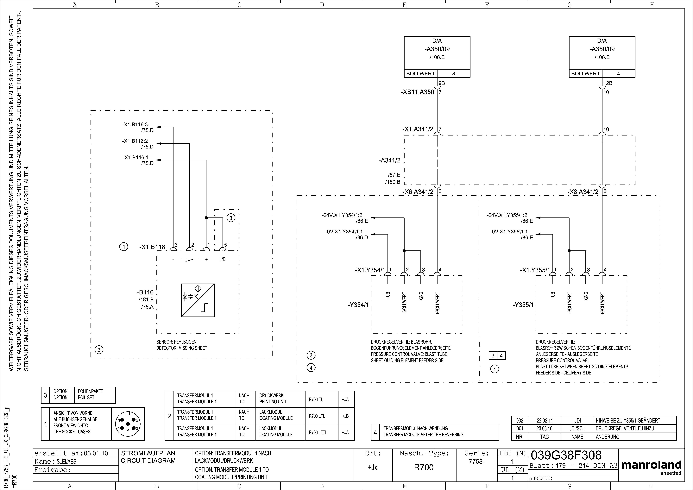

# +Jx — Sheet 179 of 214 — OPTION: TRANSFERMODUL 1 NACH

**LACKMODUL/DRUCKWERK**

> Part of the manroland **R700** printing press IEC/UL circuit diagrams.
> Drawing class: **Stromlaufplan / Circuit diagram** (DIN A3).
> Document `+Jx` covers the **1st printing module + feed register** machine section.

## At a glance

| Field | Value |
|---|---|
| Document | `+Jx`  (039G38F308) |
| Sheet | **179** of 214 |
| Section (DE) | OPTION: TRANSFERMODUL 1 NACH |
| Section (EN) | LACKMODUL/DRUCKWERK |
| Section type | CIRCUIT — Circuit diagram |
| Machine type | `R700` |
| Series | `7758` |
| Created | 03.01.10 |
| Replaces | — |
| Columns used | A, B, C, D, E, F, G, H |
| Path numbers | — |
| Labels on sheet | 144 |
| Cross-refs out | 13 |
| Cross-refs in | 27 |

**Previous:** [+Jx sheet 178](SHEET_0178.md) · **Next:** [+Jx sheet 180](SHEET_0180.md) · **Document TOC:** [_TOC.md](_TOC.md)  (+Jx) · **Master TOC:** [all sheets](../_MASTER_TOC.md)

## Sheet image (300 DPI, exact vector render)



_Rendered directly from the PDF vector layer at 300 DPI (1-bit), no OCR and no resampling. Use it to confirm anything ambiguous in the text below._

## Cross-references on this sheet

Each entry is a wire leaving this sheet. The printed token is `/sheet.column`; the link resolves to that sheet inside the same document.

| Ref | Target sheet | Col | Path | Destination on target | Target section | From col |
|---|---|---|---|---|---|---|
| `/108.E` | [+Jx sheet 108](SHEET_0108.md) | E | — | — | REFERENZMODUL | E |
| `/108.E` | [+Jx sheet 108](SHEET_0108.md) | E | — | — | REFERENZMODUL | G |
| `/75.D` | [+Jx sheet 75](SHEET_0075.md) | D | — | X1.B116:3 | FEHLBOGENKONTROLLE | B |
| `/75.D` | [+Jx sheet 75](SHEET_0075.md) | D | — | X1.B116:2 | FEHLBOGENKONTROLLE | B |
| `/75.D` | [+Jx sheet 75](SHEET_0075.md) | D | — | X1.B116:1 | FEHLBOGENKONTROLLE | B |
| `/87.E` | [+Jx sheet 87](SHEET_0087.md) | E | — | — | BOGENFÜHRUNG | E |
| `/180.B` | [+Jx sheet 180](SHEET_0180.md) | B | — | — | OPTION: TRANSFERMODUL 2 | E |
| `/86.E` | [+Jx sheet 86](SHEET_0086.md) | E | — | 24V.X1.Y354\1:2 | BOGENFÜHRUNG | D |
| `/86.E` | [+Jx sheet 86](SHEET_0086.md) | E | — | 24V.X1.Y355\1:2 | BOGENFÜHRUNG | F |
| `/86.E` | [+Jx sheet 86](SHEET_0086.md) | E | — | 0V.X1.Y354\1:1 0V.X1.Y355\1:1 | BOGENFÜHRUNG | E |
| `/86.D` | [+Jx sheet 86](SHEET_0086.md) | D | — | 0V.X1.Y354\1:1 0V.X1.Y355\1:1 | BOGENFÜHRUNG | E |
| `/181.B` | [+Jx sheet 181](SHEET_0181.md) | B | — | — | OPTION: TRANSFERMODUL 2 | B |
| `/75.A` | [+Jx sheet 75](SHEET_0075.md) | A | — | — | FEHLBOGENKONTROLLE | B |

### Incoming references (sheets that point here)

Every other sheet that sends a wire to this one. `Back-ref` is the token printed on *that* sheet; `Path` is its line number.

| From sheet | Cols | Back-ref | Path | Refs | What continues there |
|---|---|---|---|---|---|
| [+Jx#75](SHEET_0075.md) | A, D | `/75.A`, `/75.D` | — | 4 | — |
| [+Jx#86](SHEET_0086.md) | D, E | `/86.D`, `/86.E` | — | 4 | 0V.X1.Y354\1:1; 0V.X1.Y355\1:1; 24V.X1.Y354\1:2; 24V.X1.Y355\1:2 |
| [+Jx#87](SHEET_0087.md) | E | `/87.E` | — | 1 | — |
| [+Jx#108](SHEET_0108.md) | E | `/108.E` | — | 2 | — |
| [+Jx#114](SHEET_0114.md) | B | `/114.B` | — | 2 | — |
| [+Jx#121](SHEET_0121.md) | C, F | `/121.C`, `/121.F` | — | 8 | — |
| [+Jx#132](SHEET_0132.md) | G | `/132.G` | — | 1 | — |
| [+Jx#133](SHEET_0133.md) | H | `/133.H` | — | 1 | — |
| [+Jx#136](SHEET_0136.md) | G | `/136.G` | — | 2 | — |
| [+Jx#180](SHEET_0180.md) | A | `/180.A` | — | 1 | — |
| [+Jx#181](SHEET_0181.md) | B | `/181.B` | — | 1 | — |


## Devices on this sheet

| Tag | Class | Class meaning (IEC) | Col | Sub | Terminal | Sign |
|---|---|---|---|---|---|---|
| `A350/09` | A | Baugruppe / assembly, module, PC board | E | 09 | — | — |
| `A341/2` | A | Baugruppe / assembly, module, PC board | E | 2 | — | — |
| `A350/09` | A | Baugruppe / assembly, module, PC board | G | 09 | — | — |
| `Y354/1` | Y | Magnetventil / solenoid valve, actuator | D | 1 | — | — |
| `Y355/1` | Y | Magnetventil / solenoid valve, actuator | F | 1 | — | — |
| `B116` | B | Umformer / transducer, sensor | B | — | — | — |
| `XB11.A350` | — | cross-device reference | E | — | — | — |
| `NR.` | — | cross-device reference | F | — | — | — |
| `20.08.10` | — | cross-device reference | G | — | — | — |
| `X1.B116:3` | — | cross-device reference | B | — | 3 | — |
| `X1.B116:1` | — | cross-device reference | B | — | 1 | — |
| `X1.B116:2` | — | cross-device reference | B | — | 2 | — |
| `22.02.11` | — | cross-device reference | G | — | — | — |
| `X1.B116` | — | cross-device reference | B | — | — | — |

## Potentials / nets

| Potential | Count | Columns | Attached devices | Terminals |
|---|---|---|---|---|
| `0V` | 2 | D, F | `X1`, `Y354\1`, `Y355\1` | `1` |
| `24V` | 2 | D, F | `X1`, `Y354\1`, `Y355\1` | `2` |


A potential such as `L24+/4` or `M24+` is a named supply/return rail; every place it appears on this sheet is electrically common.

## Wire-end annotations (grouped as printed)

A wire that continues elsewhere is annotated with a small cluster: the destination description, the path/line number `#NN`, and the `/sheet.column` cross reference. Each row below is one such cluster exactly as it is grouped on the drawing.

| Col | Y | Path | Cross-ref | Text on the wire |
|---|---|---|---|---|
| E | 65.7 | — | — | `D/A` |
| G | 65.7 | — | — | `D/A` |
| E | 79.6 | — | — | `A350/09` |
| G | 79.6 | — | — | `A350/09` |
| E | 94.5 | — | `/108.E` | — |
| G | 94.5 | — | `/108.E` | — |
| E | 122.8 | — | — | `SOLLWERT 3` |
| G | 122.8 | — | — | `SOLLWERT 4` |
| E | 139.1 | — | — | `9B` |
| G | 139.1 | — | — | `12B` |
| E | 153.3 | — | — | `XB11.A350 7` |
| G | 154.8 | — | — | `10` |
| B | 210.0 | — | `/75.D` | `X1.B116:3` |
| E | 217.1 | — | — | `X1.A341/2 7` |
| G | 218.5 | — | — | `10` |
| B | 238.3 | — | `/75.D` | `X1.B116:2` |
| B | 266.7 | — | `/75.D` | `X1.B116:1` |
| E | 270.9 | — | — | `A341/2` |
| E | 296.4 | — | `/87.E`, `/180.B` | — |
| E | 324.8 | — | — | `X6.A341/2 3` |
| G | 324.8 | — | — | `X8.A341/2 3` |
| D | 365.9 | — | `/86.E` | `24V.X1.Y354\1:2` |
| F | 365.9 | — | `/86.E` | `24V.X1.Y355\1:2` |
| C | 371.6 | — | — | `3` |
| E | 394.2 | — | `/86.E`, `/86.D` | `0V.X1.Y354\1:1 0V.X1.Y355\1:1` |
| B | 417.0 | — | — | `3 2 1` |
| C | 417.0 | — | — | `5` |
| B | 419.8 | — | — | `1 X1.B116` |
| C | 441.0 | — | — | `+ L/D` |
| E | 459.5 | — | — | `X1.Y354/1 1 2 3 4` |
| G | 459.5 | — | — | `X1.Y355/1 1 2 3 4` |
| B | 497.7 | — | — | `B116` |
| E | 501.4 | — | — | `+UB` |
| E | 501.4 | — | — | `GND` |
| G | 501.4 | — | — | `+UB` |
| G | 501.4 | — | — | `GND` |
| E | 501.7 | — | — | `SOLLWERT` |
| E | 501.7 | — | — | `+SOLLWERT` |
| G | 501.7 | — | — | `SOLLWERT` |
| G | 501.7 | — | — | `+SOLLWERT` |
| B | 510.8 | — | `/181.B` | — |
| D | 519.0 | — | — | `Y354/1` |
| F | 519.0 | — | — | `Y355/1` |
| B | 523.2 | — | `/75.A` | — |
| B | 584.5 | — | — | `DETECTOR: MISSING SHEET SENSOR: FEHLBOGEN` |
| E | 584.5 | — | — | `DRUCKREGELVENTIL: BLASROHR, BOGENFÜHRUNGSELEMENT ANLEGERSEITE PRESSURE CONTROL VALVE: BLAST TUBE, SHEET GUIDING ELEMENT FEEDER SIDE` |
| G | 584.5 | — | — | `DRUCKREGELVENTIL: BLASROHR ZWISCHEN BOGENFÜHRUNGSELEMENTE` |
| A | 598.4 | — | — | `2` |
| G | 605.8 | — | — | `PRESSURE CONTROL VALVE: BLAST TUBE BETWEEN SHEET GUIDING ELEMENTS FEEDER SIDE DELIVERY SIDE ANLEGERSEITE AUSLEGERSEITE` |
| F | 607.5 | — | — | `3 4` |
| D | 607.7 | — | — | `3` |
| E | 629.0 | — | — | `4 4` |
| A | 669.5 | — | — | `3 OPTION OPTION` |
| A | 669.5 | — | — | `FOLIENPAKET FOIL SET` |
| B | 676.6 | — | — | `TRANSFERMODUL 1 TRANSFER MODULE 1` |
| C | 676.6 | — | — | `NACH` |
| C | 676.6 | — | — | `DRUCKWERK PRINTING UNIT` |
| D | 683.7 | — | — | `R700 TL +JA` |
| C | 687.3 | — | — | `TO` |
| B | 705.0 | — | — | `TRANSFERMODUL 1 TRANSFER MODULE 1` |
| C | 705.0 | — | — | `NACH` |
| C | 705.0 | — | — | `LACKMODUL COATING MODULE` |
| A | 707.1 | — | — | `FRONT VIEW ONTO ANSICHT VON VORNE AUF BUCHSENGEHÄUSE` |
| B | 710.3 | — | — | `2` |
| D | 712.0 | — | — | `+JB` |
| D | 712.1 | — | — | `R700 LTL` |
| C | 715.6 | — | — | `TO` |
| A | 718.7 | — | — | `1 1 5 2` |
| G | 719.4 | — | — | `002 22.02.11 JDI HINWEISE ZU Y355/1 GEÄNDERT` |
| B | 732.9 | — | — | `4 3` |
| G | 733.0 | — | — | `001 20.08.10 JDI/SCH DRUCKREGELVENTILE HINZU` |
| C | 733.3 | — | — | `NACH` |
| B | 733.4 | — | — | `TRANSFERMODUL 1 TRANSFER MODULE 1` |
| C | 733.4 | — | — | `LACKMODUL COATING MODULE` |
| E | 733.4 | — | — | `4 TRANSFERMODUL NACH WENDUNG TRANSFER MODULE AFTER THE REVERSING` |
| A | 739.0 | — | — | `THE SOCKET CASES` |
| D | 740.4 | — | — | `R700 LTTL` |
| D | 740.4 | — | — | `+JA` |
| C | 744.0 | — | — | `TO` |
| G | 747.1 | — | — | `NR. TAG NAME ÄNDERUNG` |


## Reconstructed tables

This sheet carries tabular content (pin map / terminal assignment / index). The grid below was rebuilt from the drawing's own rule lines, so each row is exactly one physical row of the table.

### Table 1 — 2 data rows × 4 columns (at x=666.1, y=62.4)

|  |  | D/A A350/09 | /108.E |
|---|---|---|---|
|  | `SOLLWERT` |  | `3` |
| `A341/2 /87.E /180.B` | `XB11.A350 X1.A341/2 X6.A341/2` |  | `9B 7 7 3` |


### Table 2 — 2 data rows × 3 columns (at x=978.0, y=62.4)

|  | D/A | A350/09 /108.E |
|---|---|---|
| `SOLLWERT` |  | `4` |
| `X8.A341/2` |  | `12B 10 10 3` |


## Notes and free text on this sheet

| Text | Col | Y (pt) |
|---|---|---|
| `9B` | E | 139.11 |
| `D/A` | E | 65.72 |
| `SOLLWERT` | E | 122.77 |
| `X6.A341/2` | E | 324.81 |
| `X1.A341/2` | E | 217.1 |
| `X8.A341/2` | G | 324.81 |
| `12B` | G | 139.13 |
| `D/A` | G | 65.72 |
| `SOLLWERT` | G | 122.77 |
| `TAG` | G | 747.23 |
| `NAME` | G | 747.22 |
| `ÄNDERUNG` | G | 747.25 |
| `JDI/SCH` | G | 733.05 |
| `DRUCKREGELVENTILE HINZU` | H | 733.09 |
| `X1.Y354/1` | E | 459.5 |
| `DRUCKREGELVENTIL: BLASROHR,` | E | 584.52 |
| `BOGENFÜHRUNGSELEMENT ANLEGERSEITE` | E | 595.16 |
| `PRESSURE CONTROL VALVE: BLAST TUBE,` | E | 605.77 |
| `SHEET GUIDING ELEMENT FEEDER SIDE` | E | 616.41 |
| `X1.Y355/1` | G | 459.5 |
| `DRUCKREGELVENTIL:` | G | 584.52 |
| `BLASROHR ZWISCHEN BOGENFÜHRUNGSELEMENTE` | G | 595.15 |
| `ANLEGERSEITE AUSLEGERSEITE` | G | 605.77 |
| `PRESSURE CONTROL VALVE:` | G | 616.41 |
| `BLAST TUBE BETWEEN SHEET GUIDING ELEMENTS` | G | 627.03 |
| `FEEDER SIDE DELIVERY SIDE` | G | 637.66 |
| `SENSOR: FEHLBOGEN` | B | 584.51 |
| `DETECTOR: MISSING SHEET` | B | 595.15 |
| `JDI` | G | 719.43 |
| `HINWEISE ZU Y355/1 GEÄNDERT` | H | 719.52 |
| `OPTION` | A | 669.54 |
| `FOLIENPAKET` | A | 669.54 |
| `FOIL SET` | A | 680.16 |
| `ANSICHT VON VORNE` | A | 707.12 |
| `AUF BUCHSENGEHÄUSE` | A | 717.76 |
| `FRONT VIEW ONTO` | A | 728.35 |
| `THE SOCKET CASES` | A | 739 |
| `TRANSFERMODUL 1` | B | 676.65 |
| `TRANSFER MODULE 1` | B | 687.28 |
| `NACH` | C | 676.63 |
| `TO` | C | 687.27 |
| `DRUCKWERK` | C | 676.62 |
| `PRINTING UNIT` | C | 687.28 |
| `LACKMODUL` | C | 705.01 |
| `COATING MODULE` | C | 715.64 |
| `R700 LTL` | D | 712.09 |
| `R700 LTTL` | D | 740.43 |
| `+JB` | D | 712.01 |
| `+JA` | D | 740.38 |
| `R700 TL` | D | 683.73 |
| `TRANSFERMODUL NACH WENDUNG` | E | 733.35 |
| `TRANSFER MODULE AFTER THE REVERSING` | E | 743.98 |
| `+UB` | E | 501.45 |
| `GND` | E | 501.45 |
| `+SOLLWERT` | E | 501.73 |
| `+UB` | G | 501.45 |
| `GND` | G | 501.45 |
| `+SOLLWERT` | G | 501.73 |
| `L/D` | C | 442.74 |

## Complete label inventory (exact text from the drawing)

Every text object inside the drawing area of this sheet, in DIN reading order (column A→H, then top→bottom). This is the authoritative list: if a string is not here it is not printed on this sheet.

| Col | Y | X | Dir | Type | Text |
|---|---|---|---|---|---|
| A | 598.3 | 168.1 | → | number | `2` |
| A | 669.5 | 91.8 | → | text | `OPTION` |
| A | 669.5 | 134.1 | → | text | `FOLIENPAKET` |
| A | 674.8 | 75.0 | → | number | `3` |
| A | 680.2 | 91.8 | → | text | `OPTION` |
| A | 680.2 | 134.1 | → | text | `FOIL SET` |
| A | 707.1 | 92.1 | → | text | `ANSICHT VON VORNE` |
| A | 717.8 | 92.1 | → | text | `AUF BUCHSENGEHÄUSE` |
| A | 724.5 | 75.4 | → | number | `1` |
| A | 728.3 | 91.6 | → | text | `FRONT VIEW ONTO` |
| A | 739.0 | 92.1 | → | text | `THE SOCKET CASES` |
| B | 210.0 | 210.0 | → | device ref | `X1.B116:3` |
| B | 219.9 | 242.9 | → | cross-reference | `/75.D` |
| B | 238.3 | 210.0 | → | device ref | `X1.B116:2` |
| B | 248.3 | 242.9 | → | cross-reference | `/75.D` |
| B | 266.7 | 211.2 | → | device ref | `X1.B116:1` |
| B | 276.6 | 242.9 | → | cross-reference | `/75.D` |
| B | 417.0 | 300.2 | → | number | `3` |
| B | 417.0 | 328.8 | → | number | `2` |
| B | 419.8 | 239.5 | → | device ref | `X1.B116` |
| B | 420.7 | 210.7 | → | number | `1` |
| B | 497.7 | 235.6 | → | device tag | `B116` |
| B | 510.8 | 238.4 | → | cross-reference | `/181.B` |
| B | 523.2 | 242.9 | → | cross-reference | `/75.A` |
| B | 584.5 | 269.0 | → | text | `SENSOR: FEHLBOGEN` |
| B | 595.1 | 268.7 | → | text | `DETECTOR: MISSING SHEET` |
| B | 676.7 | 304.7 | → | text | `TRANSFERMODUL 1` |
| B | 687.3 | 304.7 | → | text | `TRANSFER MODULE 1` |
| B | 705.0 | 304.7 | → | text | `TRANSFERMODUL 1` |
| B | 710.3 | 287.7 | → | number | `2` |
| B | 715.6 | 304.7 | → | text | `TRANSFER MODULE 1` |
| B | 718.7 | 202.7 | → | number | `1` |
| B | 718.7 | 233.9 | → | number | `2` |
| B | 732.9 | 201.8 | → | number | `4` |
| B | 732.9 | 233.6 | → | number | `3` |
| B | 733.3 | 304.7 | → | text | `TRANSFERMODUL 1` |
| B | 734.3 | 217.7 | → | number | `5` |
| B | 744.0 | 304.7 | → | text | `TRANSFER MODULE 1` |
| C | 371.6 | 394.9 | → | number | `3` |
| C | 417.0 | 356.3 | → | number | `1` |
| C | 417.0 | 385.2 | → | number | `5` |
| C | 441.0 | 351.2 | → | number | `+` |
| C | 442.7 | 377.6 | → | text | `L/D` |
| C | 676.6 | 410.5 | → | text | `NACH` |
| C | 676.6 | 445.9 | → | text | `DRUCKWERK` |
| C | 687.3 | 411.0 | → | text | `TO` |
| C | 687.3 | 445.9 | → | text | `PRINTING UNIT` |
| C | 705.0 | 410.5 | → | text | `NACH` |
| C | 705.0 | 445.9 | → | text | `LACKMODUL` |
| C | 715.6 | 411.0 | → | text | `TO` |
| C | 715.6 | 446.2 | → | text | `COATING MODULE` |
| C | 733.3 | 410.5 | → | text | `NACH` |
| C | 733.4 | 445.9 | → | text | `LACKMODUL` |
| C | 744.0 | 411.0 | → | text | `TO` |
| C | 744.0 | 446.2 | → | text | `COATING MODULE` |
| D | 365.9 | 553.0 | → | potential | `24V.X1.Y354\1:2` |
| D | 375.8 | 611.7 | → | cross-reference | `/86.E` |
| D | 394.2 | 561.8 | → | potential | `0V.X1.Y354\1:1` |
| D | 404.2 | 611.4 | → | cross-reference | `/86.D` |
| D | 519.0 | 597.5 | → | device tag | `Y354/1` |
| D | 607.7 | 532.5 | → | number | `3` |
| D | 629.0 | 532.7 | → | number | `4` |
| D | 683.7 | 530.9 | → | text | `R700 TL` |
| D | 683.7 | 587.9 | → | text | `+JA` |
| D | 712.0 | 587.9 | → | text | `+JB` |
| D | 712.1 | 530.9 | → | text | `R700 LTL` |
| D | 740.4 | 530.9 | → | text | `R700 LTTL` |
| D | 740.4 | 587.9 | → | text | `+JA` |
| E | 65.7 | 742.7 | → | text | `D/A` |
| E | 79.6 | 729.6 | → | device tag | `A350/09` |
| E | 94.5 | 738.6 | → | cross-reference | `/108.E` |
| E | 122.8 | 698.2 | → | text | `SOLLWERT` |
| E | 139.1 | 753.7 | → | text | `9B` |
| E | 153.3 | 688.8 | → | device ref | `XB11.A350` |
| E | 154.8 | 753.7 | → | number | `7` |
| E | 217.1 | 691.7 | → | text | `X1.A341/2` |
| E | 218.5 | 753.7 | → | number | `7` |
| E | 271.0 | 650.8 | → | device tag | `A341/2` |
| E | 296.4 | 667.0 | → | cross-reference | `/87.E` |
| E | 308.8 | 662.2 | → | cross-reference | `/180.B` |
| E | 324.8 | 691.7 | → | text | `X6.A341/2` |
| E | 324.8 | 753.7 | → | number | `3` |
| E | 459.5 | 610.0 | → | text | `X1.Y354/1` |
| E | 459.5 | 668.1 | → | number | `1` |
| E | 459.5 | 697.3 | → | number | `2` |
| E | 459.5 | 725.4 | → | number | `3` |
| E | 459.5 | 754.0 | → | number | `4` |
| E | 501.4 | 720.6 | ↕ | text | `GND` |
| E | 501.5 | 663.9 | ↕ | text | `+UB` |
| E | 501.7 | 692.2 | ↕ | text | `SOLLWERT` |
| E | 501.7 | 748.9 | ↕ | text | `+SOLLWERT` |
| E | 584.5 | 637.2 | → | text | `DRUCKREGELVENTIL: BLASROHR,` |
| E | 595.2 | 637.2 | → | text | `BOGENFÜHRUNGSELEMENT ANLEGERSEITE` |
| E | 605.8 | 637.2 | → | text | `PRESSURE CONTROL VALVE: BLAST TUBE,` |
| E | 616.4 | 637.5 | → | text | `SHEET GUIDING ELEMENT FEEDER SIDE` |
| E | 733.3 | 659.1 | → | text | `TRANSFERMODUL NACH WENDUNG` |
| E | 738.6 | 642.0 | → | number | `4` |
| E | 744.0 | 659.1 | → | text | `TRANSFER MODULE AFTER THE REVERSING` |
| F | 122.9 | 777.1 | → | number | `3` |
| F | 365.9 | 836.5 | → | potential | `24V.X1.Y355\1:2` |
| F | 375.8 | 895.2 | → | cross-reference | `/86.E` |
| F | 394.2 | 845.3 | → | potential | `0V.X1.Y355\1:1` |
| F | 404.1 | 895.2 | → | cross-reference | `/86.E` |
| F | 519.0 | 881.0 | → | device tag | `Y355/1` |
| F | 607.4 | 844.6 | → | number | `3` |
| F | 607.4 | 858.9 | → | number | `4` |
| F | 631.3 | 848.1 | → | number | `4` |
| F | 719.5 | 887.3 | → | number | `002` |
| F | 733.0 | 887.6 | → | number | `001` |
| F | 747.1 | 886.8 | → | device ref | `NR.` |
| G | 65.7 | 1026.1 | → | text | `D/A` |
| G | 79.6 | 1013.1 | → | device tag | `A350/09` |
| G | 94.5 | 1022.0 | → | cross-reference | `/108.E` |
| G | 122.8 | 981.6 | → | text | `SOLLWERT` |
| G | 139.1 | 1036.6 | → | text | `12B` |
| G | 154.8 | 1036.6 | → | number | `10` |
| G | 218.5 | 1036.6 | → | number | `10` |
| G | 324.8 | 975.1 | → | text | `X8.A341/2` |
| G | 324.8 | 1037.2 | → | number | `3` |
| G | 459.5 | 893.5 | → | text | `X1.Y355/1` |
| G | 459.5 | 951.6 | → | number | `1` |
| G | 459.5 | 980.8 | → | number | `2` |
| G | 459.5 | 1008.9 | → | number | `3` |
| G | 459.5 | 1037.5 | → | number | `4` |
| G | 501.4 | 1004.1 | ↕ | text | `GND` |
| G | 501.5 | 947.3 | ↕ | text | `+UB` |
| G | 501.7 | 975.7 | ↕ | text | `SOLLWERT` |
| G | 501.7 | 1032.4 | ↕ | text | `+SOLLWERT` |
| G | 584.5 | 920.7 | → | text | `DRUCKREGELVENTIL:` |
| G | 595.2 | 920.7 | → | text | `BLASROHR ZWISCHEN BOGENFÜHRUNGSELEMENTE` |
| G | 605.8 | 921.3 | → | text | `ANLEGERSEITE AUSLEGERSEITE` |
| G | 616.4 | 920.7 | → | text | `PRESSURE CONTROL VALVE:` |
| G | 627.0 | 920.7 | → | text | `BLAST TUBE BETWEEN SHEET GUIDING ELEMENTS` |
| G | 637.7 | 920.7 | → | text | `FEEDER SIDE DELIVERY SIDE` |
| G | 719.4 | 987.2 | → | text | `JDI` |
| G | 719.5 | 922.6 | → | device ref | `22.02.11` |
| G | 733.1 | 921.9 | → | device ref | `20.08.10` |
| G | 733.1 | 978.6 | → | text | `JDI/SCH` |
| G | 747.2 | 928.5 | → | text | `TAG` |
| G | 747.2 | 981.8 | → | text | `NAME` |
| G | 747.3 | 1024.0 | → | text | `ÄNDERUNG` |
| H | 122.9 | 1060.7 | → | number | `4` |
| H | 719.5 | 1023.7 | → | text | `HINWEISE ZU Y355/1 GEÄNDERT` |
| H | 733.1 | 1023.4 | → | text | `DRUCKREGELVENTILE HINZU` |

## Reading-order text block

The same content as a plain block, grouped by DIN column — convenient to paste or to match against a visual description.

```text
=== Column A ===
 598.3  168.1  numeric      2
 669.5   91.8  text         OPTION
 669.5  134.1  text         FOLIENPAKET
 674.8   75.0  numeric      3
 680.2   91.8  text         OPTION
 680.2  134.1  text         FOIL SET
 707.1   92.1  text         ANSICHT VON VORNE
 717.8   92.1  text         AUF BUCHSENGEHÄUSE
 724.5   75.4  numeric      1
 728.3   91.6  text         FRONT VIEW ONTO
 739.0   92.1  text         THE SOCKET CASES
=== Column B ===
 210.0  210.0  devref       X1.B116:3
 219.9  242.9  xref         /75.D
 238.3  210.0  devref       X1.B116:2
 248.3  242.9  xref         /75.D
 266.7  211.2  devref       X1.B116:1
 276.6  242.9  xref         /75.D
 417.0  300.2  numeric      3
 417.0  328.8  numeric      2
 419.8  239.5  devref       X1.B116
 420.7  210.7  numeric      1
 497.7  235.6  devtag       B116
 510.8  238.4  xref         /181.B
 523.2  242.9  xref         /75.A
 584.5  269.0  text         SENSOR: FEHLBOGEN
 595.1  268.7  text         DETECTOR: MISSING SHEET
 676.7  304.7  text         TRANSFERMODUL 1
 687.3  304.7  text         TRANSFER MODULE 1
 705.0  304.7  text         TRANSFERMODUL 1
 710.3  287.7  numeric      2
 715.6  304.7  text         TRANSFER MODULE 1
 718.7  202.7  numeric      1
 718.7  233.9  numeric      2
 732.9  201.8  numeric      4
 732.9  233.6  numeric      3
 733.3  304.7  text         TRANSFERMODUL 1
 734.3  217.7  numeric      5
 744.0  304.7  text         TRANSFER MODULE 1
=== Column C ===
 371.6  394.9  numeric      3
 417.0  356.3  numeric      1
 417.0  385.2  numeric      5
 441.0  351.2  numeric      +
 442.7  377.6  text         L/D
 676.6  410.5  text         NACH
 676.6  445.9  text         DRUCKWERK
 687.3  411.0  text         TO
 687.3  445.9  text         PRINTING UNIT
 705.0  410.5  text         NACH
 705.0  445.9  text         LACKMODUL
 715.6  411.0  text         TO
 715.6  446.2  text         COATING MODULE
 733.3  410.5  text         NACH
 733.4  445.9  text         LACKMODUL
 744.0  411.0  text         TO
 744.0  446.2  text         COATING MODULE
=== Column D ===
 365.9  553.0  net          24V.X1.Y354\1:2
 375.8  611.7  xref         /86.E
 394.2  561.8  net          0V.X1.Y354\1:1
 404.2  611.4  xref         /86.D
 519.0  597.5  devtag       Y354/1
 607.7  532.5  numeric      3
 629.0  532.7  numeric      4
 683.7  530.9  text         R700 TL
 683.7  587.9  text         +JA
 712.0  587.9  text         +JB
 712.1  530.9  text         R700 LTL
 740.4  530.9  text         R700 LTTL
 740.4  587.9  text         +JA
=== Column E ===
  65.7  742.7  text         D/A
  79.6  729.6  devtag       A350/09
  94.5  738.6  xref         /108.E
 122.8  698.2  text         SOLLWERT
 139.1  753.7  text         9B
 153.3  688.8  devref       XB11.A350
 154.8  753.7  numeric      7
 217.1  691.7  text         X1.A341/2
 218.5  753.7  numeric      7
 271.0  650.8  devtag       A341/2
 296.4  667.0  xref         /87.E
 308.8  662.2  xref         /180.B
 324.8  691.7  text         X6.A341/2
 324.8  753.7  numeric      3
 459.5  610.0  text         X1.Y354/1
 459.5  668.1  numeric      1
 459.5  697.3  numeric      2
 459.5  725.4  numeric      3
 459.5  754.0  numeric      4
 501.4  720.6  text         GND
 501.5  663.9  text         +UB
 501.7  692.2  text         SOLLWERT
 501.7  748.9  text         +SOLLWERT
 584.5  637.2  text         DRUCKREGELVENTIL: BLASROHR,
 595.2  637.2  text         BOGENFÜHRUNGSELEMENT ANLEGERSEITE
 605.8  637.2  text         PRESSURE CONTROL VALVE: BLAST TUBE,
 616.4  637.5  text         SHEET GUIDING ELEMENT FEEDER SIDE
 733.3  659.1  text         TRANSFERMODUL NACH WENDUNG
 738.6  642.0  numeric      4
 744.0  659.1  text         TRANSFER MODULE AFTER THE REVERSING
=== Column F ===
 122.9  777.1  numeric      3
 365.9  836.5  net          24V.X1.Y355\1:2
 375.8  895.2  xref         /86.E
 394.2  845.3  net          0V.X1.Y355\1:1
 404.1  895.2  xref         /86.E
 519.0  881.0  devtag       Y355/1
 607.4  844.6  numeric      3
 607.4  858.9  numeric      4
 631.3  848.1  numeric      4
 719.5  887.3  numeric      002
 733.0  887.6  numeric      001
 747.1  886.8  devref       NR.
=== Column G ===
  65.7 1026.1  text         D/A
  79.6 1013.1  devtag       A350/09
  94.5 1022.0  xref         /108.E
 122.8  981.6  text         SOLLWERT
 139.1 1036.6  text         12B
 154.8 1036.6  numeric      10
 218.5 1036.6  numeric      10
 324.8  975.1  text         X8.A341/2
 324.8 1037.2  numeric      3
 459.5  893.5  text         X1.Y355/1
 459.5  951.6  numeric      1
 459.5  980.8  numeric      2
 459.5 1008.9  numeric      3
 459.5 1037.5  numeric      4
 501.4 1004.1  text         GND
 501.5  947.3  text         +UB
 501.7  975.7  text         SOLLWERT
 501.7 1032.4  text         +SOLLWERT
 584.5  920.7  text         DRUCKREGELVENTIL:
 595.2  920.7  text         BLASROHR ZWISCHEN BOGENFÜHRUNGSELEMENTE
 605.8  921.3  text         ANLEGERSEITE AUSLEGERSEITE
 616.4  920.7  text         PRESSURE CONTROL VALVE:
 627.0  920.7  text         BLAST TUBE BETWEEN SHEET GUIDING ELEMENTS
 637.7  920.7  text         FEEDER SIDE DELIVERY SIDE
 719.4  987.2  text         JDI
 719.5  922.6  devref       22.02.11
 733.1  921.9  devref       20.08.10
 733.1  978.6  text         JDI/SCH
 747.2  928.5  text         TAG
 747.2  981.8  text         NAME
 747.3 1024.0  text         ÄNDERUNG
=== Column H ===
 122.9 1060.7  numeric      4
 719.5 1023.7  text         HINWEISE ZU Y355/1 GEÄNDERT
 733.1 1023.4  text         DRUCKREGELVENTILE HINZU
```

---
_Generated from the PDF vector text layer; no OCR. Source: `R700_7758_IEC_UL_JX_039G38F308_p`, sheet 179._
