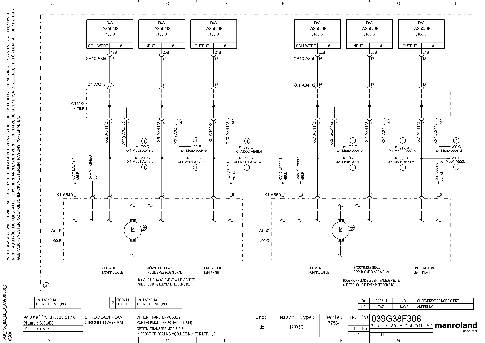

# +Jx — Sheet 180 of 214 — OPTION: TRANSFERMODUL 2

**VOR LACKMODUL(NUR BEI LTTL +JB)**

> Part of the manroland **R700** printing press IEC/UL circuit diagrams.
> Drawing class: **Stromlaufplan / Circuit diagram** (DIN A3).
> Document `+Jx` covers the **1st printing module + feed register** machine section.

## At a glance

| Field | Value |
|---|---|
| Document | `+Jx`  (039G38F308) |
| Sheet | **180** of 214 |
| Section (DE) | OPTION: TRANSFERMODUL 2 |
| Section (EN) | VOR LACKMODUL(NUR BEI LTTL +JB) |
| Section type | CIRCUIT — Circuit diagram |
| Machine type | `R700` |
| Series | `7758` |
| Created | 03.01.10 |
| Replaces | — |
| Columns used | A, B, C, D, E, F, G, H |
| Path numbers | — |
| Labels on sheet | 179 |
| Cross-refs out | 27 |
| Cross-refs in | 62 |

**Previous:** [+Jx sheet 179](SHEET_0179.md) · **Next:** [+Jx sheet 181](SHEET_0181.md) · **Document TOC:** [_TOC.md](_TOC.md)  (+Jx) · **Master TOC:** [all sheets](../_MASTER_TOC.md)

## Sheet image (300 DPI, exact vector render)



_Rendered directly from the PDF vector layer at 300 DPI (1-bit), no OCR and no resampling. Use it to confirm anything ambiguous in the text below._

## Cross-references on this sheet

Each entry is a wire leaving this sheet. The printed token is `/sheet.column`; the link resolves to that sheet inside the same document.

| Ref | Target sheet | Col | Path | Destination on target | Target section | From col |
|---|---|---|---|---|---|---|
| `/108.B` | [+Jx sheet 108](SHEET_0108.md) | B | — | — | REFERENZMODUL | B |
| `/108.B` | [+Jx sheet 108](SHEET_0108.md) | B | — | — | REFERENZMODUL | C |
| `/108.B` | [+Jx sheet 108](SHEET_0108.md) | B | — | — | REFERENZMODUL | D |
| `/108.B` | [+Jx sheet 108](SHEET_0108.md) | B | — | — | REFERENZMODUL | F |
| `/108.B` | [+Jx sheet 108](SHEET_0108.md) | B | — | — | REFERENZMODUL | G |
| `/108.B` | [+Jx sheet 108](SHEET_0108.md) | B | — | — | REFERENZMODUL | G |
| `/179.E` | [+Jx sheet 179](SHEET_0179.md) | E | — | — | OPTION: TRANSFERMODUL 1 NACH | A |
| `/90.E` | [+Jx sheet 90](SHEET_0090.md) | E | — | X1.M502.A549:5 | BOGENFÜHRUNG, NACH WENDUNG | C |
| `/90.G` | [+Jx sheet 90](SHEET_0090.md) | G | — | X1.M502.A550:3 | BOGENFÜHRUNG, NACH WENDUNG | F |
| `/90.G` | [+Jx sheet 90](SHEET_0090.md) | G | — | X1.M502.A550:4 | BOGENFÜHRUNG, NACH WENDUNG | H |
| `/90.D` | [+Jx sheet 90](SHEET_0090.md) | D | — | X1.M502.A549:3 | BOGENFÜHRUNG, NACH WENDUNG | C |
| `/90.E` | [+Jx sheet 90](SHEET_0090.md) | E | — | X1.M502.A549:4 | BOGENFÜHRUNG, NACH WENDUNG | D |
| `/90.G` | [+Jx sheet 90](SHEET_0090.md) | G | — | X1.M502.A550:5 | BOGENFÜHRUNG, NACH WENDUNG | G |
| `/86.F` | [+Jx sheet 86](SHEET_0086.md) | F | — | 24V.X1.A550:2 | BOGENFÜHRUNG | E |
| `/86.F` | [+Jx sheet 86](SHEET_0086.md) | F | — | 24V.X1.A549:2 | BOGENFÜHRUNG | B |
| `/90.F` | [+Jx sheet 90](SHEET_0090.md) | F | — | X1.M501.A550:3 | BOGENFÜHRUNG, NACH WENDUNG | F |
| `/90.F` | [+Jx sheet 90](SHEET_0090.md) | F | — | X1.M501.A550:4 | BOGENFÜHRUNG, NACH WENDUNG | H |
| `/90.C` | [+Jx sheet 90](SHEET_0090.md) | C | — | X1.M501.A549:3 | BOGENFÜHRUNG, NACH WENDUNG | C |
| `/90.C` | [+Jx sheet 90](SHEET_0090.md) | C | — | X1.M501.A549:5 | BOGENFÜHRUNG, NACH WENDUNG | C |
| `/90.C` | [+Jx sheet 90](SHEET_0090.md) | C | — | X1.M501.A549:4 | BOGENFÜHRUNG, NACH WENDUNG | D |
| `/90.F` | [+Jx sheet 90](SHEET_0090.md) | F | — | X1.M501.A550:5 | BOGENFÜHRUNG, NACH WENDUNG | G |
| `/86.E` | [+Jx sheet 86](SHEET_0086.md) | E | — | 0V.X1.A549:1 | BOGENFÜHRUNG | A |
| `/86.D` | [+Jx sheet 86](SHEET_0086.md) | D | — | 0V.X1.A550:1 | BOGENFÜHRUNG | E |
| `/87.G` | [+Jx sheet 87](SHEET_0087.md) | G | — | X1.A549:6 | BOGENFÜHRUNG | D |
| `/87.G` | [+Jx sheet 87](SHEET_0087.md) | G | — | X1.A550:6 | BOGENFÜHRUNG | H |
| `/90.E` | [+Jx sheet 90](SHEET_0090.md) | E | — | — | BOGENFÜHRUNG, NACH WENDUNG | A |
| `/90.G` | [+Jx sheet 90](SHEET_0090.md) | G | — | — | BOGENFÜHRUNG, NACH WENDUNG | E |

### Incoming references (sheets that point here)

Every other sheet that sends a wire to this one. `Back-ref` is the token printed on *that* sheet; `Path` is its line number.

| From sheet | Cols | Back-ref | Path | Refs | What continues there |
|---|---|---|---|---|---|
| [+Jx#86](SHEET_0086.md) | D, E, F | `/86.D`, `/86.E`, `/86.F` | — | 4 | 0V.X1.A549:1; 0V.X1.A550:1; 24V.X1.A549:2; 24V.X1.A550:2 |
| [+Jx#87](SHEET_0087.md) | F, G | `/87.F`, `/87.G` | — | 2 | X1.A549:6; X1.A550:6 |
| [+Jx#90](SHEET_0090.md) | C, D, E, F, G | `/90.C`, `/90.D`, `/90.E`, `/90.F`, `/90.G` | — | 14 | A549; A550; X1.M501.A549:3; X1.M501.A549:4; X1.M501.A549:5; X1.M501.A550:3; X1.M501.A550:4; X1.M501.A550:5; X1.M502.A549:3; X1.M502.A549:4; X1.M502.A549:5; X1.M |
| [+Jx#108](SHEET_0108.md) | B | `/108.B` | — | 6 | — |
| [+Jx#114](SHEET_0114.md) | B, F | `/114.B`, `/114.F` | — | 17 | — |
| [+Jx#133](SHEET_0133.md) | B | `/133.B` | — | 3 | — |
| [+Jx#134](SHEET_0134.md) | F | `/134.F` | — | 3 | — |
| [+Jx#135](SHEET_0135.md) | E | `/135.E` | — | 6 | — |
| [+Jx#141](SHEET_0141.md) | E, G | `/141.E`, `/141.G` | — | 6 | — |
| [+Jx#179](SHEET_0179.md) | E | `/179.E` | — | 1 | — |


## Devices on this sheet

| Tag | Class | Class meaning (IEC) | Col | Sub | Terminal | Sign |
|---|---|---|---|---|---|---|
| `A549` | A | Baugruppe / assembly, module, PC board | A | — | — | — |
| `A350/08` | A | Baugruppe / assembly, module, PC board | B | 08 | — | — |
| `A350/08` | A | Baugruppe / assembly, module, PC board | C | 08 | — | — |
| `A350/08` | A | Baugruppe / assembly, module, PC board | D | 08 | — | — |
| `A550` | A | Baugruppe / assembly, module, PC board | E | — | — | — |
| `A350/08` | A | Baugruppe / assembly, module, PC board | F | 08 | — | — |
| `A350/08` | A | Baugruppe / assembly, module, PC board | G | 08 | — | — |
| `A350/08` | A | Baugruppe / assembly, module, PC board | G | 08 | — | — |
| `A341/2` | A | Baugruppe / assembly, module, PC board | A | 2 | — | — |
| `X1.A549` | — | cross-device reference | A | — | — | — |
| `XB10.A350` | — | cross-device reference | B | — | — | — |
| `X1.A550` | — | cross-device reference | E | — | — | — |
| `XB10.A350` | — | cross-device reference | E | — | — | — |
| `X1.A549:6` | — | cross-device reference | D | — | 6 | — |
| `X1.A550:6` | — | cross-device reference | H | — | 6 | — |
| `NR.` | — | cross-device reference | F | — | — | — |
| `30.08.11` | — | cross-device reference | G | — | — | — |
| `X1.M501.A549:3` | — | cross-device reference | C | — | 3 | — |
| `X1.M502.A549:3` | — | cross-device reference | C | — | 3 | — |
| `X1.M501.A550:3` | — | cross-device reference | F | — | 3 | — |
| `X1.M502.A550:3` | — | cross-device reference | F | — | 3 | — |
| `X1.M501.A549:5` | — | cross-device reference | C | — | 5 | — |
| `X1.M501.A549:4` | — | cross-device reference | D | — | 4 | — |
| `X1.M501.A550:5` | — | cross-device reference | G | — | 5 | — |
| `X1.M501.A550:4` | — | cross-device reference | H | — | 4 | — |
| `X1.M502.A549:5` | — | cross-device reference | C | — | 5 | — |
| `X1.M502.A549:4` | — | cross-device reference | D | — | 4 | — |
| `X1.M502.A550:5` | — | cross-device reference | G | — | 5 | — |
| `X1.M502.A550:4` | — | cross-device reference | H | — | 4 | — |

## Potentials / nets

| Potential | Count | Columns | Attached devices | Terminals |
|---|---|---|---|---|
| `0V` | 2 | A, E | `A549`, `A550`, `X1` | `1` |
| `24V` | 2 | B, E | `A549`, `A550`, `X1` | `2` |


A potential such as `L24+/4` or `M24+` is a named supply/return rail; every place it appears on this sheet is electrically common.

## Wire-end annotations (grouped as printed)

A wire that continues elsewhere is annotated with a small cluster: the destination description, the path/line number `#NN`, and the `/sheet.column` cross reference. Each row below is one such cluster exactly as it is grouped on the drawing.

| Col | Y | Path | Cross-ref | Text on the wire |
|---|---|---|---|---|
| B | 51.5 | — | — | `D/A` |
| C | 51.5 | — | — | `D/A` |
| D | 51.5 | — | — | `D/A` |
| F | 51.5 | — | — | `D/A` |
| F | 51.5 | — | — | `D/A` |
| G | 51.5 | — | — | `D/A` |
| B | 65.4 | — | — | `A350/08` |
| C | 65.4 | — | — | `A350/08` |
| D | 65.4 | — | — | `A350/08` |
| F | 65.4 | — | — | `A350/08` |
| G | 65.4 | — | — | `A350/08` |
| G | 65.4 | — | — | `A350/08` |
| B | 80.3 | — | `/108.B` | — |
| C | 80.3 | — | `/108.B` | — |
| D | 80.3 | — | `/108.B` | — |
| F | 80.3 | — | `/108.B` | — |
| G | 80.3 | — | `/108.B` | — |
| G | 80.3 | — | `/108.B` | — |
| B | 108.6 | — | — | `SOLLWERT 5` |
| F | 108.6 | — | — | `SOLLWERT 6` |
| C | 108.7 | — | — | `INPUT 5` |
| D | 108.7 | — | — | `OUTPUT 5` |
| F | 108.7 | — | — | `INPUT 6` |
| G | 108.7 | — | — | `OUTPUT 6` |
| B | 125.0 | — | — | `19B` |
| C | 125.0 | — | — | `20B` |
| D | 125.0 | — | — | `21B` |
| F | 125.0 | — | — | `22B` |
| G | 125.0 | — | — | `23B` |
| G | 125.0 | — | — | `24B` |
| C | 139.1 | — | — | `XB10.A350 13 14 15` |
| F | 139.1 | — | — | `XB10.A350 16 17 18` |
| C | 203.4 | — | — | `X1.A341/2 13 14 15` |
| F | 204.3 | — | — | `X1.A341/2 16 17 18` |
| A | 249.7 | — | — | `A341/2` |
| A | 262.8 | — | `/179.E` | — |
| B | 297.0 | — | — | `3` |
| B | 297.0 | — | — | `3` |
| C | 297.0 | — | — | `4` |
| D | 297.0 | — | — | `5` |
| F | 297.0 | — | — | `3` |
| F | 297.0 | — | — | `3` |
| G | 297.0 | — | — | `4` |
| H | 297.0 | — | — | `5` |
| C | 297.7 | — | — | `4` |
| D | 297.7 | — | — | `5` |
| G | 297.7 | — | — | `4` |
| G | 297.7 | — | — | `5` |
| B | 297.8 | — | — | `X20.A341/2` |
| C | 297.8 | — | — | `X20.A341/2` |
| F | 297.8 | — | — | `X21.A341/2` |
| G | 297.8 | — | — | `X21.A341/2` |
| H | 297.8 | — | — | `X21.A341/2` |
| B | 299.2 | — | — | `X9.A341/2` |
| C | 299.2 | — | — | `X9.A341/2` |
| D | 299.2 | — | — | `X20.A341/2` |
| F | 299.2 | — | — | `X7.A341/2` |
| F | 299.2 | — | — | `X7.A341/2` |
| G | 299.2 | — | — | `X7.A341/2` |
| D | 300.6 | — | — | `X9.A341/2` |
| E | 341.7 | — | — | `1 1 1 1 1 1` |
| C | 356.3 | — | `/90.E` | `X1.M502.A549:5` |
| C | 356.4 | — | `/90.D` | `X1.M502.A549:3` |
| F | 356.4 | — | `/90.G` | `X1.M502.A550:3` |
| H | 356.4 | — | `/90.G` | `X1.M502.A550:4` |
| D | 357.8 | — | `/90.E` | `X1.M502.A549:4` |
| G | 357.8 | — | `/90.G` | `X1.M502.A550:5` |
| E | 380.2 | — | `/86.F` | `24V.X1.A550:2` |
| B | 380.4 | — | `/86.F` | `24V.X1.A549:2` |
| F | 382.4 | — | `/90.F` | `X1.M501.A550:3` |
| C | 383.8 | — | `/90.C` | `X1.M501.A549:3` |
| C | 383.8 | — | `/90.C` | `X1.M501.A549:5` |
| D | 383.8 | — | `/90.C` | `X1.M501.A549:4` |
| H | 383.8 | — | `/90.F` | `X1.M501.A550:4` |
| G | 385.3 | — | `/90.F` | `X1.M501.A550:5` |
| A | 386.4 | — | `/86.E` | `0V.X1.A549:1` |
| E | 386.8 | — | `/86.D` | `0V.X1.A550:1` |
| D | 396.5 | — | `/87.G` | `X1.A549:6` |
| H | 400.7 | — | `/87.G` | `X1.A550:6` |
| E | 406.7 | — | — | `1 1 1 1 1 1` |
| A | 473.6 | — | — | `X1.A549 1 2` |
| B | 473.6 | — | — | `3` |
| E | 473.6 | — | — | `5 6 5 6` |
| D | 473.6 | — | — | `4` |
| E | 473.6 | — | — | `X1.A550 1 2` |
| F | 473.6 | — | — | `3` |
| G | 473.6 | — | — | `4` |
| B | 557.0 | — | — | `M` |
| F | 557.0 | — | — | `M` |
| A | 561.5 | — | — | `A549` |
| E | 561.5 | — | — | `A550` |
| A | 587.0 | — | `/90.E` | — |
| E | 587.0 | — | `/90.G` | — |
| G | 653.9 | — | — | `STÖRMELDESIGNAL: TROUBLE MESSAGE SIGNAL:` |
| B | 655.4 | — | — | `NOMINAL VALUE SOLLWERT` |
| C | 655.4 | — | — | `STÖRMELDESIGNAL: TROUBLE MESSAGE SIGNAL:` |
| D | 655.4 | — | — | `LINKS / RECHTS LEFT / RIGHT` |
| F | 655.4 | — | — | `NOMINAL VALUE SOLLWERT` |
| G | 655.4 | — | — | `LINKS / RECHTS LEFT / RIGHT` |
| C | 684.3 | — | — | `BOGENFÜHRUNGSELEMENT: ANLEGERSEITE SHEET GUIDING ELEMENT: FEEDER SIDE` |
| G | 685.8 | — | — | `BOGENFÜHRUNGSELEMENT: ANLEGERSEITE SHEET GUIDING ELEMENT: FEEDER SIDE` |
| A | 697.6 | — | — | `2` |
| A | 733.3 | — | — | `1 NACH WENDUNG` |
| B | 733.3 | — | — | `AFTER THE REVERSING 2 ENTFÄLLT DELETED` |
| C | 733.3 | — | — | `NACH WENDUNG` |
| G | 735.6 | — | — | `001 30.08.11 JDI QUERVERWEISE KORRIGIERT` |
| C | 744.0 | — | — | `AFTER THE REVERSING` |
| G | 749.8 | — | — | `NR. TAG NAME ÄNDERUNG` |


## Reconstructed tables

This sheet carries tabular content (pin map / terminal assignment / index). The grid below was rebuilt from the drawing's own rule lines, so each row is exactly one physical row of the table.

### Table 1 — 2 data rows × 1 columns (at x=184.3, y=48.2)

| C1 |
|---|
| `A341/2` |
| `/179.E` |


### Table 2 — 2 data rows × 3 columns (at x=226.8, y=48.2) — **D/A A350/08 /108.B**

| SOLLWERT | 5 |  |
|---|---|---|
| `XB10.A350 X1.A341/2` | `19B 13 13` |  |
| `X9.A341/2` | `3 X20.A341/2` | `3` |


### Table 3 — 3 data rows × 4 columns (at x=340.2, y=48.2)

|  | D/A | A350/08 /108.B |  |
|---|---|---|---|
| `INPUT` |  | `5` |  |
|  |  | `20B 14 14` |  |
| `1 /90.D X1.M502.A549:3` | `X9.A341/2` | `4 X20.A341/2` | `4` |


### Table 4 — 2 data rows × 3 columns (at x=467.7, y=48.2) — **D/A A350/08 /108.B**

| OUTPUT | 5 |  |
|---|---|---|
|  | `21B 15 15` |  |
| `X9.A341/2 1 /90.E X1.M502.A549:5` | `5 X20.A341/2` | `5` |


### Table 5 — 2 data rows × 3 columns (at x=737.0, y=48.2) — **D/A A350/08 /108.B**

| SOLLWERT | 6 |  |
|---|---|---|
| `XB10.A350 X1.A341/2` | `22B 16 16` |  |
| `X7.A341/2` | `3 X21.A341/2` | `3` |


### Table 6 — 3 data rows × 4 columns (at x=850.4, y=48.2)

|  | D/A | A350/08 /108.B |  |
|---|---|---|---|
| `INPUT` |  | `6` |  |
|  |  | `23B 17 17` |  |
| `1 /90.G X1.M502.A550:3 /90.F` | `X7.A341/2` | `4 X21.A341/2` | `4` |


### Table 7 — 3 data rows × 3 columns (at x=978.0, y=48.2)

| D/A | A350/08 /108.B |  |
|---|---|---|
| `OUTPUT` | `6` |  |
|  | `24B 18 18` |  |
| `X7.A341/2 1 /90.G X1.M502.A550:5` | `5 X21.A341/2` | `5` |


## Notes and free text on this sheet

| Text | Col | Y (pt) |
|---|---|---|
| `M` | B | 557.02 |
| `BOGENFÜHRUNGSELEMENT: ANLEGERSEITE` | C | 684.3 |
| `SHEET GUIDING ELEMENT: FEEDER SIDE` | C | 694.93 |
| `19B` | B | 124.95 |
| `D/A` | B | 51.55 |
| `SOLLWERT` | B | 108.6 |
| `NOMINAL VALUE` | B | 666.02 |
| `20B` | C | 124.95 |
| `D/A` | C | 51.55 |
| `INPUT` | C | 108.65 |
| `STÖRMELDESIGNAL:` | C | 655.38 |
| `TROUBLE MESSAGE SIGNAL:` | C | 666.01 |
| `21B` | D | 124.95 |
| `D/A` | D | 51.55 |
| `OUTPUT` | D | 108.66 |
| `LINKS / RECHTS` | D | 655.37 |
| `LEFT / RIGHT` | D | 666 |
| `M` | F | 557.02 |
| `BOGENFÜHRUNGSELEMENT: ANLEGERSEITE` | G | 685.75 |
| `SHEET GUIDING ELEMENT: FEEDER SIDE` | F | 696.37 |
| `22B` | F | 124.95 |
| `D/A` | F | 51.55 |
| `SOLLWERT` | E | 108.6 |
| `SOLLWERT` | F | 655.35 |
| `NOMINAL VALUE` | F | 666.02 |
| `23B` | G | 124.95 |
| `INPUT` | F | 108.65 |
| `STÖRMELDESIGNAL:` | F | 653.94 |
| `TROUBLE MESSAGE SIGNAL:` | G | 664.56 |
| `24B` | G | 124.95 |
| `D/A` | G | 51.55 |
| `OUTPUT` | G | 108.66 |
| `LINKS / RECHTS` | G | 655.37 |
| `LEFT / RIGHT` | G | 666 |
| `X1.A341/2` | B | 203.4 |
| `X1.A341/2` | E | 204.34 |
| `TAG` | G | 749.87 |
| `NAME` | G | 749.86 |
| `ÄNDERUNG` | G | 749.89 |
| `JDI` | G | 735.62 |
| `QUERVERWEISE KORRIGIERT` | H | 735.72 |
| `X9.A341/2` | B | 299.2 |
| `X9.A341/2` | C | 299.2 |
| `X9.A341/2` | D | 300.65 |
| `X7.A341/2` | F | 299.2 |
| `X7.A341/2` | G | 299.2 |
| `X20.A341/2` | B | 297.75 |
| `X20.A341/2` | C | 297.75 |
| `X20.A341/2` | D | 299.2 |
| `X21.A341/2` | F | 297.75 |
| `X21.A341/2` | G | 297.75 |
| `X21.A341/2` | H | 297.75 |
| `NACH WENDUNG` | A | 733.32 |
| `AFTER THE REVERSING` | A | 743.97 |
| `ENTFÄLLT` | B | 733.33 |
| `DELETED` | B | 743.96 |
| `NACH WENDUNG` | C | 733.32 |
| `AFTER THE REVERSING` | C | 743.97 |

## Complete label inventory (exact text from the drawing)

Every text object inside the drawing area of this sheet, in DIN reading order (column A→H, then top→bottom). This is the authoritative list: if a string is not here it is not printed on this sheet.

| Col | Y | X | Dir | Type | Text |
|---|---|---|---|---|---|
| A | 249.7 | 170.4 | → | device tag | `A341/2` |
| A | 262.8 | 181.7 | → | cross-reference | `/179.E` |
| A | 386.4 | 176.2 | ↕ | potential | `0V.X1.A549:1` |
| A | 420.9 | 186.9 | ↕ | cross-reference | `/86.E` |
| A | 473.6 | 134.6 | → | device ref | `X1.A549` |
| A | 473.7 | 186.2 | → | number | `1` |
| A | 561.5 | 122.2 | → | device tag | `A549` |
| A | 587.0 | 129.8 | → | cross-reference | `/90.E` |
| A | 697.6 | 111.4 | → | number | `2` |
| A | 733.3 | 87.3 | → | text | `NACH WENDUNG` |
| A | 738.6 | 75.4 | → | number | `1` |
| A | 744.0 | 87.9 | → | text | `AFTER THE REVERSING` |
| B | 51.5 | 260.8 | → | text | `D/A` |
| B | 65.4 | 247.9 | → | device tag | `A350/08` |
| B | 80.3 | 256.7 | → | cross-reference | `/108.B` |
| B | 108.6 | 216.3 | → | text | `SOLLWERT` |
| B | 108.7 | 295.2 | → | number | `5` |
| B | 125.0 | 271.3 | → | text | `19B` |
| B | 139.1 | 206.9 | → | device ref | `XB10.A350` |
| B | 140.6 | 271.3 | → | number | `13` |
| B | 203.4 | 211.3 | → | text | `X1.A341/2` |
| B | 203.4 | 271.4 | → | number | `13` |
| B | 297.0 | 271.4 | → | number | `3` |
| B | 297.0 | 313.4 | → | number | `3` |
| B | 297.8 | 299.7 | ↕ | text | `X20.A341/2` |
| B | 299.2 | 256.3 | ↕ | text | `X9.A341/2` |
| B | 380.4 | 219.1 | ↕ | potential | `24V.X1.A549:2` |
| B | 422.6 | 230.2 | ↕ | cross-reference | `/86.F` |
| B | 473.7 | 229.6 | → | number | `2` |
| B | 473.7 | 271.8 | → | number | `3` |
| B | 557.0 | 321.4 | → | text | `M` |
| B | 655.3 | 251.3 | → | text | `SOLLWERT` |
| B | 666.0 | 251.0 | → | text | `NOMINAL VALUE` |
| B | 733.3 | 285.7 | → | text | `ENTFÄLLT` |
| B | 738.6 | 273.5 | → | number | `2` |
| B | 744.0 | 285.7 | → | text | `DELETED` |
| C | 51.5 | 388.3 | → | text | `D/A` |
| C | 65.4 | 375.4 | → | device tag | `A350/08` |
| C | 80.3 | 384.2 | → | cross-reference | `/108.B` |
| C | 108.6 | 354.9 | → | text | `INPUT` |
| C | 108.7 | 422.8 | → | number | `5` |
| C | 125.0 | 399.7 | → | text | `20B` |
| C | 140.6 | 398.8 | → | number | `14` |
| C | 204.4 | 398.8 | → | number | `14` |
| C | 297.0 | 442.3 | → | number | `4` |
| C | 297.7 | 399.7 | → | number | `4` |
| C | 297.8 | 426.9 | ↕ | text | `X20.A341/2` |
| C | 299.2 | 385.0 | ↕ | text | `X9.A341/2` |
| C | 341.7 | 479.4 | → | number | `1` |
| C | 343.1 | 352.2 | → | number | `1` |
| C | 356.4 | 345.5 | → | cross-reference | `/90.D` |
| C | 365.1 | 309.1 | → | device ref | `X1.M502.A549:3` |
| C | 366.5 | 440.6 | → | device ref | `X1.M502.A549:5` |
| C | 383.8 | 347.0 | → | cross-reference | `/90.C` |
| C | 392.5 | 309.1 | → | device ref | `X1.M501.A549:3` |
| C | 394.0 | 436.3 | → | device ref | `X1.M501.A549:5` |
| C | 406.7 | 352.2 | → | number | `1` |
| C | 408.2 | 479.4 | → | number | `1` |
| C | 473.7 | 399.4 | → | number | `5` |
| C | 655.4 | 358.2 | → | text | `STÖRMELDESIGNAL:` |
| C | 666.0 | 358.5 | → | text | `TROUBLE MESSAGE SIGNAL:` |
| C | 684.3 | 339.2 | → | text | `BOGENFÜHRUNGSELEMENT: ANLEGERSEITE` |
| C | 694.9 | 339.4 | → | text | `SHEET GUIDING ELEMENT: FEEDER SIDE` |
| C | 733.3 | 335.3 | → | text | `NACH WENDUNG` |
| C | 744.0 | 335.9 | → | text | `AFTER THE REVERSING` |
| D | 51.5 | 515.9 | → | text | `D/A` |
| D | 65.4 | 503.0 | → | device tag | `A350/08` |
| D | 80.3 | 511.8 | → | cross-reference | `/108.B` |
| D | 108.7 | 477.9 | → | text | `OUTPUT` |
| D | 108.7 | 550.3 | → | number | `5` |
| D | 125.0 | 527.2 | → | text | `21B` |
| D | 140.6 | 526.4 | → | number | `15` |
| D | 204.4 | 526.4 | → | number | `15` |
| D | 297.0 | 569.3 | → | number | `5` |
| D | 297.7 | 526.6 | → | number | `5` |
| D | 299.2 | 554.1 | ↕ | text | `X20.A341/2` |
| D | 300.6 | 512.2 | ↕ | text | `X9.A341/2` |
| D | 343.1 | 605.2 | → | number | `1` |
| D | 356.3 | 472.7 | → | cross-reference | `/90.E` |
| D | 357.8 | 600.0 | → | cross-reference | `/90.E` |
| D | 367.9 | 575.1 | → | device ref | `X1.M502.A549:4` |
| D | 383.8 | 472.7 | → | cross-reference | `/90.C` |
| D | 383.8 | 600.0 | → | cross-reference | `/90.C` |
| D | 394.0 | 573.6 | → | device ref | `X1.M501.A549:4` |
| D | 396.5 | 557.7 | ↕ | device ref | `X1.A549:6` |
| D | 408.2 | 603.7 | → | number | `1` |
| D | 420.5 | 570.5 | ↕ | cross-reference | `/87.G` |
| D | 473.7 | 527.2 | → | number | `4` |
| D | 473.7 | 569.5 | → | number | `6` |
| D | 655.4 | 501.1 | → | text | `LINKS / RECHTS` |
| D | 666.0 | 501.1 | → | text | `LEFT / RIGHT` |
| E | 108.6 | 726.5 | → | text | `SOLLWERT` |
| E | 139.1 | 717.2 | → | device ref | `XB10.A350` |
| E | 204.3 | 721.4 | → | text | `X1.A341/2` |
| E | 380.2 | 727.5 | ↕ | potential | `24V.X1.A550:2` |
| E | 386.8 | 685.1 | ↕ | potential | `0V.X1.A550:1` |
| E | 420.9 | 696.7 | ↕ | cross-reference | `/86.D` |
| E | 421.3 | 738.7 | ↕ | cross-reference | `/86.F` |
| E | 473.6 | 645.2 | → | device ref | `X1.A550` |
| E | 473.7 | 696.5 | → | number | `1` |
| E | 473.7 | 739.8 | → | number | `2` |
| E | 561.5 | 632.7 | → | device tag | `A550` |
| E | 587.0 | 639.2 | → | cross-reference | `/90.G` |
| F | 51.5 | 771.0 | → | text | `D/A` |
| F | 51.5 | 898.6 | → | text | `D/A` |
| F | 65.4 | 758.1 | → | device tag | `A350/08` |
| F | 80.3 | 766.9 | → | cross-reference | `/108.B` |
| F | 108.6 | 865.1 | → | text | `INPUT` |
| F | 108.7 | 805.5 | → | number | `6` |
| F | 125.0 | 782.4 | → | text | `22B` |
| F | 140.6 | 781.5 | → | number | `16` |
| F | 204.4 | 781.5 | → | number | `16` |
| F | 297.0 | 781.8 | → | number | `3` |
| F | 297.0 | 823.7 | → | number | `3` |
| F | 297.8 | 808.5 | ↕ | text | `X21.A341/2` |
| F | 299.2 | 766.6 | ↕ | text | `X7.A341/2` |
| F | 299.2 | 895.3 | ↕ | text | `X7.A341/2` |
| F | 341.7 | 864.0 | → | number | `1` |
| F | 356.4 | 855.8 | → | cross-reference | `/90.G` |
| F | 366.5 | 823.7 | → | device ref | `X1.M502.A550:3` |
| F | 382.4 | 855.8 | → | cross-reference | `/90.F` |
| F | 394.0 | 823.7 | → | device ref | `X1.M501.A550:3` |
| F | 408.2 | 864.0 | → | number | `1` |
| F | 473.7 | 782.1 | → | number | `3` |
| F | 557.0 | 831.7 | → | text | `M` |
| F | 653.9 | 868.6 | → | text | `STÖRMELDESIGNAL:` |
| F | 655.3 | 757.2 | → | text | `SOLLWERT` |
| F | 666.0 | 757.0 | → | text | `NOMINAL VALUE` |
| F | 696.4 | 842.5 | → | text | `SHEET GUIDING ELEMENT: FEEDER SIDE` |
| F | 735.6 | 887.8 | → | number | `001` |
| F | 749.8 | 887.0 | → | device ref | `NR.` |
| G | 51.5 | 1026.1 | → | text | `D/A` |
| G | 65.4 | 885.7 | → | device tag | `A350/08` |
| G | 65.4 | 1013.2 | → | device tag | `A350/08` |
| G | 80.3 | 894.5 | → | cross-reference | `/108.B` |
| G | 80.3 | 1022.0 | → | cross-reference | `/108.B` |
| G | 108.7 | 933.0 | → | number | `6` |
| G | 108.7 | 988.2 | → | text | `OUTPUT` |
| G | 125.0 | 909.9 | → | text | `23B` |
| G | 125.0 | 1037.5 | → | text | `24B` |
| G | 140.6 | 909.1 | → | number | `17` |
| G | 140.6 | 1036.6 | → | number | `18` |
| G | 204.4 | 909.1 | → | number | `17` |
| G | 204.4 | 1036.6 | → | number | `18` |
| G | 297.0 | 952.6 | → | number | `4` |
| G | 297.7 | 910.0 | → | number | `4` |
| G | 297.7 | 1036.9 | → | number | `5` |
| G | 297.8 | 937.2 | ↕ | text | `X21.A341/2` |
| G | 299.2 | 1022.5 | ↕ | text | `X7.A341/2` |
| G | 341.7 | 986.8 | → | number | `1` |
| G | 357.8 | 983.1 | → | cross-reference | `/90.G` |
| G | 366.5 | 952.4 | → | device ref | `X1.M502.A550:5` |
| G | 385.3 | 983.1 | → | cross-reference | `/90.F` |
| G | 394.0 | 951.0 | → | device ref | `X1.M501.A550:5` |
| G | 408.2 | 986.8 | → | number | `1` |
| G | 473.7 | 909.6 | → | number | `5` |
| G | 473.7 | 1037.5 | → | number | `4` |
| G | 655.4 | 1015.7 | → | text | `LINKS / RECHTS` |
| G | 664.6 | 868.8 | → | text | `TROUBLE MESSAGE SIGNAL:` |
| G | 666.0 | 1015.7 | → | text | `LEFT / RIGHT` |
| G | 685.7 | 842.3 | → | text | `BOGENFÜHRUNGSELEMENT: ANLEGERSEITE` |
| G | 735.6 | 987.2 | → | text | `JDI` |
| G | 735.7 | 922.6 | → | device ref | `30.08.11` |
| G | 749.9 | 928.7 | → | text | `TAG` |
| G | 749.9 | 982.0 | → | text | `NAME` |
| G | 749.9 | 1024.2 | → | text | `ÄNDERUNG` |
| H | 108.7 | 1060.6 | → | number | `6` |
| H | 297.0 | 1079.6 | → | number | `5` |
| H | 297.8 | 1064.4 | ↕ | text | `X21.A341/2` |
| H | 341.7 | 1118.4 | → | number | `1` |
| H | 356.4 | 1110.3 | → | cross-reference | `/90.G` |
| H | 366.5 | 1066.6 | → | device ref | `X1.M502.A550:4` |
| H | 383.8 | 1110.3 | → | cross-reference | `/90.F` |
| H | 392.5 | 1078.2 | → | device ref | `X1.M501.A550:4` |
| H | 400.7 | 1068.7 | ↕ | device ref | `X1.A550:6` |
| H | 406.7 | 1118.4 | → | number | `1` |
| H | 422.0 | 1079.8 | ↕ | cross-reference | `/87.G` |
| H | 473.7 | 1079.7 | → | number | `6` |
| H | 735.7 | 1024.0 | → | text | `QUERVERWEISE KORRIGIERT` |

## Reading-order text block

The same content as a plain block, grouped by DIN column — convenient to paste or to match against a visual description.

```text
=== Column A ===
 249.7  170.4  devtag       A341/2
 262.8  181.7  xref         /179.E
 386.4  176.2  net          0V.X1.A549:1
 420.9  186.9  xref         /86.E
 473.6  134.6  devref       X1.A549
 473.7  186.2  numeric      1
 561.5  122.2  devtag       A549
 587.0  129.8  xref         /90.E
 697.6  111.4  numeric      2
 733.3   87.3  text         NACH WENDUNG
 738.6   75.4  numeric      1
 744.0   87.9  text         AFTER THE REVERSING
=== Column B ===
  51.5  260.8  text         D/A
  65.4  247.9  devtag       A350/08
  80.3  256.7  xref         /108.B
 108.6  216.3  text         SOLLWERT
 108.7  295.2  numeric      5
 125.0  271.3  text         19B
 139.1  206.9  devref       XB10.A350
 140.6  271.3  numeric      13
 203.4  211.3  text         X1.A341/2
 203.4  271.4  numeric      13
 297.0  271.4  numeric      3
 297.0  313.4  numeric      3
 297.8  299.7  text         X20.A341/2
 299.2  256.3  text         X9.A341/2
 380.4  219.1  net          24V.X1.A549:2
 422.6  230.2  xref         /86.F
 473.7  229.6  numeric      2
 473.7  271.8  numeric      3
 557.0  321.4  text         M
 655.3  251.3  text         SOLLWERT
 666.0  251.0  text         NOMINAL VALUE
 733.3  285.7  text         ENTFÄLLT
 738.6  273.5  numeric      2
 744.0  285.7  text         DELETED
=== Column C ===
  51.5  388.3  text         D/A
  65.4  375.4  devtag       A350/08
  80.3  384.2  xref         /108.B
 108.6  354.9  text         INPUT
 108.7  422.8  numeric      5
 125.0  399.7  text         20B
 140.6  398.8  numeric      14
 204.4  398.8  numeric      14
 297.0  442.3  numeric      4
 297.7  399.7  numeric      4
 297.8  426.9  text         X20.A341/2
 299.2  385.0  text         X9.A341/2
 341.7  479.4  numeric      1
 343.1  352.2  numeric      1
 356.4  345.5  xref         /90.D
 365.1  309.1  devref       X1.M502.A549:3
 366.5  440.6  devref       X1.M502.A549:5
 383.8  347.0  xref         /90.C
 392.5  309.1  devref       X1.M501.A549:3
 394.0  436.3  devref       X1.M501.A549:5
 406.7  352.2  numeric      1
 408.2  479.4  numeric      1
 473.7  399.4  numeric      5
 655.4  358.2  text         STÖRMELDESIGNAL:
 666.0  358.5  text         TROUBLE MESSAGE SIGNAL:
 684.3  339.2  text         BOGENFÜHRUNGSELEMENT: ANLEGERSEITE
 694.9  339.4  text         SHEET GUIDING ELEMENT: FEEDER SIDE
 733.3  335.3  text         NACH WENDUNG
 744.0  335.9  text         AFTER THE REVERSING
=== Column D ===
  51.5  515.9  text         D/A
  65.4  503.0  devtag       A350/08
  80.3  511.8  xref         /108.B
 108.7  477.9  text         OUTPUT
 108.7  550.3  numeric      5
 125.0  527.2  text         21B
 140.6  526.4  numeric      15
 204.4  526.4  numeric      15
 297.0  569.3  numeric      5
 297.7  526.6  numeric      5
 299.2  554.1  text         X20.A341/2
 300.6  512.2  text         X9.A341/2
 343.1  605.2  numeric      1
 356.3  472.7  xref         /90.E
 357.8  600.0  xref         /90.E
 367.9  575.1  devref       X1.M502.A549:4
 383.8  472.7  xref         /90.C
 383.8  600.0  xref         /90.C
 394.0  573.6  devref       X1.M501.A549:4
 396.5  557.7  devref       X1.A549:6
 408.2  603.7  numeric      1
 420.5  570.5  xref         /87.G
 473.7  527.2  numeric      4
 473.7  569.5  numeric      6
 655.4  501.1  text         LINKS / RECHTS
 666.0  501.1  text         LEFT / RIGHT
=== Column E ===
 108.6  726.5  text         SOLLWERT
 139.1  717.2  devref       XB10.A350
 204.3  721.4  text         X1.A341/2
 380.2  727.5  net          24V.X1.A550:2
 386.8  685.1  net          0V.X1.A550:1
 420.9  696.7  xref         /86.D
 421.3  738.7  xref         /86.F
 473.6  645.2  devref       X1.A550
 473.7  696.5  numeric      1
 473.7  739.8  numeric      2
 561.5  632.7  devtag       A550
 587.0  639.2  xref         /90.G
=== Column F ===
  51.5  771.0  text         D/A
  51.5  898.6  text         D/A
  65.4  758.1  devtag       A350/08
  80.3  766.9  xref         /108.B
 108.6  865.1  text         INPUT
 108.7  805.5  numeric      6
 125.0  782.4  text         22B
 140.6  781.5  numeric      16
 204.4  781.5  numeric      16
 297.0  781.8  numeric      3
 297.0  823.7  numeric      3
 297.8  808.5  text         X21.A341/2
 299.2  766.6  text         X7.A341/2
 299.2  895.3  text         X7.A341/2
 341.7  864.0  numeric      1
 356.4  855.8  xref         /90.G
 366.5  823.7  devref       X1.M502.A550:3
 382.4  855.8  xref         /90.F
 394.0  823.7  devref       X1.M501.A550:3
 408.2  864.0  numeric      1
 473.7  782.1  numeric      3
 557.0  831.7  text         M
 653.9  868.6  text         STÖRMELDESIGNAL:
 655.3  757.2  text         SOLLWERT
 666.0  757.0  text         NOMINAL VALUE
 696.4  842.5  text         SHEET GUIDING ELEMENT: FEEDER SIDE
 735.6  887.8  numeric      001
 749.8  887.0  devref       NR.
=== Column G ===
  51.5 1026.1  text         D/A
  65.4  885.7  devtag       A350/08
  65.4 1013.2  devtag       A350/08
  80.3  894.5  xref         /108.B
  80.3 1022.0  xref         /108.B
 108.7  933.0  numeric      6
 108.7  988.2  text         OUTPUT
 125.0  909.9  text         23B
 125.0 1037.5  text         24B
 140.6  909.1  numeric      17
 140.6 1036.6  numeric      18
 204.4  909.1  numeric      17
 204.4 1036.6  numeric      18
 297.0  952.6  numeric      4
 297.7  910.0  numeric      4
 297.7 1036.9  numeric      5
 297.8  937.2  text         X21.A341/2
 299.2 1022.5  text         X7.A341/2
 341.7  986.8  numeric      1
 357.8  983.1  xref         /90.G
 366.5  952.4  devref       X1.M502.A550:5
 385.3  983.1  xref         /90.F
 394.0  951.0  devref       X1.M501.A550:5
 408.2  986.8  numeric      1
 473.7  909.6  numeric      5
 473.7 1037.5  numeric      4
 655.4 1015.7  text         LINKS / RECHTS
 664.6  868.8  text         TROUBLE MESSAGE SIGNAL:
 666.0 1015.7  text         LEFT / RIGHT
 685.7  842.3  text         BOGENFÜHRUNGSELEMENT: ANLEGERSEITE
 735.6  987.2  text         JDI
 735.7  922.6  devref       30.08.11
 749.9  928.7  text         TAG
 749.9  982.0  text         NAME
 749.9 1024.2  text         ÄNDERUNG
=== Column H ===
 108.7 1060.6  numeric      6
 297.0 1079.6  numeric      5
 297.8 1064.4  text         X21.A341/2
 341.7 1118.4  numeric      1
 356.4 1110.3  xref         /90.G
 366.5 1066.6  devref       X1.M502.A550:4
 383.8 1110.3  xref         /90.F
 392.5 1078.2  devref       X1.M501.A550:4
 400.7 1068.7  devref       X1.A550:6
 406.7 1118.4  numeric      1
 422.0 1079.8  xref         /87.G
 473.7 1079.7  numeric      6
 735.7 1024.0  text         QUERVERWEISE KORRIGIERT
```

---
_Generated from the PDF vector text layer; no OCR. Source: `R700_7758_IEC_UL_JX_039G38F308_p`, sheet 180._
