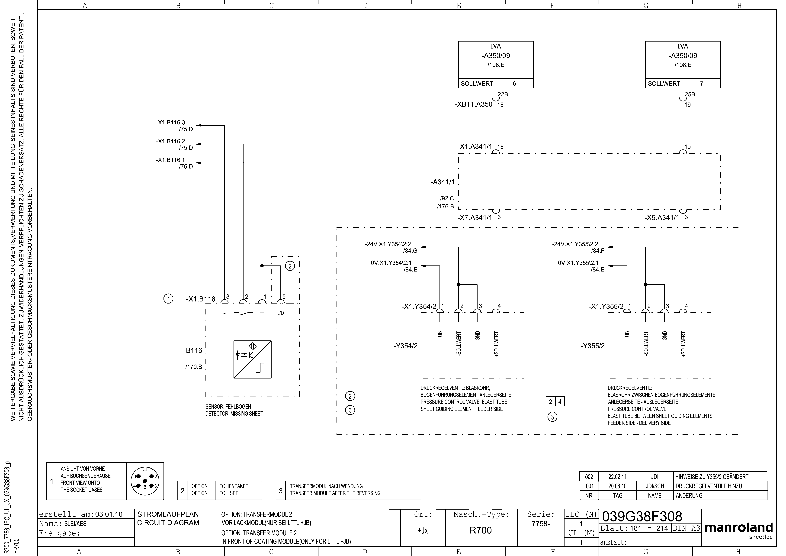

# +Jx — Sheet 181 of 214 — OPTION: TRANSFERMODUL 2

**VOR LACKMODUL(NUR BEI LTTL +JB)**

> Part of the manroland **R700** printing press IEC/UL circuit diagrams.
> Drawing class: **Stromlaufplan / Circuit diagram** (DIN A3).
> Document `+Jx` covers the **1st printing module + feed register** machine section.

## At a glance

| Field | Value |
|---|---|
| Document | `+Jx`  (039G38F308) |
| Sheet | **181** of 214 |
| Section (DE) | OPTION: TRANSFERMODUL 2 |
| Section (EN) | VOR LACKMODUL(NUR BEI LTTL +JB) |
| Section type | CIRCUIT — Circuit diagram |
| Machine type | `R700` |
| Series | `7758` |
| Created | 03.01.10 |
| Replaces | — |
| Columns used | A, B, C, D, E, F, G, H |
| Path numbers | — |
| Labels on sheet | 117 |
| Cross-refs out | 12 |
| Cross-refs in | 26 |

**Previous:** [+Jx sheet 180](SHEET_0180.md) · **Next:** [+Jx sheet 182](SHEET_0182.md) · **Document TOC:** [_TOC.md](_TOC.md)  (+Jx) · **Master TOC:** [all sheets](../_MASTER_TOC.md)

## Sheet image (300 DPI, exact vector render)



_Rendered directly from the PDF vector layer at 300 DPI (1-bit), no OCR and no resampling. Use it to confirm anything ambiguous in the text below._

## Cross-references on this sheet

Each entry is a wire leaving this sheet. The printed token is `/sheet.column`; the link resolves to that sheet inside the same document.

| Ref | Target sheet | Col | Path | Destination on target | Target section | From col |
|---|---|---|---|---|---|---|
| `/108.E` | [+Jx sheet 108](SHEET_0108.md) | E | — | — | REFERENZMODUL | E |
| `/108.E` | [+Jx sheet 108](SHEET_0108.md) | E | — | — | REFERENZMODUL | G |
| `/75.D` | [+Jx sheet 75](SHEET_0075.md) | D | — | X1.B116:3. | FEHLBOGENKONTROLLE | B |
| `/75.D` | [+Jx sheet 75](SHEET_0075.md) | D | — | X1.B116:2. | FEHLBOGENKONTROLLE | B |
| `/75.D` | [+Jx sheet 75](SHEET_0075.md) | D | — | X1.B116:1. | FEHLBOGENKONTROLLE | B |
| `/92.C` | [+Jx sheet 92](SHEET_0092.md) | C | — | — | BOGENFÜHRUNG (BLASROHRE) | E |
| `/176.B` | [+Jx sheet 176](SHEET_0176.md) | B | — | — | OPTION: TRANSFERMODUL 1 NACH | E |
| `/84.F` | [+Jx sheet 84](SHEET_0084.md) | F | — | 24V.X1.Y354\2:2 24V.X1.Y355\2:2 | BOGENFÜHRUNG | E |
| `/84.G` | [+Jx sheet 84](SHEET_0084.md) | G | — | 24V.X1.Y354\2:2 24V.X1.Y355\2:2 | BOGENFÜHRUNG | E |
| `/84.E` | [+Jx sheet 84](SHEET_0084.md) | E | — | 0V.X1.Y354\2:1 0V.X1.Y355\2:1 | BOGENFÜHRUNG | E |
| `/84.E` | [+Jx sheet 84](SHEET_0084.md) | E | — | 0V.X1.Y354\2:1 0V.X1.Y355\2:1 | BOGENFÜHRUNG | E |
| `/179.B` | [+Jx sheet 179](SHEET_0179.md) | B | — | — | OPTION: TRANSFERMODUL 1 NACH | B |

### Incoming references (sheets that point here)

Every other sheet that sends a wire to this one. `Back-ref` is the token printed on *that* sheet; `Path` is its line number.

| From sheet | Cols | Back-ref | Path | Refs | What continues there |
|---|---|---|---|---|---|
| [+Jx#75](SHEET_0075.md) | D | `/75.D` | — | 3 | — |
| [+Jx#84](SHEET_0084.md) | E, F | `/84.E`, `/84.F` | — | 4 | 0V.X1.Y354\2:1; 0V.X1.Y355\2:1; 24V.X1.Y354\2:2; 24V.X1.Y355\2:2 |
| [+Jx#92](SHEET_0092.md) | B | `/92.B` | — | 1 | — |
| [+Jx#108](SHEET_0108.md) | E | `/108.E` | — | 2 | — |
| [+Jx#114](SHEET_0114.md) | A | `/114.A` | — | 2 | — |
| [+Jx#121](SHEET_0121.md) | C, F | `/121.C`, `/121.F` | — | 8 | — |
| [+Jx#131](SHEET_0131.md) | F | `/131.F` | — | 1 | — |
| [+Jx#133](SHEET_0133.md) | B | `/133.B` | — | 1 | — |
| [+Jx#136](SHEET_0136.md) | G | `/136.G` | — | 2 | — |
| [+Jx#176](SHEET_0176.md) | A | `/176.A` | — | 1 | — |
| [+Jx#179](SHEET_0179.md) | B | `/179.B` | — | 1 | — |


## Devices on this sheet

| Tag | Class | Class meaning (IEC) | Col | Sub | Terminal | Sign |
|---|---|---|---|---|---|---|
| `B116` | B | Umformer / transducer, sensor | B | — | — | — |
| `A350/09` | A | Baugruppe / assembly, module, PC board | E | 09 | — | — |
| `A341/1` | A | Baugruppe / assembly, module, PC board | E | 1 | — | — |
| `A350/09` | A | Baugruppe / assembly, module, PC board | G | 09 | — | — |
| `Y354/2` | Y | Magnetventil / solenoid valve, actuator | D | 2 | — | — |
| `Y355/2` | Y | Magnetventil / solenoid valve, actuator | F | 2 | — | — |
| `XB11.A350` | — | cross-device reference | E | — | — | — |
| `NR.` | — | cross-device reference | F | — | — | — |
| `20.08.10` | — | cross-device reference | G | — | — | — |
| `22.02.11` | — | cross-device reference | G | — | — | — |
| `X1.B116` | — | cross-device reference | B | — | — | — |

## Potentials / nets

| Potential | Count | Columns | Attached devices | Terminals |
|---|---|---|---|---|
| `0V` | 2 | D, F | `X1`, `Y354\2`, `Y355\2` | `1` |
| `24V` | 2 | D, F | `X1`, `Y354\2`, `Y355\2` | `2` |


A potential such as `L24+/4` or `M24+` is a named supply/return rail; every place it appears on this sheet is electrically common.

## Wire-end annotations (grouped as printed)

A wire that continues elsewhere is annotated with a small cluster: the destination description, the path/line number `#NN`, and the `/sheet.column` cross reference. Each row below is one such cluster exactly as it is grouped on the drawing.

| Col | Y | Path | Cross-ref | Text on the wire |
|---|---|---|---|---|
| E | 65.7 | — | — | `D/A` |
| G | 65.7 | — | — | `D/A` |
| E | 79.6 | — | — | `A350/09` |
| G | 79.6 | — | — | `A350/09` |
| E | 94.5 | — | `/108.E` | — |
| G | 94.5 | — | `/108.E` | — |
| E | 122.8 | — | — | `SOLLWERT 6` |
| G | 122.8 | — | — | `SOLLWERT 7` |
| E | 139.1 | — | — | `22B` |
| G | 139.1 | — | — | `25B` |
| E | 153.3 | — | — | `XB11.A350 16` |
| G | 154.8 | — | — | `19` |
| B | 181.6 | — | `/75.D` | `X1.B116:3.` |
| B | 210.0 | — | `/75.D` | `X1.B116:2.` |
| E | 217.1 | — | — | `X1.A341/1 16` |
| G | 218.5 | — | — | `19` |
| B | 238.3 | — | `/75.D` | `X1.B116:1.` |
| E | 270.9 | — | — | `A341/1` |
| E | 296.4 | — | `/92.C`, `/176.B` | — |
| E | 324.8 | — | — | `X7.A341/1 3` |
| G | 324.8 | — | — | `X5.A341/1 3` |
| E | 365.9 | — | `/84.F`, `/84.G` | `24V.X1.Y354\2:2 24V.X1.Y355\2:2` |
| E | 394.2 | — | `/84.E`, `/84.E` | `0V.X1.Y354\2:1 0V.X1.Y355\2:1` |
| C | 399.9 | — | — | `2` |
| C | 445.3 | — | — | `3 2 1` |
| C | 445.3 | — | — | `5` |
| B | 448.1 | — | — | `1 X1.B116` |
| E | 459.5 | — | — | `X1.Y354/2 1 2 3 4` |
| G | 459.5 | — | — | `X1.Y355/2 1 2 3 4` |
| C | 469.4 | — | — | `+ L/D` |
| E | 501.4 | — | — | `+UB` |
| E | 501.4 | — | — | `GND` |
| G | 501.4 | — | — | `+UB` |
| G | 501.4 | — | — | `GND` |
| E | 501.7 | — | — | `SOLLWERT` |
| E | 501.7 | — | — | `+SOLLWERT` |
| G | 501.7 | — | — | `SOLLWERT` |
| G | 501.7 | — | — | `+SOLLWERT` |
| D | 519.0 | — | — | `Y354/2` |
| F | 519.0 | — | — | `Y355/2` |
| B | 526.1 | — | — | `B116` |
| B | 551.5 | — | `/179.B` | — |
| E | 584.5 | — | — | `DRUCKREGELVENTIL: BLASROHR, BOGENFÜHRUNGSELEMENT ANLEGERSEITE PRESSURE CONTROL VALVE: BLAST TUBE, SHEET GUIDING ELEMENT FEEDER SIDE` |
| G | 584.5 | — | — | `DRUCKREGELVENTIL: BLASROHR ZWISCHEN BOGENFÜHRUNGSELEMENTE` |
| D | 597.0 | — | — | `2` |
| F | 604.6 | — | — | `2 4` |
| G | 605.8 | — | — | `PRESSURE CONTROL VALVE: BLAST TUBE BETWEEN SHEET GUIDING ELEMENTS FEEDER SIDE DELIVERY SIDE ANLEGERSEITE AUSLEGERSEITE` |
| C | 612.9 | — | — | `DETECTOR: MISSING SHEET SENSOR: FEHLBOGEN` |
| E | 618.2 | — | — | `3 3` |
| A | 707.1 | — | — | `FRONT VIEW ONTO ANSICHT VON VORNE AUF BUCHSENGEHÄUSE` |
| A | 718.7 | — | — | `1 1 5 2 2 OPTION OPTION` |
| G | 718.7 | — | — | `002 22.02.11 JDI HINWEISE ZU Y355/2 GEÄNDERT` |
| B | 732.9 | — | — | `4 3` |
| G | 733.0 | — | — | `001 20.08.10 JDI/SCH DRUCKREGELVENTILE HINZU` |
| C | 733.3 | — | — | `FOLIENPAKET FOIL SET` |
| D | 733.4 | — | — | `3 TRANSFERMODUL NACH WENDUNG TRANSFER MODULE AFTER THE REVERSING` |
| A | 739.0 | — | — | `THE SOCKET CASES` |
| G | 747.1 | — | — | `NR. TAG NAME ÄNDERUNG` |


## Reconstructed tables

This sheet carries tabular content (pin map / terminal assignment / index). The grid below was rebuilt from the drawing's own rule lines, so each row is exactly one physical row of the table.

### Table 1 — 2 data rows × 4 columns (at x=666.1, y=62.4)

|  |  | D/A A350/09 | /108.E |
|---|---|---|---|
|  | `SOLLWERT` |  | `6` |
| `A341/1 /92.C /176.B` | `XB11.A350 X1.A341/1 X7.A341/1` |  | `22B 16 16 3` |


### Table 2 — 2 data rows × 3 columns (at x=978.0, y=62.4)

|  | D/A | A350/09 /108.E |
|---|---|---|
| `SOLLWERT` |  | `7` |
| `X5.A341/1` |  | `25B 19 19 3` |


## Notes and free text on this sheet

| Text | Col | Y (pt) |
|---|---|---|
| `SENSOR: FEHLBOGEN` | C | 612.86 |
| `DETECTOR: MISSING SHEET` | C | 623.49 |
| `22B` | E | 139.13 |
| `D/A` | E | 65.72 |
| `SOLLWERT` | E | 122.77 |
| `X7.A341/1` | E | 324.81 |
| `X1.A341/1` | E | 217.1 |
| `X5.A341/1` | G | 324.81 |
| `25B` | G | 139.13 |
| `D/A` | G | 65.72 |
| `SOLLWERT` | G | 122.77 |
| `X1.Y354/2` | E | 459.5 |
| `DRUCKREGELVENTIL: BLASROHR,` | E | 584.52 |
| `BOGENFÜHRUNGSELEMENT ANLEGERSEITE` | E | 595.16 |
| `PRESSURE CONTROL VALVE: BLAST TUBE,` | E | 605.77 |
| `SHEET GUIDING ELEMENT FEEDER SIDE` | E | 616.41 |
| `X1.Y355/2` | G | 459.5 |
| `DRUCKREGELVENTIL:` | G | 584.52 |
| `BLASROHR ZWISCHEN BOGENFÜHRUNGSELEMENTE` | G | 595.15 |
| `ANLEGERSEITE AUSLEGERSEITE` | G | 605.77 |
| `PRESSURE CONTROL VALVE:` | G | 616.41 |
| `BLAST TUBE BETWEEN SHEET GUIDING ELEMENTS` | G | 627.03 |
| `FEEDER SIDE DELIVERY SIDE` | G | 637.66 |
| `TAG` | G | 747.23 |
| `NAME` | G | 747.22 |
| `ÄNDERUNG` | G | 747.25 |
| `JDI/SCH` | G | 733.05 |
| `DRUCKREGELVENTILE HINZU` | H | 733.09 |
| `X1.B116:3.` | B | 181.63 |
| `X1.B116:1.` | B | 238.33 |
| `X1.B116:2.` | B | 209.98 |
| `JDI` | G | 718.71 |
| `HINWEISE ZU Y355/2 GEÄNDERT` | H | 718.8 |
| `ANSICHT VON VORNE` | A | 707.12 |
| `AUF BUCHSENGEHÄUSE` | A | 717.76 |
| `FRONT VIEW ONTO` | A | 728.35 |
| `THE SOCKET CASES` | A | 739 |
| `OPTION` | B | 733.32 |
| `FOLIENPAKET` | C | 733.32 |
| `FOIL SET` | C | 743.94 |
| `L/D` | C | 471.08 |
| `+UB` | E | 501.45 |
| `GND` | E | 501.45 |
| `+SOLLWERT` | E | 501.73 |
| `+UB` | G | 501.45 |
| `GND` | G | 501.45 |
| `+SOLLWERT` | G | 501.73 |
| `TRANSFERMODUL NACH WENDUNG` | D | 733.35 |
| `TRANSFER MODULE AFTER THE REVERSING` | D | 743.98 |

## Complete label inventory (exact text from the drawing)

Every text object inside the drawing area of this sheet, in DIN reading order (column A→H, then top→bottom). This is the authoritative list: if a string is not here it is not printed on this sheet.

| Col | Y | X | Dir | Type | Text |
|---|---|---|---|---|---|
| A | 707.1 | 92.1 | → | text | `ANSICHT VON VORNE` |
| A | 717.8 | 92.1 | → | text | `AUF BUCHSENGEHÄUSE` |
| A | 724.5 | 75.4 | → | number | `1` |
| A | 728.3 | 91.6 | → | text | `FRONT VIEW ONTO` |
| A | 739.0 | 92.1 | → | text | `THE SOCKET CASES` |
| B | 181.6 | 236.4 | → | text | `X1.B116:3.` |
| B | 191.6 | 271.3 | → | cross-reference | `/75.D` |
| B | 210.0 | 236.4 | → | text | `X1.B116:2.` |
| B | 219.9 | 271.3 | → | cross-reference | `/75.D` |
| B | 238.3 | 236.4 | → | text | `X1.B116:1.` |
| B | 248.3 | 271.3 | → | cross-reference | `/75.D` |
| B | 448.1 | 282.0 | → | device ref | `X1.B116` |
| B | 449.1 | 253.3 | → | number | `1` |
| B | 526.1 | 278.1 | → | device tag | `B116` |
| B | 551.5 | 280.9 | → | cross-reference | `/179.B` |
| B | 718.7 | 202.7 | → | number | `1` |
| B | 718.7 | 233.9 | → | number | `2` |
| B | 732.9 | 201.8 | → | number | `4` |
| B | 732.9 | 233.6 | → | number | `3` |
| B | 733.3 | 290.3 | → | text | `OPTION` |
| B | 734.3 | 217.7 | → | number | `5` |
| B | 738.6 | 273.5 | → | number | `2` |
| B | 743.9 | 290.3 | → | text | `OPTION` |
| C | 399.9 | 437.4 | → | number | `2` |
| C | 445.3 | 342.7 | → | number | `3` |
| C | 445.3 | 371.3 | → | number | `2` |
| C | 445.3 | 398.8 | → | number | `1` |
| C | 445.3 | 427.7 | → | number | `5` |
| C | 469.3 | 393.7 | → | number | `+` |
| C | 471.1 | 420.1 | → | text | `L/D` |
| C | 612.9 | 311.5 | → | text | `SENSOR: FEHLBOGEN` |
| C | 623.5 | 311.2 | → | text | `DETECTOR: MISSING SHEET` |
| C | 733.3 | 332.5 | → | text | `FOLIENPAKET` |
| C | 738.6 | 422.2 | → | number | `3` |
| C | 743.9 | 332.5 | → | text | `FOIL SET` |
| D | 365.9 | 553.0 | → | potential | `24V.X1.Y354\2:2` |
| D | 375.8 | 610.9 | → | cross-reference | `/84.G` |
| D | 394.2 | 561.8 | → | potential | `0V.X1.Y354\2:1` |
| D | 404.1 | 611.7 | → | cross-reference | `/84.E` |
| D | 519.0 | 596.1 | → | device tag | `Y354/2` |
| D | 597.0 | 528.4 | → | number | `2` |
| D | 618.2 | 528.4 | → | number | `3` |
| D | 733.3 | 439.4 | → | text | `TRANSFERMODUL NACH WENDUNG` |
| D | 744.0 | 439.4 | → | text | `TRANSFER MODULE AFTER THE REVERSING` |
| E | 65.7 | 742.7 | → | text | `D/A` |
| E | 79.6 | 729.6 | → | device tag | `A350/09` |
| E | 94.5 | 738.6 | → | cross-reference | `/108.E` |
| E | 122.8 | 698.2 | → | text | `SOLLWERT` |
| E | 139.1 | 754.0 | → | text | `22B` |
| E | 153.3 | 688.8 | → | device ref | `XB11.A350` |
| E | 154.8 | 753.2 | → | number | `16` |
| E | 217.1 | 693.1 | → | text | `X1.A341/1` |
| E | 218.5 | 753.2 | → | number | `16` |
| E | 271.0 | 652.3 | → | device tag | `A341/1` |
| E | 296.4 | 666.7 | → | cross-reference | `/92.C` |
| E | 308.8 | 662.2 | → | cross-reference | `/176.B` |
| E | 324.8 | 693.1 | → | text | `X7.A341/1` |
| E | 324.8 | 753.7 | → | number | `3` |
| E | 459.5 | 608.6 | → | text | `X1.Y354/2` |
| E | 459.5 | 668.1 | → | number | `1` |
| E | 459.5 | 697.3 | → | number | `2` |
| E | 459.5 | 725.4 | → | number | `3` |
| E | 459.5 | 754.0 | → | number | `4` |
| E | 501.4 | 720.6 | ↕ | text | `GND` |
| E | 501.5 | 663.9 | ↕ | text | `+UB` |
| E | 501.7 | 692.2 | ↕ | text | `SOLLWERT` |
| E | 501.7 | 748.9 | ↕ | text | `+SOLLWERT` |
| E | 584.5 | 637.2 | → | text | `DRUCKREGELVENTIL: BLASROHR,` |
| E | 595.2 | 637.2 | → | text | `BOGENFÜHRUNGSELEMENT ANLEGERSEITE` |
| E | 605.8 | 637.2 | → | text | `PRESSURE CONTROL VALVE: BLAST TUBE,` |
| E | 616.4 | 637.5 | → | text | `SHEET GUIDING ELEMENT FEEDER SIDE` |
| F | 122.9 | 777.1 | → | number | `6` |
| F | 365.9 | 836.5 | → | potential | `24V.X1.Y355\2:2` |
| F | 375.8 | 895.7 | → | cross-reference | `/84.F` |
| F | 394.2 | 845.3 | → | potential | `0V.X1.Y355\2:1` |
| F | 404.1 | 895.2 | → | cross-reference | `/84.E` |
| F | 519.0 | 879.6 | → | device tag | `Y355/2` |
| F | 604.6 | 831.7 | → | number | `2` |
| F | 604.6 | 845.9 | → | number | `4` |
| F | 628.4 | 834.9 | → | number | `3` |
| F | 718.8 | 886.6 | → | number | `002` |
| F | 733.0 | 887.6 | → | number | `001` |
| F | 747.1 | 886.8 | → | device ref | `NR.` |
| G | 65.7 | 1026.1 | → | text | `D/A` |
| G | 79.6 | 1013.1 | → | device tag | `A350/09` |
| G | 94.5 | 1022.0 | → | cross-reference | `/108.E` |
| G | 122.8 | 981.6 | → | text | `SOLLWERT` |
| G | 139.1 | 1037.5 | → | text | `25B` |
| G | 154.8 | 1036.6 | → | number | `19` |
| G | 218.5 | 1036.6 | → | number | `19` |
| G | 324.8 | 976.5 | → | text | `X5.A341/1` |
| G | 324.8 | 1037.2 | → | number | `3` |
| G | 459.5 | 892.1 | → | text | `X1.Y355/2` |
| G | 459.5 | 951.6 | → | number | `1` |
| G | 459.5 | 980.8 | → | number | `2` |
| G | 459.5 | 1008.9 | → | number | `3` |
| G | 459.5 | 1037.5 | → | number | `4` |
| G | 501.4 | 1004.1 | ↕ | text | `GND` |
| G | 501.5 | 947.3 | ↕ | text | `+UB` |
| G | 501.7 | 975.7 | ↕ | text | `SOLLWERT` |
| G | 501.7 | 1032.4 | ↕ | text | `+SOLLWERT` |
| G | 584.5 | 920.7 | → | text | `DRUCKREGELVENTIL:` |
| G | 595.2 | 920.7 | → | text | `BLASROHR ZWISCHEN BOGENFÜHRUNGSELEMENTE` |
| G | 605.8 | 921.3 | → | text | `ANLEGERSEITE AUSLEGERSEITE` |
| G | 616.4 | 920.7 | → | text | `PRESSURE CONTROL VALVE:` |
| G | 627.0 | 920.7 | → | text | `BLAST TUBE BETWEEN SHEET GUIDING ELEMENTS` |
| G | 637.7 | 920.7 | → | text | `FEEDER SIDE DELIVERY SIDE` |
| G | 718.7 | 986.5 | → | text | `JDI` |
| G | 718.8 | 921.9 | → | device ref | `22.02.11` |
| G | 733.1 | 921.9 | → | device ref | `20.08.10` |
| G | 733.1 | 978.6 | → | text | `JDI/SCH` |
| G | 747.2 | 928.5 | → | text | `TAG` |
| G | 747.2 | 981.8 | → | text | `NAME` |
| G | 747.3 | 1024.0 | → | text | `ÄNDERUNG` |
| H | 122.9 | 1060.6 | → | number | `7` |
| H | 718.8 | 1023.0 | → | text | `HINWEISE ZU Y355/2 GEÄNDERT` |
| H | 733.1 | 1023.4 | → | text | `DRUCKREGELVENTILE HINZU` |

## Reading-order text block

The same content as a plain block, grouped by DIN column — convenient to paste or to match against a visual description.

```text
=== Column A ===
 707.1   92.1  text         ANSICHT VON VORNE
 717.8   92.1  text         AUF BUCHSENGEHÄUSE
 724.5   75.4  numeric      1
 728.3   91.6  text         FRONT VIEW ONTO
 739.0   92.1  text         THE SOCKET CASES
=== Column B ===
 181.6  236.4  text         X1.B116:3.
 191.6  271.3  xref         /75.D
 210.0  236.4  text         X1.B116:2.
 219.9  271.3  xref         /75.D
 238.3  236.4  text         X1.B116:1.
 248.3  271.3  xref         /75.D
 448.1  282.0  devref       X1.B116
 449.1  253.3  numeric      1
 526.1  278.1  devtag       B116
 551.5  280.9  xref         /179.B
 718.7  202.7  numeric      1
 718.7  233.9  numeric      2
 732.9  201.8  numeric      4
 732.9  233.6  numeric      3
 733.3  290.3  text         OPTION
 734.3  217.7  numeric      5
 738.6  273.5  numeric      2
 743.9  290.3  text         OPTION
=== Column C ===
 399.9  437.4  numeric      2
 445.3  342.7  numeric      3
 445.3  371.3  numeric      2
 445.3  398.8  numeric      1
 445.3  427.7  numeric      5
 469.3  393.7  numeric      +
 471.1  420.1  text         L/D
 612.9  311.5  text         SENSOR: FEHLBOGEN
 623.5  311.2  text         DETECTOR: MISSING SHEET
 733.3  332.5  text         FOLIENPAKET
 738.6  422.2  numeric      3
 743.9  332.5  text         FOIL SET
=== Column D ===
 365.9  553.0  net          24V.X1.Y354\2:2
 375.8  610.9  xref         /84.G
 394.2  561.8  net          0V.X1.Y354\2:1
 404.1  611.7  xref         /84.E
 519.0  596.1  devtag       Y354/2
 597.0  528.4  numeric      2
 618.2  528.4  numeric      3
 733.3  439.4  text         TRANSFERMODUL NACH WENDUNG
 744.0  439.4  text         TRANSFER MODULE AFTER THE REVERSING
=== Column E ===
  65.7  742.7  text         D/A
  79.6  729.6  devtag       A350/09
  94.5  738.6  xref         /108.E
 122.8  698.2  text         SOLLWERT
 139.1  754.0  text         22B
 153.3  688.8  devref       XB11.A350
 154.8  753.2  numeric      16
 217.1  693.1  text         X1.A341/1
 218.5  753.2  numeric      16
 271.0  652.3  devtag       A341/1
 296.4  666.7  xref         /92.C
 308.8  662.2  xref         /176.B
 324.8  693.1  text         X7.A341/1
 324.8  753.7  numeric      3
 459.5  608.6  text         X1.Y354/2
 459.5  668.1  numeric      1
 459.5  697.3  numeric      2
 459.5  725.4  numeric      3
 459.5  754.0  numeric      4
 501.4  720.6  text         GND
 501.5  663.9  text         +UB
 501.7  692.2  text         SOLLWERT
 501.7  748.9  text         +SOLLWERT
 584.5  637.2  text         DRUCKREGELVENTIL: BLASROHR,
 595.2  637.2  text         BOGENFÜHRUNGSELEMENT ANLEGERSEITE
 605.8  637.2  text         PRESSURE CONTROL VALVE: BLAST TUBE,
 616.4  637.5  text         SHEET GUIDING ELEMENT FEEDER SIDE
=== Column F ===
 122.9  777.1  numeric      6
 365.9  836.5  net          24V.X1.Y355\2:2
 375.8  895.7  xref         /84.F
 394.2  845.3  net          0V.X1.Y355\2:1
 404.1  895.2  xref         /84.E
 519.0  879.6  devtag       Y355/2
 604.6  831.7  numeric      2
 604.6  845.9  numeric      4
 628.4  834.9  numeric      3
 718.8  886.6  numeric      002
 733.0  887.6  numeric      001
 747.1  886.8  devref       NR.
=== Column G ===
  65.7 1026.1  text         D/A
  79.6 1013.1  devtag       A350/09
  94.5 1022.0  xref         /108.E
 122.8  981.6  text         SOLLWERT
 139.1 1037.5  text         25B
 154.8 1036.6  numeric      19
 218.5 1036.6  numeric      19
 324.8  976.5  text         X5.A341/1
 324.8 1037.2  numeric      3
 459.5  892.1  text         X1.Y355/2
 459.5  951.6  numeric      1
 459.5  980.8  numeric      2
 459.5 1008.9  numeric      3
 459.5 1037.5  numeric      4
 501.4 1004.1  text         GND
 501.5  947.3  text         +UB
 501.7  975.7  text         SOLLWERT
 501.7 1032.4  text         +SOLLWERT
 584.5  920.7  text         DRUCKREGELVENTIL:
 595.2  920.7  text         BLASROHR ZWISCHEN BOGENFÜHRUNGSELEMENTE
 605.8  921.3  text         ANLEGERSEITE AUSLEGERSEITE
 616.4  920.7  text         PRESSURE CONTROL VALVE:
 627.0  920.7  text         BLAST TUBE BETWEEN SHEET GUIDING ELEMENTS
 637.7  920.7  text         FEEDER SIDE DELIVERY SIDE
 718.7  986.5  text         JDI
 718.8  921.9  devref       22.02.11
 733.1  921.9  devref       20.08.10
 733.1  978.6  text         JDI/SCH
 747.2  928.5  text         TAG
 747.2  981.8  text         NAME
 747.3 1024.0  text         ÄNDERUNG
=== Column H ===
 122.9 1060.6  numeric      7
 718.8 1023.0  text         HINWEISE ZU Y355/2 GEÄNDERT
 733.1 1023.4  text         DRUCKREGELVENTILE HINZU
```

---
_Generated from the PDF vector text layer; no OCR. Source: `R700_7758_IEC_UL_JX_039G38F308_p`, sheet 181._
