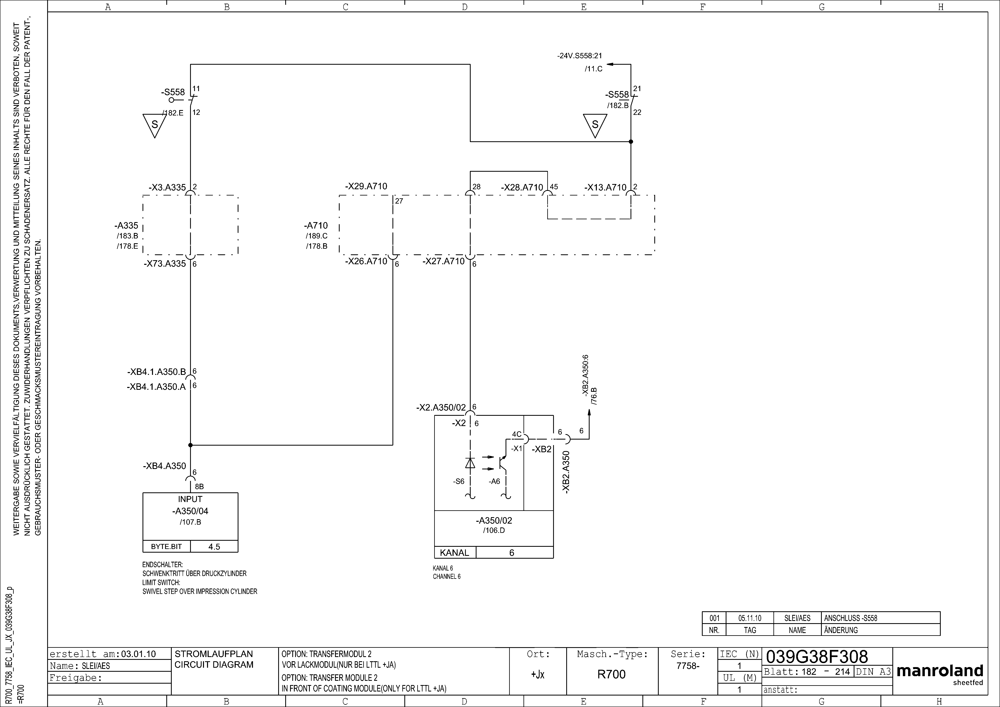

# +Jx — Sheet 182 of 214 — OPTION: TRANSFERMODUL 2

**VOR LACKMODUL(NUR BEI LTTL +JA)**

> Part of the manroland **R700** printing press IEC/UL circuit diagrams.
> Drawing class: **Stromlaufplan / Circuit diagram** (DIN A3).
> Document `+Jx` covers the **1st printing module + feed register** machine section.

## At a glance

| Field | Value |
|---|---|
| Document | `+Jx`  (039G38F308) |
| Sheet | **182** of 214 |
| Section (DE) | OPTION: TRANSFERMODUL 2 |
| Section (EN) | VOR LACKMODUL(NUR BEI LTTL +JA) |
| Section type | CIRCUIT — Circuit diagram |
| Machine type | `R700` |
| Series | `7758` |
| Created | 03.01.10 |
| Replaces | — |
| Columns used | A, B, C, D, E, F, G |
| Path numbers | — |
| Labels on sheet | 77 |
| Cross-refs out | 10 |
| Cross-refs in | 23 |

**Previous:** [+Jx sheet 181](SHEET_0181.md) · **Next:** [+Jx sheet 183](SHEET_0183.md) · **Document TOC:** [_TOC.md](_TOC.md)  (+Jx) · **Master TOC:** [all sheets](../_MASTER_TOC.md)

## Sheet image (300 DPI, exact vector render)



_Rendered directly from the PDF vector layer at 300 DPI (1-bit), no OCR and no resampling. Use it to confirm anything ambiguous in the text below._

## Cross-references on this sheet

Each entry is a wire leaving this sheet. The printed token is `/sheet.column`; the link resolves to that sheet inside the same document.

| Ref | Target sheet | Col | Path | Destination on target | Target section | From col |
|---|---|---|---|---|---|---|
| `/11.C` | [+Jx sheet 11](SHEET_0011.md) | C | — | — | SPANNUNGSVERSORGUNG, SCHALTSCHRANKBELÜFTUNG | E |
| `/182.B` | [+Jx sheet 182](SHEET_0182.md) | B | — | — | OPTION: TRANSFERMODUL 2 | C |
| `/182.E` | [+Jx sheet 182](SHEET_0182.md) | E | — | — | OPTION: TRANSFERMODUL 2 | C |
| `/183.B` | [+Jx sheet 183](SHEET_0183.md) | B | — | — | OPTION: TRANSFERMODUL 1 + 2 | A |
| `/178.E` | [+Jx sheet 178](SHEET_0178.md) | E | — | — | OPTION: TRANSFERMODUL 1 NACH | A |
| `/189.C` | [+Jx sheet 189](SHEET_0189.md) | C | — | — | OPTION: ZWISCHENTROCKNER, VORBEREITUNG | C |
| `/178.B` | [+Jx sheet 178](SHEET_0178.md) | B | — | — | OPTION: TRANSFERMODUL 1 NACH | C |
| `/76.B` | [+Jx sheet 76](SHEET_0076.md) | B | — | XB2.A350:6 | BUSVERBINDUNGEN: SICHERHEITSKREIS | E |
| `/107.B` | [+Jx sheet 107](SHEET_0107.md) | B | — | — | REFERENZMODUL | B |
| `/106.D` | [+Jx sheet 106](SHEET_0106.md) | D | — | — | REFERENZMODUL | D |

### Incoming references (sheets that point here)

Every other sheet that sends a wire to this one. `Back-ref` is the token printed on *that* sheet; `Path` is its line number.

| From sheet | Cols | Back-ref | Path | Refs | What continues there |
|---|---|---|---|---|---|
| [+Jx#11](SHEET_0011.md) | C | `/11.C` | — | 1 | — |
| [+Jx#76](SHEET_0076.md) | B | `/76.B` | — | 1 | XB2.A350:6 |
| [+Jx#106](SHEET_0106.md) | D | `/106.D` | — | 1 | — |
| [+Jx#107](SHEET_0107.md) | B | `/107.B` | — | 1 | — |
| [+Jx#126](SHEET_0126.md) | E | `/126.E` | — | 2 | — |
| [+Jx#127](SHEET_0127.md) | F | `/127.F` | — | 1 | — |
| [+Jx#130](SHEET_0130.md) | A, B, D | `/130.A`, `/130.B`, `/130.D` | — | 3 | — |
| [+Jx#138](SHEET_0138.md) | B | `/138.B` | — | 1 | — |
| [+Jx#143](SHEET_0143.md) | F | `/143.F` | — | 1 | — |
| [+Jx#144](SHEET_0144.md) | C | `/144.C` | — | 1 | — |
| [+Jx#146](SHEET_0146.md) | B | `/146.B` | — | 1 | — |
| [+Jx#147](SHEET_0147.md) | C | `/147.C` | — | 2 | — |
| [+Jx#153](SHEET_0153.md) | E | `/153.E` | — | 1 | — |
| [+Jx#178](SHEET_0178.md) | B, E | `/178.B`, `/178.E` | — | 2 | — |
| [+Jx#182](SHEET_0182.md) | C | `/182.C` | — | 2 | — |
| [+Jx#183](SHEET_0183.md) | B | `/183.B` | — | 1 | — |
| [+Jx#189](SHEET_0189.md) | C | `/189.C` | — | 1 | — |


## Devices on this sheet

| Tag | Class | Class meaning (IEC) | Col | Sub | Terminal | Sign |
|---|---|---|---|---|---|---|
| `A350/04` | A | Baugruppe / assembly, module, PC board | B | 04 | — | — |
| `A335` | A | Baugruppe / assembly, module, PC board | A | — | — | — |
| `S6` | S | Schalter / switch | D | — | — | — |
| `A6` | A | Baugruppe / assembly, module, PC board | D | — | — | — |
| `X1` | X | Klemme / terminal, plug connector | D | — | — | — |
| `X2` | X | Klemme / terminal, plug connector | D | — | — | — |
| `XB2` | XB |  | E | — | — | — |
| `A350/02` | A | Baugruppe / assembly, module, PC board | D | 02 | — | — |
| `A710` | A | Baugruppe / assembly, module, PC board | C | — | — | — |
| `S558` | S | Schalter / switch | E | — | — | — |
| `S558` | S | Schalter / switch | B | — | — | — |
| `4.5` | — | cross-device reference | B | — | — | — |
| `XB4.A350` | — | cross-device reference | A | — | — | — |
| `X73.A335` | — | cross-device reference | A | — | — | — |
| `X3.A335` | — | cross-device reference | B | — | — | — |
| `XB4.1.A350.B` | — | cross-device reference | A | — | — | — |
| `XB4.1.A350.A` | — | cross-device reference | A | — | — | — |
| `XB2.A350` | — | cross-device reference | E | — | — | — |
| `X28.A710` | — | cross-device reference | D | — | — | — |
| `X13.A710` | — | cross-device reference | E | — | — | — |
| `X27.A710` | — | cross-device reference | D | — | — | — |
| `X26.A710` | — | cross-device reference | C | — | — | — |
| `NR.` | — | cross-device reference | F | — | — | — |
| `05.11.10` | — | cross-device reference | F | — | — | — |
| `XB2.A350:6` | — | cross-device reference | E | — | 6 | — |
| `X29.A710` | — | cross-device reference | C | — | — | — |

## Potentials / nets

| Potential | Count | Columns | Attached devices | Terminals |
|---|---|---|---|---|
| `24V` | 1 | E | `S558` | `21` |


A potential such as `L24+/4` or `M24+` is a named supply/return rail; every place it appears on this sheet is electrically common.

## Wire-end annotations (grouped as printed)

A wire that continues elsewhere is annotated with a small cluster: the destination description, the path/line number `#NN`, and the `/sheet.column` cross reference. Each row below is one such cluster exactly as it is grouped on the drawing.

| Col | Y | Path | Cross-ref | Text on the wire |
|---|---|---|---|---|
| E | 62.6 | — | — | `24V.S558:21` |
| E | 78.2 | — | `/11.C` | — |
| B | 101.6 | — | — | `11` |
| E | 101.6 | — | — | `21` |
| B | 105.1 | — | — | `S558` |
| E | 108.0 | — | — | `S558` |
| C | 121.7 | — | `/182.B`, `/182.E` | — |
| B | 129.9 | — | — | `12` |
| E | 129.9 | — | — | `22` |
| C | 142.7 | — | — | `S S` |
| C | 217.1 | — | — | `X29.A710` |
| B | 218.5 | — | — | `X3.A335 2` |
| D | 218.5 | — | — | `28` |
| E | 218.5 | — | — | `X28.A710 45 X13.A710 2` |
| C | 235.5 | — | — | `27` |
| A | 263.9 | — | — | `A335` |
| C | 263.9 | — | — | `A710` |
| A | 276.9 | — | `/183.B`, `/178.E` | — |
| C | 277.0 | — | `/189.C`, `/178.B` | — |
| D | 306.4 | — | — | `X26.A710 6 X27.A710 6` |
| B | 309.2 | — | — | `X73.A335 6` |
| E | 422.4 | — | `/76.B` | `XB2.A350:6` |
| A | 438.2 | — | — | `XB4.1.A350.B 6` |
| A | 455.2 | — | — | `XB4.1.A350.A 6` |
| D | 480.7 | — | — | `X2.A350/02 6` |
| D | 499.1 | — | — | `X2` |
| D | 500.6 | — | — | `6 6` |
| E | 509.1 | — | — | `6` |
| D | 513.4 | — | — | `4C` |
| D | 530.3 | — | — | `X1` |
| E | 530.3 | — | — | `XB2` |
| E | 536.6 | — | — | `XB2.A350` |
| B | 550.2 | — | — | `XB4.A350 6` |
| D | 569.3 | — | — | `S6 A6` |
| B | 575.6 | — | — | `8B` |
| B | 590.2 | — | — | `INPUT` |
| B | 604.0 | — | — | `A350/04` |
| D | 615.4 | — | — | `A350/02` |
| B | 617.8 | — | `/107.B` | — |
| D | 627.8 | — | `/106.D` | — |
| B | 646.9 | — | — | `BYTE.BIT 4.5` |
| D | 653.6 | — | — | `KANAL 6` |
| B | 669.5 | — | — | `ENDSCHALTER: LIMIT SWITCH: SCHWENKTRITT ÜBER DRUCKZYLINDER SWIVEL STEP OVER IMPRESSION CYLINDER` |
| D | 674.0 | — | — | `KANAL 6 CHANNEL 6` |
| G | 733.0 | — | — | `001 05.11.10 SLEI/AES ANSCHLUSS S558` |
| G | 747.1 | — | — | `NR. TAG NAME ÄNDERUNG` |


## Reconstructed tables

This sheet carries tabular content (pin map / terminal assignment / index). The grid below was rebuilt from the drawing's own rule lines, so each row is exactly one physical row of the table.

### Table 1 — 3 data rows × 2 columns (at x=170.1, y=76.5)

| S558 /182.E S X3.A335 X73.A335 XB4.1.A350.B XB4.1.A350.A | 11 12 2 6 6 6 |
|---|---|
| `XB4.A350` | `6 8B` |
| `INPUT A350/04` | `/107.B` |
| `BYTE.BIT` | `4.5` |


### Table 2 — 5 data rows × 7 columns (at x=467.7, y=76.5) — **/11.C S558 /182.B S**

| 27 |  | 28 | X28.A710 |  | 45 | X13.A710 |
|---|---|---|---|---|---|---|
| `6` | `X27.A710 X2.A350/02` | `6 6` |  |  | `XB2.A350:6` | `/76.B` |
|  | `X2` | `6` | `4C` |  | `6 6` |  |
|  | `S6` | `A6` | `X1` | `XB2` | `XB2.A350` |  |
|  |  | `A350/02 /106.D` |  |  |  |  |
|  | `KANAL` |  | `6` |  |  |  |


## Notes and free text on this sheet

| Text | Col | Y (pt) |
|---|---|---|
| `8B` | B | 575.65 |
| `INPUT` | B | 590.18 |
| `BYTE.BIT` | A | 647.44 |
| `ENDSCHALTER:` | A | 669.55 |
| `SCHWENKTRITT ÜBER DRUCKZYLINDER` | B | 680.19 |
| `LIMIT SWITCH:` | A | 690.76 |
| `SWIVEL STEP OVER IMPRESSION CYLINDER` | B | 701.44 |
| `KANAL 6` | D | 673.97 |
| `CHANNEL 6` | D | 683.91 |
| `4C` | D | 513.35 |
| `KANAL` | D | 653.62 |
| `X2.A350/02` | D | 480.71 |
| `TAG` | F | 747.23 |
| `NAME` | G | 747.22 |
| `ÄNDERUNG` | G | 747.25 |
| `SLEI/AES` | G | 733.09 |
| `ANSCHLUSS S558` | G | 733.09 |
| `S` | E | 142.74 |
| `S` | A | 142.74 |

## Complete label inventory (exact text from the drawing)

Every text object inside the drawing area of this sheet, in DIN reading order (column A→H, then top→bottom). This is the authoritative list: if a string is not here it is not printed on this sheet.

| Col | Y | X | Dir | Type | Text |
|---|---|---|---|---|---|
| A | 142.7 | 180.1 | → | text | `S` |
| A | 263.9 | 136.3 | → | device tag | `A335` |
| A | 276.9 | 139.2 | → | cross-reference | `/183.B` |
| A | 289.3 | 139.2 | → | cross-reference | `/178.E` |
| A | 309.2 | 171.2 | → | device ref | `X73.A335` |
| A | 438.2 | 151.7 | → | device ref | `XB4.1.A350.B` |
| A | 455.9 | 151.1 | → | device ref | `XB4.1.A350.A` |
| A | 550.2 | 170.4 | → | device ref | `XB4.A350` |
| A | 647.4 | 180.0 | → | text | `BYTE.BIT` |
| A | 669.5 | 169.5 | → | text | `ENDSCHALTER:` |
| A | 690.8 | 169.5 | → | text | `LIMIT SWITCH:` |
| B | 101.6 | 228.8 | → | number | `11` |
| B | 105.1 | 191.9 | → | device tag | `S558` |
| B | 130.0 | 228.8 | → | number | `12` |
| B | 130.6 | 193.0 | → | cross-reference | `/182.E` |
| B | 218.5 | 177.2 | → | device ref | `X3.A335` |
| B | 218.5 | 229.6 | → | number | `2` |
| B | 310.7 | 229.3 | → | number | `6` |
| B | 438.2 | 229.3 | → | number | `6` |
| B | 455.2 | 229.3 | → | number | `6` |
| B | 558.7 | 229.3 | → | number | `6` |
| B | 575.6 | 232.2 | → | text | `8B` |
| B | 590.2 | 211.9 | → | text | `INPUT` |
| B | 604.0 | 205.2 | → | device tag | `A350/04` |
| B | 617.8 | 214.2 | → | cross-reference | `/107.B` |
| B | 646.9 | 248.5 | → | device ref | `4.5` |
| B | 680.2 | 169.8 | → | text | `SCHWENKTRITT ÜBER DRUCKZYLINDER` |
| B | 701.4 | 169.8 | → | text | `SWIVEL STEP OVER IMPRESSION CYLINDER` |
| C | 217.1 | 411.0 | → | device ref | `X29.A710` |
| C | 235.5 | 470.6 | → | number | `27` |
| C | 263.9 | 362.0 | → | device tag | `A710` |
| C | 277.0 | 364.3 | → | cross-reference | `/189.C` |
| C | 289.3 | 364.5 | → | cross-reference | `/178.B` |
| C | 306.4 | 411.0 | → | device ref | `X26.A710` |
| C | 310.7 | 470.3 | → | number | `6` |
| D | 218.5 | 562.7 | → | number | `28` |
| D | 218.5 | 596.7 | → | device ref | `X28.A710` |
| D | 306.4 | 503.1 | → | device ref | `X27.A710` |
| D | 310.7 | 562.4 | → | number | `6` |
| D | 480.7 | 495.8 | → | text | `X2.A350/02` |
| D | 480.7 | 562.4 | → | number | `6` |
| D | 499.2 | 538.3 | → | device tag | `X2` |
| D | 500.6 | 565.2 | → | number | `6` |
| D | 513.3 | 610.0 | → | text | `4C` |
| D | 530.3 | 608.6 | → | device tag | `X1` |
| D | 569.3 | 539.4 | → | device tag | `S6` |
| D | 569.3 | 582.0 | → | device tag | `A6` |
| D | 615.4 | 566.8 | → | device tag | `A350/02` |
| D | 627.8 | 575.4 | → | cross-reference | `/106.D` |
| D | 653.6 | 523.8 | → | text | `KANAL` |
| D | 653.6 | 606.5 | → | number | `6` |
| D | 674.0 | 515.3 | → | text | `KANAL 6` |
| D | 683.9 | 515.6 | → | text | `CHANNEL 6` |
| E | 62.6 | 663.6 | → | potential | `24V.S558:21` |
| E | 78.2 | 696.5 | → | cross-reference | `/11.C` |
| E | 101.6 | 754.0 | → | number | `21` |
| E | 108.0 | 720.6 | → | device tag | `S558` |
| E | 121.7 | 723.1 | → | cross-reference | `/182.B` |
| E | 130.0 | 754.0 | → | number | `22` |
| E | 142.7 | 704.6 | → | text | `S` |
| E | 218.5 | 654.8 | → | number | `45` |
| E | 218.5 | 695.9 | → | device ref | `X13.A710` |
| E | 218.5 | 754.0 | → | number | `2` |
| E | 422.4 | 693.3 | ↕ | device ref | `XB2.A350:6` |
| E | 461.2 | 703.2 | ↕ | cross-reference | `/76.B` |
| E | 509.1 | 690.0 | → | number | `6` |
| E | 510.5 | 664.4 | → | number | `6` |
| E | 530.3 | 633.3 | → | device tag | `XB2` |
| E | 536.6 | 669.2 | ↕ | device ref | `XB2.A350` |
| F | 733.0 | 845.1 | → | number | `001` |
| F | 733.1 | 879.3 | → | device ref | `05.11.10` |
| F | 747.1 | 844.3 | → | device ref | `NR.` |
| F | 747.2 | 886.0 | → | text | `TAG` |
| G | 733.1 | 934.1 | → | text | `SLEI/AES` |
| G | 733.1 | 981.5 | → | text | `ANSCHLUSS S558` |
| G | 747.2 | 939.3 | → | text | `NAME` |
| G | 747.3 | 981.5 | → | text | `ÄNDERUNG` |

## Reading-order text block

The same content as a plain block, grouped by DIN column — convenient to paste or to match against a visual description.

```text
=== Column A ===
 142.7  180.1  text         S
 263.9  136.3  devtag       A335
 276.9  139.2  xref         /183.B
 289.3  139.2  xref         /178.E
 309.2  171.2  devref       X73.A335
 438.2  151.7  devref       XB4.1.A350.B
 455.9  151.1  devref       XB4.1.A350.A
 550.2  170.4  devref       XB4.A350
 647.4  180.0  text         BYTE.BIT
 669.5  169.5  text         ENDSCHALTER:
 690.8  169.5  text         LIMIT SWITCH:
=== Column B ===
 101.6  228.8  numeric      11
 105.1  191.9  devtag       S558
 130.0  228.8  numeric      12
 130.6  193.0  xref         /182.E
 218.5  177.2  devref       X3.A335
 218.5  229.6  numeric      2
 310.7  229.3  numeric      6
 438.2  229.3  numeric      6
 455.2  229.3  numeric      6
 558.7  229.3  numeric      6
 575.6  232.2  text         8B
 590.2  211.9  text         INPUT
 604.0  205.2  devtag       A350/04
 617.8  214.2  xref         /107.B
 646.9  248.5  devref       4.5
 680.2  169.8  text         SCHWENKTRITT ÜBER DRUCKZYLINDER
 701.4  169.8  text         SWIVEL STEP OVER IMPRESSION CYLINDER
=== Column C ===
 217.1  411.0  devref       X29.A710
 235.5  470.6  numeric      27
 263.9  362.0  devtag       A710
 277.0  364.3  xref         /189.C
 289.3  364.5  xref         /178.B
 306.4  411.0  devref       X26.A710
 310.7  470.3  numeric      6
=== Column D ===
 218.5  562.7  numeric      28
 218.5  596.7  devref       X28.A710
 306.4  503.1  devref       X27.A710
 310.7  562.4  numeric      6
 480.7  495.8  text         X2.A350/02
 480.7  562.4  numeric      6
 499.2  538.3  devtag       X2
 500.6  565.2  numeric      6
 513.3  610.0  text         4C
 530.3  608.6  devtag       X1
 569.3  539.4  devtag       S6
 569.3  582.0  devtag       A6
 615.4  566.8  devtag       A350/02
 627.8  575.4  xref         /106.D
 653.6  523.8  text         KANAL
 653.6  606.5  numeric      6
 674.0  515.3  text         KANAL 6
 683.9  515.6  text         CHANNEL 6
=== Column E ===
  62.6  663.6  net          24V.S558:21
  78.2  696.5  xref         /11.C
 101.6  754.0  numeric      21
 108.0  720.6  devtag       S558
 121.7  723.1  xref         /182.B
 130.0  754.0  numeric      22
 142.7  704.6  text         S
 218.5  654.8  numeric      45
 218.5  695.9  devref       X13.A710
 218.5  754.0  numeric      2
 422.4  693.3  devref       XB2.A350:6
 461.2  703.2  xref         /76.B
 509.1  690.0  numeric      6
 510.5  664.4  numeric      6
 530.3  633.3  devtag       XB2
 536.6  669.2  devref       XB2.A350
=== Column F ===
 733.0  845.1  numeric      001
 733.1  879.3  devref       05.11.10
 747.1  844.3  devref       NR.
 747.2  886.0  text         TAG
=== Column G ===
 733.1  934.1  text         SLEI/AES
 733.1  981.5  text         ANSCHLUSS S558
 747.2  939.3  text         NAME
 747.3  981.5  text         ÄNDERUNG
```

---
_Generated from the PDF vector text layer; no OCR. Source: `R700_7758_IEC_UL_JX_039G38F308_p`, sheet 182._
