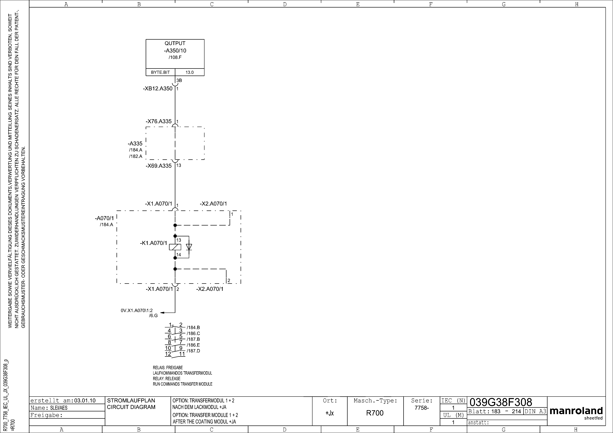

# +Jx — Sheet 183 of 214 — OPTION: TRANSFERMODUL 1 + 2

**NACH DEM LACKMODUL +JA**

> Part of the manroland **R700** printing press IEC/UL circuit diagrams.
> Drawing class: **Stromlaufplan / Circuit diagram** (DIN A3).
> Document `+Jx` covers the **1st printing module + feed register** machine section.

## At a glance

| Field | Value |
|---|---|
| Document | `+Jx`  (039G38F308) |
| Sheet | **183** of 214 |
| Section (DE) | OPTION: TRANSFERMODUL 1 + 2 |
| Section (EN) | NACH DEM LACKMODUL +JA |
| Section type | CIRCUIT — Circuit diagram |
| Machine type | `R700` |
| Series | `7758` |
| Created | 03.01.10 |
| Replaces | — |
| Columns used | B, C |
| Path numbers | — |
| Labels on sheet | 51 |
| Cross-refs out | 10 |
| Cross-refs in | 17 |

**Previous:** [+Jx sheet 182](SHEET_0182.md) · **Next:** [+Jx sheet 184](SHEET_0184.md) · **Document TOC:** [_TOC.md](_TOC.md)  (+Jx) · **Master TOC:** [all sheets](../_MASTER_TOC.md)

## Sheet image (300 DPI, exact vector render)



_Rendered directly from the PDF vector layer at 300 DPI (1-bit), no OCR and no resampling. Use it to confirm anything ambiguous in the text below._

## Cross-references on this sheet

Each entry is a wire leaving this sheet. The printed token is `/sheet.column`; the link resolves to that sheet inside the same document.

| Ref | Target sheet | Col | Path | Destination on target | Target section | From col |
|---|---|---|---|---|---|---|
| `/108.F` | [+Jx sheet 108](SHEET_0108.md) | F | — | — | REFERENZMODUL | B |
| `/184.A` | [+Jx sheet 184](SHEET_0184.md) | A | — | — | OPTION: TRANSFERMODUL 1 + 2 | B |
| `/182.A` | [+Jx sheet 182](SHEET_0182.md) | A | — | — | OPTION: TRANSFERMODUL 2 | B |
| `/184.A` | [+Jx sheet 184](SHEET_0184.md) | A | — | — | OPTION: TRANSFERMODUL 1 + 2 | B |
| `/6.G` | [+Jx sheet 6](SHEET_0006.md) | G | — | 0V.X1.A070\1:2 | SPANNUNGSVERSORGUNG, SCHALTSCHRANKBELÜFTUNG | B |
| `/184.B` | [+Jx sheet 184](SHEET_0184.md) | B | — | — | OPTION: TRANSFERMODUL 1 + 2 | C |
| `/186.C` | [+Jx sheet 186](SHEET_0186.md) | C | — | — | OPTION: TRANSFERMODUL 1 + 2 | C |
| `/187.B` | [+Jx sheet 187](SHEET_0187.md) | B | — | — | OPTION: TRANSFERMODUL 1 + 2 | C |
| `/186.E` | [+Jx sheet 186](SHEET_0186.md) | E | — | — | OPTION: TRANSFERMODUL 1 + 2 | C |
| `/187.D` | [+Jx sheet 187](SHEET_0187.md) | D | — | — | OPTION: TRANSFERMODUL 1 + 2 | C |

### Incoming references (sheets that point here)

Every other sheet that sends a wire to this one. `Back-ref` is the token printed on *that* sheet; `Path` is its line number.

| From sheet | Cols | Back-ref | Path | Refs | What continues there |
|---|---|---|---|---|---|
| [+Jx#6](SHEET_0006.md) | H | `/6.H` | — | 1 | 0V.X1.A070\1:2 |
| [+Jx#108](SHEET_0108.md) | F | `/108.F` | — | 1 | — |
| [+Jx#113](SHEET_0113.md) | C | `/113.C` | — | 2 | — |
| [+Jx#123](SHEET_0123.md) | E | `/123.E` | — | 2 | — |
| [+Jx#137](SHEET_0137.md) | H | `/137.H` | — | 1 | — |
| [+Jx#152](SHEET_0152.md) | G | `/152.G` | — | 1 | — |
| [+Jx#155](SHEET_0155.md) | B | `/155.B` | — | 1 | — |
| [+Jx#182](SHEET_0182.md) | A | `/182.A` | — | 1 | — |
| [+Jx#184](SHEET_0184.md) | A, B | `/184.A`, `/184.B` | — | 3 | — |
| [+Jx#186](SHEET_0186.md) | C, E | `/186.C`, `/186.E` | — | 2 | — |
| [+Jx#187](SHEET_0187.md) | B, D | `/187.B`, `/187.D` | — | 2 | — |


## Devices on this sheet

| Tag | Class | Class meaning (IEC) | Col | Sub | Terminal | Sign |
|---|---|---|---|---|---|---|
| `A070/1` | A | Baugruppe / assembly, module, PC board | B | 1 | — | — |
| `A335` | A | Baugruppe / assembly, module, PC board | B | — | — | — |
| `A350/10` | A | Baugruppe / assembly, module, PC board | B | 10 | — | — |
| `X76.A335` | — | cross-device reference | B | — | — | — |
| `X69.A335` | — | cross-device reference | B | — | — | — |
| `XB12.A350` | — | cross-device reference | B | — | — | — |
| `13.0` | — | cross-device reference | C | — | — | — |

## Potentials / nets

| Potential | Count | Columns | Attached devices | Terminals |
|---|---|---|---|---|
| `0V` | 1 | B | `A070\1`, `X1` | `2` |


A potential such as `L24+/4` or `M24+` is a named supply/return rail; every place it appears on this sheet is electrically common.

## Wire-end annotations (grouped as printed)

A wire that continues elsewhere is annotated with a small cluster: the destination description, the path/line number `#NN`, and the `/sheet.column` cross reference. Each row below is one such cluster exactly as it is grouped on the drawing.

| Col | Y | Path | Cross-ref | Text on the wire |
|---|---|---|---|---|
| B | 79.9 | — | — | `QUTPUT` |
| B | 93.8 | — | — | `A350/10` |
| B | 107.6 | — | `/108.F` | — |
| B | 137.2 | — | — | `BYTE.BIT 13.0` |
| C | 152.6 | — | — | `3B` |
| B | 167.5 | — | — | `XB12.A350 1` |
| B | 231.3 | — | — | `X76.A335 1` |
| B | 274.5 | — | — | `A335` |
| B | 287.6 | — | `/184.A`, `/182.A` | — |
| B | 317.7 | — | — | `X69.A335 13` |
| B | 391.4 | — | — | `X1.A070/1 1` |
| C | 391.4 | — | — | `X2.A070/1` |
| C | 412.7 | — | — | `1` |
| B | 419.8 | — | — | `A070/1` |
| B | 432.8 | — | `/184.A` | — |
| C | 463.0 | — | — | `13` |
| B | 468.0 | — | — | `K1.A070/1` |
| C | 491.4 | — | — | `14` |
| C | 541.7 | — | — | `2` |
| B | 557.2 | — | — | `X1.A070/1 2` |
| C | 557.2 | — | — | `X2.A070/1` |
| B | 599.7 | — | `/6.G` | `0V.X1.A070\1:2` |
| C | 626.7 | — | — | `1 2` |
| C | 633.0 | — | `/184.B`, `/186.C`, `/187.B`, `/186.E`, `/187.D` | — |
| B | 638.0 | — | — | `4 6 3 5` |
| B | 660.7 | — | — | `8` |
| C | 660.7 | — | — | `7` |
| B | 672.0 | — | — | `10 12 11 9` |
| C | 712.0 | — | — | `RELAIS: FREIGABE LAUFKOMMANDOS TRANSFERMODUL RELAY: RELEASE RUN COMMANDS TRANSFER MODULE` |


## Reconstructed tables

This sheet carries tabular content (pin map / terminal assignment / index). The grid below was rebuilt from the drawing's own rule lines, so each row is exactly one physical row of the table.

### Table 1 — 3 data rows × 3 columns (at x=283.5, y=76.5)

| QUTPUT | A350/10 /108.F |  |
|---|---|---|
| `BYTE.BIT` |  | `13.0` |
| `XB12.A350 X76.A335 X69.A335 X1.A070/1` | `3B 1 1 13 1` |  |
| `K1.A070/1` | `13 14` |  |


## Notes and free text on this sheet

| Text | Col | Y (pt) |
|---|---|---|
| `X1.A070/1` | B | 391.43 |
| `K1.A070/1` | B | 467.96 |
| `RELAIS: FREIGABE` | B | 712.05 |
| `LAUFKOMMANDOS TRANSFERMODUL` | C | 722.73 |
| `RELAY: RELEASE` | B | 733.32 |
| `RUN COMMANDS TRANSFER MODULE` | C | 744 |
| `3B` | C | 152.58 |
| `QUTPUT` | B | 79.92 |
| `BYTE.BIT` | B | 137.21 |
| `X2.A070/1` | C | 391.43 |

## Complete label inventory (exact text from the drawing)

Every text object inside the drawing area of this sheet, in DIN reading order (column A→H, then top→bottom). This is the authoritative list: if a string is not here it is not printed on this sheet.

| Col | Y | X | Dir | Type | Text |
|---|---|---|---|---|---|
| B | 79.9 | 319.9 | → | text | `QUTPUT` |
| B | 93.8 | 318.8 | → | device tag | `A350/10` |
| B | 107.6 | 327.8 | → | cross-reference | `/108.F` |
| B | 137.2 | 293.4 | → | text | `BYTE.BIT` |
| B | 167.5 | 277.8 | → | device ref | `XB12.A350` |
| B | 231.3 | 283.2 | → | device ref | `X76.A335` |
| B | 274.5 | 248.3 | → | device tag | `A335` |
| B | 287.6 | 250.9 | → | cross-reference | `/184.A` |
| B | 300.0 | 250.9 | → | cross-reference | `/182.A` |
| B | 317.7 | 283.2 | → | device ref | `X69.A335` |
| B | 391.4 | 282.0 | → | text | `X1.A070/1` |
| B | 419.8 | 184.5 | → | device tag | `A070/1` |
| B | 432.8 | 194.2 | → | cross-reference | `/184.A` |
| B | 468.0 | 272.1 | → | text | `K1.A070/1` |
| B | 557.3 | 283.5 | → | text | `X1.A070/1` |
| B | 599.7 | 234.7 | → | potential | `0V.X1.A070\1:2` |
| B | 609.6 | 289.7 | → | cross-reference | `/6.G` |
| B | 626.7 | 327.7 | → | number | `1` |
| B | 638.0 | 326.0 | → | number | `4` |
| B | 649.3 | 326.0 | → | number | `6` |
| B | 660.7 | 326.3 | → | number | `8` |
| B | 672.0 | 320.3 | → | number | `10` |
| B | 683.4 | 320.3 | → | number | `12` |
| B | 712.0 | 297.1 | → | text | `RELAIS: FREIGABE` |
| B | 733.3 | 297.1 | → | text | `RELAY: RELEASE` |
| C | 137.2 | 360.3 | → | device ref | `13.0` |
| C | 152.6 | 342.7 | → | text | `3B` |
| C | 168.9 | 342.1 | → | number | `1` |
| C | 232.7 | 342.1 | → | number | `1` |
| C | 317.7 | 342.1 | → | number | `13` |
| C | 391.4 | 388.3 | → | text | `X2.A070/1` |
| C | 395.7 | 342.1 | → | number | `1` |
| C | 412.7 | 448.4 | → | number | `1` |
| C | 463.0 | 342.1 | → | number | `13` |
| C | 491.4 | 342.1 | → | number | `14` |
| C | 541.7 | 442.2 | → | number | `2` |
| C | 557.3 | 381.3 | → | text | `X2.A070/1` |
| C | 558.7 | 343.0 | → | number | `2` |
| C | 626.7 | 348.4 | → | number | `2` |
| C | 633.0 | 362.8 | → | cross-reference | `/184.B` |
| C | 638.0 | 348.4 | → | number | `3` |
| C | 644.4 | 362.8 | → | cross-reference | `/186.C` |
| C | 649.3 | 348.4 | → | number | `5` |
| C | 655.7 | 362.8 | → | cross-reference | `/187.B` |
| C | 660.7 | 348.4 | → | number | `7` |
| C | 667.1 | 362.8 | → | cross-reference | `/186.E` |
| C | 672.0 | 348.4 | → | number | `9` |
| C | 678.4 | 362.8 | → | cross-reference | `/187.D` |
| C | 683.4 | 347.5 | → | number | `11` |
| C | 722.7 | 297.1 | → | text | `LAUFKOMMANDOS TRANSFERMODUL` |
| C | 744.0 | 297.1 | → | text | `RUN COMMANDS TRANSFER MODULE` |

## Reading-order text block

The same content as a plain block, grouped by DIN column — convenient to paste or to match against a visual description.

```text
=== Column B ===
  79.9  319.9  text         QUTPUT
  93.8  318.8  devtag       A350/10
 107.6  327.8  xref         /108.F
 137.2  293.4  text         BYTE.BIT
 167.5  277.8  devref       XB12.A350
 231.3  283.2  devref       X76.A335
 274.5  248.3  devtag       A335
 287.6  250.9  xref         /184.A
 300.0  250.9  xref         /182.A
 317.7  283.2  devref       X69.A335
 391.4  282.0  text         X1.A070/1
 419.8  184.5  devtag       A070/1
 432.8  194.2  xref         /184.A
 468.0  272.1  text         K1.A070/1
 557.3  283.5  text         X1.A070/1
 599.7  234.7  net          0V.X1.A070\1:2
 609.6  289.7  xref         /6.G
 626.7  327.7  numeric      1
 638.0  326.0  numeric      4
 649.3  326.0  numeric      6
 660.7  326.3  numeric      8
 672.0  320.3  numeric      10
 683.4  320.3  numeric      12
 712.0  297.1  text         RELAIS: FREIGABE
 733.3  297.1  text         RELAY: RELEASE
=== Column C ===
 137.2  360.3  devref       13.0
 152.6  342.7  text         3B
 168.9  342.1  numeric      1
 232.7  342.1  numeric      1
 317.7  342.1  numeric      13
 391.4  388.3  text         X2.A070/1
 395.7  342.1  numeric      1
 412.7  448.4  numeric      1
 463.0  342.1  numeric      13
 491.4  342.1  numeric      14
 541.7  442.2  numeric      2
 557.3  381.3  text         X2.A070/1
 558.7  343.0  numeric      2
 626.7  348.4  numeric      2
 633.0  362.8  xref         /184.B
 638.0  348.4  numeric      3
 644.4  362.8  xref         /186.C
 649.3  348.4  numeric      5
 655.7  362.8  xref         /187.B
 660.7  348.4  numeric      7
 667.1  362.8  xref         /186.E
 672.0  348.4  numeric      9
 678.4  362.8  xref         /187.D
 683.4  347.5  numeric      11
 722.7  297.1  text         LAUFKOMMANDOS TRANSFERMODUL
 744.0  297.1  text         RUN COMMANDS TRANSFER MODULE
```

---
_Generated from the PDF vector text layer; no OCR. Source: `R700_7758_IEC_UL_JX_039G38F308_p`, sheet 183._
