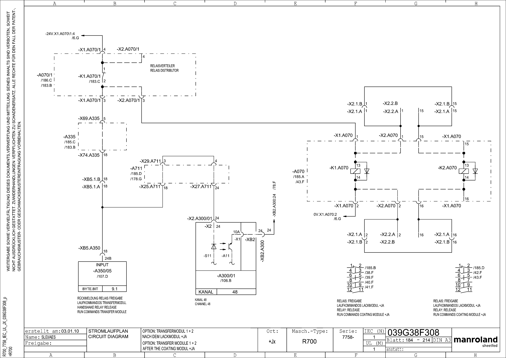

# +Jx — Sheet 184 of 214 — OPTION: TRANSFERMODUL 1 + 2

**NACH DEM LACKMODUL +JA**

> Part of the manroland **R700** printing press IEC/UL circuit diagrams.
> Drawing class: **Stromlaufplan / Circuit diagram** (DIN A3).
> Document `+Jx` covers the **1st printing module + feed register** machine section.

## At a glance

| Field | Value |
|---|---|
| Document | `+Jx`  (039G38F308) |
| Sheet | **184** of 214 |
| Section (DE) | OPTION: TRANSFERMODUL 1 + 2 |
| Section (EN) | NACH DEM LACKMODUL +JA |
| Section type | CIRCUIT — Circuit diagram |
| Machine type | `R700` |
| Series | `7758` |
| Created | 03.01.10 |
| Replaces | — |
| Columns used | A, B, C, D, E, F, G, H |
| Path numbers | — |
| Labels on sheet | 161 |
| Cross-refs out | 22 |
| Cross-refs in | 61 |

**Previous:** [+Jx sheet 183](SHEET_0183.md) · **Next:** [+Jx sheet 185](SHEET_0185.md) · **Document TOC:** [_TOC.md](_TOC.md)  (+Jx) · **Master TOC:** [all sheets](../_MASTER_TOC.md)

## Sheet image (300 DPI, exact vector render)



_Rendered directly from the PDF vector layer at 300 DPI (1-bit), no OCR and no resampling. Use it to confirm anything ambiguous in the text below._

## Cross-references on this sheet

Each entry is a wire leaving this sheet. The printed token is `/sheet.column`; the link resolves to that sheet inside the same document.

| Ref | Target sheet | Col | Path | Destination on target | Target section | From col |
|---|---|---|---|---|---|---|
| `/6.G` | [+Jx sheet 6](SHEET_0006.md) | G | — | 24V.X1.A070\1:4 | SPANNUNGSVERSORGUNG, SCHALTSCHRANKBELÜFTUNG | A |
| `/186.C` | [+Jx sheet 186](SHEET_0186.md) | C | — | — | OPTION: TRANSFERMODUL 1 + 2 | A |
| `/183.B` | [+Jx sheet 183](SHEET_0183.md) | B | — | — | OPTION: TRANSFERMODUL 1 + 2 | A |
| `/183.C` | [+Jx sheet 183](SHEET_0183.md) | C | — | — | OPTION: TRANSFERMODUL 1 + 2 | B |
| `/185.C` | [+Jx sheet 185](SHEET_0185.md) | C | — | — | OPTION: TRANSFERMODUL 1 + 2 | A |
| `/183.B` | [+Jx sheet 183](SHEET_0183.md) | B | — | — | OPTION: TRANSFERMODUL 1 + 2 | A |
| `/185.D` | [+Jx sheet 185](SHEET_0185.md) | D | — | — | OPTION: TRANSFERMODUL 1 + 2 | B |
| `/178.G` | [+Jx sheet 178](SHEET_0178.md) | G | — | — | OPTION: TRANSFERMODUL 1 NACH | B |
| `/185.A` | [+Jx sheet 185](SHEET_0185.md) | A | — | — | OPTION: TRANSFERMODUL 1 + 2 | E |
| `/43.F` | [+Jx sheet 43](SHEET_0043.md) | F | — | — | LAUFKOMMANDOS | E |
| `/78.F` | [+Jx sheet 78](SHEET_0078.md) | F | — | XB2.A300:24 | BUSVERBINDUNGEN: SICHERHEITSKREIS | E |
| `/6.G` | [+Jx sheet 6](SHEET_0006.md) | G | — | 0V.X1.A070:2 | SPANNUNGSVERSORGUNG, SCHALTSCHRANKBELÜFTUNG | F |
| `/185.B` | [+Jx sheet 185](SHEET_0185.md) | B | — | — | OPTION: TRANSFERMODUL 1 + 2 | F |
| `/38.F` | [+Jx sheet 38](SHEET_0038.md) | F | — | — | LAUFKOMMANDOS | F |
| `/39.F` | [+Jx sheet 39](SHEET_0039.md) | F | — | — | LAUFKOMMANDOS | F |
| `/40.F` | [+Jx sheet 40](SHEET_0040.md) | F | — | — | LAUFKOMMANDOS | F |
| `/41.F` | [+Jx sheet 41](SHEET_0041.md) | F | — | — | LAUFKOMMANDOS | F |
| `/185.D` | [+Jx sheet 185](SHEET_0185.md) | D | — | — | OPTION: TRANSFERMODUL 1 + 2 | H |
| `/42.F` | [+Jx sheet 42](SHEET_0042.md) | F | — | — | LAUFKOMMANDOS | H |
| `/43.F` | [+Jx sheet 43](SHEET_0043.md) | F | — | — | LAUFKOMMANDOS | H |
| `/107.D` | [+Jx sheet 107](SHEET_0107.md) | D | — | — | REFERENZMODUL | B |
| `/106.B` | [+Jx sheet 106](SHEET_0106.md) | B | — | — | REFERENZMODUL | D |

### Incoming references (sheets that point here)

Every other sheet that sends a wire to this one. `Back-ref` is the token printed on *that* sheet; `Path` is its line number.

| From sheet | Cols | Back-ref | Path | Refs | What continues there |
|---|---|---|---|---|---|
| [+Jx#6](SHEET_0006.md) | G, H | `/6.G`, `/6.H` | — | 2 | 0V.X1.A070:2 |
| [+Jx#38](SHEET_0038.md) | F | `/38.F` | — | 1 | — |
| [+Jx#39](SHEET_0039.md) | F | `/39.F` | — | 1 | — |
| [+Jx#40](SHEET_0040.md) | F | `/40.F` | — | 1 | — |
| [+Jx#41](SHEET_0041.md) | F | `/41.F` | — | 1 | — |
| [+Jx#42](SHEET_0042.md) | F | `/42.F` | — | 1 | — |
| [+Jx#43](SHEET_0043.md) | E, F | `/43.E`, `/43.F` | — | 2 | — |
| [+Jx#78](SHEET_0078.md) | E | `/78.E` | — | 1 | XB2.A300:24 |
| [+Jx#106](SHEET_0106.md) | B | `/106.B` | — | 1 | — |
| [+Jx#107](SHEET_0107.md) | D | `/107.D` | — | 1 | — |
| [+Jx#113](SHEET_0113.md) | A, C | `/113.A`, `/113.C` | — | 6 | — |
| [+Jx#122](SHEET_0122.md) | A, C | `/122.A`, `/122.C` | — | 16 | — |
| [+Jx#123](SHEET_0123.md) | C, E | `/123.C`, `/123.E` | — | 6 | — |
| [+Jx#124](SHEET_0124.md) | F, H | `/124.F`, `/124.H` | — | 2 | — |
| [+Jx#131](SHEET_0131.md) | A, B | `/131.A`, `/131.B` | — | 2 | — |
| [+Jx#132](SHEET_0132.md) | C | `/132.C` | — | 1 | — |
| [+Jx#143](SHEET_0143.md) | B | `/143.B` | — | 1 | — |
| [+Jx#144](SHEET_0144.md) | G | `/144.G` | — | 1 | — |
| [+Jx#147](SHEET_0147.md) | D | `/147.D` | — | 2 | — |
| [+Jx#152](SHEET_0152.md) | G | `/152.G` | — | 1 | — |
| [+Jx#154](SHEET_0154.md) | A | `/154.A` | — | 1 | — |
| [+Jx#178](SHEET_0178.md) | G | `/178.G` | — | 1 | — |
| [+Jx#183](SHEET_0183.md) | B, C | `/183.B`, `/183.C` | — | 3 | — |
| [+Jx#185](SHEET_0185.md) | A, B, C, D | `/185.A`, `/185.B`, `/185.C`, `/185.D` | — | 5 | — |
| [+Jx#186](SHEET_0186.md) | C | `/186.C` | — | 1 | — |


## Devices on this sheet

| Tag | Class | Class meaning (IEC) | Col | Sub | Terminal | Sign |
|---|---|---|---|---|---|---|
| `A335` | A | Baugruppe / assembly, module, PC board | A | — | — | — |
| `S11` | S | Schalter / switch | D | — | — | — |
| `A11` | A | Baugruppe / assembly, module, PC board | D | — | — | — |
| `X1` | X | Klemme / terminal, plug connector | D | — | — | — |
| `X2` | X | Klemme / terminal, plug connector | D | — | — | — |
| `XB2` | XB |  | D | — | — | — |
| `A300/01` | A | Baugruppe / assembly, module, PC board | D | 01 | — | — |
| `A711` | A | Baugruppe / assembly, module, PC board | B | — | — | — |
| `A070/1` | A | Baugruppe / assembly, module, PC board | A | 1 | — | — |
| `A070` | A | Baugruppe / assembly, module, PC board | E | — | — | — |
| `A350/05` | A | Baugruppe / assembly, module, PC board | B | 05 | — | — |
| `X69.A335` | — | cross-device reference | B | — | — | — |
| `X74.A335` | — | cross-device reference | B | — | — | — |
| `XB2.A300` | — | cross-device reference | D | — | — | — |
| `X29.A711` | — | cross-device reference | C | — | — | — |
| `X25.A711` | — | cross-device reference | C | — | — | — |
| `X27.A711` | — | cross-device reference | C | — | — | — |
| `XB5.1.B` | — | cross-device reference | B | — | — | — |
| `XB5.1.A` | — | cross-device reference | B | — | — | — |
| `X1.A070` | — | cross-device reference | F | — | — | — |
| `X1.A070` | — | cross-device reference | F | — | — | — |
| `X2.A070` | — | cross-device reference | G | — | — | — |
| `X2.A070` | — | cross-device reference | G | — | — | — |
| `K1.A070` | — | cross-device reference | F | — | — | — |
| `K2.A070` | — | cross-device reference | H | — | — | — |
| `X2.2.A` | — | cross-device reference | G | — | — | — |
| `9.1` | — | cross-device reference | B | — | — | — |
| `XB5.A350` | — | cross-device reference | B | — | — | — |
| `X2.2.A` | — | cross-device reference | G | — | — | — |
| `X2.1.A` | — | cross-device reference | G | — | — | — |
| `X2.1.B` | — | cross-device reference | G | — | — | — |
| `X2.1.A` | — | cross-device reference | F | — | — | — |
| `X2.1.B` | — | cross-device reference | F | — | — | — |
| `X2.1.A` | — | cross-device reference | G | — | — | — |
| `X2.1.B` | — | cross-device reference | G | — | — | — |
| `X2.1.A` | — | cross-device reference | F | — | — | — |
| `X2.1.B` | — | cross-device reference | F | — | — | — |
| `XB2.A300:24` | — | cross-device reference | E | — | 24 | — |
| `X1.A070` | — | cross-device reference | H | — | — | — |
| `X1.A070` | — | cross-device reference | H | — | — | — |
| `X2.2.B` | — | cross-device reference | G | — | — | — |
| `X2.2.B` | — | cross-device reference | G | — | — | — |

## Potentials / nets

| Potential | Count | Columns | Attached devices | Terminals |
|---|---|---|---|---|
| `0V` | 1 | F | `A070`, `X1` | `2` |
| `24V` | 1 | A | `A070\1`, `X1` | `4` |


A potential such as `L24+/4` or `M24+` is a named supply/return rail; every place it appears on this sheet is electrically common.

## Wire-end annotations (grouped as printed)

A wire that continues elsewhere is annotated with a small cluster: the destination description, the path/line number `#NN`, and the `/sheet.column` cross reference. Each row below is one such cluster exactly as it is grouped on the drawing.

| Col | Y | Path | Cross-ref | Text on the wire |
|---|---|---|---|---|
| A | 75.3 | — | `/6.G` | `24V.X1.A070\1:4` |
| B | 110.8 | — | — | `X2.A070/1` |
| B | 112.2 | — | — | `X1.A070/1 4` |
| B | 129.2 | — | — | `4` |
| C | 152.2 | — | — | `RELAISVERTEILER RELAIS DISTRIBUTOR` |
| B | 158.3 | — | — | `1` |
| A | 171.7 | — | — | `A070/1` |
| B | 174.6 | — | — | `K1.A070/1 2` |
| A | 184.8 | — | `/186.C`, `/183.B` | — |
| B | 187.7 | — | `/183.C` | — |
| B | 231.3 | — | — | `X1.A070/1 3` |
| B | 231.3 | — | — | `X2.A070/1 3` |
| G | 238.4 | — | — | `X2.2.B` |
| F | 239.8 | — | — | `X2.1.B 1` |
| G | 239.8 | — | — | `X2.1.B 15` |
| F | 256.8 | — | — | `X2.1.A 1` |
| G | 256.8 | — | — | `X2.2.A 1 15` |
| G | 256.8 | — | — | `X2.1.A 15` |
| B | 273.8 | — | — | `X69.A335 5` |
| F | 313.5 | — | — | `X1.A070 1` |
| G | 313.5 | — | — | `X2.A070 1` |
| H | 316.3 | — | — | `X1.A070` |
| A | 317.0 | — | — | `A335` |
| G | 317.8 | — | — | `15` |
| A | 330.1 | — | `/185.C`, `/183.B` | — |
| H | 334.8 | — | — | `15` |
| B | 360.2 | — | — | `X74.A335 18` |
| C | 374.4 | — | — | `X29.A711 3` |
| D | 374.4 | — | — | `4` |
| F | 385.1 | — | — | `13` |
| H | 385.1 | — | — | `13` |
| F | 390.0 | — | — | `K1.A070` |
| H | 390.0 | — | — | `K2.A070` |
| B | 391.4 | — | — | `A711` |
| E | 398.5 | — | — | `A070` |
| B | 404.5 | — | `/185.D`, `/178.G` | — |
| E | 411.6 | — | `/185.A` | — |
| F | 413.4 | — | — | `14` |
| H | 413.4 | — | — | `14` |
| B | 416.9 | — | — | `XB5.1.B 18` |
| E | 424.0 | — | `/43.F` | — |
| E | 425.6 | — | `/78.F` | `XB2.A300:24` |
| C | 433.9 | — | — | `X25.A711 18` |
| C | 433.9 | — | — | `X27.A711 24` |
| B | 434.0 | — | — | `XB5.1.A 18` |
| H | 463.7 | — | — | `16` |
| F | 479.3 | — | — | `X1.A070 2` |
| G | 479.3 | — | — | `X2.A070 2` |
| H | 479.3 | — | — | `X1.A070` |
| G | 480.7 | — | — | `16` |
| F | 500.5 | — | `/6.G` | `0V.X1.A070:2` |
| C | 509.1 | — | — | `X2.A300/01 24` |
| D | 527.5 | — | — | `X2` |
| D | 528.9 | — | — | `24 24` |
| E | 537.4 | — | — | `24` |
| D | 541.6 | — | — | `10A` |
| F | 546.6 | — | — | `X2.1.A 2` |
| G | 546.6 | — | — | `X2.2.A 2 16` |
| G | 546.6 | — | — | `X2.1.A 16` |
| D | 558.7 | — | — | `X1` |
| D | 558.7 | — | — | `XB2` |
| F | 564.4 | — | — | `X2.1.B 2` |
| G | 564.4 | — | — | `X2.2.B` |
| G | 564.4 | — | — | `X2.1.B 16` |
| D | 565.0 | — | — | `XB2.A300` |
| B | 578.5 | — | — | `XB5.A350 18` |
| D | 597.6 | — | — | `S11 A11` |
| B | 604.0 | — | — | `24B` |
| B | 618.5 | — | — | `INPUT` |
| F | 619.6 | — | — | `1 2` |
| H | 619.6 | — | — | `1 2` |
| F | 626.0 | — | `/185.B`, `/38.F`, `/39.F`, `/40.F`, `/41.F` | — |
| H | 626.0 | — | `/185.D`, `/42.F`, `/43.F` | — |
| F | 630.9 | — | — | `4 6 3 5` |
| H | 630.9 | — | — | `4 6 3 5` |
| B | 632.4 | — | — | `A350/05` |
| D | 643.7 | — | — | `A300/01` |
| B | 646.2 | — | `/107.D` | — |
| F | 653.6 | — | — | `8` |
| F | 653.6 | — | — | `7` |
| H | 653.6 | — | — | `8` |
| H | 653.6 | — | — | `7` |
| D | 656.1 | — | `/106.B` | — |
| F | 664.9 | — | — | `10 12 11 9` |
| H | 664.9 | — | — | `10 12 11 9` |
| B | 675.2 | — | — | `BYTE.BIT 9.1` |
| D | 681.9 | — | — | `KANAL 48` |
| B | 698.6 | — | — | `RÜCKMELDUNG RELAIS FREIGABE LAUFKOMMANDOS TRANSFERMODUL HANDSHAKE RELAY RELEASE RUN COMMANDS TRANSFER MODULE` |
| C | 702.3 | — | — | `KANAL 48 CHANNEL 48` |
| F | 705.0 | — | — | `RELAIS: FREIGABE LAUFKOMMANDOS LACKMODUL +JA RELAY: RELEASE RUN COMMANDS COATING MODULE +JA` |
| H | 705.0 | — | — | `RELAIS: FREIGABE LAUFKOMMANDOS LACKMODUL +JA RELAY: RELEASE RUN COMMANDS COATING MODULE +JA` |


## Reconstructed tables

This sheet carries tabular content (pin map / terminal assignment / index). The grid below was rebuilt from the drawing's own rule lines, so each row is exactly one physical row of the table.

### Table 1 — 9 data rows × 10 columns (at x=184.3, y=147.4)

| K1.A070/1 /183.C | 1 2 |  | RELAISVERTEILER RELAIS | DISTRIBUTOR |  |  |  |  |  |
|---|---|---|---|---|---|---|---|---|---|
| `X1.A070/1 X69.A335` | `3 5` | `X2.A070/1` | `3` |  |  |  |  |  |  |
| `X74.A335` | `18` |  |  |  |  |  |  |  |  |
| `XB5.1.B XB5.1.A` | `18 18` | `A711 /185.D /178.G` | `X29.A711 X25.A711` | `3 18` | `X27.A711` | `4 24` |  |  |  |
|  |  |  |  |  | `X2.A300/01` | `24` |  |  |  |
| `XB5.A350` | `18 24B` |  |  |  | `X2 S11` | `24 A11` | `10A X1` | `XB2` | `24 24 XB2.A300` |
| `INPUT` |  |  |  |  |  |  |  |  |  |
|  | `A350/05 /107.D` |  |  |  |  | `A300/01 /106.B` |  |  |  |
| `BYTE.BIT` | `9.1` |  |  |  |  |  |  |  |  |
|  |  |  |  |  | `KANAL` |  | `48` |  |  |


### Table 2 — 4 data rows × 8 columns (at x=836.2, y=204.1)

|  | 1 1 | X2.2.B X2.2.A |  | 1 | X2.1.B 15 X2.1.A | 15 15 |  |
|---|---|---|---|---|---|---|---|
| `1` |  | `X2.A070` |  | `1` | `X1.A070 15` |  | `15` |
| `13 14` |  |  |  |  | `K2.A070` |  | `13 14` |
| `2` |  | `X2.A070` | `2` |  | `X1.A070 16` |  | `16` |
|  | `2 2` | `X2.2.A X2.2.B` | `2` |  | `X2.1.A 16 X2.1.B` | `16 16` |  |


## Notes and free text on this sheet

| Text | Col | Y (pt) |
|---|---|---|
| `KANAL 48` | C | 702.31 |
| `CHANNEL 48` | C | 712.26 |
| `10A` | D | 541.65 |
| `KANAL` | D | 681.96 |
| `X2.A300/01` | C | 509.06 |
| `RELAISVERTEILER` | C | 152.22 |
| `RELAIS DISTRIBUTOR` | C | 162.86 |
| `X1.A070/1` | B | 112.21 |
| `X2.A070/1` | B | 231.27 |
| `K1.A070/1` | B | 174.58 |
| `RELAIS: FREIGABE` | F | 704.96 |
| `LAUFKOMMANDOS LACKMODUL +JA` | F | 715.64 |
| `RELAY: RELEASE` | F | 726.23 |
| `RUN COMMANDS COATING MODULE +JA` | F | 736.91 |
| `RELAIS: FREIGABE` | G | 704.96 |
| `LAUFKOMMANDOS LACKMODUL +JA` | H | 715.64 |
| `RELAY: RELEASE` | G | 726.23 |
| `RUN COMMANDS COATING MODULE +JA` | H | 736.91 |
| `24B` | B | 604.01 |
| `INPUT` | B | 618.53 |
| `BYTE.BIT` | B | 675.79 |
| `RÜCKMELDUNG RELAIS FREIGABE` | B | 698.62 |
| `LAUFKOMMANDOS TRANSFERMODUL` | B | 709.27 |
| `HANDSHAKE RELAY RELEASE` | B | 719.87 |
| `RUN COMMANDS TRANSFER MODULE` | B | 730.54 |

## Complete label inventory (exact text from the drawing)

Every text object inside the drawing area of this sheet, in DIN reading order (column A→H, then top→bottom). This is the authoritative list: if a string is not here it is not printed on this sheet.

| Col | Y | X | Dir | Type | Text |
|---|---|---|---|---|---|
| A | 75.3 | 106.6 | → | potential | `24V.X1.A070\1:4` |
| A | 85.2 | 169.2 | → | cross-reference | `/6.G` |
| A | 171.7 | 86.7 | → | device tag | `A070/1` |
| A | 184.8 | 96.4 | → | cross-reference | `/186.C` |
| A | 197.2 | 96.7 | → | cross-reference | `/183.B` |
| A | 317.0 | 149.1 | → | device tag | `A335` |
| A | 330.1 | 151.7 | → | cross-reference | `/185.C` |
| A | 342.5 | 151.9 | → | cross-reference | `/183.B` |
| B | 110.8 | 275.0 | → | text | `X2.A070/1` |
| B | 112.2 | 184.3 | → | text | `X1.A070/1` |
| B | 112.2 | 243.8 | → | number | `4` |
| B | 129.2 | 335.9 | → | number | `4` |
| B | 158.3 | 242.9 | → | number | `1` |
| B | 174.6 | 184.3 | → | text | `K1.A070/1` |
| B | 186.6 | 243.8 | → | number | `2` |
| B | 187.7 | 209.8 | → | cross-reference | `/183.C` |
| B | 231.3 | 184.3 | → | text | `X1.A070/1` |
| B | 231.3 | 276.4 | → | text | `X2.A070/1` |
| B | 232.7 | 243.5 | → | number | `3` |
| B | 232.7 | 335.6 | → | number | `3` |
| B | 273.8 | 184.0 | → | device ref | `X69.A335` |
| B | 275.2 | 243.5 | → | number | `5` |
| B | 360.2 | 184.0 | → | device ref | `X74.A335` |
| B | 360.3 | 242.9 | → | number | `18` |
| B | 391.4 | 306.7 | → | device tag | `A711` |
| B | 404.5 | 307.6 | → | cross-reference | `/185.D` |
| B | 416.9 | 307.0 | → | cross-reference | `/178.G` |
| B | 417.0 | 193.6 | → | device ref | `XB5.1.B` |
| B | 417.0 | 242.9 | → | number | `18` |
| B | 434.0 | 242.9 | → | number | `18` |
| B | 434.7 | 193.0 | → | device ref | `XB5.1.A` |
| B | 578.5 | 184.5 | → | device ref | `XB5.A350` |
| B | 587.0 | 242.9 | → | number | `18` |
| B | 604.0 | 246.6 | → | text | `24B` |
| B | 618.5 | 226.1 | → | text | `INPUT` |
| B | 632.4 | 219.4 | → | device tag | `A350/05` |
| B | 646.2 | 228.2 | → | cross-reference | `/107.D` |
| B | 675.2 | 263.2 | → | device ref | `9.1` |
| B | 675.8 | 194.2 | → | text | `BYTE.BIT` |
| B | 698.6 | 182.3 | → | text | `RÜCKMELDUNG RELAIS FREIGABE` |
| B | 709.3 | 182.3 | → | text | `LAUFKOMMANDOS TRANSFERMODUL` |
| B | 719.9 | 182.3 | → | text | `HANDSHAKE RELAY RELEASE` |
| B | 730.5 | 182.3 | → | text | `RUN COMMANDS TRANSFER MODULE` |
| C | 152.2 | 353.8 | → | text | `RELAISVERTEILER` |
| C | 162.9 | 353.8 | → | text | `RELAIS DISTRIBUTOR` |
| C | 374.4 | 328.8 | → | device ref | `X29.A711` |
| C | 374.4 | 385.2 | → | number | `3` |
| C | 433.9 | 327.4 | → | device ref | `X25.A711` |
| C | 433.9 | 447.9 | → | device ref | `X27.A711` |
| C | 438.2 | 384.7 | → | number | `18` |
| C | 509.1 | 440.5 | → | text | `X2.A300/01` |
| C | 702.3 | 458.6 | → | text | `KANAL 48` |
| C | 712.3 | 458.9 | → | text | `CHANNEL 48` |
| D | 374.4 | 506.0 | → | number | `4` |
| D | 438.2 | 506.0 | → | number | `24` |
| D | 509.1 | 506.0 | → | number | `24` |
| D | 527.5 | 481.6 | → | device tag | `X2` |
| D | 528.9 | 508.8 | → | number | `24` |
| D | 538.9 | 608.0 | → | number | `24` |
| D | 541.6 | 548.5 | → | text | `10A` |
| D | 558.7 | 551.9 | → | device tag | `X1` |
| D | 558.7 | 576.6 | → | device tag | `XB2` |
| D | 564.9 | 612.5 | ↕ | device ref | `XB2.A300` |
| D | 597.6 | 479.1 | → | device tag | `S11` |
| D | 597.6 | 521.6 | → | device tag | `A11` |
| D | 643.7 | 510.8 | → | device tag | `A300/01` |
| D | 656.1 | 518.9 | → | cross-reference | `/106.B` |
| D | 681.9 | 547.1 | → | number | `48` |
| D | 682.0 | 467.1 | → | text | `KANAL` |
| E | 398.5 | 688.0 | → | device tag | `A070` |
| E | 411.6 | 690.2 | → | cross-reference | `/185.A` |
| E | 424.0 | 695.9 | → | cross-reference | `/43.F` |
| E | 425.6 | 641.5 | ↕ | cross-reference | `/78.F` |
| E | 455.8 | 641.6 | ↕ | device ref | `XB2.A300:24` |
| E | 537.4 | 628.4 | → | number | `24` |
| F | 239.8 | 817.2 | → | device ref | `X2.1.B` |
| F | 239.8 | 859.5 | → | number | `1` |
| F | 256.8 | 859.5 | → | number | `1` |
| F | 257.5 | 816.7 | → | device ref | `X2.1.A` |
| F | 313.5 | 785.5 | → | device ref | `X1.A070` |
| F | 317.7 | 838.2 | → | number | `1` |
| F | 385.1 | 838.2 | → | number | `13` |
| F | 390.0 | 775.6 | → | device ref | `K1.A070` |
| F | 413.4 | 838.2 | → | number | `14` |
| F | 479.3 | 786.9 | → | device ref | `X1.A070` |
| F | 480.7 | 839.1 | → | number | `2` |
| F | 500.5 | 738.1 | → | potential | `0V.X1.A070:2` |
| F | 510.4 | 785.8 | → | cross-reference | `/6.G` |
| F | 546.6 | 816.7 | → | device ref | `X2.1.A` |
| F | 548.8 | 860.3 | → | number | `2` |
| F | 564.4 | 817.2 | → | device ref | `X2.1.B` |
| F | 565.8 | 860.3 | → | number | `2` |
| F | 619.6 | 823.7 | → | number | `1` |
| F | 619.6 | 844.4 | → | number | `2` |
| F | 626.0 | 858.9 | → | cross-reference | `/185.B` |
| F | 630.9 | 822.0 | → | number | `4` |
| F | 630.9 | 844.4 | → | number | `3` |
| F | 637.3 | 858.9 | → | cross-reference | `/38.F` |
| F | 642.2 | 822.0 | → | number | `6` |
| F | 642.2 | 844.4 | → | number | `5` |
| F | 648.6 | 858.9 | → | cross-reference | `/39.F` |
| F | 653.6 | 822.3 | → | number | `8` |
| F | 653.6 | 844.4 | → | number | `7` |
| F | 660.0 | 858.9 | → | cross-reference | `/40.F` |
| F | 664.9 | 816.4 | → | number | `10` |
| F | 664.9 | 844.4 | → | number | `9` |
| F | 671.3 | 858.9 | → | cross-reference | `/41.F` |
| F | 676.3 | 816.4 | → | number | `12` |
| F | 676.3 | 843.6 | → | number | `11` |
| F | 705.0 | 793.1 | → | text | `RELAIS: FREIGABE` |
| F | 715.6 | 793.1 | → | text | `LAUFKOMMANDOS LACKMODUL +JA` |
| F | 726.2 | 793.1 | → | text | `RELAY: RELEASE` |
| F | 736.9 | 793.1 | → | text | `RUN COMMANDS COATING MODULE +JA` |
| G | 238.4 | 900.9 | → | device ref | `X2.2.B` |
| G | 239.8 | 1022.7 | → | device ref | `X2.1.B` |
| G | 256.8 | 944.5 | → | number | `1` |
| G | 256.8 | 987.0 | → | number | `15` |
| G | 257.5 | 901.7 | → | device ref | `X2.2.A` |
| G | 257.5 | 1022.2 | → | device ref | `X2.1.A` |
| G | 313.5 | 891.8 | → | device ref | `X2.A070` |
| G | 317.7 | 944.5 | → | number | `1` |
| G | 317.7 | 987.0 | → | number | `15` |
| G | 479.3 | 886.1 | → | device ref | `X2.A070` |
| G | 480.7 | 938.3 | → | number | `2` |
| G | 480.7 | 987.0 | → | number | `16` |
| G | 546.6 | 894.6 | → | device ref | `X2.2.A` |
| G | 546.6 | 1022.2 | → | device ref | `X2.1.A` |
| G | 548.8 | 938.3 | → | number | `2` |
| G | 548.8 | 987.0 | → | number | `16` |
| G | 564.4 | 893.8 | → | device ref | `X2.2.B` |
| G | 564.4 | 1022.7 | → | device ref | `X2.1.B` |
| G | 705.0 | 1019.9 | → | text | `RELAIS: FREIGABE` |
| G | 726.2 | 1019.9 | → | text | `RELAY: RELEASE` |
| H | 239.8 | 1065.0 | → | number | `15` |
| H | 256.8 | 1065.0 | → | number | `15` |
| H | 316.3 | 1040.6 | → | device ref | `X1.A070` |
| H | 334.8 | 1093.3 | → | number | `15` |
| H | 385.1 | 1093.3 | → | number | `13` |
| H | 390.0 | 1030.7 | → | device ref | `K2.A070` |
| H | 413.4 | 1093.3 | → | number | `14` |
| H | 463.7 | 1093.3 | → | number | `16` |
| H | 479.3 | 1040.6 | → | device ref | `X1.A070` |
| H | 548.8 | 1065.0 | → | number | `16` |
| H | 565.8 | 1065.0 | → | number | `16` |
| H | 619.6 | 1078.9 | → | number | `1` |
| H | 619.6 | 1099.6 | → | number | `2` |
| H | 626.0 | 1114.0 | → | cross-reference | `/185.D` |
| H | 630.9 | 1077.2 | → | number | `4` |
| H | 630.9 | 1099.6 | → | number | `3` |
| H | 637.3 | 1114.0 | → | cross-reference | `/42.F` |
| H | 642.2 | 1077.2 | → | number | `6` |
| H | 642.2 | 1099.6 | → | number | `5` |
| H | 648.6 | 1114.0 | → | cross-reference | `/43.F` |
| H | 653.6 | 1077.4 | → | number | `8` |
| H | 653.6 | 1099.6 | → | number | `7` |
| H | 664.9 | 1071.5 | → | number | `10` |
| H | 664.9 | 1099.6 | → | number | `9` |
| H | 676.3 | 1071.5 | → | number | `12` |
| H | 676.3 | 1098.7 | → | number | `11` |
| H | 715.6 | 1019.9 | → | text | `LAUFKOMMANDOS LACKMODUL +JA` |
| H | 736.9 | 1019.9 | → | text | `RUN COMMANDS COATING MODULE +JA` |

## Reading-order text block

The same content as a plain block, grouped by DIN column — convenient to paste or to match against a visual description.

```text
=== Column A ===
  75.3  106.6  net          24V.X1.A070\1:4
  85.2  169.2  xref         /6.G
 171.7   86.7  devtag       A070/1
 184.8   96.4  xref         /186.C
 197.2   96.7  xref         /183.B
 317.0  149.1  devtag       A335
 330.1  151.7  xref         /185.C
 342.5  151.9  xref         /183.B
=== Column B ===
 110.8  275.0  text         X2.A070/1
 112.2  184.3  text         X1.A070/1
 112.2  243.8  numeric      4
 129.2  335.9  numeric      4
 158.3  242.9  numeric      1
 174.6  184.3  text         K1.A070/1
 186.6  243.8  numeric      2
 187.7  209.8  xref         /183.C
 231.3  184.3  text         X1.A070/1
 231.3  276.4  text         X2.A070/1
 232.7  243.5  numeric      3
 232.7  335.6  numeric      3
 273.8  184.0  devref       X69.A335
 275.2  243.5  numeric      5
 360.2  184.0  devref       X74.A335
 360.3  242.9  numeric      18
 391.4  306.7  devtag       A711
 404.5  307.6  xref         /185.D
 416.9  307.0  xref         /178.G
 417.0  193.6  devref       XB5.1.B
 417.0  242.9  numeric      18
 434.0  242.9  numeric      18
 434.7  193.0  devref       XB5.1.A
 578.5  184.5  devref       XB5.A350
 587.0  242.9  numeric      18
 604.0  246.6  text         24B
 618.5  226.1  text         INPUT
 632.4  219.4  devtag       A350/05
 646.2  228.2  xref         /107.D
 675.2  263.2  devref       9.1
 675.8  194.2  text         BYTE.BIT
 698.6  182.3  text         RÜCKMELDUNG RELAIS FREIGABE
 709.3  182.3  text         LAUFKOMMANDOS TRANSFERMODUL
 719.9  182.3  text         HANDSHAKE RELAY RELEASE
 730.5  182.3  text         RUN COMMANDS TRANSFER MODULE
=== Column C ===
 152.2  353.8  text         RELAISVERTEILER
 162.9  353.8  text         RELAIS DISTRIBUTOR
 374.4  328.8  devref       X29.A711
 374.4  385.2  numeric      3
 433.9  327.4  devref       X25.A711
 433.9  447.9  devref       X27.A711
 438.2  384.7  numeric      18
 509.1  440.5  text         X2.A300/01
 702.3  458.6  text         KANAL 48
 712.3  458.9  text         CHANNEL 48
=== Column D ===
 374.4  506.0  numeric      4
 438.2  506.0  numeric      24
 509.1  506.0  numeric      24
 527.5  481.6  devtag       X2
 528.9  508.8  numeric      24
 538.9  608.0  numeric      24
 541.6  548.5  text         10A
 558.7  551.9  devtag       X1
 558.7  576.6  devtag       XB2
 564.9  612.5  devref       XB2.A300
 597.6  479.1  devtag       S11
 597.6  521.6  devtag       A11
 643.7  510.8  devtag       A300/01
 656.1  518.9  xref         /106.B
 681.9  547.1  numeric      48
 682.0  467.1  text         KANAL
=== Column E ===
 398.5  688.0  devtag       A070
 411.6  690.2  xref         /185.A
 424.0  695.9  xref         /43.F
 425.6  641.5  xref         /78.F
 455.8  641.6  devref       XB2.A300:24
 537.4  628.4  numeric      24
=== Column F ===
 239.8  817.2  devref       X2.1.B
 239.8  859.5  numeric      1
 256.8  859.5  numeric      1
 257.5  816.7  devref       X2.1.A
 313.5  785.5  devref       X1.A070
 317.7  838.2  numeric      1
 385.1  838.2  numeric      13
 390.0  775.6  devref       K1.A070
 413.4  838.2  numeric      14
 479.3  786.9  devref       X1.A070
 480.7  839.1  numeric      2
 500.5  738.1  net          0V.X1.A070:2
 510.4  785.8  xref         /6.G
 546.6  816.7  devref       X2.1.A
 548.8  860.3  numeric      2
 564.4  817.2  devref       X2.1.B
 565.8  860.3  numeric      2
 619.6  823.7  numeric      1
 619.6  844.4  numeric      2
 626.0  858.9  xref         /185.B
 630.9  822.0  numeric      4
 630.9  844.4  numeric      3
 637.3  858.9  xref         /38.F
 642.2  822.0  numeric      6
 642.2  844.4  numeric      5
 648.6  858.9  xref         /39.F
 653.6  822.3  numeric      8
 653.6  844.4  numeric      7
 660.0  858.9  xref         /40.F
 664.9  816.4  numeric      10
 664.9  844.4  numeric      9
 671.3  858.9  xref         /41.F
 676.3  816.4  numeric      12
 676.3  843.6  numeric      11
 705.0  793.1  text         RELAIS: FREIGABE
 715.6  793.1  text         LAUFKOMMANDOS LACKMODUL +JA
 726.2  793.1  text         RELAY: RELEASE
 736.9  793.1  text         RUN COMMANDS COATING MODULE +JA
=== Column G ===
 238.4  900.9  devref       X2.2.B
 239.8 1022.7  devref       X2.1.B
 256.8  944.5  numeric      1
 256.8  987.0  numeric      15
 257.5  901.7  devref       X2.2.A
 257.5 1022.2  devref       X2.1.A
 313.5  891.8  devref       X2.A070
 317.7  944.5  numeric      1
 317.7  987.0  numeric      15
 479.3  886.1  devref       X2.A070
 480.7  938.3  numeric      2
 480.7  987.0  numeric      16
 546.6  894.6  devref       X2.2.A
 546.6 1022.2  devref       X2.1.A
 548.8  938.3  numeric      2
 548.8  987.0  numeric      16
 564.4  893.8  devref       X2.2.B
 564.4 1022.7  devref       X2.1.B
 705.0 1019.9  text         RELAIS: FREIGABE
 726.2 1019.9  text         RELAY: RELEASE
=== Column H ===
 239.8 1065.0  numeric      15
 256.8 1065.0  numeric      15
 316.3 1040.6  devref       X1.A070
 334.8 1093.3  numeric      15
 385.1 1093.3  numeric      13
 390.0 1030.7  devref       K2.A070
 413.4 1093.3  numeric      14
 463.7 1093.3  numeric      16
 479.3 1040.6  devref       X1.A070
 548.8 1065.0  numeric      16
 565.8 1065.0  numeric      16
 619.6 1078.9  numeric      1
 619.6 1099.6  numeric      2
 626.0 1114.0  xref         /185.D
 630.9 1077.2  numeric      4
 630.9 1099.6  numeric      3
 637.3 1114.0  xref         /42.F
 642.2 1077.2  numeric      6
 642.2 1099.6  numeric      5
 648.6 1114.0  xref         /43.F
 653.6 1077.4  numeric      8
 653.6 1099.6  numeric      7
 664.9 1071.5  numeric      10
 664.9 1099.6  numeric      9
 676.3 1071.5  numeric      12
 676.3 1098.7  numeric      11
 715.6 1019.9  text         LAUFKOMMANDOS LACKMODUL +JA
 736.9 1019.9  text         RUN COMMANDS COATING MODULE +JA
```

---
_Generated from the PDF vector text layer; no OCR. Source: `R700_7758_IEC_UL_JX_039G38F308_p`, sheet 184._
