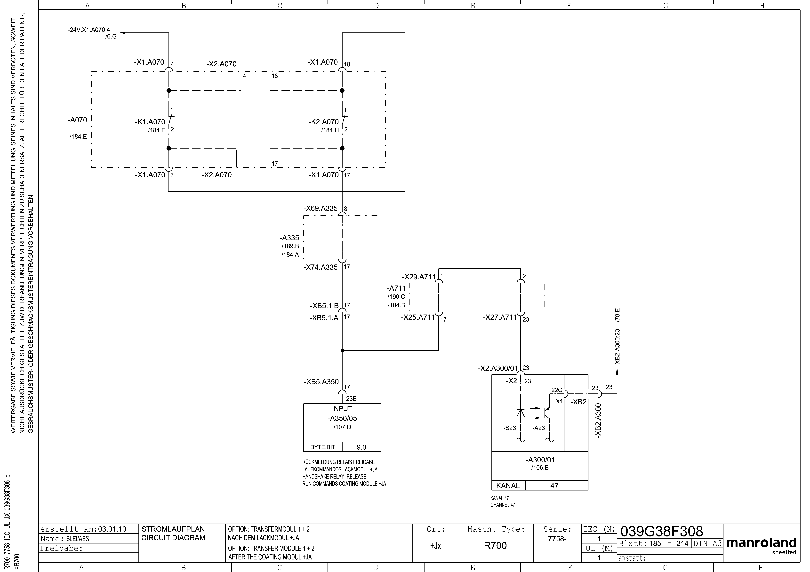

# +Jx — Sheet 185 of 214 — OPTION: TRANSFERMODUL 1 + 2

**NACH DEM LACKMODUL +JA**

> Part of the manroland **R700** printing press IEC/UL circuit diagrams.
> Drawing class: **Stromlaufplan / Circuit diagram** (DIN A3).
> Document `+Jx` covers the **1st printing module + feed register** machine section.

## At a glance

| Field | Value |
|---|---|
| Document | `+Jx`  (039G38F308) |
| Sheet | **185** of 214 |
| Section (DE) | OPTION: TRANSFERMODUL 1 + 2 |
| Section (EN) | NACH DEM LACKMODUL +JA |
| Section type | CIRCUIT — Circuit diagram |
| Machine type | `R700` |
| Series | `7758` |
| Created | 03.01.10 |
| Replaces | — |
| Columns used | A, B, C, D, E, F, G |
| Path numbers | — |
| Labels on sheet | 78 |
| Cross-refs out | 11 |
| Cross-refs in | 30 |

**Previous:** [+Jx sheet 184](SHEET_0184.md) · **Next:** [+Jx sheet 186](SHEET_0186.md) · **Document TOC:** [_TOC.md](_TOC.md)  (+Jx) · **Master TOC:** [all sheets](../_MASTER_TOC.md)

## Sheet image (300 DPI, exact vector render)



_Rendered directly from the PDF vector layer at 300 DPI (1-bit), no OCR and no resampling. Use it to confirm anything ambiguous in the text below._

## Cross-references on this sheet

Each entry is a wire leaving this sheet. The printed token is `/sheet.column`; the link resolves to that sheet inside the same document.

| Ref | Target sheet | Col | Path | Destination on target | Target section | From col |
|---|---|---|---|---|---|---|
| `/6.G` | [+Jx sheet 6](SHEET_0006.md) | G | — | 24V.X1.A070:4 | SPANNUNGSVERSORGUNG, SCHALTSCHRANKBELÜFTUNG | A |
| `/184.F` | [+Jx sheet 184](SHEET_0184.md) | F | — | — | OPTION: TRANSFERMODUL 1 + 2 | B |
| `/184.H` | [+Jx sheet 184](SHEET_0184.md) | H | — | — | OPTION: TRANSFERMODUL 1 + 2 | D |
| `/184.E` | [+Jx sheet 184](SHEET_0184.md) | E | — | — | OPTION: TRANSFERMODUL 1 + 2 | A |
| `/189.B` | [+Jx sheet 189](SHEET_0189.md) | B | — | — | OPTION: ZWISCHENTROCKNER, VORBEREITUNG | C |
| `/184.A` | [+Jx sheet 184](SHEET_0184.md) | A | — | — | OPTION: TRANSFERMODUL 1 + 2 | C |
| `/190.C` | [+Jx sheet 190](SHEET_0190.md) | C | — | — | OPTION: ZWISCHENTROCKNER, VORBEREITUNG | D |
| `/184.B` | [+Jx sheet 184](SHEET_0184.md) | B | — | — | OPTION: TRANSFERMODUL 1 + 2 | D |
| `/78.E` | [+Jx sheet 78](SHEET_0078.md) | E | — | XB2.A300:23 | BUSVERBINDUNGEN: SICHERHEITSKREIS | G |
| `/107.D` | [+Jx sheet 107](SHEET_0107.md) | D | — | — | REFERENZMODUL | D |
| `/106.B` | [+Jx sheet 106](SHEET_0106.md) | B | — | — | REFERENZMODUL | F |

### Incoming references (sheets that point here)

Every other sheet that sends a wire to this one. `Back-ref` is the token printed on *that* sheet; `Path` is its line number.

| From sheet | Cols | Back-ref | Path | Refs | What continues there |
|---|---|---|---|---|---|
| [+Jx#6](SHEET_0006.md) | G | `/6.G` | — | 1 | — |
| [+Jx#78](SHEET_0078.md) | E | `/78.E` | — | 1 | XB2.A300:23 |
| [+Jx#106](SHEET_0106.md) | B | `/106.B` | — | 1 | — |
| [+Jx#107](SHEET_0107.md) | D | `/107.D` | — | 1 | — |
| [+Jx#113](SHEET_0113.md) | A, B | `/113.A`, `/113.B` | — | 4 | — |
| [+Jx#123](SHEET_0123.md) | C, D | `/123.C`, `/123.D` | — | 4 | — |
| [+Jx#124](SHEET_0124.md) | F, H | `/124.F`, `/124.H` | — | 2 | — |
| [+Jx#131](SHEET_0131.md) | A, B | `/131.A`, `/131.B` | — | 2 | — |
| [+Jx#132](SHEET_0132.md) | C | `/132.C` | — | 1 | — |
| [+Jx#143](SHEET_0143.md) | B | `/143.B` | — | 1 | — |
| [+Jx#144](SHEET_0144.md) | G | `/144.G` | — | 1 | — |
| [+Jx#147](SHEET_0147.md) | D | `/147.D` | — | 2 | — |
| [+Jx#152](SHEET_0152.md) | G | `/152.G` | — | 1 | — |
| [+Jx#154](SHEET_0154.md) | A | `/154.A` | — | 1 | — |
| [+Jx#184](SHEET_0184.md) | A, B, E, F, H | `/184.A`, `/184.B`, `/184.E`, `/184.F`, `/184.H` | — | 5 | — |
| [+Jx#189](SHEET_0189.md) | B | `/189.B` | — | 1 | — |
| [+Jx#190](SHEET_0190.md) | B | `/190.B` | — | 1 | — |


## Devices on this sheet

| Tag | Class | Class meaning (IEC) | Col | Sub | Terminal | Sign |
|---|---|---|---|---|---|---|
| `A070` | A | Baugruppe / assembly, module, PC board | A | — | — | — |
| `A350/05` | A | Baugruppe / assembly, module, PC board | D | 05 | — | — |
| `A335` | A | Baugruppe / assembly, module, PC board | C | — | — | — |
| `S23` | S | Schalter / switch | E | — | — | — |
| `A23` | A | Baugruppe / assembly, module, PC board | F | — | — | — |
| `X1` | X | Klemme / terminal, plug connector | F | — | — | — |
| `X2` | X | Klemme / terminal, plug connector | E | — | — | — |
| `XB2` | XB |  | F | — | — | — |
| `A300/01` | A | Baugruppe / assembly, module, PC board | F | 01 | — | — |
| `A711` | A | Baugruppe / assembly, module, PC board | D | — | — | — |
| `X1.A070` | — | cross-device reference | B | — | — | — |
| `X1.A070` | — | cross-device reference | B | — | — | — |
| `X1.A070` | — | cross-device reference | C | — | — | — |
| `X1.A070` | — | cross-device reference | C | — | — | — |
| `K1.A070` | — | cross-device reference | B | — | — | — |
| `K2.A070` | — | cross-device reference | C | — | — | — |
| `9.0` | — | cross-device reference | D | — | — | — |
| `XB5.A350` | — | cross-device reference | C | — | — | — |
| `X69.A335` | — | cross-device reference | C | — | — | — |
| `X74.A335` | — | cross-device reference | C | — | — | — |
| `XB2.A300` | — | cross-device reference | F | — | — | — |
| `X29.A711` | — | cross-device reference | D | — | — | — |
| `X25.A711` | — | cross-device reference | D | — | — | — |
| `X27.A711` | — | cross-device reference | E | — | — | — |
| `XB5.1.B` | — | cross-device reference | C | — | — | — |
| `XB5.1.A` | — | cross-device reference | C | — | — | — |
| `XB2.A300:23` | — | cross-device reference | G | — | 23 | — |
| `X2.A070` | — | cross-device reference | B | — | — | — |
| `X2.A070` | — | cross-device reference | B | — | — | — |

## Potentials / nets

| Potential | Count | Columns | Attached devices | Terminals |
|---|---|---|---|---|
| `24V` | 1 | A | `A070`, `X1` | `4` |


A potential such as `L24+/4` or `M24+` is a named supply/return rail; every place it appears on this sheet is electrically common.

## Wire-end annotations (grouped as printed)

A wire that continues elsewhere is annotated with a small cluster: the destination description, the path/line number `#NN`, and the `/sheet.column` cross reference. Each row below is one such cluster exactly as it is grouped on the drawing.

| Col | Y | Path | Cross-ref | Text on the wire |
|---|---|---|---|---|
| A | 39.9 | — | `/6.G` | `24V.X1.A070:4` |
| B | 86.7 | — | — | `X1.A070 4` |
| D | 86.7 | — | — | `X1.A070 18` |
| B | 89.5 | — | — | `X2.A070` |
| C | 108.0 | — | — | `4` |
| C | 108.0 | — | — | `18` |
| B | 158.3 | — | — | `1` |
| D | 158.3 | — | — | `1` |
| A | 171.7 | — | — | `A070` |
| B | 174.6 | — | — | `K1.A070 2` |
| D | 174.6 | — | — | `K2.A070 2` |
| B | 187.7 | — | `/184.F` | — |
| D | 187.7 | — | `/184.H` | — |
| A | 197.2 | — | `/184.E` | — |
| C | 237.0 | — | — | `17` |
| B | 252.5 | — | — | `X1.A070 3` |
| B | 252.5 | — | — | `X2.A070` |
| D | 252.5 | — | — | `X1.A070 17` |
| C | 302.1 | — | — | `X69.A335 8` |
| C | 345.4 | — | — | `A335` |
| C | 358.4 | — | `/189.B`, `/184.A` | — |
| C | 388.6 | — | — | `X74.A335 17` |
| D | 402.8 | — | — | `X29.A711 1` |
| F | 402.8 | — | — | `2` |
| D | 419.8 | — | — | `A711` |
| D | 432.9 | — | `/190.C`, `/184.B` | — |
| D | 445.3 | — | — | `XB5.1.B 17` |
| G | 453.4 | — | `/78.E` | `XB2.A300:23` |
| D | 462.3 | — | — | `XB5.1.A 17` |
| D | 462.3 | — | — | `X25.A711 17` |
| E | 462.3 | — | — | `X27.A711 23` |
| E | 537.4 | — | — | `X2.A300/01 23` |
| E | 555.9 | — | — | `X2` |
| C | 557.2 | — | — | `XB5.A350 17` |
| F | 557.3 | — | — | `23 23` |
| F | 565.8 | — | — | `23` |
| F | 570.0 | — | — | `22C` |
| D | 582.8 | — | — | `23B` |
| F | 587.0 | — | — | `X1` |
| F | 587.0 | — | — | `XB2` |
| F | 593.3 | — | — | `XB2.A300` |
| D | 597.3 | — | — | `INPUT` |
| D | 611.1 | — | — | `A350/05` |
| D | 624.9 | — | `/107.D` | — |
| F | 626.0 | — | — | `S23 A23` |
| D | 653.9 | — | — | `BYTE.BIT 9.0` |
| F | 672.0 | — | — | `A300/01` |
| D | 677.4 | — | — | `RÜCKMELDUNG RELAIS FREIGABE LAUFKOMMANDOS LACKMODUL +JA HANDSHAKE RELAY: RELEASE RUN COMMANDS COATING MODULE +JA` |
| F | 684.4 | — | `/106.B` | — |
| F | 710.3 | — | — | `KANAL 47` |
| E | 730.7 | — | — | `KANAL 47 CHANNEL 47` |


## Reconstructed tables

This sheet carries tabular content (pin map / terminal assignment / index). The grid below was rebuilt from the drawing's own rule lines, so each row is exactly one physical row of the table.

### Table 1 — 10 data rows × 10 columns (at x=446.5, y=48.2)

| X1.A070 | 18 |  |  |  |  |  |  |  |  |
|---|---|---|---|---|---|---|---|---|---|
| `K2.A070 /184.H` | `1 2` |  |  |  |  |  |  |  |  |
| `X1.A070` | `17` |  |  |  |  |  |  |  |  |
| `X69.A335 X74.A335` | `8 17` |  |  |  |  |  |  |  |  |
| `XB5.1.B XB5.1.A` | `17 17` | `A711 /190.C /184.B` | `X29.A711 X25.A711` | `1 17` | `X27.A711` | `2 23` |  |  |  |
|  |  |  |  |  | `X2.A300/01` | `23` |  |  |  |
| `XB5.A350` | `17 23B` |  |  |  | `X2` | `23` | `22C X1` | `XB2` | `23 23` |
| `INPUT` | `A350/05 /107.D` |  |  |  | `S23` | `A23` |  |  | `XB2.A300` |
| `BYTE.BIT` | `9.0` |  |  |  |  |  |  |  |  |
| `RÜCKMELDUNG LAUFKOMMANDOS HANDSHAKE RELAY:` | `RELAIS FREIGABE LACKMODUL +JA RELEASE` |  |  |  |  | `A300/01 /106.B` |  |  |  |
| `RUN COMMANDS` | `COATING MODULE` | `+JA` |  |  | `KANAL` |  | `47` |  |  |


## Notes and free text on this sheet

| Text | Col | Y (pt) |
|---|---|---|
| `23B` | D | 582.75 |
| `INPUT` | D | 597.27 |
| `BYTE.BIT` | C | 654.53 |
| `RÜCKMELDUNG RELAIS FREIGABE` | D | 677.36 |
| `LAUFKOMMANDOS LACKMODUL +JA` | D | 688.01 |
| `HANDSHAKE RELAY: RELEASE` | D | 698.61 |
| `RUN COMMANDS COATING MODULE +JA` | D | 709.27 |
| `KANAL 47` | E | 730.66 |
| `CHANNEL 47` | E | 740.6 |
| `22C` | F | 570.04 |
| `KANAL` | E | 710.31 |
| `X2.A300/01` | E | 537.41 |

## Complete label inventory (exact text from the drawing)

Every text object inside the drawing area of this sheet, in DIN reading order (column A→H, then top→bottom). This is the authoritative list: if a string is not here it is not printed on this sheet.

| Col | Y | X | Dir | Type | Text |
|---|---|---|---|---|---|
| A | 39.9 | 99.8 | → | potential | `24V.X1.A070:4` |
| A | 49.8 | 155.1 | → | cross-reference | `/6.G` |
| A | 171.7 | 99.8 | → | device tag | `A070` |
| A | 197.2 | 102.3 | → | cross-reference | `/184.E` |
| B | 86.7 | 197.3 | → | device ref | `X1.A070` |
| B | 89.5 | 303.6 | → | device ref | `X2.A070` |
| B | 91.0 | 250.9 | → | number | `4` |
| B | 158.3 | 250.0 | → | number | `1` |
| B | 174.6 | 198.7 | → | device ref | `K1.A070` |
| B | 186.6 | 250.9 | → | number | `2` |
| B | 187.7 | 217.7 | → | cross-reference | `/184.F` |
| B | 252.5 | 198.7 | → | device ref | `X1.A070` |
| B | 252.5 | 296.5 | → | device ref | `X2.A070` |
| B | 254.0 | 250.6 | → | number | `3` |
| C | 86.7 | 452.4 | → | device ref | `X1.A070` |
| C | 108.0 | 357.2 | → | number | `4` |
| C | 108.0 | 398.8 | → | number | `18` |
| C | 174.6 | 453.8 | → | device ref | `K2.A070` |
| C | 237.0 | 398.8 | → | number | `17` |
| C | 252.5 | 453.8 | → | device ref | `X1.A070` |
| C | 302.1 | 446.2 | → | device ref | `X69.A335` |
| C | 345.4 | 411.3 | → | device tag | `A335` |
| C | 358.4 | 414.1 | → | cross-reference | `/189.B` |
| C | 370.8 | 413.9 | → | cross-reference | `/184.A` |
| C | 388.6 | 446.2 | → | device ref | `X74.A335` |
| C | 445.3 | 455.8 | → | device ref | `XB5.1.B` |
| C | 463.0 | 455.2 | → | device ref | `XB5.1.A` |
| C | 557.2 | 446.7 | → | device ref | `XB5.A350` |
| C | 654.5 | 456.4 | → | text | `BYTE.BIT` |
| D | 91.0 | 505.1 | → | number | `18` |
| D | 158.3 | 505.1 | → | number | `1` |
| D | 186.6 | 506.0 | → | number | `2` |
| D | 187.7 | 472.3 | → | cross-reference | `/184.H` |
| D | 254.0 | 505.1 | → | number | `17` |
| D | 303.6 | 505.7 | → | number | `8` |
| D | 388.6 | 505.1 | → | number | `17` |
| D | 402.8 | 591.0 | → | device ref | `X29.A711` |
| D | 419.8 | 568.9 | → | device tag | `A711` |
| D | 432.9 | 569.8 | → | cross-reference | `/190.C` |
| D | 445.2 | 570.0 | → | cross-reference | `/184.B` |
| D | 445.3 | 505.1 | → | number | `17` |
| D | 462.3 | 505.1 | → | number | `17` |
| D | 462.3 | 589.6 | → | device ref | `X25.A711` |
| D | 565.8 | 505.1 | → | number | `17` |
| D | 582.7 | 508.8 | → | text | `23B` |
| D | 597.3 | 488.3 | → | text | `INPUT` |
| D | 611.1 | 481.6 | → | device tag | `A350/05` |
| D | 624.9 | 490.4 | → | cross-reference | `/107.D` |
| D | 653.9 | 524.7 | → | device ref | `9.0` |
| D | 677.4 | 444.5 | → | text | `RÜCKMELDUNG RELAIS FREIGABE` |
| D | 688.0 | 444.5 | → | text | `LAUFKOMMANDOS LACKMODUL +JA` |
| D | 698.6 | 444.5 | → | text | `HANDSHAKE RELAY: RELEASE` |
| D | 709.3 | 444.5 | → | text | `RUN COMMANDS COATING MODULE +JA` |
| E | 402.8 | 646.9 | → | number | `1` |
| E | 462.3 | 710.1 | → | device ref | `X27.A711` |
| E | 466.6 | 646.9 | → | number | `17` |
| E | 537.4 | 702.7 | → | text | `X2.A300/01` |
| E | 555.8 | 743.8 | → | device tag | `X2` |
| E | 626.0 | 740.1 | → | device tag | `S23` |
| E | 710.3 | 729.4 | → | text | `KANAL` |
| E | 730.7 | 720.9 | → | text | `KANAL 47` |
| E | 740.6 | 721.1 | → | text | `CHANNEL 47` |
| F | 402.8 | 768.2 | → | number | `2` |
| F | 466.6 | 768.2 | → | number | `23` |
| F | 537.4 | 768.2 | → | number | `23` |
| F | 557.3 | 771.0 | → | number | `23` |
| F | 565.8 | 890.6 | → | number | `23` |
| F | 567.2 | 870.2 | → | number | `23` |
| F | 570.0 | 810.7 | → | text | `22C` |
| F | 587.0 | 814.1 | → | device tag | `X1` |
| F | 587.0 | 838.8 | → | device tag | `XB2` |
| F | 593.3 | 874.7 | ↕ | device ref | `XB2.A300` |
| F | 626.0 | 782.6 | → | device tag | `A23` |
| F | 672.0 | 773.0 | → | device tag | `A300/01` |
| F | 684.4 | 781.1 | → | cross-reference | `/106.B` |
| F | 710.3 | 809.1 | → | number | `47` |
| G | 453.4 | 903.7 | ↕ | cross-reference | `/78.E` |
| G | 484.2 | 903.8 | ↕ | device ref | `XB2.A300:23` |

## Reading-order text block

The same content as a plain block, grouped by DIN column — convenient to paste or to match against a visual description.

```text
=== Column A ===
  39.9   99.8  net          24V.X1.A070:4
  49.8  155.1  xref         /6.G
 171.7   99.8  devtag       A070
 197.2  102.3  xref         /184.E
=== Column B ===
  86.7  197.3  devref       X1.A070
  89.5  303.6  devref       X2.A070
  91.0  250.9  numeric      4
 158.3  250.0  numeric      1
 174.6  198.7  devref       K1.A070
 186.6  250.9  numeric      2
 187.7  217.7  xref         /184.F
 252.5  198.7  devref       X1.A070
 252.5  296.5  devref       X2.A070
 254.0  250.6  numeric      3
=== Column C ===
  86.7  452.4  devref       X1.A070
 108.0  357.2  numeric      4
 108.0  398.8  numeric      18
 174.6  453.8  devref       K2.A070
 237.0  398.8  numeric      17
 252.5  453.8  devref       X1.A070
 302.1  446.2  devref       X69.A335
 345.4  411.3  devtag       A335
 358.4  414.1  xref         /189.B
 370.8  413.9  xref         /184.A
 388.6  446.2  devref       X74.A335
 445.3  455.8  devref       XB5.1.B
 463.0  455.2  devref       XB5.1.A
 557.2  446.7  devref       XB5.A350
 654.5  456.4  text         BYTE.BIT
=== Column D ===
  91.0  505.1  numeric      18
 158.3  505.1  numeric      1
 186.6  506.0  numeric      2
 187.7  472.3  xref         /184.H
 254.0  505.1  numeric      17
 303.6  505.7  numeric      8
 388.6  505.1  numeric      17
 402.8  591.0  devref       X29.A711
 419.8  568.9  devtag       A711
 432.9  569.8  xref         /190.C
 445.2  570.0  xref         /184.B
 445.3  505.1  numeric      17
 462.3  505.1  numeric      17
 462.3  589.6  devref       X25.A711
 565.8  505.1  numeric      17
 582.7  508.8  text         23B
 597.3  488.3  text         INPUT
 611.1  481.6  devtag       A350/05
 624.9  490.4  xref         /107.D
 653.9  524.7  devref       9.0
 677.4  444.5  text         RÜCKMELDUNG RELAIS FREIGABE
 688.0  444.5  text         LAUFKOMMANDOS LACKMODUL +JA
 698.6  444.5  text         HANDSHAKE RELAY: RELEASE
 709.3  444.5  text         RUN COMMANDS COATING MODULE +JA
=== Column E ===
 402.8  646.9  numeric      1
 462.3  710.1  devref       X27.A711
 466.6  646.9  numeric      17
 537.4  702.7  text         X2.A300/01
 555.8  743.8  devtag       X2
 626.0  740.1  devtag       S23
 710.3  729.4  text         KANAL
 730.7  720.9  text         KANAL 47
 740.6  721.1  text         CHANNEL 47
=== Column F ===
 402.8  768.2  numeric      2
 466.6  768.2  numeric      23
 537.4  768.2  numeric      23
 557.3  771.0  numeric      23
 565.8  890.6  numeric      23
 567.2  870.2  numeric      23
 570.0  810.7  text         22C
 587.0  814.1  devtag       X1
 587.0  838.8  devtag       XB2
 593.3  874.7  devref       XB2.A300
 626.0  782.6  devtag       A23
 672.0  773.0  devtag       A300/01
 684.4  781.1  xref         /106.B
 710.3  809.1  numeric      47
=== Column G ===
 453.4  903.7  xref         /78.E
 484.2  903.8  devref       XB2.A300:23
```

---
_Generated from the PDF vector text layer; no OCR. Source: `R700_7758_IEC_UL_JX_039G38F308_p`, sheet 185._
