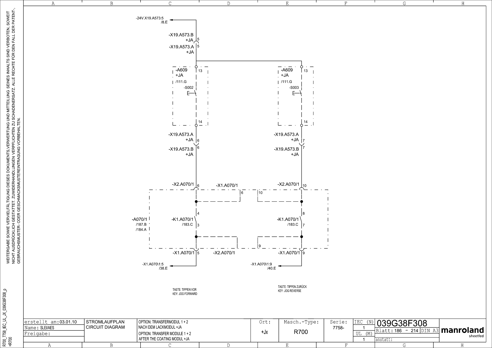

# +Jx — Sheet 186 of 214 — OPTION: TRANSFERMODUL 1 + 2

**NACH DEM LACKMODUL +JA**

> Part of the manroland **R700** printing press IEC/UL circuit diagrams.
> Drawing class: **Stromlaufplan / Circuit diagram** (DIN A3).
> Document `+Jx` covers the **1st printing module + feed register** machine section.

## At a glance

| Field | Value |
|---|---|
| Document | `+Jx`  (039G38F308) |
| Sheet | **186** of 214 |
| Section (DE) | OPTION: TRANSFERMODUL 1 + 2 |
| Section (EN) | NACH DEM LACKMODUL +JA |
| Section type | CIRCUIT — Circuit diagram |
| Machine type | `R700` |
| Series | `7758` |
| Created | 03.01.10 |
| Replaces | — |
| Columns used | B, C, D, E |
| Path numbers | — |
| Labels on sheet | 64 |
| Cross-refs out | 9 |
| Cross-refs in | 23 |

**Previous:** [+Jx sheet 185](SHEET_0185.md) · **Next:** [+Jx sheet 187](SHEET_0187.md) · **Document TOC:** [_TOC.md](_TOC.md)  (+Jx) · **Master TOC:** [all sheets](../_MASTER_TOC.md)

## Sheet image (300 DPI, exact vector render)



_Rendered directly from the PDF vector layer at 300 DPI (1-bit), no OCR and no resampling. Use it to confirm anything ambiguous in the text below._

## Cross-references on this sheet

Each entry is a wire leaving this sheet. The printed token is `/sheet.column`; the link resolves to that sheet inside the same document.

| Ref | Target sheet | Col | Path | Destination on target | Target section | From col |
|---|---|---|---|---|---|---|
| `/8.E` | [+Jx sheet 8](SHEET_0008.md) | E | — | 24V.X19.A573:5 | SPANNUNGSVERSORGUNG, SCHALTSCHRANKBELÜFTUNG | C |
| `/111.G` | [+Jx sheet 111](SHEET_0111.md) | G | — | — | REFERENZMODUL | C |
| `/111.G` | [+Jx sheet 111](SHEET_0111.md) | G | — | — | REFERENZMODUL | E |
| `/187.B` | [+Jx sheet 187](SHEET_0187.md) | B | — | — | OPTION: TRANSFERMODUL 1 + 2 | C |
| `/184.A` | [+Jx sheet 184](SHEET_0184.md) | A | — | — | OPTION: TRANSFERMODUL 1 + 2 | C |
| `/183.C` | [+Jx sheet 183](SHEET_0183.md) | C | — | — | OPTION: TRANSFERMODUL 1 + 2 | C |
| `/183.C` | [+Jx sheet 183](SHEET_0183.md) | C | — | — | OPTION: TRANSFERMODUL 1 + 2 | E |
| `/38.E` | [+Jx sheet 38](SHEET_0038.md) | E | — | X1.A070\1:5 | LAUFKOMMANDOS | C |
| `/40.E` | [+Jx sheet 40](SHEET_0040.md) | E | — | X1.A070\1:9 | LAUFKOMMANDOS | E |

### Incoming references (sheets that point here)

Every other sheet that sends a wire to this one. `Back-ref` is the token printed on *that* sheet; `Path` is its line number.

| From sheet | Cols | Back-ref | Path | Refs | What continues there |
|---|---|---|---|---|---|
| [+Jx#8](SHEET_0008.md) | E | `/8.E` | — | 1 | — |
| [+Jx#38](SHEET_0038.md) | E | `/38.E` | — | 1 | — |
| [+Jx#40](SHEET_0040.md) | E | `/40.E` | — | 1 | — |
| [+Jx#111](SHEET_0111.md) | F | `/111.F` | — | 2 | — |
| [+Jx#113](SHEET_0113.md) | C | `/113.C` | — | 4 | — |
| [+Jx#123](SHEET_0123.md) | E | `/123.E` | — | 4 | — |
| [+Jx#141](SHEET_0141.md) | C | `/141.C` | — | 6 | — |
| [+Jx#183](SHEET_0183.md) | C | `/183.C` | — | 2 | — |
| [+Jx#184](SHEET_0184.md) | A | `/184.A` | — | 1 | — |
| [+Jx#187](SHEET_0187.md) | A | `/187.A` | — | 1 | — |


## Devices on this sheet

| Tag | Class | Class meaning (IEC) | Col | Sub | Terminal | Sign |
|---|---|---|---|---|---|---|
| `A070/1` | A | Baugruppe / assembly, module, PC board | B | 1 | — | — |
| `S002` | S | Schalter / switch | C | — | — | — |
| `A609` | A | Baugruppe / assembly, module, PC board | C | — | — | — |
| `S003` | S | Schalter / switch | E | — | — | — |
| `A609` | A | Baugruppe / assembly, module, PC board | E | — | — | — |
| `X19.A573.B` | — | cross-device reference | C | — | — | — |
| `X19.A573.A` | — | cross-device reference | C | — | — | — |
| `X19.A573.B` | — | cross-device reference | C | — | — | — |
| `X19.A573.A` | — | cross-device reference | C | — | — | — |
| `X19.A573.B` | — | cross-device reference | E | — | — | — |
| `X19.A573.A` | — | cross-device reference | E | — | — | — |
| `X1.A070\1:5` | — | cross-device reference | C | — | 5 | — |
| `X1.A070\1:9` | — | cross-device reference | E | — | 9 | — |

## Potentials / nets

| Potential | Count | Columns | Attached devices | Terminals |
|---|---|---|---|---|
| `24V` | 1 | C | `A573`, `X19` | `5` |


A potential such as `L24+/4` or `M24+` is a named supply/return rail; every place it appears on this sheet is electrically common.

## Wire-end annotations (grouped as printed)

A wire that continues elsewhere is annotated with a small cluster: the destination description, the path/line number `#NN`, and the `/sheet.column` cross reference. Each row below is one such cluster exactly as it is grouped on the drawing.

| Col | Y | Path | Cross-ref | Text on the wire |
|---|---|---|---|---|
| C | 39.9 | — | `/8.E` | `24V.X19.A573:5` |
| C | 79.6 | — | — | `X19.A573.B 5` |
| C | 92.3 | — | — | `+JA` |
| C | 108.0 | — | — | `X19.A573.A 5` |
| C | 121.3 | — | — | `+JA` |
| C | 164.6 | — | — | `+JA A609` |
| E | 164.6 | — | — | `+JA A609` |
| D | 167.5 | — | — | `13` |
| E | 167.5 | — | — | `13` |
| C | 193.7 | — | `/111.G` | — |
| E | 193.7 | — | `/111.G` | — |
| C | 207.9 | — | — | `S002` |
| E | 207.9 | — | — | `S003` |
| D | 290.8 | — | — | `14` |
| E | 290.8 | — | — | `14` |
| C | 320.6 | — | — | `X19.A573.A 6` |
| E | 320.6 | — | — | `X19.A573.A 7` |
| C | 333.2 | — | — | `+JA` |
| E | 333.2 | — | — | `+JA` |
| C | 353.2 | — | — | `X19.A573.B 6` |
| E | 353.2 | — | — | `X19.A573.B 7` |
| C | 368.6 | — | — | `+JA` |
| E | 368.6 | — | — | `+JA` |
| C | 441.0 | — | — | `X2.A070/1 6` |
| E | 441.0 | — | — | `X2.A070/1 10` |
| D | 443.9 | — | — | `X1.A070/1` |
| D | 462.3 | — | — | `6` |
| E | 462.3 | — | — | `10` |
| C | 512.6 | — | — | `4` |
| E | 512.6 | — | — | `8` |
| B | 526.1 | — | — | `A070/1` |
| C | 526.1 | — | — | `K1.A070/1 3` |
| E | 526.1 | — | — | `K1.A070/1 7` |
| C | 539.1 | — | `/187.B`, `/184.A` | — |
| C | 539.2 | — | `/183.C` | — |
| E | 539.2 | — | `/183.C` | — |
| E | 591.3 | — | — | `9` |
| C | 606.9 | — | — | `X1.A070/1 5` |
| D | 606.9 | — | — | `X2.A070/1` |
| E | 606.9 | — | — | `X1.A070/1 9` |
| C | 635.2 | — | `/38.E` | `X1.A070\1:5` |
| E | 635.2 | — | `/40.E` | `X1.A070\1:9` |
| E | 691.0 | — | — | `KEY: JOG REVERSE TASTE: TIPPEN ZURÜCK` |
| C | 698.0 | — | — | `KEY: JOG FORWARD TASTE: TIPPEN VOR` |


## Reconstructed tables

This sheet carries tabular content (pin map / terminal assignment / index). The grid below was rebuilt from the drawing's own rule lines, so each row is exactly one physical row of the table.

### Table 1 — 4 data rows × 2 columns (at x=418.1, y=48.2)

| X19.A573.B +JA X19.A573.A +JA | 5 5 |
|---|---|
| `A609 +JA /111.G S002` | `13 14` |
| `X19.A573.A +JA X19.A573.B +JA X2.A070/1` | `6 6 6` |
| `K1.A070/1 /183.C` | `4 3` |
| `X1.A070/1` | `5` |


### Table 2 — 3 data rows × 2 columns (at x=673.2, y=147.4)

| A609 +JA /111.G S003 | 13 14 |
|---|---|
| `X19.A573.A +JA X19.A573.B +JA X2.A070/1` | `7 7 10` |
| `K1.A070/1 /183.C` | `8 7` |
| `X1.A070/1` | `9` |


## Notes and free text on this sheet

| Text | Col | Y (pt) |
|---|---|---|
| `X2.A070/1` | C | 441.03 |
| `X1.A070/1` | C | 606.86 |
| `X2.A070/1` | E | 441.03 |
| `X1.A070/1` | E | 606.86 |
| `TASTE: TIPPEN VOR` | C | 698.05 |
| `KEY: JOG FORWARD` | C | 707.96 |
| `+JA` | C | 177.31 |
| `TASTE: TIPPEN ZURÜCK` | E | 690.97 |
| `KEY: JOG REVERSE` | E | 700.92 |
| `+JA` | E | 177.31 |
| `K1.A070/1` | C | 526.07 |
| `K1.A070/1` | E | 526.07 |
| `X2.A070/1` | D | 606.86 |
| `X1.A070/1` | D | 443.87 |

## Complete label inventory (exact text from the drawing)

Every text object inside the drawing area of this sheet, in DIN reading order (column A→H, then top→bottom). This is the authoritative list: if a string is not here it is not printed on this sheet.

| Col | Y | X | Dir | Type | Text |
|---|---|---|---|---|---|
| B | 526.1 | 319.2 | → | device tag | `A070/1` |
| C | 39.9 | 328.8 | → | potential | `24V.X19.A573:5` |
| C | 49.8 | 389.8 | → | cross-reference | `/8.E` |
| C | 79.6 | 408.2 | → | device ref | `X19.A573.B` |
| C | 91.0 | 477.4 | → | number | `5` |
| C | 92.3 | 449.0 | → | text | `+JA` |
| C | 108.0 | 477.4 | → | number | `5` |
| C | 108.7 | 409.0 | → | device ref | `X19.A573.A` |
| C | 121.3 | 450.4 | → | text | `+JA` |
| C | 164.6 | 424.9 | → | device tag | `A609` |
| C | 177.3 | 424.6 | → | text | `+JA` |
| C | 193.7 | 425.2 | → | cross-reference | `/111.G` |
| C | 207.9 | 444.8 | → | device tag | `S002` |
| C | 320.6 | 407.6 | → | device ref | `X19.A573.A` |
| C | 333.2 | 449.0 | → | text | `+JA` |
| C | 336.2 | 477.4 | → | number | `6` |
| C | 353.2 | 477.4 | → | number | `6` |
| C | 356.0 | 408.2 | → | device ref | `X19.A573.B` |
| C | 368.6 | 449.0 | → | text | `+JA` |
| C | 441.0 | 416.7 | → | text | `X2.A070/1` |
| C | 445.3 | 477.4 | → | number | `6` |
| C | 512.6 | 477.6 | → | number | `4` |
| C | 526.1 | 415.3 | → | text | `K1.A070/1` |
| C | 539.1 | 329.1 | → | cross-reference | `/187.B` |
| C | 539.2 | 440.8 | → | cross-reference | `/183.C` |
| C | 541.0 | 477.4 | → | number | `3` |
| C | 551.5 | 328.8 | → | cross-reference | `/184.A` |
| C | 606.9 | 418.1 | → | text | `X1.A070/1` |
| C | 608.3 | 477.4 | → | number | `5` |
| C | 635.2 | 344.4 | → | device ref | `X1.A070\1:5` |
| C | 645.1 | 384.9 | → | cross-reference | `/38.E` |
| C | 698.0 | 417.8 | → | text | `TASTE: TIPPEN VOR` |
| C | 708.0 | 417.5 | → | text | `KEY: JOG FORWARD` |
| D | 167.5 | 479.6 | → | number | `13` |
| D | 290.8 | 479.6 | → | number | `14` |
| D | 443.9 | 523.0 | → | text | `X1.A070/1` |
| D | 462.3 | 583.7 | → | number | `6` |
| D | 606.9 | 515.9 | → | text | `X2.A070/1` |
| E | 164.6 | 680.0 | → | device tag | `A609` |
| E | 167.5 | 734.7 | → | number | `13` |
| E | 177.3 | 679.7 | → | text | `+JA` |
| E | 193.7 | 680.3 | → | cross-reference | `/111.G` |
| E | 207.9 | 699.9 | → | device tag | `S003` |
| E | 290.8 | 734.7 | → | number | `14` |
| E | 320.6 | 662.7 | → | device ref | `X19.A573.A` |
| E | 333.2 | 704.1 | → | text | `+JA` |
| E | 336.2 | 732.5 | → | number | `7` |
| E | 353.2 | 732.5 | → | number | `7` |
| E | 356.0 | 663.3 | → | device ref | `X19.A573.B` |
| E | 368.6 | 704.1 | → | text | `+JA` |
| E | 441.0 | 671.8 | → | text | `X2.A070/1` |
| E | 445.3 | 731.9 | → | number | `10` |
| E | 462.3 | 625.6 | → | number | `10` |
| E | 512.6 | 732.5 | → | number | `8` |
| E | 526.1 | 670.4 | → | text | `K1.A070/1` |
| E | 539.2 | 695.9 | → | cross-reference | `/183.C` |
| E | 541.0 | 732.5 | → | number | `7` |
| E | 591.3 | 626.2 | → | number | `9` |
| E | 606.9 | 673.2 | → | text | `X1.A070/1` |
| E | 608.3 | 732.5 | → | number | `9` |
| E | 635.2 | 606.6 | → | device ref | `X1.A070\1:9` |
| E | 645.1 | 647.1 | → | cross-reference | `/40.E` |
| E | 691.0 | 672.9 | → | text | `TASTE: TIPPEN ZURÜCK` |
| E | 700.9 | 672.7 | → | text | `KEY: JOG REVERSE` |

## Reading-order text block

The same content as a plain block, grouped by DIN column — convenient to paste or to match against a visual description.

```text
=== Column B ===
 526.1  319.2  devtag       A070/1
=== Column C ===
  39.9  328.8  net          24V.X19.A573:5
  49.8  389.8  xref         /8.E
  79.6  408.2  devref       X19.A573.B
  91.0  477.4  numeric      5
  92.3  449.0  text         +JA
 108.0  477.4  numeric      5
 108.7  409.0  devref       X19.A573.A
 121.3  450.4  text         +JA
 164.6  424.9  devtag       A609
 177.3  424.6  text         +JA
 193.7  425.2  xref         /111.G
 207.9  444.8  devtag       S002
 320.6  407.6  devref       X19.A573.A
 333.2  449.0  text         +JA
 336.2  477.4  numeric      6
 353.2  477.4  numeric      6
 356.0  408.2  devref       X19.A573.B
 368.6  449.0  text         +JA
 441.0  416.7  text         X2.A070/1
 445.3  477.4  numeric      6
 512.6  477.6  numeric      4
 526.1  415.3  text         K1.A070/1
 539.1  329.1  xref         /187.B
 539.2  440.8  xref         /183.C
 541.0  477.4  numeric      3
 551.5  328.8  xref         /184.A
 606.9  418.1  text         X1.A070/1
 608.3  477.4  numeric      5
 635.2  344.4  devref       X1.A070\1:5
 645.1  384.9  xref         /38.E
 698.0  417.8  text         TASTE: TIPPEN VOR
 708.0  417.5  text         KEY: JOG FORWARD
=== Column D ===
 167.5  479.6  numeric      13
 290.8  479.6  numeric      14
 443.9  523.0  text         X1.A070/1
 462.3  583.7  numeric      6
 606.9  515.9  text         X2.A070/1
=== Column E ===
 164.6  680.0  devtag       A609
 167.5  734.7  numeric      13
 177.3  679.7  text         +JA
 193.7  680.3  xref         /111.G
 207.9  699.9  devtag       S003
 290.8  734.7  numeric      14
 320.6  662.7  devref       X19.A573.A
 333.2  704.1  text         +JA
 336.2  732.5  numeric      7
 353.2  732.5  numeric      7
 356.0  663.3  devref       X19.A573.B
 368.6  704.1  text         +JA
 441.0  671.8  text         X2.A070/1
 445.3  731.9  numeric      10
 462.3  625.6  numeric      10
 512.6  732.5  numeric      8
 526.1  670.4  text         K1.A070/1
 539.2  695.9  xref         /183.C
 541.0  732.5  numeric      7
 591.3  626.2  numeric      9
 606.9  673.2  text         X1.A070/1
 608.3  732.5  numeric      9
 635.2  606.6  devref       X1.A070\1:9
 645.1  647.1  xref         /40.E
 691.0  672.9  text         TASTE: TIPPEN ZURÜCK
 700.9  672.7  text         KEY: JOG REVERSE
```

---
_Generated from the PDF vector text layer; no OCR. Source: `R700_7758_IEC_UL_JX_039G38F308_p`, sheet 186._
