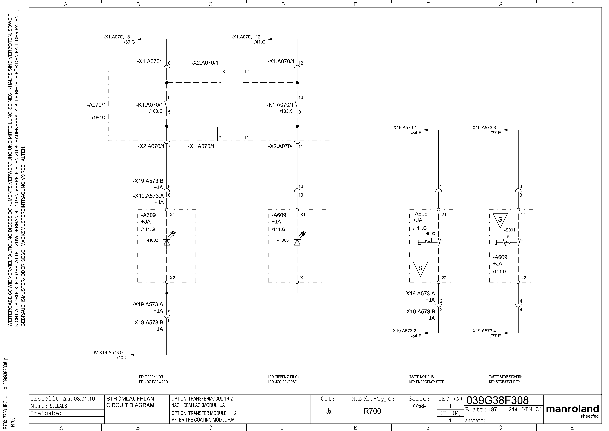

# +Jx — Sheet 187 of 214 — OPTION: TRANSFERMODUL 1 + 2

**NACH DEM LACKMODUL +JA**

> Part of the manroland **R700** printing press IEC/UL circuit diagrams.
> Drawing class: **Stromlaufplan / Circuit diagram** (DIN A3).
> Document `+Jx` covers the **1st printing module + feed register** machine section.

## At a glance

| Field | Value |
|---|---|
| Document | `+Jx`  (039G38F308) |
| Sheet | **187** of 214 |
| Section (DE) | OPTION: TRANSFERMODUL 1 + 2 |
| Section (EN) | NACH DEM LACKMODUL +JA |
| Section type | CIRCUIT — Circuit diagram |
| Machine type | `R700` |
| Series | `7758` |
| Created | 03.01.10 |
| Replaces | — |
| Columns used | A, B, C, D, F, G |
| Path numbers | — |
| Labels on sheet | 100 |
| Cross-refs out | 14 |
| Cross-refs in | 36 |

**Previous:** [+Jx sheet 186](SHEET_0186.md) · **Next:** [+Jx sheet 188](SHEET_0188.md) · **Document TOC:** [_TOC.md](_TOC.md)  (+Jx) · **Master TOC:** [all sheets](../_MASTER_TOC.md)

## Sheet image (300 DPI, exact vector render)



_Rendered directly from the PDF vector layer at 300 DPI (1-bit), no OCR and no resampling. Use it to confirm anything ambiguous in the text below._

## Cross-references on this sheet

Each entry is a wire leaving this sheet. The printed token is `/sheet.column`; the link resolves to that sheet inside the same document.

| Ref | Target sheet | Col | Path | Destination on target | Target section | From col |
|---|---|---|---|---|---|---|
| `/39.G` | [+Jx sheet 39](SHEET_0039.md) | G | — | X1.A070\1:8 X1.A070\1:12 | LAUFKOMMANDOS | C |
| `/41.G` | [+Jx sheet 41](SHEET_0041.md) | G | — | X1.A070\1:8 X1.A070\1:12 | LAUFKOMMANDOS | C |
| `/183.C` | [+Jx sheet 183](SHEET_0183.md) | C | — | — | OPTION: TRANSFERMODUL 1 + 2 | B |
| `/183.C` | [+Jx sheet 183](SHEET_0183.md) | C | — | — | OPTION: TRANSFERMODUL 1 + 2 | D |
| `/186.C` | [+Jx sheet 186](SHEET_0186.md) | C | — | — | OPTION: TRANSFERMODUL 1 + 2 | A |
| `/37.E` | [+Jx sheet 37](SHEET_0037.md) | E | — | X19.A573:1 X19.A573:3 | STOP SICHERN | F |
| `/34.F` | [+Jx sheet 34](SHEET_0034.md) | F | — | X19.A573:1 X19.A573:3 | NOT AUS | F |
| `/111.G` | [+Jx sheet 111](SHEET_0111.md) | G | — | — | REFERENZMODUL | F |
| `/111.G` | [+Jx sheet 111](SHEET_0111.md) | G | — | — | REFERENZMODUL | B |
| `/111.G` | [+Jx sheet 111](SHEET_0111.md) | G | — | — | REFERENZMODUL | D |
| `/111.G` | [+Jx sheet 111](SHEET_0111.md) | G | — | — | REFERENZMODUL | G |
| `/34.F` | [+Jx sheet 34](SHEET_0034.md) | F | — | X19.A573:2 | NOT AUS | F |
| `/37.E` | [+Jx sheet 37](SHEET_0037.md) | E | — | X19.A573:4 | STOP SICHERN | G |
| `/10.C` | [+Jx sheet 10](SHEET_0010.md) | C | — | 0V.X19.A573:9 | SPANNUNGSVERSORGUNG, SCHALTSCHRANKBELÜFTUNG | B |

### Incoming references (sheets that point here)

Every other sheet that sends a wire to this one. `Back-ref` is the token printed on *that* sheet; `Path` is its line number.

| From sheet | Cols | Back-ref | Path | Refs | What continues there |
|---|---|---|---|---|---|
| [+Jx#10](SHEET_0010.md) | C | `/10.C` | — | 1 | — |
| [+Jx#34](SHEET_0034.md) | F | `/34.F` | — | 2 | — |
| [+Jx#37](SHEET_0037.md) | E | `/37.E` | — | 2 | — |
| [+Jx#39](SHEET_0039.md) | G | `/39.G` | — | 1 | X1.A070\1:8 |
| [+Jx#41](SHEET_0041.md) | H | `/41.H` | — | 1 | X1.A070\1:12 |
| [+Jx#111](SHEET_0111.md) | F | `/111.F` | — | 4 | — |
| [+Jx#113](SHEET_0113.md) | C | `/113.C` | — | 4 | — |
| [+Jx#123](SHEET_0123.md) | E | `/123.E` | — | 4 | — |
| [+Jx#141](SHEET_0141.md) | C | `/141.C` | — | 14 | — |
| [+Jx#183](SHEET_0183.md) | C | `/183.C` | — | 2 | — |
| [+Jx#186](SHEET_0186.md) | C | `/186.C` | — | 1 | — |


## Devices on this sheet

| Tag | Class | Class meaning (IEC) | Col | Sub | Terminal | Sign |
|---|---|---|---|---|---|---|
| `X1` | X | Klemme / terminal, plug connector | B | — | — | — |
| `X2` | X | Klemme / terminal, plug connector | B | — | — | — |
| `A609` | A | Baugruppe / assembly, module, PC board | B | — | — | — |
| `A070/1` | A | Baugruppe / assembly, module, PC board | A | 1 | — | — |
| `X1` | X | Klemme / terminal, plug connector | D | — | — | — |
| `X2` | X | Klemme / terminal, plug connector | D | — | — | — |
| `A609` | A | Baugruppe / assembly, module, PC board | D | — | — | — |
| `S001` | S | Schalter / switch | G | — | — | — |
| `A609` | A | Baugruppe / assembly, module, PC board | G | — | — | — |
| `S000` | S | Schalter / switch | F | — | — | — |
| `A609` | A | Baugruppe / assembly, module, PC board | F | — | — | — |
| `X19.A573.B` | — | cross-device reference | B | — | — | — |
| `X19.A573.A` | — | cross-device reference | B | — | — | — |
| `X19.A573.B` | — | cross-device reference | B | — | — | — |
| `X19.A573.A` | — | cross-device reference | B | — | — | — |
| `X19.A573.B` | — | cross-device reference | F | — | — | — |
| `X19.A573.A` | — | cross-device reference | F | — | — | — |
| `X19.A573:4` | — | cross-device reference | G | — | 4 | — |
| `X19.A573:3` | — | cross-device reference | G | — | 3 | — |
| `X19.A573:1` | — | cross-device reference | F | — | 1 | — |
| `X19.A573:2` | — | cross-device reference | F | — | 2 | — |
| `X1.A070\1:12` | — | cross-device reference | C | — | 12 | — |
| `X1.A070\1:8` | — | cross-device reference | B | — | 8 | — |

## Potentials / nets

| Potential | Count | Columns | Attached devices | Terminals |
|---|---|---|---|---|
| `0V` | 1 | B | `A573`, `X19` | `9` |
| `H002` | 1 | B | — | — |
| `H003` | 1 | D | — | — |


A potential such as `L24+/4` or `M24+` is a named supply/return rail; every place it appears on this sheet is electrically common.

## Wire-end annotations (grouped as printed)

A wire that continues elsewhere is annotated with a small cluster: the destination description, the path/line number `#NN`, and the `/sheet.column` cross reference. Each row below is one such cluster exactly as it is grouped on the drawing.

| Col | Y | Path | Cross-ref | Text on the wire |
|---|---|---|---|---|
| C | 68.2 | — | `/39.G`, `/41.G` | `X1.A070\1:8 X1.A070\1:12` |
| B | 115.0 | — | — | `X1.A070/1 8` |
| D | 115.0 | — | — | `X1.A070/1 12` |
| C | 117.9 | — | — | `X2.A070/1` |
| C | 136.3 | — | — | `8` |
| C | 136.3 | — | — | `12` |
| B | 186.7 | — | — | `6` |
| D | 186.7 | — | — | `10` |
| A | 200.1 | — | — | `A070/1` |
| B | 200.1 | — | — | `K1.A070/1 5` |
| D | 200.1 | — | — | `K1.A070/1 9` |
| B | 213.2 | — | `/183.C` | — |
| D | 213.2 | — | `/183.C` | — |
| A | 225.6 | — | `/186.C` | — |
| F | 245.4 | — | `/37.E`, `/34.F` | `X19.A573:1 X19.A573:3` |
| C | 265.3 | — | — | `7` |
| C | 265.3 | — | — | `11` |
| B | 280.9 | — | — | `X2.A070/1 7` |
| C | 280.9 | — | — | `X1.A070/1` |
| D | 280.9 | — | — | `X2.A070/1 11` |
| B | 348.9 | — | — | `X19.A573.B 8` |
| D | 360.3 | — | — | `10` |
| F | 360.3 | — | — | `1` |
| G | 360.3 | — | — | `3` |
| B | 361.6 | — | — | `+JA` |
| B | 377.3 | — | — | `X19.A573.A 8` |
| D | 377.3 | — | — | `10` |
| F | 377.3 | — | — | `1` |
| G | 377.3 | — | — | `3` |
| B | 390.6 | — | — | `+JA` |
| F | 412.7 | — | — | `+JA A609` |
| B | 415.5 | — | — | `+JA A609` |
| B | 415.5 | — | — | `X1` |
| D | 415.5 | — | — | `+JA A609` |
| D | 415.5 | — | — | `X1` |
| F | 415.5 | — | — | `21` |
| G | 415.5 | — | — | `21` |
| G | 423.4 | — | — | `S` |
| F | 441.7 | — | `/111.G` | — |
| B | 444.2 | — | `/111.G` | — |
| D | 444.2 | — | `/111.G` | — |
| G | 445.7 | — | — | `S001` |
| F | 452.8 | — | — | `S000` |
| G | 459.7 | — | — | `L R` |
| B | 465.6 | — | — | `H002` |
| D | 465.6 | — | — | `H003` |
| G | 497.7 | — | — | `+JA A609` |
| F | 518.3 | — | — | `S` |
| G | 526.8 | — | `/111.G` | — |
| B | 538.8 | — | — | `X2` |
| D | 538.8 | — | — | `X2` |
| F | 538.9 | — | — | `22` |
| G | 538.9 | — | — | `22` |
| F | 568.6 | — | — | `X19.A573.A 2` |
| F | 581.2 | — | — | `+JA` |
| G | 584.2 | — | — | `4` |
| B | 589.9 | — | — | `X19.A573.A 9` |
| F | 601.2 | — | — | `X19.A573.B 2` |
| G | 601.2 | — | — | `4` |
| B | 602.5 | — | — | `+JA` |
| F | 616.7 | — | — | `+JA` |
| B | 622.5 | — | — | `X19.A573.B 9` |
| B | 637.9 | — | — | `+JA` |
| F | 642.3 | — | `/34.F` | `X19.A573:2` |
| G | 642.3 | — | `/37.E` | `X19.A573:4` |
| B | 684.8 | — | `/10.C` | `0V.X19.A573:9` |
| B | 733.5 | — | — | `LED: TIPPEN VOR LED: JOG FORWARD` |
| D | 733.5 | — | — | `LED: TIPPEN ZURÜCK LED: JOG REVERSE` |
| F | 733.5 | — | — | `KEY EMERGENCY STOP TASTE NOT AUS` |
| G | 733.5 | — | — | `KEY STOP SECURITY TASTE STOP SICHERN` |


## Reconstructed tables

This sheet carries tabular content (pin map / terminal assignment / index). The grid below was rebuilt from the drawing's own rule lines, so each row is exactly one physical row of the table.

### Table 1 — 4 data rows × 2 columns (at x=269.3, y=76.5)

| X1.A070/1 | 8 |
|---|---|
| `K1.A070/1 /183.C` | `6 5` |
| `X2.A070/1 X19.A573.B +JA X19.A573.A +JA` | `7 8 8` |
| `A609 +JA /111.G H002` | `X1 X2` |
| `X19.A573.A +JA X19.A573.B +JA` | `9 9` |


### Table 2 — 3 data rows × 2 columns (at x=524.4, y=76.5)

| X1.A070/1 | 12 |
|---|---|
| `K1.A070/1 /183.C` | `10 9` |
| `X2.A070/1` | `11 10 10` |
| `A609 +JA /111.G H003` | `X1 X2` |


## Notes and free text on this sheet

| Text | Col | Y (pt) |
|---|---|---|
| `+JA` | B | 637.94 |
| `LED: TIPPEN VOR` | B | 733.5 |
| `LED: JOG FORWARD` | B | 743.39 |
| `X1.A070/1` | B | 115.05 |
| `X2.A070/1` | B | 280.88 |
| `X1.A070/1` | D | 115.05 |
| `X2.A070/1` | D | 280.88 |
| `K1.A070/1` | B | 200.09 |
| `K1.A070/1` | D | 200.09 |
| `LED: TIPPEN ZURÜCK` | D | 733.5 |
| `LED: JOG REVERSE` | D | 743.43 |
| `+JA` | D | 428.18 |
| `+JA` | F | 616.68 |
| `TASTE STOP SICHERN` | G | 733.47 |
| `KEY STOP SECURITY` | G | 743.43 |
| `+JA` | G | 510.38 |
| `TASTE NOT AUS` | F | 733.45 |
| `KEY EMERGENCY STOP` | F | 743.44 |
| `X1.A070/1` | C | 280.88 |
| `X2.A070/1` | C | 117.88 |
| `S` | F | 518.33 |
| `L` | G | 459.74 |
| `R` | G | 459.67 |
| `S` | G | 423.37 |

## Complete label inventory (exact text from the drawing)

Every text object inside the drawing area of this sheet, in DIN reading order (column A→H, then top→bottom). This is the authoritative list: if a string is not here it is not printed on this sheet.

| Col | Y | X | Dir | Type | Text |
|---|---|---|---|---|---|
| A | 200.1 | 170.4 | → | device tag | `A070/1` |
| A | 225.6 | 180.0 | → | cross-reference | `/186.C` |
| B | 68.3 | 202.7 | → | device ref | `X1.A070\1:8` |
| B | 78.2 | 242.4 | → | cross-reference | `/39.G` |
| B | 115.0 | 267.9 | → | text | `X1.A070/1` |
| B | 119.3 | 328.5 | → | number | `8` |
| B | 186.6 | 328.5 | → | number | `6` |
| B | 200.1 | 266.5 | → | text | `K1.A070/1` |
| B | 213.2 | 292.0 | → | cross-reference | `/183.C` |
| B | 215.0 | 328.5 | → | number | `5` |
| B | 280.9 | 269.3 | → | text | `X2.A070/1` |
| B | 282.3 | 328.5 | → | number | `7` |
| B | 348.9 | 259.4 | → | device ref | `X19.A573.B` |
| B | 360.3 | 328.5 | → | number | `8` |
| B | 361.6 | 300.2 | → | text | `+JA` |
| B | 377.3 | 328.5 | → | number | `8` |
| B | 378.0 | 260.2 | → | device ref | `X19.A573.A` |
| B | 390.6 | 301.6 | → | text | `+JA` |
| B | 415.5 | 276.1 | → | device tag | `A609` |
| B | 415.5 | 331.7 | → | device tag | `X1` |
| B | 428.2 | 275.8 | → | text | `+JA` |
| B | 444.2 | 276.4 | → | cross-reference | `/111.G` |
| B | 465.6 | 286.9 | → | potential | `H002` |
| B | 538.8 | 331.7 | → | device tag | `X2` |
| B | 589.8 | 258.8 | → | device ref | `X19.A573.A` |
| B | 602.5 | 300.2 | → | text | `+JA` |
| B | 605.5 | 328.5 | → | number | `9` |
| B | 622.5 | 328.5 | → | number | `9` |
| B | 625.3 | 259.4 | → | device ref | `X19.A573.B` |
| B | 637.9 | 300.2 | → | text | `+JA` |
| B | 684.8 | 180.6 | → | potential | `0V.X19.A573:9` |
| B | 694.7 | 228.8 | → | cross-reference | `/10.C` |
| B | 733.5 | 268.7 | → | text | `LED: TIPPEN VOR` |
| B | 743.4 | 268.7 | → | text | `LED: JOG FORWARD` |
| C | 68.3 | 453.0 | → | device ref | `X1.A070\1:12` |
| C | 117.9 | 374.2 | → | text | `X2.A070/1` |
| C | 136.3 | 434.8 | → | number | `8` |
| C | 136.3 | 476.8 | → | number | `12` |
| C | 265.3 | 427.7 | → | number | `7` |
| C | 265.3 | 476.8 | → | number | `11` |
| C | 280.9 | 367.1 | → | text | `X1.A070/1` |
| D | 78.2 | 497.5 | → | cross-reference | `/41.G` |
| D | 115.0 | 523.0 | → | text | `X1.A070/1` |
| D | 119.3 | 583.1 | → | number | `12` |
| D | 186.6 | 583.1 | → | number | `10` |
| D | 200.1 | 521.6 | → | text | `K1.A070/1` |
| D | 213.2 | 547.1 | → | cross-reference | `/183.C` |
| D | 215.0 | 583.7 | → | number | `9` |
| D | 280.9 | 524.4 | → | text | `X2.A070/1` |
| D | 282.3 | 583.1 | → | number | `11` |
| D | 360.3 | 583.1 | → | number | `10` |
| D | 377.3 | 583.1 | → | number | `10` |
| D | 415.5 | 531.2 | → | device tag | `A609` |
| D | 415.5 | 586.8 | → | device tag | `X1` |
| D | 428.2 | 530.9 | → | text | `+JA` |
| D | 444.2 | 531.5 | → | cross-reference | `/111.G` |
| D | 465.6 | 542.0 | → | potential | `H003` |
| D | 538.8 | 586.8 | → | device tag | `X2` |
| D | 733.5 | 523.8 | → | text | `LED: TIPPEN ZURÜCK` |
| D | 743.4 | 523.8 | → | text | `LED: JOG REVERSE` |
| F | 245.4 | 766.2 | → | device ref | `X19.A573:1` |
| F | 255.3 | 803.6 | → | cross-reference | `/34.F` |
| F | 360.3 | 859.5 | → | number | `1` |
| F | 377.3 | 859.5 | → | number | `1` |
| F | 412.7 | 807.6 | → | device tag | `A609` |
| F | 415.5 | 863.1 | → | number | `21` |
| F | 425.3 | 807.3 | → | text | `+JA` |
| F | 441.7 | 807.9 | → | cross-reference | `/111.G` |
| F | 452.8 | 828.9 | → | device tag | `S000` |
| F | 518.3 | 817.9 | → | text | `S` |
| F | 538.9 | 863.1 | → | number | `22` |
| F | 568.6 | 790.3 | → | device ref | `X19.A573.A` |
| F | 581.2 | 831.7 | → | text | `+JA` |
| F | 584.2 | 860.3 | → | number | `2` |
| F | 601.2 | 860.3 | → | number | `2` |
| F | 604.0 | 790.9 | → | device ref | `X19.A573.B` |
| F | 616.7 | 831.7 | → | text | `+JA` |
| F | 642.3 | 765.1 | → | device ref | `X19.A573:2` |
| F | 652.2 | 803.6 | → | cross-reference | `/34.F` |
| F | 733.4 | 800.5 | → | text | `TASTE NOT AUS` |
| F | 743.4 | 800.2 | → | text | `KEY EMERGENCY STOP` |
| G | 245.4 | 921.0 | → | device ref | `X19.A573:3` |
| G | 255.3 | 959.0 | → | cross-reference | `/37.E` |
| G | 360.3 | 1015.9 | → | number | `3` |
| G | 377.3 | 1015.9 | → | number | `3` |
| G | 415.5 | 1019.1 | → | number | `21` |
| G | 423.4 | 973.8 | → | text | `S` |
| G | 445.7 | 985.9 | → | device tag | `S001` |
| G | 459.7 | 980.2 | → | text | `L` |
| G | 459.7 | 991.8 | → | text | `R` |
| G | 497.7 | 963.5 | → | device tag | `A609` |
| G | 510.4 | 963.2 | → | text | `+JA` |
| G | 526.8 | 963.8 | → | cross-reference | `/111.G` |
| G | 538.9 | 1019.1 | → | number | `22` |
| G | 584.2 | 1016.2 | → | number | `4` |
| G | 601.2 | 1016.2 | → | number | `4` |
| G | 642.3 | 921.0 | → | device ref | `X19.A573:4` |
| G | 652.2 | 959.0 | → | cross-reference | `/37.E` |
| G | 733.5 | 956.4 | → | text | `TASTE STOP SICHERN` |
| G | 743.4 | 956.1 | → | text | `KEY STOP SECURITY` |

## Reading-order text block

The same content as a plain block, grouped by DIN column — convenient to paste or to match against a visual description.

```text
=== Column A ===
 200.1  170.4  devtag       A070/1
 225.6  180.0  xref         /186.C
=== Column B ===
  68.3  202.7  devref       X1.A070\1:8
  78.2  242.4  xref         /39.G
 115.0  267.9  text         X1.A070/1
 119.3  328.5  numeric      8
 186.6  328.5  numeric      6
 200.1  266.5  text         K1.A070/1
 213.2  292.0  xref         /183.C
 215.0  328.5  numeric      5
 280.9  269.3  text         X2.A070/1
 282.3  328.5  numeric      7
 348.9  259.4  devref       X19.A573.B
 360.3  328.5  numeric      8
 361.6  300.2  text         +JA
 377.3  328.5  numeric      8
 378.0  260.2  devref       X19.A573.A
 390.6  301.6  text         +JA
 415.5  276.1  devtag       A609
 415.5  331.7  devtag       X1
 428.2  275.8  text         +JA
 444.2  276.4  xref         /111.G
 465.6  286.9  net          H002
 538.8  331.7  devtag       X2
 589.8  258.8  devref       X19.A573.A
 602.5  300.2  text         +JA
 605.5  328.5  numeric      9
 622.5  328.5  numeric      9
 625.3  259.4  devref       X19.A573.B
 637.9  300.2  text         +JA
 684.8  180.6  net          0V.X19.A573:9
 694.7  228.8  xref         /10.C
 733.5  268.7  text         LED: TIPPEN VOR
 743.4  268.7  text         LED: JOG FORWARD
=== Column C ===
  68.3  453.0  devref       X1.A070\1:12
 117.9  374.2  text         X2.A070/1
 136.3  434.8  numeric      8
 136.3  476.8  numeric      12
 265.3  427.7  numeric      7
 265.3  476.8  numeric      11
 280.9  367.1  text         X1.A070/1
=== Column D ===
  78.2  497.5  xref         /41.G
 115.0  523.0  text         X1.A070/1
 119.3  583.1  numeric      12
 186.6  583.1  numeric      10
 200.1  521.6  text         K1.A070/1
 213.2  547.1  xref         /183.C
 215.0  583.7  numeric      9
 280.9  524.4  text         X2.A070/1
 282.3  583.1  numeric      11
 360.3  583.1  numeric      10
 377.3  583.1  numeric      10
 415.5  531.2  devtag       A609
 415.5  586.8  devtag       X1
 428.2  530.9  text         +JA
 444.2  531.5  xref         /111.G
 465.6  542.0  net          H003
 538.8  586.8  devtag       X2
 733.5  523.8  text         LED: TIPPEN ZURÜCK
 743.4  523.8  text         LED: JOG REVERSE
=== Column F ===
 245.4  766.2  devref       X19.A573:1
 255.3  803.6  xref         /34.F
 360.3  859.5  numeric      1
 377.3  859.5  numeric      1
 412.7  807.6  devtag       A609
 415.5  863.1  numeric      21
 425.3  807.3  text         +JA
 441.7  807.9  xref         /111.G
 452.8  828.9  devtag       S000
 518.3  817.9  text         S
 538.9  863.1  numeric      22
 568.6  790.3  devref       X19.A573.A
 581.2  831.7  text         +JA
 584.2  860.3  numeric      2
 601.2  860.3  numeric      2
 604.0  790.9  devref       X19.A573.B
 616.7  831.7  text         +JA
 642.3  765.1  devref       X19.A573:2
 652.2  803.6  xref         /34.F
 733.4  800.5  text         TASTE NOT AUS
 743.4  800.2  text         KEY EMERGENCY STOP
=== Column G ===
 245.4  921.0  devref       X19.A573:3
 255.3  959.0  xref         /37.E
 360.3 1015.9  numeric      3
 377.3 1015.9  numeric      3
 415.5 1019.1  numeric      21
 423.4  973.8  text         S
 445.7  985.9  devtag       S001
 459.7  980.2  text         L
 459.7  991.8  text         R
 497.7  963.5  devtag       A609
 510.4  963.2  text         +JA
 526.8  963.8  xref         /111.G
 538.9 1019.1  numeric      22
 584.2 1016.2  numeric      4
 601.2 1016.2  numeric      4
 642.3  921.0  devref       X19.A573:4
 652.2  959.0  xref         /37.E
 733.5  956.4  text         TASTE STOP SICHERN
 743.4  956.1  text         KEY STOP SECURITY
```

---
_Generated from the PDF vector text layer; no OCR. Source: `R700_7758_IEC_UL_JX_039G38F308_p`, sheet 187._
