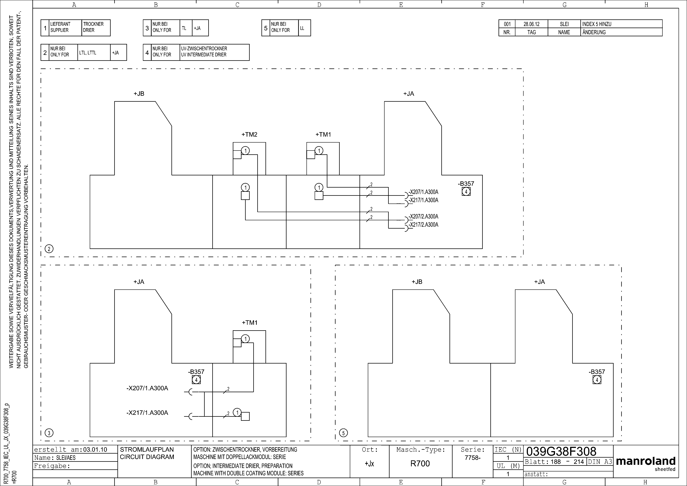

# +Jx — Sheet 188 of 214 — OPTION: ZWISCHENTROCKNER, VORBEREITUNG

**MASCHINE MIT DOPPELLACKMODUL: SERIE**

> Part of the manroland **R700** printing press IEC/UL circuit diagrams.
> Drawing class: **Stromlaufplan / Circuit diagram** (DIN A3).
> Document `+Jx` covers the **1st printing module + feed register** machine section.

## At a glance

| Field | Value |
|---|---|
| Document | `+Jx`  (039G38F308) |
| Sheet | **188** of 214 |
| Section (DE) | OPTION: ZWISCHENTROCKNER, VORBEREITUNG |
| Section (EN) | MASCHINE MIT DOPPELLACKMODUL: SERIE |
| Section type | CIRCUIT — Circuit diagram |
| Machine type | `R700` |
| Series | `7758` |
| Created | 03.01.10 |
| Replaces | — |
| Columns used | A, B, C, D, E, F, G |
| Path numbers | — |
| Labels on sheet | 67 |
| Cross-refs out | 0 |
| Cross-refs in | 0 |

**Previous:** [+Jx sheet 187](SHEET_0187.md) · **Next:** [+Jx sheet 189](SHEET_0189.md) · **Document TOC:** [_TOC.md](_TOC.md)  (+Jx) · **Master TOC:** [all sheets](../_MASTER_TOC.md)

## Sheet image (300 DPI, exact vector render)



_Rendered directly from the PDF vector layer at 300 DPI (1-bit), no OCR and no resampling. Use it to confirm anything ambiguous in the text below._

## Cross-references on this sheet

Each entry is a wire leaving this sheet. The printed token is `/sheet.column`; the link resolves to that sheet inside the same document.

_No outgoing cross-references on this sheet._

## Devices on this sheet

| Tag | Class | Class meaning (IEC) | Col | Sub | Terminal | Sign |
|---|---|---|---|---|---|---|
| `+TM2` | TM |  | C | — | — | + |
| `+TM1` | TM |  | D | — | — | + |
| `B357` | B | Umformer / transducer, sensor | F | — | — | — |
| `B357` | B | Umformer / transducer, sensor | B | — | — | — |
| `+TM1` | TM |  | C | — | — | + |
| `B357` | B | Umformer / transducer, sensor | G | — | — | — |
| `NR.` | — | cross-device reference | F | — | — | — |
| `28.06.12` | — | cross-device reference | G | — | — | — |
| `X207/1.A300A` | — | cross-device reference | E | — | — | — |
| `X207/2.A300A` | — | cross-device reference | E | — | — | — |
| `X217/1.A300A` | — | cross-device reference | E | — | — | — |
| `X217/2.A300A` | — | cross-device reference | E | — | — | — |
| `X207/1.A300A` | — | cross-device reference | B | — | — | — |
| `X217/1.A300A` | — | cross-device reference | B | — | — | — |

## Potentials / nets

_No named potentials on this sheet._

## Wire-end annotations (grouped as printed)

A wire that continues elsewhere is annotated with a small cluster: the destination description, the path/line number `#NN`, and the `/sheet.column` cross reference. Each row below is one such cluster exactly as it is grouped on the drawing.

| Col | Y | Path | Cross-ref | Text on the wire |
|---|---|---|---|---|
| G | 38.5 | — | — | `001 28.06.12 SLEI INDEX 5 HINZU` |
| A | 38.8 | — | — | `1 LIEFERANT SUPPLIER` |
| B | 38.8 | — | — | `3 NUR BEI ONLY FOR TL +JA` |
| D | 38.8 | — | — | `5 NUR BEI ONLY FOR LL` |
| A | 38.9 | — | — | `DRIER TROCKNER` |
| G | 52.6 | — | — | `NR. TAG NAME ÄNDERUNG` |
| A | 81.3 | — | — | `2 NUR BEI ONLY FOR LTL, LTTL +JA` |
| B | 81.3 | — | — | `4 NUR BEI ONLY FOR` |
| C | 81.4 | — | — | `UV ZWISCHENTROCKNER UV INTERMEDIATE DRIER` |
| C | 157.5 | — | — | `+JB +JA` |
| D | 228.4 | — | — | `+TM2 +TM1` |
| D | 257.7 | — | — | `1 1` |
| F | 313.5 | — | — | `B357` |
| E | 316.6 | — | — | `2` |
| D | 321.5 | — | — | `1 1 X207/1.A300A` |
| F | 329.1 | — | — | `4` |
| E | 330.8 | — | — | `2` |
| E | 343.1 | — | — | `X217/1.A300A` |
| E | 359.1 | — | — | `2` |
| E | 371.4 | — | — | `X207/2.A300A` |
| E | 373.3 | — | — | `2` |
| E | 385.6 | — | — | `X217/2.A300A` |
| A | 428.3 | — | — | `2` |
| B | 483.5 | — | — | `+JA` |
| F | 483.5 | — | — | `+JB +JA` |
| C | 554.4 | — | — | `+TM1` |
| C | 583.7 | — | — | `1` |
| B | 639.5 | — | — | `B357` |
| G | 639.5 | — | — | `B357` |
| B | 655.1 | — | — | `X207/1.A300A 4` |
| G | 655.1 | — | — | `4` |
| C | 671.0 | — | — | `2` |
| B | 710.3 | — | — | `X217/1.A300A 1` |
| C | 713.5 | — | — | `2` |
| A | 747.2 | — | — | `3` |
| D | 747.2 | — | — | `5` |


## Reconstructed tables

This sheet carries tabular content (pin map / terminal assignment / index). The grid below was rebuilt from the drawing's own rule lines, so each row is exactly one physical row of the table.

### Table 1 — 1 data rows × 2 columns (at x=198.4, y=175.7) — **+JA**

| X207/1.A300A | B357 4 |
|---|---|
| `X217/1.A300A` |  |


### Table 2 — 5 data rows × 2 columns (at x=368.5, y=175.7)

| C1 | C2 |
|---|---|
|  | `+TM2 1` |
|  | `1` |
|  | `+TM1 1` |
| `2` |  |
| `1 2` |  |


### Table 3 — 3 data rows × 2 columns (at x=496.1, y=175.7)

| C1 | C2 |
|---|---|
| `+TM1 1` |  |
| `1` |  |
|  | `5` |


### Table 4 — 4 data rows × 1 columns (at x=637.8, y=175.7)

| C1 |
|---|
| `2` |
| `2` |
| `2` |
| `2` |


### Table 5 — 5 data rows × 1 columns (at x=680.3, y=175.7)

| C1 |
|---|
| `X207/1.A300A` |
| `X217/1.A300A` |
| `X207/2.A300A` |
| `X217/2.A300A` |
| `+JB` |


### Table 6 — 2 data rows × 1 columns (at x=779.5, y=175.7)

| C1 |
|---|
| `B357` |
| `4` |


### Table 7 — 2 data rows × 2 columns (at x=892.9, y=175.7)

| C1 | C2 |
|---|---|
| `+JA` |  |
|  | `B357 4` |


## Notes and free text on this sheet

| Text | Col | Y (pt) |
|---|---|---|
| `TAG` | G | 52.75 |
| `NAME` | G | 52.73 |
| `ÄNDERUNG` | G | 52.76 |
| `SLEI` | G | 38.58 |
| `INDEX 5 HINZU` | G | 38.59 |
| `+JB` | B | 157.53 |
| `+JA` | E | 157.53 |
| `LIEFERANT` | A | 38.84 |
| `SUPPLIER` | A | 49.47 |
| `TROCKNER` | A | 38.88 |
| `DRIER` | A | 49.48 |
| `NUR BEI` | A | 81.33 |
| `ONLY FOR` | A | 92.01 |
| `LTL, LTTL` | A | 88.44 |
| `+JA` | B | 88.41 |
| `NUR BEI` | B | 38.81 |
| `ONLY FOR` | B | 49.49 |
| `TL` | B | 45.93 |
| `+JA` | C | 45.89 |
| `UV ZWISCHENTROCKNER` | C | 81.36 |
| `UV INTERMEDIATE DRIER` | C | 92 |
| `+JB` | E | 483.52 |
| `+JA` | G | 483.52 |
| `NUR BEI` | D | 38.81 |
| `ONLY FOR` | D | 49.49 |
| `LL` | D | 45.88 |

## Complete label inventory (exact text from the drawing)

Every text object inside the drawing area of this sheet, in DIN reading order (column A→H, then top→bottom). This is the authoritative list: if a string is not here it is not printed on this sheet.

| Col | Y | X | Dir | Type | Text |
|---|---|---|---|---|---|
| A | 38.8 | 87.3 | → | text | `LIEFERANT` |
| A | 38.9 | 144.6 | → | text | `TROCKNER` |
| A | 44.1 | 75.4 | → | number | `1` |
| A | 49.5 | 87.6 | → | text | `SUPPLIER` |
| A | 49.5 | 144.0 | → | text | `DRIER` |
| A | 81.3 | 87.3 | → | text | `NUR BEI` |
| A | 86.7 | 75.1 | → | number | `2` |
| A | 88.4 | 137.6 | → | text | `LTL, LTTL` |
| A | 92.0 | 87.6 | → | text | `ONLY FOR` |
| A | 428.3 | 83.0 | → | number | `2` |
| A | 747.2 | 83.0 | → | number | `3` |
| B | 38.8 | 264.5 | → | text | `NUR BEI` |
| B | 44.1 | 252.1 | → | number | `3` |
| B | 45.9 | 315.4 | → | text | `TL` |
| B | 49.5 | 264.8 | → | text | `ONLY FOR` |
| B | 81.3 | 264.5 | → | text | `NUR BEI` |
| B | 86.7 | 252.3 | → | number | `4` |
| B | 88.4 | 194.6 | → | text | `+JA` |
| B | 92.0 | 264.8 | → | text | `ONLY FOR` |
| B | 157.5 | 231.6 | → | text | `+JB` |
| B | 483.5 | 231.3 | → | text | `+JA` |
| B | 639.4 | 326.0 | → | device tag | `B357` |
| B | 655.1 | 338.3 | → | number | `4` |
| B | 667.8 | 219.4 | → | device ref | `X207/1.A300A` |
| B | 710.3 | 219.4 | → | device ref | `X217/1.A300A` |
| C | 44.1 | 457.7 | → | number | `5` |
| C | 45.9 | 336.3 | → | text | `+JA` |
| C | 81.4 | 314.1 | → | text | `UV ZWISCHENTROCKNER` |
| C | 92.0 | 314.1 | → | text | `UV INTERMEDIATE DRIER` |
| C | 228.4 | 418.5 | → | device tag | `+TM2` |
| C | 257.7 | 423.3 | → | number | `1` |
| C | 321.5 | 423.3 | → | number | `1` |
| C | 554.4 | 419.2 | → | device tag | `+TM1` |
| C | 583.7 | 423.3 | → | number | `1` |
| C | 671.0 | 394.0 | → | number | `2` |
| C | 711.3 | 409.2 | → | number | `1` |
| C | 713.5 | 394.0 | → | number | `2` |
| D | 38.8 | 470.0 | → | text | `NUR BEI` |
| D | 45.9 | 520.3 | → | text | `LL` |
| D | 49.5 | 470.3 | → | text | `ONLY FOR` |
| D | 228.4 | 546.8 | → | device tag | `+TM1` |
| D | 257.7 | 550.9 | → | number | `1` |
| D | 321.5 | 550.9 | → | number | `1` |
| D | 747.2 | 593.3 | → | number | `5` |
| E | 157.5 | 699.0 | → | text | `+JA` |
| E | 316.6 | 642.0 | → | number | `2` |
| E | 328.9 | 708.4 | → | device ref | `X207/1.A300A` |
| E | 330.8 | 642.0 | → | number | `2` |
| E | 343.1 | 708.4 | → | device ref | `X217/1.A300A` |
| E | 359.1 | 642.0 | → | number | `2` |
| E | 371.5 | 708.4 | → | device ref | `X207/2.A300A` |
| E | 373.3 | 642.0 | → | number | `2` |
| E | 385.6 | 708.4 | → | device ref | `X217/2.A300A` |
| E | 483.5 | 713.5 | → | text | `+JB` |
| F | 38.5 | 873.4 | → | number | `001` |
| F | 52.6 | 872.6 | → | device ref | `NR.` |
| F | 313.5 | 793.7 | → | device tag | `B357` |
| F | 329.1 | 806.1 | → | number | `4` |
| G | 38.6 | 907.7 | → | device ref | `28.06.12` |
| G | 38.6 | 970.6 | → | text | `SLEI` |
| G | 38.6 | 1009.3 | → | text | `INDEX 5 HINZU` |
| G | 52.7 | 914.3 | → | text | `TAG` |
| G | 52.7 | 967.6 | → | text | `NAME` |
| G | 52.8 | 1009.8 | → | text | `ÄNDERUNG` |
| G | 483.5 | 925.8 | → | text | `+JA` |
| G | 639.4 | 1020.5 | → | device tag | `B357` |
| G | 655.1 | 1032.8 | → | number | `4` |

## Reading-order text block

The same content as a plain block, grouped by DIN column — convenient to paste or to match against a visual description.

```text
=== Column A ===
  38.8   87.3  text         LIEFERANT
  38.9  144.6  text         TROCKNER
  44.1   75.4  numeric      1
  49.5   87.6  text         SUPPLIER
  49.5  144.0  text         DRIER
  81.3   87.3  text         NUR BEI
  86.7   75.1  numeric      2
  88.4  137.6  text         LTL, LTTL
  92.0   87.6  text         ONLY FOR
 428.3   83.0  numeric      2
 747.2   83.0  numeric      3
=== Column B ===
  38.8  264.5  text         NUR BEI
  44.1  252.1  numeric      3
  45.9  315.4  text         TL
  49.5  264.8  text         ONLY FOR
  81.3  264.5  text         NUR BEI
  86.7  252.3  numeric      4
  88.4  194.6  text         +JA
  92.0  264.8  text         ONLY FOR
 157.5  231.6  text         +JB
 483.5  231.3  text         +JA
 639.4  326.0  devtag       B357
 655.1  338.3  numeric      4
 667.8  219.4  devref       X207/1.A300A
 710.3  219.4  devref       X217/1.A300A
=== Column C ===
  44.1  457.7  numeric      5
  45.9  336.3  text         +JA
  81.4  314.1  text         UV ZWISCHENTROCKNER
  92.0  314.1  text         UV INTERMEDIATE DRIER
 228.4  418.5  devtag       +TM2
 257.7  423.3  numeric      1
 321.5  423.3  numeric      1
 554.4  419.2  devtag       +TM1
 583.7  423.3  numeric      1
 671.0  394.0  numeric      2
 711.3  409.2  numeric      1
 713.5  394.0  numeric      2
=== Column D ===
  38.8  470.0  text         NUR BEI
  45.9  520.3  text         LL
  49.5  470.3  text         ONLY FOR
 228.4  546.8  devtag       +TM1
 257.7  550.9  numeric      1
 321.5  550.9  numeric      1
 747.2  593.3  numeric      5
=== Column E ===
 157.5  699.0  text         +JA
 316.6  642.0  numeric      2
 328.9  708.4  devref       X207/1.A300A
 330.8  642.0  numeric      2
 343.1  708.4  devref       X217/1.A300A
 359.1  642.0  numeric      2
 371.5  708.4  devref       X207/2.A300A
 373.3  642.0  numeric      2
 385.6  708.4  devref       X217/2.A300A
 483.5  713.5  text         +JB
=== Column F ===
  38.5  873.4  numeric      001
  52.6  872.6  devref       NR.
 313.5  793.7  devtag       B357
 329.1  806.1  numeric      4
=== Column G ===
  38.6  907.7  devref       28.06.12
  38.6  970.6  text         SLEI
  38.6 1009.3  text         INDEX 5 HINZU
  52.7  914.3  text         TAG
  52.7  967.6  text         NAME
  52.8 1009.8  text         ÄNDERUNG
 483.5  925.8  text         +JA
 639.4 1020.5  devtag       B357
 655.1 1032.8  numeric      4
```

---
_Generated from the PDF vector text layer; no OCR. Source: `R700_7758_IEC_UL_JX_039G38F308_p`, sheet 188._
