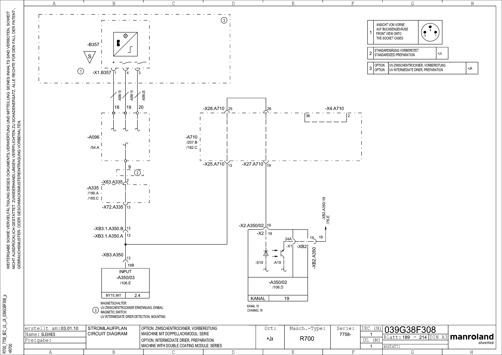

# +Jx — Sheet 189 of 214 — OPTION: ZWISCHENTROCKNER, VORBEREITUNG

**MASCHINE MIT DOPPELLACKMODUL: SERIE**

> Part of the manroland **R700** printing press IEC/UL circuit diagrams.
> Drawing class: **Stromlaufplan / Circuit diagram** (DIN A3).
> Document `+Jx` covers the **1st printing module + feed register** machine section.

## At a glance

| Field | Value |
|---|---|
| Document | `+Jx`  (039G38F308) |
| Sheet | **189** of 214 |
| Section (DE) | OPTION: ZWISCHENTROCKNER, VORBEREITUNG |
| Section (EN) | MASCHINE MIT DOPPELLACKMODUL: SERIE |
| Section type | CIRCUIT — Circuit diagram |
| Machine type | `R700` |
| Series | `7758` |
| Created | 03.01.10 |
| Replaces | — |
| Columns used | A, B, C, D, E, F, G, H |
| Path numbers | — |
| Labels on sheet | 94 |
| Cross-refs out | 8 |
| Cross-refs in | 24 |

**Previous:** [+Jx sheet 188](SHEET_0188.md) · **Next:** [+Jx sheet 190](SHEET_0190.md) · **Document TOC:** [_TOC.md](_TOC.md)  (+Jx) · **Master TOC:** [all sheets](../_MASTER_TOC.md)

## Sheet image (300 DPI, exact vector render)



_Rendered directly from the PDF vector layer at 300 DPI (1-bit), no OCR and no resampling. Use it to confirm anything ambiguous in the text below._

## Cross-references on this sheet

Each entry is a wire leaving this sheet. The printed token is `/sheet.column`; the link resolves to that sheet inside the same document.

| Ref | Target sheet | Col | Path | Destination on target | Target section | From col |
|---|---|---|---|---|---|---|
| `/207.B` | [+Jx sheet 207](SHEET_0207.md) | B | — | — | OPTION: ZWISCHENTROCKNER, VORBEREITUNG | C |
| `/182.C` | [+Jx sheet 182](SHEET_0182.md) | C | — | — | OPTION: TRANSFERMODUL 2 | C |
| `/54.A` | [+Jx sheet 54](SHEET_0054.md) | A | — | — | SCHUTZEINRICHTUNGEN | B |
| `/190.A` | [+Jx sheet 190](SHEET_0190.md) | A | — | — | OPTION: ZWISCHENTROCKNER, VORBEREITUNG | B |
| `/185.C` | [+Jx sheet 185](SHEET_0185.md) | C | — | — | OPTION: TRANSFERMODUL 1 + 2 | B |
| `/76.E` | [+Jx sheet 76](SHEET_0076.md) | E | — | XB2.A350:19 | BUSVERBINDUNGEN: SICHERHEITSKREIS | F |
| `/106.E` | [+Jx sheet 106](SHEET_0106.md) | E | — | — | REFERENZMODUL | B |
| `/106.D` | [+Jx sheet 106](SHEET_0106.md) | D | — | — | REFERENZMODUL | E |

### Incoming references (sheets that point here)

Every other sheet that sends a wire to this one. `Back-ref` is the token printed on *that* sheet; `Path` is its line number.

| From sheet | Cols | Back-ref | Path | Refs | What continues there |
|---|---|---|---|---|---|
| [+Jx#54](SHEET_0054.md) | A | `/54.A` | — | 1 | — |
| [+Jx#76](SHEET_0076.md) | E | `/76.E` | — | 1 | XB2.A350:19 |
| [+Jx#106](SHEET_0106.md) | D, E | `/106.D`, `/106.E` | — | 2 | — |
| [+Jx#117](SHEET_0117.md) | E | `/117.E` | — | 3 | — |
| [+Jx#126](SHEET_0126.md) | F | `/126.F` | — | 2 | — |
| [+Jx#128](SHEET_0128.md) | C, D, F | `/128.C`, `/128.D`, `/128.F` | — | 3 | — |
| [+Jx#130](SHEET_0130.md) | F | `/130.F` | — | 1 | — |
| [+Jx#143](SHEET_0143.md) | A | `/143.A` | — | 1 | — |
| [+Jx#144](SHEET_0144.md) | D | `/144.D` | — | 1 | — |
| [+Jx#146](SHEET_0146.md) | A, B | `/146.A`, `/146.B` | — | 3 | — |
| [+Jx#151](SHEET_0151.md) | H | `/151.H` | — | 1 | — |
| [+Jx#153](SHEET_0153.md) | C | `/153.C` | — | 1 | — |
| [+Jx#182](SHEET_0182.md) | C | `/182.C` | — | 1 | — |
| [+Jx#185](SHEET_0185.md) | C | `/185.C` | — | 1 | — |
| [+Jx#190](SHEET_0190.md) | A | `/190.A` | — | 1 | — |
| [+Jx#207](SHEET_0207.md) | B | `/207.B` | — | 1 | — |


## Devices on this sheet

| Tag | Class | Class meaning (IEC) | Col | Sub | Terminal | Sign |
|---|---|---|---|---|---|---|
| `A096` | A | Baugruppe / assembly, module, PC board | B | — | — | — |
| `B357` | B | Umformer / transducer, sensor | B | — | — | — |
| `A335` | A | Baugruppe / assembly, module, PC board | B | — | — | — |
| `A350/03` | A | Baugruppe / assembly, module, PC board | B | 03 | — | — |
| `S19` | S | Schalter / switch | D | — | — | — |
| `A19` | A | Baugruppe / assembly, module, PC board | E | — | — | — |
| `X1` | X | Klemme / terminal, plug connector | E | — | — | — |
| `X2` | X | Klemme / terminal, plug connector | D | — | — | — |
| `XB2` | XB |  | E | — | — | — |
| `A350/02` | A | Baugruppe / assembly, module, PC board | E | 02 | — | — |
| `A710` | A | Baugruppe / assembly, module, PC board | C | — | — | — |
| `A096:18` | A | Baugruppe / assembly, module, PC board | B | — | 18 | — |
| `A096:19` | A | Baugruppe / assembly, module, PC board | B | — | 19 | — |
| `A096:20` | A | Baugruppe / assembly, module, PC board | C | — | 20 | — |
| `X1.B357` | — | cross-device reference | B | — | — | — |
| `X63.A335` | — | cross-device reference | B | — | — | — |
| `X72.A335` | — | cross-device reference | B | — | — | — |
| `XB3.1.A350.B` | — | cross-device reference | B | — | — | — |
| `XB3.1.A350.A` | — | cross-device reference | B | — | — | — |
| `XB3.A350` | — | cross-device reference | B | — | — | — |
| `2.4` | — | cross-device reference | B | — | — | — |
| `XB2.A350` | — | cross-device reference | E | — | — | — |
| `X27.A710` | — | cross-device reference | D | — | — | — |
| `X25.A710` | — | cross-device reference | D | — | — | — |
| `XB2.A350:19` | — | cross-device reference | F | — | 19 | — |
| `X28.A710` | — | cross-device reference | D | — | — | — |
| `X4.A710` | — | cross-device reference | F | — | — | — |

## Potentials / nets

_No named potentials on this sheet._

## Wire-end annotations (grouped as printed)

A wire that continues elsewhere is annotated with a small cluster: the destination description, the path/line number `#NN`, and the `/sheet.column` cross reference. Each row below is one such cluster exactly as it is grouped on the drawing.

| Col | Y | Path | Cross-ref | Text on the wire |
|---|---|---|---|---|
| D | 45.6 | — | — | `3` |
| G | 55.9 | — | — | `FRONT VIEW ONTO ANSICHT VON VORNE AUF BUCHSENGEHÄUSE` |
| G | 68.2 | — | — | `1 THE SOCKET CASES 4` |
| G | 80.9 | — | — | `3 1` |
| B | 100.9 | — | — | `B357` |
| G | 116.8 | — | — | `2 STANDARDMÄSSIG VORBEREITET STANDARDIZED PREPARATION` |
| G | 123.9 | — | — | `+Jx` |
| B | 128.6 | — | — | `S` |
| B | 143.4 | — | — | `+` |
| F | 152.2 | — | — | `OPTION OPTION` |
| G | 152.2 | — | — | `UV ZWISCHENTROCKNER, VORBEREITUNG UV INTERMEDIATE DRIER, PREPARATION +JA` |
| F | 157.5 | — | — | `3` |
| A | 165.6 | — | — | `1` |
| B | 167.5 | — | — | `X1.B357 1 4 3` |
| B | 214.5 | — | — | `A096:18` |
| B | 214.5 | — | — | `A096:19` |
| C | 214.5 | — | — | `A096:20` |
| B | 249.7 | — | — | `18 19 20` |
| D | 252.5 | — | — | `X28.A710` |
| F | 252.5 | — | — | `X4.A710` |
| D | 254.0 | — | — | `25 26` |
| F | 271.0 | — | — | `36 2` |
| B | 320.6 | — | — | `A096` |
| C | 320.6 | — | — | `A710` |
| C | 333.6 | — | `/207.B`, `/182.C` | — |
| B | 346.0 | — | `/54.A` | — |
| D | 384.3 | — | — | `X25.A710 13 X27.A710 19` |
| B | 391.4 | — | — | `9` |
| B | 407.0 | — | — | `2` |
| B | 424.1 | — | — | `A335 X63.A335 2` |
| B | 454.1 | — | `/190.A`, `/185.C` | — |
| F | 467.1 | — | `/76.E` | `XB2.A350:19` |
| B | 486.4 | — | — | `X72.A335 13` |
| D | 530.3 | — | — | `X2.A350/02 19` |
| B | 537.4 | — | — | `XB3.1.A350.B 13` |
| D | 548.8 | — | — | `X2` |
| E | 550.2 | — | — | `19 19` |
| B | 554.4 | — | — | `XB3.1.A350.A 13` |
| E | 558.7 | — | — | `19` |
| E | 562.9 | — | — | `24A` |
| E | 579.9 | — | — | `X1` |
| E | 579.9 | — | — | `XB2` |
| E | 586.2 | — | — | `XB2.A350` |
| B | 599.8 | — | — | `XB3.A350 13` |
| E | 618.9 | — | — | `S19 A19` |
| B | 625.3 | — | — | `19B` |
| B | 639.8 | — | — | `INPUT` |
| B | 653.6 | — | — | `A350/03` |
| E | 665.0 | — | — | `A350/02` |
| B | 667.4 | — | `/106.E` | — |
| E | 677.4 | — | `/106.D` | — |
| B | 696.5 | — | — | `BYTE.BIT 2.4` |
| E | 703.2 | — | — | `KANAL 19` |
| B | 716.3 | — | — | `MAGNETSCHALTER: UV ZWISCHENTROCKNER ERKENNUNG, EINBAU MAGNETIC SWITCH: UV INTERMEDIATE DRIER DETECTION, MOUNTING` |
| D | 723.6 | — | — | `KANAL 19 CHANNEL 19` |
| B | 733.0 | — | — | `3` |


## Reconstructed tables

This sheet carries tabular content (pin map / terminal assignment / index). The grid below was rebuilt from the drawing's own rule lines, so each row is exactly one physical row of the table.

### Table 1 — 3 data rows × 4 columns (at x=240.9, y=76.5)

| + X1.B357 X63.A335 X72.A335 XB3.1.A350.B XB3.1.A350.A | 1 A096:18 18 | 4 A096:19 19 9 2 2 13 13 13 | 3 A096:20 20 |
|---|---|---|---|
| `XB3.A350` |  | `13 19B` |  |
|  | `INPUT` | `A350/03 /106.E` |  |
| `BYTE.BIT` |  | `2.4` |  |


### Table 2 — 5 data rows × 6 columns (at x=538.6, y=232.4)

| 25 |  | 26 |  |  | 36 |
|---|---|---|---|---|---|
| `13` | `X27.A710 X2.A350/02` | `19 19` |  |  | `XB2.A350:19` |
|  | `X2` | `19` | `24A` |  | `19 19` |
|  | `S19` | `A19` | `X1` | `XB2` | `XB2.A350` |
|  |  | `A350/02 /106.D` |  |  |  |
|  | `KANAL` |  | `19` |  |  |


## Notes and free text on this sheet

| Text | Col | Y (pt) |
|---|---|---|
| `19B` | B | 625.27 |
| `INPUT` | B | 639.79 |
| `BYTE.BIT` | B | 697.05 |
| `MAGNETSCHALTER:` | B | 716.33 |
| `UV ZWISCHENTROCKNER ERKENNUNG, EINBAU` | B | 726.96 |
| `MAGNETIC SWITCH:` | B | 737.56 |
| `UV INTERMEDIATE DRIER DETECTION, MOUNTING` | B | 748.24 |
| `KANAL 19` | D | 723.57 |
| `CHANNEL 19` | D | 733.52 |
| `24A` | E | 562.91 |
| `KANAL` | D | 703.22 |
| `X2.A350/02` | D | 530.32 |
| `S` | B | 128.57 |
| `ANSICHT VON VORNE` | G | 55.86 |
| `AUF BUCHSENGEHÄUSE` | G | 66.5 |
| `FRONT VIEW ONTO` | G | 77.09 |
| `THE SOCKET CASES` | G | 87.74 |
| `STANDARDMÄSSIG VORBEREITET` | G | 116.8 |
| `STANDARDIZED PREPARATION` | G | 127.43 |
| `+Jx` | G | 123.94 |
| `OPTION` | F | 152.21 |
| `UV ZWISCHENTROCKNER, VORBEREITUNG` | G | 152.23 |
| `UV INTERMEDIATE DRIER, PREPARATION` | G | 162.86 |
| `+JA` | H | 159.27 |

## Complete label inventory (exact text from the drawing)

Every text object inside the drawing area of this sheet, in DIN reading order (column A→H, then top→bottom). This is the authoritative list: if a string is not here it is not printed on this sheet.

| Col | Y | X | Dir | Type | Text |
|---|---|---|---|---|---|
| A | 165.6 | 189.5 | → | number | `1` |
| B | 100.9 | 207.2 | → | device tag | `B357` |
| B | 128.6 | 208.5 | → | text | `S` |
| B | 143.4 | 266.2 | → | number | `+` |
| B | 167.5 | 219.7 | → | device ref | `X1.B357` |
| B | 168.9 | 271.3 | → | number | `1` |
| B | 168.9 | 300.5 | → | number | `4` |
| B | 168.9 | 328.5 | → | number | `3` |
| B | 214.5 | 281.2 | ↕ | device tag | `A096:18` |
| B | 214.5 | 309.6 | ↕ | device tag | `A096:19` |
| B | 249.7 | 271.0 | → | number | `18` |
| B | 249.7 | 299.3 | → | number | `19` |
| B | 249.7 | 328.5 | → | number | `20` |
| B | 320.5 | 207.2 | → | device tag | `A096` |
| B | 346.0 | 214.6 | → | cross-reference | `/54.A` |
| B | 391.4 | 304.4 | → | number | `9` |
| B | 407.0 | 324.0 | → | number | `2` |
| B | 424.0 | 300.5 | → | number | `2` |
| B | 426.8 | 240.7 | → | device ref | `X63.A335` |
| B | 441.0 | 205.8 | → | device tag | `A335` |
| B | 454.1 | 208.3 | → | cross-reference | `/190.A` |
| B | 466.5 | 208.3 | → | cross-reference | `/185.C` |
| B | 486.4 | 242.1 | → | device ref | `X72.A335` |
| B | 487.8 | 299.6 | → | number | `13` |
| B | 537.4 | 222.5 | → | device ref | `XB3.1.A350.B` |
| B | 537.4 | 299.6 | → | number | `13` |
| B | 554.4 | 299.6 | → | number | `13` |
| B | 555.1 | 222.0 | → | device ref | `XB3.1.A350.A` |
| B | 599.8 | 241.2 | → | device ref | `XB3.A350` |
| B | 608.3 | 299.6 | → | number | `13` |
| B | 625.3 | 302.5 | → | text | `19B` |
| B | 639.8 | 282.8 | → | text | `INPUT` |
| B | 653.6 | 276.1 | → | device tag | `A350/03` |
| B | 667.4 | 285.0 | → | cross-reference | `/106.E` |
| B | 696.5 | 319.2 | → | device ref | `2.4` |
| B | 697.0 | 250.9 | → | text | `BYTE.BIT` |
| B | 716.3 | 239.0 | → | text | `MAGNETSCHALTER:` |
| B | 727.0 | 239.0 | → | text | `UV ZWISCHENTROCKNER ERKENNUNG, EINBAU` |
| B | 733.0 | 224.8 | → | number | `3` |
| B | 737.6 | 239.0 | → | text | `MAGNETIC SWITCH:` |
| B | 748.2 | 239.0 | → | text | `UV INTERMEDIATE DRIER DETECTION, MOUNTING` |
| C | 214.5 | 337.9 | ↕ | device tag | `A096:20` |
| C | 320.5 | 439.9 | → | device tag | `A710` |
| C | 333.6 | 442.5 | → | cross-reference | `/207.B` |
| C | 346.1 | 442.2 | → | cross-reference | `/182.C` |
| D | 45.6 | 529.5 | → | number | `3` |
| D | 252.5 | 481.9 | → | device ref | `X28.A710` |
| D | 254.0 | 541.4 | → | number | `25` |
| D | 384.3 | 481.9 | → | device ref | `X25.A710` |
| D | 384.3 | 574.0 | → | device ref | `X27.A710` |
| D | 388.6 | 540.6 | → | number | `13` |
| D | 530.3 | 566.6 | → | text | `X2.A350/02` |
| D | 548.8 | 609.2 | → | device tag | `X2` |
| D | 618.9 | 605.5 | → | device tag | `S19` |
| D | 703.2 | 594.7 | → | text | `KANAL` |
| D | 723.6 | 586.2 | → | text | `KANAL 19` |
| D | 733.5 | 586.5 | → | text | `CHANNEL 19` |
| E | 254.0 | 633.5 | → | number | `26` |
| E | 271.0 | 725.4 | → | number | `36` |
| E | 388.6 | 632.7 | → | number | `19` |
| E | 530.3 | 632.7 | → | number | `19` |
| E | 550.2 | 635.5 | → | number | `19` |
| E | 558.7 | 756.0 | → | number | `19` |
| E | 560.1 | 734.7 | → | number | `19` |
| E | 562.9 | 676.1 | → | text | `24A` |
| E | 579.9 | 679.5 | → | device tag | `X1` |
| E | 579.9 | 704.1 | → | device tag | `XB2` |
| E | 586.2 | 740.1 | ↕ | device ref | `XB2.A350` |
| E | 618.9 | 648.0 | → | device tag | `A19` |
| E | 665.0 | 637.7 | → | device tag | `A350/02` |
| E | 677.4 | 646.3 | → | cross-reference | `/106.D` |
| E | 703.2 | 673.9 | → | number | `19` |
| F | 72.5 | 876.2 | → | number | `1` |
| F | 122.1 | 875.9 | → | number | `2` |
| F | 152.2 | 888.4 | → | text | `OPTION` |
| F | 157.5 | 875.8 | → | number | `3` |
| F | 162.8 | 888.4 | → | text | `OPTION` |
| F | 252.5 | 771.3 | → | device ref | `X4.A710` |
| F | 271.0 | 824.9 | → | number | `2` |
| F | 467.1 | 764.2 | ↕ | device ref | `XB2.A350:19` |
| F | 510.8 | 774.1 | ↕ | cross-reference | `/76.E` |
| G | 55.9 | 892.9 | → | text | `ANSICHT VON VORNE` |
| G | 66.5 | 892.9 | → | text | `AUF BUCHSENGEHÄUSE` |
| G | 68.2 | 1018.6 | → | number | `4` |
| G | 77.1 | 892.3 | → | text | `FRONT VIEW ONTO` |
| G | 80.9 | 1005.7 | → | number | `3` |
| G | 80.9 | 1031.5 | → | number | `1` |
| G | 87.7 | 892.9 | → | text | `THE SOCKET CASES` |
| G | 116.8 | 888.4 | → | text | `STANDARDMÄSSIG VORBEREITET` |
| G | 123.9 | 1037.9 | → | text | `+Jx` |
| G | 127.4 | 888.4 | → | text | `STANDARDIZED PREPARATION` |
| G | 152.2 | 923.5 | → | text | `UV ZWISCHENTROCKNER, VORBEREITUNG` |
| G | 162.9 | 923.5 | → | text | `UV INTERMEDIATE DRIER, PREPARATION` |
| H | 159.3 | 1108.8 | → | text | `+JA` |

## Reading-order text block

The same content as a plain block, grouped by DIN column — convenient to paste or to match against a visual description.

```text
=== Column A ===
 165.6  189.5  numeric      1
=== Column B ===
 100.9  207.2  devtag       B357
 128.6  208.5  text         S
 143.4  266.2  numeric      +
 167.5  219.7  devref       X1.B357
 168.9  271.3  numeric      1
 168.9  300.5  numeric      4
 168.9  328.5  numeric      3
 214.5  281.2  devtag       A096:18
 214.5  309.6  devtag       A096:19
 249.7  271.0  numeric      18
 249.7  299.3  numeric      19
 249.7  328.5  numeric      20
 320.5  207.2  devtag       A096
 346.0  214.6  xref         /54.A
 391.4  304.4  numeric      9
 407.0  324.0  numeric      2
 424.0  300.5  numeric      2
 426.8  240.7  devref       X63.A335
 441.0  205.8  devtag       A335
 454.1  208.3  xref         /190.A
 466.5  208.3  xref         /185.C
 486.4  242.1  devref       X72.A335
 487.8  299.6  numeric      13
 537.4  222.5  devref       XB3.1.A350.B
 537.4  299.6  numeric      13
 554.4  299.6  numeric      13
 555.1  222.0  devref       XB3.1.A350.A
 599.8  241.2  devref       XB3.A350
 608.3  299.6  numeric      13
 625.3  302.5  text         19B
 639.8  282.8  text         INPUT
 653.6  276.1  devtag       A350/03
 667.4  285.0  xref         /106.E
 696.5  319.2  devref       2.4
 697.0  250.9  text         BYTE.BIT
 716.3  239.0  text         MAGNETSCHALTER:
 727.0  239.0  text         UV ZWISCHENTROCKNER ERKENNUNG, EINBAU
 733.0  224.8  numeric      3
 737.6  239.0  text         MAGNETIC SWITCH:
 748.2  239.0  text         UV INTERMEDIATE DRIER DETECTION, MOUNTING
=== Column C ===
 214.5  337.9  devtag       A096:20
 320.5  439.9  devtag       A710
 333.6  442.5  xref         /207.B
 346.1  442.2  xref         /182.C
=== Column D ===
  45.6  529.5  numeric      3
 252.5  481.9  devref       X28.A710
 254.0  541.4  numeric      25
 384.3  481.9  devref       X25.A710
 384.3  574.0  devref       X27.A710
 388.6  540.6  numeric      13
 530.3  566.6  text         X2.A350/02
 548.8  609.2  devtag       X2
 618.9  605.5  devtag       S19
 703.2  594.7  text         KANAL
 723.6  586.2  text         KANAL 19
 733.5  586.5  text         CHANNEL 19
=== Column E ===
 254.0  633.5  numeric      26
 271.0  725.4  numeric      36
 388.6  632.7  numeric      19
 530.3  632.7  numeric      19
 550.2  635.5  numeric      19
 558.7  756.0  numeric      19
 560.1  734.7  numeric      19
 562.9  676.1  text         24A
 579.9  679.5  devtag       X1
 579.9  704.1  devtag       XB2
 586.2  740.1  devref       XB2.A350
 618.9  648.0  devtag       A19
 665.0  637.7  devtag       A350/02
 677.4  646.3  xref         /106.D
 703.2  673.9  numeric      19
=== Column F ===
  72.5  876.2  numeric      1
 122.1  875.9  numeric      2
 152.2  888.4  text         OPTION
 157.5  875.8  numeric      3
 162.8  888.4  text         OPTION
 252.5  771.3  devref       X4.A710
 271.0  824.9  numeric      2
 467.1  764.2  devref       XB2.A350:19
 510.8  774.1  xref         /76.E
=== Column G ===
  55.9  892.9  text         ANSICHT VON VORNE
  66.5  892.9  text         AUF BUCHSENGEHÄUSE
  68.2 1018.6  numeric      4
  77.1  892.3  text         FRONT VIEW ONTO
  80.9 1005.7  numeric      3
  80.9 1031.5  numeric      1
  87.7  892.9  text         THE SOCKET CASES
 116.8  888.4  text         STANDARDMÄSSIG VORBEREITET
 123.9 1037.9  text         +Jx
 127.4  888.4  text         STANDARDIZED PREPARATION
 152.2  923.5  text         UV ZWISCHENTROCKNER, VORBEREITUNG
 162.9  923.5  text         UV INTERMEDIATE DRIER, PREPARATION
=== Column H ===
 159.3 1108.8  text         +JA
```

---
_Generated from the PDF vector text layer; no OCR. Source: `R700_7758_IEC_UL_JX_039G38F308_p`, sheet 189._
