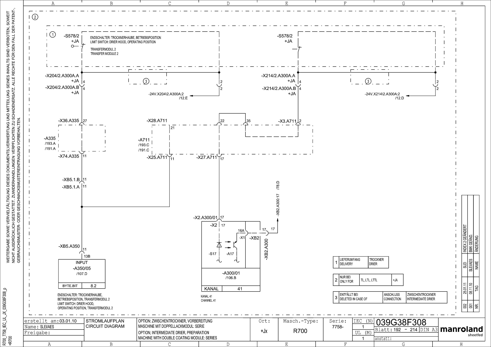

# +Jx — Sheet 192 of 214 — OPTION: ZWISCHENTROCKNER, VORBEREITUNG

**MASCHINE MIT DOPPELLACKMODUL: SERIE**

> Part of the manroland **R700** printing press IEC/UL circuit diagrams.
> Drawing class: **Stromlaufplan / Circuit diagram** (DIN A3).
> Document `+Jx` covers the **1st printing module + feed register** machine section.

## At a glance

| Field | Value |
|---|---|
| Document | `+Jx`  (039G38F308) |
| Sheet | **192** of 214 |
| Section (DE) | OPTION: ZWISCHENTROCKNER, VORBEREITUNG |
| Section (EN) | MASCHINE MIT DOPPELLACKMODUL: SERIE |
| Section type | CIRCUIT — Circuit diagram |
| Machine type | `R700` |
| Series | `7758` |
| Created | 03.01.10 |
| Replaces | — |
| Columns used | A, B, C, D, E, F, G, H |
| Path numbers | — |
| Labels on sheet | 117 |
| Cross-refs out | 9 |
| Cross-refs in | 30 |

**Previous:** [+Jx sheet 191](SHEET_0191.md) · **Next:** [+Jx sheet 193](SHEET_0193.md) · **Document TOC:** [_TOC.md](_TOC.md)  (+Jx) · **Master TOC:** [all sheets](../_MASTER_TOC.md)

## Sheet image (300 DPI, exact vector render)



_Rendered directly from the PDF vector layer at 300 DPI (1-bit), no OCR and no resampling. Use it to confirm anything ambiguous in the text below._

## Cross-references on this sheet

Each entry is a wire leaving this sheet. The printed token is `/sheet.column`; the link resolves to that sheet inside the same document.

| Ref | Target sheet | Col | Path | Destination on target | Target section | From col |
|---|---|---|---|---|---|---|
| `/12.E` | [+Jx sheet 12](SHEET_0012.md) | E | — | 24V.X204\2.A300A:2 24V.X214\2.A300A:2 | SPANNUNGSVERSORGUNG, SCHALTSCHRANKBELÜFTUNG | E |
| `/12.D` | [+Jx sheet 12](SHEET_0012.md) | D | — | 24V.X204\2.A300A:2 24V.X214\2.A300A:2 | SPANNUNGSVERSORGUNG, SCHALTSCHRANKBELÜFTUNG | E |
| `/193.A` | [+Jx sheet 193](SHEET_0193.md) | A | — | — | OPTION: ZWISCHENTROCKNER, VORBEREITUNG | A |
| `/191.A` | [+Jx sheet 191](SHEET_0191.md) | A | — | — | OPTION: ZWISCHENTROCKNER, VORBEREITUNG | A |
| `/193.C` | [+Jx sheet 193](SHEET_0193.md) | C | — | — | OPTION: ZWISCHENTROCKNER, VORBEREITUNG | C |
| `/191.C` | [+Jx sheet 191](SHEET_0191.md) | C | — | — | OPTION: ZWISCHENTROCKNER, VORBEREITUNG | C |
| `/78.D` | [+Jx sheet 78](SHEET_0078.md) | D | — | XB2.A300:17 | BUSVERBINDUNGEN: SICHERHEITSKREIS | E |
| `/107.D` | [+Jx sheet 107](SHEET_0107.md) | D | — | — | REFERENZMODUL | A |
| `/106.B` | [+Jx sheet 106](SHEET_0106.md) | B | — | — | REFERENZMODUL | D |

### Incoming references (sheets that point here)

Every other sheet that sends a wire to this one. `Back-ref` is the token printed on *that* sheet; `Path` is its line number.

| From sheet | Cols | Back-ref | Path | Refs | What continues there |
|---|---|---|---|---|---|
| [+Jx#12](SHEET_0012.md) | D, E | `/12.D`, `/12.E` | — | 2 | 24V.X204\2.A300A:2; 24V.X214\2.A300A:2 |
| [+Jx#78](SHEET_0078.md) | D | `/78.D` | — | 1 | XB2.A300:17 |
| [+Jx#106](SHEET_0106.md) | B | `/106.B` | — | 1 | — |
| [+Jx#107](SHEET_0107.md) | D | `/107.D` | — | 1 | — |
| [+Jx#124](SHEET_0124.md) | E, G | `/124.E`, `/124.G` | — | 2 | — |
| [+Jx#128](SHEET_0128.md) | H | `/128.H` | — | 1 | — |
| [+Jx#131](SHEET_0131.md) | A, B | `/131.A`, `/131.B` | — | 2 | — |
| [+Jx#132](SHEET_0132.md) | C | `/132.C` | — | 1 | — |
| [+Jx#143](SHEET_0143.md) | B | `/143.B` | — | 1 | — |
| [+Jx#144](SHEET_0144.md) | F | `/144.F` | — | 1 | — |
| [+Jx#146](SHEET_0146.md) | C, D | `/146.C`, `/146.D` | — | 3 | — |
| [+Jx#149](SHEET_0149.md) | G | `/149.G` | — | 1 | — |
| [+Jx#154](SHEET_0154.md) | A | `/154.A` | — | 1 | — |
| [+Jx#157](SHEET_0157.md) | C, D, E | `/157.C`, `/157.D`, `/157.E` | — | 4 | — |
| [+Jx#158](SHEET_0158.md) | C, D, E | `/158.C`, `/158.D`, `/158.E` | — | 4 | — |
| [+Jx#191](SHEET_0191.md) | A, B | `/191.A`, `/191.B` | — | 2 | — |
| [+Jx#193](SHEET_0193.md) | A, C | `/193.A`, `/193.C` | — | 2 | — |


## Devices on this sheet

| Tag | Class | Class meaning (IEC) | Col | Sub | Terminal | Sign |
|---|---|---|---|---|---|---|
| `S578/2` | S | Schalter / switch | A | 2 | — | — |
| `A335` | A | Baugruppe / assembly, module, PC board | A | — | — | — |
| `A350/05` | A | Baugruppe / assembly, module, PC board | A | 05 | — | — |
| `S17` | S | Schalter / switch | D | — | — | — |
| `A17` | A | Baugruppe / assembly, module, PC board | D | — | — | — |
| `X1` | X | Klemme / terminal, plug connector | D | — | — | — |
| `X2` | X | Klemme / terminal, plug connector | D | — | — | — |
| `XB2` | XB |  | D | — | — | — |
| `A300/01` | A | Baugruppe / assembly, module, PC board | D | 01 | — | — |
| `A711` | A | Baugruppe / assembly, module, PC board | C | — | — | — |
| `S578/2` | S | Schalter / switch | E | 2 | — | — |
| `X204/2.A300A.B` | — | cross-device reference | A | — | — | — |
| `X204/2.A300A.A` | — | cross-device reference | A | — | — | — |
| `X36.A335` | — | cross-device reference | A | — | — | — |
| `X74.A335` | — | cross-device reference | A | — | — | — |
| `XB5.1.B` | — | cross-device reference | A | — | — | — |
| `XB5.1.A` | — | cross-device reference | A | — | — | — |
| `8.2` | — | cross-device reference | B | — | — | — |
| `XB5.A350` | — | cross-device reference | A | — | — | — |
| `XB2.A300` | — | cross-device reference | E | — | — | — |
| `X25.A711` | — | cross-device reference | C | — | — | — |
| `X27.A711` | — | cross-device reference | D | — | — | — |
| `X214/2.A300A.B` | — | cross-device reference | E | — | — | — |
| `X214/2.A300A.A` | — | cross-device reference | E | — | — | — |
| `X3.A711` | — | cross-device reference | E | — | — | — |
| `NR.` | — | cross-device reference | H | — | — | — |
| `08.11.10` | — | cross-device reference | H | — | — | — |
| `XB2.A300:17` | — | cross-device reference | E | — | 17 | — |
| `25.01.11` | — | cross-device reference | H | — | — | — |
| `X28.A711` | — | cross-device reference | C | — | — | — |

## Potentials / nets

| Potential | Count | Columns | Attached devices | Terminals |
|---|---|---|---|---|
| `24V` | 2 | C, G | `A300A`, `X204\2`, `X214\2` | `2` |


A potential such as `L24+/4` or `M24+` is a named supply/return rail; every place it appears on this sheet is electrically common.

## Wire-end annotations (grouped as printed)

A wire that continues elsewhere is annotated with a small cluster: the destination description, the path/line number `#NN`, and the `/sheet.column` cross reference. Each row below is one such cluster exactly as it is grouped on the drawing.

| Col | Y | Path | Cross-ref | Text on the wire |
|---|---|---|---|---|
| A | 38.5 | — | — | `2` |
| A | 80.6 | — | — | `1` |
| A | 82.5 | — | — | `S578/2` |
| E | 82.5 | — | — | `S578/2` |
| B | 88.5 | — | — | `ENDSCHALTER: TROCKNERHAUBE, BETRIEBSPOSITION LIMIT SWITCH: DRIER HOOD, OPERATING POSITION` |
| A | 95.1 | — | — | `+JA` |
| E | 95.1 | — | — | `+JA` |
| B | 116.8 | — | — | `TRANSFERMODUL 2 TRANSFER MODULE 2` |
| A | 178.8 | — | — | `X204/2.A300A.A 4` |
| E | 178.8 | — | — | `X214/2.A300A.A 4` |
| A | 191.5 | — | — | `+JA` |
| E | 191.5 | — | — | `+JA` |
| D | 194.4 | — | — | `3 3` |
| D | 194.4 | — | — | `2` |
| H | 194.4 | — | — | `2` |
| A | 207.2 | — | — | `X204/2.A300A.B 4` |
| E | 210.0 | — | — | `X214/2.A300A.B 4` |
| D | 211.4 | — | — | `2` |
| H | 211.4 | — | — | `2` |
| A | 219.8 | — | — | `+JA` |
| E | 222.7 | — | — | `+JA` |
| E | 224.2 | — | `/12.E`, `/12.D` | `24V.X204\2.A300A:2 24V.X214\2.A300A:2` |
| A | 287.9 | — | — | `X36.A335 27` |
| C | 287.9 | — | — | `X28.A711` |
| D | 289.4 | — | — | `22` |
| D | 289.4 | — | — | `35` |
| E | 289.4 | — | — | `X3.A711 2` |
| C | 306.4 | — | — | `21` |
| A | 331.2 | — | — | `A335` |
| C | 334.7 | — | — | `A711` |
| A | 344.3 | — | `/193.A`, `/191.A` | — |
| C | 347.8 | — | `/193.C`, `/191.C` | — |
| A | 374.4 | — | — | `X74.A335 11` |
| C | 377.2 | — | — | `X25.A711 11 X27.A711 17` |
| A | 431.1 | — | — | `XB5.1.B 11` |
| E | 438.9 | — | `/78.D` | `XB2.A300:17` |
| A | 448.1 | — | — | `XB5.1.A 11` |
| D | 523.2 | — | — | `X2.A300/01 17` |
| D | 541.7 | — | — | `X2` |
| D | 543.1 | — | — | `17 17` |
| H | 544.4 | — | — | `25.01.11 SLEI 002 INDEX 2 GEÄNDERT` |
| E | 551.6 | — | — | `17` |
| D | 555.8 | — | — | `16A` |
| H | 567.9 | — | — | `001 BMK GEÄND. 08.11.10 SLEI/AES` |
| H | 571.6 | — | — | `NR. NAME TAG ÄNDERUNG` |
| D | 572.8 | — | — | `X1` |
| D | 572.9 | — | — | `XB2` |
| E | 579.1 | — | — | `XB2.A300` |
| A | 592.7 | — | — | `XB5.A350 11` |
| D | 611.8 | — | — | `S17 A17` |
| B | 618.2 | — | — | `13B` |
| F | 627.0 | — | — | `1 LIEFERUMFANG DELIVERY` |
| G | 627.1 | — | — | `DRIER TROCKNER` |
| A | 632.7 | — | — | `INPUT` |
| A | 646.5 | — | — | `A350/05` |
| D | 657.9 | — | — | `A300/01` |
| A | 660.4 | — | `/107.D` | — |
| F | 669.5 | — | — | `2 NUR BEI ONLY FOR TL, LTL, LTTL +JA` |
| D | 670.2 | — | `/106.B` | — |
| A | 689.4 | — | — | `BYTE.BIT 8.2` |
| D | 696.1 | — | — | `KANAL 41` |
| F | 712.0 | — | — | `3 ENTFÄLLT BEI DELETED IN CASE OF` |
| G | 712.1 | — | — | `CONNECTION ANSCHLUSS` |
| G | 712.1 | — | — | `INTERMEDIATE DRIER ZWISCHENTROCKNER` |
| B | 712.8 | — | — | `ENDSCHALTER: TROCKNERHAUBE, BETRIEBSPOSITION, TRANSFERMODUL 2 LIMIT SWITCH: DRIER HOOD, OPERATING POSITION, TRANSFERMODUL 2` |
| D | 716.5 | — | — | `KANAL 41 CHANNEL 41` |


## Reconstructed tables

This sheet carries tabular content (pin map / terminal assignment / index). The grid below was rebuilt from the drawing's own rule lines, so each row is exactly one physical row of the table.

### Table 1 — 4 data rows × 2 columns (at x=141.7, y=76.5)

| S578/2 +JA | ENDSCHALTER: LIMIT SWITCH: TRANSFERMODUL TRANSFER |
|---|---|
| `X204/2.A300A.A +JA X204/2.A300A.B +JA X36.A335 X74.A335 XB5.1.B XB5.1.A` | `4 4 27 11 11 11` |
| `XB5.A350` | `11 13B` |
| `INPUT` | `A350/05 /107.D` |
| `BYTE.BIT` | `8.2` |


### Table 2 — 7 data rows × 7 columns (at x=411.0, y=76.5) — **S578/2 +JA**

|  |  | 2 2 |  |  |  | X214/2.A300A.A +JA X214/2.A300A.B +JA |
|---|---|---|---|---|---|---|
| `/12.E` |  |  |  |  |  |  |
| `21` |  | `22` |  | `35` |  | `X3.A711` |
| `11` | `X27.A711` | `17` |  |  |  | `/78.D XB2.A300:17` |
|  | `X2.A300/01` | `17` |  |  |  |  |
|  | `X2 S17` | `17 A17` | `16A X1` | `XB2` | `17 17 XB2.A300` |  |
|  |  | `A300/01 /106.B` |  |  |  |  |
|  | `KANAL` |  | `41` |  |  |  |


## Notes and free text on this sheet

| Text | Col | Y (pt) |
|---|---|---|
| `+JA` | A | 95.11 |
| `ENDSCHALTER: TROCKNERHAUBE, BETRIEBSPOSITION` | B | 88.45 |
| `LIMIT SWITCH: DRIER HOOD, OPERATING POSITION` | B | 99.08 |
| `13B` | B | 618.18 |
| `INPUT` | A | 632.7 |
| `BYTE.BIT` | A | 689.96 |
| `ENDSCHALTER: TROCKNERHAUBE,` | A | 712.79 |
| `BETRIEBSPOSITION, TRANSFERMODUL 2` | B | 723.42 |
| `LIMIT SWITCH: DRIER HOOD,` | A | 734.03 |
| `OPERATING POSITION, TRANSFERMODUL 2` | B | 744.69 |
| `KANAL 41` | D | 716.46 |
| `CHANNEL 41` | D | 726.41 |
| `16A` | D | 555.82 |
| `KANAL` | D | 696.14 |
| `X2.A300/01` | D | 523.23 |
| `+JA` | E | 222.66 |
| `TAG` | H | 692.65 |
| `NAME` | H | 633.42 |
| `ÄNDERUNG` | H | 571.56 |
| `SLEI/AES` | H | 627.99 |
| `BMK GEÄND.` | H | 567.86 |
| `SLEI` | H | 635.57 |
| `INDEX 2 GEÄNDERT` | H | 544.35 |
| `TRANSFERMODUL 2` | B | 116.83 |
| `TRANSFER MODULE 2` | B | 127.45 |
| `ENTFÄLLT BEI` | F | 712.04 |
| `DELETED IN CASE OF` | F | 722.7 |
| `ANSCHLUSS` | G | 712.09 |
| `CONNECTION` | G | 722.72 |
| `ZWISCHENTROCKNER` | G | 712.07 |
| `INTERMEDIATE DRIER` | G | 722.71 |
| `LIEFERUMFANG` | F | 627.04 |
| `DELIVERY` | F | 637.65 |
| `TROCKNER` | G | 627.06 |
| `DRIER` | F | 637.67 |
| `NUR BEI` | F | 669.52 |
| `ONLY FOR` | F | 680.2 |
| `TL, LTL, LTTL` | F | 676.64 |
| `+JA` | G | 676.6 |

## Complete label inventory (exact text from the drawing)

Every text object inside the drawing area of this sheet, in DIN reading order (column A→H, then top→bottom). This is the authoritative list: if a string is not here it is not printed on this sheet.

| Col | Y | X | Dir | Type | Text |
|---|---|---|---|---|---|
| A | 38.5 | 83.0 | → | number | `2` |
| A | 80.6 | 125.7 | → | number | `1` |
| A | 82.4 | 154.8 | → | device tag | `S578/2` |
| A | 95.1 | 172.6 | → | text | `+JA` |
| A | 178.8 | 109.4 | → | device ref | `X204/2.A300A.A` |
| A | 191.5 | 172.6 | → | text | `+JA` |
| A | 207.2 | 110.0 | → | device ref | `X204/2.A300A.B` |
| A | 219.8 | 172.6 | → | text | `+JA` |
| A | 288.0 | 141.4 | → | device ref | `X36.A335` |
| A | 331.2 | 106.6 | → | device tag | `A335` |
| A | 344.3 | 109.1 | → | cross-reference | `/193.A` |
| A | 356.7 | 109.1 | → | cross-reference | `/191.A` |
| A | 374.4 | 141.4 | → | device ref | `X74.A335` |
| A | 431.1 | 151.1 | → | device ref | `XB5.1.B` |
| A | 448.8 | 150.5 | → | device ref | `XB5.1.A` |
| A | 592.7 | 142.0 | → | device ref | `XB5.A350` |
| A | 632.7 | 183.5 | → | text | `INPUT` |
| A | 646.5 | 176.9 | → | device tag | `A350/05` |
| A | 660.4 | 185.7 | → | cross-reference | `/107.D` |
| A | 690.0 | 151.7 | → | text | `BYTE.BIT` |
| A | 712.8 | 139.7 | → | text | `ENDSCHALTER: TROCKNERHAUBE,` |
| A | 734.0 | 139.7 | → | text | `LIMIT SWITCH: DRIER HOOD,` |
| B | 88.5 | 219.1 | → | text | `ENDSCHALTER: TROCKNERHAUBE, BETRIEBSPOSITION` |
| B | 99.1 | 219.1 | → | text | `LIMIT SWITCH: DRIER HOOD, OPERATING POSITION` |
| B | 116.8 | 219.7 | → | text | `TRANSFERMODUL 2` |
| B | 127.5 | 219.7 | → | text | `TRANSFER MODULE 2` |
| B | 194.4 | 201.3 | → | number | `4` |
| B | 211.4 | 201.3 | → | number | `4` |
| B | 289.4 | 201.3 | → | number | `27` |
| B | 374.4 | 200.4 | → | number | `11` |
| B | 431.1 | 200.4 | → | number | `11` |
| B | 448.1 | 200.4 | → | number | `11` |
| B | 601.2 | 200.4 | → | number | `11` |
| B | 618.2 | 203.2 | → | text | `13B` |
| B | 689.4 | 220.0 | → | device ref | `8.2` |
| B | 723.4 | 139.7 | → | text | `BETRIEBSPOSITION, TRANSFERMODUL 2` |
| B | 744.7 | 140.0 | → | text | `OPERATING POSITION, TRANSFERMODUL 2` |
| C | 194.4 | 352.3 | → | number | `3` |
| C | 224.2 | 360.3 | → | potential | `24V.X204\2.A300A:2` |
| C | 234.1 | 434.6 | → | cross-reference | `/12.E` |
| C | 288.0 | 355.7 | → | device ref | `X28.A711` |
| C | 306.4 | 413.9 | → | number | `21` |
| C | 334.7 | 335.1 | → | device tag | `A711` |
| C | 347.8 | 335.9 | → | cross-reference | `/193.C` |
| C | 360.2 | 335.9 | → | cross-reference | `/191.C` |
| C | 377.2 | 355.7 | → | device ref | `X25.A711` |
| C | 381.5 | 413.0 | → | number | `11` |
| D | 194.4 | 534.3 | → | number | `2` |
| D | 211.4 | 534.3 | → | number | `2` |
| D | 289.4 | 534.3 | → | number | `22` |
| D | 289.4 | 597.8 | → | number | `35` |
| D | 377.2 | 476.2 | → | device ref | `X27.A711` |
| D | 381.5 | 533.5 | → | number | `17` |
| D | 523.2 | 468.9 | → | text | `X2.A300/01` |
| D | 523.3 | 533.5 | → | number | `17` |
| D | 541.7 | 510.0 | → | device tag | `X2` |
| D | 543.1 | 536.3 | → | number | `17` |
| D | 555.8 | 576.9 | → | text | `16A` |
| D | 572.8 | 580.3 | → | device tag | `X1` |
| D | 572.8 | 604.9 | → | device tag | `XB2` |
| D | 611.8 | 506.3 | → | device tag | `S17` |
| D | 611.8 | 548.8 | → | device tag | `A17` |
| D | 657.9 | 539.1 | → | device tag | `A300/01` |
| D | 670.2 | 547.2 | → | cross-reference | `/106.B` |
| D | 696.1 | 495.5 | → | text | `KANAL` |
| D | 696.1 | 576.1 | → | number | `41` |
| D | 716.5 | 487.0 | → | text | `KANAL 41` |
| D | 726.4 | 487.3 | → | text | `CHANNEL 41` |
| E | 82.4 | 672.1 | → | device tag | `S578/2` |
| E | 95.1 | 690.0 | → | text | `+JA` |
| E | 178.8 | 633.8 | → | device ref | `X214/2.A300A.A` |
| E | 191.5 | 697.0 | → | text | `+JA` |
| E | 194.4 | 725.7 | → | number | `4` |
| E | 210.0 | 635.8 | → | device ref | `X214/2.A300A.B` |
| E | 211.4 | 725.7 | → | number | `4` |
| E | 222.7 | 698.5 | → | text | `+JA` |
| E | 289.4 | 674.9 | → | device ref | `X3.A711` |
| E | 289.4 | 725.7 | → | number | `2` |
| E | 438.9 | 669.9 | ↕ | cross-reference | `/78.D` |
| E | 470.0 | 669.9 | ↕ | device ref | `XB2.A300:17` |
| E | 551.6 | 656.8 | → | number | `17` |
| E | 553.0 | 635.5 | → | number | `17` |
| E | 579.1 | 640.9 | ↕ | device ref | `XB2.A300` |
| F | 194.4 | 890.9 | → | number | `3` |
| F | 627.0 | 824.3 | → | text | `LIEFERUMFANG` |
| F | 632.3 | 812.4 | → | number | `1` |
| F | 637.7 | 824.3 | → | text | `DELIVERY` |
| F | 637.7 | 895.2 | → | text | `DRIER` |
| F | 669.5 | 824.3 | → | text | `NUR BEI` |
| F | 674.8 | 812.1 | → | number | `2` |
| F | 676.6 | 875.2 | → | text | `TL, LTL, LTTL` |
| F | 680.2 | 824.6 | → | text | `ONLY FOR` |
| F | 712.0 | 824.3 | → | text | `ENTFÄLLT BEI` |
| F | 717.4 | 812.0 | → | number | `3` |
| F | 722.7 | 824.3 | → | text | `DELETED IN CASE OF` |
| G | 224.2 | 884.7 | → | potential | `24V.X214\2.A300A:2` |
| G | 234.1 | 958.7 | → | cross-reference | `/12.D` |
| G | 627.1 | 895.7 | → | text | `TROCKNER` |
| G | 676.6 | 952.9 | → | text | `+JA` |
| G | 712.1 | 931.2 | → | text | `ANSCHLUSS` |
| G | 712.1 | 987.9 | → | text | `ZWISCHENTROCKNER` |
| G | 722.7 | 930.9 | → | text | `CONNECTION` |
| G | 722.7 | 987.0 | → | text | `INTERMEDIATE DRIER` |
| H | 194.4 | 1058.7 | → | number | `2` |
| H | 211.4 | 1058.7 | → | number | `2` |
| H | 544.4 | 1124.3 | ↕ | text | `INDEX 2 GEÄNDERT` |
| H | 567.9 | 1138.4 | ↕ | text | `BMK GEÄND.` |
| H | 571.6 | 1152.6 | ↕ | text | `ÄNDERUNG` |
| H | 628.0 | 1138.4 | ↕ | text | `SLEI/AES` |
| H | 633.4 | 1152.6 | ↕ | text | `NAME` |
| H | 635.6 | 1124.2 | ↕ | text | `SLEI` |
| H | 685.7 | 1124.2 | ↕ | device ref | `25.01.11` |
| H | 686.6 | 1138.4 | ↕ | device ref | `08.11.10` |
| H | 692.6 | 1152.6 | ↕ | text | `TAG` |
| H | 735.9 | 1138.3 | ↕ | number | `001` |
| H | 736.3 | 1152.5 | ↕ | device ref | `NR.` |
| H | 736.9 | 1124.3 | ↕ | number | `002` |

## Reading-order text block

The same content as a plain block, grouped by DIN column — convenient to paste or to match against a visual description.

```text
=== Column A ===
  38.5   83.0  numeric      2
  80.6  125.7  numeric      1
  82.4  154.8  devtag       S578/2
  95.1  172.6  text         +JA
 178.8  109.4  devref       X204/2.A300A.A
 191.5  172.6  text         +JA
 207.2  110.0  devref       X204/2.A300A.B
 219.8  172.6  text         +JA
 288.0  141.4  devref       X36.A335
 331.2  106.6  devtag       A335
 344.3  109.1  xref         /193.A
 356.7  109.1  xref         /191.A
 374.4  141.4  devref       X74.A335
 431.1  151.1  devref       XB5.1.B
 448.8  150.5  devref       XB5.1.A
 592.7  142.0  devref       XB5.A350
 632.7  183.5  text         INPUT
 646.5  176.9  devtag       A350/05
 660.4  185.7  xref         /107.D
 690.0  151.7  text         BYTE.BIT
 712.8  139.7  text         ENDSCHALTER: TROCKNERHAUBE,
 734.0  139.7  text         LIMIT SWITCH: DRIER HOOD,
=== Column B ===
  88.5  219.1  text         ENDSCHALTER: TROCKNERHAUBE, BETRIEBSPOSITION
  99.1  219.1  text         LIMIT SWITCH: DRIER HOOD, OPERATING POSITION
 116.8  219.7  text         TRANSFERMODUL 2
 127.5  219.7  text         TRANSFER MODULE 2
 194.4  201.3  numeric      4
 211.4  201.3  numeric      4
 289.4  201.3  numeric      27
 374.4  200.4  numeric      11
 431.1  200.4  numeric      11
 448.1  200.4  numeric      11
 601.2  200.4  numeric      11
 618.2  203.2  text         13B
 689.4  220.0  devref       8.2
 723.4  139.7  text         BETRIEBSPOSITION, TRANSFERMODUL 2
 744.7  140.0  text         OPERATING POSITION, TRANSFERMODUL 2
=== Column C ===
 194.4  352.3  numeric      3
 224.2  360.3  net          24V.X204\2.A300A:2
 234.1  434.6  xref         /12.E
 288.0  355.7  devref       X28.A711
 306.4  413.9  numeric      21
 334.7  335.1  devtag       A711
 347.8  335.9  xref         /193.C
 360.2  335.9  xref         /191.C
 377.2  355.7  devref       X25.A711
 381.5  413.0  numeric      11
=== Column D ===
 194.4  534.3  numeric      2
 211.4  534.3  numeric      2
 289.4  534.3  numeric      22
 289.4  597.8  numeric      35
 377.2  476.2  devref       X27.A711
 381.5  533.5  numeric      17
 523.2  468.9  text         X2.A300/01
 523.3  533.5  numeric      17
 541.7  510.0  devtag       X2
 543.1  536.3  numeric      17
 555.8  576.9  text         16A
 572.8  580.3  devtag       X1
 572.8  604.9  devtag       XB2
 611.8  506.3  devtag       S17
 611.8  548.8  devtag       A17
 657.9  539.1  devtag       A300/01
 670.2  547.2  xref         /106.B
 696.1  495.5  text         KANAL
 696.1  576.1  numeric      41
 716.5  487.0  text         KANAL 41
 726.4  487.3  text         CHANNEL 41
=== Column E ===
  82.4  672.1  devtag       S578/2
  95.1  690.0  text         +JA
 178.8  633.8  devref       X214/2.A300A.A
 191.5  697.0  text         +JA
 194.4  725.7  numeric      4
 210.0  635.8  devref       X214/2.A300A.B
 211.4  725.7  numeric      4
 222.7  698.5  text         +JA
 289.4  674.9  devref       X3.A711
 289.4  725.7  numeric      2
 438.9  669.9  xref         /78.D
 470.0  669.9  devref       XB2.A300:17
 551.6  656.8  numeric      17
 553.0  635.5  numeric      17
 579.1  640.9  devref       XB2.A300
=== Column F ===
 194.4  890.9  numeric      3
 627.0  824.3  text         LIEFERUMFANG
 632.3  812.4  numeric      1
 637.7  824.3  text         DELIVERY
 637.7  895.2  text         DRIER
 669.5  824.3  text         NUR BEI
 674.8  812.1  numeric      2
 676.6  875.2  text         TL, LTL, LTTL
 680.2  824.6  text         ONLY FOR
 712.0  824.3  text         ENTFÄLLT BEI
 717.4  812.0  numeric      3
 722.7  824.3  text         DELETED IN CASE OF
=== Column G ===
 224.2  884.7  net          24V.X214\2.A300A:2
 234.1  958.7  xref         /12.D
 627.1  895.7  text         TROCKNER
 676.6  952.9  text         +JA
 712.1  931.2  text         ANSCHLUSS
 712.1  987.9  text         ZWISCHENTROCKNER
 722.7  930.9  text         CONNECTION
 722.7  987.0  text         INTERMEDIATE DRIER
=== Column H ===
 194.4 1058.7  numeric      2
 211.4 1058.7  numeric      2
 544.4 1124.3  text         INDEX 2 GEÄNDERT
 567.9 1138.4  text         BMK GEÄND.
 571.6 1152.6  text         ÄNDERUNG
 628.0 1138.4  text         SLEI/AES
 633.4 1152.6  text         NAME
 635.6 1124.2  text         SLEI
 685.7 1124.2  devref       25.01.11
 686.6 1138.4  devref       08.11.10
 692.6 1152.6  text         TAG
 735.9 1138.3  numeric      001
 736.3 1152.5  devref       NR.
 736.9 1124.3  numeric      002
```

---
_Generated from the PDF vector text layer; no OCR. Source: `R700_7758_IEC_UL_JX_039G38F308_p`, sheet 192._
