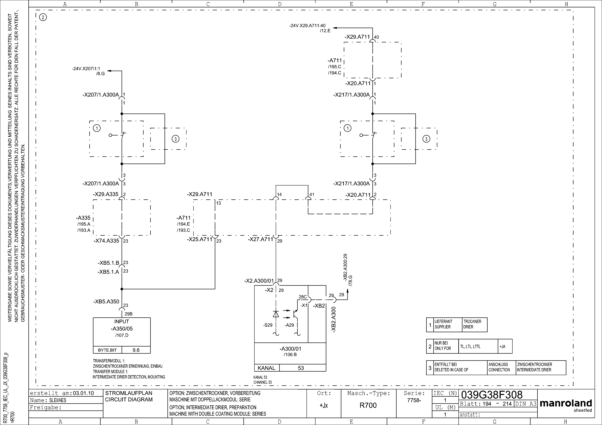

# +Jx — Sheet 194 of 214 — OPTION: ZWISCHENTROCKNER, VORBEREITUNG

**MASCHINE MIT DOPPELLACKMODUL: SERIE**

> Part of the manroland **R700** printing press IEC/UL circuit diagrams.
> Drawing class: **Stromlaufplan / Circuit diagram** (DIN A3).
> Document `+Jx` covers the **1st printing module + feed register** machine section.

## At a glance

| Field | Value |
|---|---|
| Document | `+Jx`  (039G38F308) |
| Sheet | **194** of 214 |
| Section (DE) | OPTION: ZWISCHENTROCKNER, VORBEREITUNG |
| Section (EN) | MASCHINE MIT DOPPELLACKMODUL: SERIE |
| Section type | CIRCUIT — Circuit diagram |
| Machine type | `R700` |
| Series | `7758` |
| Created | 03.01.10 |
| Replaces | — |
| Columns used | A, B, C, D, E, F, G, H |
| Path numbers | — |
| Labels on sheet | 101 |
| Cross-refs out | 11 |
| Cross-refs in | 30 |

**Previous:** [+Jx sheet 193](SHEET_0193.md) · **Next:** [+Jx sheet 195](SHEET_0195.md) · **Document TOC:** [_TOC.md](_TOC.md)  (+Jx) · **Master TOC:** [all sheets](../_MASTER_TOC.md)

## Sheet image (300 DPI, exact vector render)



_Rendered directly from the PDF vector layer at 300 DPI (1-bit), no OCR and no resampling. Use it to confirm anything ambiguous in the text below._

## Cross-references on this sheet

Each entry is a wire leaving this sheet. The printed token is `/sheet.column`; the link resolves to that sheet inside the same document.

| Ref | Target sheet | Col | Path | Destination on target | Target section | From col |
|---|---|---|---|---|---|---|
| `/12.E` | [+Jx sheet 12](SHEET_0012.md) | E | — | 24V.X29.A711:40 | SPANNUNGSVERSORGUNG, SCHALTSCHRANKBELÜFTUNG | D |
| `/195.C` | [+Jx sheet 195](SHEET_0195.md) | C | — | — | OPTION: ZWISCHENTROCKNER, VORBEREITUNG | E |
| `/194.C` | [+Jx sheet 194](SHEET_0194.md) | C | — | — | OPTION: ZWISCHENTROCKNER, VORBEREITUNG | E |
| `/8.G` | [+Jx sheet 8](SHEET_0008.md) | G | — | 24V.X207\1:1 | SPANNUNGSVERSORGUNG, SCHALTSCHRANKBELÜFTUNG | A |
| `/195.A` | [+Jx sheet 195](SHEET_0195.md) | A | — | — | OPTION: ZWISCHENTROCKNER, VORBEREITUNG | A |
| `/193.A` | [+Jx sheet 193](SHEET_0193.md) | A | — | — | OPTION: ZWISCHENTROCKNER, VORBEREITUNG | A |
| `/194.E` | [+Jx sheet 194](SHEET_0194.md) | E | — | — | OPTION: ZWISCHENTROCKNER, VORBEREITUNG | C |
| `/193.C` | [+Jx sheet 193](SHEET_0193.md) | C | — | — | OPTION: ZWISCHENTROCKNER, VORBEREITUNG | C |
| `/78.G` | [+Jx sheet 78](SHEET_0078.md) | G | — | XB2.A300:29 | BUSVERBINDUNGEN: SICHERHEITSKREIS | E |
| `/107.D` | [+Jx sheet 107](SHEET_0107.md) | D | — | — | REFERENZMODUL | B |
| `/106.B` | [+Jx sheet 106](SHEET_0106.md) | B | — | — | REFERENZMODUL | D |

### Incoming references (sheets that point here)

Every other sheet that sends a wire to this one. `Back-ref` is the token printed on *that* sheet; `Path` is its line number.

| From sheet | Cols | Back-ref | Path | Refs | What continues there |
|---|---|---|---|---|---|
| [+Jx#8](SHEET_0008.md) | G | `/8.G` | — | 1 | 24V.X207\1:1 |
| [+Jx#12](SHEET_0012.md) | D | `/12.D` | — | 1 | — |
| [+Jx#78](SHEET_0078.md) | F | `/78.F` | — | 1 | XB2.A300:29 |
| [+Jx#106](SHEET_0106.md) | B | `/106.B` | — | 1 | — |
| [+Jx#107](SHEET_0107.md) | D | `/107.D` | — | 1 | — |
| [+Jx#124](SHEET_0124.md) | F, H | `/124.F`, `/124.H` | — | 2 | — |
| [+Jx#131](SHEET_0131.md) | A, B | `/131.A`, `/131.B` | — | 2 | — |
| [+Jx#132](SHEET_0132.md) | C | `/132.C` | — | 1 | — |
| [+Jx#141](SHEET_0141.md) | F | `/141.F` | — | 2 | — |
| [+Jx#143](SHEET_0143.md) | B | `/143.B` | — | 1 | — |
| [+Jx#144](SHEET_0144.md) | G | `/144.G` | — | 1 | — |
| [+Jx#147](SHEET_0147.md) | A, D, E | `/147.A`, `/147.D`, `/147.E` | — | 5 | — |
| [+Jx#154](SHEET_0154.md) | A | `/154.A` | — | 1 | — |
| [+Jx#157](SHEET_0157.md) | F, G | `/157.F`, `/157.G` | — | 4 | — |
| [+Jx#193](SHEET_0193.md) | A, C | `/193.A`, `/193.C` | — | 2 | — |
| [+Jx#194](SHEET_0194.md) | C, E | `/194.C`, `/194.E` | — | 2 | — |
| [+Jx#195](SHEET_0195.md) | A, C | `/195.A`, `/195.C` | — | 2 | — |


## Devices on this sheet

| Tag | Class | Class meaning (IEC) | Col | Sub | Terminal | Sign |
|---|---|---|---|---|---|---|
| `A711` | A | Baugruppe / assembly, module, PC board | C | — | — | — |
| `A335` | A | Baugruppe / assembly, module, PC board | A | — | — | — |
| `S29` | S | Schalter / switch | D | — | — | — |
| `A29` | A | Baugruppe / assembly, module, PC board | D | — | — | — |
| `X1` | X | Klemme / terminal, plug connector | D | — | — | — |
| `X2` | X | Klemme / terminal, plug connector | D | — | — | — |
| `XB2` | XB |  | E | — | — | — |
| `A300/01` | A | Baugruppe / assembly, module, PC board | D | 01 | — | — |
| `A711` | A | Baugruppe / assembly, module, PC board | E | — | — | — |
| `A350/05` | A | Baugruppe / assembly, module, PC board | B | 05 | — | — |
| `X25.A711` | — | cross-device reference | C | — | — | — |
| `X27.A711` | — | cross-device reference | D | — | — | — |
| `X20.A711` | — | cross-device reference | E | — | — | — |
| `X217/1.A300A` | — | cross-device reference | E | — | — | — |
| `X217/1.A300A` | — | cross-device reference | E | — | — | — |
| `X207/1.A300A` | — | cross-device reference | B | — | — | — |
| `X207/1.A300A` | — | cross-device reference | B | — | — | — |
| `X29.A335` | — | cross-device reference | B | — | — | — |
| `XB2.A300` | — | cross-device reference | E | — | — | — |
| `XB5.1.B` | — | cross-device reference | B | — | — | — |
| `XB5.1.A` | — | cross-device reference | B | — | — | — |
| `X74.A335` | — | cross-device reference | B | — | — | — |
| `X29.A711` | — | cross-device reference | E | — | — | — |
| `X20.A711` | — | cross-device reference | E | — | — | — |
| `XB5.A350` | — | cross-device reference | B | — | — | — |
| `9.6` | — | cross-device reference | B | — | — | — |
| `XB2.A300:29` | — | cross-device reference | E | — | 29 | — |
| `X29.A711` | — | cross-device reference | C | — | — | — |

## Potentials / nets

| Potential | Count | Columns | Attached devices | Terminals |
|---|---|---|---|---|
| `24V` | 2 | A, D | `A711`, `X207\1`, `X29` | `1`, `40` |


A potential such as `L24+/4` or `M24+` is a named supply/return rail; every place it appears on this sheet is electrically common.

## Wire-end annotations (grouped as printed)

A wire that continues elsewhere is annotated with a small cluster: the destination description, the path/line number `#NN`, and the `/sheet.column` cross reference. Each row below is one such cluster exactly as it is grouped on the drawing.

| Col | Y | Path | Cross-ref | Text on the wire |
|---|---|---|---|---|
| A | 31.4 | — | — | `2` |
| D | 47.0 | — | `/12.E` | `24V.X29.A711:40` |
| E | 68.3 | — | — | `X29.A711 40` |
| E | 115.0 | — | — | `A711` |
| E | 128.2 | — | `/195.C`, `/194.C` | — |
| A | 132.0 | — | `/8.G` | `24V.X207\1:1` |
| E | 160.4 | — | — | `X20.A711 1` |
| B | 183.1 | — | — | `X207/1.A300A 1` |
| E | 183.1 | — | — | `X217/1.A300A 1` |
| B | 200.1 | — | — | `1` |
| E | 200.1 | — | — | `1` |
| A | 250.7 | — | — | `1` |
| E | 250.7 | — | — | `1` |
| C | 272.4 | — | — | `3` |
| F | 272.4 | — | — | `3` |
| B | 343.3 | — | — | `3` |
| E | 343.3 | — | — | `3` |
| B | 358.8 | — | — | `X207/1.A300A 3` |
| E | 358.8 | — | — | `X217/1.A300A 3` |
| B | 380.1 | — | — | `X29.A335 2` |
| C | 380.1 | — | — | `X29.A711` |
| D | 381.5 | — | — | `14` |
| E | 381.5 | — | — | `41 X20.A711 2` |
| C | 398.5 | — | — | `13` |
| A | 426.9 | — | — | `A335` |
| C | 426.9 | — | — | `A711` |
| A | 439.9 | — | `/195.A`, `/193.A` | — |
| C | 439.9 | — | `/194.E`, `/193.C` | — |
| C | 469.4 | — | — | `X25.A711 23 X27.A711 29` |
| B | 472.2 | — | — | `X74.A335 23` |
| E | 502.6 | — | `/78.G` | `XB2.A300:29` |
| B | 516.2 | — | — | `XB5.1.B 23` |
| B | 533.2 | — | — | `XB5.1.A 23` |
| D | 551.6 | — | — | `X2.A300/01 29` |
| D | 570.0 | — | — | `X2` |
| D | 571.5 | — | — | `29 29` |
| E | 580.0 | — | — | `29` |
| D | 584.2 | — | — | `28C` |
| B | 592.7 | — | — | `XB5.A350 23` |
| D | 601.2 | — | — | `X1` |
| E | 601.2 | — | — | `XB2` |
| E | 607.5 | — | — | `XB2.A300` |
| B | 618.2 | — | — | `29B` |
| B | 632.7 | — | — | `INPUT` |
| F | 634.1 | — | — | `1 LIEFERANT SUPPLIER` |
| G | 634.1 | — | — | `DRIER TROCKNER` |
| D | 640.2 | — | — | `S29 A29` |
| B | 646.5 | — | — | `A350/05` |
| B | 660.4 | — | `/107.D` | — |
| G | 676.6 | — | — | `2 NUR BEI ONLY FOR TL, LTL, LTTL +JA` |
| D | 686.2 | — | — | `A300/01` |
| B | 689.4 | — | — | `BYTE.BIT 9.6` |
| D | 698.6 | — | `/106.B` | — |
| B | 712.1 | — | — | `INTERMEDIATE DRIER DETECTION, MOUNTING TRANSFERMODUL 1: ZWISCHENTROCKNER ERKENNUNG, EINBAU TRANSFER MODULE 1:` |
| F | 719.1 | — | — | `3 ENTFÄLLT BEI DELETED IN CASE OF` |
| G | 719.2 | — | — | `CONNECTION ANSCHLUSS` |
| H | 719.2 | — | — | `INTERMEDIATE DRIER ZWISCHENTROCKNER` |
| D | 724.5 | — | — | `KANAL 53` |
| D | 744.8 | — | — | `KANAL 53 CHANNEL 53` |


## Reconstructed tables

This sheet carries tabular content (pin map / terminal assignment / index). The grid below was rebuilt from the drawing's own rule lines, so each row is exactly one physical row of the table.

### Table 1 — 9 data rows × 11 columns (at x=184.3, y=55.3)

| /8.G X207/1.A300A | 1 1 |  |  |  |  |  |  | /12.E | X29.A711 A711 /195.C /194.C X20.A711 X217/1.A300A | 40 1 1 1 |
|---|---|---|---|---|---|---|---|---|---|---|
| `1` |  |  | `3` |  |  |  |  |  | `1` |  |
| `X207/1.A300A` | `3 3` |  |  |  |  |  |  |  | `X217/1.A300A` | `3 3` |
| `X29.A335` | `2` |  | `X29.A711` | `13` |  | `14` |  | `41` | `X20.A711` | `2` |
| `X74.A335 XB5.1.B XB5.1.A` | `23 23 23` |  | `A711 /194.E /193.C X25.A711` | `23` | `X27.A711 X2.A300/01` | `29 29` |  |  | `XB2.A300:29 /78.G` |  |
| `XB5.A350` | `23 29B` |  |  |  | `X2` | `29` | `28C X1` | `XB2` | `29 29` |  |
| `INPUT` | `A350/05 /107.D` |  |  |  | `S29` | `A29` |  |  | `XB2.A300` |  |
| `BYTE.BIT` | `9.6` |  |  |  |  | `A300/01` |  |  |  |  |
| `TRANSFERMODUL` | `1:` |  |  |  |  | `/106.B` |  |  |  |  |
| `ZWISCHENTROCKNER` | `ERKENNUNG,` | `EINBAU` |  |  | `KANAL` |  | `53` |  |  |  |


## Notes and free text on this sheet

| Text | Col | Y (pt) |
|---|---|---|
| `KANAL 53` | D | 744.83 |
| `CHANNEL 53` | D | 754.78 |
| `28C` | D | 584.21 |
| `KANAL` | D | 724.48 |
| `X2.A300/01` | D | 551.58 |
| `29B` | B | 618.18 |
| `INPUT` | B | 632.7 |
| `BYTE.BIT` | B | 689.96 |
| `TRANSFERMODUL 1:` | B | 712.09 |
| `ZWISCHENTROCKNER ERKENNUNG, EINBAU` | B | 722.71 |
| `TRANSFER MODULE 1:` | B | 733.35 |
| `INTERMEDIATE DRIER DETECTION, MOUNTING` | B | 743.98 |
| `LIEFERANT` | F | 634.11 |
| `SUPPLIER` | F | 644.75 |
| `TROCKNER` | G | 634.15 |
| `DRIER` | G | 644.76 |
| `ENTFÄLLT BEI` | F | 719.13 |
| `DELETED IN CASE OF` | F | 729.78 |
| `ANSCHLUSS` | G | 719.18 |
| `CONNECTION` | G | 729.81 |
| `ZWISCHENTROCKNER` | H | 719.16 |
| `INTERMEDIATE DRIER` | H | 729.8 |
| `NUR BEI` | F | 676.6 |
| `ONLY FOR` | F | 687.29 |
| `TL, LTL, LTTL` | G | 683.73 |
| `+JA` | G | 683.68 |

## Complete label inventory (exact text from the drawing)

Every text object inside the drawing area of this sheet, in DIN reading order (column A→H, then top→bottom). This is the authoritative list: if a string is not here it is not printed on this sheet.

| Col | Y | X | Dir | Type | Text |
|---|---|---|---|---|---|
| A | 31.4 | 83.0 | → | number | `2` |
| A | 132.0 | 142.3 | → | potential | `24V.X207\1:1` |
| A | 141.9 | 190.5 | → | cross-reference | `/8.G` |
| A | 250.6 | 189.5 | → | number | `1` |
| A | 426.8 | 150.5 | → | device tag | `A335` |
| A | 439.9 | 153.1 | → | cross-reference | `/195.A` |
| A | 452.3 | 153.1 | → | cross-reference | `/193.A` |
| B | 183.1 | 163.3 | → | device ref | `X207/1.A300A` |
| B | 183.1 | 242.9 | → | number | `1` |
| B | 200.1 | 242.9 | → | number | `1` |
| B | 343.3 | 243.5 | → | number | `3` |
| B | 358.8 | 163.3 | → | device ref | `X207/1.A300A` |
| B | 360.3 | 243.5 | → | number | `3` |
| B | 380.1 | 184.0 | → | device ref | `X29.A335` |
| B | 381.5 | 243.8 | → | number | `2` |
| B | 472.2 | 185.4 | → | device ref | `X74.A335` |
| B | 473.7 | 243.8 | → | number | `23` |
| B | 516.2 | 193.6 | → | device ref | `XB5.1.B` |
| B | 516.2 | 243.8 | → | number | `23` |
| B | 533.2 | 243.8 | → | number | `23` |
| B | 533.9 | 193.0 | → | device ref | `XB5.1.A` |
| B | 592.7 | 184.5 | → | device ref | `XB5.A350` |
| B | 601.2 | 243.8 | → | number | `23` |
| B | 618.2 | 246.6 | → | text | `29B` |
| B | 632.7 | 226.1 | → | text | `INPUT` |
| B | 646.5 | 219.4 | → | device tag | `A350/05` |
| B | 660.4 | 228.2 | → | cross-reference | `/107.D` |
| B | 689.4 | 262.5 | → | device ref | `9.6` |
| B | 690.0 | 194.2 | → | text | `BYTE.BIT` |
| B | 712.1 | 184.3 | → | text | `TRANSFERMODUL 1:` |
| B | 722.7 | 184.3 | → | text | `ZWISCHENTROCKNER ERKENNUNG, EINBAU` |
| B | 733.4 | 184.3 | → | text | `TRANSFER MODULE 1:` |
| B | 744.0 | 183.4 | → | text | `INTERMEDIATE DRIER DETECTION, MOUNTING` |
| C | 272.4 | 345.2 | → | number | `3` |
| C | 380.1 | 369.9 | → | device ref | `X29.A711` |
| C | 398.5 | 427.2 | → | number | `13` |
| C | 426.8 | 349.2 | → | device tag | `A711` |
| C | 439.9 | 350.4 | → | cross-reference | `/194.E` |
| C | 452.4 | 350.1 | → | cross-reference | `/193.C` |
| C | 469.4 | 369.9 | → | device ref | `X25.A711` |
| C | 473.7 | 428.0 | → | number | `23` |
| D | 47.0 | 572.0 | → | potential | `24V.X29.A711:40` |
| D | 381.5 | 547.7 | → | number | `14` |
| D | 381.5 | 612.3 | → | number | `41` |
| D | 469.4 | 490.4 | → | device ref | `X27.A711` |
| D | 473.7 | 548.5 | → | number | `29` |
| D | 551.6 | 483.0 | → | text | `X2.A300/01` |
| D | 551.6 | 548.5 | → | number | `29` |
| D | 570.0 | 524.1 | → | device tag | `X2` |
| D | 571.4 | 551.3 | → | number | `29` |
| D | 584.2 | 591.0 | → | text | `28C` |
| D | 601.2 | 594.4 | → | device tag | `X1` |
| D | 640.2 | 520.4 | → | device tag | `S29` |
| D | 640.2 | 563.0 | → | device tag | `A29` |
| D | 686.2 | 553.3 | → | device tag | `A300/01` |
| D | 698.6 | 561.4 | → | cross-reference | `/106.B` |
| D | 724.5 | 509.7 | → | text | `KANAL` |
| D | 724.5 | 589.3 | → | number | `53` |
| D | 744.8 | 501.2 | → | text | `KANAL 53` |
| D | 754.8 | 501.4 | → | text | `CHANNEL 53` |
| E | 56.9 | 633.0 | → | cross-reference | `/12.E` |
| E | 68.3 | 681.7 | → | device ref | `X29.A711` |
| E | 69.7 | 739.8 | → | number | `40` |
| E | 115.0 | 648.3 | → | device tag | `A711` |
| E | 128.1 | 649.1 | → | cross-reference | `/195.C` |
| E | 140.5 | 649.1 | → | cross-reference | `/194.C` |
| E | 160.4 | 683.1 | → | device ref | `X20.A711` |
| E | 161.8 | 739.0 | → | number | `1` |
| E | 183.1 | 659.3 | → | device ref | `X217/1.A300A` |
| E | 183.1 | 739.0 | → | number | `1` |
| E | 200.1 | 739.0 | → | number | `1` |
| E | 250.6 | 685.5 | → | number | `1` |
| E | 343.3 | 739.6 | → | number | `3` |
| E | 358.8 | 659.3 | → | device ref | `X217/1.A300A` |
| E | 360.3 | 739.6 | → | number | `3` |
| E | 381.5 | 683.1 | → | device ref | `X20.A711` |
| E | 381.5 | 739.8 | → | number | `2` |
| E | 502.6 | 679.1 | ↕ | device ref | `XB2.A300:29` |
| E | 545.4 | 689.0 | ↕ | cross-reference | `/78.G` |
| E | 580.0 | 671.0 | → | number | `29` |
| E | 581.4 | 650.6 | → | number | `29` |
| E | 601.2 | 619.1 | → | device tag | `XB2` |
| E | 607.5 | 655.0 | ↕ | device ref | `XB2.A300` |
| F | 272.4 | 841.3 | → | number | `3` |
| F | 634.1 | 859.7 | → | text | `LIEFERANT` |
| F | 639.4 | 847.8 | → | number | `1` |
| F | 644.7 | 860.0 | → | text | `SUPPLIER` |
| F | 676.6 | 859.7 | → | text | `NUR BEI` |
| F | 681.9 | 847.6 | → | number | `2` |
| F | 687.3 | 860.0 | → | text | `ONLY FOR` |
| F | 719.1 | 859.7 | → | text | `ENTFÄLLT BEI` |
| F | 724.5 | 847.4 | → | number | `3` |
| F | 729.8 | 859.7 | → | text | `DELETED IN CASE OF` |
| G | 634.2 | 917.0 | → | text | `TROCKNER` |
| G | 644.8 | 916.4 | → | text | `DRIER` |
| G | 683.7 | 910.6 | → | text | `TL, LTL, LTTL` |
| G | 683.7 | 988.3 | → | text | `+JA` |
| G | 719.2 | 966.6 | → | text | `ANSCHLUSS` |
| G | 729.8 | 966.3 | → | text | `CONNECTION` |
| H | 719.2 | 1023.3 | → | text | `ZWISCHENTROCKNER` |
| H | 729.8 | 1022.5 | → | text | `INTERMEDIATE DRIER` |

## Reading-order text block

The same content as a plain block, grouped by DIN column — convenient to paste or to match against a visual description.

```text
=== Column A ===
  31.4   83.0  numeric      2
 132.0  142.3  net          24V.X207\1:1
 141.9  190.5  xref         /8.G
 250.6  189.5  numeric      1
 426.8  150.5  devtag       A335
 439.9  153.1  xref         /195.A
 452.3  153.1  xref         /193.A
=== Column B ===
 183.1  163.3  devref       X207/1.A300A
 183.1  242.9  numeric      1
 200.1  242.9  numeric      1
 343.3  243.5  numeric      3
 358.8  163.3  devref       X207/1.A300A
 360.3  243.5  numeric      3
 380.1  184.0  devref       X29.A335
 381.5  243.8  numeric      2
 472.2  185.4  devref       X74.A335
 473.7  243.8  numeric      23
 516.2  193.6  devref       XB5.1.B
 516.2  243.8  numeric      23
 533.2  243.8  numeric      23
 533.9  193.0  devref       XB5.1.A
 592.7  184.5  devref       XB5.A350
 601.2  243.8  numeric      23
 618.2  246.6  text         29B
 632.7  226.1  text         INPUT
 646.5  219.4  devtag       A350/05
 660.4  228.2  xref         /107.D
 689.4  262.5  devref       9.6
 690.0  194.2  text         BYTE.BIT
 712.1  184.3  text         TRANSFERMODUL 1:
 722.7  184.3  text         ZWISCHENTROCKNER ERKENNUNG, EINBAU
 733.4  184.3  text         TRANSFER MODULE 1:
 744.0  183.4  text         INTERMEDIATE DRIER DETECTION, MOUNTING
=== Column C ===
 272.4  345.2  numeric      3
 380.1  369.9  devref       X29.A711
 398.5  427.2  numeric      13
 426.8  349.2  devtag       A711
 439.9  350.4  xref         /194.E
 452.4  350.1  xref         /193.C
 469.4  369.9  devref       X25.A711
 473.7  428.0  numeric      23
=== Column D ===
  47.0  572.0  net          24V.X29.A711:40
 381.5  547.7  numeric      14
 381.5  612.3  numeric      41
 469.4  490.4  devref       X27.A711
 473.7  548.5  numeric      29
 551.6  483.0  text         X2.A300/01
 551.6  548.5  numeric      29
 570.0  524.1  devtag       X2
 571.4  551.3  numeric      29
 584.2  591.0  text         28C
 601.2  594.4  devtag       X1
 640.2  520.4  devtag       S29
 640.2  563.0  devtag       A29
 686.2  553.3  devtag       A300/01
 698.6  561.4  xref         /106.B
 724.5  509.7  text         KANAL
 724.5  589.3  numeric      53
 744.8  501.2  text         KANAL 53
 754.8  501.4  text         CHANNEL 53
=== Column E ===
  56.9  633.0  xref         /12.E
  68.3  681.7  devref       X29.A711
  69.7  739.8  numeric      40
 115.0  648.3  devtag       A711
 128.1  649.1  xref         /195.C
 140.5  649.1  xref         /194.C
 160.4  683.1  devref       X20.A711
 161.8  739.0  numeric      1
 183.1  659.3  devref       X217/1.A300A
 183.1  739.0  numeric      1
 200.1  739.0  numeric      1
 250.6  685.5  numeric      1
 343.3  739.6  numeric      3
 358.8  659.3  devref       X217/1.A300A
 360.3  739.6  numeric      3
 381.5  683.1  devref       X20.A711
 381.5  739.8  numeric      2
 502.6  679.1  devref       XB2.A300:29
 545.4  689.0  xref         /78.G
 580.0  671.0  numeric      29
 581.4  650.6  numeric      29
 601.2  619.1  devtag       XB2
 607.5  655.0  devref       XB2.A300
=== Column F ===
 272.4  841.3  numeric      3
 634.1  859.7  text         LIEFERANT
 639.4  847.8  numeric      1
 644.7  860.0  text         SUPPLIER
 676.6  859.7  text         NUR BEI
 681.9  847.6  numeric      2
 687.3  860.0  text         ONLY FOR
 719.1  859.7  text         ENTFÄLLT BEI
 724.5  847.4  numeric      3
 729.8  859.7  text         DELETED IN CASE OF
=== Column G ===
 634.2  917.0  text         TROCKNER
 644.8  916.4  text         DRIER
 683.7  910.6  text         TL, LTL, LTTL
 683.7  988.3  text         +JA
 719.2  966.6  text         ANSCHLUSS
 729.8  966.3  text         CONNECTION
=== Column H ===
 719.2 1023.3  text         ZWISCHENTROCKNER
 729.8 1022.5  text         INTERMEDIATE DRIER
```

---
_Generated from the PDF vector text layer; no OCR. Source: `R700_7758_IEC_UL_JX_039G38F308_p`, sheet 194._
