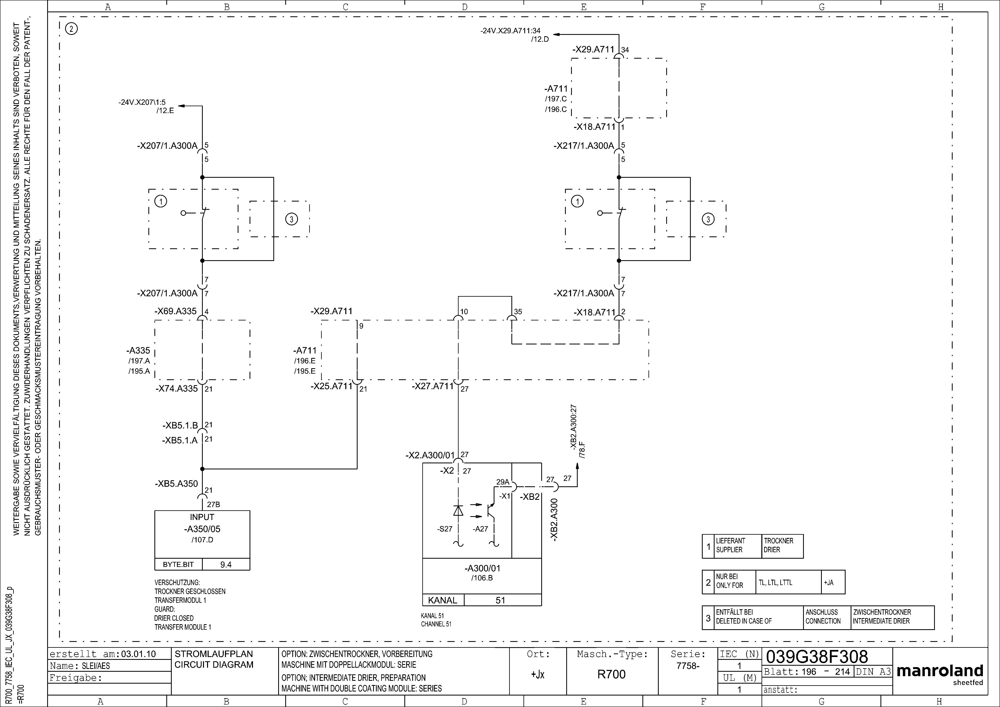

# +Jx — Sheet 196 of 214 — OPTION: ZWISCHENTROCKNER, VORBEREITUNG

**MASCHINE MIT DOPPELLACKMODUL: SERIE**

> Part of the manroland **R700** printing press IEC/UL circuit diagrams.
> Drawing class: **Stromlaufplan / Circuit diagram** (DIN A3).
> Document `+Jx` covers the **1st printing module + feed register** machine section.

## At a glance

| Field | Value |
|---|---|
| Document | `+Jx`  (039G38F308) |
| Sheet | **196** of 214 |
| Section (DE) | OPTION: ZWISCHENTROCKNER, VORBEREITUNG |
| Section (EN) | MASCHINE MIT DOPPELLACKMODUL: SERIE |
| Section type | CIRCUIT — Circuit diagram |
| Machine type | `R700` |
| Series | `7758` |
| Created | 03.01.10 |
| Replaces | — |
| Columns used | A, B, C, D, E, F, G, H |
| Path numbers | — |
| Labels on sheet | 103 |
| Cross-refs out | 11 |
| Cross-refs in | 30 |

**Previous:** [+Jx sheet 195](SHEET_0195.md) · **Next:** [+Jx sheet 197](SHEET_0197.md) · **Document TOC:** [_TOC.md](_TOC.md)  (+Jx) · **Master TOC:** [all sheets](../_MASTER_TOC.md)

## Sheet image (300 DPI, exact vector render)



_Rendered directly from the PDF vector layer at 300 DPI (1-bit), no OCR and no resampling. Use it to confirm anything ambiguous in the text below._

## Cross-references on this sheet

Each entry is a wire leaving this sheet. The printed token is `/sheet.column`; the link resolves to that sheet inside the same document.

| Ref | Target sheet | Col | Path | Destination on target | Target section | From col |
|---|---|---|---|---|---|---|
| `/12.D` | [+Jx sheet 12](SHEET_0012.md) | D | — | 2 24V.X29.A711:34 | SPANNUNGSVERSORGUNG, SCHALTSCHRANKBELÜFTUNG | C |
| `/197.C` | [+Jx sheet 197](SHEET_0197.md) | C | — | — | OPTION: ZWISCHENTROCKNER, VORBEREITUNG | E |
| `/196.C` | [+Jx sheet 196](SHEET_0196.md) | C | — | — | OPTION: ZWISCHENTROCKNER, VORBEREITUNG | E |
| `/12.E` | [+Jx sheet 12](SHEET_0012.md) | E | — | 24V.X207\1:5 | SPANNUNGSVERSORGUNG, SCHALTSCHRANKBELÜFTUNG | A |
| `/197.A` | [+Jx sheet 197](SHEET_0197.md) | A | — | — | OPTION: ZWISCHENTROCKNER, VORBEREITUNG | A |
| `/195.A` | [+Jx sheet 195](SHEET_0195.md) | A | — | — | OPTION: ZWISCHENTROCKNER, VORBEREITUNG | A |
| `/196.E` | [+Jx sheet 196](SHEET_0196.md) | E | — | — | OPTION: ZWISCHENTROCKNER, VORBEREITUNG | C |
| `/195.E` | [+Jx sheet 195](SHEET_0195.md) | E | — | — | OPTION: ZWISCHENTROCKNER, VORBEREITUNG | C |
| `/78.F` | [+Jx sheet 78](SHEET_0078.md) | F | — | XB2.A300:27 | BUSVERBINDUNGEN: SICHERHEITSKREIS | E |
| `/107.D` | [+Jx sheet 107](SHEET_0107.md) | D | — | — | REFERENZMODUL | B |
| `/106.B` | [+Jx sheet 106](SHEET_0106.md) | B | — | — | REFERENZMODUL | D |

### Incoming references (sheets that point here)

Every other sheet that sends a wire to this one. `Back-ref` is the token printed on *that* sheet; `Path` is its line number.

| From sheet | Cols | Back-ref | Path | Refs | What continues there |
|---|---|---|---|---|---|
| [+Jx#12](SHEET_0012.md) | D, E | `/12.D`, `/12.E` | — | 2 | 24V.X207\1:5 |
| [+Jx#78](SHEET_0078.md) | F | `/78.F` | — | 1 | XB2.A300:27 |
| [+Jx#106](SHEET_0106.md) | B | `/106.B` | — | 1 | — |
| [+Jx#107](SHEET_0107.md) | D | `/107.D` | — | 1 | — |
| [+Jx#124](SHEET_0124.md) | F, H | `/124.F`, `/124.H` | — | 2 | — |
| [+Jx#131](SHEET_0131.md) | A, B | `/131.A`, `/131.B` | — | 2 | — |
| [+Jx#132](SHEET_0132.md) | C | `/132.C` | — | 1 | — |
| [+Jx#140](SHEET_0140.md) | G | `/140.G` | — | 2 | — |
| [+Jx#143](SHEET_0143.md) | B | `/143.B` | — | 1 | — |
| [+Jx#144](SHEET_0144.md) | G | `/144.G` | — | 1 | — |
| [+Jx#147](SHEET_0147.md) | D, E | `/147.D`, `/147.E` | — | 4 | — |
| [+Jx#152](SHEET_0152.md) | G | `/152.G` | — | 1 | — |
| [+Jx#154](SHEET_0154.md) | A | `/154.A` | — | 1 | — |
| [+Jx#157](SHEET_0157.md) | F, G | `/157.F`, `/157.G` | — | 4 | — |
| [+Jx#195](SHEET_0195.md) | A, E | `/195.A`, `/195.E` | — | 2 | — |
| [+Jx#196](SHEET_0196.md) | C, E | `/196.C`, `/196.E` | — | 2 | — |
| [+Jx#197](SHEET_0197.md) | A, C | `/197.A`, `/197.C` | — | 2 | — |


## Devices on this sheet

| Tag | Class | Class meaning (IEC) | Col | Sub | Terminal | Sign |
|---|---|---|---|---|---|---|
| `A711` | A | Baugruppe / assembly, module, PC board | C | — | — | — |
| `A335` | A | Baugruppe / assembly, module, PC board | A | — | — | — |
| `S27` | S | Schalter / switch | D | — | — | — |
| `A27` | A | Baugruppe / assembly, module, PC board | D | — | — | — |
| `X1` | X | Klemme / terminal, plug connector | D | — | — | — |
| `X2` | X | Klemme / terminal, plug connector | D | — | — | — |
| `XB2` | XB |  | E | — | — | — |
| `A300/01` | A | Baugruppe / assembly, module, PC board | D | 01 | — | — |
| `A711` | A | Baugruppe / assembly, module, PC board | E | — | — | — |
| `A350/05` | A | Baugruppe / assembly, module, PC board | B | 05 | — | — |
| `X25.A711` | — | cross-device reference | C | — | — | — |
| `X27.A711` | — | cross-device reference | D | — | — | — |
| `X18.A711` | — | cross-device reference | E | — | — | — |
| `X217/1.A300A` | — | cross-device reference | E | — | — | — |
| `X217/1.A300A` | — | cross-device reference | E | — | — | — |
| `X207/1.A300A` | — | cross-device reference | B | — | — | — |
| `X207/1.A300A` | — | cross-device reference | B | — | — | — |
| `X69.A335` | — | cross-device reference | B | — | — | — |
| `XB2.A300` | — | cross-device reference | E | — | — | — |
| `XB5.1.B` | — | cross-device reference | B | — | — | — |
| `XB5.1.A` | — | cross-device reference | B | — | — | — |
| `X74.A335` | — | cross-device reference | B | — | — | — |
| `X29.A711` | — | cross-device reference | E | — | — | — |
| `X18.A711` | — | cross-device reference | E | — | — | — |
| `XB5.A350` | — | cross-device reference | B | — | — | — |
| `9.4` | — | cross-device reference | B | — | — | — |
| `XB2.A300:27` | — | cross-device reference | E | — | 27 | — |
| `X29.A711` | — | cross-device reference | C | — | — | — |

## Potentials / nets

| Potential | Count | Columns | Attached devices | Terminals |
|---|---|---|---|---|
| `24V` | 2 | A, D | `A711`, `X207\1`, `X29` | `34`, `5` |


A potential such as `L24+/4` or `M24+` is a named supply/return rail; every place it appears on this sheet is electrically common.

## Wire-end annotations (grouped as printed)

A wire that continues elsewhere is annotated with a small cluster: the destination description, the path/line number `#NN`, and the `/sheet.column` cross reference. Each row below is one such cluster exactly as it is grouped on the drawing.

| Col | Y | Path | Cross-ref | Text on the wire |
|---|---|---|---|---|
| C | 31.4 | — | `/12.D` | `2 24V.X29.A711:34` |
| E | 54.1 | — | — | `X29.A711 34` |
| E | 100.9 | — | — | `A711` |
| E | 114.0 | — | `/197.C`, `/196.C` | — |
| A | 117.9 | — | `/12.E` | `24V.X207\1:5` |
| E | 146.2 | — | — | `X18.A711 1` |
| B | 168.9 | — | — | `X207/1.A300A 5` |
| E | 168.9 | — | — | `X217/1.A300A 5` |
| B | 185.9 | — | — | `5` |
| E | 185.9 | — | — | `5` |
| A | 236.5 | — | — | `1` |
| E | 236.5 | — | — | `1` |
| C | 258.2 | — | — | `3` |
| F | 258.2 | — | — | `3` |
| B | 329.1 | — | — | `7` |
| E | 329.1 | — | — | `7` |
| B | 344.6 | — | — | `X207/1.A300A 7` |
| E | 344.6 | — | — | `X217/1.A300A 7` |
| B | 365.9 | — | — | `X69.A335 4` |
| C | 365.9 | — | — | `X29.A711` |
| E | 367.3 | — | — | `35 X18.A711 2` |
| D | 367.4 | — | — | `10` |
| C | 384.4 | — | — | `9` |
| A | 412.7 | — | — | `A335` |
| C | 412.7 | — | — | `A711` |
| A | 425.8 | — | `/197.A`, `/195.A` | — |
| C | 425.8 | — | `/196.E`, `/195.E` | — |
| C | 455.2 | — | — | `X25.A711 21 X27.A711 27` |
| B | 458.0 | — | — | `X74.A335 21` |
| E | 481.3 | — | `/78.F` | `XB2.A300:27` |
| B | 502.0 | — | — | `XB5.1.B 21` |
| B | 519.0 | — | — | `XB5.1.A 21` |
| D | 537.4 | — | — | `X2.A300/01 27` |
| D | 555.9 | — | — | `X2` |
| D | 557.3 | — | — | `27 27` |
| E | 565.8 | — | — | `27` |
| D | 570.0 | — | — | `29A` |
| B | 571.4 | — | — | `XB5.A350 21` |
| D | 587.0 | — | — | `X1` |
| E | 587.0 | — | — | `XB2` |
| E | 593.3 | — | — | `XB2.A300` |
| B | 596.9 | — | — | `27B` |
| B | 611.4 | — | — | `INPUT` |
| B | 625.3 | — | — | `A350/05` |
| D | 626.0 | — | — | `S27 A27` |
| B | 639.1 | — | `/107.D` | — |
| F | 641.2 | — | — | `1 LIEFERANT SUPPLIER` |
| G | 641.2 | — | — | `DRIER TROCKNER` |
| B | 668.1 | — | — | `BYTE.BIT 9.4` |
| D | 672.0 | — | — | `A300/01` |
| G | 683.7 | — | — | `2 NUR BEI ONLY FOR TL, LTL, LTTL +JA` |
| D | 684.4 | — | `/106.B` | — |
| B | 690.8 | — | — | `DRIER CLOSED GUARD: VERSCHUTZUNG: TROCKNER GESCHLOSSEN TRANSFERMODUL 1` |
| D | 710.3 | — | — | `KANAL 51` |
| F | 726.2 | — | — | `3 ENTFÄLLT BEI DELETED IN CASE OF` |
| H | 726.2 | — | — | `INTERMEDIATE DRIER ZWISCHENTROCKNER` |
| G | 726.3 | — | — | `CONNECTION ANSCHLUSS` |
| D | 730.6 | — | — | `KANAL 51 CHANNEL 51` |
| B | 744.0 | — | — | `TRANSFER MODULE 1` |


## Reconstructed tables

This sheet carries tabular content (pin map / terminal assignment / index). The grid below was rebuilt from the drawing's own rule lines, so each row is exactly one physical row of the table.

### Table 1 — 9 data rows × 2 columns (at x=184.3, y=41.1)

| /12.E X207/1.A300A | 5 5 |
|---|---|
| `1` |  |
| `X207/1.A300A` | `7 7` |
| `X69.A335` | `4` |
| `X74.A335 XB5.1.B XB5.1.A` | `21 21 21` |
| `XB5.A350` | `21 27B` |
| `INPUT` | `A350/05 /107.D` |
| `BYTE.BIT` | `9.4` |
| `VERSCHUTZUNG: TROCKNER` | `GESCHLOSSEN` |
| `TRANSFERMODUL` | `1` |


### Table 2 — 9 data rows × 8 columns (at x=326.0, y=41.1)

|  |  |  |  |  | /12.D | X29.A711 A711 /197.C /196.C X18.A711 X217/1.A300A | 34 1 5 5 |
|---|---|---|---|---|---|---|---|
| `3` |  |  |  |  |  | `1` |  |
|  |  |  |  |  |  | `X217/1.A300A` | `7 7` |
| `X29.A711` | `9` |  | `10` |  | `35` | `X18.A711` | `2` |
| `A711 /196.E /195.E X25.A711` | `21` | `X27.A711 X2.A300/01` | `27 27` |  |  | `XB2.A300:27 /78.F` |  |
|  |  | `X2` | `27` | `29A X1` | `XB2` | `27 27` |  |
|  |  | `S27` | `A27` |  |  | `XB2.A300` |  |
|  |  |  | `A300/01` |  |  |  |  |
|  |  |  | `/106.B` |  |  |  |  |
|  |  | `KANAL` |  | `51` |  |  |  |


## Notes and free text on this sheet

| Text | Col | Y (pt) |
|---|---|---|
| `KANAL 51` | D | 730.63 |
| `CHANNEL 51` | D | 740.58 |
| `29A` | D | 569.99 |
| `KANAL` | D | 710.31 |
| `X2.A300/01` | D | 537.41 |
| `27B` | B | 596.92 |
| `INPUT` | B | 611.44 |
| `BYTE.BIT` | B | 668.7 |
| `VERSCHUTZUNG:` | B | 690.83 |
| `TROCKNER GESCHLOSSEN` | B | 701.46 |
| `TRANSFERMODUL 1` | B | 712.09 |
| `GUARD:` | A | 722.7 |
| `DRIER CLOSED` | B | 733.35 |
| `TRANSFER MODULE 1` | B | 743.98 |
| `LIEFERANT` | F | 641.2 |
| `SUPPLIER` | F | 651.84 |
| `TROCKNER` | G | 641.24 |
| `DRIER` | G | 651.84 |
| `ENTFÄLLT BEI` | F | 726.22 |
| `DELETED IN CASE OF` | F | 736.87 |
| `ANSCHLUSS` | G | 726.26 |
| `CONNECTION` | G | 736.9 |
| `ZWISCHENTROCKNER` | H | 726.25 |
| `INTERMEDIATE DRIER` | H | 736.88 |
| `NUR BEI` | F | 683.69 |
| `ONLY FOR` | F | 694.38 |
| `TL, LTL, LTTL` | G | 690.81 |
| `+JA` | G | 690.77 |

## Complete label inventory (exact text from the drawing)

Every text object inside the drawing area of this sheet, in DIN reading order (column A→H, then top→bottom). This is the authoritative list: if a string is not here it is not printed on this sheet.

| Col | Y | X | Dir | Type | Text |
|---|---|---|---|---|---|
| A | 31.4 | 83.0 | → | number | `2` |
| A | 117.9 | 141.2 | → | potential | `24V.X207\1:5` |
| A | 127.8 | 186.5 | → | cross-reference | `/12.E` |
| A | 236.5 | 189.5 | → | number | `1` |
| A | 412.7 | 150.5 | → | device tag | `A335` |
| A | 425.8 | 153.1 | → | cross-reference | `/197.A` |
| A | 438.2 | 153.1 | → | cross-reference | `/195.A` |
| A | 722.7 | 184.0 | → | text | `GUARD:` |
| B | 168.9 | 163.3 | → | device ref | `X207/1.A300A` |
| B | 168.9 | 243.5 | → | number | `5` |
| B | 185.9 | 243.5 | → | number | `5` |
| B | 329.1 | 243.5 | → | number | `7` |
| B | 344.6 | 163.3 | → | device ref | `X207/1.A300A` |
| B | 346.1 | 243.5 | → | number | `7` |
| B | 365.9 | 184.0 | → | device ref | `X69.A335` |
| B | 367.4 | 243.8 | → | number | `4` |
| B | 458.0 | 185.4 | → | device ref | `X74.A335` |
| B | 459.5 | 243.8 | → | number | `21` |
| B | 502.0 | 193.6 | → | device ref | `XB5.1.B` |
| B | 502.0 | 243.8 | → | number | `21` |
| B | 519.0 | 243.8 | → | number | `21` |
| B | 519.7 | 193.0 | → | device ref | `XB5.1.A` |
| B | 571.4 | 184.5 | → | device ref | `XB5.A350` |
| B | 580.0 | 243.8 | → | number | `21` |
| B | 596.9 | 246.6 | → | text | `27B` |
| B | 611.4 | 226.1 | → | text | `INPUT` |
| B | 625.3 | 219.4 | → | device tag | `A350/05` |
| B | 639.1 | 228.2 | → | cross-reference | `/107.D` |
| B | 668.1 | 262.5 | → | device ref | `9.4` |
| B | 668.7 | 194.2 | → | text | `BYTE.BIT` |
| B | 690.8 | 184.3 | → | text | `VERSCHUTZUNG:` |
| B | 701.5 | 184.3 | → | text | `TROCKNER GESCHLOSSEN` |
| B | 712.1 | 184.3 | → | text | `TRANSFERMODUL 1` |
| B | 733.4 | 183.7 | → | text | `DRIER CLOSED` |
| B | 744.0 | 184.3 | → | text | `TRANSFER MODULE 1` |
| C | 258.2 | 345.2 | → | number | `3` |
| C | 365.9 | 369.9 | → | device ref | `X29.A711` |
| C | 384.4 | 427.7 | → | number | `9` |
| C | 412.7 | 349.2 | → | device tag | `A711` |
| C | 425.8 | 350.4 | → | cross-reference | `/196.E` |
| C | 438.2 | 350.4 | → | cross-reference | `/195.E` |
| C | 455.2 | 369.9 | → | device ref | `X25.A711` |
| C | 459.5 | 428.0 | → | number | `21` |
| D | 32.8 | 572.0 | → | potential | `24V.X29.A711:34` |
| D | 367.4 | 547.7 | → | number | `10` |
| D | 367.4 | 612.0 | → | number | `35` |
| D | 455.2 | 490.4 | → | device ref | `X27.A711` |
| D | 459.5 | 548.5 | → | number | `27` |
| D | 537.4 | 483.0 | → | text | `X2.A300/01` |
| D | 537.4 | 548.5 | → | number | `27` |
| D | 555.8 | 524.1 | → | device tag | `X2` |
| D | 557.3 | 551.3 | → | number | `27` |
| D | 570.0 | 591.0 | → | text | `29A` |
| D | 587.0 | 594.4 | → | device tag | `X1` |
| D | 626.0 | 520.4 | → | device tag | `S27` |
| D | 626.0 | 563.0 | → | device tag | `A27` |
| D | 672.0 | 553.3 | → | device tag | `A300/01` |
| D | 684.4 | 561.4 | → | cross-reference | `/106.B` |
| D | 710.3 | 509.7 | → | text | `KANAL` |
| D | 710.3 | 590.2 | → | number | `51` |
| D | 730.6 | 501.2 | → | text | `KANAL 51` |
| D | 740.6 | 501.4 | → | text | `CHANNEL 51` |
| E | 42.7 | 632.7 | → | cross-reference | `/12.D` |
| E | 54.1 | 681.7 | → | device ref | `X29.A711` |
| E | 55.5 | 739.6 | → | number | `34` |
| E | 100.9 | 648.3 | → | device tag | `A711` |
| E | 114.0 | 649.1 | → | cross-reference | `/197.C` |
| E | 126.4 | 649.1 | → | cross-reference | `/196.C` |
| E | 146.2 | 683.1 | → | device ref | `X18.A711` |
| E | 147.7 | 739.0 | → | number | `1` |
| E | 168.9 | 659.3 | → | device ref | `X217/1.A300A` |
| E | 168.9 | 739.6 | → | number | `5` |
| E | 185.9 | 739.6 | → | number | `5` |
| E | 236.5 | 685.5 | → | number | `1` |
| E | 329.1 | 739.6 | → | number | `7` |
| E | 344.6 | 659.3 | → | device ref | `X217/1.A300A` |
| E | 346.1 | 739.6 | → | number | `7` |
| E | 367.3 | 683.1 | → | device ref | `X18.A711` |
| E | 367.4 | 739.8 | → | number | `2` |
| E | 481.3 | 679.1 | ↕ | device ref | `XB2.A300:27` |
| E | 525.5 | 689.0 | ↕ | cross-reference | `/78.F` |
| E | 565.8 | 671.0 | → | number | `27` |
| E | 567.2 | 650.6 | → | number | `27` |
| E | 587.0 | 619.1 | → | device tag | `XB2` |
| E | 593.3 | 655.0 | ↕ | device ref | `XB2.A300` |
| F | 258.2 | 841.3 | → | number | `3` |
| F | 641.2 | 852.7 | → | text | `LIEFERANT` |
| F | 646.5 | 840.8 | → | number | `1` |
| F | 651.8 | 852.9 | → | text | `SUPPLIER` |
| F | 683.7 | 852.7 | → | text | `NUR BEI` |
| F | 689.0 | 840.5 | → | number | `2` |
| F | 694.4 | 852.9 | → | text | `ONLY FOR` |
| F | 726.2 | 852.7 | → | text | `ENTFÄLLT BEI` |
| F | 731.5 | 840.3 | → | number | `3` |
| F | 736.9 | 852.7 | → | text | `DELETED IN CASE OF` |
| G | 641.2 | 909.9 | → | text | `TROCKNER` |
| G | 651.8 | 909.4 | → | text | `DRIER` |
| G | 690.8 | 903.5 | → | text | `TL, LTL, LTTL` |
| G | 690.8 | 981.2 | → | text | `+JA` |
| G | 726.3 | 959.5 | → | text | `ANSCHLUSS` |
| G | 736.9 | 959.2 | → | text | `CONNECTION` |
| H | 726.2 | 1016.2 | → | text | `ZWISCHENTROCKNER` |
| H | 736.9 | 1015.4 | → | text | `INTERMEDIATE DRIER` |

## Reading-order text block

The same content as a plain block, grouped by DIN column — convenient to paste or to match against a visual description.

```text
=== Column A ===
  31.4   83.0  numeric      2
 117.9  141.2  net          24V.X207\1:5
 127.8  186.5  xref         /12.E
 236.5  189.5  numeric      1
 412.7  150.5  devtag       A335
 425.8  153.1  xref         /197.A
 438.2  153.1  xref         /195.A
 722.7  184.0  text         GUARD:
=== Column B ===
 168.9  163.3  devref       X207/1.A300A
 168.9  243.5  numeric      5
 185.9  243.5  numeric      5
 329.1  243.5  numeric      7
 344.6  163.3  devref       X207/1.A300A
 346.1  243.5  numeric      7
 365.9  184.0  devref       X69.A335
 367.4  243.8  numeric      4
 458.0  185.4  devref       X74.A335
 459.5  243.8  numeric      21
 502.0  193.6  devref       XB5.1.B
 502.0  243.8  numeric      21
 519.0  243.8  numeric      21
 519.7  193.0  devref       XB5.1.A
 571.4  184.5  devref       XB5.A350
 580.0  243.8  numeric      21
 596.9  246.6  text         27B
 611.4  226.1  text         INPUT
 625.3  219.4  devtag       A350/05
 639.1  228.2  xref         /107.D
 668.1  262.5  devref       9.4
 668.7  194.2  text         BYTE.BIT
 690.8  184.3  text         VERSCHUTZUNG:
 701.5  184.3  text         TROCKNER GESCHLOSSEN
 712.1  184.3  text         TRANSFERMODUL 1
 733.4  183.7  text         DRIER CLOSED
 744.0  184.3  text         TRANSFER MODULE 1
=== Column C ===
 258.2  345.2  numeric      3
 365.9  369.9  devref       X29.A711
 384.4  427.7  numeric      9
 412.7  349.2  devtag       A711
 425.8  350.4  xref         /196.E
 438.2  350.4  xref         /195.E
 455.2  369.9  devref       X25.A711
 459.5  428.0  numeric      21
=== Column D ===
  32.8  572.0  net          24V.X29.A711:34
 367.4  547.7  numeric      10
 367.4  612.0  numeric      35
 455.2  490.4  devref       X27.A711
 459.5  548.5  numeric      27
 537.4  483.0  text         X2.A300/01
 537.4  548.5  numeric      27
 555.8  524.1  devtag       X2
 557.3  551.3  numeric      27
 570.0  591.0  text         29A
 587.0  594.4  devtag       X1
 626.0  520.4  devtag       S27
 626.0  563.0  devtag       A27
 672.0  553.3  devtag       A300/01
 684.4  561.4  xref         /106.B
 710.3  509.7  text         KANAL
 710.3  590.2  numeric      51
 730.6  501.2  text         KANAL 51
 740.6  501.4  text         CHANNEL 51
=== Column E ===
  42.7  632.7  xref         /12.D
  54.1  681.7  devref       X29.A711
  55.5  739.6  numeric      34
 100.9  648.3  devtag       A711
 114.0  649.1  xref         /197.C
 126.4  649.1  xref         /196.C
 146.2  683.1  devref       X18.A711
 147.7  739.0  numeric      1
 168.9  659.3  devref       X217/1.A300A
 168.9  739.6  numeric      5
 185.9  739.6  numeric      5
 236.5  685.5  numeric      1
 329.1  739.6  numeric      7
 344.6  659.3  devref       X217/1.A300A
 346.1  739.6  numeric      7
 367.3  683.1  devref       X18.A711
 367.4  739.8  numeric      2
 481.3  679.1  devref       XB2.A300:27
 525.5  689.0  xref         /78.F
 565.8  671.0  numeric      27
 567.2  650.6  numeric      27
 587.0  619.1  devtag       XB2
 593.3  655.0  devref       XB2.A300
=== Column F ===
 258.2  841.3  numeric      3
 641.2  852.7  text         LIEFERANT
 646.5  840.8  numeric      1
 651.8  852.9  text         SUPPLIER
 683.7  852.7  text         NUR BEI
 689.0  840.5  numeric      2
 694.4  852.9  text         ONLY FOR
 726.2  852.7  text         ENTFÄLLT BEI
 731.5  840.3  numeric      3
 736.9  852.7  text         DELETED IN CASE OF
=== Column G ===
 641.2  909.9  text         TROCKNER
 651.8  909.4  text         DRIER
 690.8  903.5  text         TL, LTL, LTTL
 690.8  981.2  text         +JA
 726.3  959.5  text         ANSCHLUSS
 736.9  959.2  text         CONNECTION
=== Column H ===
 726.2 1016.2  text         ZWISCHENTROCKNER
 736.9 1015.4  text         INTERMEDIATE DRIER
```

---
_Generated from the PDF vector text layer; no OCR. Source: `R700_7758_IEC_UL_JX_039G38F308_p`, sheet 196._
