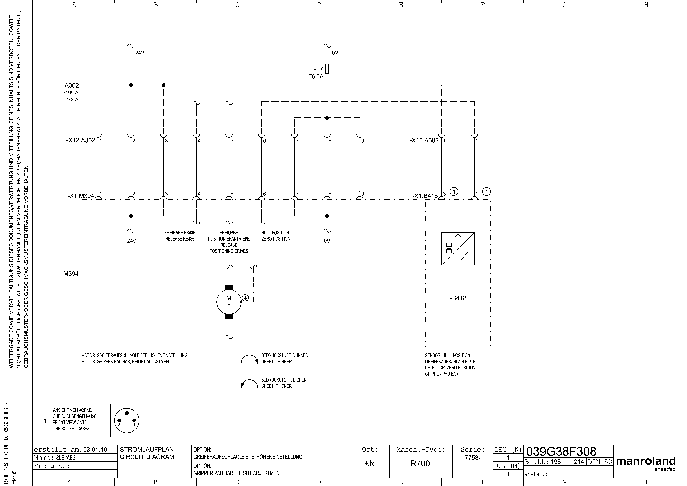

# +Jx — Sheet 198 of 214 — OPTION:

**GREIFERAUFSCHLAGLEISTE, HÖHENEINSTELLUNG**

> Part of the manroland **R700** printing press IEC/UL circuit diagrams.
> Drawing class: **Stromlaufplan / Circuit diagram** (DIN A3).
> Document `+Jx` covers the **1st printing module + feed register** machine section.

## At a glance

| Field | Value |
|---|---|
| Document | `+Jx`  (039G38F308) |
| Sheet | **198** of 214 |
| Section (DE) | OPTION: |
| Section (EN) | GREIFERAUFSCHLAGLEISTE, HÖHENEINSTELLUNG |
| Section type | CIRCUIT — Circuit diagram |
| Machine type | `R700` |
| Series | `7758` |
| Created | 03.01.10 |
| Replaces | — |
| Columns used | A, B, C, D, E, F |
| Path numbers | — |
| Labels on sheet | 66 |
| Cross-refs out | 2 |
| Cross-refs in | 24 |

**Previous:** [+Jx sheet 197](SHEET_0197.md) · **Next:** [+Jx sheet 199](SHEET_0199.md) · **Document TOC:** [_TOC.md](_TOC.md)  (+Jx) · **Master TOC:** [all sheets](../_MASTER_TOC.md)

## Sheet image (300 DPI, exact vector render)



_Rendered directly from the PDF vector layer at 300 DPI (1-bit), no OCR and no resampling. Use it to confirm anything ambiguous in the text below._

## Cross-references on this sheet

Each entry is a wire leaving this sheet. The printed token is `/sheet.column`; the link resolves to that sheet inside the same document.

| Ref | Target sheet | Col | Path | Destination on target | Target section | From col |
|---|---|---|---|---|---|---|
| `/199.A` | [+Jx sheet 199](SHEET_0199.md) | A | — | — | OPTION: | A |
| `/73.A` | [+Jx sheet 73](SHEET_0073.md) | A | — | — | BEDRUCKSTOFFEINSTELLUNG | A |

### Incoming references (sheets that point here)

Every other sheet that sends a wire to this one. `Back-ref` is the token printed on *that* sheet; `Path` is its line number.

| From sheet | Cols | Back-ref | Path | Refs | What continues there |
|---|---|---|---|---|---|
| [+Jx#73](SHEET_0073.md) | A | `/73.A` | — | 1 | — |
| [+Jx#117](SHEET_0117.md) | E | `/117.E` | — | 2 | — |
| [+Jx#118](SHEET_0118.md) | H | `/118.H` | — | 9 | — |
| [+Jx#137](SHEET_0137.md) | E | `/137.E` | — | 9 | — |
| [+Jx#138](SHEET_0138.md) | B | `/138.B` | — | 2 | — |
| [+Jx#199](SHEET_0199.md) | A | `/199.A` | — | 1 | — |


## Devices on this sheet

| Tag | Class | Class meaning (IEC) | Col | Sub | Terminal | Sign |
|---|---|---|---|---|---|---|
| `A302` | A | Baugruppe / assembly, module, PC board | A | — | — | — |
| `B418` | B | Umformer / transducer, sensor | F | — | — | — |
| `F7` | F | Schutz / protection device (fuse, circuit breaker) | D | — | — | — |
| `X13.A302` | — | cross-device reference | E | — | — | — |
| `X12.A302` | — | cross-device reference | A | — | — | — |
| `X1.M394` | — | cross-device reference | A | — | — | — |
| `X1.B418` | — | cross-device reference | E | — | — | — |

## Potentials / nets

| Potential | Count | Columns | Attached devices | Terminals |
|---|---|---|---|---|
| `0V` | 2 | D | — | — |
| `24V` | 2 | B | — | — |
| `M394` | 1 | A | — | — |


A potential such as `L24+/4` or `M24+` is a named supply/return rail; every place it appears on this sheet is electrically common.

## Wire-end annotations (grouped as printed)

A wire that continues elsewhere is annotated with a small cluster: the destination description, the path/line number `#NN`, and the `/sheet.column` cross reference. Each row below is one such cluster exactly as it is grouped on the drawing.

| Col | Y | Path | Cross-ref | Text on the wire |
|---|---|---|---|---|
| B | 87.4 | — | — | `24V` |
| D | 87.4 | — | — | `0V` |
| D | 115.0 | — | — | `F7` |
| D | 128.1 | — | — | `T6,3A` |
| A | 143.4 | — | — | `A302` |
| A | 156.5 | — | `/199.A` | — |
| A | 168.8 | — | `/73.A` | — |
| C | 238.3 | — | — | `X12.A302 1 2 3 4 5 6 7 8 9 X13.A302 1 2` |
| F | 328.6 | — | — | `1 1` |
| C | 331.9 | — | — | `X1.M394 1 2 3 4 5 6 7 8 9 X1.B418 3 1` |
| B | 400.2 | — | — | `FREIGABE RS485` |
| C | 400.2 | — | — | `POSITIONIERANTRIEBE FREIGABE` |
| C | 400.3 | — | — | `NULL POSITION` |
| B | 410.9 | — | — | `RELEASE RS485` |
| C | 410.9 | — | — | `ZERO POSITION` |
| C | 413.4 | — | — | `24V 0V` |
| C | 421.5 | — | — | `POSITIONING DRIVES RELEASE` |
| A | 469.4 | — | — | `M394` |
| C | 511.9 | — | — | `M` |
| F | 511.9 | — | — | `B418` |
| B | 612.9 | — | — | `MOTOR: GREIFERAUFSCHLAGLEISTE, HÖHENEINSTELLUNG MOTOR: GRIPPER PAD BAR, HEIGHT ADJUSTMENT` |
| D | 612.9 | — | — | `BEDRUCKSTOFF, DÜNNER SHEET, THINNER` |
| F | 612.9 | — | — | `DETECTOR: ZERO POSITION, SENSOR: NULL POSITION, GREIFERAUFSCHLAGLEISTE GRIPPER PAD BAR` |
| D | 655.4 | — | — | `BEDRUCKSTOFF, DICKER SHEET, THICKER` |
| A | 707.8 | — | — | `FRONT VIEW ONTO ANSICHT VON VORNE AUF BUCHSENGEHÄUSE` |
| A | 720.1 | — | — | `1 THE SOCKET CASES 4` |
| B | 732.9 | — | — | `3 1` |


## Reconstructed tables

This sheet carries tabular content (pin map / terminal assignment / index). The grid below was rebuilt from the drawing's own rule lines, so each row is exactly one physical row of the table.

### Table 1 — 2 data rows × 8 columns (at x=85.0, y=147.4) — **A302 /199.A /73.A**

| X12.A302 X1.M394 | 1 1 |  | 2 2 |  | 3 3 | 4 4 | 5 5 |
|---|---|---|---|---|---|---|---|
| `M394 MOTOR: MOTOR:` | `GRIPPER` | `24V GREIFERAUFSCHLAGLEISTE, PAD BAR,` | `HEIGHT` | `ADJUSTMENT` | `FREIGABE RS485 RELEASE RS485 HÖHENEINSTELLUNG` | `FREIGABE POSITIONIERANTRIEBE RELEASE POSITIONING M` | `DRIVES` |
| `ANSICHT VON VORNE AUF BUCHSENGEHÄUSE FRONT VIEW ONTO THE SOCKET CASES` |  | `4 3` | `1` |  |  |  |  |


### Table 2 — 1 data rows × 3 columns (at x=453.5, y=147.4)

| 6 6 | 7 7 | 8 8 |
|---|---|---|
| `NULL POSITION ZERO POSITION BEDRUCKSTOFF, SHEET, THINNER BEDRUCKSTOFF, SHEET, THICKER` | `DÜNNER DICKER` |  |


## Notes and free text on this sheet

| Text | Col | Y (pt) |
|---|---|---|
| `T6,3A` | D | 128.06 |
| `M` | C | 511.92 |
| `MOTOR: GREIFERAUFSCHLAGLEISTE, HÖHENEINSTELLUNG` | B | 612.87 |
| `MOTOR: GRIPPER PAD BAR, HEIGHT ADJUSTMENT` | B | 623.5 |
| `SENSOR: NULL POSITION,` | F | 612.86 |
| `GREIFERAUFSCHLAGLEISTE` | F | 623.5 |
| `DETECTOR: ZERO POSITION,` | F | 634.12 |
| `GRIPPER PAD BAR` | F | 644.75 |
| `FREIGABE` | C | 400.23 |
| `POSITIONIERANTRIEBE` | C | 410.88 |
| `RELEASE` | C | 421.5 |
| `POSITIONING DRIVES` | C | 432.15 |
| `FREIGABE RS485` | B | 400.25 |
| `RELEASE RS485` | B | 410.89 |
| `NULL POSITION` | C | 400.27 |
| `ZERO POSITION` | C | 410.9 |
| `BEDRUCKSTOFF, DÜNNER` | D | 612.88 |
| `SHEET, THINNER` | C | 623.5 |
| `BEDRUCKSTOFF, DICKER` | D | 655.39 |
| `SHEET, THICKER` | C | 666.01 |
| `ANSICHT VON VORNE` | A | 707.83 |
| `AUF BUCHSENGEHÄUSE` | A | 718.46 |
| `FRONT VIEW ONTO` | A | 729.06 |
| `THE SOCKET CASES` | A | 739.71 |

## Complete label inventory (exact text from the drawing)

Every text object inside the drawing area of this sheet, in DIN reading order (column A→H, then top→bottom). This is the authoritative list: if a string is not here it is not printed on this sheet.

| Col | Y | X | Dir | Type | Text |
|---|---|---|---|---|---|
| A | 143.4 | 108.3 | → | device tag | `A302` |
| A | 156.5 | 110.6 | → | cross-reference | `/199.A` |
| A | 168.9 | 115.4 | → | cross-reference | `/73.A` |
| A | 238.3 | 114.8 | → | device ref | `X12.A302` |
| A | 239.8 | 172.1 | → | number | `1` |
| A | 331.9 | 172.1 | → | number | `1` |
| A | 334.7 | 117.4 | → | device ref | `X1.M394` |
| A | 469.4 | 106.3 | → | potential | `M394` |
| A | 707.8 | 92.1 | → | text | `ANSICHT VON VORNE` |
| A | 718.5 | 92.1 | → | text | `AUF BUCHSENGEHÄUSE` |
| A | 724.5 | 75.4 | → | number | `1` |
| A | 729.1 | 91.6 | → | text | `FRONT VIEW ONTO` |
| A | 739.7 | 92.1 | → | text | `THE SOCKET CASES` |
| B | 87.4 | 231.6 | → | potential | `24V` |
| B | 239.8 | 229.6 | → | number | `2` |
| B | 239.8 | 286.0 | → | number | `3` |
| B | 331.9 | 229.6 | → | number | `2` |
| B | 331.9 | 286.0 | → | number | `3` |
| B | 400.3 | 285.3 | → | text | `FREIGABE RS485` |
| B | 410.9 | 286.7 | → | text | `RELEASE RS485` |
| B | 413.4 | 217.4 | → | potential | `24V` |
| B | 612.9 | 141.2 | → | text | `MOTOR: GREIFERAUFSCHLAGLEISTE, HÖHENEINSTELLUNG` |
| B | 623.5 | 141.2 | → | text | `MOTOR: GRIPPER PAD BAR, HEIGHT ADJUSTMENT` |
| B | 720.1 | 217.8 | → | number | `4` |
| B | 732.9 | 204.9 | → | number | `3` |
| B | 732.9 | 230.7 | → | number | `1` |
| C | 239.8 | 343.0 | → | number | `4` |
| C | 239.8 | 399.4 | → | number | `5` |
| C | 239.8 | 456.1 | → | number | `6` |
| C | 331.9 | 343.0 | → | number | `4` |
| C | 331.9 | 399.4 | → | number | `5` |
| C | 331.9 | 456.1 | → | number | `6` |
| C | 400.2 | 380.7 | → | text | `FREIGABE` |
| C | 400.3 | 453.0 | → | text | `NULL POSITION` |
| C | 410.9 | 360.7 | → | text | `POSITIONIERANTRIEBE` |
| C | 410.9 | 453.5 | → | text | `ZERO POSITION` |
| C | 421.5 | 382.1 | → | text | `RELEASE` |
| C | 432.2 | 363.5 | → | text | `POSITIONING DRIVES` |
| C | 511.9 | 392.5 | → | text | `M` |
| C | 623.5 | 453.3 | → | text | `SHEET, THINNER` |
| C | 666.0 | 453.3 | → | text | `SHEET, THICKER` |
| D | 87.4 | 575.6 | → | potential | `0V` |
| D | 115.1 | 544.3 | → | device tag | `F7` |
| D | 128.1 | 534.6 | → | text | `T6,3A` |
| D | 239.8 | 512.8 | → | number | `7` |
| D | 239.8 | 569.5 | → | number | `8` |
| D | 331.9 | 512.8 | → | number | `7` |
| D | 331.9 | 569.5 | → | number | `8` |
| D | 413.4 | 561.4 | → | potential | `0V` |
| D | 612.9 | 453.0 | → | text | `BEDRUCKSTOFF, DÜNNER` |
| D | 655.4 | 453.0 | → | text | `BEDRUCKSTOFF, DICKER` |
| E | 238.3 | 710.1 | → | device ref | `X13.A302` |
| E | 239.8 | 626.2 | → | number | `9` |
| E | 331.9 | 626.2 | → | number | `9` |
| E | 334.7 | 714.6 | → | device ref | `X1.B418` |
| F | 239.8 | 767.3 | → | number | `1` |
| F | 239.8 | 824.9 | → | number | `2` |
| F | 328.6 | 784.8 | → | number | `1` |
| F | 328.6 | 841.5 | → | number | `1` |
| F | 331.9 | 767.9 | → | number | `3` |
| F | 331.9 | 824.0 | → | number | `1` |
| F | 511.9 | 780.1 | → | device tag | `B418` |
| F | 612.9 | 736.7 | → | text | `SENSOR: NULL POSITION,` |
| F | 623.5 | 736.7 | → | text | `GREIFERAUFSCHLAGLEISTE` |
| F | 634.1 | 736.4 | → | text | `DETECTOR: ZERO POSITION,` |
| F | 644.8 | 736.7 | → | text | `GRIPPER PAD BAR` |

## Reading-order text block

The same content as a plain block, grouped by DIN column — convenient to paste or to match against a visual description.

```text
=== Column A ===
 143.4  108.3  devtag       A302
 156.5  110.6  xref         /199.A
 168.9  115.4  xref         /73.A
 238.3  114.8  devref       X12.A302
 239.8  172.1  numeric      1
 331.9  172.1  numeric      1
 334.7  117.4  devref       X1.M394
 469.4  106.3  net          M394
 707.8   92.1  text         ANSICHT VON VORNE
 718.5   92.1  text         AUF BUCHSENGEHÄUSE
 724.5   75.4  numeric      1
 729.1   91.6  text         FRONT VIEW ONTO
 739.7   92.1  text         THE SOCKET CASES
=== Column B ===
  87.4  231.6  net          24V
 239.8  229.6  numeric      2
 239.8  286.0  numeric      3
 331.9  229.6  numeric      2
 331.9  286.0  numeric      3
 400.3  285.3  text         FREIGABE RS485
 410.9  286.7  text         RELEASE RS485
 413.4  217.4  net          24V
 612.9  141.2  text         MOTOR: GREIFERAUFSCHLAGLEISTE, HÖHENEINSTELLUNG
 623.5  141.2  text         MOTOR: GRIPPER PAD BAR, HEIGHT ADJUSTMENT
 720.1  217.8  numeric      4
 732.9  204.9  numeric      3
 732.9  230.7  numeric      1
=== Column C ===
 239.8  343.0  numeric      4
 239.8  399.4  numeric      5
 239.8  456.1  numeric      6
 331.9  343.0  numeric      4
 331.9  399.4  numeric      5
 331.9  456.1  numeric      6
 400.2  380.7  text         FREIGABE
 400.3  453.0  text         NULL POSITION
 410.9  360.7  text         POSITIONIERANTRIEBE
 410.9  453.5  text         ZERO POSITION
 421.5  382.1  text         RELEASE
 432.2  363.5  text         POSITIONING DRIVES
 511.9  392.5  text         M
 623.5  453.3  text         SHEET, THINNER
 666.0  453.3  text         SHEET, THICKER
=== Column D ===
  87.4  575.6  net          0V
 115.1  544.3  devtag       F7
 128.1  534.6  text         T6,3A
 239.8  512.8  numeric      7
 239.8  569.5  numeric      8
 331.9  512.8  numeric      7
 331.9  569.5  numeric      8
 413.4  561.4  net          0V
 612.9  453.0  text         BEDRUCKSTOFF, DÜNNER
 655.4  453.0  text         BEDRUCKSTOFF, DICKER
=== Column E ===
 238.3  710.1  devref       X13.A302
 239.8  626.2  numeric      9
 331.9  626.2  numeric      9
 334.7  714.6  devref       X1.B418
=== Column F ===
 239.8  767.3  numeric      1
 239.8  824.9  numeric      2
 328.6  784.8  numeric      1
 328.6  841.5  numeric      1
 331.9  767.9  numeric      3
 331.9  824.0  numeric      1
 511.9  780.1  devtag       B418
 612.9  736.7  text         SENSOR: NULL POSITION,
 623.5  736.7  text         GREIFERAUFSCHLAGLEISTE
 634.1  736.4  text         DETECTOR: ZERO POSITION,
 644.8  736.7  text         GRIPPER PAD BAR
```

---
_Generated from the PDF vector text layer; no OCR. Source: `R700_7758_IEC_UL_JX_039G38F308_p`, sheet 198._
