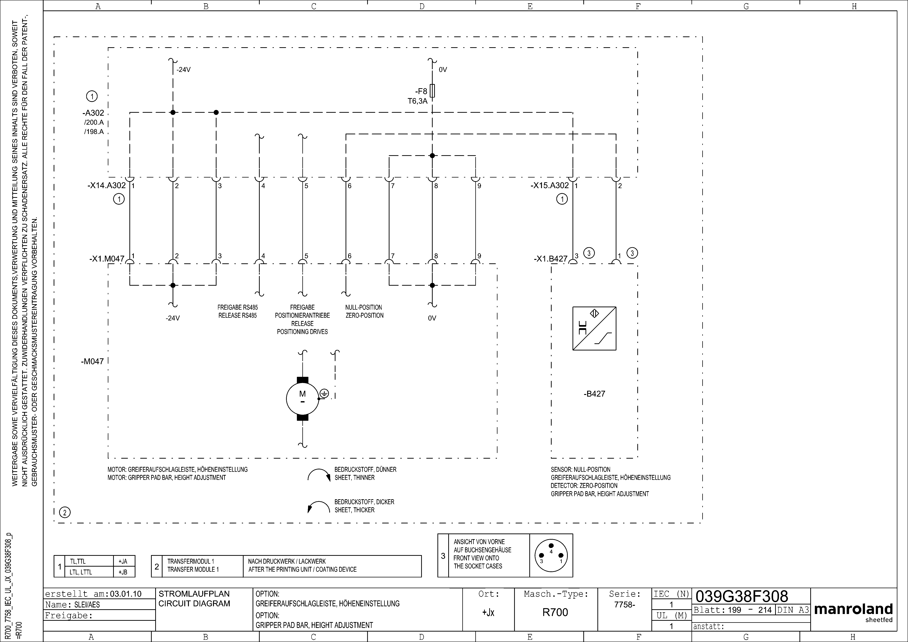

# +Jx — Sheet 199 of 214 — OPTION:

**GREIFERAUFSCHLAGLEISTE, HÖHENEINSTELLUNG**

> Part of the manroland **R700** printing press IEC/UL circuit diagrams.
> Drawing class: **Stromlaufplan / Circuit diagram** (DIN A3).
> Document `+Jx` covers the **1st printing module + feed register** machine section.

## At a glance

| Field | Value |
|---|---|
| Document | `+Jx`  (039G38F308) |
| Sheet | **199** of 214 |
| Section (DE) | OPTION: |
| Section (EN) | GREIFERAUFSCHLAGLEISTE, HÖHENEINSTELLUNG |
| Section type | CIRCUIT — Circuit diagram |
| Machine type | `R700` |
| Series | `7758` |
| Created | 03.01.10 |
| Replaces | — |
| Columns used | A, B, C, D, E, F |
| Path numbers | — |
| Labels on sheet | 80 |
| Cross-refs out | 2 |
| Cross-refs in | 24 |

**Previous:** [+Jx sheet 198](SHEET_0198.md) · **Next:** [+Jx sheet 200](SHEET_0200.md) · **Document TOC:** [_TOC.md](_TOC.md)  (+Jx) · **Master TOC:** [all sheets](../_MASTER_TOC.md)

## Sheet image (300 DPI, exact vector render)



_Rendered directly from the PDF vector layer at 300 DPI (1-bit), no OCR and no resampling. Use it to confirm anything ambiguous in the text below._

## Cross-references on this sheet

Each entry is a wire leaving this sheet. The printed token is `/sheet.column`; the link resolves to that sheet inside the same document.

| Ref | Target sheet | Col | Path | Destination on target | Target section | From col |
|---|---|---|---|---|---|---|
| `/200.A` | [+Jx sheet 200](SHEET_0200.md) | A | — | — | OPTION: | A |
| `/198.A` | [+Jx sheet 198](SHEET_0198.md) | A | — | — | OPTION: | A |

### Incoming references (sheets that point here)

Every other sheet that sends a wire to this one. `Back-ref` is the token printed on *that* sheet; `Path` is its line number.

| From sheet | Cols | Back-ref | Path | Refs | What continues there |
|---|---|---|---|---|---|
| [+Jx#117](SHEET_0117.md) | E | `/117.E` | — | 2 | — |
| [+Jx#118](SHEET_0118.md) | C | `/118.C` | — | 9 | — |
| [+Jx#138](SHEET_0138.md) | C, G | `/138.C`, `/138.G` | — | 11 | — |
| [+Jx#198](SHEET_0198.md) | A | `/198.A` | — | 1 | — |
| [+Jx#200](SHEET_0200.md) | A | `/200.A` | — | 1 | — |


## Devices on this sheet

| Tag | Class | Class meaning (IEC) | Col | Sub | Terminal | Sign |
|---|---|---|---|---|---|---|
| `A302` | A | Baugruppe / assembly, module, PC board | A | — | — | — |
| `B427` | B | Umformer / transducer, sensor | F | — | — | — |
| `F8` | F | Schutz / protection device (fuse, circuit breaker) | D | — | — | — |
| `X15.A302` | — | cross-device reference | E | — | — | — |
| `X14.A302` | — | cross-device reference | A | — | — | — |
| `X1.B427` | — | cross-device reference | E | — | — | — |
| `X1.M047` | — | cross-device reference | A | — | — | — |

## Potentials / nets

| Potential | Count | Columns | Attached devices | Terminals |
|---|---|---|---|---|
| `0V` | 2 | D | — | — |
| `24V` | 2 | B | — | — |
| `M047` | 1 | A | — | — |


A potential such as `L24+/4` or `M24+` is a named supply/return rail; every place it appears on this sheet is electrically common.

## Wire-end annotations (grouped as printed)

A wire that continues elsewhere is annotated with a small cluster: the destination description, the path/line number `#NN`, and the `/sheet.column` cross reference. Each row below is one such cluster exactly as it is grouped on the drawing.

| Col | Y | Path | Cross-ref | Text on the wire |
|---|---|---|---|---|
| C | 87.4 | — | — | `24V 0V` |
| D | 115.0 | — | — | `F8` |
| A | 123.1 | — | — | `1` |
| B | 128.1 | — | — | `A302 T6,3A` |
| A | 156.5 | — | `/200.A`, `/198.A` | — |
| C | 238.3 | — | — | `X14.A302 1 2 3 4 5 6 7 8 9 X15.A302 1 2` |
| C | 257.7 | — | — | `1 1` |
| F | 329.1 | — | — | `3 3` |
| C | 331.9 | — | — | `X1.M047 1 2 3 4 5 6 7 8 9` |
| E | 331.9 | — | — | `X1.B427 3 1` |
| B | 400.2 | — | — | `FREIGABE RS485` |
| C | 400.2 | — | — | `POSITIONIERANTRIEBE FREIGABE` |
| C | 400.3 | — | — | `NULL POSITION` |
| B | 410.9 | — | — | `RELEASE RS485` |
| C | 410.9 | — | — | `ZERO POSITION` |
| C | 413.4 | — | — | `24V 0V` |
| C | 421.5 | — | — | `POSITIONING DRIVES RELEASE` |
| A | 469.4 | — | — | `M047` |
| C | 511.9 | — | — | `M` |
| F | 511.9 | — | — | `B427` |
| B | 612.9 | — | — | `MOTOR: GREIFERAUFSCHLAGLEISTE, HÖHENEINSTELLUNG MOTOR: GRIPPER PAD BAR, HEIGHT ADJUSTMENT` |
| C | 612.9 | — | — | `BEDRUCKSTOFF, DÜNNER SHEET, THINNER` |
| F | 612.9 | — | — | `DETECTOR: ZERO POSITION SENSOR: NULL POSITION GREIFERAUFSCHLAGLEISTE, HÖHENEINSTELLUNG GRIPPER PAD BAR, HEIGHT ADJUSTMENT` |
| B | 655.4 | — | — | `2 BEDRUCKSTOFF, DICKER SHEET, THICKER` |
| E | 707.8 | — | — | `FRONT VIEW ONTO ANSICHT VON VORNE AUF BUCHSENGEHÄUSE` |
| E | 720.1 | — | — | `3 THE SOCKET CASES 4` |
| E | 732.9 | — | — | `3 1` |
| A | 733.3 | — | — | `TL,TTL` |
| B | 733.3 | — | — | `+JA 2 TRANSFERMODUL 1 TRANSFER MODULE 1` |
| C | 733.3 | — | — | `NACH DRUCKWERK / LACKWERK` |
| A | 738.6 | — | — | `1 LTL, LTTL` |
| C | 744.0 | — | — | `AFTER THE PRINTING UNIT / COATING DEVICE` |
| A | 747.4 | — | — | `+JB` |


## Reconstructed tables

This sheet carries tabular content (pin map / terminal assignment / index). The grid below was rebuilt from the drawing's own rule lines, so each row is exactly one physical row of the table.

### Table 1 — 3 data rows × 13 columns (at x=170.1, y=147.4)

| 1 1 | 2 2 | 3 3 | 4 4 | 5 5 |  | 6 6 | 7 7 | 8 8 |  | 9 9 | X15.A302 1 X1.B427 | 1 3 3 |
|---|---|---|---|---|---|---|---|---|---|---|---|---|
| `24V` |  | `FREIGABE RS485 RELEASE RS485` | `FREIGABE POSITIONIERANTRIEBE RELEASE POSITIONING` | `DRIVES` |  | `NULL POSITION ZERO POSITION` |  |  |  |  |  |  |
| `GREIFERAUFSCHLAGLEISTE, GRIPPER PAD BAR,` | `HEIGHT ADJUSTMENT` | `HÖHENEINSTELLUNG` | `M` |  | `SHEET, SHEET,` | `BEDRUCKSTOFF, DÜNNER THINNER BEDRUCKSTOFF, DICKER THICKER` |  |  |  |  | `SENSOR: DETECTOR: GRIPPER` | `B427 NULL POSITION GREIFERAUFSCHLAGLEISTE, ZERO POSITION PAD BAR, HEIGHT` |
| `2` | `TRANSFERMODUL 1 TRANSFER MODULE` | `NACH AFTER 1` | `DRUCKWERK / THE PRINTING` | `LACKWERK UNIT / COATING` |  | `DEVICE` |  | `3` | `ANSICHT AUF FRONT THE SOCKET` | `VON VORNE BUCHSENGEHÄUSE VIEW ONTO CASES` | `4 3 1` |  |


## Notes and free text on this sheet

| Text | Col | Y (pt) |
|---|---|---|
| `T6,3A` | D | 128.06 |
| `SENSOR: NULL POSITION` | E | 612.87 |
| `GREIFERAUFSCHLAGLEISTE, HÖHENEINSTELLUNG` | F | 623.5 |
| `DETECTOR: ZERO POSITION` | F | 634.13 |
| `GRIPPER PAD BAR, HEIGHT ADJUSTMENT` | F | 644.76 |
| `M` | C | 511.92 |
| `MOTOR: GREIFERAUFSCHLAGLEISTE, HÖHENEINSTELLUNG` | B | 612.87 |
| `MOTOR: GRIPPER PAD BAR, HEIGHT ADJUSTMENT` | B | 623.5 |
| `FREIGABE` | C | 400.23 |
| `POSITIONIERANTRIEBE` | C | 410.88 |
| `RELEASE` | C | 421.5 |
| `POSITIONING DRIVES` | C | 432.15 |
| `FREIGABE RS485` | B | 400.25 |
| `RELEASE RS485` | B | 410.89 |
| `NULL POSITION` | C | 400.27 |
| `ZERO POSITION` | C | 410.9 |
| `BEDRUCKSTOFF, DÜNNER` | C | 612.88 |
| `SHEET, THINNER` | C | 623.5 |
| `BEDRUCKSTOFF, DICKER` | C | 655.39 |
| `SHEET, THICKER` | C | 666.01 |
| `LTL, LTTL` | A | 747.5 |
| `TL,TTL` | A | 733.33 |
| `+JB` | A | 747.44 |
| `+JA` | A | 733.29 |
| `TRANSFERMODUL 1` | B | 733.35 |
| `TRANSFER MODULE 1` | B | 743.97 |
| `NACH DRUCKWERK / LACKWERK` | C | 733.31 |
| `AFTER THE PRINTING UNIT / COATING DEVICE` | C | 743.97 |
| `ANSICHT VON VORNE` | E | 707.83 |
| `AUF BUCHSENGEHÄUSE` | E | 718.46 |
| `FRONT VIEW ONTO` | E | 729.06 |
| `THE SOCKET CASES` | E | 739.71 |

## Complete label inventory (exact text from the drawing)

Every text object inside the drawing area of this sheet, in DIN reading order (column A→H, then top→bottom). This is the authoritative list: if a string is not here it is not printed on this sheet.

| Col | Y | X | Dir | Type | Text |
|---|---|---|---|---|---|
| A | 123.1 | 118.6 | → | number | `1` |
| A | 143.4 | 108.3 | → | device tag | `A302` |
| A | 156.5 | 110.6 | → | cross-reference | `/200.A` |
| A | 168.9 | 110.6 | → | cross-reference | `/198.A` |
| A | 238.3 | 114.8 | → | device ref | `X14.A302` |
| A | 239.8 | 172.1 | → | number | `1` |
| A | 257.7 | 154.0 | → | number | `1` |
| A | 331.9 | 172.1 | → | number | `1` |
| A | 334.7 | 117.4 | → | device ref | `X1.M047` |
| A | 469.4 | 106.3 | → | potential | `M047` |
| A | 669.2 | 83.0 | → | number | `2` |
| A | 733.3 | 92.1 | → | text | `TL,TTL` |
| A | 733.3 | 155.6 | → | text | `+JA` |
| A | 738.6 | 75.4 | → | number | `1` |
| A | 747.4 | 155.6 | → | text | `+JB` |
| A | 747.5 | 91.6 | → | text | `LTL, LTTL` |
| B | 87.4 | 231.6 | → | potential | `24V` |
| B | 239.8 | 229.6 | → | number | `2` |
| B | 239.8 | 286.0 | → | number | `3` |
| B | 331.9 | 229.6 | → | number | `2` |
| B | 331.9 | 286.0 | → | number | `3` |
| B | 400.3 | 285.3 | → | text | `FREIGABE RS485` |
| B | 410.9 | 286.7 | → | text | `RELEASE RS485` |
| B | 413.4 | 217.4 | → | potential | `24V` |
| B | 612.9 | 141.2 | → | text | `MOTOR: GREIFERAUFSCHLAGLEISTE, HÖHENEINSTELLUNG` |
| B | 623.5 | 141.2 | → | text | `MOTOR: GRIPPER PAD BAR, HEIGHT ADJUSTMENT` |
| B | 733.3 | 219.7 | → | text | `TRANSFERMODUL 1` |
| B | 738.6 | 202.7 | → | number | `2` |
| B | 744.0 | 219.7 | → | text | `TRANSFER MODULE 1` |
| C | 239.8 | 343.0 | → | number | `4` |
| C | 239.8 | 399.4 | → | number | `5` |
| C | 239.8 | 456.1 | → | number | `6` |
| C | 331.9 | 343.0 | → | number | `4` |
| C | 331.9 | 399.4 | → | number | `5` |
| C | 331.9 | 456.1 | → | number | `6` |
| C | 400.2 | 380.7 | → | text | `FREIGABE` |
| C | 400.3 | 453.0 | → | text | `NULL POSITION` |
| C | 410.9 | 360.7 | → | text | `POSITIONIERANTRIEBE` |
| C | 410.9 | 453.5 | → | text | `ZERO POSITION` |
| C | 421.5 | 382.1 | → | text | `RELEASE` |
| C | 432.2 | 363.5 | → | text | `POSITIONING DRIVES` |
| C | 511.9 | 392.5 | → | text | `M` |
| C | 612.9 | 438.8 | → | text | `BEDRUCKSTOFF, DÜNNER` |
| C | 623.5 | 439.1 | → | text | `SHEET, THINNER` |
| C | 655.4 | 438.8 | → | text | `BEDRUCKSTOFF, DICKER` |
| C | 666.0 | 439.1 | → | text | `SHEET, THICKER` |
| C | 733.3 | 325.4 | → | text | `NACH DRUCKWERK / LACKWERK` |
| C | 744.0 | 326.0 | → | text | `AFTER THE PRINTING UNIT / COATING DEVICE` |
| D | 87.4 | 575.6 | → | potential | `0V` |
| D | 115.1 | 544.5 | → | device tag | `F8` |
| D | 128.1 | 534.6 | → | text | `T6,3A` |
| D | 239.8 | 512.8 | → | number | `7` |
| D | 239.8 | 569.5 | → | number | `8` |
| D | 331.9 | 512.8 | → | number | `7` |
| D | 331.9 | 569.5 | → | number | `8` |
| D | 413.4 | 561.4 | → | potential | `0V` |
| D | 724.5 | 578.1 | → | number | `3` |
| E | 238.3 | 695.9 | → | device ref | `X15.A302` |
| E | 239.8 | 626.2 | → | number | `9` |
| E | 239.8 | 753.2 | → | number | `1` |
| E | 257.7 | 735.2 | → | number | `1` |
| E | 331.9 | 626.2 | → | number | `9` |
| E | 331.9 | 753.7 | → | number | `3` |
| E | 334.7 | 700.2 | → | device ref | `X1.B427` |
| E | 612.9 | 722.6 | → | text | `SENSOR: NULL POSITION` |
| E | 707.8 | 595.3 | → | text | `ANSICHT VON VORNE` |
| E | 718.5 | 595.3 | → | text | `AUF BUCHSENGEHÄUSE` |
| E | 720.1 | 721.0 | → | number | `4` |
| E | 729.1 | 594.7 | → | text | `FRONT VIEW ONTO` |
| E | 732.9 | 708.1 | → | number | `3` |
| E | 732.9 | 733.9 | → | number | `1` |
| E | 739.7 | 595.3 | → | text | `THE SOCKET CASES` |
| F | 239.8 | 810.7 | → | number | `2` |
| F | 329.1 | 770.4 | → | number | `3` |
| F | 329.1 | 827.1 | → | number | `3` |
| F | 331.9 | 809.9 | → | number | `1` |
| F | 511.9 | 765.6 | → | device tag | `B427` |
| F | 623.5 | 722.6 | → | text | `GREIFERAUFSCHLAGLEISTE, HÖHENEINSTELLUNG` |
| F | 634.1 | 722.3 | → | text | `DETECTOR: ZERO POSITION` |
| F | 644.8 | 722.6 | → | text | `GRIPPER PAD BAR, HEIGHT ADJUSTMENT` |

## Reading-order text block

The same content as a plain block, grouped by DIN column — convenient to paste or to match against a visual description.

```text
=== Column A ===
 123.1  118.6  numeric      1
 143.4  108.3  devtag       A302
 156.5  110.6  xref         /200.A
 168.9  110.6  xref         /198.A
 238.3  114.8  devref       X14.A302
 239.8  172.1  numeric      1
 257.7  154.0  numeric      1
 331.9  172.1  numeric      1
 334.7  117.4  devref       X1.M047
 469.4  106.3  net          M047
 669.2   83.0  numeric      2
 733.3   92.1  text         TL,TTL
 733.3  155.6  text         +JA
 738.6   75.4  numeric      1
 747.4  155.6  text         +JB
 747.5   91.6  text         LTL, LTTL
=== Column B ===
  87.4  231.6  net          24V
 239.8  229.6  numeric      2
 239.8  286.0  numeric      3
 331.9  229.6  numeric      2
 331.9  286.0  numeric      3
 400.3  285.3  text         FREIGABE RS485
 410.9  286.7  text         RELEASE RS485
 413.4  217.4  net          24V
 612.9  141.2  text         MOTOR: GREIFERAUFSCHLAGLEISTE, HÖHENEINSTELLUNG
 623.5  141.2  text         MOTOR: GRIPPER PAD BAR, HEIGHT ADJUSTMENT
 733.3  219.7  text         TRANSFERMODUL 1
 738.6  202.7  numeric      2
 744.0  219.7  text         TRANSFER MODULE 1
=== Column C ===
 239.8  343.0  numeric      4
 239.8  399.4  numeric      5
 239.8  456.1  numeric      6
 331.9  343.0  numeric      4
 331.9  399.4  numeric      5
 331.9  456.1  numeric      6
 400.2  380.7  text         FREIGABE
 400.3  453.0  text         NULL POSITION
 410.9  360.7  text         POSITIONIERANTRIEBE
 410.9  453.5  text         ZERO POSITION
 421.5  382.1  text         RELEASE
 432.2  363.5  text         POSITIONING DRIVES
 511.9  392.5  text         M
 612.9  438.8  text         BEDRUCKSTOFF, DÜNNER
 623.5  439.1  text         SHEET, THINNER
 655.4  438.8  text         BEDRUCKSTOFF, DICKER
 666.0  439.1  text         SHEET, THICKER
 733.3  325.4  text         NACH DRUCKWERK / LACKWERK
 744.0  326.0  text         AFTER THE PRINTING UNIT / COATING DEVICE
=== Column D ===
  87.4  575.6  net          0V
 115.1  544.5  devtag       F8
 128.1  534.6  text         T6,3A
 239.8  512.8  numeric      7
 239.8  569.5  numeric      8
 331.9  512.8  numeric      7
 331.9  569.5  numeric      8
 413.4  561.4  net          0V
 724.5  578.1  numeric      3
=== Column E ===
 238.3  695.9  devref       X15.A302
 239.8  626.2  numeric      9
 239.8  753.2  numeric      1
 257.7  735.2  numeric      1
 331.9  626.2  numeric      9
 331.9  753.7  numeric      3
 334.7  700.2  devref       X1.B427
 612.9  722.6  text         SENSOR: NULL POSITION
 707.8  595.3  text         ANSICHT VON VORNE
 718.5  595.3  text         AUF BUCHSENGEHÄUSE
 720.1  721.0  numeric      4
 729.1  594.7  text         FRONT VIEW ONTO
 732.9  708.1  numeric      3
 732.9  733.9  numeric      1
 739.7  595.3  text         THE SOCKET CASES
=== Column F ===
 239.8  810.7  numeric      2
 329.1  770.4  numeric      3
 329.1  827.1  numeric      3
 331.9  809.9  numeric      1
 511.9  765.6  devtag       B427
 623.5  722.6  text         GREIFERAUFSCHLAGLEISTE, HÖHENEINSTELLUNG
 634.1  722.3  text         DETECTOR: ZERO POSITION
 644.8  722.6  text         GRIPPER PAD BAR, HEIGHT ADJUSTMENT
```

---
_Generated from the PDF vector text layer; no OCR. Source: `R700_7758_IEC_UL_JX_039G38F308_p`, sheet 199._
