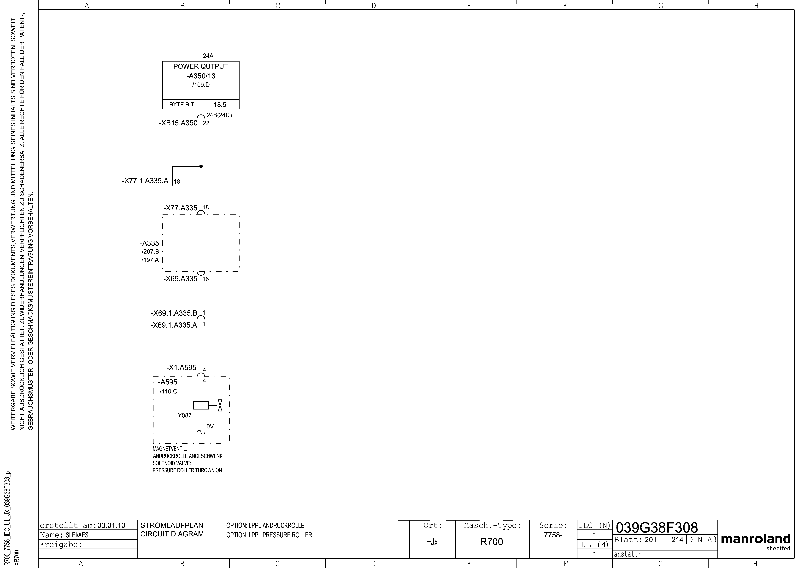

# +Jx — Sheet 201 of 214 — OPTION: LPPL ANDRÜCKROLLE

**OPTION: LPPL PRESSURE ROLLER**

> Part of the manroland **R700** printing press IEC/UL circuit diagrams.
> Drawing class: **Stromlaufplan / Circuit diagram** (DIN A3).
> Document `+Jx` covers the **1st printing module + feed register** machine section.

## At a glance

| Field | Value |
|---|---|
| Document | `+Jx`  (039G38F308) |
| Sheet | **201** of 214 |
| Section (DE) | OPTION: LPPL ANDRÜCKROLLE |
| Section (EN) | OPTION: LPPL PRESSURE ROLLER |
| Section type | CIRCUIT — Circuit diagram |
| Machine type | `R700` |
| Series | `7758` |
| Created | 03.01.10 |
| Replaces | — |
| Columns used | B |
| Path numbers | — |
| Labels on sheet | 33 |
| Cross-refs out | 4 |
| Cross-refs in | 11 |

**Previous:** [+Jx sheet 200](SHEET_0200.md) · **Next:** [+Jx sheet 202](SHEET_0202.md) · **Document TOC:** [_TOC.md](_TOC.md)  (+Jx) · **Master TOC:** [all sheets](../_MASTER_TOC.md)

## Sheet image (300 DPI, exact vector render)



_Rendered directly from the PDF vector layer at 300 DPI (1-bit), no OCR and no resampling. Use it to confirm anything ambiguous in the text below._

## Cross-references on this sheet

Each entry is a wire leaving this sheet. The printed token is `/sheet.column`; the link resolves to that sheet inside the same document.

| Ref | Target sheet | Col | Path | Destination on target | Target section | From col |
|---|---|---|---|---|---|---|
| `/109.D` | [+Jx sheet 109](SHEET_0109.md) | D | — | — | REFERENZMODUL | B |
| `/207.B` | [+Jx sheet 207](SHEET_0207.md) | B | — | — | OPTION: ZWISCHENTROCKNER, VORBEREITUNG | B |
| `/197.A` | [+Jx sheet 197](SHEET_0197.md) | A | — | — | OPTION: ZWISCHENTROCKNER, VORBEREITUNG | B |
| `/110.C` | [+Jx sheet 110](SHEET_0110.md) | C | — | — | REFERENZMODUL | B |

### Incoming references (sheets that point here)

Every other sheet that sends a wire to this one. `Back-ref` is the token printed on *that* sheet; `Path` is its line number.

| From sheet | Cols | Back-ref | Path | Refs | What continues there |
|---|---|---|---|---|---|
| [+Jx#109](SHEET_0109.md) | D | `/109.D` | — | 1 | — |
| [+Jx#110](SHEET_0110.md) | C | `/110.C` | — | 1 | — |
| [+Jx#115](SHEET_0115.md) | C | `/115.C` | — | 1 | — |
| [+Jx#139](SHEET_0139.md) | B | `/139.B` | — | 1 | — |
| [+Jx#152](SHEET_0152.md) | G | `/152.G` | — | 3 | STROMPFAD PIN 1 2 |
| [+Jx#155](SHEET_0155.md) | D | `/155.D` | — | 1 | — |
| [+Jx#156](SHEET_0156.md) | A | `/156.A` | — | 1 | — |
| [+Jx#197](SHEET_0197.md) | A | `/197.A` | — | 1 | — |
| [+Jx#207](SHEET_0207.md) | A | `/207.A` | — | 1 | — |


## Devices on this sheet

| Tag | Class | Class meaning (IEC) | Col | Sub | Terminal | Sign |
|---|---|---|---|---|---|---|
| `A350/13` | A | Baugruppe / assembly, module, PC board | B | 13 | — | — |
| `Y087` | Y | Magnetventil / solenoid valve, actuator | B | — | — | — |
| `A595` | A | Baugruppe / assembly, module, PC board | B | — | — | — |
| `A335` | A | Baugruppe / assembly, module, PC board | B | — | — | — |
| `XB15.A350` | — | cross-device reference | B | — | — | — |
| `18.5` | — | cross-device reference | B | — | — | — |
| `X1.A595` | — | cross-device reference | B | — | — | — |
| `X77.A335` | — | cross-device reference | B | — | — | — |
| `X69.A335` | — | cross-device reference | B | — | — | — |
| `X69.1.A335.B` | — | cross-device reference | B | — | — | — |
| `X69.1.A335.A` | — | cross-device reference | B | — | — | — |
| `X77.1.A335.A` | — | cross-device reference | B | — | — | — |

## Potentials / nets

| Potential | Count | Columns | Attached devices | Terminals |
|---|---|---|---|---|
| `0V` | 1 | B | — | — |


A potential such as `L24+/4` or `M24+` is a named supply/return rail; every place it appears on this sheet is electrically common.

## Wire-end annotations (grouped as printed)

A wire that continues elsewhere is annotated with a small cluster: the destination description, the path/line number `#NN`, and the `/sheet.column` cross reference. Each row below is one such cluster exactly as it is grouped on the drawing.

| Col | Y | Path | Cross-ref | Text on the wire |
|---|---|---|---|---|
| B | 78.9 | — | — | `24A` |
| B | 94.0 | — | — | `POWER QUTPUT` |
| B | 108.0 | — | — | `A350/13` |
| B | 121.8 | — | `/109.D` | — |
| B | 150.8 | — | — | `BYTE.BIT 18.5` |
| B | 166.8 | — | — | `24B(24C)` |
| B | 177.4 | — | — | `XB15.A350 22` |
| B | 263.2 | — | — | `X77.1.A335.A 18` |
| B | 303.5 | — | — | `X77.A335 18` |
| B | 356.0 | — | — | `A335` |
| B | 369.1 | — | `/207.B`, `/197.A` | — |
| B | 408.4 | — | — | `X69.A335 16` |
| B | 459.5 | — | — | `X69.1.A335.B 1` |
| B | 476.5 | — | — | `X69.1.A335.A 1` |
| B | 540.2 | — | — | `X1.A595 4` |
| B | 560.1 | — | — | `4` |
| B | 561.5 | — | — | `A595` |
| B | 576.4 | — | `/110.C` | — |
| B | 611.8 | — | — | `Y087` |
| B | 628.1 | — | — | `0V` |
| B | 662.5 | — | — | `MAGNETVENTIL:` |
| B | 673.1 | — | — | `PRESSURE ROLLER THROWN ON SOLENOID VALVE: ANDRÜCKROLLE ANGESCHWENKT` |


## Reconstructed tables

This sheet carries tabular content (pin map / terminal assignment / index). The grid below was rebuilt from the drawing's own rule lines, so each row is exactly one physical row of the table.

### Table 1 — 2 data rows × 2 columns (at x=240.9, y=90.7)

| POWER | QUTPUT A350/13 /109.D |
|---|---|
| `BYTE.BIT` | `18.5` |
| `XB15.A350` | `24B(24C) 22` |


## Notes and free text on this sheet

| Text | Col | Y (pt) |
|---|---|---|
| `24A` | B | 78.89 |
| `24B(24C)` | B | 166.8 |
| `POWER QUTPUT` | B | 94.04 |
| `BYTE.BIT` | B | 151.38 |
| `MAGNETVENTIL:` | B | 662.46 |
| `ANDRÜCKROLLE ANGESCHWENKT` | B | 673.11 |
| `SOLENOID VALVE:` | B | 683.71 |
| `PRESSURE ROLLER THROWN ON` | B | 694.36 |

## Complete label inventory (exact text from the drawing)

Every text object inside the drawing area of this sheet, in DIN reading order (column A→H, then top→bottom). This is the authoritative list: if a string is not here it is not printed on this sheet.

| Col | Y | X | Dir | Type | Text |
|---|---|---|---|---|---|
| B | 78.9 | 300.5 | → | text | `24A` |
| B | 94.0 | 256.8 | → | text | `POWER QUTPUT` |
| B | 108.0 | 276.1 | → | device tag | `A350/13` |
| B | 121.8 | 284.9 | → | cross-reference | `/109.D` |
| B | 150.8 | 316.2 | → | device ref | `18.5` |
| B | 151.4 | 250.9 | → | text | `BYTE.BIT` |
| B | 166.8 | 306.1 | → | text | `24B(24C)` |
| B | 177.4 | 235.3 | → | device ref | `XB15.A350` |
| B | 178.9 | 300.5 | → | number | `22` |
| B | 263.2 | 180.6 | → | device ref | `X77.1.A335.A` |
| B | 265.3 | 257.1 | → | number | `18` |
| B | 303.5 | 242.1 | → | device ref | `X77.A335` |
| B | 303.6 | 299.6 | → | number | `18` |
| B | 356.0 | 207.2 | → | device tag | `A335` |
| B | 369.1 | 210.0 | → | cross-reference | `/207.B` |
| B | 381.5 | 209.8 | → | cross-reference | `/197.A` |
| B | 408.4 | 242.1 | → | device ref | `X69.A335` |
| B | 409.9 | 299.6 | → | number | `16` |
| B | 459.5 | 223.7 | → | device ref | `X69.1.A335.B` |
| B | 459.5 | 299.6 | → | number | `1` |
| B | 476.5 | 299.6 | → | number | `1` |
| B | 477.2 | 223.1 | → | device ref | `X69.1.A335.A` |
| B | 540.2 | 246.6 | → | device ref | `X1.A595` |
| B | 544.5 | 300.5 | → | number | `4` |
| B | 560.1 | 300.5 | → | number | `4` |
| B | 561.5 | 234.1 | → | device tag | `A595` |
| B | 576.4 | 236.7 | → | cross-reference | `/110.C` |
| B | 611.8 | 260.5 | → | device tag | `Y087` |
| B | 628.1 | 305.9 | → | potential | `0V` |
| B | 662.5 | 226.2 | → | text | `MAGNETVENTIL:` |
| B | 673.1 | 226.8 | → | text | `ANDRÜCKROLLE ANGESCHWENKT` |
| B | 683.7 | 226.5 | → | text | `SOLENOID VALVE:` |
| B | 694.4 | 226.2 | → | text | `PRESSURE ROLLER THROWN ON` |

## Reading-order text block

The same content as a plain block, grouped by DIN column — convenient to paste or to match against a visual description.

```text
=== Column B ===
  78.9  300.5  text         24A
  94.0  256.8  text         POWER QUTPUT
 108.0  276.1  devtag       A350/13
 121.8  284.9  xref         /109.D
 150.8  316.2  devref       18.5
 151.4  250.9  text         BYTE.BIT
 166.8  306.1  text         24B(24C)
 177.4  235.3  devref       XB15.A350
 178.9  300.5  numeric      22
 263.2  180.6  devref       X77.1.A335.A
 265.3  257.1  numeric      18
 303.5  242.1  devref       X77.A335
 303.6  299.6  numeric      18
 356.0  207.2  devtag       A335
 369.1  210.0  xref         /207.B
 381.5  209.8  xref         /197.A
 408.4  242.1  devref       X69.A335
 409.9  299.6  numeric      16
 459.5  223.7  devref       X69.1.A335.B
 459.5  299.6  numeric      1
 476.5  299.6  numeric      1
 477.2  223.1  devref       X69.1.A335.A
 540.2  246.6  devref       X1.A595
 544.5  300.5  numeric      4
 560.1  300.5  numeric      4
 561.5  234.1  devtag       A595
 576.4  236.7  xref         /110.C
 611.8  260.5  devtag       Y087
 628.1  305.9  net          0V
 662.5  226.2  text         MAGNETVENTIL:
 673.1  226.8  text         ANDRÜCKROLLE ANGESCHWENKT
 683.7  226.5  text         SOLENOID VALVE:
 694.4  226.2  text         PRESSURE ROLLER THROWN ON
```

---
_Generated from the PDF vector text layer; no OCR. Source: `R700_7758_IEC_UL_JX_039G38F308_p`, sheet 201._
