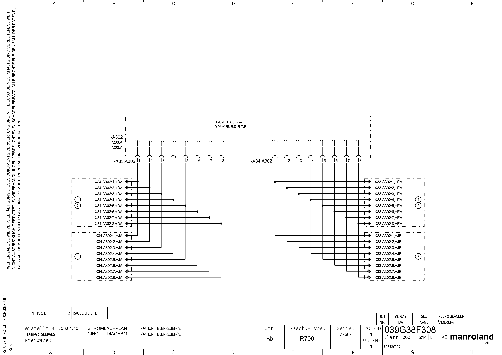

# +Jx — Sheet 202 of 214 — OPTION: TELEPRESENCE

**OPTION: TELEPRESENCE**

> Part of the manroland **R700** printing press IEC/UL circuit diagrams.
> Drawing class: **Stromlaufplan / Circuit diagram** (DIN A3).
> Document `+Jx` covers the **1st printing module + feed register** machine section.

## At a glance

| Field | Value |
|---|---|
| Document | `+Jx`  (039G38F308) |
| Sheet | **202** of 214 |
| Section (DE) | OPTION: TELEPRESENCE |
| Section (EN) | OPTION: TELEPRESENCE |
| Section type | CIRCUIT — Circuit diagram |
| Machine type | `R700` |
| Series | `7758` |
| Created | 03.01.10 |
| Replaces | — |
| Columns used | A, B, C, D, E, F, G, H |
| Path numbers | — |
| Labels on sheet | 73 |
| Cross-refs out | 2 |
| Cross-refs in | 18 |

**Previous:** [+Jx sheet 201](SHEET_0201.md) · **Next:** [+Jx sheet 203](SHEET_0203.md) · **Document TOC:** [_TOC.md](_TOC.md)  (+Jx) · **Master TOC:** [all sheets](../_MASTER_TOC.md)

## Sheet image (300 DPI, exact vector render)



_Rendered directly from the PDF vector layer at 300 DPI (1-bit), no OCR and no resampling. Use it to confirm anything ambiguous in the text below._

## Cross-references on this sheet

Each entry is a wire leaving this sheet. The printed token is `/sheet.column`; the link resolves to that sheet inside the same document.

| Ref | Target sheet | Col | Path | Destination on target | Target section | From col |
|---|---|---|---|---|---|---|
| `/203.A` | [+Jx sheet 203](SHEET_0203.md) | A | — | — | OPTION: TELEPRESENCE | B |
| `/200.A` | [+Jx sheet 200](SHEET_0200.md) | A | — | — | OPTION: | B |

### Incoming references (sheets that point here)

Every other sheet that sends a wire to this one. `Back-ref` is the token printed on *that* sheet; `Path` is its line number.

| From sheet | Cols | Back-ref | Path | Refs | What continues there |
|---|---|---|---|---|---|
| [+Jx#149](SHEET_0149.md) | B, C | `/149.B`, `/149.C` | — | 16 | — |
| [+Jx#200](SHEET_0200.md) | A | `/200.A` | — | 1 | — |
| [+Jx#203](SHEET_0203.md) | A | `/203.A` | — | 1 | — |


## Devices on this sheet

| Tag | Class | Class meaning (IEC) | Col | Sub | Terminal | Sign |
|---|---|---|---|---|---|---|
| `A302` | A | Baugruppe / assembly, module, PC board | B | — | — | — |
| `X33.A302` | — | cross-device reference | B | — | — | — |
| `X34.A302` | — | cross-device reference | D | — | — | — |
| `NR.` | — | cross-device reference | G | — | — | — |
| `28.06.12` | — | cross-device reference | G | — | — | — |

## Potentials / nets

_No named potentials on this sheet._

## Wire-end annotations (grouped as printed)

A wire that continues elsewhere is annotated with a small cluster: the destination description, the path/line number `#NN`, and the `/sheet.column` cross reference. Each row below is one such cluster exactly as it is grouped on the drawing.

| Col | Y | Path | Cross-ref | Text on the wire |
|---|---|---|---|---|
| D | 286.9 | — | — | `DIAGNOSEBUS, SLAVE DIAGNOSIS BUS, SLAVE` |
| B | 320.6 | — | — | `A302` |
| B | 333.6 | — | `/203.A`, `/200.A` | — |
| E | 377.2 | — | — | `X34.A302 1 2 3 4 5 6 7 8` |
| C | 377.3 | — | — | `X33.A302 1 2 3 4 5 6 7 8` |
| G | 427.5 | — | — | `X33.A302:1,+EA` |
| B | 427.6 | — | — | `X34.A302:1,+DA` |
| B | 441.7 | — | — | `X34.A302:2,+DA` |
| G | 441.7 | — | — | `X33.A302:2,+EA` |
| B | 455.9 | — | — | `X34.A302:3,+DA` |
| G | 455.9 | — | — | `X33.A302:3,+EA` |
| B | 470.1 | — | — | `X34.A302:4,+DA` |
| G | 470.1 | — | — | `X33.A302:4,+EA` |
| A | 470.3 | — | — | `1` |
| G | 470.3 | — | — | `1` |
| B | 484.2 | — | — | `X34.A302:5,+DA` |
| G | 484.2 | — | — | `X33.A302:5,+EA` |
| A | 485.0 | — | — | `2` |
| G | 485.0 | — | — | `2` |
| B | 498.4 | — | — | `X34.A302:6,+DA` |
| G | 498.4 | — | — | `X33.A302:6,+EA` |
| B | 512.6 | — | — | `X34.A302:7,+DA` |
| G | 512.6 | — | — | `X33.A302:7,+EA` |
| B | 526.8 | — | — | `X34.A302:8,+DA` |
| G | 526.8 | — | — | `X33.A302:8,+EA` |
| B | 555.1 | — | — | `X34.A302:1,+JA` |
| G | 555.1 | — | — | `X33.A302:1,+JB` |
| B | 569.3 | — | — | `X34.A302:2,+JA` |
| G | 569.3 | — | — | `X33.A302:2,+JB` |
| B | 583.4 | — | — | `X34.A302:3,+JA` |
| G | 583.4 | — | — | `X33.A302:3,+JB` |
| B | 597.6 | — | — | `X34.A302:4,+JA` |
| G | 597.6 | — | — | `X33.A302:4,+JB` |
| A | 605.4 | — | — | `2` |
| G | 605.4 | — | — | `2` |
| B | 611.8 | — | — | `X34.A302:5,+JA` |
| G | 611.8 | — | — | `X33.A302:5,+JB` |
| B | 626.0 | — | — | `X34.A302:6,+JA` |
| G | 626.0 | — | — | `X33.A302:6,+JB` |
| B | 640.1 | — | — | `X34.A302:7,+JA` |
| G | 640.1 | — | — | `X33.A302:7,+JB` |
| B | 654.3 | — | — | `X34.A302:8,+JA` |
| G | 654.3 | — | — | `X33.A302:8,+JB` |
| D | 738.6 | — | — | `1 R700 L 2 R700 LL, LTL, LTTL 001 28.06.12 SLEI INDEX 2 GEÄNDERT` |
| G | 761.3 | — | — | `NR. TAG NAME ÄNDERUNG` |


## Notes and free text on this sheet

| Text | Col | Y (pt) |
|---|---|---|
| `X34.A302:1,+DA` | B | 427.55 |
| `X34.A302:2,+DA` | B | 441.72 |
| `X34.A302:3,+DA` | B | 455.89 |
| `X34.A302:4,+DA` | B | 470.07 |
| `X34.A302:5,+DA` | B | 484.24 |
| `X34.A302:6,+DA` | B | 498.41 |
| `X34.A302:7,+DA` | B | 512.58 |
| `X34.A302:8,+DA` | B | 526.76 |
| `X33.A302:1,+EA` | G | 427.54 |
| `X33.A302:2,+EA` | G | 441.71 |
| `X33.A302:3,+EA` | G | 455.88 |
| `X33.A302:4,+EA` | G | 470.05 |
| `X33.A302:5,+EA` | G | 484.23 |
| `X33.A302:6,+EA` | G | 498.4 |
| `X33.A302:7,+EA` | G | 512.57 |
| `X33.A302:8,+EA` | G | 526.75 |
| `X34.A302:1,+JA` | B | 555.09 |
| `X34.A302:2,+JA` | B | 569.26 |
| `X34.A302:3,+JA` | B | 583.44 |
| `X34.A302:4,+JA` | B | 597.61 |
| `X34.A302:5,+JA` | B | 611.78 |
| `X34.A302:6,+JA` | B | 625.96 |
| `X34.A302:7,+JA` | B | 640.13 |
| `X34.A302:8,+JA` | B | 654.3 |
| `X33.A302:1,+JB` | G | 555.09 |
| `X33.A302:2,+JB` | G | 569.26 |
| `X33.A302:3,+JB` | G | 583.44 |
| `X33.A302:4,+JB` | G | 597.61 |
| `X33.A302:5,+JB` | G | 611.78 |
| `X33.A302:6,+JB` | G | 625.96 |
| `X33.A302:7,+JB` | G | 640.13 |
| `X33.A302:8,+JB` | G | 654.3 |
| `TAG` | G | 761.41 |
| `NAME` | G | 761.4 |
| `ÄNDERUNG` | H | 761.42 |
| `SLEI` | G | 747.24 |
| `INDEX 2 GEÄNDERT` | H | 747.26 |
| `R700 L` | A | 740.43 |
| `R700 LL, LTL, LTTL` | B | 740.43 |
| `DIAGNOSEBUS, SLAVE` | D | 286.86 |
| `DIAGNOSIS BUS, SLAVE` | D | 297.49 |

## Complete label inventory (exact text from the drawing)

Every text object inside the drawing area of this sheet, in DIN reading order (column A→H, then top→bottom). This is the authoritative list: if a string is not here it is not printed on this sheet.

| Col | Y | X | Dir | Type | Text |
|---|---|---|---|---|---|
| A | 470.3 | 182.4 | → | number | `1` |
| A | 485.0 | 182.3 | → | number | `2` |
| A | 605.4 | 182.3 | → | number | `2` |
| A | 738.6 | 75.4 | → | number | `1` |
| A | 738.6 | 160.2 | → | number | `2` |
| A | 740.4 | 88.0 | → | text | `R700 L` |
| B | 320.5 | 262.8 | → | device tag | `A302` |
| B | 333.6 | 265.0 | → | cross-reference | `/203.A` |
| B | 346.0 | 265.0 | → | cross-reference | `/200.A` |
| B | 377.3 | 328.0 | → | number | `1` |
| B | 378.0 | 270.7 | → | device ref | `X33.A302` |
| B | 427.5 | 222.0 | → | text | `X34.A302:1,+DA` |
| B | 441.7 | 222.0 | → | text | `X34.A302:2,+DA` |
| B | 455.9 | 222.0 | → | text | `X34.A302:3,+DA` |
| B | 470.1 | 222.0 | → | text | `X34.A302:4,+DA` |
| B | 484.2 | 222.0 | → | text | `X34.A302:5,+DA` |
| B | 498.4 | 222.0 | → | text | `X34.A302:6,+DA` |
| B | 512.6 | 222.0 | → | text | `X34.A302:7,+DA` |
| B | 526.8 | 222.0 | → | text | `X34.A302:8,+DA` |
| B | 555.1 | 223.7 | → | text | `X34.A302:1,+JA` |
| B | 569.3 | 223.7 | → | text | `X34.A302:2,+JA` |
| B | 583.4 | 223.7 | → | text | `X34.A302:3,+JA` |
| B | 597.6 | 223.7 | → | text | `X34.A302:4,+JA` |
| B | 611.8 | 223.7 | → | text | `X34.A302:5,+JA` |
| B | 626.0 | 223.7 | → | text | `X34.A302:6,+JA` |
| B | 640.1 | 223.7 | → | text | `X34.A302:7,+JA` |
| B | 654.3 | 223.7 | → | text | `X34.A302:8,+JA` |
| B | 740.4 | 173.1 | → | text | `R700 LL, LTL, LTTL` |
| C | 377.3 | 357.2 | → | number | `2` |
| C | 377.3 | 385.2 | → | number | `3` |
| C | 377.3 | 413.9 | → | number | `4` |
| C | 377.3 | 441.9 | → | number | `5` |
| C | 377.3 | 470.3 | → | number | `6` |
| D | 286.9 | 509.7 | → | text | `DIAGNOSEBUS, SLAVE` |
| D | 297.5 | 509.7 | → | text | `DIAGNOSIS BUS, SLAVE` |
| D | 377.2 | 595.3 | → | device ref | `X34.A302` |
| D | 377.3 | 498.6 | → | number | `7` |
| D | 377.3 | 527.0 | → | number | `8` |
| E | 377.3 | 654.0 | → | number | `1` |
| E | 377.3 | 683.1 | → | number | `2` |
| E | 377.3 | 711.2 | → | number | `3` |
| E | 377.3 | 739.8 | → | number | `4` |
| F | 377.3 | 767.9 | → | number | `5` |
| F | 377.3 | 796.3 | → | number | `6` |
| F | 377.3 | 824.6 | → | number | `7` |
| F | 377.3 | 852.9 | → | number | `8` |
| G | 427.5 | 885.5 | → | text | `X33.A302:1,+EA` |
| G | 441.7 | 885.5 | → | text | `X33.A302:2,+EA` |
| G | 455.9 | 885.5 | → | text | `X33.A302:3,+EA` |
| G | 470.1 | 885.5 | → | text | `X33.A302:4,+EA` |
| G | 470.3 | 990.3 | → | number | `1` |
| G | 484.2 | 885.5 | → | text | `X33.A302:5,+EA` |
| G | 485.0 | 990.1 | → | number | `2` |
| G | 498.4 | 885.5 | → | text | `X33.A302:6,+EA` |
| G | 512.6 | 885.5 | → | text | `X33.A302:7,+EA` |
| G | 526.7 | 885.5 | → | text | `X33.A302:8,+EA` |
| G | 555.1 | 885.5 | → | text | `X33.A302:1,+JB` |
| G | 569.3 | 885.5 | → | text | `X33.A302:2,+JB` |
| G | 583.4 | 885.5 | → | text | `X33.A302:3,+JB` |
| G | 597.6 | 885.5 | → | text | `X33.A302:4,+JB` |
| G | 605.4 | 990.1 | → | number | `2` |
| G | 611.8 | 885.5 | → | text | `X33.A302:5,+JB` |
| G | 626.0 | 885.5 | → | text | `X33.A302:6,+JB` |
| G | 640.1 | 885.5 | → | text | `X33.A302:7,+JB` |
| G | 654.3 | 885.5 | → | text | `X33.A302:8,+JB` |
| G | 747.1 | 901.8 | → | number | `001` |
| G | 747.2 | 999.0 | → | text | `SLEI` |
| G | 747.3 | 936.0 | → | device ref | `28.06.12` |
| G | 761.3 | 901.0 | → | device ref | `NR.` |
| G | 761.4 | 942.7 | → | text | `TAG` |
| G | 761.4 | 996.0 | → | text | `NAME` |
| H | 747.3 | 1037.6 | → | text | `INDEX 2 GEÄNDERT` |
| H | 761.4 | 1038.2 | → | text | `ÄNDERUNG` |

## Reading-order text block

The same content as a plain block, grouped by DIN column — convenient to paste or to match against a visual description.

```text
=== Column A ===
 470.3  182.4  numeric      1
 485.0  182.3  numeric      2
 605.4  182.3  numeric      2
 738.6   75.4  numeric      1
 738.6  160.2  numeric      2
 740.4   88.0  text         R700 L
=== Column B ===
 320.5  262.8  devtag       A302
 333.6  265.0  xref         /203.A
 346.0  265.0  xref         /200.A
 377.3  328.0  numeric      1
 378.0  270.7  devref       X33.A302
 427.5  222.0  text         X34.A302:1,+DA
 441.7  222.0  text         X34.A302:2,+DA
 455.9  222.0  text         X34.A302:3,+DA
 470.1  222.0  text         X34.A302:4,+DA
 484.2  222.0  text         X34.A302:5,+DA
 498.4  222.0  text         X34.A302:6,+DA
 512.6  222.0  text         X34.A302:7,+DA
 526.8  222.0  text         X34.A302:8,+DA
 555.1  223.7  text         X34.A302:1,+JA
 569.3  223.7  text         X34.A302:2,+JA
 583.4  223.7  text         X34.A302:3,+JA
 597.6  223.7  text         X34.A302:4,+JA
 611.8  223.7  text         X34.A302:5,+JA
 626.0  223.7  text         X34.A302:6,+JA
 640.1  223.7  text         X34.A302:7,+JA
 654.3  223.7  text         X34.A302:8,+JA
 740.4  173.1  text         R700 LL, LTL, LTTL
=== Column C ===
 377.3  357.2  numeric      2
 377.3  385.2  numeric      3
 377.3  413.9  numeric      4
 377.3  441.9  numeric      5
 377.3  470.3  numeric      6
=== Column D ===
 286.9  509.7  text         DIAGNOSEBUS, SLAVE
 297.5  509.7  text         DIAGNOSIS BUS, SLAVE
 377.2  595.3  devref       X34.A302
 377.3  498.6  numeric      7
 377.3  527.0  numeric      8
=== Column E ===
 377.3  654.0  numeric      1
 377.3  683.1  numeric      2
 377.3  711.2  numeric      3
 377.3  739.8  numeric      4
=== Column F ===
 377.3  767.9  numeric      5
 377.3  796.3  numeric      6
 377.3  824.6  numeric      7
 377.3  852.9  numeric      8
=== Column G ===
 427.5  885.5  text         X33.A302:1,+EA
 441.7  885.5  text         X33.A302:2,+EA
 455.9  885.5  text         X33.A302:3,+EA
 470.1  885.5  text         X33.A302:4,+EA
 470.3  990.3  numeric      1
 484.2  885.5  text         X33.A302:5,+EA
 485.0  990.1  numeric      2
 498.4  885.5  text         X33.A302:6,+EA
 512.6  885.5  text         X33.A302:7,+EA
 526.7  885.5  text         X33.A302:8,+EA
 555.1  885.5  text         X33.A302:1,+JB
 569.3  885.5  text         X33.A302:2,+JB
 583.4  885.5  text         X33.A302:3,+JB
 597.6  885.5  text         X33.A302:4,+JB
 605.4  990.1  numeric      2
 611.8  885.5  text         X33.A302:5,+JB
 626.0  885.5  text         X33.A302:6,+JB
 640.1  885.5  text         X33.A302:7,+JB
 654.3  885.5  text         X33.A302:8,+JB
 747.1  901.8  numeric      001
 747.2  999.0  text         SLEI
 747.3  936.0  devref       28.06.12
 761.3  901.0  devref       NR.
 761.4  942.7  text         TAG
 761.4  996.0  text         NAME
=== Column H ===
 747.3 1037.6  text         INDEX 2 GEÄNDERT
 761.4 1038.2  text         ÄNDERUNG
```

---
_Generated from the PDF vector text layer; no OCR. Source: `R700_7758_IEC_UL_JX_039G38F308_p`, sheet 202._
