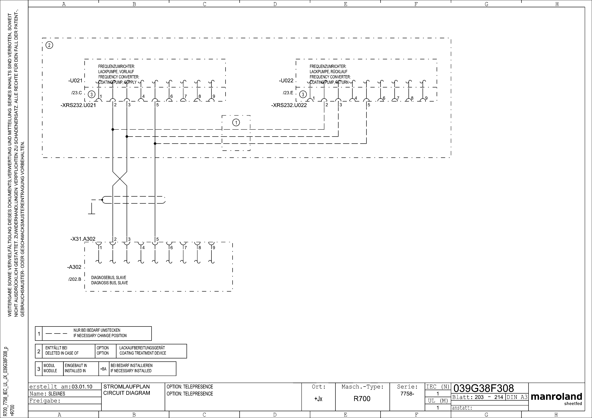

# +Jx — Sheet 203 of 214 — OPTION: TELEPRESENCE

**OPTION: TELEPRESENCE**

> Part of the manroland **R700** printing press IEC/UL circuit diagrams.
> Drawing class: **Stromlaufplan / Circuit diagram** (DIN A3).
> Document `+Jx` covers the **1st printing module + feed register** machine section.

## At a glance

| Field | Value |
|---|---|
| Document | `+Jx`  (039G38F308) |
| Sheet | **203** of 214 |
| Section (DE) | OPTION: TELEPRESENCE |
| Section (EN) | OPTION: TELEPRESENCE |
| Section type | CIRCUIT — Circuit diagram |
| Machine type | `R700` |
| Series | `7758` |
| Created | 03.01.10 |
| Replaces | — |
| Columns used | A, B, C, D, E, F |
| Path numbers | — |
| Labels on sheet | 68 |
| Cross-refs out | 3 |
| Cross-refs in | 30 |

**Previous:** [+Jx sheet 202](SHEET_0202.md) · **Next:** [+Jx sheet 204](SHEET_0204.md) · **Document TOC:** [_TOC.md](_TOC.md)  (+Jx) · **Master TOC:** [all sheets](../_MASTER_TOC.md)

## Sheet image (300 DPI, exact vector render)



_Rendered directly from the PDF vector layer at 300 DPI (1-bit), no OCR and no resampling. Use it to confirm anything ambiguous in the text below._

## Cross-references on this sheet

Each entry is a wire leaving this sheet. The printed token is `/sheet.column`; the link resolves to that sheet inside the same document.

| Ref | Target sheet | Col | Path | Destination on target | Target section | From col |
|---|---|---|---|---|---|---|
| `/23.E` | [+Jx sheet 23](SHEET_0023.md) | E | — | — | LACKPUMPE | D |
| `/23.C` | [+Jx sheet 23](SHEET_0023.md) | C | — | — | LACKPUMPE | A |
| `/202.B` | [+Jx sheet 202](SHEET_0202.md) | B | — | — | OPTION: TELEPRESENCE | A |

### Incoming references (sheets that point here)

Every other sheet that sends a wire to this one. `Back-ref` is the token printed on *that* sheet; `Path` is its line number.

| From sheet | Cols | Back-ref | Path | Refs | What continues there |
|---|---|---|---|---|---|
| [+Jx#23](SHEET_0023.md) | C, E | `/23.C`, `/23.E` | — | 2 | — |
| [+Jx#148](SHEET_0148.md) | C | `/148.C` | — | 9 | — |
| [+Jx#158](SHEET_0158.md) | F, G | `/158.F`, `/158.G` | — | 18 | — |
| [+Jx#202](SHEET_0202.md) | B | `/202.B` | — | 1 | — |


## Devices on this sheet

| Tag | Class | Class meaning (IEC) | Col | Sub | Terminal | Sign |
|---|---|---|---|---|---|---|
| `U022` | U | Umrichter / frequency converter | D | — | — | — |
| `U021` | U | Umrichter / frequency converter | A | — | — | — |
| `A302` | A | Baugruppe / assembly, module, PC board | A | — | — | — |
| `XRS232.U021` | — | cross-device reference | A | — | — | — |
| `XRS232.U022` | — | cross-device reference | D | — | — | — |
| `X31.A302` | — | cross-device reference | A | — | — | — |

## Potentials / nets

_No named potentials on this sheet._

## Wire-end annotations (grouped as printed)

A wire that continues elsewhere is annotated with a small cluster: the destination description, the path/line number `#NN`, and the `/sheet.column` cross reference. Each row below is one such cluster exactly as it is grouped on the drawing.

| Col | Y | Path | Cross-ref | Text on the wire |
|---|---|---|---|---|
| A | 88.1 | — | — | `2` |
| C | 131.0 | — | — | `U021 FREQUENZUMRICHTER: LACKPUMPE, RÜCKLAUF FREQUENCY CONVERTER: COATING PUMP, RETURN` |
| B | 131.0 | — | — | `FREQUENZUMRICHTER: LACKPUMPE, VORLAUF FREQUENCY CONVERTER: COATING PUMP, SUPPLY` |
| D | 157.6 | — | — | `U022` |
| D | 183.0 | — | `/23.E` | — |
| A | 183.1 | — | `/23.C` | — |
| D | 187.3 | — | — | `3 3 1 4 6 7 8 9` |
| B | 190.2 | — | — | `1` |
| B | 190.2 | — | — | `4` |
| C | 190.2 | — | — | `6 7 8 9` |
| A | 207.2 | — | — | `XRS232.U021 2 3` |
| B | 207.2 | — | — | `5` |
| E | 207.2 | — | — | `XRS232.U022 2 3 5` |
| C | 243.6 | — | — | `1` |
| B | 476.5 | — | — | `X31.A302 2 3 5` |
| B | 494.9 | — | — | `1 4 6 7 8 9` |
| A | 533.1 | — | — | `A302` |
| B | 556.1 | — | — | `DIAGNOSEBUS, SLAVE DIAGNOSIS BUS, SLAVE` |
| A | 558.6 | — | `/202.B` | — |
| A | 662.5 | — | — | `1 IF NECESSARY CHANGE POSITION NUR BEI BEDARF UMSTECKEN` |
| A | 697.9 | — | — | `2 ENTFÄLLT BEI DELETED IN CASE OF` |
| B | 697.9 | — | — | `OPTION OPTION` |
| B | 697.9 | — | — | `LACKAUFBEREITUNGSGERÄT COATING TREATMENT DEVICE` |
| A | 733.3 | — | — | `INSTALLED IN EINGEBAUT IN +BA` |
| B | 733.3 | — | — | `IF NECESSARY INSTALLED BEI BEDARF INSTALLIEREN` |
| A | 733.4 | — | — | `3 MODUL MODULE` |


## Notes and free text on this sheet

| Text | Col | Y (pt) |
|---|---|---|
| `FREQUENZUMRICHTER:` | E | 130.99 |
| `LACKPUMPE, RÜCKLAUF` | E | 141.61 |
| `FREQUENCY CONVERTER:` | E | 152.24 |
| `COATING PUMP, RETURN` | E | 162.88 |
| `FREQUENZUMRICHTER:` | B | 130.99 |
| `LACKPUMPE, VORLAUF` | B | 141.61 |
| `FREQUENCY CONVERTER:` | B | 152.24 |
| `COATING PUMP, SUPPLY` | B | 162.87 |
| `NUR BEI BEDARF UMSTECKEN` | A | 662.47 |
| `IF NECESSARY CHANGE POSITION` | B | 673.09 |
| `DIAGNOSEBUS, SLAVE` | B | 556.15 |
| `DIAGNOSIS BUS, SLAVE` | B | 566.78 |
| `ENTFÄLLT BEI` | A | 697.87 |
| `DELETED IN CASE OF` | A | 708.52 |
| `OPTION` | B | 697.88 |
| `LACKAUFBEREITUNGSGERÄT` | B | 697.91 |
| `COATING TREATMENT DEVICE` | B | 708.54 |
| `MODUL` | A | 733.37 |
| `MODULE` | A | 743.99 |
| `EINGEBAUT IN` | A | 733.31 |
| `INSTALLED IN` | A | 743.95 |
| `+BA` | B | 740.39 |
| `BEI BEDARF INSTALLIEREN` | B | 733.32 |
| `IF NECESSARY INSTALLED` | B | 743.95 |

## Complete label inventory (exact text from the drawing)

Every text object inside the drawing area of this sheet, in DIN reading order (column A→H, then top→bottom). This is the authoritative list: if a string is not here it is not printed on this sheet.

| Col | Y | X | Dir | Type | Text |
|---|---|---|---|---|---|
| A | 88.1 | 97.2 | → | number | `2` |
| A | 157.6 | 137.5 | → | device tag | `U021` |
| A | 183.1 | 143.7 | → | cross-reference | `/23.C` |
| A | 187.3 | 182.3 | → | number | `3` |
| A | 207.2 | 121.9 | → | device ref | `XRS232.U021` |
| A | 476.5 | 141.7 | → | device ref | `X31.A302` |
| A | 533.1 | 135.2 | → | device tag | `A302` |
| A | 558.6 | 137.8 | → | cross-reference | `/202.B` |
| A | 662.5 | 148.3 | → | text | `NUR BEI BEDARF UMSTECKEN` |
| A | 667.8 | 75.4 | → | number | `1` |
| A | 697.9 | 91.6 | → | text | `ENTFÄLLT BEI` |
| A | 703.2 | 75.1 | → | number | `2` |
| A | 708.5 | 91.6 | → | text | `DELETED IN CASE OF` |
| A | 733.3 | 130.5 | → | text | `EINGEBAUT IN` |
| A | 733.4 | 88.0 | → | text | `MODUL` |
| A | 738.6 | 75.0 | → | number | `3` |
| A | 743.9 | 130.3 | → | text | `INSTALLED IN` |
| A | 744.0 | 88.0 | → | text | `MODULE` |
| B | 131.0 | 197.9 | → | text | `FREQUENZUMRICHTER:` |
| B | 141.6 | 197.9 | → | text | `LACKPUMPE, VORLAUF` |
| B | 152.2 | 197.9 | → | text | `FREQUENCY CONVERTER:` |
| B | 162.9 | 198.1 | → | text | `COATING PUMP, SUPPLY` |
| B | 190.2 | 200.4 | → | number | `1` |
| B | 190.2 | 286.3 | → | number | `4` |
| B | 207.2 | 229.6 | → | number | `2` |
| B | 207.2 | 257.7 | → | number | `3` |
| B | 207.2 | 314.4 | → | number | `5` |
| B | 477.9 | 229.6 | → | number | `2` |
| B | 477.9 | 257.7 | → | number | `3` |
| B | 477.9 | 314.4 | → | number | `5` |
| B | 494.9 | 200.4 | → | number | `1` |
| B | 494.9 | 286.3 | → | number | `4` |
| B | 556.2 | 183.7 | → | text | `DIAGNOSEBUS, SLAVE` |
| B | 566.8 | 183.7 | → | text | `DIAGNOSIS BUS, SLAVE` |
| B | 673.1 | 148.0 | → | text | `IF NECESSARY CHANGE POSITION` |
| B | 697.9 | 194.6 | → | text | `OPTION` |
| B | 697.9 | 240.4 | → | text | `LACKAUFBEREITUNGSGERÄT` |
| B | 708.5 | 194.6 | → | text | `OPTION` |
| B | 708.5 | 240.7 | → | text | `COATING TREATMENT DEVICE` |
| B | 733.3 | 222.7 | → | text | `BEI BEDARF INSTALLIEREN` |
| B | 740.4 | 201.7 | → | text | `+BA` |
| B | 744.0 | 222.4 | → | text | `IF NECESSARY INSTALLED` |
| C | 190.2 | 342.7 | → | number | `6` |
| C | 190.2 | 371.1 | → | number | `7` |
| C | 190.2 | 399.4 | → | number | `8` |
| C | 190.2 | 427.7 | → | number | `9` |
| C | 243.6 | 472.9 | → | number | `1` |
| C | 494.9 | 342.7 | → | number | `6` |
| C | 494.9 | 371.1 | → | number | `7` |
| C | 494.9 | 399.4 | → | number | `8` |
| C | 494.9 | 427.7 | → | number | `9` |
| D | 157.6 | 561.3 | → | device tag | `U022` |
| D | 183.0 | 569.2 | → | cross-reference | `/23.E` |
| D | 187.3 | 607.5 | → | number | `3` |
| D | 207.2 | 545.7 | → | device ref | `XRS232.U022` |
| E | 131.0 | 623.1 | → | text | `FREQUENZUMRICHTER:` |
| E | 141.6 | 623.1 | → | text | `LACKPUMPE, RÜCKLAUF` |
| E | 152.2 | 623.1 | → | text | `FREQUENCY CONVERTER:` |
| E | 162.9 | 623.3 | → | text | `COATING PUMP, RETURN` |
| E | 193.7 | 628.6 | → | number | `1` |
| E | 193.7 | 713.5 | → | number | `4` |
| E | 207.2 | 654.8 | → | number | `2` |
| E | 207.2 | 682.9 | → | number | `3` |
| E | 207.2 | 739.6 | → | number | `5` |
| F | 193.7 | 770.0 | → | number | `6` |
| F | 193.7 | 798.4 | → | number | `7` |
| F | 193.7 | 826.7 | → | number | `8` |
| F | 193.7 | 855.1 | → | number | `9` |

## Reading-order text block

The same content as a plain block, grouped by DIN column — convenient to paste or to match against a visual description.

```text
=== Column A ===
  88.1   97.2  numeric      2
 157.6  137.5  devtag       U021
 183.1  143.7  xref         /23.C
 187.3  182.3  numeric      3
 207.2  121.9  devref       XRS232.U021
 476.5  141.7  devref       X31.A302
 533.1  135.2  devtag       A302
 558.6  137.8  xref         /202.B
 662.5  148.3  text         NUR BEI BEDARF UMSTECKEN
 667.8   75.4  numeric      1
 697.9   91.6  text         ENTFÄLLT BEI
 703.2   75.1  numeric      2
 708.5   91.6  text         DELETED IN CASE OF
 733.3  130.5  text         EINGEBAUT IN
 733.4   88.0  text         MODUL
 738.6   75.0  numeric      3
 743.9  130.3  text         INSTALLED IN
 744.0   88.0  text         MODULE
=== Column B ===
 131.0  197.9  text         FREQUENZUMRICHTER:
 141.6  197.9  text         LACKPUMPE, VORLAUF
 152.2  197.9  text         FREQUENCY CONVERTER:
 162.9  198.1  text         COATING PUMP, SUPPLY
 190.2  200.4  numeric      1
 190.2  286.3  numeric      4
 207.2  229.6  numeric      2
 207.2  257.7  numeric      3
 207.2  314.4  numeric      5
 477.9  229.6  numeric      2
 477.9  257.7  numeric      3
 477.9  314.4  numeric      5
 494.9  200.4  numeric      1
 494.9  286.3  numeric      4
 556.2  183.7  text         DIAGNOSEBUS, SLAVE
 566.8  183.7  text         DIAGNOSIS BUS, SLAVE
 673.1  148.0  text         IF NECESSARY CHANGE POSITION
 697.9  194.6  text         OPTION
 697.9  240.4  text         LACKAUFBEREITUNGSGERÄT
 708.5  194.6  text         OPTION
 708.5  240.7  text         COATING TREATMENT DEVICE
 733.3  222.7  text         BEI BEDARF INSTALLIEREN
 740.4  201.7  text         +BA
 744.0  222.4  text         IF NECESSARY INSTALLED
=== Column C ===
 190.2  342.7  numeric      6
 190.2  371.1  numeric      7
 190.2  399.4  numeric      8
 190.2  427.7  numeric      9
 243.6  472.9  numeric      1
 494.9  342.7  numeric      6
 494.9  371.1  numeric      7
 494.9  399.4  numeric      8
 494.9  427.7  numeric      9
=== Column D ===
 157.6  561.3  devtag       U022
 183.0  569.2  xref         /23.E
 187.3  607.5  numeric      3
 207.2  545.7  devref       XRS232.U022
=== Column E ===
 131.0  623.1  text         FREQUENZUMRICHTER:
 141.6  623.1  text         LACKPUMPE, RÜCKLAUF
 152.2  623.1  text         FREQUENCY CONVERTER:
 162.9  623.3  text         COATING PUMP, RETURN
 193.7  628.6  numeric      1
 193.7  713.5  numeric      4
 207.2  654.8  numeric      2
 207.2  682.9  numeric      3
 207.2  739.6  numeric      5
=== Column F ===
 193.7  770.0  numeric      6
 193.7  798.4  numeric      7
 193.7  826.7  numeric      8
 193.7  855.1  numeric      9
```

---
_Generated from the PDF vector text layer; no OCR. Source: `R700_7758_IEC_UL_JX_039G38F308_p`, sheet 203._
