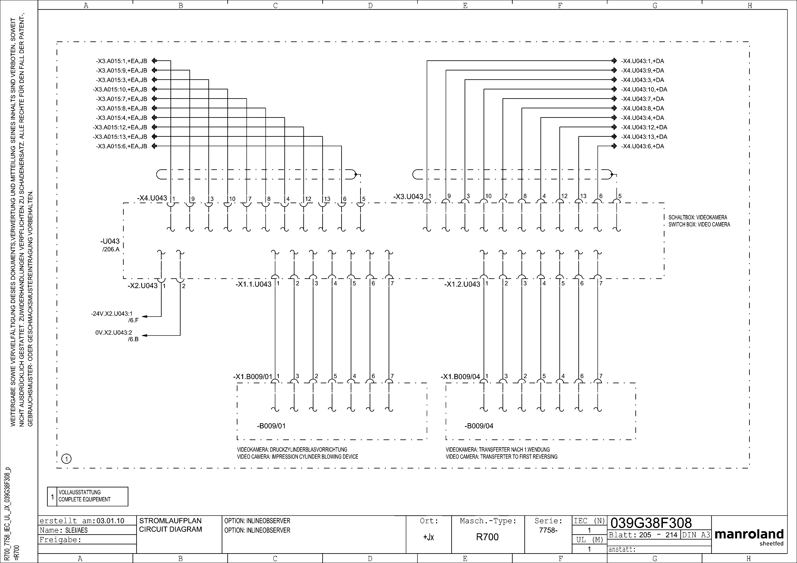

# +Jx — Sheet 205 of 214 — OPTION: INLINEOBSERVER

**OPTION: INLINEOBSERVER**

> Part of the manroland **R700** printing press IEC/UL circuit diagrams.
> Drawing class: **Stromlaufplan / Circuit diagram** (DIN A3).
> Document `+Jx` covers the **1st printing module + feed register** machine section.

## At a glance

| Field | Value |
|---|---|
| Document | `+Jx`  (039G38F308) |
| Sheet | **205** of 214 |
| Section (DE) | OPTION: INLINEOBSERVER |
| Section (EN) | OPTION: INLINEOBSERVER |
| Section type | CIRCUIT — Circuit diagram |
| Machine type | `R700` |
| Series | `7758` |
| Created | 03.01.10 |
| Replaces | — |
| Columns used | A, B, C, D, E, F, G |
| Path numbers | — |
| Labels on sheet | 97 |
| Cross-refs out | 3 |
| Cross-refs in | 55 |

**Previous:** [+Jx sheet 204](SHEET_0204.md) · **Next:** [+Jx sheet 206](SHEET_0206.md) · **Document TOC:** [_TOC.md](_TOC.md)  (+Jx) · **Master TOC:** [all sheets](../_MASTER_TOC.md)

## Sheet image (300 DPI, exact vector render)



_Rendered directly from the PDF vector layer at 300 DPI (1-bit), no OCR and no resampling. Use it to confirm anything ambiguous in the text below._

## Cross-references on this sheet

Each entry is a wire leaving this sheet. The printed token is `/sheet.column`; the link resolves to that sheet inside the same document.

| Ref | Target sheet | Col | Path | Destination on target | Target section | From col |
|---|---|---|---|---|---|---|
| `/206.A` | [+Jx sheet 206](SHEET_0206.md) | A | — | — | OPTION: INLINEOBSERVER | A |
| `/6.F` | [+Jx sheet 6](SHEET_0006.md) | F | — | 24V.X2.U043:1 | SPANNUNGSVERSORGUNG, SCHALTSCHRANKBELÜFTUNG | A |
| `/6.B` | [+Jx sheet 6](SHEET_0006.md) | B | — | 0V.X2.U043:2 | SPANNUNGSVERSORGUNG, SCHALTSCHRANKBELÜFTUNG | A |

### Incoming references (sheets that point here)

Every other sheet that sends a wire to this one. `Back-ref` is the token printed on *that* sheet; `Path` is its line number.

| From sheet | Cols | Back-ref | Path | Refs | What continues there |
|---|---|---|---|---|---|
| [+Jx#6](SHEET_0006.md) | B, F | `/6.B`, `/6.F` | — | 2 | 0V.X2.U043:2 |
| [+Jx#116](SHEET_0116.md) | C | `/116.C` | — | 14 | — |
| [+Jx#120](SHEET_0120.md) | B, C | `/120.B`, `/120.C` | — | 14 | — |
| [+Jx#127](SHEET_0127.md) | E | `/127.E` | — | 2 | — |
| [+Jx#129](SHEET_0129.md) | A | `/129.A` | — | 11 | — |
| [+Jx#130](SHEET_0130.md) | G | `/130.G` | — | 11 | — |
| [+Jx#206](SHEET_0206.md) | A | `/206.A` | — | 1 | — |


## Devices on this sheet

| Tag | Class | Class meaning (IEC) | Col | Sub | Terminal | Sign |
|---|---|---|---|---|---|---|
| `U043` | U | Umrichter / frequency converter | A | — | — | — |
| `B009/01` | B | Umformer / transducer, sensor | C | 01 | — | — |
| `B009/04` | B | Umformer / transducer, sensor | E | 04 | — | — |
| `X4.U043` | — | cross-device reference | B | — | — | — |
| `X3.U043` | — | cross-device reference | D | — | — | — |
| `X2.U043` | — | cross-device reference | B | — | — | — |
| `X1.1.U043` | — | cross-device reference | C | — | — | — |
| `X1.2.U043` | — | cross-device reference | E | — | — | — |

## Potentials / nets

| Potential | Count | Columns | Attached devices | Terminals |
|---|---|---|---|---|
| `0V` | 1 | A | `U043`, `X2` | `2` |
| `24V` | 1 | A | `U043`, `X2` | `1` |


A potential such as `L24+/4` or `M24+` is a named supply/return rail; every place it appears on this sheet is electrically common.

## Wire-end annotations (grouped as printed)

A wire that continues elsewhere is annotated with a small cluster: the destination description, the path/line number `#NN`, and the `/sheet.column` cross reference. Each row below is one such cluster exactly as it is grouped on the drawing.

| Col | Y | Path | Cross-ref | Text on the wire |
|---|---|---|---|---|
| A | 87.4 | — | — | `X3.A015:1,+EA,JB` |
| G | 87.4 | — | — | `X4.U043:1,+DA` |
| A | 101.5 | — | — | `X3.A015:9,+EA,JB` |
| G | 101.6 | — | — | `X4.U043:9,+DA` |
| A | 115.7 | — | — | `X3.A015:3,+EA,JB` |
| G | 115.7 | — | — | `X4.U043:3,+DA` |
| A | 129.9 | — | — | `X3.A015:10,+EA,JB` |
| G | 129.9 | — | — | `X4.U043:10,+DA` |
| A | 144.1 | — | — | `X3.A015:7,+EA,JB` |
| G | 144.1 | — | — | `X4.U043:7,+DA` |
| A | 158.2 | — | — | `X3.A015:8,+EA,JB` |
| G | 158.3 | — | — | `X4.U043:8,+DA` |
| A | 172.4 | — | — | `X3.A015:4,+EA,JB` |
| G | 172.4 | — | — | `X4.U043:4,+DA` |
| A | 186.6 | — | — | `X3.A015:12,+EA,JB` |
| G | 186.6 | — | — | `X4.U043:12,+DA` |
| A | 200.8 | — | — | `X3.A015:13,+EA,JB` |
| G | 200.8 | — | — | `X4.U043:13,+DA` |
| A | 214.9 | — | — | `X3.A015:6,+EA,JB` |
| G | 214.9 | — | — | `X4.U043:6,+DA` |
| D | 289.4 | — | — | `X4.U043 1 9 3 10 7 8 4 12 13 6 5 X3.U043 1 9 3 10 7 8 4 12 13 6 5` |
| G | 322.3 | — | — | `SCHALTBOX: VIDEOKAMERA SWITCH BOX: VIDEO CAMERA` |
| A | 356.0 | — | — | `U043` |
| A | 369.1 | — | `/206.A` | — |
| C | 419.8 | — | — | `X1.1.U043 1 2 3 4 5 6 7` |
| F | 419.8 | — | — | `X1.2.U043 1 2 3 4 5 6 7` |
| B | 422.6 | — | — | `X2.U043 1 2` |
| A | 465.1 | — | `/6.F` | `24V.X2.U043:1` |
| A | 493.4 | — | `/6.B` | `0V.X2.U043:2` |
| C | 558.7 | — | — | `X1.B009/01 1 3 2 5 4 6 7` |
| F | 558.7 | — | — | `X1.B009/04 1 3 2 5 4 6 7` |
| C | 632.4 | — | — | `B009/01` |
| E | 632.4 | — | — | `B009/04` |
| C | 669.6 | — | — | `VIDEOKAMERA: DRUCKZYLINDERBLASVORRICHTUNG VIDEO CAMERA: IMPRESSION CYLINDER BLOWING DEVICE` |
| E | 669.6 | — | — | `VIDEOKAMERA: TRANSFERTER NACH 1.WENDUNG VIDEO CAMERA: TRANSFERTER TO FIRST REVERSING` |
| A | 682.9 | — | — | `1` |
| A | 733.4 | — | — | `1 COMPLETE EQUIPEMENT VOLLAUSSTATTUNG` |


## Notes and free text on this sheet

| Text | Col | Y (pt) |
|---|---|---|
| `SCHALTBOX: VIDEOKAMERA` | G | 322.31 |
| `SWITCH BOX: VIDEO CAMERA` | G | 332.93 |
| `X4.U043:13,+DA` | G | 200.78 |
| `X4.U043:6,+DA` | G | 214.95 |
| `X4.U043:12,+DA` | G | 186.61 |
| `X4.U043:4,+DA` | G | 172.43 |
| `X4.U043:7,+DA` | G | 144.09 |
| `X4.U043:1,+DA` | G | 87.4 |
| `X4.U043:9,+DA` | G | 101.57 |
| `X4.U043:3,+DA` | G | 115.74 |
| `X4.U043:10,+DA` | G | 129.92 |
| `X4.U043:8,+DA` | G | 158.26 |
| `X3.A015:4,+EA,JB` | A | 172.4 |
| `X3.A015:13,+EA,JB` | A | 200.75 |
| `X3.A015:6,+EA,JB` | A | 214.92 |
| `X3.A015:12,+EA,JB` | A | 186.58 |
| `X3.A015:8,+EA,JB` | A | 158.23 |
| `X3.A015:7,+EA,JB` | A | 144.05 |
| `X3.A015:10,+EA,JB` | A | 129.88 |
| `X3.A015:3,+EA,JB` | A | 115.71 |
| `X3.A015:1,+EA,JB` | A | 87.36 |
| `X3.A015:9,+EA,JB` | A | 101.53 |
| `X1.B009/01` | C | 558.67 |
| `VIDEOKAMERA: DRUCKZYLINDERBLASVORRICHTUNG` | C | 669.57 |
| `VIDEO CAMERA: IMPRESSION CYLINDER BLOWING DEVICE` | C | 680.18 |
| `X1.B009/04` | E | 558.67 |
| `VIDEOKAMERA: TRANSFERTER NACH 1.WENDUNG` | E | 669.56 |
| `VIDEO CAMERA: TRANSFERTER TO FIRST REVERSING` | E | 680.19 |
| `VOLLAUSSTATTUNG` | A | 733.35 |
| `COMPLETE EQUIPEMENT` | A | 743.98 |

## Complete label inventory (exact text from the drawing)

Every text object inside the drawing area of this sheet, in DIN reading order (column A→H, then top→bottom). This is the authoritative list: if a string is not here it is not printed on this sheet.

| Col | Y | X | Dir | Type | Text |
|---|---|---|---|---|---|
| A | 87.4 | 143.4 | → | text | `X3.A015:1,+EA,JB` |
| A | 101.5 | 143.4 | → | text | `X3.A015:9,+EA,JB` |
| A | 115.7 | 143.4 | → | text | `X3.A015:3,+EA,JB` |
| A | 129.9 | 138.6 | → | text | `X3.A015:10,+EA,JB` |
| A | 144.1 | 143.4 | → | text | `X3.A015:7,+EA,JB` |
| A | 158.2 | 143.4 | → | text | `X3.A015:8,+EA,JB` |
| A | 172.4 | 143.4 | → | text | `X3.A015:4,+EA,JB` |
| A | 186.6 | 138.6 | → | text | `X3.A015:12,+EA,JB` |
| A | 200.8 | 138.6 | → | text | `X3.A015:13,+EA,JB` |
| A | 214.9 | 143.4 | → | text | `X3.A015:6,+EA,JB` |
| A | 356.0 | 150.0 | → | device tag | `U043` |
| A | 369.1 | 153.1 | → | cross-reference | `/206.A` |
| A | 465.1 | 136.1 | → | potential | `24V.X2.U043:1` |
| A | 493.4 | 142.6 | → | potential | `0V.X2.U043:2` |
| A | 682.9 | 97.4 | → | number | `1` |
| A | 733.3 | 87.9 | → | text | `VOLLAUSSTATTUNG` |
| A | 738.6 | 75.4 | → | number | `1` |
| A | 744.0 | 87.6 | → | text | `COMPLETE EQUIPEMENT` |
| B | 291.5 | 204.9 | → | device ref | `X4.U043` |
| B | 293.7 | 257.1 | → | number | `1` |
| B | 293.7 | 286.0 | → | number | `9` |
| B | 293.7 | 314.4 | → | number | `3` |
| B | 422.6 | 190.8 | → | device ref | `X2.U043` |
| B | 424.0 | 242.9 | → | number | `1` |
| B | 424.0 | 272.1 | → | number | `2` |
| B | 475.0 | 191.9 | → | cross-reference | `/6.F` |
| B | 503.3 | 191.3 | → | cross-reference | `/6.B` |
| C | 293.7 | 342.1 | → | number | `10` |
| C | 293.7 | 371.1 | → | number | `7` |
| C | 293.7 | 399.4 | → | number | `8` |
| C | 293.7 | 428.0 | → | number | `4` |
| C | 293.7 | 455.5 | → | number | `12` |
| C | 419.8 | 413.0 | → | number | `1` |
| C | 419.8 | 442.2 | → | number | `2` |
| C | 419.8 | 470.3 | → | number | `3` |
| C | 420.5 | 352.1 | → | device ref | `X1.1.U043` |
| C | 558.7 | 348.4 | → | text | `X1.B009/01` |
| C | 558.7 | 413.0 | → | number | `1` |
| C | 558.7 | 441.9 | → | number | `3` |
| C | 558.7 | 470.6 | → | number | `2` |
| C | 632.4 | 384.1 | → | device tag | `B009/01` |
| C | 669.6 | 354.3 | → | text | `VIDEOKAMERA: DRUCKZYLINDERBLASVORRICHTUNG` |
| C | 680.2 | 354.3 | → | text | `VIDEO CAMERA: IMPRESSION CYLINDER BLOWING DEVICE` |
| D | 289.4 | 587.6 | → | device ref | `X3.U043` |
| D | 293.7 | 483.9 | → | number | `13` |
| D | 293.7 | 512.8 | → | number | `6` |
| D | 293.7 | 541.1 | → | number | `5` |
| D | 419.8 | 498.9 | → | number | `4` |
| D | 419.8 | 527.0 | → | number | `5` |
| D | 419.8 | 555.3 | → | number | `6` |
| D | 419.8 | 583.7 | → | number | `7` |
| D | 558.7 | 498.6 | → | number | `5` |
| D | 558.7 | 527.2 | → | number | `4` |
| D | 558.7 | 555.3 | → | number | `6` |
| D | 558.7 | 583.7 | → | number | `7` |
| E | 289.4 | 639.8 | → | number | `1` |
| E | 289.4 | 668.7 | → | number | `9` |
| E | 289.4 | 697.0 | → | number | `3` |
| E | 289.4 | 724.8 | → | number | `10` |
| E | 289.4 | 753.7 | → | number | `7` |
| E | 419.8 | 724.8 | → | number | `1` |
| E | 419.8 | 754.0 | → | number | `2` |
| E | 420.5 | 663.9 | → | device ref | `X1.2.U043` |
| E | 558.7 | 658.5 | → | text | `X1.B009/04` |
| E | 558.7 | 724.8 | → | number | `1` |
| E | 558.7 | 753.7 | → | number | `3` |
| E | 632.4 | 694.2 | → | device tag | `B009/04` |
| E | 669.6 | 666.1 | → | text | `VIDEOKAMERA: TRANSFERTER NACH 1.WENDUNG` |
| E | 680.2 | 666.1 | → | text | `VIDEO CAMERA: TRANSFERTER TO FIRST REVERSING` |
| F | 289.4 | 782.1 | → | number | `8` |
| F | 289.4 | 810.7 | → | number | `4` |
| F | 289.4 | 838.2 | → | number | `12` |
| F | 289.4 | 866.6 | → | number | `13` |
| F | 289.4 | 895.5 | → | number | `6` |
| F | 419.8 | 782.1 | → | number | `3` |
| F | 419.8 | 810.7 | → | number | `4` |
| F | 419.8 | 838.8 | → | number | `5` |
| F | 419.8 | 867.1 | → | number | `6` |
| F | 419.8 | 895.5 | → | number | `7` |
| F | 558.7 | 782.4 | → | number | `2` |
| F | 558.7 | 810.4 | → | number | `5` |
| F | 558.7 | 839.1 | → | number | `4` |
| F | 558.7 | 867.1 | → | number | `6` |
| F | 558.7 | 895.5 | → | number | `7` |
| G | 87.4 | 928.1 | → | text | `X4.U043:1,+DA` |
| G | 101.6 | 928.1 | → | text | `X4.U043:9,+DA` |
| G | 115.7 | 928.1 | → | text | `X4.U043:3,+DA` |
| G | 129.9 | 928.1 | → | text | `X4.U043:10,+DA` |
| G | 144.1 | 928.1 | → | text | `X4.U043:7,+DA` |
| G | 158.3 | 928.1 | → | text | `X4.U043:8,+DA` |
| G | 172.4 | 928.1 | → | text | `X4.U043:4,+DA` |
| G | 186.6 | 928.1 | → | text | `X4.U043:12,+DA` |
| G | 200.8 | 928.1 | → | text | `X4.U043:13,+DA` |
| G | 215.0 | 928.1 | → | text | `X4.U043:6,+DA` |
| G | 289.4 | 923.8 | → | number | `5` |
| G | 322.3 | 998.9 | → | text | `SCHALTBOX: VIDEOKAMERA` |
| G | 332.9 | 998.9 | → | text | `SWITCH BOX: VIDEO CAMERA` |

## Reading-order text block

The same content as a plain block, grouped by DIN column — convenient to paste or to match against a visual description.

```text
=== Column A ===
  87.4  143.4  text         X3.A015:1,+EA,JB
 101.5  143.4  text         X3.A015:9,+EA,JB
 115.7  143.4  text         X3.A015:3,+EA,JB
 129.9  138.6  text         X3.A015:10,+EA,JB
 144.1  143.4  text         X3.A015:7,+EA,JB
 158.2  143.4  text         X3.A015:8,+EA,JB
 172.4  143.4  text         X3.A015:4,+EA,JB
 186.6  138.6  text         X3.A015:12,+EA,JB
 200.8  138.6  text         X3.A015:13,+EA,JB
 214.9  143.4  text         X3.A015:6,+EA,JB
 356.0  150.0  devtag       U043
 369.1  153.1  xref         /206.A
 465.1  136.1  net          24V.X2.U043:1
 493.4  142.6  net          0V.X2.U043:2
 682.9   97.4  numeric      1
 733.3   87.9  text         VOLLAUSSTATTUNG
 738.6   75.4  numeric      1
 744.0   87.6  text         COMPLETE EQUIPEMENT
=== Column B ===
 291.5  204.9  devref       X4.U043
 293.7  257.1  numeric      1
 293.7  286.0  numeric      9
 293.7  314.4  numeric      3
 422.6  190.8  devref       X2.U043
 424.0  242.9  numeric      1
 424.0  272.1  numeric      2
 475.0  191.9  xref         /6.F
 503.3  191.3  xref         /6.B
=== Column C ===
 293.7  342.1  numeric      10
 293.7  371.1  numeric      7
 293.7  399.4  numeric      8
 293.7  428.0  numeric      4
 293.7  455.5  numeric      12
 419.8  413.0  numeric      1
 419.8  442.2  numeric      2
 419.8  470.3  numeric      3
 420.5  352.1  devref       X1.1.U043
 558.7  348.4  text         X1.B009/01
 558.7  413.0  numeric      1
 558.7  441.9  numeric      3
 558.7  470.6  numeric      2
 632.4  384.1  devtag       B009/01
 669.6  354.3  text         VIDEOKAMERA: DRUCKZYLINDERBLASVORRICHTUNG
 680.2  354.3  text         VIDEO CAMERA: IMPRESSION CYLINDER BLOWING DEVICE
=== Column D ===
 289.4  587.6  devref       X3.U043
 293.7  483.9  numeric      13
 293.7  512.8  numeric      6
 293.7  541.1  numeric      5
 419.8  498.9  numeric      4
 419.8  527.0  numeric      5
 419.8  555.3  numeric      6
 419.8  583.7  numeric      7
 558.7  498.6  numeric      5
 558.7  527.2  numeric      4
 558.7  555.3  numeric      6
 558.7  583.7  numeric      7
=== Column E ===
 289.4  639.8  numeric      1
 289.4  668.7  numeric      9
 289.4  697.0  numeric      3
 289.4  724.8  numeric      10
 289.4  753.7  numeric      7
 419.8  724.8  numeric      1
 419.8  754.0  numeric      2
 420.5  663.9  devref       X1.2.U043
 558.7  658.5  text         X1.B009/04
 558.7  724.8  numeric      1
 558.7  753.7  numeric      3
 632.4  694.2  devtag       B009/04
 669.6  666.1  text         VIDEOKAMERA: TRANSFERTER NACH 1.WENDUNG
 680.2  666.1  text         VIDEO CAMERA: TRANSFERTER TO FIRST REVERSING
=== Column F ===
 289.4  782.1  numeric      8
 289.4  810.7  numeric      4
 289.4  838.2  numeric      12
 289.4  866.6  numeric      13
 289.4  895.5  numeric      6
 419.8  782.1  numeric      3
 419.8  810.7  numeric      4
 419.8  838.8  numeric      5
 419.8  867.1  numeric      6
 419.8  895.5  numeric      7
 558.7  782.4  numeric      2
 558.7  810.4  numeric      5
 558.7  839.1  numeric      4
 558.7  867.1  numeric      6
 558.7  895.5  numeric      7
=== Column G ===
  87.4  928.1  text         X4.U043:1,+DA
 101.6  928.1  text         X4.U043:9,+DA
 115.7  928.1  text         X4.U043:3,+DA
 129.9  928.1  text         X4.U043:10,+DA
 144.1  928.1  text         X4.U043:7,+DA
 158.3  928.1  text         X4.U043:8,+DA
 172.4  928.1  text         X4.U043:4,+DA
 186.6  928.1  text         X4.U043:12,+DA
 200.8  928.1  text         X4.U043:13,+DA
 215.0  928.1  text         X4.U043:6,+DA
 289.4  923.8  numeric      5
 322.3  998.9  text         SCHALTBOX: VIDEOKAMERA
 332.9  998.9  text         SWITCH BOX: VIDEO CAMERA
```

---
_Generated from the PDF vector text layer; no OCR. Source: `R700_7758_IEC_UL_JX_039G38F308_p`, sheet 205._
